# AUDIT TRANSPARAN & TRIANGULASI V3: TOP 5 MASALAH TEKNIS-OPERASIONAL PETERNAKAN UNGGAS & PRODUKSI TELUR DI INDONESIA

> **Status Tahapan:** *Problem Discovery*, Audit Metodologi, & Triangulasi Lapangan Daring (**V3**) — Tim Asprak, Hackathon Deep Tech UNJ 2026, Jalur Pangan `D-FARM UNJ` (Challenge #1: *Smart Poultry / Smart Egg Production*).  
> **Batasan Ketat Dokumen:** Dokumen ini **100% berfokus pada pemetaan masalah empiris, audit transparansi peran AI Agent, dan triangulasi literatur Tier-1 terhadap suara peternak lapangan Indonesia**. Dokumen ini **sama sekali tidak mengusulkan solusi, konsep proyek, nama produk, maupun arsitektur aplikasi Hackathon**, serta mengecualikan seluruh topik pengolahan limbah/sampah (kotoran, kompos, biogas, maggot) dan jalur kesehatan (`D-MARC`). Arsip **V1** (`TOP_5_MASALAH_PETERNAKAN_UNGGAS_INDONESIA.md` + `terlaluOverClaim_assets/`) dan **V2** (`terlaluOverClaim_TOP_5_MASALAH_PETERNAKAN_UNGGAS_INDONESIA_V2.md` + `assets_v2/`) dipertahankan utuh tanpa perubahan.

---

## 1. Ringkasan Eksekutif & Standar Transparansi Riset

### A. Standar Atribusi & 4 Label Asal (*Provenance Tags*)
`[SINTESIS & PENILAIAN INDIKATIF AI AGENT — PERLU VALIDASI PENELITI]` — *Tabel tata kelola atribusi dokumen V3.*

Untuk menjamin integritas ilmiah di hadapan dewan juri dan tim peneliti, **dokumen V3 memisahkan secara eksplisit mana data asli dari sumber primer, mana suara lapangan non-*peer-reviewed*, dan mana sintesis/penilaian indikatif buatan AI Agent**. Tidak ada satu pun matriks prioritas buatan AI Agent di dokumen ini yang diklaim sebagai *"peringkat objektif mutlak"*. Seluruh tabel, grafik (pada *caption* Markdown **dan** *footer* file PNG), serta penilaian wajib menyandang salah satu dari 4 label berikut:

| Label Asal (*Provenance Tag*) | Definisi & Batas Penggunaannya dalam Dokumen V3 |
| :--- | :--- |
| **`[ASLI DARI SUMBER PRIMER]`** | Grafik atau data diambil utuh dari lembaga/publikasi resmi tanpa modifikasi (contoh: grafik surveilans PCR nasional PT Medion TEC). |
| **`[DATA PRIMER TERVERIFIKASI — TABEL/VISUALISASI DISUSUN OLEH AI AGENT]`** | 100% angka, persentase, dan sampel berasal dari BPS, Kementan RI, atau 35 artikel jurnal *peer-reviewed* Tier-1 Indonesia (2021–2026) dari arsip V2; AI Agent hanya menyusun format tabel atau merangkumnya ke dalam grafik baru. |
| **`[SUARA LAPANGAN DARING (YOUTUBE/BERITA/FORUM) — NON-PEER-REVIEWED]`** | Hasil penelusuran keluhan, wawancara, dan praktik nyata peternak ayam broiler & layer Indonesia dari YouTube, berita wawancara media, dan komunitas publik daring (2022–2026). Digunakan **khusus untuk triangulasi realitas lapangan**, bukan pengganti jurnal *peer-reviewed*. |
| **`[SINTESIS & PENILAIAN INDIKATIF AI AGENT — PERLU VALIDASI PENELITI]`** | Seluruh rubrik, bobot, skor, klasifikasi kuadran, analisis *gap*, atau urutan prioritas lintas-domain yang disusun oleh AI Agent sebagai alat bantu diskusi, dan **wajib divalidasi melalui wawancara primer Tim Asprak**. |

### B. Pemisahan Tegas: Faktor Makro/Pasar Eksternal vs Masalah Teknis-Operasional (*On-Farm*)
`[DATA PRIMER TERVERIFIKASI — TABEL/VISUALISASI DISUSUN OLEH AI AGENT]`

Sebagaimana terkonfirmasi pada literatur primer Indonesia (`Sumiati et al., 2025`; `Chapot et al., 2024`; `Ali et al., 2023`) maupun keluhan peternak di media, tekanan sektor perunggasan Indonesia terbagi menjadi dua lapisan terpisah:

| Lapisan Permasalahan | Fakta Empiris Terverifikasi di Indonesia (2021–2026) | Cakupan & Sumber Primer | Perlakuan dalam Pemetaan V3 |
| :--- | :--- | :--- | :--- |
| **Lapisan Eksternal (Makro, Tata Niaga & Struktur Pasar)** | • **Skala Nasional 2025:** Populasi **3,32 miliar broiler** (produksi daging **4,06–4,28 juta ton**) dan **426,12 juta layer** (produksi telur **6,31 juta ton**). • **Ketergantungan Impor Hulu:** Impor **4,4 juta ton SBM** (USDA 2022), **724.746 ton kedelai** (2023), dan **691.283 ekor GPS DOC** (2023). • **Struktur Pasar & *Oversupply*:** ~60% produksi berasal dari peternakan industrial skala besar (*closed house*) vs ~40% dari >1 juta peternak kecil–menengah (*open house*); 107 pabrik pakan didominasi 6 grup besar; *oversupply* kronis menekan harga *livebird* (Rp16.000–Rp17.500/kg) dan telur di bawah HPP/HAP. | `[Data Nasional]` [BPS](https://www.bps.go.id/id/statistics-table/2/NDg4IzI=/produksi-daging-ayam-ras-pedaging-menurut-provinsi.html); [Sumiati et al., *Animal Bioscience* Q1 (2025)](https://doi.org/10.5713/ab.24.0678); [Ali et al., *Heliyon* Q1 (2023)](https://doi.org/10.1016/j.heliyon.2023.e16808); `[Survei Multi-Farm / Regional]` [Chapot et al., *PLOS ONE* Q1 (2024)](https://doi.org/10.1371/journal.pone.0308379) | **Dipisahkan sebagai konteks eksternal** *(tidak dimasukkan ke dalam Top 5 Masalah Teknis-Operasional kandang, namun menjadi latar mengapa margin peternak amat rentan terhadap inefisiensi sekecil apa pun)*. |
| **Lapisan Internal (*On-Farm* / Teknis-Operasional Kandang)** | Meliputi 8 kandidat masalah yang langsung terjadi pada manajemen kandang & flok broiler maupun layer: wabah penyakit & biosekuriti, *heat stress* & mikroklimat, inefisiensi pakan/FCR, risiko *blackout*/energi/modal *closed house*, *recording* silo & SDM/ABK, mutu DOC/FWM, AMU/AMR, dan kerusakan fisik kerabang telur. | 35 Artikel Tier-1 (V2) + 4 Sumber Tier-2 + 20 Sumber Suara Lapangan Daring (V3) | **Diaudit dalam 3 Lapisan Transparan** (Bagian 2, 3, 4) → Paparan Top 5 Indikatif V3 (Bagian 5). |

---

## 2. Lapisan 1 — Peringkat & Fakta Objektif Langsung dari Sumber Primer (Per Domain)

> **Catatan Kejujuran Metodologis:** Hingga tahun 2026, **tidak ada satu pun publikasi BPS, Kementerian Pertanian RI, maupun satu artikel jurnal tunggal** yang memeringkat seluruh masalah teknis-operasional perunggasan Indonesia lintas-domain (penyakit vs panas vs pakan vs listrik vs SDM) ke dalam satu skala skor tunggal. Peringkat yang benar-benar objektif dari sumber primer hanya eksis **secara terpisah di dalam masing-masing domain spesifik**, sebagaimana ditampilkan apa adanya pada tabel berikut.

`[DATA PRIMER TERVERIFIKASI — TABEL/VISUALISASI DISUSUN OLEH AI AGENT]`

| Domain Spesifik | Peringkat / Urutan Asli Langsung dari Sumber Primer (Tanpa Bobot AI) | Cakupan, Lokasi & Sampel Indonesia | Sumber Primer Terverifikasi |
| :--- | :--- | :--- | :--- |
| **1. Komponen Struktur Biaya Usaha Broiler** | **#1 Pakan (62,27% mandiri; 67,67% kontrak)** → **#2 DOC (30,47% mandiri; 26,10% kontrak)** *(gabungan Pakan+DOC = **92,74%–93,77%**)* → **#3 BBM, Listrik & *Litter* (2,29%–3,17%)** → **#4 Tenaga Kerja (1,68%–2,51%)** → **#5 Obat & Vaksin (0,47%–1,62%)** → **#6 Penyusutan Kandang/Alat (0,85%–0,92%)**. | `[Survei Multi-Farm / Regional]` Provinsi Banten, **180 farm broiler** (103 mandiri + 77 kontrak), data 2021. | [Junaidi et al., *JWPR* Q3 (2023), Tabel 1](https://doi.org/10.36380/jwpr.2023.25) |
| **2. Komponen Struktur Biaya Usaha Layer** | **#1 Pakan (79,9%–82,1% biaya/kg telur)** → **#2 *Pullet* (12,0%–12,9%)** → **#3 Penyusutan & OVK (~1,5%–2,0%)** → **#4 Tenaga Kerja (~1,4%–1,9%)**. Pada survei Jawa 2019–2022, biaya operasional naik **+14,84%** didorong kenaikan signifikan biaya pakan (`p = 0,001`) & tenaga kerja (`p < 0,05`). | `[Survei Multi-Farm / Regional]` Payakumbuh, Blitar, Sidrap (50 farm, data 2017) & Jabar–Jateng–Jatim (**114 farm layer**, survei 2023). | [Ilham et al., *JITV* SINTA 1 (2021), Tabel 3](https://doi.org/10.14334/jitv.v26i4.2697); [Priyono et al., *TASJ* SINTA 1 (2024)](https://doi.org/10.5398/tasj.2024.47.3.392) |
| **3. Peringkat Penyakit Positif PCR Nasional (Broiler & Layer)** | **#1 *Infectious Bronchitis* (IB ~17,7%)** → **#2 *Avian Paramyxovirus*/AP (~14,8%)** → **#3 *Newcastle Disease* (ND ~14,1%)** → **#4 IBD/Gumboro (~10,6%)** → **#5 AI H5N1 (~9,9%)**. Insiden klinis broiler: **#1 CRD (>31%)**, **#2 Colibacillosis (~17%)**, **#3 Coccidiosis (~12%)**. | `[Surveilans Laboratorium Nasional — Tier 2]` Sampel diagnostik nasional Jan–Nov 2025. | [PT Medion TEC (Januari 2026), Grafik 1, 3, 4](https://www.medion.co.id/en/info-medion/overview-of-poultry-disease-analysis-2025-disease-projection-2026/) |
| **4. Urutan Kategori Kepatuhan Biosekuriti (Terburuk → Terbaik)** | **Terburuk #1: Biosekuriti Eksternal (0,28)** → **#2 Pergerakan & Pembelian (0,48)** → **#3 Karyawan & Peralatan (0,50)** → **#4 Biosekuriti Internal (0,58)** → **#5 Manajemen Pakan/Air & Obat Veteriner (masing-masing 0,69)** *(skala 0–1)*. | `[Survei Multi-Farm / Regional]` Jawa Barat, **19 farm broiler / 153 siklus** (2019–2023). | [Anwar Sani et al., *Poultry Science* Q1 (2025)](https://doi.org/10.1016/j.psj.2025.106010) |
| **5. Distribusi Kategori Ketidaknyamanan Termal (THI) di Dalam Kandang** | **#1 *Severe Discomfort* (62,0%)** → **#2 *Moderate Discomfort* (29,0%)** → **#3 *Life-Threatening* >85 (8,3%)** → **#4 *Light Discomfort* (1,1%)** → **#5 *Absolute Comfort* <72 (0,0%)**. | `[Survei Multi-Farm / Regional]` Jawa Barat, **14 farm *closed/semi-closed***, 2.104 ekor, **84 titik ukur**. | [Wilcox et al., *Animal Welfare* Q1 (2025)](https://doi.org/10.1017/awf.2025.10052) |
| **6. Tujuan & Kelas Pemakaian Antibiotik di Kandang Broiler** | **Tujuan (#1 tertinggi):** *Flushing* umur 1–3 hari (**75,0%**) → Profilaksis (**56,1%**) → Kombinasi (**45,5%**) → Terapi klinis (**8,3%**). **Kelas (#1 tertinggi):** Penisilin (**33,3%**) & Kuinolon (**33,3%**; enrofloxacin 26,5%) → Sulfonamida (**19,7%**) → Tetrasiklin (**17,4%**) → Kolistin (**16,7%**). | `[Survei Multi-Farm / Regional]` Kab. Bogor, Jawa Barat, **132 peternak broiler** (2021). | [Efendi et al., *Veterinary World* Q1 (2022), Tabel 1 & 3](https://doi.org/10.14202/vetworld.2022.707-713) |

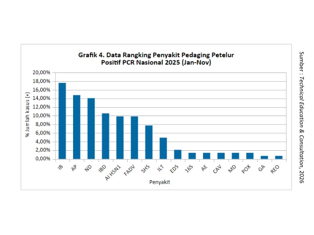
*`[ASLI DARI SUMBER PRIMER]` Grafik 4 — Data Rangking Penyakit Pedaging & Petelur Positif PCR Nasional 2025 (Jan–Nov), disalin utuh tanpa modifikasi dari [Technical Education & Consultation PT Medion (Januari 2026)](https://www.medion.co.id/en/info-medion/overview-of-poultry-disease-analysis-2025-disease-projection-2026/).*

---

## 3. Lapisan 2 — Sintesis Suara Peternak Lapangan Daring Indonesia (YouTube, Berita Wawancara & Komunitas)

`[SUARA LAPANGAN DARING (YOUTUBE/BERITA/FORUM) — NON-PEER-REVIEWED]`

Untuk menguji apakah temuan jurnal Scopus V2 sejalan dengan realitas keluhan harian peternak Indonesia, dilakukan penelusuran netral pada **20 sumber lapangan daring terverifikasi aktif (`HTTP 200`, periode 2022–2026)** yang terdiri dari **9 video YouTube praktisi/peternak**, **8 berita wawancara peternak & asosiasi**, serta **3 tulisan komunitas publik Indonesia**. *(Catatan: tautan forum tertutup login/diblokir seperti Quora/Reddit yang gagal dibaca penuh tidak dimasukkan demi menjaga prinsip verifikasi isi langsung).*

### A. Tabel Pemetaan 20 Sumber Suara Peternak Lapangan Daring Indonesia
`[SUARA LAPANGAN DARING (YOUTUBE/BERITA/FORUM) — NON-PEER-REVIEWED]`

| No | Kanal | Narasumber / Kanal, Tahun & Sektor | Keluhan / Masalah Utama di Lapangan | Solusi Sementara yang Dipakai | Tautan Terverifikasi (`HTTP 200`) |
| :-: | :---: | :--- | :--- | :--- | :--- |
| 1 | **YouTube** | **Edufarmers — Wawancara Pak Fatkul (Peternak Trenggalek)** (Okt 2023) — *Broiler* | Kerap merugi hingga belasan juta rupiah per siklus akibat ayam terserang penyakit menular dan gagal panen. | Perketat sanitasi, jadwal vaksinasi & disiplin biosekuriti manual. | [YouTube — Edufarmers](https://www.youtube.com/watch?v=lvuE-meEgkE) |
| 2 | **YouTube** | **BaLe Saba (Praktisi *Closed House*)** (Agu 2022) — *Broiler* | Serangan **koksidiosis** di kandang *closed house* merusak pencernaan dan memicu **FCR membengkak**. | Pengamatan feses manual & pengobatan antikoksidia reaktif. | [YouTube — BaLe Saba](https://www.youtube.com/watch?v=bMMVM-WQkUs) |
| 3 | **YouTube** | **FARM SULUNG [AYAM PETELUR]** (Mei 2023) — *Layer* | Ayam petelur terserang **ngorok (CRD/pilek) tidak sembuh-sembuh** yang mengganggu performa kandang. | Pemberian obat/antibiotik mandiri secara berulang berdasarkan panduan toko obat. | [YouTube — FARM SULUNG](https://www.youtube.com/watch?v=jq6ERRpfYQc) |
| 4 | **YouTube** | **FARM SULUNG [AYAM PETELUR]** (Apr 2023) — *Layer* | **Produksi telur menurun/tidak teratur** akibat kombinasi stres, penyakit, dan gangguan nutrisi (termasuk kelainan kualitas telur). | Pemberian vitamin/suplemen & obat secara reaktif setelah produksi telanjur turun. | [YouTube — FARM SULUNG](https://www.youtube.com/watch?v=4X6AlqJo5EE) |
| 5 | **YouTube** | **Edufarmers** (Jan 2024) — *Broiler* | ***Heat stress*** saat suhu kandang melampaui 28°C dan kelembapan 60–70% memicu *panting* dan penurunan performa. | Buka tirai manual, tambah kipas/air dingin, dan berikan vitamin C/elektrolit. | [YouTube — Edufarmers](https://www.youtube.com/watch?v=Qp8rexlhkSw) |
| 6 | **YouTube** | **Ternak Mania** (Apr 2022) — *Broiler* | ***Heat stress* akut maupun kronis** akibat suhu & kelembapan kandang melewati zona nyaman menekan pertumbuhan broiler. | Pengaturan ventilasi manual, penjarangan kandang, dan suplemen anti-stres. | [YouTube — Ternak Mania](https://www.youtube.com/watch?v=rD-rVRYBwW8) |
| 7 | **YouTube** | **INSPIRASI TERNAK** (Mei 2024) — *Broiler* | **Ciri pemeliharaan gagal** (pertumbuhan lambat sejak awal/DOC, mortalitas naik, FCR bengkak) sering terlambat dideteksi peternak. | Pengecekan visual harian & evaluasi manual catatan performa. | [YouTube — INSPIRASI TERNAK](https://www.youtube.com/watch?v=GlopqKR0h1Y) |
| 8 | **YouTube** | **INSPIRASI TERNAK** (Apr 2023) — *Broiler (CH)* | **Bahaya listrik padam di *closed house*** menghentikan *blower/exhaust* dan memicu kematian massal akibat panas & kehabisan oksigen. | Genset cadangan manual & buka tirai darurat manual. | [YouTube — INSPIRASI TERNAK](https://www.youtube.com/watch?v=MKCVNMDuY7I) |
| 9 | **YouTube** | **Edufarmers** (Jun 2024) — *Broiler* | Ketiadaan disiplin ***recording* (pencatatan)** pertumbuhan, konsumsi pakan, FCR, dan kematian membuat masalah kesehatan & finansial terlambat diketahui. | Pencatatan manual di kertas kontrol kandang & evaluasi mingguan. | [YouTube — Edufarmers](https://www.youtube.com/watch?v=MIvceGAocvM) |
| 10 | **Berita** | **TROBOS Livestock — Wawancara Hari Wibowo (Hari Farm, 10.000 ekor)** (Mar 2024) — *Layer* | Wabah **Avian Influenza (AI)** awalnya dikira snot (gejala pilek mirip); kematian melonjak 4→80 ekor/hari (300 ekor/bulan), **HDA anjlok dari 82% → 60% → tinggal 40%**. | Revaksinasi reaktif, turunkan protein pakan ke 14% & tambah jagung untuk energi pemulihan. | [TROBOS Livestock (2024)](https://troboslivestock.com/virus-ai-terus-mengintai/) |
| 11 | **Berita** | **Afederasi — Wawancara Eko (Peternak Bareng, Jombang)** (Okt 2025) — *Layer* | **Cuaca panas ekstrem (*heat stress*)** menurunkan nafsu makan ayam, **produksi telur turun 5%–10%** (dari normal 275–300 kg/hari), dan **cangkang telur memucat**. | Penanganan stres panas manual, tambah vitamin & pengaturan minum. | [Afederasi (Okt 2025)](https://afederasi.com/dampak-cuaca-produksi-telur-ayam-menurun-10-persen) |
| 12 | **Berita** | **TROBOS Livestock — Kusnan (Perwakilan PER-MINDO)** (Agu 2025) — *Broiler* | Realita **FCR peternak rakyat 1,5–1,6** (butuh 2,4–2,8 kg pakan untuk bobot 1,6–1,8 kg) tertekan berat saat harga *livebird* jatuh ke Rp16.000–Rp17.000/kg. | Efisiensi biaya operasional kandang seadanya & menuntut perbaikan tata niaga. | [TROBOS Livestock (Agu 2025)](https://troboslivestock.com/realita-peternak-broiler-skala-rakyat-murah-di-pasar-pahit-di-kandang/) |
| 13 | **Berita** | **Detik Jateng & Kompas Regional — Wawancara Susilo (Ketua PINSAR Jateng)** (Jun 2026) — *Broiler* | **Pemadaman listrik byar-pet** pada malam hari fase ***brooding* (anak ayam 1–14 hari)** membuat DOC gelap/kedinginan, menumpuk, dan memicu **deplesi hingga 50%** serta kerugian puluhan juta rupiah. | Menyalakan genset manual (terkendala modal BBM bagi peternak kecil). | [Detik Jateng (2026)](https://www.detik.com/jateng/berita/d-8541193/listrik-byar-pet-peternak-ayam-di-jateng-ngaku-rugi-puluhan-juta) \| [Kompas Regional (2026)](https://regional.kompas.com/read/2026/06/20/071428578/peternak-ayam-khawatir-pemadaman-listrik-kematian-anak-ayam-bisa-capai-50) |
| 14 | **Berita** | **Kompas Medan — Wawancara Dandi (Peternak CH 30.000 ekor, Deli Serdang)** (Jun 2026) — *Broiler (CH)* | ***Blackout* Sumatera & antrean/kelangkaan BBM solar** membuat genset mati sehingga **800 ekor broiler mati dalam sehari**. | Berburu solar manual hingga ke kota (Medan) untuk menghidupkan genset tunggal. | [Kompas Medan (Jun 2026)](https://medan.kompas.com/read/2026/06/12/190231978/kesulitan-dapat-solar-peternak-ayam-di-deli-serdang-kehilangan-800-ekor-saat) |
| 15 | **Berita** | **ANTARA News Aceh — Muhammad Hatta (Peternak Abdya)** (Okt 2025/2026) — *Broiler (CH)* | Listrik PLN padam 3 hari merusak genset sehingga **18.000 ekor broiler siap panen mati massal** (taksiran rugi **~Rp800 juta**). | Genset tunggal nonstop (gagal/rusak saat pemadaman panjang) → gugatan hukum ke PLN. | [ANTARA News Aceh](https://aceh.antaranews.com/berita/395781/18000-ayam-mati-akibat-listrik-padam-peternak-abdya-gugat-pln-ke-pengadilan) |
| 16 | **Berita** | **ANTARA News Kalsel — Saipul Hadi (Peternak CH, HST)** (Jul 2026) — *Broiler (CH)* | Pemadaman listrik mendadak **>5 jam** disertai gangguan genset menewaskan **>5.000 ekor broiler** akibat kepanasan akut. | Genset cadangan tunggal tanpa sistem proteksi/cadangan berlapis. | [ANTARA News Kalsel (Jul 2026)](https://kalsel.antaranews.com/berita/527877/pemadaman-listrik-akibatkan-5000-ekor-ayam-mati-di-aluan-sumur-hst) |
| 17 | **Berita** | **BeritaJatim — Peternakan Sultan, Madiun** (Sep 2026) — *Unggas/Broiler* | **Kelemahan pengawasan ABK & logistik pakan:** oknum anak kandang mencuri puluhan sak pakan secara berulang sejak awal 2026 (kerugian puluhan juta rupiah). | Pemasangan CCTV setelah pemilik mencurigai selisih stok pakan berkepanjangan. | [BeritaJatim (Sep 2026)](https://beritajatim.com/cctv-bongkar-ulah-anak-kandang-pakan-ayam-senilai-puluhan-juta-raib) |
| 18 | **Komunitas** | **Kompasiana — `jafvetchannel1485`** (Okt 2025) — *Layer* | Pada ayam petelur fase tua (**>70 minggu**), metabolisme melambat, **FCR melambung**, dan produksi telur menurun sehingga membebani biaya pakan. | Penyesuaian porsi & strategi pemberian pakan manual pada flok tua. | [Kompasiana (Okt 2025)](https://www.kompasiana.com/jafvetchannel1485/68e50c52c925c4772d167343/ayam-tua-otak-baru-menghemat-fcr-tanpa-menurunkan-bobot-tubuh) |
| 19 | **Komunitas** | **Kompasiana — `pujiaris4473` (Sentra Blitar)** (Jun 2022) — *Layer* | Populasi layer Blitar anjlok (26,82 jt → 20,54 jt ekor) akibat jepit harga pakan–telur diperparah **cuaca ekstrem (*heat stress*)** yang memicu *panting* dan menurunkan produktivitas. | Penyesuaian pakan alternatif & efisiensi operasional manual demi bertahan. | [Kompasiana Blitar (2022)](https://www.kompasiana.com/pujiaris4473/6296eeb4ce96e567fd5ba243/populasi-ayam-layer-di-blitar-turun-drastis-peternak-lakukan-berbagai-upaya-alternatif-untuk-tetap-bertahan) |
| 20 | **Komunitas** | **Chickin.id Community Blog** (Mar 2025) — *Broiler* | **Tantangan pengelolaan SDM/ABK 24 jam** di kandang: fokus anak kandang mudah terpecah (misal musim libur/hari raya) sehingga manajemen pakan, minum, dan suhu rawan lalai. | Pembagian jadwal piket manual & pengawasan langsung pemilik kandang. | [Chickin.id Blog (Mar 2025)](https://chickin.id/blog/manajemen-saat-lebaran-bagaimana-nasib-kandang-dan-abk/) |

*(Catatan pembanding khusus isu AMR: Pada penelusuran berita industri 2022–2026, ditemukan 1 artikel [TROBOS Livestock Sep 2025 tentang resistensi antibiotik bakteri snot](https://troboslivestock.com/bakteri-snot-pada-ayam-tunjukkan-resistensi-antibiotik/) — namun narasumbernya adalah **peneliti BRIN**, bukan keluhan spontan peternak di kandang).*

### B. Analisis *Gap*: Jurnal Scopus Tier-1 (V2) vs Suara Peternak Lapangan Daring (V3)
`[SINTESIS & PENILAIAN INDIKATIF AI AGENT — PERLU VALIDASI PENELITI]`

Triangulasi 35 artikel Tier-1 (dikelompokkan berdasarkan **kohort/studi independen**) terhadap 20 sumber lapangan daring di atas menghasilkan **3 pola utama yang sangat jelas**:

1. **Konvergensi Tinggi (*Kuat di Jurnal Tier-1 sekaligus Ramai Dikeluhkan Peternak* — Kuadran I):**
   - **Wabah Penyakit & Biosekuriti Lemah** (`7 kohort independen Tier-1` × `6/20 sumber daring`): Kedua sumber kompak menyoroti kemiripan gejala awal penyakit (misal AI dikira snot di Hari Farm), tingginya kematian/penurunan HDA (82%→40%), dan kerugian puluhan juta.
   - **Inefisiensi Pakan, FCR Bengkak & Produktivitas Flok** (`9 kohort independen Tier-1` × `7/20 sumber daring`): Dominasi biaya pakan, FCR bengkak akibat koksidiosis/manajemen/umur tua, dan tekanan margin muncul konsisten di jurnal maupun keluhan harian peternak.
   - ***Heat Stress* & Instabilitas Mikroklimat** (`7 studi independen Tier-1` × `4/20 sumber daring`): Terkonfirmasi dari HSI nasional 12 bulan & 70,3% THI berat di CH Jabar hingga kesaksian langsung peternak Jombang (produksi turun 5%–10% & kerabang pucat) dan sentra Blitar.
   - **Pencatatan (*Recording*) Silo & Pengawasan SDM/ABK** (`6 kohort independen Tier-1` × `4/20 sumber daring`): Jurnal Q1 (`Chapot 2023, 2024`) menyoroti data silo & sulitnya rekrutmen pekerja kompeten, sedangkan lapangan daring menambahkan dimensi operasional konkret berupa **kelalaian piket 24 jam dan kebocoran/pencurian pakan oleh oknum ABK** (kasus Madiun Sep 2026).

2. ***Gap* Tipe 1 — Tinggi di Jurnal Scopus Q1, tetapi Hampir Tidak Dikeluhkan Peternak (*Research-Driven / Latent Problem* — Kuadran IV):**
   - **Antibiotik Profilaktik (AMU) & Resistensi Antimikroba (AMR/MDR):** Di V2, isu ini tampak mendominasi (11 paper) dan duduk di peringkat #4. Namun audit V3 mengungkap dua koreksi krusial:
     1. **Koreksi *Publication Bias*:** Sebanyak **4 dari 11 artikel (`Anwar Sani et al., 2023, 2024, 2025, 2026`) berasal dari 1 kohort yang sama** (19 farm broiler Jawa Barat — proyek *CORNERSTONE* Utrecht–IPB–Kementan). Jika dihitung secara jujur per kohort independen, jumlahnya adalah **6 kohort/review independen**, bukan 11 bukti geografis terpisah.
     2. **Kesenjangan Persepsi Lapangan (`0/20` keluhan spontan peternak):** Di YouTube dan wawancara media, peternak nyaris tidak pernah mengeluhkan AMR; sebaliknya mereka memandang antibiotik sebagai *"penyelamat/asuransi murah"* (`Anwar Sani et al., 2026`). Suara kekhawatiran AMR di media Indonesia berasal dari peneliti BRIN/regulator/ASOHI. Ini menjadikan AMU/AMR sebagai **masalah laten berisiko jangka panjang** (*public health & therapy failure*), bukan *pain point* yang dirasakan peternak sehari-hari.

3. ***Gap* Tipe 2 — Sangat Ramai Dikeluhkan Peternak Daring, tetapi Minim Jurnal Scopus Q1 (*Field-Driven / Under-Researched Problem* — Kuadran II):**
   - **Pemadaman Listrik (*Blackout*), Beban Energi & Modal *Closed House*** (`4 studi independen SINTA 2/Q3` × `5/20 sumber daring`): Kasus kematian massal akibat listrik padam—baik di *closed house* (Aceh 18.000 ekor/Rp800 jt; HST Kalsel >5.000 ekor; Deli Serdang 800 ekor) maupun pada fase *brooding* malam hari (PINSAR Jateng: deplesi hingga 50%)—sangat mendominasi keluhan peternak & asosiasi, namun **nyaris belum diteliti sebagai topik utama di jurnal Scopus Q1 Indonesia 2021–2026**.
   - **Kerusakan Fisik Kerabang Telur (Retak/Tipis/Pucat) & *Grading* Manual** (`2 studi lokal SINTA 2` × `2/20 sumber daring`): Baik di literatur Tier-1 maupun keluhan daring, kelainan kerabang lebih sering muncul sebagai **gejala sekunder dari *heat stress*, umur tua, atau penyakit**, bukan sebagai kendala tunggal terbesar di peternak rakyat.

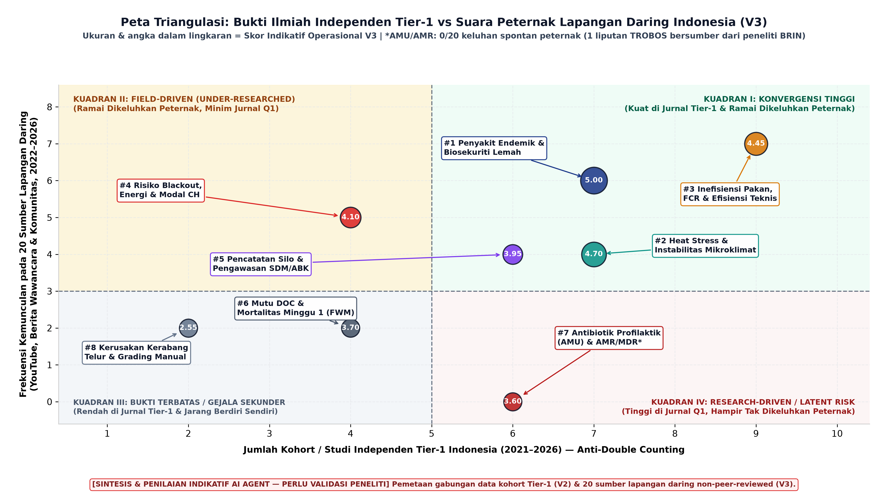
*`[SINTESIS & PENILAIAN INDIKATIF AI AGENT — PERLU VALIDASI PENELITI]` Peta 2×2 kuadran yang membandingkan jumlah kohort/studi independen Tier-1 Indonesia (2021–2026, anti-double counting) terhadap frekuensi kemunculan pada 20 sumber lapangan daring non-peer-reviewed (2022–2026).*

---

## 4. Lapisan 3 — Matriks Prioritisasi Indikatif 8 Kandidat → Top 5

`[SINTESIS & PENILAIAN INDIKATIF AI AGENT — PERLU VALIDASI PENELITI]`

> **Peringatan Transparansi:** Matriks di bawah ini adalah **alat bantu prioritisasi indikatif yang disusun oleh AI Agent**, bukan peringkat mutlak dari satu sumber primer. Skor akhir berfungsi sebagai hipotesis kerja terstruktur untuk diuji dan ditetapkan ulang oleh peneliti (Tim Asprak) melalui wawancara primer lapangan.

### A. Rubrik & Alasan Pembobotan Operasional V3 (Koreksi Anti-*Publication Bias*)
Pada V2, pembobotan rata 25% untuk "jumlah artikel Tier-1" memicu bias publikasi (*publication bias*)—topik yang kebetulan didanai riset internasional di satu kohort (AMU/AMR) terdorong naik, sementara keluhan akut lapangan yang jarang diteliti di Scopus Q1 (*blackout* listrik) tersingkir. Di V3, rubrik diperbaiki dengan dua koreksi:
1. **Bukti ilmiah (D4) dihitung per kohort/lokasi independen** (4 paper `Anwar Sani 2023–2026` dihitung **1 kohort**, 2 paper `Chapot 2023–2024` dihitung **1 kohort**), bukan jumlah judul artikel.
2. **Bobot Operasional** menitikberatkan dampak nyata di kandang dan suara lapangan:
   - **D1 — Dampak Ekonomi & Struktur Biaya di Peternakan (30%):** Pengaruh langsung pada HPP, margin, atau risiko kerugian akut per siklus/insiden.
   - **D2 — Dampak Produktivitas, Kualitas Produk & Mortalitas Ternak (30%):** Kematian flok, defisit ADG/HDP, pembengkakan FCR, atau penurunan mutu/kesejahteraan.
   - **D3 — Kesenjangan Solusi Sementara & Frekuensi Keluhan Lapangan Daring (25%):** Gabungan tingkat kegagalan praktik manual saat ini dan frekuensi keluhan spontan pada 20 sumber daring.
   - **D4 — Kekuatan Bukti Ilmiah Independen Tier-1 Indonesia 2021–2026 (15%):** Jumlah kohort/studi independen terverifikasi (`5` = ≥5 kohort lintas provinsi incl. Q1/Q2; `4` = 3–4 kohort incl. Q1/Q2/S1; `3` = 2–4 studi dominan S2/Q3; `2` = ≤2 studi lokal).

### B. Tabel Matriks Prioritisasi Indikatif + Uji Sensitivitas + Kolom Validasi Peneliti
`[SINTESIS & PENILAIAN INDIKATIF AI AGENT — PERLU VALIDASI PENELITI]`

| Peringkat Indikatif V3 | Kandidat Masalah Teknis-Operasional (*On-Farm*) | Kohort Indep. Tier-1 | Keluhan Daring (n=20) | D1: Ekonomi (30%) | D2: Prod/Mort (30%) | D3: Solusi & Daring (25%) | D4: Bukti Indep. (15%) | **Skor Operasional (Utama)** | **Uji Sensitivitas: Bobot Rata (25%×4)** | Catatan Bias & Stabilitas | **Validasi Wawancara Primer (Besok — Tim Asprak)** |
| :-: | :--- | :-: | :-: | :-: | :-: | :-: | :-: | :-: | :-: | :--- | :--- |
| **#1** | **Wabah Penyakit Endemik & Lemahnya Biosekuriti Kandang Rakyat** | 7 | 6/20 | 5 | 5 | 5 | 5 | **5,00** | **5,00 (#1)** | **Sangat Stabil** (Invarian #1 di semua skema; kuat di jurnal & peternak). | *(Belum diisi — input hasil wawancara)* |
| **#2** | **Cekaman Panas (*Heat Stress*) & Instabilitas Mikroklimat Tropis** | 7 | 4/20 | 4 | 5 | 5 | 5 | **4,70** | **4,75 (#2)** | **Sangat Stabil** (Invarian #2 di semua skema; data layer Q1 RI masih terbatas). | *(Belum diisi — input hasil wawancara)* |
| **#3** | **Inefisiensi Pakan, Pembengkakan FCR & Kesenjangan Produktivitas Flok** | 9 | 7/20 | 5 | 4 | 4 | 5 | **4,45** | **4,50 (#3)** | **Sangat Stabil** (Invarian #3; D3=4 karena CH & kontrak sebagian sudah menekan FCR). | *(Belum diisi — input hasil wawancara)* |
| **#4** | **Risiko *Blackout* Listrik, Beban Energi & Hambatan Modal *Closed House*** | 4 | 5/20 | 4 | 4 | 5 | 3 | **4,10** | **4,00 (#4)** | **Sensitif Bobot** (Kuat di keluhan daring & konteks Mitra PT Zara, namun *blackout* belum ada di Scopus Q1). | *(Belum diisi — input hasil wawancara)* |
| **#5** | **Pencatatan Data (*Recording*) Silo, Lemahnya Pengawasan & SDM/ABK** | 6 | 4/20 | 3 | 4 | 5 | 4 | **3,95** | **4,00 (#5)** | **Cukup Stabil** (Dampak ekonomi bersifat tidak langsung; dimensi pencurian/kelalaian ABK kuat di lapangan). | *(Belum diisi — input hasil wawancara)* |
| #6 | Variabilitas Mutu DOC, Mortalitas Minggu Pertama (FWM) & Kesejahteraan | 4 | 2/20 | 3 | 4 | 4 | 4 | **3,70** | **3,75 (#6)** | *Di luar Top 5*; berfungsi sebagai pemicu hulu mortalitas awal & *flushing* antibiotik. | *(Belum diisi — input hasil wawancara)* |
| #7 | Ketergantungan Antibiotik Profilaktik (AMU) & Resistensi (AMR/MDR) | 6 | 0/20* | 3 | 4 | 3 | 5 | **3,60** | **3,75 (#7)** | **Sensitif Orientasi** (Risiko sistemik/laten tinggi di Scopus Q1, tetapi biaya OVK kecil 0,47–1,62% & 0/20 keluhan spontan peternak). | *(Belum diisi — input hasil wawancara)* |
| #8 | Kerusakan Fisik Kerabang Telur (Retak/Tipis/Pucat) & Sortasi Manual | 2 | 2/20 | 2 | 3 | 3 | 2 | **2,55** | **2,50 (#8)** | **Stabil di #8** (Bukti Tier-1 sangat minim; di lapangan lebih sering muncul sebagai gejala sekunder *heat stress*/penyakit). | *(Belum diisi — input hasil wawancara)* |

### C. Hasil Uji Sensitivitas & Implikasi untuk Wawancara Primer Besok
- **Stabilitas Tinggi pada Top 3 (`#1–#3`):** Baik di bawah **Bobot Operasional (30/30/25/15)** maupun **Bobot Rata (25/25/25/25)**—bahkan dibandingkan dengan arsip V2—urutan **#1 Penyakit & Biosekuriti**, **#2 *Heat Stress* & Mikroklimat**, dan **#3 Inefisiensi Pakan & FCR** tetap **100% invarian**.
- **Zona Sensitif pada `#4–#7`:** Di V3, urutan **#4 (*Blackout*/Energi/CH)** dan **#5 (*Recording* Silo & SDM/ABK)** sama-sama bertahan masuk Top 5 di kedua skema bobot (Operasional & Bobot Rata), sementara **#7 (AMU/AMR)** turun dari #4 di V2 ke #7 setelah koreksi *publication bias* kohort, koreksi porsi biaya OVK riil (0,47%–1,62%), dan dimasukkannya frekuensi keluhan peternak daring. Jika wawancara primer Tim Asprak besok menemukan bahwa peternak sasaran lebih terbebani oleh **kualitas DOC (#6)** atau **kegagalan pengobatan antibiotik (#7)** dibanding *blackout* (#4), urutan #4–#7 dapat segera disesuaikan pada kolom validasi akhir.

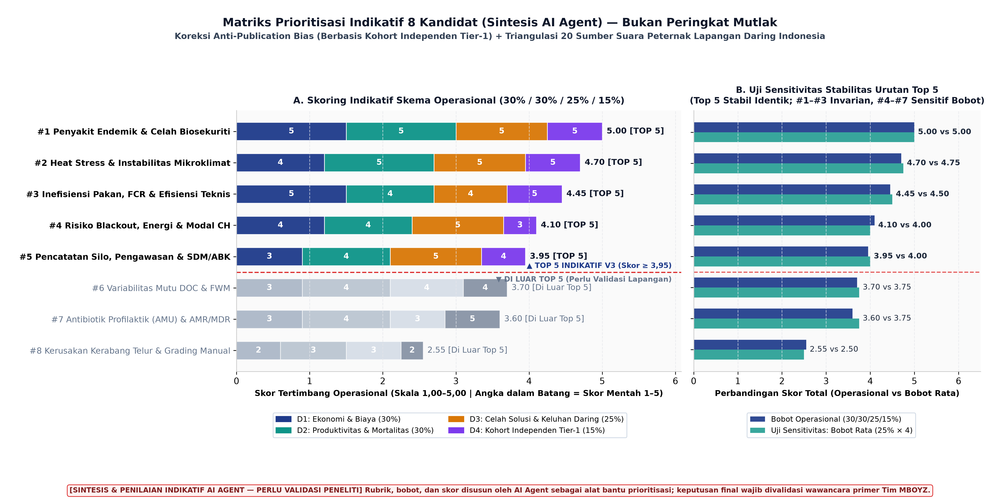
*`[SINTESIS & PENILAIAN INDIKATIF AI AGENT — PERLU VALIDASI PENELITI]` Grafik prioritisasi indikatif 8 kandidat masalah teknis-operasional beserta uji sensitivitas perbandingan Bobot Operasional (30/30/25/15%) vs Bobot Rata (25% × 4).*

---

## 5. Paparan Top 5 Masalah Teknis-Operasional Tertinggi (Versi Indikatif V3)

*(Penamaan diringkas agar tajam, operasional, dan jelas batas sebab-akibatnya; istilah teknis veteriner/agribisnis tetap dicantumkan pada uraian).*

---

### Peringkat Indikatif #1 (Skor 5,00) — Wabah Penyakit Endemik & Lemahnya Biosekuriti Kandang Rakyat

- **Sektor Terdampak:** Ayam Pedaging (*Broiler*) & Ayam Petelur (*Layer*)
- **Alasan Pemilihan & Keselarasan Triangulasi (`[SINTESIS & PENILAIAN INDIKATIF AI AGENT — PERLU VALIDASI PENELITI]`):** **Konvergensi Tinggi (Kuadran I — 7 kohort independen Tier-1 × 6/20 sumber daring).** Menjadi ancaman paling destruktif secara finansial maupun biologis: satu wabah HPAI dapat menghapus >10× margin kotor normal, biosekuriti eksternal kandang rakyat berada di titik terlemah (0,28), dan kemiripan gejala koinfeksi membuat peternak di lapangan kerap salah menduga wabah ganas (misal AI dikira snot).
- **Data Kuantitatif Terverifikasi (`[DATA PRIMER TERVERIFIKASI — TABEL/VISUALISASI DISUSUN OLEH AI AGENT]`):**
  - `[Pemodelan Bio-Ekonomi Regional — Jawa Bagian Barat, 2023]` Pada farm broiler Sektor 3 (3.000 ekor, margin normal **Rp5,28 juta/siklus**), 1 wabah HPAI H5N1 menimbulkan kerugian rata-rata **Rp1,2–62,7 juta** (`none-8`: **−Rp53,89 jt**; `stamp-15` tanpa kompensasi: **−Rp57,35 jt**; `early-8` jual dini: **−Rp22,89 jt**); peternak kontrak *makloon* menanggung rugi jauh lebih kecil (**−Rp0,91 jt**) sehingga rendah insentif biosekuriti ([Pramuwidyatama et al., *Prev. Vet. Med.* Q1, 2023](https://doi.org/10.1016/j.prevetmed.2022.105833)).
  - `[Survei Multi-Farm / Regional — Jawa Barat, 19 farm / 153 siklus, 2019–2023]` Skor **biosekuriti eksternal rata-rata hanya 0,28** (skala 0–1; internal 0,58); seluruh **4 farm dengan skor biosekuriti terendah gulung tikar/berhenti beroperasi** ([Anwar Sani et al., *Poultry Science* Q1, 2025](https://doi.org/10.1016/j.psj.2025.106010)).
  - `[Surveilans Laboratorium Nasional — Tier 2, Jan–Nov 2025]` Positif PCR nasional dipimpin **IB (~17,7%)**, **AP (~14,8%)**, **ND (~14,1%)**, **IBD (~10,6%)**, dan **AI H5N1 (~9,9%)**; klinis broiler didominasi **CRD (>31%)** & **Colibacillosis (~17%)**; serangan viral menekan HDP layer **9%–80%** ([PT Medion TEC, 2026](https://www.medion.co.id/en/info-medion/overview-of-poultry-disease-analysis-2025-disease-projection-2026/)).
  - `[Studi Kasus Lokal — Majalengka, Jabar, 11.000 broiler, 2026]` Koinfeksi simultan **AI H5 clade 2.3.2 + AI H9 + IB (CV 256%) + *M. gallisepticum* (31,25%) + koksidiosis (4.400 OPG)** di bawah tekanan NH₃ 20 ppm ([Hartady et al., *Vet. Sci.* Q1, 2026](https://doi.org/10.3390/vetsci13040364)). Mortalitas lapangan Indonesia: OH **5%–10%** vs CH **<3%** (`[Data Nasional]` [BBPKH Cinagara, 2025](https://bbpkhcinagara.bppsdmp.pertanian.go.id/storage/master/file/QuSKqJd1_Close_House_vs_Open_House_Menimbang_Efisiensi_dan_Kenyamanan_Ayam_Modern.pdf)); Jatim n=150 rata-rata **4,77%** ([Aji et al., *TASJ* S1, 2023](https://doi.org/10.5398/tasj.2023.46.3.382)); Bogor 12.000 ekor **10,16% (OH) vs 8,30% (CH)** ([Arif et al., *JSV* S2, 2024](https://doi.org/10.22146/jsv.82670)).
- **Realitas & Solusi Sementara Peternak + Keterbatasannya (`[DATA PRIMER TERVERIFIKASI — TABEL/VISUALISASI DISUSUN OLEH AI AGENT]` + `[SUARA LAPANGAN DARING (YOUTUBE/BERITA/FORUM) — NON-PEER-REVIEWED]`):**
  - *Pengamatan visual & obat mandiri tanpa uji lab:* Kasus nyata Hari Farm (10.000 ekor layer) terpapar AI yang awalnya dikira snot hingga 300 ekor mati/bulan dan HDA jatuh **82% → 40%** ([TROBOS, 2024](https://troboslivestock.com/virus-ai-terus-mengintai/)); peternak layer mengeluhkan ngorok tak sembuh-sembuh ([FARM SULUNG, 2023](https://www.youtube.com/watch?v=jq6ERRpfYQc)) dan rugi belasan juta ([Edufarmers — Pak Fatkul, 2023](https://www.youtube.com/watch?v=lvuE-meEgkE)). **Keterbatasan:** Koinfeksi tumpang tindih sulit didiagnosis kasatmata; obat sering salah sasaran.
  - *Jual dini (panic selling) ke pasar ayam sakit:* Dipakai peternak saat wabah meledak karena ketiadaan kompensasi *stamping out* ([Pramuwidyatama et al., 2023](https://doi.org/10.1016/j.prevetmed.2022.105833)). **Keterbatasan:** Secara aktif menyebarkan virus HPAI ke rantai pasok dan mempertahankan endemisitas regional.
  - *Vaksinasi & revaksinasi reaktif tanpa kontrol akses 3 zona:* Kepatuhan eksternal 0,28 dan mutasi strain lapang (ND Genotipe VII, AI clade baru) menyebabkan wabah terus berulang ([Dharmayanti et al., *JVS* Q2, 2024](https://doi.org/10.4142/jvs.23022)).
- **Catatan Keterbatasan Bukti (*Caveat*):** Kerugian Rp1,2–62,7 juta berasal dari simulasi bio-ekonomi Jawa Bagian Barat (kalibrasi harga 2019–2020), bukan survei akuntansi kerugian nasional; data PCR PT Medion berasal dari sampel kiriman lab swasta (potensi bias pelaporan kasus berat).
- **Sumber Terverifikasi:** [Pramuwidyatama et al. (2023)](https://doi.org/10.1016/j.prevetmed.2022.105833) | [Anwar Sani et al. (2025)](https://doi.org/10.1016/j.psj.2025.106010) | [Chapot et al. (2024)](https://doi.org/10.1371/journal.pone.0308379) | [Hartady et al. (2026)](https://doi.org/10.3390/vetsci13040364) | [Dharmayanti et al. (2024)](https://doi.org/10.4142/jvs.23022) | [Rachmawati et al. (2025)](https://doi.org/10.5455/OVJ.2025.v15.i6.50) | [PT Medion TEC (2026)](https://www.medion.co.id/en/info-medion/overview-of-poultry-disease-analysis-2025-disease-projection-2026/) | [TROBOS Hari Farm (2024)](https://troboslivestock.com/virus-ai-terus-mengintai/) | [Edufarmers YouTube (2023)](https://www.youtube.com/watch?v=lvuE-meEgkE).

---

### Peringkat Indikatif #2 (Skor 4,70) — Cekaman Panas (*Heat Stress*) & Instabilitas Mikroklimat Tropis

- **Sektor Terdampak:** Ayam Pedaging (*Broiler*) & Ayam Petelur (*Layer*) — baik *open house* maupun *closed/semi-closed house*
- **Alasan Pemilihan & Keselarasan Triangulasi (`[SINTESIS & PENILAIAN INDIKATIF AI AGENT — PERLU VALIDASI PENELITI]`):** **Konvergensi Tinggi (Kuadran I — 7 studi independen Tier-1 × 4/20 sumber daring).** Bukti Q1 Indonesia mematahkan anggapan bahwa *closed house* otomatis bebas cekaman panas: **70,3% titik ukur di dalam kandang *closed/semi-closed* komersial Jawa Barat tetap berada di zona THI *severe* hingga *life-threatening***, sementara di lapangan peternak layer melaporkan penurunan panen telur langsung 5%–10% saat cuaca panas ekstrem.
- **Data Kuantitatif Terverifikasi (`[DATA PRIMER TERVERIFIKASI — TABEL/VISUALISASI DISUSUN OLEH AI AGENT]`):**
  - `[Data Nasional — Indonesia, 2023]` Suhu puncak mencapai **36°C** dengan **HSI rata-rata bulanan 155,5–165,4 (Barat, puncak 187,8)** dan **150,0–166,4 (Timur, puncak 195,0)** — melampaui zona nyaman (<150–160) di seluruh 12 bulan ([Sumiati et al., *Animal Bioscience* Q1, 2025, Tabel 6](https://doi.org/10.5713/ab.24.0678)).
  - `[Survei Multi-Farm / Regional — Jawa Barat, 14 farm CH/semi-CH, 2.104 ekor, 84 titik ukur, 2025]` **0,0%** titik nyaman (THI <72), **62,0% *severe***, **8,3% *life-threatening*** (>85, maks 86,2); suhu rata-rata **29,3°C**, RH **81,9%** (66%–96%), NH₃ **7,3 ppm** (berkorelasi dengan CO₂ `r_s = 0,583, p < 0,01`); area dekat *inlet* paling basah/buruk; **40% ayam kena *Foot-Pad Dermatitis* (FPD)** & **30% *Hock Burn*** ([Wilcox et al., *Animal Welfare* Q1, 2025](https://doi.org/10.1017/awf.2025.10052)).
  - `[Studi Kasus Lokal — Jawa Tengah, 180 Cobb 500 open-sided, 2026]` Hanya **2 dari 35 hari** di zona termonetral (pukul 11.00 rata-rata **34,1°C**); beban panas kumulatif menjelaskan **61% variasi bobot** (`p < 0,01`) & **54,5% *feed intake*** (`p < 0,001`); defisit bobot hari ke-35 **−552,1 g (~−22% di bawah target Cobb 500)**, RFCR **+0,440**; risiko kematian melonjak bila suhu pukul 16.00 >32,5°C ([Mohammadi et al., *AAVS* Q3, 2026](https://doi.org/10.17582/journal.aavs/2026/14.5.1100.1111)).
  - `[Studi Kasus Lokal — 4.200 CP-707 closed house, 2026]` Kontrol suhu manual menyimpang signifikan di atas SOP (`p = 0,001`) dengan mortalitas **5,09%** vs **2,36%** saat terkendali stabil (`p = 0,005`) ([Alvandika et al., *JIPI* S2, 2026](https://doi.org/10.18343/jipi.31.4.718)). Di Blitar, suhu tinggi menurunkan HDP layer ke level terendah (**63%**) dibanding Payakumbuh (**68%**) ([Ilham et al., *JITV* S1, 2021](https://doi.org/10.14334/jitv.v26i4.2697)).
- **Realitas & Solusi Sementara Peternak + Keterbatasannya (`[DATA PRIMER TERVERIFIKASI — TABEL/VISUALISASI DISUSUN OLEH AI AGENT]` + `[SUARA LAPANGAN DARING (YOUTUBE/BERITA/FORUM) — NON-PEER-REVIEWED]`):**
  - *Buka-tutup tirai manual & kipas/air minum/vitamin C:* Peternak layer Jombang (Eko) mencatat produksi telur turun **5%–10%** disertai kerabang memucat saat cuaca ekstrem ([Afederasi, Okt 2025](https://afederasi.com/dampak-cuaca-produksi-telur-ayam-menurun-10-persen)); praktisi broiler mengandalkan buka tirai & elektrolit ([Edufarmers, 2024](https://www.youtube.com/watch?v=Qp8rexlhkSw); [Ternak Mania, 2022](https://www.youtube.com/watch?v=rD-rVRYBwW8)). **Keterbatasan:** Membuka tirai penuh memasukkan patogen luar ([Zulfan et al., 2026](https://doi.org/10.4025/actascianimsci.v48i1.74435)) dan tidak meredam panas sore >32,5°C; vitamin hanya meredam gejala sekunder.
  - *Operasional cooling pad & blower tanpa kalibrasi kelembapan (RH):* Di kelembapan tropis 82%–96%, pendinginan evaporatif berlebihan membasahi *litter* area *inlet* sehingga memicu FPD 40%, HB 30%, dan lonjakan NH₃ hingga 20 ppm ([Wilcox et al., 2025](https://doi.org/10.1017/awf.2025.10052); [Hartady et al., 2026](https://doi.org/10.3390/vetsci13040364)).
- **Catatan Keterbatasan Bukti (*Caveat*):** Bukti kuantitatif eksperimen terkontrol dampak *heat stress* pada kualitas kerabang layer komersial Indonesia di jurnal Scopus Q1 2021–2026 masih minim (terbatas pada survei observasional `Ilham 2021` dan wawancara lapangan); angka defisit −552 g berasal dari studi lokal 180 ekor di Jawa Tengah.
- **Sumber Terverifikasi:** [Sumiati et al. (2025)](https://doi.org/10.5713/ab.24.0678) | [Wilcox et al. (2025)](https://doi.org/10.1017/awf.2025.10052) | [Mohammadi et al. (2026)](https://doi.org/10.17582/journal.aavs/2026/14.5.1100.1111) | [Alvandika et al. (2026)](https://doi.org/10.18343/jipi.31.4.718) | [Zulfan et al. (2026)](https://doi.org/10.4025/actascianimsci.v48i1.74435) | [Afederasi Eko Jombang (2025)](https://afederasi.com/dampak-cuaca-produksi-telur-ayam-menurun-10-persen) | [Edufarmers Heat Stress (2024)](https://www.youtube.com/watch?v=Qp8rexlhkSw).

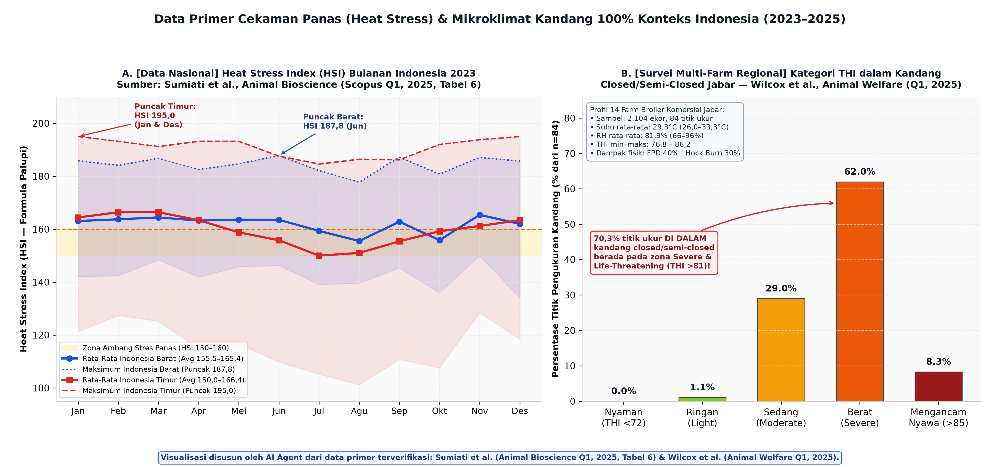
*`[DATA PRIMER TERVERIFIKASI — TABEL/VISUALISASI DISUSUN OLEH AI AGENT]` 100% data dari Sumiati et al. (*Animal Bioscience* Q1, 2025, Tabel 6) `[Data Nasional]` dan Wilcox et al. (*Animal Welfare* Q1, 2025) `[Survei Multi-Farm / Regional]`.*

---

### Peringkat Indikatif #3 (Skor 4,45) — Inefisiensi Pakan, Pembengkakan FCR & Kesenjangan Produktivitas Flok

- **Sektor Terdampak:** Ayam Pedaging (*Broiler*) & Ayam Petelur (*Layer*)
- **Alasan Pemilihan & Keselarasan Triangulasi (`[SINTESIS & PENILAIAN INDIKATIF AI AGENT — PERLU VALIDASI PENELITI]`):** **Konvergensi Tertinggi secara Jumlah Sumber (Kuadran I — 9 kohort independen Tier-1 × 7/20 sumber daring).** Di luar faktor harga pakan eksternal, pakan menyerap **62,3%–82,1% biaya usaha** dan bukti *stochastic frontier* menunjukkan **inefisiensi manajemen di dalam kandang mencapai 24,2%–31,1%** pada broiler serta **93,7% farm layer Blitar inefisien secara DEA**.
- **Data Kuantitatif Terverifikasi (`[DATA PRIMER TERVERIFIKASI — TABEL/VISUALISASI DISUSUN OLEH AI AGENT]`):**
  - `[Survei Multi-Farm / Regional — Banten, 180 farm broiler, 2023]` Pakan = **62,27%** (mandiri) & **67,67%** (kontrak); Pakan + DOC = **92,74%–93,77%** biaya total. Efisiensi teknis (TE) **mandiri hanya 0,689 (inefisiensi 31,1%; γ = 0,9878, p < 0,01 → dominan dapat dikendalikan manajemen kandang)** vs kontrak **0,893** ([Junaidi et al., *JWPR* Q3, 2023](https://doi.org/10.36380/jwpr.2023.25)).
  - `[Survei Multi-Farm / Regional — Jawa Timur, 150 farm broiler kemitraan, 2022]` Rata-rata **inefisiensi biaya 24,2%** (5,6% hingga >60,5%); pakan 53,63% biaya tahunan ([Aji et al., *TASJ* S1/Q2, 2023](https://doi.org/10.5398/tasj.2023.46.3.382)).
  - `[Survei Multi-Farm / Regional — Layer Indonesia]` HDP layer rakyat rata-rata hanya **65%** (Blitar 63%, Sidrap 64%, Payakumbuh 68%) vs standar **83%**, dengan **93,7% peternak Blitar inefisien (DEA 0,881)** dan pakan **79,9%–82,1%** biaya/kg telur ([Ilham et al., *JITV* S1, 2021](https://doi.org/10.14334/jitv.v26i4.2697)). Di Blitar (30 farm, 2025), HDP umur 72 minggu hanya **65%–70%** vs standar **79%–81%**, di mana buruknya GFP menjelaskan **41,1%** variasi HDP (`p = 0,019`) ([Riyanto et al., *JIIP* S2, 2025](https://doi.org/10.21776/ub.jiip.2025.035.01.3)). Di 3 provinsi Jawa (114 farm layer), biaya operasional naik **+14,84%** dengan R/C tipis **1,14–1,15** ([Priyono et al., *TASJ* S1/Q2, 2024](https://doi.org/10.5398/tasj.2024.47.3.392)).
  - `[Studi Kasus Lokal Terpisah — Kesenjangan FCR OH vs CH]` Aceh Utara (54.000 CP707): FCR 5 minggu **1,76 vs 1,55 (Δ +0,21; minggu 4–5: 2,06 vs 1,61)**, bobot **−15,9%**, ADG **−23,0%**, IP **299 vs 414** ([Zulfan et al., *Acta Sci.* Q3, 2026](https://doi.org/10.4025/actascianimsci.v48i1.74435)); Trenggalek (20.000 ekor): **1,605 vs 1,416 (Δ +0,189)** ([Laili et al., *JAVEST* S2, 2022](https://doi.org/10.20473/javest.v3.i1.2022.6-11)); Bogor/PT Zara (12.000 Cobb): **1,49 vs 1,40 (Δ +0,09)**, bobot panen CH **+5,21%** ([Arif et al., *JSV* S2, 2024](https://doi.org/10.22146/jsv.82670)). Acuan nasional Kementan: OH **>1,65** vs CH **1,45–1,55** (`[Data Nasional]` [BBPKH Cinagara, 2025](https://bbpkhcinagara.bppsdmp.pertanian.go.id/storage/master/file/QuSKqJd1_Close_House_vs_Open_House_Menimbang_Efisiensi_dan_Kenyamanan_Ayam_Modern.pdf)).
- **Realitas & Solusi Sementara Peternak + Keterbatasannya (`[DATA PRIMER TERVERIFIKASI — TABEL/VISUALISASI DISUSUN OLEH AI AGENT]` + `[SUARA LAPANGAN DARING (YOUTUBE/BERITA/FORUM) — NON-PEER-REVIEWED]`):**
  - *Pakan manual ad libitum & self-mixing bahan lokal tanpa uji nutrisi:* Perwakilan PER-MINDO mencatat FCR rakyat 1,5–1,6 tertekan harga *livebird* Rp16.000–Rp17.000/kg ([TROBOS, 2025](https://troboslivestock.com/realita-peternak-broiler-skala-rakyat-murah-di-pasar-pahit-di-kandang/)); peternak layer mengeluhkan FCR melambung pada ayam tua >70 minggu ([Kompasiana, 2025](https://www.kompasiana.com/jafvetchannel1485/68e50c52c925c4772d167343/ayam-tua-otak-baru-menghemat-fcr-tanpa-menurunkan-bobot-tubuh)) serta pakan tidak sesuai fase protein & pemalsuan bahan baku lokal ([Chapot et al., 2024](https://doi.org/10.1371/journal.pone.0308379)). **Keterbatasan:** Pakan tercecer (*spillage*) dan kualitas pakan tidak terkontrol langsung memboroskan biaya terbesar usaha.
  - *Sampling timbang bobot manual mingguan & kemitraan inti–plasma:* Praktisi melaporkan FCR bengkak akibat koksidiosis dan perlambatan bobot sering baru disadari saat evaluasi mingguan/panen ([BaLe Saba, 2022](https://www.youtube.com/watch?v=bMMVM-WQkUs); [INSPIRASI TERNAK, 2024](https://www.youtube.com/watch?v=GlopqKR0h1Y)). **Keterbatasan:** Menangkap ayam memicu stres, data *lagging*, dan skema kemitraan pun tetap menyisakan inefisiensi biaya 24,2%.
- **Catatan Keterbatasan Bukti (*Caveat*):** Data survei `Ilham et al. (2021)` dikumpulkan pada 2017 (hanya proporsi biaya & skor efisiensi yang dikutip, bukan nominal Rupiah); 3 studi perbandingan FCR OH vs CH masing-masing berskala lokal dengan galur/umur panen berbeda sehingga tidak dirata-ratakan menjadi angka nasional.
- **Sumber Terverifikasi:** [Junaidi et al. (2023)](https://doi.org/10.36380/jwpr.2023.25) | [Aji et al. (2023)](https://doi.org/10.5398/tasj.2023.46.3.382) | [Priyono et al. (2024)](https://doi.org/10.5398/tasj.2024.47.3.392) | [Ilham et al. (2021)](https://doi.org/10.14334/jitv.v26i4.2697) | [Zulfan et al. (2026)](https://doi.org/10.4025/actascianimsci.v48i1.74435) | [Arif et al. (2024)](https://doi.org/10.22146/jsv.82670) | [Laili et al. (2022)](https://doi.org/10.20473/javest.v3.i1.2022.6-11) | [Riyanto et al. (2025)](https://doi.org/10.21776/ub.jiip.2025.035.01.3) | [TROBOS PER-MINDO (2025)](https://troboslivestock.com/realita-peternak-broiler-skala-rakyat-murah-di-pasar-pahit-di-kandang/) | [BaLe Saba YouTube (2022)](https://www.youtube.com/watch?v=bMMVM-WQkUs).

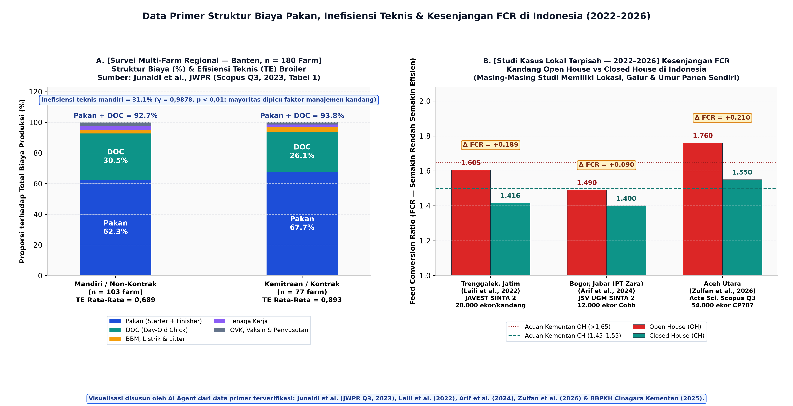
*`[DATA PRIMER TERVERIFIKASI — TABEL/VISUALISASI DISUSUN OLEH AI AGENT]` 100% data dari Junaidi et al. (*JWPR* Q3, 2023, Tabel 1) `[Survei Multi-Farm / Regional]`, serta 3 studi perbandingan FCR lokal terpisah (Laili 2022, Arif 2024, Zulfan 2026) `[Studi Kasus Lokal]` dan acuan Kementan RI (2025).*

---

### Peringkat Indikatif #4 (Skor 4,10) — Risiko Pemadaman Listrik (*Blackout*), Beban Energi & Hambatan Modal *Closed House*

- **Sektor Terdampak:** Ayam Pedaging (*Broiler*) & Ayam Petelur (*Layer*) — paling akut pada kandang *closed house* & fase *brooding* (hari 1–14)
- **Alasan Pemilihan & Keselarasan Triangulasi (`[SINTESIS & PENILAIAN INDIKATIF AI AGENT — PERLU VALIDASI PENELITI]`):** **Masalah *Field-Driven* Utama (Kuadran II — 4 studi independen SINTA 2/Q3 × 5/20 sumber daring).** Masuk kembali ke Top 5 V3 setelah koreksi *publication bias* V2 dan triangulasi suara peternak daring: kendala modal *closed house* (3–4× lipat, *payback* 4,5–7 tahun) membatasi modernisasi peternak rakyat, sementara bagi peternak yang sudah beralih ke *closed house* maupun pada fase *brooding*, **1 kali pemadaman listrik berkepanjangan dapat memusnahkan seluruh modal dalam hitungan menit hingga jam**—sekaligus selaras langsung dengan kendala beban listrik *blower* PLN dan gas LPG *brooding* yang disampaikan Mitra PT Zara Propertifarm (`04_MITRA_PT_ZARA_PROPERTIFARM.md`).
- **Data Kuantitatif Terverifikasi (`[DATA PRIMER TERVERIFIKASI — TABEL/VISUALISASI DISUSUN OLEH AI AGENT]` + `[SUARA LAPANGAN DARING (YOUTUBE/BERITA/FORUM) — NON-PEER-REVIEWED]`):**
  - `[Data Nasional — Acuan Kementan RI, 2025]` Investasi awal kandang *closed house* mencapai **3–4 kali lipat** dibanding *open house* ([BBPKH Cinagara Kementan, 2025](https://bbpkhcinagara.bppsdmp.pertanian.go.id/storage/master/file/QuSKqJd1_Close_House_vs_Open_House_Menimbang_Efisiensi_dan_Kenyamanan_Ayam_Modern.pdf)); spesifikasi impor 20.000 ekor/lantai menembus **~Rp2 Miliar/lantai** (`04_MITRA_PT_ZARA_PROPERTIFARM.md`).
  - `[Studi Kasus Lokal — Jombang, Jatim, 26.000 ekor CH, 2023]` Pengembalian modal (*Payback Period*) *closed house* sangat panjang bagi peternak kecil: **43 siklus (~7 tahun)** pada semi-otomatis (`R/C 1,07`, NPM 6,8%) dan **27 siklus (~4,5 tahun)** pada otomatis (`R/C 1,12`, NPM 10,7%) dengan lonjakan biaya operasional listrik dan gas ([Fikrianti et al., *JAI* IPB S2, 2023](https://doi.org/10.29244/jai.2023.11.2.422-431)).
  - `[Survei Multi-Farm / Regional — Banyumas, Jateng, 61 farm broiler, 2023]` Penyusutan kandang dan peralatan berpengaruh signifikan terhadap pendapatan peternak (laba rata-rata/1.000 ekor/bulan **Rp3,63 jt di OH vs Rp4,90 jt di CH**) ([Mastuti et al., *Animal Production* S2, 2023](https://doi.org/10.20884/1.jap.2023.25.1.200)).
  - `[Survei Multi-Farm / Regional — Banten, 180 farm broiler, 2023]` Biaya rutin BBM, listrik & *litter* menyumbang **2,29%** (mandiri) dan **3,17%** (kontrak — komponen biaya variabel terbesar ke-3 setelah pakan & DOC) ([Junaidi et al., *JWPR* Q3, 2023](https://doi.org/10.36380/jwpr.2023.25)).
  - `[SUARA LAPANGAN DARING (YOUTUBE/BERITA/FORUM) — NON-PEER-REVIEWED]` **Insiden Blackout Aktual 2025–2026:** **Aceh Barat Daya:** listrik padam 3 hari & genset rusak tewaskan **18.000 ekor broiler (rugi ~Rp800 juta)** ([ANTARA Aceh](https://aceh.antaranews.com/berita/395781/18000-ayam-mati-akibat-listrik-padam-peternak-abdya-gugat-pln-ke-pengadilan)); **HST Kalsel:** padam >5 jam tewaskan **>5.000 ekor** ([ANTARA Kalsel, Jul 2026](https://kalsel.antaranews.com/berita/527877/pemadaman-listrik-akibatkan-5000-ekor-ayam-mati-di-aluan-sumur-hst)); **Deli Serdang:** langka solar genset tewaskan **800 ekor/hari** ([Kompas Medan, Jun 2026](https://medan.kompas.com/read/2026/06/12/190231978/kesulitan-dapat-solar-peternak-ayam-di-deli-serdang-kehilangan-800-ekor-saat)); **Jawa Tengah:** Ketua PINSAR Jateng melaporkan pemadaman malam fase *brooding* 1–14 hari berpotensi memicu **deplesi anak ayam hingga 50%** & rugi puluhan juta ([Detik Jateng, Jun 2026](https://www.detik.com/jateng/berita/d-8541193/listrik-byar-pet-peternak-ayam-di-jateng-ngaku-rugi-puluhan-juta); [Kompas Regional, Jun 2026](https://regional.kompas.com/read/2026/06/20/071428578/peternak-ayam-khawatir-pemadaman-listrik-kematian-anak-ayam-bisa-capai-50)).
- **Realitas & Solusi Sementara Peternak + Keterbatasannya (`[SUARA LAPANGAN DARING (YOUTUBE/BERITA/FORUM) — NON-PEER-REVIEWED]`):**
  - *Genset diesel tunggal manual & buka tirai darurat manual:* Digunakan hampir seluruh peternak *closed house* ([INSPIRASI TERNAK, 2023](https://www.youtube.com/watch?v=MKCVNMDuY7I)). **Keterbatasan:** Genset tunggal rentan rusak saat pemadaman berhari-hari (kasus Abdya), bergantung pasokan solar yang sering antre/langka (kasus Deli Serdang), mahal bagi peternak kecil (keluhan PINSAR Jateng), dan pembukaan tirai manual kerap terlambat melampaui batas toleransi panas/oksigen ayam di kandang kedap udara.
- **Catatan Keterbatasan Bukti (*Caveat*):** **Belum ada studi epidemiologi atau survei nasional *peer-reviewed* Scopus Q1 di Indonesia (2021–2026)** yang menghitung frekuensi kejadian *blackout* per tahun maupun proporsi total kerugian nasional akibat mati lampu. Angka 800–18.000 ekor merupakan kasus insidental aktual dari berita media nasional (Tier 3) dan tidak boleh diekstrapolasi secara nasional.
- **Sumber Terverifikasi:** [Fikrianti et al. (2023)](https://doi.org/10.29244/jai.2023.11.2.422-431) | [Mastuti et al. (2023)](https://doi.org/10.20884/1.jap.2023.25.1.200) | [Junaidi et al. (2023)](https://doi.org/10.36380/jwpr.2023.25) | [Zulfan et al. (2026)](https://doi.org/10.4025/actascianimsci.v48i1.74435) | [BBPKH Cinagara (2025)](https://bbpkhcinagara.bppsdmp.pertanian.go.id/storage/master/file/QuSKqJd1_Close_House_vs_Open_House_Menimbang_Efisiensi_dan_Kenyamanan_Ayam_Modern.pdf) | [Detik Jateng (2026)](https://www.detik.com/jateng/berita/d-8541193/listrik-byar-pet-peternak-ayam-di-jateng-ngaku-rugi-puluhan-juta) | [Kompas Regional (2026)](https://regional.kompas.com/read/2026/06/20/071428578/peternak-ayam-khawatir-pemadaman-listrik-kematian-anak-ayam-bisa-capai-50) | [Kompas Medan (2026)](https://medan.kompas.com/read/2026/06/12/190231978/kesulitan-dapat-solar-peternak-ayam-di-deli-serdang-kehilangan-800-ekor-saat) | [ANTARA Aceh](https://aceh.antaranews.com/berita/395781/18000-ayam-mati-akibat-listrik-padam-peternak-abdya-gugat-pln-ke-pengadilan) | [ANTARA Kalsel (2026)](https://kalsel.antaranews.com/berita/527877/pemadaman-listrik-akibatkan-5000-ekor-ayam-mati-di-aluan-sumur-hst) | [INSPIRASI TERNAK (2023)](https://www.youtube.com/watch?v=MKCVNMDuY7I).

---

### Peringkat Indikatif #5 (Skor 3,95) — Pencatatan Data (*Recording*) Silo, Lemahnya Pengawasan & Kesenjangan SDM/ABK

- **Sektor Terdampak:** Ayam Petelur (*Layer*) & Ayam Pedaging (*Broiler*) — lintas seluruh skala usaha
- **Alasan Pemilihan & Keselarasan Triangulasi (`[SINTESIS & PENILAIAN INDIKATIF AI AGENT — PERLU VALIDASI PENELITI]`):** **Konvergensi Tinggi (Kuadran I — 6 kohort independen Tier-1 × 4/20 sumber daring).** Berfungsi sebagai *bottleneck* operasional lintas masalah #1–#4: pencatatan kertas yang terpisah (*silo*), kegagalan pelaporan publik (`iSIKHNAS`), rendahnya kompetensi teknis ABK, serta celah pengawasan harian (kelalaian piket hingga pencurian pakan) secara langsung memperpanjang keterlambatan respons terhadap penyakit, penyimpangan suhu, dan kebocoran pakan.
- **Data Kuantitatif Terverifikasi (`[DATA PRIMER TERVERIFIKASI — TABEL/VISUALISASI DISUSUN OLEH AI AGENT]`):**
  - `[Survei Multi-Farm / Regional — 5 Provinsi Jawa, 56 pemangku kepentingan, 2023–2024]` Pencatatan data kesehatan & produksi di 4 model bisnis (perusahaan, kontrak, kemitraan, mandiri) bersifat **silo** (campuran kertas & *spreadsheet* dasar) tanpa kapasitas analitik dan tanpa standar interoperabilitas; sistem pemerintah `iSIKHNAS` dinilai tidak efektif di unggas, sehingga informasi bergantung informal pada WhatsApp & TSO perusahaan input ([Chapot et al., *Prev. Vet. Med.* Q1, 2023](https://doi.org/10.1016/j.prevetmed.2023.106003); [Chapot et al., *PLOS ONE* Q1, 2024](https://doi.org/10.1371/journal.pone.0308379)).
  - `[Survei Multi-Farm / Regional — Nasional Indonesia, 200 pekerja kandang, 2023]` Sebanyak **33,0% pekerja kandang belum pernah mendengar tentang *Avian Influenza* (AI)**; sumber info utama bukan pelatihan kandang, melainkan petugas kesehatan (36%) & televisi (34%) ([Rehman et al., *PeerJ* Q1, 2023](https://doi.org/10.7717/peerj.14600)).
  - `[Survei Multi-Farm / Regional — Jawa Timur n=150 & Banten n=180 & Blitar n=30]` Rata-rata pendidikan formal peternak ~9 tahun (**9,42 thn** di Jatim; **9,08–9,77 thn** di Banten), dan tingkat pendidikan serta pengalaman secara statistik signifikan menekan inefisiensi biaya **24,2%** ([Aji et al., *TASJ* S1, 2023](https://doi.org/10.5398/tasj.2023.46.3.382); [Junaidi et al., *JWPR* Q3, 2023](https://doi.org/10.36380/jwpr.2023.25)). Di Blitar, rendahnya kepatuhan GFP menjelaskan **41,1% variasi produksi telur harian** (`p = 0,019`) ([Riyanto et al., *JIIP* S2, 2025](https://doi.org/10.21776/ub.jiip.2025.035.01.3)). Pada survei layer Asia (103 produsen Indonesia), **72%** menyatakan butuh pelatihan & pendampingan teknis ([de Luna et al., *Front. Vet. Sci.* Q1, 2022](https://doi.org/10.3389/fvets.2022.1038362)).
- **Realitas & Solusi Sementara Peternak + Keterbatasannya (`[DATA PRIMER TERVERIFIKASI — TABEL/VISUALISASI DISUSUN OLEH AI AGENT]` + `[SUARA LAPANGAN DARING (YOUTUBE/BERITA/FORUM) — NON-PEER-REVIEWED]`):**
  - *Buku tulis/lembar kontrol kertas, grup WhatsApp & konsultasi TSO:* Praktisi menggarisbawahi banyak peternak tidak disiplin melakukan *recording* harian sehingga baru sadar performa jatuh menjelang panen ([Edufarmers Recording, 2024](https://www.youtube.com/watch?v=MIvceGAocvM); [INSPIRASI TERNAK, 2024](https://www.youtube.com/watch?v=GlopqKR0h1Y)). **Keterbatasan:** Rawan salah catat/hilang, tidak memberi peringatan dini, dan saran TSO perusahaan pakan/obat sarat potensi bias komersial ([Hibbard et al., *PLOS ONE* Q1, 2023](https://doi.org/10.1371/journal.pone.0291556)).
  - *Piket ABK 24 jam & pemasangan CCTV reaktif:* Di lapangan, fokus ABK rentan terpecah pada masa libur/hari raya ([Chickin.id Blog, 2025](https://chickin.id/blog/manajemen-saat-lebaran-bagaimana-nasib-kandang-dan-abk/)), bahkan muncul kasus oknum ABK mencuri puluhan sak pakan berulang hingga kerugian puluhan juta rupiah yang baru terungkap lewat CCTV ([BeritaJatim Madiun, Sep 2026](https://beritajatim.com/cctv-bongkar-ulah-anak-kandang-pakan-ayam-senilai-puluhan-juta-raib)). **Keterbatasan:** Pengawasan visual jarak jauh tidak otomatis mendeteksi penyimpangan stok pakan vs FCR harian sebelum kerugian menumpuk.
- **Catatan Keterbatasan Bukti (*Caveat*):** Studi kualitatif `Chapot et al. (2023, 2024)` berfokus di Pulau Jawa (dominan layer), sedangkan kasus pencurian pakan oleh ABK (`BeritaJatim 2026`) adalah kasus insidental lokal (belum ada statistik persentase kecurangan ABK berskala nasional).
- **Sumber Terverifikasi:** [Chapot et al. (2024)](https://doi.org/10.1371/journal.pone.0308379) | [Chapot et al. (2023)](https://doi.org/10.1016/j.prevetmed.2023.106003) | [Hibbard et al. (2023)](https://doi.org/10.1371/journal.pone.0291556) | [Rehman et al. (2023)](https://doi.org/10.7717/peerj.14600) | [Aji et al. (2023)](https://doi.org/10.5398/tasj.2023.46.3.382) | [Riyanto et al. (2025)](https://doi.org/10.21776/ub.jiip.2025.035.01.3) | [Edufarmers Recording (2024)](https://www.youtube.com/watch?v=MIvceGAocvM) | [BeritaJatim Madiun (2026)](https://beritajatim.com/cctv-bongkar-ulah-anak-kandang-pakan-ayam-senilai-puluhan-juta-raib) | [Chickin.id Blog (2025)](https://chickin.id/blog/manajemen-saat-lebaran-bagaimana-nasib-kandang-dan-abk/).

---

### Catatan Kritis Kandidat #6–#8 (Di Luar Top 5 Indikatif V3 — Wajib Diverifikasi pada Wawancara Primer)
`[SINTESIS & PENILAIAN INDIKATIF AI AGENT — PERLU VALIDASI PENELITI]`
- **#6 Variabilitas Mutu DOC & Mortalitas Minggu Pertama (FWM — Skor 3,70):** Rata-rata FWM di Jawa Barat **1,9%–2,1% (maks 10,6%)** vs standar ≤1% dengan DOC berasal dari **39 *hatchery*** (`Anwar Sani et al., 2025, 2026`); menjadi pemicu hulu utama peternak melakukan *flushing* antibiotik hari 1–4.
- **#7 Ketergantungan Antibiotik Profilaktik (AMU) & Resistensi (AMR/MDR — Skor 3,60):** Secara ilmiah tetap merupakan **risiko sistemik & kesehatan masyarakat paling terdokumentasi di Scopus Q1 Indonesia** (`6 kohort independen`: 86%–88% profilaktik, 60,8% WHO HPCIA, enrofloxacin overdosis 3–4× EMA DDDvet, *E. coli* ciprofloxacin NWT **93%**, 100% MDR pasar Aceh, 81,8% peternak layer tidak tahu larangan kolistin, dan edukasi gagal menurunkan AMU/AMR). Posisinya turun dari #4 (V2) ke #7 (V3) semata-mata karena **bobot operasional V3 memperhitungkan porsi biaya OVK yang kecil (0,47%–1,62%) dan absennya keluhan spontan peternak daring (0/20)**. Jika wawancara primer menunjukkan maraknya kegagalan pengobatan bakteri di kandang, kandidat ini tetap sangat strategis.
- **#8 Kerusakan Fisik Kerabang Telur (Retak/Tipis/Pucat) & Sortasi Manual (Skor 2,55):** Bukti Tier-1 2021–2026 baru terbatas pada 2 studi lokal SINTA 2 (`Wahidiyah et al., 2026` mencatat telur abnormal <1% di CH UB Teaching Farm; `Septiana et al., 2022` kerabang tipis 0,52% vs 0,21% di Bogor), dan di suara lapangan lebih sering muncul sebagai gejala ikutan *heat stress*/umur/penyakit.

---

## 6. Audit Perubahan (V2 → V3) & Daftar Pustaka Terpisah

### A. Ringkasan Audit Perubahan Metodologi & Peringkat (V2 → V3)
`[SINTESIS & PENILAIAN INDIKATIF AI AGENT — PERLU VALIDASI PENELITI]`

| Aspek Audit | Kondisi pada V2 | Perbaikan & Perubahan pada V3 |
| :--- | :--- | :--- |
| **Transparansi Peran AI Agent** | Tabel & grafik skoring buatan AI sempat diberi label *"Pemeringkatan Objektif"* / *"Tabel Skoring Objektif"*. | **Dihapus sepenuhnya.** Seluruh tabel, grafik (caption Markdown + footer dalam PNG), dan penilaian kini memakai **4 Label Asal (*Provenance Tags*) eksplisit**; dipisahkan tegas antara peringkat asli per domain (Lapisan 1), suara lapangan daring (Lapisan 2), dan sintesis indikatif AI (Lapisan 3). |
| **Koreksi *Publication Bias* (Kohort Independen)** | Menghitung jumlah artikel mentah (misal 4 paper `Anwar Sani 2023–2026` dari 1 kohort Jabar ikut membesarkan hitungan 11 paper AMU/AMR). | **Dihitung per kohort/studi independen** (4 paper `Anwar Sani` = 1 kohort; 2 paper `Chapot` = 1 kohort) dan bobot bukti jurnal diturunkan dari 25% → **15%**, dialihkan ke dampak ekonomi (30%), produktivitas/mortalitas (30%), serta celah solusi & keluhan daring (25%). |
| **Triangulasi Suara Peternak Daring** | Belum ada pemetaan terstruktur terhadap keluhan peternak di YouTube, berita wawancara, dan komunitas publik. | Ditambahkan **20 sumber suara lapangan daring Indonesia (2022–2026, 100% HTTP 200)** + **Analisis *Gap* 2×2 Kuadran** yang membuktikan perbedaan nyata antara *research-driven problem* (AMU/AMR: 0/20 keluhan spontan) dan *field-driven problem* (*blackout*/energi/ABK). |
| **Pergeseran Peringkat Top 5** | `#1` Penyakit (5,00), `#2` *Heat Stress* (4,75), `#3` Pakan/FCR (4,50), **`#4` AMU/AMR (4,50)**, `#5` Data/SDM (4,00); *Blackout* di `#7`. | **`#1–#3` Invarian 100%** (Penyakit 5,00; *Heat Stress* 4,70; Pakan/FCR 4,45). **`#4` kini Risiko *Blackout*, Energi & Modal CH (4,10)**, `#5` Pencatatan Silo & SDM/ABK (3,95); **AMU/AMR bergeser ke `#7` (3,60)** sebagai risiko laten. Stabilitas diuji lewat Uji Sensitivitas (Operasional vs Bobot Rata) + kolom kosong validasi wawancara primer Tim Asprak. |
| **Penamaan Masalah** | Judul panjang bergaya literatur veteriner. | Diringkas menjadi nama operasional tajam dan jelas batas sebab-akibatnya. |

---

### B. Daftar Pustaka Terpisah & Terverifikasi

#### (A) Tier 1 — Jurnal *Peer-Reviewed* Indonesia (2021–2026: 35 Artikel — Scopus Q1–Q4 / ScienceDirect / SINTA 1–2)
1. **Aji, J. M. M., et al. (2023).** Determinants of Cost Inefficiency and Farmer Performance in Broiler Contract Farming. *Tropical Animal Science Journal*, 46(3): 382–388. **[SINTA 1 / Scopus Q2]** — [https://doi.org/10.5398/tasj.2023.46.3.382](https://doi.org/10.5398/tasj.2023.46.3.382)
2. **Ali, P. R., et al. (2023).** Indonesian agroindustry business agility: Enablers and challenges in the poultry industry based on ISM model. *Heliyon*, 9(6): e16808. **[Scopus Q1 — Elsevier]** — [https://doi.org/10.1016/j.heliyon.2023.e16808](https://doi.org/10.1016/j.heliyon.2023.e16808) | [PMC10272334](https://pmc.ncbi.nlm.nih.gov/articles/PMC10272334/)
3. **Alvandika, A., et al. (2026).** The Impact of IoT-Based Cyber-Physical Systems on Broiler Farming in Closed-House Systems. *Jurnal Ilmu Pertanian Indonesia (JIPI)*, 31(4): 718–725. **[SINTA 2]** — [https://doi.org/10.18343/jipi.31.4.718](https://doi.org/10.18343/jipi.31.4.718)
4. **Anwar Sani, R., et al. (2023).** The comparison and use of tools for quantification of antimicrobial use in Indonesian broiler farms. *Frontiers in Veterinary Science*, 10: 1092302. **[Scopus Q1]** — [https://doi.org/10.3389/fvets.2023.1092302](https://doi.org/10.3389/fvets.2023.1092302) | [PMC10036347](https://pmc.ncbi.nlm.nih.gov/articles/PMC10036347/)
5. **Anwar Sani, R., et al. (2024).** Antimicrobial Usage and Antimicrobial Resistance in Commensal *Escherichia coli* from Broiler Farms in Indonesia. *Antibiotics*, 13(12): 1181. **[Scopus Q1]** — [https://doi.org/10.3390/antibiotics13121181](https://doi.org/10.3390/antibiotics13121181) | [PMC11672412](https://pmc.ncbi.nlm.nih.gov/articles/PMC11672412/)
6. **Anwar Sani, R., et al. (2025).** Longitudinal evaluation of interventions on antimicrobial use and antimicrobial resistance on small- and medium-scale broiler farms in Indonesia. *Poultry Science*, 104(12): 106010. **[Scopus Q1 — Elsevier]** — [https://doi.org/10.1016/j.psj.2025.106010](https://doi.org/10.1016/j.psj.2025.106010) | [PMC12681536](https://pmc.ncbi.nlm.nih.gov/articles/PMC12681536/)
7. **Anwar Sani, R., et al. (2026).** "If you want to sleep easy, you give antibiotics" exploring drivers of antimicrobial use in the small- and medium scale broiler sector in Indonesia: A qualitative study. *Preventive Veterinary Medicine*, 249: 106955. **[Scopus Q1 — Elsevier]** — [https://doi.org/10.1016/j.prevetmed.2026.106955](https://doi.org/10.1016/j.prevetmed.2026.106955) | [PubMed](https://pubmed.ncbi.nlm.nih.gov/42485744/)
8. **Arif, R., Widiatmoko, A., & Nurzuliana, D. (2024).** Health and Production Performance of Broiler strain Cobb with Closed House IoT system in Cimahpar, Bogor. *Jurnal Sain Veteriner*, 42(3): 302–309. **[SINTA 2]** — [https://doi.org/10.22146/jsv.82670](https://doi.org/10.22146/jsv.82670)
9. **Chapot, L., et al. (2023).** A qualitative analysis of health information-sharing networks in the Indonesian poultry sector. *Preventive Veterinary Medicine*, 219: 106003. **[Scopus Q1 — Elsevier]** — [https://doi.org/10.1016/j.prevetmed.2023.106003](https://doi.org/10.1016/j.prevetmed.2023.106003) | [PubMed](https://pubmed.ncbi.nlm.nih.gov/37657198/)
10. **Chapot, L., et al. (2024).** Needs and capabilities for improving poultry production and health management in Indonesia. *PLOS ONE*, 19(8): e0308379. **[Scopus Q1]** — [https://doi.org/10.1371/journal.pone.0308379](https://doi.org/10.1371/journal.pone.0308379)
11. **de Luna, M. C. T., et al. (2022).** Cage egg producers' perspectives on the adoption of cage-free systems in China, Japan, Indonesia, Malaysia, Philippines, and Thailand. *Frontiers in Veterinary Science*, 9: 1038362. **[Scopus Q1]** — [https://doi.org/10.3389/fvets.2022.1038362](https://doi.org/10.3389/fvets.2022.1038362) | [PMC9793746](https://pmc.ncbi.nlm.nih.gov/articles/PMC9793746/)
12. **Dharmayanti, N. L. P. I., et al. (2024).** Newcastle disease virus: the past and current situation in Indonesia. *Journal of Veterinary Science*, 25(1): e17. **[Scopus Q2]** — [https://doi.org/10.4142/jvs.23022](https://doi.org/10.4142/jvs.23022) | [PMC10839176](https://pmc.ncbi.nlm.nih.gov/articles/PMC10839176/)
13. **Efendi, R., et al. (2022).** An assessment of knowledge and attitude toward antibiotic misuse by small-scale broiler farmers in Bogor, West Java, Indonesia. *Veterinary World*, 15(3): 707–713. **[Scopus Q1]** — [https://doi.org/10.14202/vetworld.2022.707-713](https://doi.org/10.14202/vetworld.2022.707-713) | [PMC9047124](https://pmc.ncbi.nlm.nih.gov/articles/PMC9047124/)
14. **Ferasyi, T. R., et al. (2025).** One Health surveillance of multidrug-resistant *Escherichia coli* in broilers and traditional poultry market environments in Aceh, Indonesia. *Veterinary World*, 18(10): 3149–3161. **[Scopus Q1]** — [https://doi.org/10.14202/vetworld.2025.3149-3161](https://doi.org/10.14202/vetworld.2025.3149-3161) | [PMC12668750](https://pmc.ncbi.nlm.nih.gov/articles/PMC12668750/)
15. **Fikrianti, Y., Priyanto, B., & Aini, F. N. (2023).** Perbandingan Analisis Finansial Sistem Kandang *Closed House* Semi Otomatis dan Otomatis. *Jurnal Agribisnis Indonesia (JAI)*, 11(2): 422–431. **[SINTA 2]** — [https://doi.org/10.29244/jai.2023.11.2.422-431](https://doi.org/10.29244/jai.2023.11.2.422-431)
16. **Hartady, T., et al. (2026).** A Case of Avian Influenza Co-Infection and Multifactorial Diseases in a Broiler Farm in West Java, Indonesia. *Veterinary Sciences*, 13(4): 364. **[Scopus Q1]** — [https://doi.org/10.3390/vetsci13040364](https://doi.org/10.3390/vetsci13040364) | [PMC13120342](https://pmc.ncbi.nlm.nih.gov/articles/PMC13120342/)
17. **Hibbard, R., et al. (2023).** "It's a habit. They've been doing it for decades and they feel good and safe.": A qualitative study of barriers and opportunities to changing antimicrobial use in the Indonesian poultry sector. *PLOS ONE*, 18(9): e0291556. **[Scopus Q1]** — [https://doi.org/10.1371/journal.pone.0291556](https://doi.org/10.1371/journal.pone.0291556) | [PubMed](https://pubmed.ncbi.nlm.nih.gov/37747889/)
18. **Ilham, N., Maulana, M., & Gunawan, E. (2021).** Production Efficiency of Poultry Small-Scale Laying Hen in Indonesia. *Jurnal Ilmu Ternak dan Veteriner (JITV)*, 26(4): 187–194. **[SINTA 1 / Scopus Q4]** — [https://doi.org/10.14334/jitv.v26i4.2697](https://doi.org/10.14334/jitv.v26i4.2697)
19. **Jokar, M., et al. (2026).** Impact of the colistin ban on antimicrobial use and resistance-related practices among Indonesian layer poultry farmers. *Frontiers in Veterinary Science*, 13: 1885994. **[Scopus Q1]** — [https://doi.org/10.3389/fvets.2026.1885994](https://doi.org/10.3389/fvets.2026.1885994) | [PMC13671022](https://pmc.ncbi.nlm.nih.gov/articles/PMC13671022/)
20. **Junaidi, E., et al. (2023).** Comparative Analysis of Contract Farming Effect on Technical Efficiency of Broiler Chicken Farms in Indonesia. *Journal of World's Poultry Research*, 13(2): 223–232. **[Scopus Q3]** — [https://doi.org/10.36380/jwpr.2023.25](https://doi.org/10.36380/jwpr.2023.25)
21. **Laili, A. R., et al. (2022).** Comparison of Broiler Performance in Closed House and Open House Systems in Trenggalek. *JAVEST*, 3(1): 6–11. **[SINTA 2]** — [https://doi.org/10.20473/javest.v3.i1.2022.6-11](https://doi.org/10.20473/javest.v3.i1.2022.6-11)
22. **Mahapurta, I., et al. (2026).** Development of Antimicrobial Resistance in Layer Chicken Farms in Indonesia: A Review. *Journal of World's Poultry Research*, 16(1): 110–126. **[Scopus Q3]** — [https://doi.org/10.36380/jwpr.2026.12](https://doi.org/10.36380/jwpr.2026.12)
23. **Mastuti, S., et al. (2023).** Elasticity Analysis of Production Cost Against Income of Broiler Business with Open-House and Closed-House System in Banyumas Regency. *Animal Production*, 25(1): 1–10. **[SINTA 2]** — [https://doi.org/10.20884/1.jap.2023.25.1.200](https://doi.org/10.20884/1.jap.2023.25.1.200)
24. **Mohammadi, N., et al. (2026).** Heat Stress Impacts on Broiler Performance and Mortality in Non-Cooled Equatorial Housing. *Advances in Animal and Veterinary Sciences*, 14(5): 1100–1111. **[Scopus Q3]** — [https://doi.org/10.17582/journal.aavs/2026/14.5.1100.1111](https://doi.org/10.17582/journal.aavs/2026/14.5.1100.1111)
25. **Naing, S., et al. (2026).** Impact of reducing colistin use on colistin resistance in *Escherichia coli* isolated from humans and poultry in Indonesia (COINCIDE study protocol). *One Health*, 22: 101347. **[Scopus Q1 — Elsevier]** — [https://doi.org/10.1016/j.onehlt.2026.101347](https://doi.org/10.1016/j.onehlt.2026.101347) | [PMC12907006](https://pmc.ncbi.nlm.nih.gov/articles/PMC12907006/)
26. **Pramuwidyatama, M. G., et al. (2023).** Economic impact of highly pathogenic avian influenza outbreaks in Western Java smallholder broiler farms. *Preventive Veterinary Medicine*, 212: 105833. **[Scopus Q1 — Elsevier]** — [https://doi.org/10.1016/j.prevetmed.2022.105833](https://doi.org/10.1016/j.prevetmed.2022.105833) | [WUR OA PDF](https://edepot.wur.nl/588952)
27. **Priyono, P., et al. (2024).** The Resilience of Smallholder Layer-Chicken Farmers Throughout the COVID-19 Pandemic: Evidence from Indonesia. *Tropical Animal Science Journal*, 47(3): 392–401. **[SINTA 1 / Scopus Q2]** — [https://doi.org/10.5398/tasj.2024.47.3.392](https://doi.org/10.5398/tasj.2024.47.3.392)
28. **Rachmawati, K., et al. (2025).** Isolation and identification of the H9N2 virus that caused the decline in poultry egg production in Indonesia from 2011 to 2018. *Open Veterinary Journal*, 15(6): 2815–2822. **[Scopus Q2]** — [https://doi.org/10.5455/OVJ.2025.v15.i6.50](https://doi.org/10.5455/OVJ.2025.v15.i6.50)
29. **Rehman, S., et al. (2023).** A cross-sectional survey of avian influenza knowledge among poultry farmworkers in Indonesia. *PeerJ*, 11: e14600. **[Scopus Q1]** — [https://doi.org/10.7717/peerj.14600](https://doi.org/10.7717/peerj.14600) | [PMC9851045](https://pmc.ncbi.nlm.nih.gov/articles/PMC9851045/)
30. **Riyanto, R., & Almawachida, A. R. (2025).** Application of Good Farming Practices for Laying Hens in Suruhwadang Village, Blitar Regency. *Jurnal Ilmu-Ilmu Peternakan (JIIP)*, 35(1): 23–34. **[SINTA 2]** — [https://doi.org/10.21776/ub.jiip.2025.035.01.3](https://doi.org/10.21776/ub.jiip.2025.035.01.3)
31. **Septiana, A., et al. (2022).** Percentage of Parent Stock Chicken Eggs with Thin Shells in Battery Cage and Postal Cage Maintenance Methods at Farm Cariu Bogor. *JAVEST*, 3(2): 43–46. **[SINTA 2]** — [https://doi.org/10.20473/javest.v3.i2.2022.43-46](https://doi.org/10.20473/javest.v3.i2.2022.43-46)
32. **Sumiati, et al. (2025).** Invited Review — Challenges and constraints to the sustainability of poultry farming in Indonesia. *Animal Bioscience*, 38(4): 802–817. **[Scopus Q1]** — [https://doi.org/10.5713/ab.24.0678](https://doi.org/10.5713/ab.24.0678) | [PMC11969156](https://pmc.ncbi.nlm.nih.gov/articles/PMC11969156/)
33. **Wahidiyah, S. N., et al. (2026).** Economic Assessment of Quality-Related Revenue Loss in a Closed-House Layer System: An Opportunity Cost Analysis. *Jurnal Ilmu-Ilmu Peternakan (JIIP)*, 36(1). **[SINTA 2]** — [https://doi.org/10.21776/ub.jiip.2026.036.01.5](https://doi.org/10.21776/ub.jiip.2026.036.01.5)
34. **Wilcox, C., et al. (2025).** Factors affecting animal welfare on commercial broiler chicken farms in West Java, Indonesia. *Animal Welfare*, 34: e37. **[Scopus Q1 — Cambridge]** — [https://doi.org/10.1017/awf.2025.10052](https://doi.org/10.1017/awf.2025.10052) | [PMC12722053](https://pmc.ncbi.nlm.nih.gov/articles/PMC12722053/)
35. **Zulfan, Daud, M., & Ikram, F. (2026).** Performance comparison of broiler chickens reared in closed versus stage slatted-floor open-sided houses: a case study of broiler farmers under an inti-plasma partnership model in Indonesia. *Acta Scientiarum. Animal Sciences*, 48: e74435. **[Scopus Q3]** — [https://doi.org/10.4025/actascianimsci.v48i1.74435](https://doi.org/10.4025/actascianimsci.v48i1.74435)

#### (B) Tier 2 — Data Resmi Pemerintah & Surveilans Laboratorium Nasional Indonesia (2021–2026)
36. **Badan Pusat Statistik (BPS).** Produksi Daging Ayam Ras Pedaging Menurut Provinsi — [https://www.bps.go.id/id/statistics-table/2/NDg4IzI=/produksi-daging-ayam-ras-pedaging-menurut-provinsi.html](https://www.bps.go.id/id/statistics-table/2/NDg4IzI=/produksi-daging-ayam-ras-pedaging-menurut-provinsi.html)
37. **BBPKH Cinagara, Kementerian Pertanian RI (Desember 2025).** *Close House vs Open House: Menimbang Efisiensi dan Kenyamanan Ayam Modern* — [https://bbpkhcinagara.bppsdmp.pertanian.go.id/storage/master/file/QuSKqJd1_Close_House_vs_Open_House_Menimbang_Efisiensi_dan_Kenyamanan_Ayam_Modern.pdf](https://bbpkhcinagara.bppsdmp.pertanian.go.id/storage/master/file/QuSKqJd1_Close_House_vs_Open_House_Menimbang_Efisiensi_dan_Kenyamanan_Ayam_Modern.pdf)
38. **Portal Satu Data Kementerian Pertanian RI (2026).** *Buku Statistik Peternakan dan Kesehatan Hewan 2025* — [https://satudata.pertanian.go.id/details/publikasi/968](https://satudata.pertanian.go.id/details/publikasi/968)
39. **Technical Education & Consultation (TEC) PT Medion (Januari 2026).** *Overview of Poultry Disease Analysis 2025 & Disease Projection 2026* — [https://www.medion.co.id/en/info-medion/overview-of-poultry-disease-analysis-2025-disease-projection-2026/](https://www.medion.co.id/en/info-medion/overview-of-poultry-disease-analysis-2025-disease-projection-2026/)

#### (C) Tier 3 — Suara Lapangan Daring Indonesia (YouTube, Berita Wawancara & Komunitas — Non-*Peer-Reviewed*, 2022–2026)
40. **Edufarmers (YouTube, Okt 2023).** *Kenali Penyakit Ayam Broiler, Tekan Risiko Gagal Ternak (Wawancara Pak Fatkul, Trenggalek)* — [https://www.youtube.com/watch?v=lvuE-meEgkE](https://www.youtube.com/watch?v=lvuE-meEgkE)
41. **BaLe Saba (YouTube, Agu 2022).** *HATI-HATI KOKSI | FCR JADI BENGKAK #CloseHouse #broiler* — [https://www.youtube.com/watch?v=bMMVM-WQkUs](https://www.youtube.com/watch?v=bMMVM-WQkUs)
42. **FARM SULUNG [AYAM PETELUR] (YouTube, Mei 2023).** *ayam petelur ngorok tidak sembuh sembuh - kandang ayam* — [https://www.youtube.com/watch?v=jq6ERRpfYQc](https://www.youtube.com/watch?v=jq6ERRpfYQc)
43. **FARM SULUNG [AYAM PETELUR] (YouTube, Apr 2023).** *penyebab produksi telur ayam menurun - solusinya* — [https://www.youtube.com/watch?v=4X6AlqJo5EE](https://www.youtube.com/watch?v=4X6AlqJo5EE)
44. **Edufarmers (YouTube, Jan 2024).** *Anti Panik Atasi Heat Stress Pada Ayam Broiler* — [https://www.youtube.com/watch?v=Qp8rexlhkSw](https://www.youtube.com/watch?v=Qp8rexlhkSw)
45. **Ternak Mania (YouTube, Apr 2022).** *PETERNAK BROILER WAJIB TAHU | Heat stress yang bikin stress* — [https://www.youtube.com/watch?v=rD-rVRYBwW8](https://www.youtube.com/watch?v=rD-rVRYBwW8)
46. **INSPIRASI TERNAK (YouTube, Mei 2024).** *Ciri Ciri Pemeliharaan Ayam Broiler Yang Gagal* — [https://www.youtube.com/watch?v=GlopqKR0h1Y](https://www.youtube.com/watch?v=GlopqKR0h1Y)
47. **INSPIRASI TERNAK (YouTube, Apr 2023).** *Kandang Close House Listrik Mati, Siapa yang Menanggung Kerugian* — [https://www.youtube.com/watch?v=MKCVNMDuY7I](https://www.youtube.com/watch?v=MKCVNMDuY7I)
48. **Edufarmers (YouTube, Jun 2024).** *Pantau Produktivitas Ayam Broiler dengan Sistem Recording!* — [https://www.youtube.com/watch?v=MIvceGAocvM](https://www.youtube.com/watch?v=MIvceGAocvM)
49. **TROBOS Livestock (Mar 2024).** *Virus AI Terus Mengintai (Wawancara Hari Wibowo, Hari Farm)* — [https://troboslivestock.com/virus-ai-terus-mengintai/](https://troboslivestock.com/virus-ai-terus-mengintai/)
50. **Afederasi (Okt 2025).** *Dampak Cuaca Produksi Telur Ayam Menurun 10 Persen (Wawancara Eko, Jombang)* — [https://afederasi.com/dampak-cuaca-produksi-telur-ayam-menurun-10-persen](https://afederasi.com/dampak-cuaca-produksi-telur-ayam-menurun-10-persen)
51. **TROBOS Livestock (Agu 2025).** *Realita Peternak Broiler Skala Rakyat: Murah di Pasar, Pahit di Kandang (Kusnan, PER-MINDO)* — [https://troboslivestock.com/realita-peternak-broiler-skala-rakyat-murah-di-pasar-pahit-di-kandang/](https://troboslivestock.com/realita-peternak-broiler-skala-rakyat-murah-di-pasar-pahit-di-kandang/)
52. **Detik Jateng (Jun 2026).** *Listrik Byar-Pet, Peternak Ayam di Jateng Ngaku Rugi Puluhan Juta (Ketua PINSAR Jateng)* — [https://www.detik.com/jateng/berita/d-8541193/listrik-byar-pet-peternak-ayam-di-jateng-ngaku-rugi-puluhan-juta](https://www.detik.com/jateng/berita/d-8541193/listrik-byar-pet-peternak-ayam-di-jateng-ngaku-rugi-puluhan-juta)
53. **Kompas.com Regional (Jun 2026).** *Peternak Ayam Khawatir Pemadaman Listrik, Kematian Anak Ayam Bisa Capai 50 Persen* — [https://regional.kompas.com/read/2026/06/20/071428578/peternak-ayam-khawatir-pemadaman-listrik-kematian-anak-ayam-bisa-capai-50](https://regional.kompas.com/read/2026/06/20/071428578/peternak-ayam-khawatir-pemadaman-listrik-kematian-anak-ayam-bisa-capai-50)
54. **Kompas.com Medan (Jun 2026).** *Kesulitan Dapat Solar, Peternak Ayam di Deli Serdang Kehilangan 800 Ekor Saat Listrik Padam* — [https://medan.kompas.com/read/2026/06/12/190231978/kesulitan-dapat-solar-peternak-ayam-di-deli-serdang-kehilangan-800-ekor-saat](https://medan.kompas.com/read/2026/06/12/190231978/kesulitan-dapat-solar-peternak-ayam-di-deli-serdang-kehilangan-800-ekor-saat)
55. **ANTARA News Aceh (2025/2026).** *18.000 ayam mati akibat listrik padam, peternak Abdya gugat PLN ke pengadilan* — [https://aceh.antaranews.com/berita/395781/18000-ayam-mati-akibat-listrik-padam-peternak-abdya-gugat-pln-ke-pengadilan](https://aceh.antaranews.com/berita/395781/18000-ayam-mati-akibat-listrik-padam-peternak-abdya-gugat-pln-ke-pengadilan)
56. **ANTARA News Kalsel (Jul 2026).** *Pemadaman listrik akibatkan 5.000 ekor ayam mati di Aluan Sumur HST* — [https://kalsel.antaranews.com/berita/527877/pemadaman-listrik-akibatkan-5000-ekor-ayam-mati-di-aluan-sumur-hst](https://kalsel.antaranews.com/berita/527877/pemadaman-listrik-akibatkan-5000-ekor-ayam-mati-di-aluan-sumur-hst)
57. **BeritaJatim (Sep 2026).** *CCTV Bongkar Ulah Anak Kandang di Madiun, Pakan Ayam Senilai Puluhan Juta Raib* — [https://beritajatim.com/cctv-bongkar-ulah-anak-kandang-pakan-ayam-senilai-puluhan-juta-raib](https://beritajatim.com/cctv-bongkar-ulah-anak-kandang-pakan-ayam-senilai-puluhan-juta-raib)
58. **Kompasiana — `jafvetchannel1485` (Okt 2025).** *Bagaimana Strategi Ayam Tua Tetap Efisien Tanpa Menurunkan Bobot Tubuh?* — [https://www.kompasiana.com/jafvetchannel1485/68e50c52c925c4772d167343/ayam-tua-otak-baru-menghemat-fcr-tanpa-menurunkan-bobot-tubuh](https://www.kompasiana.com/jafvetchannel1485/68e50c52c925c4772d167343/ayam-tua-otak-baru-menghemat-fcr-tanpa-menurunkan-bobot-tubuh)
59. **Kompasiana — `pujiaris4473` (Jun 2022).** *Populasi Ayam Layer di Blitar Turun Drastis, Peternak Lakukan Berbagai Upaya Alternatif untuk Tetap Bertahan* — [https://www.kompasiana.com/pujiaris4473/6296eeb4ce96e567fd5ba243/populasi-ayam-layer-di-blitar-turun-drastis-peternak-lakukan-berbagai-upaya-alternatif-untuk-tetap-bertahan](https://www.kompasiana.com/pujiaris4473/6296eeb4ce96e567fd5ba243/populasi-ayam-layer-di-blitar-turun-drastis-peternak-lakukan-berbagai-upaya-alternatif-untuk-tetap-bertahan)
60. **Chickin.id Community Blog (Mar 2025).** *Manajemen Saat Lebaran, Bagaimana Nasib Kandang dan ABK?* — [https://chickin.id/blog/manajemen-saat-lebaran-bagaimana-nasib-kandang-dan-abk/](https://chickin.id/blog/manajemen-saat-lebaran-bagaimana-nasib-kandang-dan-abk/)
61. **TROBOS Livestock (Sep 2025 — Pembanding Gap AMR dari Peneliti BRIN).** *Bakteri Snot pada Ayam Tunjukkan Resistensi Antibiotik* — [https://troboslivestock.com/bakteri-snot-pada-ayam-tunjukkan-resistensi-antibiotik/](https://troboslivestock.com/bakteri-snot-pada-ayam-tunjukkan-resistensi-antibiotik/)
62. **Referensi Internal Mitra Hackathon:** `01_Context_Memory/04_MITRA_PT_ZARA_PROPERTIFARM.md` — Konteks lapangan mitra lokal PT Zara Propertifarm Indonesia (KANOPIS).

---

## 7. Lampiran: Bukti Primer Asli (Tabel, Grafik & Visualisasi Langsung dari Jurnal & Sumber Resmi)

> **Catatan Verifikasi:** Seluruh 32 aset gambar pada bagian Lampiran ini berlabel **`[ASLI DARI SUMBER PRIMER — UNDUHAN/POTONGAN LANGSUNG JURNAL]`**, diambil langsung dari publikasi resmi (unduhan *Figure* asli dari PT Medion, PMC CDN, Elsevier CDN, *crop* PNG 300 DPI dari file PDF resmi jurnal, atau tangkapan layar retina 2,5× dari tabel HTML resmi PMC) **tanpa digambar ulang oleh AI**, dan disimpan lokal pada `02_Problem_Research/assets_v3/lampiran_jurnal_asli/`. Seluruh file telah diinspeksi secara visual untuk memastikan keterbacaan angka dan tidak terpotong.

---

### Lampiran A — Audit Validitas Angka Grafik Python V3 vs Tabel Asli Jurnal
`[DATA PRIMER TERVERIFIKASI — TABEL/VISUALISASI DISUSUN OLEH AI AGENT]`

Audit cocok-silang baris-per-baris dilakukan antara nilai yang di-plot pada skrip Python pembuat **`04_data_primer_heat_stress_indonesia_v3.png`** dan **`05_data_primer_biaya_fcr_indonesia_v3.png`** terhadap potongan tabel/PDF asli jurnal di bawah ini:

| Grafik & Panel | Sumber Acuan Asli | Status Audit (`COCOK 100%` / `DIKOREKSI`) | Catatan Teknis / Bukti Baris Tabel |
| :--- | :--- | :---: | :--- |
| **Grafik 04 — Panel A** (*HSI Bulanan Indonesia 2023*) | `Sumiati et al. (2025)`, *Animal Bioscience* Q1, **Table 6** (hal. 10 PDF resmi `animbiosci.org`) — lihat bukti `L06` & `L06b` | **`COCOK 100%`** | Seluruh **72/72 angka** (12 bulan Jan–Des × 6 seri: *min/max/avg* Indonesia Barat & Timur) cocok persis hingga 2 desimal (termasuk puncak Timur `195,00` pada Jan & Des dan puncak Barat `187,84` pada Jun); nol interpolasi. *Catatan metodologis:* Table 6 menggunakan formula HSI Palupi [48], dan caption Fig. 8 (`L06b`) mencatat data suhu 2023 bersumber dari BPS Pelalawan & BPS Bogor sebagai wilayah representatif. |
| **Grafik 04 — Panel B** (*Kategori THI, Suhu/RH & Dampak FPD/HB Jabar*) | `Wilcox et al. (2025)`, *Animal Welfare* Q1 (`PMC12722053`), **Table 2**, **Table 3** & teks *Results* — lihat bukti `L07a`, `L07b`, `L08`, `L09` | **`COCOK 100%`** | Distribusi THI (`0,0%` nyaman `<72%`; `1,1%` ringan `73–76%`; `29,0%` sedang `77–80%`; `62,0%` berat `81–84%`; `8,3%` mengancam nyawa `>85%`; rentang `76,8–86,2`) cocok 100% dengan teks *Results* asli (total `100,4%` adalah pembulatan bawaan artikel asli). Rerata suhu `29,3°C` (`26–33,3°C`) & RH `81,9%` (`66–96%`) cocok 100% dengan **Table 3** (`L07a`); FPD `40%` (`100%−60%` skor 0) & HB `30%` (`100%−70%` skor 0) pada kaki kiri (`n = 2.104`, 14 farm, 84 titik) cocok 100% dengan **Table 2** (`L07b`). |
| **Grafik 05 — Panel A** (*Struktur Biaya & Efisiensi Teknis Broiler Banten*) | `Junaidi et al. (2023)`, *JWPR* Q3, **Table 1** (hal. 4), **Table 3** (hal. 6) & **Table 4** (hal. 8) — lihat bukti `L11` & `L12` | **`COCOK 100%`** | Seluruh komponen biaya cocok persis hingga 2 desimal: Mandiri (`n=103`) Pakan `33,26% + 29,01% = 62,27%`, DOC `30,47%`, BBM/listrik/litter `2,29%`, tenaga kerja `2,51%`, OVK+vaksin `0,79% + 0,83% = 1,62%`, penyusutan `0,59% + 0,26% = 0,85%`, TE `0,689`, `γ = 0,9878` (`p < 0,01`); Kontrak (`n=77`) Pakan `20,38% + 47,29% = 67,67%`, DOC `26,10%`, BBM/listrik/litter `3,17%`, tenaga kerja `1,68%`, OVK+vaksin `0,31% + 0,16% = 0,47%`, penyusutan `0,56% + 0,36% = 0,92%`, TE `0,893`. |
| **Grafik 05 — Panel B** (*Kesenjangan FCR Open House vs Closed House*) | `Laili et al. (2022)` (`L17`), `Arif et al. (2024)` (`L16`), `Zulfan et al. (2026)` (`L15`), & `BBPKH Cinagara Kementan (2025)` (`L19`) | **`COCOK 100%`** | Seluruh nilai FCR, populasi & garis acuan cocok 100%: `Laili (2022)` OH `1,605` vs CH `1,416` (`20.000 ekor/kandang`, hal. 1–3); `Arif (2024)` OH `1,49` vs CH `1,40` (`12.000 ekor Cobb` total 2 siklus × 2 kandang × 3.000 ekor di PT Zara Bogor, hal. 3–4 Table 2); `Zulfan (2026)` FCR keseluruhan 1–5 minggu OH `1,76 ± 0,04` vs CH `1,55 ± 0,01` (`p < 0,001`, total `54.000 ekor CP707`: `48.000 CH` + `6.000 OH`, hal. 2 & 6 Table 1); garis acuan Kementan OH `>1,65` & CH `1,45–1,55` cocok dengan **Tabel 1** `BBPKH Cinagara (2025)` hal. 2 (`L19`). |

> **Kesimpulan Audit Validitas:** Seluruh angka primer pada **Grafik 04** dan **Grafik 05** terverifikasi **100% cocok** dengan tabel asli jurnal; tidak ditemukan angka fiktif maupun salah baca sehingga Bagian 1–6 V3 beserta Grafik 04 & 05 tidak memerlukan koreksi angka.

---

### Lampiran B — Bukti Primer Asli Masalah #1 (Penyakit Endemik & Biosekuriti)

#### L01. PT Medion TEC (Januari 2026) — Grafik 1: Ranking Penyakit Ayam Pedaging (Broiler) 2023–Nov 2025
`[ASLI DARI SUMBER PRIMER]` — *Unduhan langsung berkas gambar resmi Grafik 1 dari artikel surveilans tahunan PT Medion TEC (Januari 2026).*  
**Ringkasan Angka Kunci:** CRD (~30%+ kasus 2025), Colibacillosis (~17%), Coccidiosis (~12%), CRD Kompleks (~10%), dan NE (~7%) mendominasi secara konsisten sebagai 5 besar penyakit klinis broiler Indonesia periode 2023–Nov 2025.  
**Sumber:** [https://www.medion.co.id/en/info-medion/overview-of-poultry-disease-analysis-2025-disease-projection-2026/](https://www.medion.co.id/en/info-medion/overview-of-poultry-disease-analysis-2025-disease-projection-2026/)

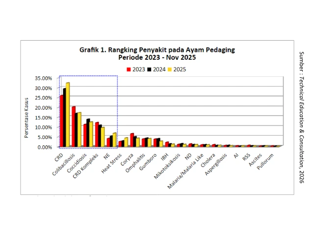

#### L02. PT Medion TEC (Januari 2026) — Grafik 3: Ranking Penyakit Ayam Petelur (Layer) Masa Produksi 2023–Nov 2025
`[ASLI DARI SUMBER PRIMER]` — *Unduhan langsung berkas gambar resmi Grafik 3 dari artikel surveilans tahunan PT Medion TEC (Januari 2026).*  
**Ringkasan Angka Kunci:** CRD (~16%), Coryza/Snot (~15%), Cacingan (~12%), Colibacillosis (~10,5%), dan Fowl Cholera (~8%) merupakan 5 besar gangguan klinis utama pada ayam layer masa produksi di Indonesia (2023–Nov 2025).  
**Sumber:** [https://www.medion.co.id/en/info-medion/overview-of-poultry-disease-analysis-2025-disease-projection-2026/](https://www.medion.co.id/en/info-medion/overview-of-poultry-disease-analysis-2025-disease-projection-2026/)

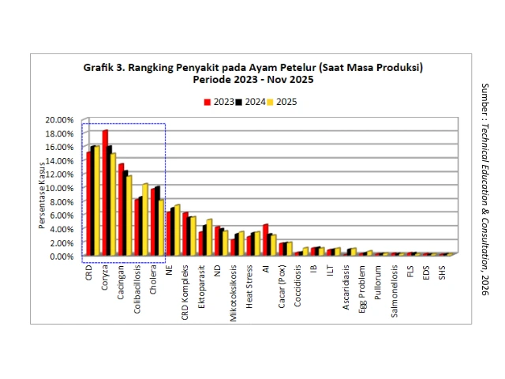

#### L03. Pramuwidyatama et al. (2023, *Prev. Vet. Med.* Q1) — Table 4: Dampak Ekonomi Wabah HPAI H5N1 Jawa Barat
`[ASLI DARI SUMBER PRIMER]` — *Potongan PDF resmi WUR OA (`edepot.wur.nl/588952`), **Table 4**, halaman 7 (300 DPI).*  
**Ringkasan Angka Kunci:** Pada peternakan broiler mandiri & kontrak harga di Jawa Barat, wabah HPAI H5N1 membalik *gross margin* normal `+Rp5,28 juta/siklus` menjadi kerugian `-Rp53,89 juta` (`none-8`), `-Rp57,35 juta` (`stamp-15`), dan `-Rp22,89 juta` (`early-8`).  
**Sumber:** [https://doi.org/10.1016/j.prevetmed.2022.105833](https://doi.org/10.1016/j.prevetmed.2022.105833) | [WUR OA PDF](https://edepot.wur.nl/588952)

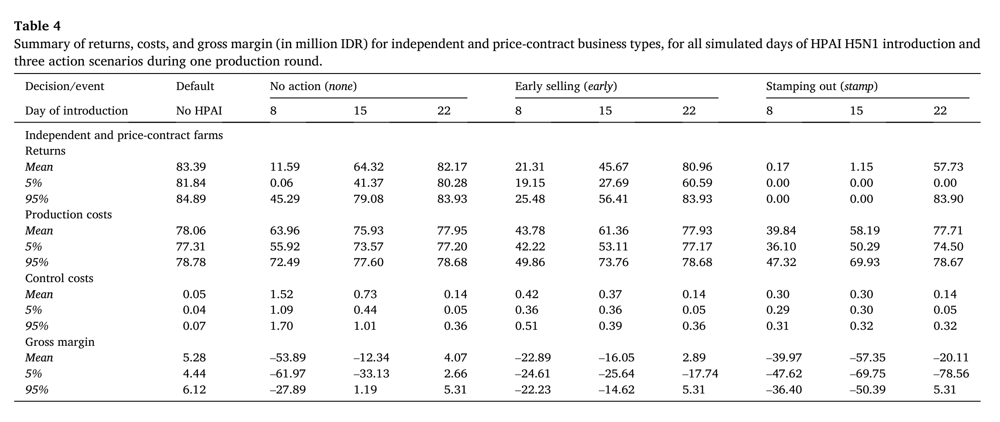

#### L03b. Pramuwidyatama et al. (2023, *Prev. Vet. Med.* Q1) — Fig. 2: Perbandingan *Gross Margin* Mandiri/Kontrak vs *Makloon* (t=15)
`[ASLI DARI SUMBER PRIMER]` — *Potongan PDF resmi WUR OA (`edepot.wur.nl/588952`), **Fig. 2**, halaman 7 (300 DPI).*  
**Ringkasan Angka Kunci:** Visualisasi ketimpangan risiko ekonomi wabah HPAI H5N1 pada hari ke-15 antara peternak mandiri/*price-contract* (kerugian hingga `-Rp70 juta`) dibandingkan skema *makloon* (margin mendekati nol/positif tipis).  
**Sumber:** [https://doi.org/10.1016/j.prevetmed.2022.105833](https://doi.org/10.1016/j.prevetmed.2022.105833) | [WUR OA PDF](https://edepot.wur.nl/588952)

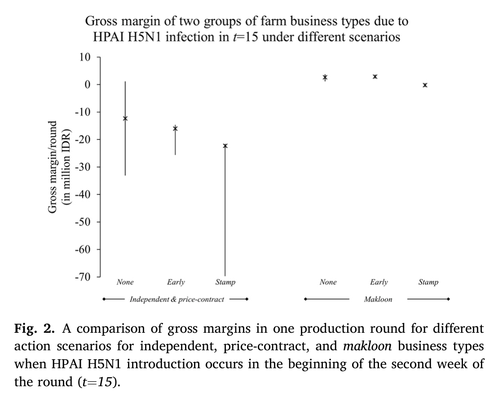

#### L04. Anwar Sani et al. (2025, *Poultry Science* Q1) — Table 2: Variabel Skor Biosekuriti 6 Dimensi & FWM (19 Farm Jabar, 142 Siklus)
`[ASLI DARI SUMBER PRIMER]` — *Tangkapan layar retina 2,5× dari HTML resmi PMC (`PMC12681536`), **Table 2**.*  
**Ringkasan Angka Kunci:** Memuat 6 kategori skor biosekuriti (`ExBio`, `IntBio`, `EmpEqui`, `Move`, `FeedWater`, `VetDrugs`) dan mortalitas minggu pertama (`Firstweekmort`) pada 142 siklus produksi di 19 farm broiler Jabar; pada teks *Results*, rerata skor biosekuriti eksternal hanya **`0,28`** (`0–0,67`), pergerakan/pembelian **`0,48`**, pekerja/peralatan **`0,50`**, dan biosekuriti internal **`0,58`**.  
**Sumber:** [https://doi.org/10.1016/j.psj.2025.106010](https://doi.org/10.1016/j.psj.2025.106010) | [PMC12681536](https://pmc.ncbi.nlm.nih.gov/articles/PMC12681536/)

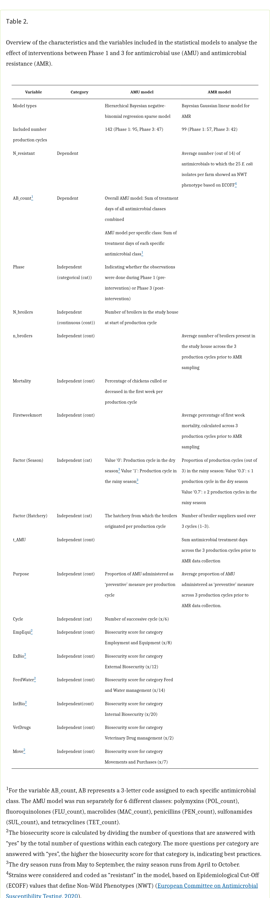

#### L05. Hartady et al. (2026, *Veterinary Sciences* Q1) — Figure 3: Inspeksi Lingkungan Kandang (IHS & RH) Kasus Koinfeksi Majalengka
`[ASLI DARI SUMBER PRIMER]` — *Unduhan langsung berkas Figure 3 resmi dari PMC CDN (`PMC13120342`, `vetsci-13-00364-g003`).*  
**Ringkasan Angka Kunci:** Menunjukkan lonjakan *Index Heat Stress* (IHS > 160) dan kelembapan relatif kandang (mencapai >85%, jauh di atas garis batas maksimum 70%) yang memicu koinfeksi multifaktorial (AI H9, IB, CRD, Koksidiosis) di Majalengka, Jawa Barat.  
**Sumber:** [https://doi.org/10.3390/vetsci13040364](https://doi.org/10.3390/vetsci13040364) | [PMC13120342](https://pmc.ncbi.nlm.nih.gov/articles/PMC13120342/)

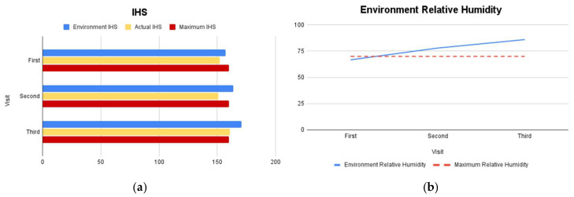

---

### Lampiran C — Bukti Primer Asli Masalah #2 (*Heat Stress* & Instabilitas Mikroklimat Tropis)

#### L06. Sumiati et al. (2025, *Animal Bioscience* Q1) — Table 6: *Heat Stress Index* (HSI) Bulanan Indonesia 2023
`[ASLI DARI SUMBER PRIMER]` — *Potongan PDF resmi `animbiosci.org` (`ab-24-0678.pdf`), **Table 6**, halaman 10 (300 DPI) — bukti verifikasi Grafik 04 Panel A.*  
**Ringkasan Angka Kunci:** Nilai rata-rata HSI Indonesia Barat (`155,52–165,42`, puncak `187,84` Jun) dan Indonesia Timur (`150,00–166,40`, puncak `195,00` Jan & Des) melampaui ambang stres panas (>150–160) sepanjang 12 bulan tahun 2023.  
**Sumber:** [https://doi.org/10.5713/ab.24.0678](https://doi.org/10.5713/ab.24.0678) | [PMC11969156](https://pmc.ncbi.nlm.nih.gov/articles/PMC11969156/)

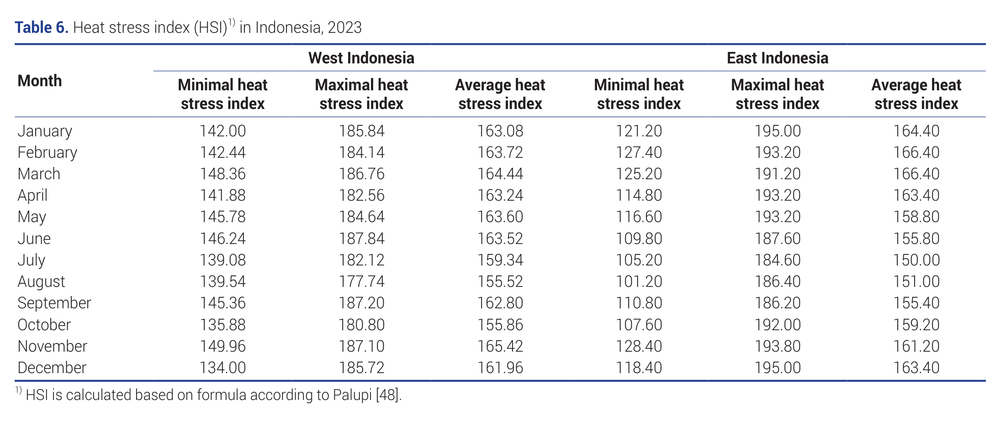

#### L06b. Sumiati et al. (2025, *Animal Bioscience* Q1) — Figure 8: Suhu Minimum & Maksimum Indonesia 2023
`[ASLI DARI SUMBER PRIMER]` — *Potongan PDF resmi `animbiosci.org` (`ab-24-0678.pdf`), **Figure 8**, halaman 10 (300 DPI).*  
**Ringkasan Angka Kunci:** Fluktuasi suhu harian di Indonesia Barat dan Timur berkisar dari minimum ~20–24°C hingga maksimum mencapai 34–36°C sepanjang tahun 2023, melampaui zona nyaman termal ayam dewasa.  
**Sumber:** [https://doi.org/10.5713/ab.24.0678](https://doi.org/10.5713/ab.24.0678) | [PMC11969156](https://pmc.ncbi.nlm.nih.gov/articles/PMC11969156/)

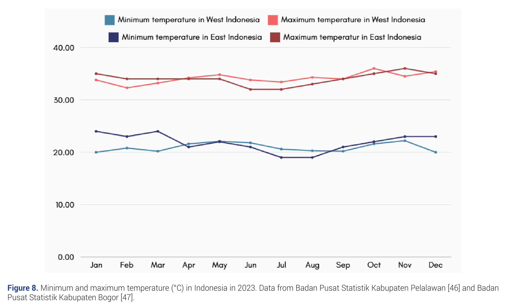

#### L07a. Wilcox et al. (2025, *Animal Welfare* Q1) — Table 3: Variabel Mikroklimat 14 Farm Broiler Komersial Jawa Barat
`[ASLI DARI SUMBER PRIMER]` — *Tangkapan layar retina 2,5× dari HTML resmi PMC (`PMC12722053`), **Table 3** — bukti verifikasi Grafik 04 Panel B.*  
**Ringkasan Angka Kunci:** Rerata suhu dalam kandang mencapai `29,3 ± 1,57°C` (rentang `26–33,3°C`), kelembapan relatif `81,9%` (`66–96%`), amonia `7,3 ± 6,4 ppm`, dan CO₂ `780 ± 222 ppm` (maks `1.782 ppm`) pada 10 kandang *closed* dan 4 *semi-closed* Jabar.  
**Sumber:** [https://doi.org/10.1017/awf.2025.10052](https://doi.org/10.1017/awf.2025.10052) | [PMC12722053](https://pmc.ncbi.nlm.nih.gov/articles/PMC12722053/)

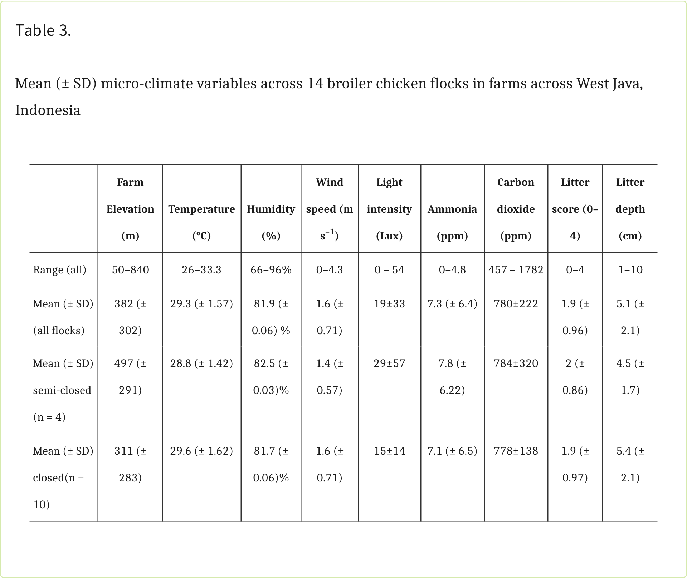

#### L07b. Wilcox et al. (2025, *Animal Welfare* Q1) — Table 2: Distribusi Skor *Foot-Pad Dermatitis* (FPD) & *Hock Burn* (n = 2.104 Ekor)
`[ASLI DARI SUMBER PRIMER]` — *Tangkapan layar retina 2,5× dari HTML resmi PMC (`PMC12722053`), **Table 2** — bukti verifikasi FPD 40% & HB 30% pada Grafik 04 Panel B.*  
**Ringkasan Angka Kunci:** Dari 2.104 ayam di 14 flok Jawa Barat, hanya `60%` bebas FPD (artinya **40% mengalami lesi FPD skor 1–4**) dan `70%` bebas *hock burn* (artinya **30% mengalami *hock burn* skor 1–4**), dengan variasi tajam antar-farm (misal F2 mencapai `44,4%` FPD parah skor 3–4).  
**Sumber:** [https://doi.org/10.1017/awf.2025.10052](https://doi.org/10.1017/awf.2025.10052) | [PMC12722053](https://pmc.ncbi.nlm.nih.gov/articles/PMC12722053/)

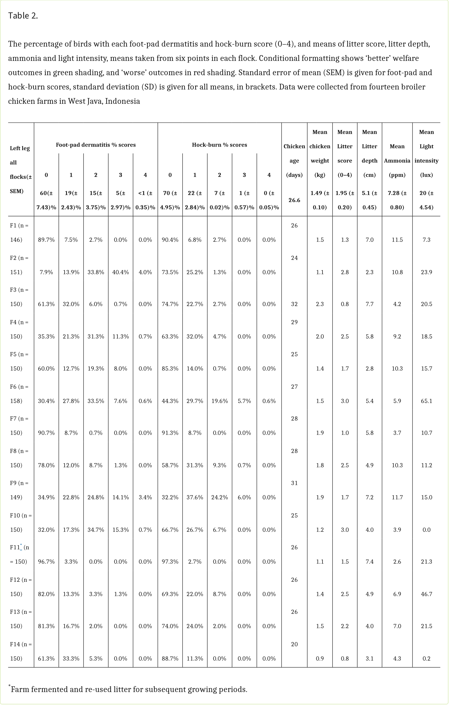

#### L08. Wilcox et al. (2025, *Animal Welfare* Q1) — Figure 6: Gradien Spasial FPD & *Hock Burn* pada 6 Zona Kandang (n = 84 Titik)
`[ASLI DARI SUMBER PRIMER]` — *Unduhan langsung berkas Figure 6 resmi dari PMC CDN (`PMC12722053`, `S0962728625100523_fig6`).*  
**Ringkasan Angka Kunci:** Ketidakmerataan mikroklimat di dalam kandang menyebabkan lesi FPD (panel a) dan *hock burn* (panel b) jauh lebih parah pada Zona 1–2 dekat pintu/*inlet* dibanding Zona 4–6 dekat *exhaust fan*.  
**Sumber:** [https://doi.org/10.1017/awf.2025.10052](https://doi.org/10.1017/awf.2025.10052) | [PMC12722053](https://pmc.ncbi.nlm.nih.gov/articles/PMC12722053/)

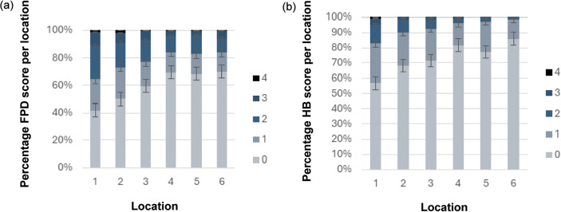

#### L09. Wilcox et al. (2025, *Animal Welfare* Q1) — Figure 8: Pengaruh Suhu & Kelembapan terhadap Perilaku *Panting* & *Huddling*
`[ASLI DARI SUMBER PRIMER]` — *Unduhan langsung berkas Figure 8 resmi dari PMC CDN (`PMC12722053`, `S0962728625100523_fig8`).*  
**Ringkasan Angka Kunci:** Persentase ayam terengah-engah (*panting*, batang oranye) melonjak drastis hingga ~70% saat suhu kandang menyentuh `33,3°C` dan meningkat konsisten saat kelembapan melewati `83%–89%`.  
**Sumber:** [https://doi.org/10.1017/awf.2025.10052](https://doi.org/10.1017/awf.2025.10052) | [PMC12722053](https://pmc.ncbi.nlm.nih.gov/articles/PMC12722053/)

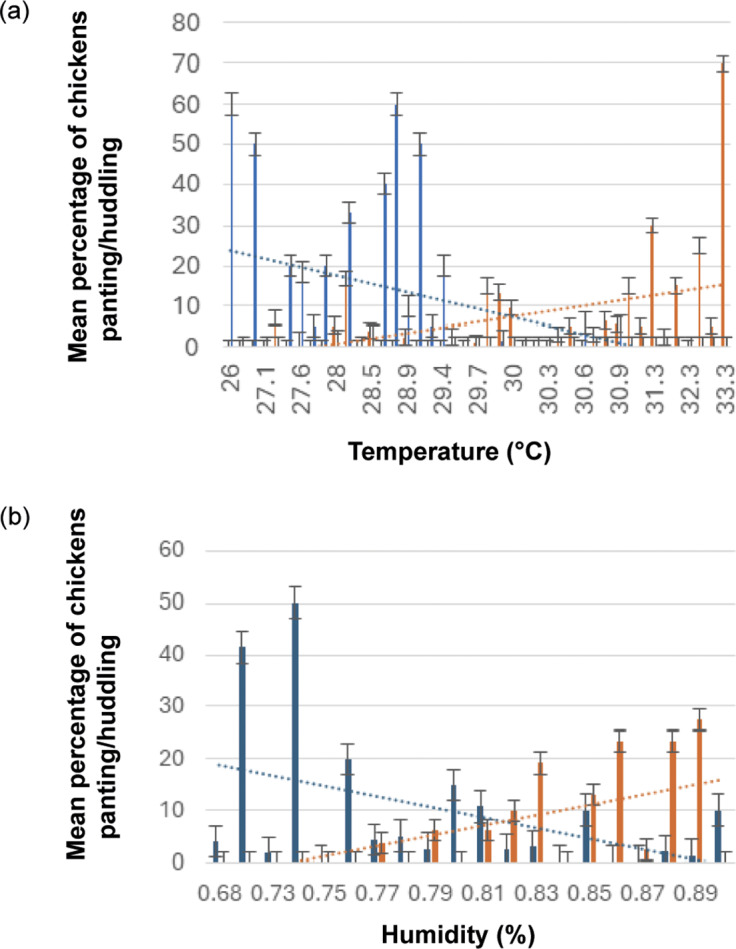

#### L10a. Mohammadi et al. (2026, *AAVS* Q3) — Table 3: Regresi Beban Panas Kumulatif (`∑HL`) terhadap Defisit Bobot Broiler Jawa Tengah
`[ASLI DARI SUMBER PRIMER]` — *Potongan PDF resmi `Advances in Animal and Veterinary Sciences` (`AAVS_14_5_1100-1111.pdf`), **Table 3**, halaman 6 (300 DPI).*  
**Ringkasan Angka Kunci:** Variabel lingkungan menjelaskan `61%` variasi defisit bobot hidup (`R² = 0,61`, `p < 0,001`), dengan beban panas kumulatif mingguan (`∑HL`) sebagai prediktor paling signifikan (`B = -3,40`, `p < 0,001`).  
**Sumber:** [https://doi.org/10.17582/journal.aavs/2026/14.5.1100.1111](https://doi.org/10.17582/journal.aavs/2026/14.5.1100.1111)

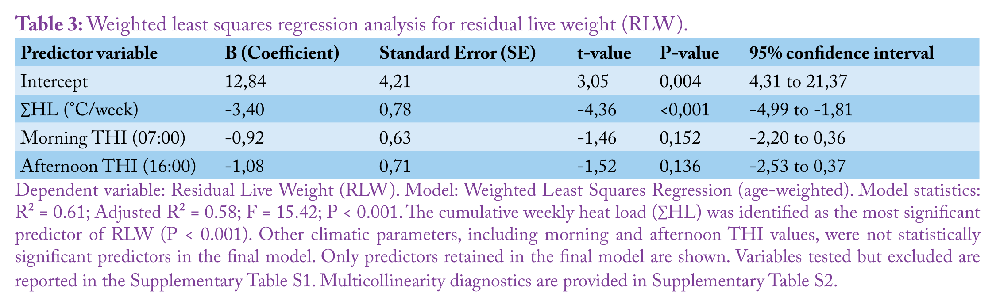

#### L10b. Mohammadi et al. (2026, *AAVS* Q3) — Table 6: Analisis ROC Ambang Panas Sore sebagai Prediktor Mortalitas Broiler
`[ASLI DARI SUMBER PRIMER]` — *Potongan PDF resmi `Advances in Animal and Veterinary Sciences` (`AAVS_14_5_1100-1111.pdf`), **Table 6**, halaman 9 (300 DPI).*  
**Ringkasan Angka Kunci:** THI sore pukul 16:00 dengan *cut-off* `>79` (`AUC = 0,709`, `p = 0,016`) dan suhu pukul 16:00 `>32,8°C` (`AUC = 0,694`, `p = 0,026`) terbukti signifikan memprediksi kejadian mortalitas broiler *open-sided* di Jawa Tengah.  
**Sumber:** [https://doi.org/10.17582/journal.aavs/2026/14.5.1100.1111](https://doi.org/10.17582/journal.aavs/2026/14.5.1100.1111)

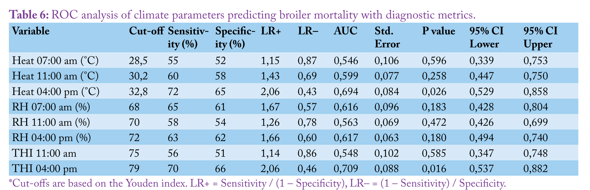

---

### Lampiran D — Bukti Primer Asli Masalah #3 (Inefisiensi Pakan, FCR & Produktivitas Flok)

#### L11. Junaidi et al. (2023, *JWPR* Q3) — Table 1: Struktur Biaya Produksi Broiler Mandiri vs Kontrak di Banten (n = 180 Farm)
`[ASLI DARI SUMBER PRIMER]` — *Potongan PDF resmi `JWPR` (`13(2): 223-232`), **Table 1**, halaman 4 (300 DPI) — bukti verifikasi Grafik 05 Panel A.*  
**Ringkasan Angka Kunci:** Biaya pakan (*starter* + *finisher*) mendominasi `62,27%` total biaya pada farm mandiri (`n = 103`) dan `67,67%` pada farm kontrak (`n = 77`), diikuti DOC (`30,47%` vs `26,10%`), sementara obat/vitamin/vaksin hanya `1,62%` vs `0,47%`.  
**Sumber:** [https://doi.org/10.36380/jwpr.2023.25](https://doi.org/10.36380/jwpr.2023.25)

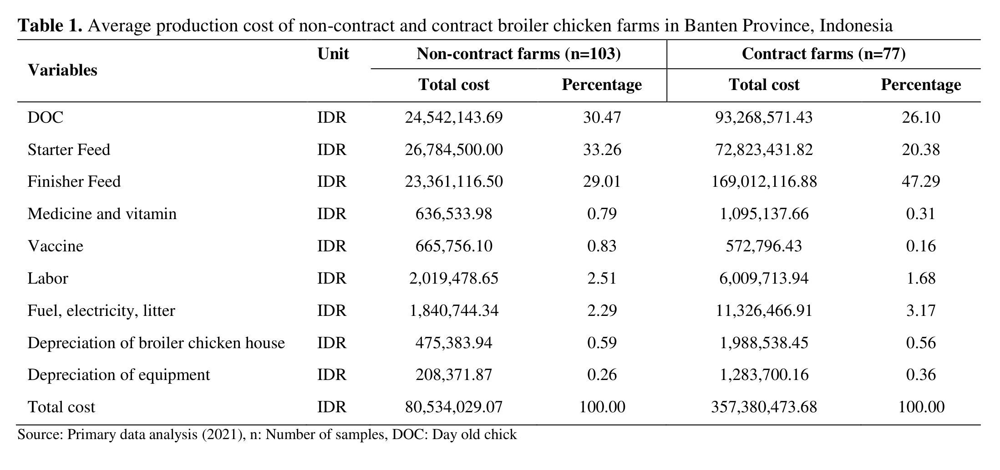

#### L12. Junaidi et al. (2023, *JWPR* Q3) — Table 4: Distribusi Efisiensi Teknis (TE) Broiler Mandiri vs Kontrak di Banten
`[ASLI DARI SUMBER PRIMER]` — *Potongan PDF resmi `JWPR` (`13(2): 223-232`), **Table 4**, halaman 8 (300 DPI) — bukti verifikasi Grafik 05 Panel A.*  
**Ringkasan Angka Kunci:** Sebanyak `56,31%` peternak mandiri memiliki efisiensi teknis di bawah `0,70` (rerata TE `0,689`, ruang pemborosan `31,1%`), kontras dengan peternak kontrak yang `54,55%`-nya mencapai TE `≥0,90` (rerata `0,893`).  
**Sumber:** [https://doi.org/10.36380/jwpr.2023.25](https://doi.org/10.36380/jwpr.2023.25)

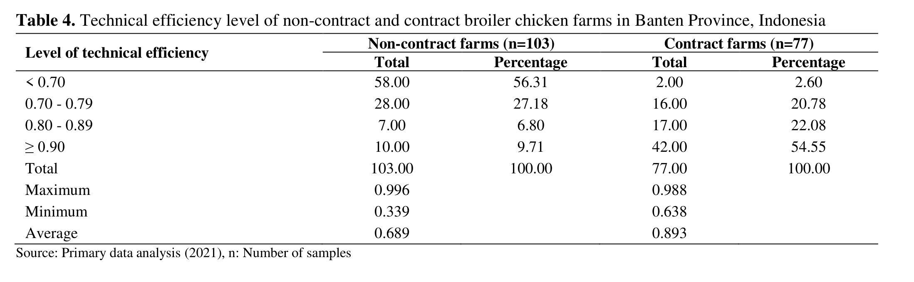

#### L13. Aji et al. (2023, *TASJ* SINTA 1/Q2) — Table 5 & Table 6: Distribusi & Determinan Inefisiensi Biaya 150 Farm Broiler Jawa Timur
`[ASLI DARI SUMBER PRIMER]` — *Potongan PDF resmi `Tropical Animal Science Journal` IPB (`46(3): 382-388`), **Table 5 & Table 6**, halaman 5 (300 DPI).*  
**Ringkasan Angka Kunci:** Rerata inefisiensi biaya mencapai `24,2%` (`Mean Cost Inefficiency 0,242`) pada 150 peternak broiler Jember–Lumajang–Banyuwangi, dengan pendidikan (`-0,1220**`), pengalaman (`-0,1304**`), ukuran rumah tangga, umur, dan rasio mortalitas signifikan pada taraf 95%.  
**Sumber:** [https://doi.org/10.5398/tasj.2023.46.3.382](https://doi.org/10.5398/tasj.2023.46.3.382)

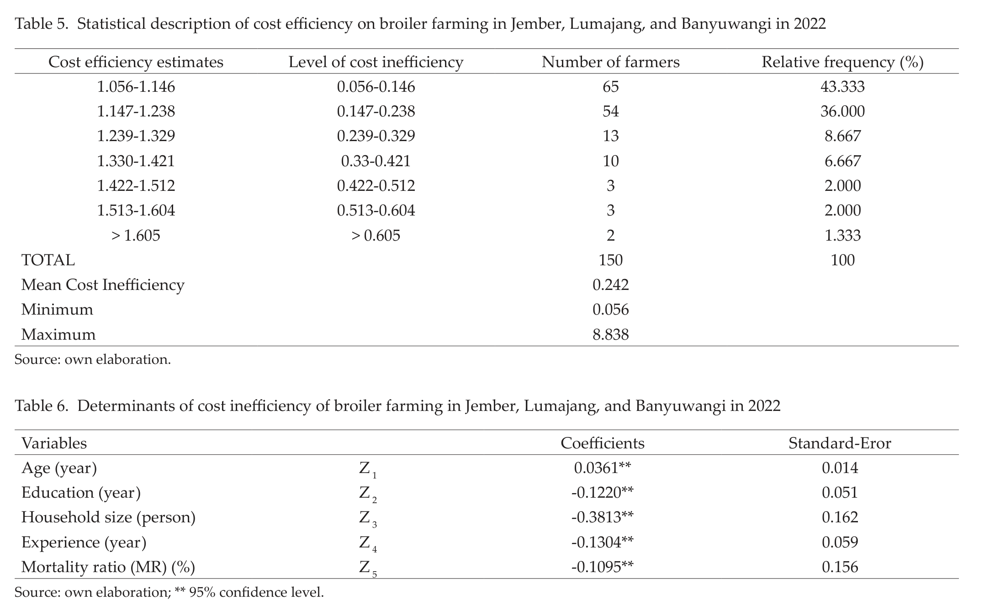

#### L14a. Priyono et al. (2024, *TASJ* SINTA 1/Q2) — Table 3: Analisis Finansial & Dominasi Biaya Pakan Ayam Petelur Rakyat
`[ASLI DARI SUMBER PRIMER]` — *Potongan PDF resmi `Tropical Animal Science Journal` IPB (`47(3): 392-401`), **Table 3**, halaman 4 (300 DPI).*  
**Ringkasan Angka Kunci:** Pada usaha layer rakyat (skala 100 ekor), biaya pakan melonjak dari `Rp24,09 juta/thn` (2019) menjadi `Rp28,11 juta/thn` (2022) — menyerap mayoritas mutlak biaya operasional — sehingga menekan rasio pendapatan terhadap biaya (`R/C ratio`) di kisaran tipis `1,1375–1,1473`.  
**Sumber:** [https://doi.org/10.5398/tasj.2024.47.3.392](https://doi.org/10.5398/tasj.2024.47.3.392)

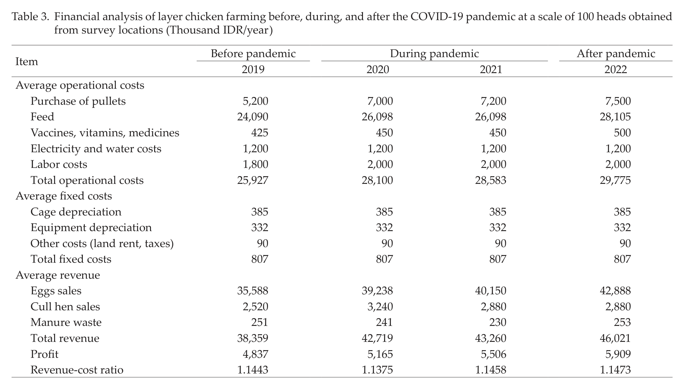

#### L14b. Ilham et al. (2021, *JITV* SINTA 1/Q4) — Figure 1: Kurva Produksi Telur (HDP) Sentra Layer Rakyat vs Standar Genetik Hy-Line
`[ASLI DARI SUMBER PRIMER]` — *Potongan PDF resmi `JITV` (`26(4): 187-194`), **Figure 1**, halaman 4 (300 DPI).*  
**Ringkasan Angka Kunci:** Kurva *Hen-Day Production* (HDP) aktual di tiga sentra layer rakyat Indonesia (Blitar, Payakumbuh, Sidrap) tertinggal jauh di bawah potensi genetik standar Hy-Line sepanjang seluruh umur produksi (bulan ke-5 hingga ke-24).  
**Sumber:** [https://doi.org/10.14334/jitv.v26i4.2697](https://doi.org/10.14334/jitv.v26i4.2697)

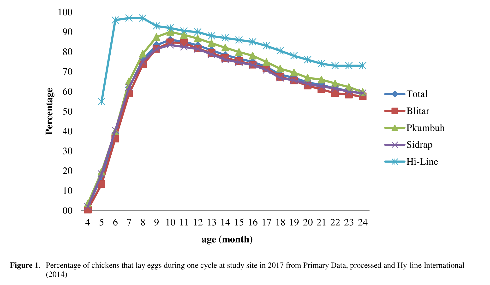

#### L15. Zulfan et al. (2026, *Acta Sci. Anim. Sci.* Q3) — Table 1: Perbandingan FCR, Bobot Panen & Deplesi OH vs CH (Aceh Utara)
`[ASLI DARI SUMBER PRIMER]` — *Potongan PDF resmi `Acta Scientiarum. Animal Sciences` (`v.48, e74435`), **Table 1**, halaman 6 (300 DPI) — bukti verifikasi Grafik 05 Panel B.*  
**Ringkasan Angka Kunci:** Pada periode keseluruhan 1–5 minggu, kandang *open house* (`OH`) mengalami pembengkakan FCR `1,76 ± 0,04` vs `1,55 ± 0,01` di *closed house* (`CH`, `p < 0,001`), bobot panen lebih rendah `1.930 g` vs `2.295 g`, dan deplesi `4,54%` vs `2,47%`.  
**Sumber:** [https://doi.org/10.4025/actascianimsci.v48i1.74435](https://doi.org/10.4025/actascianimsci.v48i1.74435)

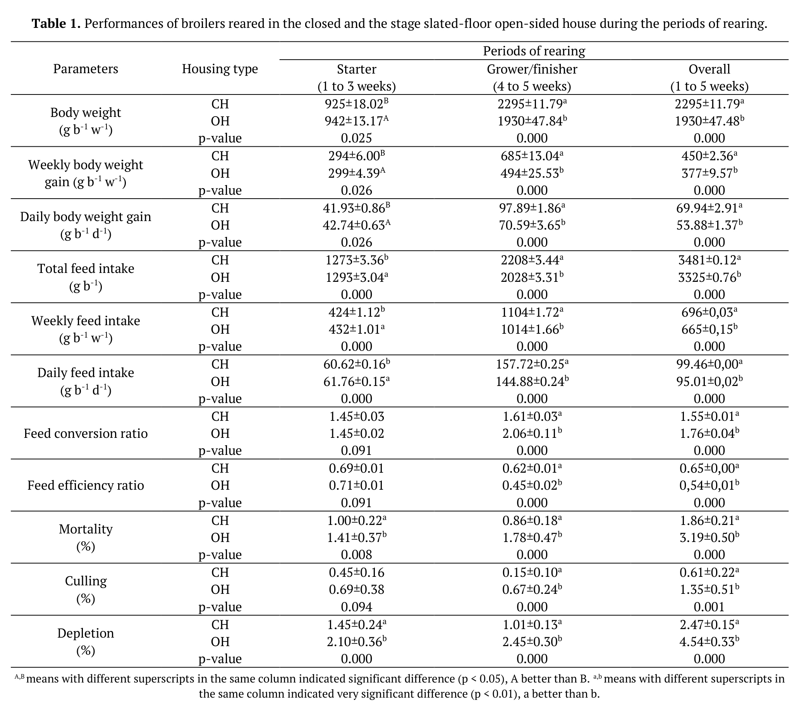

#### L16. Arif et al. (2024, *JSV UGM* SINTA 2) — Table 2: Performa Broiler Cobb OH vs CH IoT di PT Zara Propertifarm Bogor
`[ASLI DARI SUMBER PRIMER]` — *Potongan PDF resmi `Jurnal Sain Veteriner` UGM (`42(3): 302-309`), **Table 2**, halaman 4 (300 DPI) — bukti verifikasi Grafik 05 Panel B.*  
**Ringkasan Angka Kunci:** Di lokasi mitra lokal PT Zara Bogor (total 12.000 ekor Cobb, 2 siklus), kandang *open house* mencatat FCR `1,49` dan mortalitas `10,16%` dibandingkan *closed house* IoT dengan FCR `1,40` dan mortalitas `8,30%` (+5,21% bobot panen).  
**Sumber:** [https://doi.org/10.22146/jsv.82670](https://doi.org/10.22146/jsv.82670)

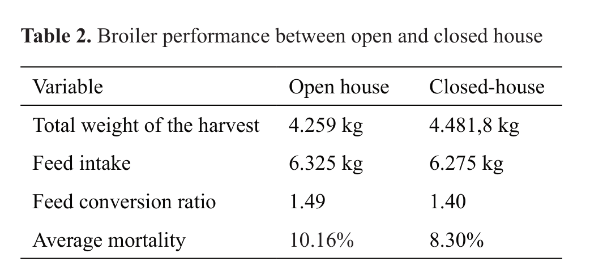

#### L17. Laili et al. (2022, *JAVEST Unair* SINTA 2) — Gambar 1 & Gambar 2: Perbandingan FCR & Indeks Performa (IP) Trenggalek
`[ASLI DARI SUMBER PRIMER]` — *Potongan PDF resmi `JAVEST` Unair (`3(1): 6-11`), **Gambar 1 & Gambar 2**, halaman 3 (300 DPI) — bukti verifikasi Grafik 05 Panel B.*  
**Ringkasan Angka Kunci:** Pada populasi setara 20.000 ekor/kandang di Trenggalek, kandang *open house* tertinggal pada minggu 3–5 sehingga FCR akhir membengkak ke `1,605` (vs `1,416` CH) dan IP turun ke `319,4` (vs `366,5` CH).  
**Sumber:** [https://doi.org/10.20473/javest.v3.i1.2022.6-11](https://doi.org/10.20473/javest.v3.i1.2022.6-11)

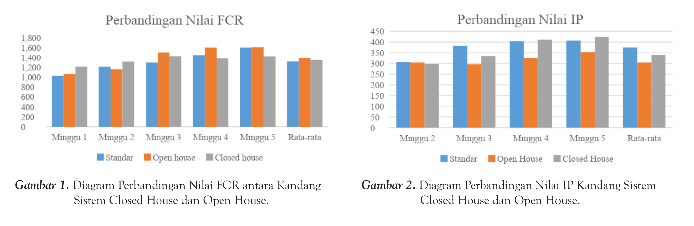

---

### Lampiran E — Bukti Primer Asli Masalah #4 (Risiko *Blackout*, Beban Energi & Modal *Closed House*)

#### L18. Fikrianti et al. (2023, *JAI IPB* SINTA 2) — Tabel 2: Analisis Finansial & *Payback Period* Kandang *Closed House*
`[ASLI DARI SUMBER PRIMER]` — *Potongan PDF resmi `Jurnal Agribisnis Indonesia` IPB (`11(2): 422-431`), **Tabel 2**, halaman 6 (300 DPI).*  
**Ringkasan Angka Kunci:** Menunjukkan panjangnya periode balik modal (*Payback Period*) kandang *closed house* semi-otomatis (`43 periode` ≈ 6–7 tahun, ROI `28%`, NPM `6,8%`) dibanding otomatis (`27 periode`, ROI `43,5%`, R/C `1,12`), yang menjelaskan tingginya hambatan modal bagi peternak rakyat.  
**Sumber:** [https://doi.org/10.29244/jai.2023.11.2.422-431](https://doi.org/10.29244/jai.2023.11.2.422-431)

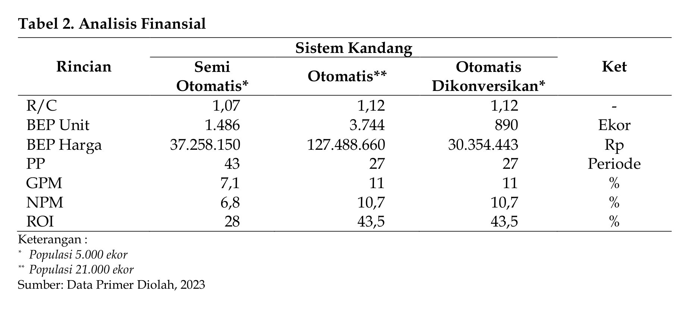

#### L19. BBPKH Cinagara Kementerian Pertanian RI (Desember 2025) — Tabel 1: Perbandingan Resmi *Close House* vs *Open House* (Modal, FCR & Ketergantungan Listrik)
`[ASLI DARI SUMBER PRIMER]` — *Potongan PDF resmi Kementerian Pertanian RI (`bbpkhcinagara.bppsdmp.pertanian.go.id`), **Tabel 1**, halaman 2 (300 DPI) — sekaligus bukti verifikasi garis acuan FCR Grafik 05 Panel B.*  
**Ringkasan Angka Kunci:** Dokumen resmi Kementan RI menegaskan investasi awal *close house* `3–4 kali lipat` dari *open house*, biaya operasional listrik tinggi, ketergantungan listrik `"Sangat tinggi; risiko tinggi jika listrik padam"`, serta tolok ukur FCR `1,45–1,55` (CH) vs `>1,65` (OH).  
**Sumber:** [PDF Resmi BBPKH Cinagara Kementan RI (Des 2025)](https://bbpkhcinagara.bppsdmp.pertanian.go.id/storage/master/file/QuSKqJd1_Close_House_vs_Open_House_Menimbang_Efisiensi_dan_Kenyamanan_Ayam_Modern.pdf)

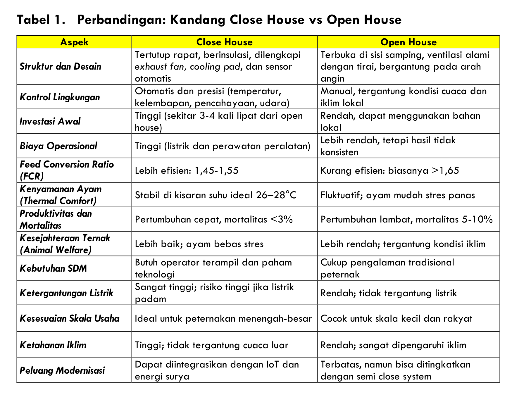

> **Catatan Kejujuran Akses Sumber (`Mastuti et al., 2023`):** Berkas PDF `Mastuti et al. (2023, Animal Production SINTA 2)` (`https://doi.org/10.20884/1.jap.2023.25.1.200`) pada server `animalproduction.id` gagal diunduh karena server mengembalikan *TLS connection reset* (HTTPS) dan blokir firewall `Web Page Blocked` (HTTP). Sesuai aturan anti-hoax, tabelnya **tidak** digambar ulang.

---

### Lampiran F — Bukti Primer Asli Masalah #5 (Pencatatan Silo, Pengawasan & SDM/ABK)

#### L20. Rehman et al. (2023, *PeerJ* Q1) — Figure 2: Tingkat Pengetahuan *Avian Influenza* pada 200 Pekerja Kandang Unggas Indonesia
`[ASLI DARI SUMBER PRIMER]` — *Unduhan langsung berkas Figure 2 resmi dari PMC CDN (`PMC9851045`, `peerj-11-14600-g002`).*  
**Ringkasan Angka Kunci:** Mayoritas pekerja kandang unggas di Indonesia (`58%`, terdiri dari `33% Low` dan `25% Moderate`) belum mencapai tingkat pengetahuan tinggi terkait *Avian Influenza* dan protokol pencegahannya (hanya `42% High`).  
**Sumber:** [https://doi.org/10.7717/peerj.14600](https://doi.org/10.7717/peerj.14600) | [PMC9851045](https://pmc.ncbi.nlm.nih.gov/articles/PMC9851045/)

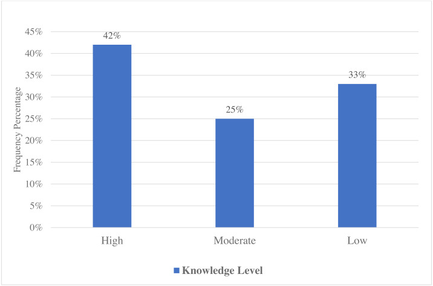

#### L21a. Chapot et al. (2024, *PLOS ONE* Q1) — Table 1: Komposisi 56 Pemangku Kepentingan Wawancara Manajemen Unggas Indonesia
`[ASLI DARI SUMBER PRIMER]` — *Potongan PDF resmi `PLOS ONE` (`19(8): e0308379`), **Table 1**, halaman 5 (300 DPI).*  
**Ringkasan Angka Kunci:** Rincian responden lintas rantai nilai (perusahaan integrator, peternak layer kecil-menengah, asosiasi, pemerintah, perguruan tinggi, TSO pakan/farmasi, hingga *poultry shop*) yang memvalidasi kendala *recording* kertas/WhatsApp dan kurangnya sistem pendukung keputusan.  
**Sumber:** [https://doi.org/10.1371/journal.pone.0308379](https://doi.org/10.1371/journal.pone.0308379)

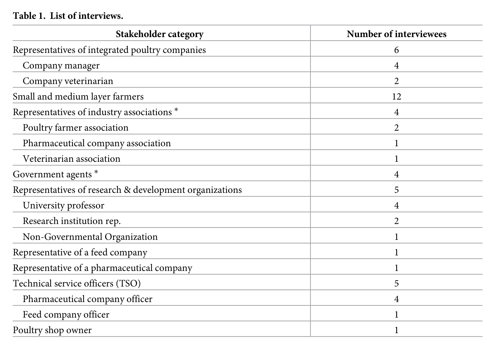

#### L21b. Ali et al. (2023, *Heliyon* Q1 Elsevier) — Fig. 4: Struktur Hierarki ISM Tantangan Kelincahan Industri Perunggasan Indonesia
`[ASLI DARI SUMBER PRIMER]` — *Unduhan langsung berkas Fig. 4 resmi dari PMC CDN (`PMC10272334`, `gr4`).*  
**Ringkasan Angka Kunci:** Memetakan keterkaitan struktural antara budaya *silo* organisasi (node 8), komunikasi tidak transparan/terlambat (node 4), kurangnya penyelarasan (node 7), hingga kelangkaan personel terampil (node 12) dan kekakuan pendanaan (node 13).  
**Sumber:** [https://doi.org/10.1016/j.heliyon.2023.e16808](https://doi.org/10.1016/j.heliyon.2023.e16808) | [PMC10272334](https://pmc.ncbi.nlm.nih.gov/articles/PMC10272334/)

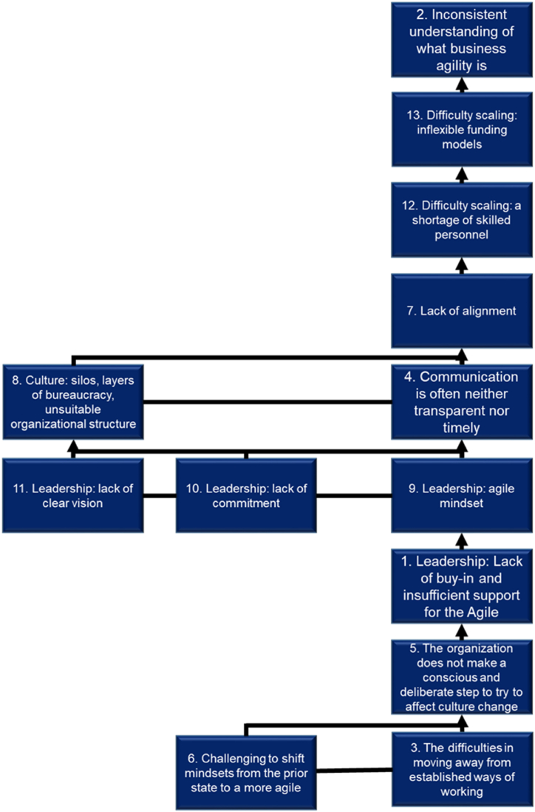

#### L21c. Chapot et al. (2023, *Preventive Veterinary Medicine* Q1 Elsevier) — Fig. 4: Peta Jaringan Aliran Data & Informasi Kesehatan Unggas Indonesia
`[ASLI DARI SUMBER PRIMER]` — *Unduhan langsung berkas resolusi tinggi Fig. 4 resmi dari Elsevier CDN (`1-s2.0-S0167587723001678-gr4_lrg.jpg`).*  
**Ringkasan Angka Kunci:** Peta empiris fragmentasi (*silo*) arus data pelaporan penyakit & konsultasi kesehatan antara rantai korporasi terintegrasi (kiri: pekerja inti/plasma → supervisor → TSO → manajer → kantor pusat) dengan peternak mandiri (kanan: *poultry shop*, TSO swasta, lab swasta, asosiasi, dan Dinas/Kementan).  
**Sumber:** [https://doi.org/10.1016/j.prevetmed.2023.106003](https://doi.org/10.1016/j.prevetmed.2023.106003) | [PubMed](https://pubmed.ncbi.nlm.nih.gov/37657198/)

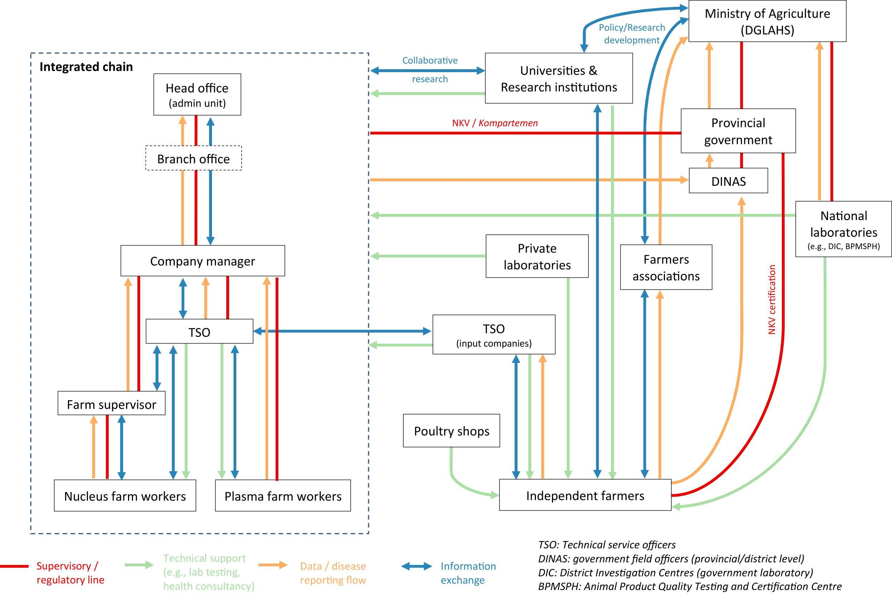

> **Catatan Kejujuran Akses Sumber (`Riyanto & Almawachida, 2025`):** Unduhan PDF `Riyanto & Almawachida (2025, JIIP UB SINTA 2)` (`https://doi.org/10.21776/ub.jiip.2025.035.01.3`) terhalang gerbang verifikasi anti-bot Cloudflare (`challenges.cloudflare.com`) pada server `jiip.ub.ac.id`. Sesuai aturan integritas dan anti-bypass, gerbang tersebut tidak dilewati dan tabel aslinya tidak dibuat ulang.

---

### Lampiran G — Bukti Primer Asli Pembanding Kandidat #7 (AMU & AMR — Penguat *Gap Analysis*)

#### L22a. Efendi et al. (2022, *Veterinary World* Q1) — Table-1: Kelas & Kategori WHO Antibiotik yang Digunakan Peternak Broiler Bogor (n = 132)
`[ASLI DARI SUMBER PRIMER]` — *Tangkapan layar retina 2,5× dari HTML resmi PMC (`PMC9047124`), **Table-1**.*  
**Ringkasan Angka Kunci:** Dari 132 peternak broiler kecil Bogor, antibiotik *Critically Important* WHO mendominasi: Quinolones `33,3%` (Enrofloxacin `26,5%`), Penicillins `33,3%` (Amoxicillin `32,6%`), Polymyxins/Colistin `16,7%`, dan Macrolides `16,7%`.  
**Sumber:** [https://doi.org/10.14202/vetworld.2022.707-713](https://doi.org/10.14202/vetworld.2022.707-713) | [PMC9047124](https://pmc.ncbi.nlm.nih.gov/articles/PMC9047124/)

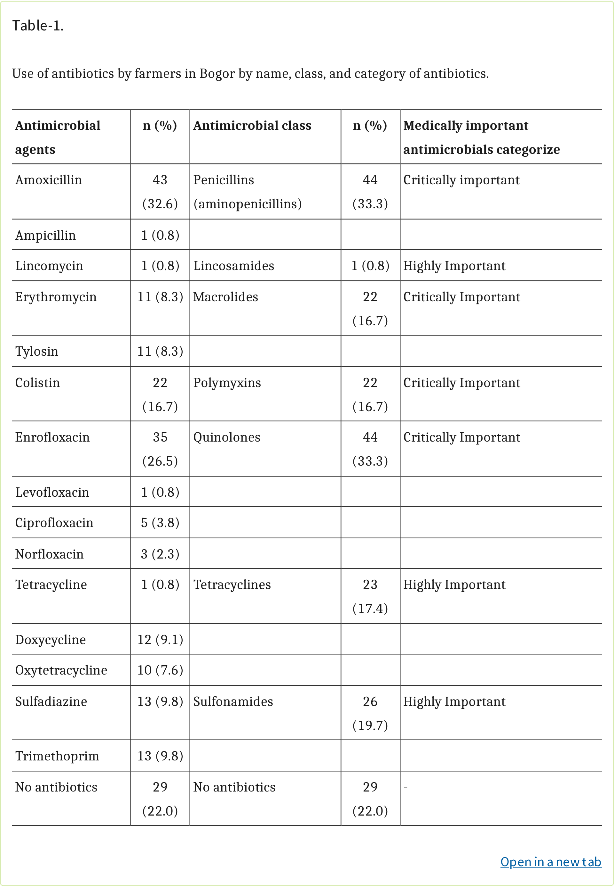

#### L22b. Efendi et al. (2022, *Veterinary World* Q1) — Table-3: Tujuan Pemakaian Antibiotik (*Flushing* & Profilaksis vs Terapi)
`[ASLI DARI SUMBER PRIMER]` — *Tangkapan layar retina 2,5× dari HTML resmi PMC (`PMC9047124`), **Table-3**.*  
**Ringkasan Angka Kunci:** Sebanyak `75,0%` peternak menggunakan antibiotik sebagai *flushing* dan `56,1%` sebagai profilaksis (bahkan `45,5%` memakai kombinasi), sementara pemakaian untuk terapi penyakit aktual hanya `8,3%`.  
**Sumber:** [https://doi.org/10.14202/vetworld.2022.707-713](https://doi.org/10.14202/vetworld.2022.707-713) | [PMC9047124](https://pmc.ncbi.nlm.nih.gov/articles/PMC9047124/)

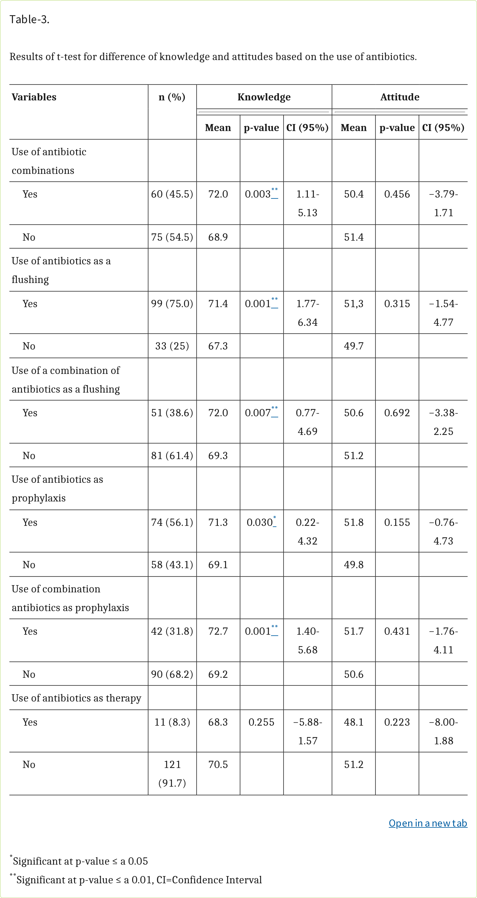

#### L23. Anwar Sani et al. (2024, *Antibiotics* Q1) — Figure 2: Proporsi Resistensi (*NWT/ECOFF* & *CBP*) *E. coli* pada 14 Antibiotik di 19 Farm Jabar
`[ASLI DARI SUMBER PRIMER]` — *Unduhan langsung berkas Figure 2 resmi dari PMC CDN (`PMC11672412`, `antibiotics-13-01181-g002`).*  
**Ringkasan Angka Kunci:** Memperlihatkan tingginya proporsi isolat *E. coli* resisten (*Non-Wild Type* ECOFF oranye & non-susceptible CBP biru) lintas 19 farm Jabar, dengan ciprofloxacin, ampicillin, sulfamethoxazole, dan tetracycline mendekati `100%` di sebagian besar peternakan.  
**Sumber:** [https://doi.org/10.3390/antibiotics13121181](https://doi.org/10.3390/antibiotics13121181) | [PMC11672412](https://pmc.ncbi.nlm.nih.gov/articles/PMC11672412/)

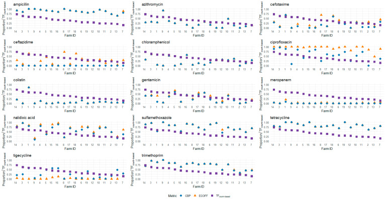

#### L23b. Anwar Sani et al. (2025, *Poultry Science* Q1) — Fig. 2: Heatmap Penggunaan Antibiotik Menurut Umur Ayam (98 Siklus Phase 1)
`[ASLI DARI SUMBER PRIMER]` — *Unduhan langsung berkas Fig. 2 resmi dari PMC CDN (`PMC12681536`, `gr2`).*  
**Ringkasan Angka Kunci:** Membuktikan pola rutin *flushing* antibiotik kelas kritis WHO (*fluoroquinolones* HPCIA mencapai `35%–43%` siklus; *polymyxins* `11%–18%`; *penicillins* `12%–19%`) sejak hari ke-1 hingga hari ke-4 pemeliharaan broiler di Jawa Barat.  
**Sumber:** [https://doi.org/10.1016/j.psj.2025.106010](https://doi.org/10.1016/j.psj.2025.106010) | [PMC12681536](https://pmc.ncbi.nlm.nih.gov/articles/PMC12681536/)

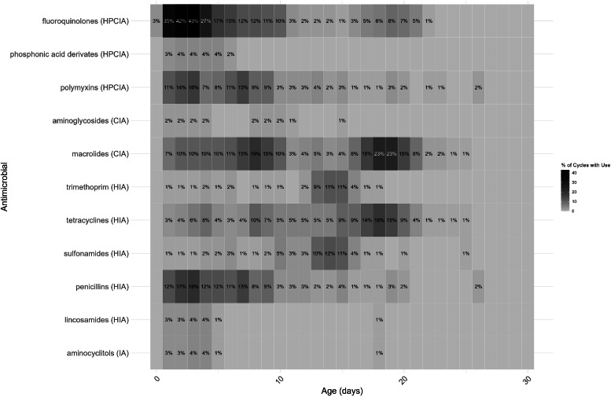
