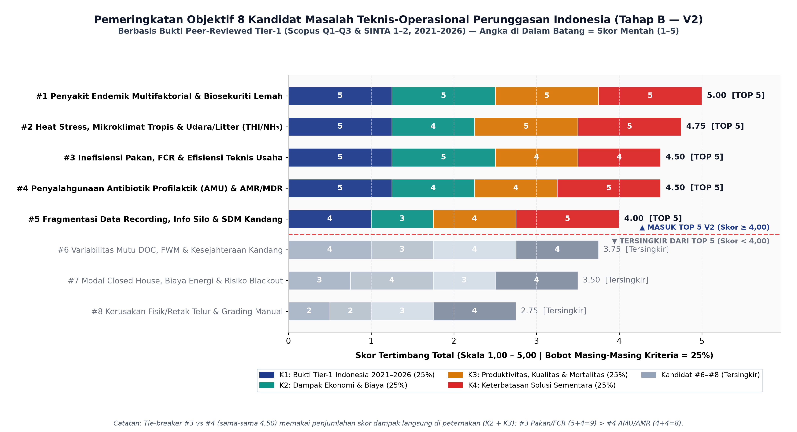
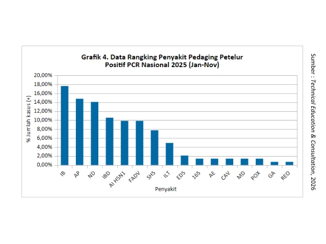
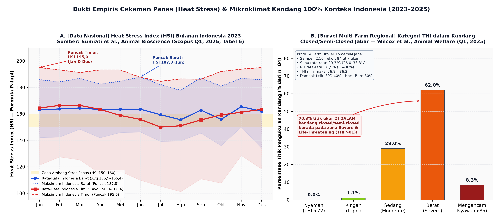
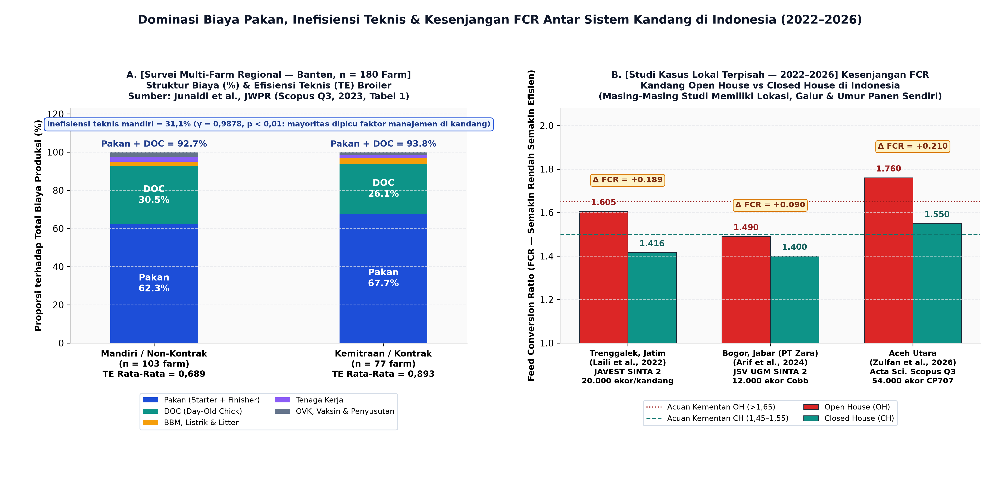
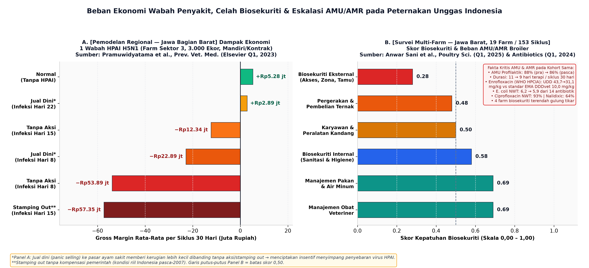

# AUDIT & DEEP RESEARCH V2 (PEER-REVIEWED SCOPUS/SCIENCEDIRECT & SINTA 1–2): TOP 5 MASALAH TEKNIS-OPERASIONAL PETERNAKAN UNGGAS & PRODUKSI TELUR DI INDONESIA

> **Status Tahapan:** *Problem Discovery* & Verifikasi Bukti Ilmiah (*Evidence Audit V2*) — Tim MBOYZ, Hackathon Deep Tech UNJ 2026, Jalur Pangan `D-FARM UNJ` (Challenge #1: *Smart Poultry / Smart Egg Production*).  
> **Batasan Ketat Dokumen:** Dokumen ini **100% berfokus pada pemetaan masalah empiris berbasis bukti *peer-reviewed* Indonesia (2021–2026)** dan **sama sekali tidak memuat usulan solusi, konsep produk, nama sistem, maupun arsitektur aplikasi Hackathon**. Seluruh topik pengolahan limbah/sampah peternakan (kotoran, kompos, biogas, maggot) dikecualikan sepenuhnya. Arsip V1 (`TOP_5_MASALAH_PETERNAKAN_UNGGAS_INDONESIA.md` dan folder `assets/`) dipertahankan utuh tanpa perubahan.

---

## 1. Ringkasan Eksekutif & Batasan Ruang Lingkup

### A. Standar Verifikasi Sumber & Integritas Data V2
Dokumen V2 merupakan audit menyeluruh terhadap V1 untuk menyingkirkan *confirmation bias*, klaim berbasis studi luar negeri, ekstrapolasi sepihak (*overclaim*), serta literatur tidak terakreditasi. Seluruh bukti disaring melalui protokol riset dua tahap:
1. **Tahap A (Pencarian Terbuka/Netral):** Penelusuran sistematis pada database PubMed/PMC, OpenAlex, ScienceDirect/Elsevier, Cambridge/PLOS/Frontiers/MDPI, serta portal jurnal nasional bereputasi tinggi (SINTA 1–2) khusus untuk objek penelitian **di Indonesia terbitan 2021–2026**. Total **35 artikel jurnal *peer-reviewed* Tier 1** (terdiri dari **18 jurnal Scopus Q1** [termasuk 6 jurnal Elsevier/ScienceDirect], **2 jurnal Scopus Q2**, **4 jurnal Scopus Q3**, **3 jurnal SINTA 1 terindeks Scopus Q2/Q4**, serta **8 jurnal SINTA 2 nasional**) berhasil diverifikasi, dibaca teks lengkap atau abstrak penuh terverifikasinya, dan dicocokkan DOI-nya melalui Crossref/PubMed.
2. **Hierarki Bukti Ketat:**
   - **Tier 1 (Tulang Punggung Utama, 2021–2026):** Jurnal internasional bereputasi (Scopus Q1–Q4 / ScienceDirect / Elsevier / Cambridge / PLOS / Frontiers / MDPI / PeerJ) dan jurnal nasional terakreditasi **SINTA 1–2** yang secara eksplisit meneliti peternakan broiler/layer **di Indonesia**.
   - **Tier 2 (Data Makro & Surveilans Resmi, 2021–2026):** BPS, Kementerian Pertanian RI (Ditjen PKH / BBPKH Cinagara), Bapanas, dan laporan surveilans diagnostik laboratorium nasional PT Medion.
   - **Tier 3 (Pendukung Sampingan Terbatas):** Berita media nasional kredibel (Kompas, ANTARA) khusus untuk verifikasi insiden lapangan aktual (misal kejadian *blackout*), bukan sebagai dasar klaim epidemiologis nasional.
   - **Ditolak Keras (*Zero Tolerance*):** Seluruh *preprint* (`arXiv`, `bioRxiv`, `medRxiv`, `SSRN`, `ResearchGate`), studi eksperimen luar negeri (misal data Korea Selatan pada V1), skripsi/tugas akhir tidak terpublikasi di jurnal bereputasi, vlog non-ilmiah, serta jurnal SINTA 3–5/tidak terakreditasi.
3. **Pelabelan Cakupan Wajib (*Anti-Overclaim*):** Setiap angka kuantitatif dalam dokumen ini wajib mencantumkan salah satu dari tiga label cakupan: `[Data Nasional]`, `[Survei Multi-Farm / Regional]` (termasuk pemodelan bio-ekonomi regional), atau `[Studi Kasus Lokal]`, disertai tahun dan lokasi di Indonesia.

### B. Pemisahan Tegas: Faktor Makro/Pasar Eksternal vs Masalah Teknis-Operasional (*On-Farm*)
Tinjauan literatur primer Indonesia 2021–2026 (`Sumiati et al., 2025`; `Chapot et al., 2024`; `Ali et al., 2023`) menunjukkan bahwa tekanan usaha perunggasan Indonesia berasal dari **dua lapisan berbeda** yang harus dipisahkan agar analisis permasalahan di kandang tetap tajam:

| Dimensi Masalah | Fakta Empiris Terverifikasi di Indonesia (2021–2026) | Cakupan & Sumber | Status dalam Pemeringkatan Top 5 V2 |
| :--- | :--- | :--- | :--- |
| **Lapisan 1: Faktor Makro, Struktur Pasar & Kebijakan (Eksternal di Luar Kendali Kandang)** | • **Skala Nasional:** Populasi nasional mencapai **3,32 miliar ekor broiler** (produksi daging **4,06–4,28 juta ton**) dan **426,12 juta ekor layer** (produksi telur **6,31 juta ton**) pada 2025; konsumsi daging ayam naik dari 5,7 kg (2019) → **7,46 kg/kapita/tahun** (2023) dan telur naik 6,74 kg → **7,37 kg/kapita/tahun** (2022). • **Ketergantungan Bahan Baku Impor:** Indonesia mengimpor **4,4 juta ton bungkil kedelai (SBM)** (data USDA 2022), **724.746 ton kedelai** (2023), serta **691.283 ekor *Grandparent Stock* (GPS) DOC** (2023). • **Ketimpangan Struktur & *Oversupply*:** Sekitar **60% produksi** berasal dari peternakan industrial skala besar (*closed house*, ~200–300 pemain besar) dan **40%** dari >1 juta peternak rakyat skala kecil–menengah (*open house*); kekakuan rantai pasok, konsentrasi 107 pabrik pakan (didominasi 6 grup besar), *bundling* pakan–DOC integrator, serta *oversupply* kronis memicu fluktuasi harga *livebird* & telur ekstrem di bawah titik impas (*break-even*). | `[Data Nasional]` [BPS (2025/2026)](https://www.bps.go.id/id/statistics-table/2/NDg4IzI=/produksi-daging-ayam-ras-pedaging-menurut-provinsi.html); [Sumiati et al., *Animal Bioscience* Q1 (2025)](https://doi.org/10.5713/ab.24.0678); [Ali et al., *Heliyon* Q1 (2023)](https://doi.org/10.1016/j.heliyon.2023.e16808); `[Survei Multi-Farm / Regional]` [Chapot et al., *PLOS ONE* Q1 (2024)](https://doi.org/10.1371/journal.pone.0308379) | **Dikecualikan dari Top 5 Teknis** *(disajikan sebagai konteks tekanan margin yang memperparah sensitivitas masalah di kandang)*. |
| **Lapisan 2: Masalah Teknis-Operasional di Peternakan (*On-Farm*)** | Mencakup seluruh kendala yang terjadi **di dalam operasional kandang & manajemen flok** (broiler & layer): penyakit endemik multifaktorial & biosekuriti, *heat stress* & instabilitas mikroklimat/udara, inefisiensi pakan/FCR & efisiensi teknis, penyalahgunaan antibiotik profilaktik (AMU) & AMR, fragmentasi *recording* & kesenjangan SDM kandang, variabilitas mutu DOC/FWM, beban modal/energi kandang, serta kerusakan fisik telur. | 35 Artikel *Peer-Reviewed* Tier 1 Indonesia (2021–2026) & Surveilans Nasional (Tier 2) | **Masuk Evaluasi Skoring Objektif (8 Kandidat → Top 5 V2)** pada Bagian 3 & 4. |

---

## 2. Temuan Literatur Primer (*Review Papers* & Survei Terverifikasi Indonesia 2021–2026)

Tabel berikut merangkum **25 klaster literatur utama Tier 1 *peer-reviewed*** (dari total **35 artikel Tier 1** yang diaudit dan tercantum lengkap pada Bagian 7A) yang seluruhnya meneliti sektor perunggasan ayam pedaging (*broiler*) dan/atau ayam petelur (*layer*) **di Indonesia** sepanjang **2021–2026**. Status kuartil Scopus (ScimagoJR) dan akreditasi SINTA (Kemendiktisaintek) telah diverifikasi langsung.

| No | Peneliti & Tahun | Nama Jurnal | Status Indeks Terverifikasi | Lokasi & Sampel Indonesia | Temuan Utama (Kuantitatif / Empiris) | DOI / Tautan Aktif |
| :-: | :--- | :--- | :--- | :--- | :--- | :--- |
| 1 | **Sumiati et al. (2025)** | *Animal Bioscience* 38(4):802–817 | **Scopus Q1** | Nasional Indonesia (*Invited Review*, data BPS/Kementan/USDA/GPMT 2017–2024) | 60% industrial vs 40% peternak kecil (>1 juta farm); impor 4,4 jt ton SBM & 691.283 GPS DOC; **HSI nasional 2023 rata-rata 150,0–166,4 (puncak 187,8 Barat & 195,0 Timur)** sepanjang 12 bulan; biosekuriti Sektor 3–4 lemah; larangan AGP 2018 picu penurunan efisiensi & biaya NGP mahal. | [DOI: 10.5713/ab.24.0678](https://doi.org/10.5713/ab.24.0678) ([PMC11969156](https://pmc.ncbi.nlm.nih.gov/articles/PMC11969156/)) |
| 2 | **Chapot et al. (2024)** | *PLOS ONE* 19(8):e0308379 | **Scopus Q1** | 5 Provinsi Jawa (DKI Jakarta, DIY, Jabar, Jateng, Jatim); **56 pemangku kepentingan** (34 wawancara individu + 7 FGD, fokus utama layer) | Pakan + DOC **>80% biaya produksi**; pemalsuan/fluktuasi mutu bahan pakan lokal; koinfeksi penyakit makin kompleks tanpa dukungan diagnostik lab; pencatatan kertas/silo; sistem pemerintah *iSIKHNAS* tidak efektif di unggas; kekurangan pekerja kandang terlatih. | [DOI: 10.1371/journal.pone.0308379](https://doi.org/10.1371/journal.pone.0308379) |
| 3 | **Chapot et al. (2023)** | *Preventive Veterinary Medicine* 219:106003 | **Scopus Q1 (Elsevier / ScienceDirect)** | Pulau Jawa (rantai nilai unggas, fokus sektor layer) | Sistem pengumpulan data kesehatan & produksi peternak sangat terfragmentasi (*siloed*) dengan campuran kertas dan digital sederhana, melemahkan kapasitas analisis dan deteksi dini wabah; ketergantungan pada jejaring informal TSO perusahaan input. | [DOI: 10.1016/j.prevetmed.2023.106003](https://doi.org/10.1016/j.prevetmed.2023.106003) ([PubMed](https://pubmed.ncbi.nlm.nih.gov/37657198/)) |
| 4 | **Pramuwidyatama et al. (2023)** | *Preventive Veterinary Medicine* 212:105833 | **Scopus Q1 (Elsevier / ScienceDirect)** | Jawa Bagian Barat (Jakarta, Jabar, Banten — 60% populasi unggas RI); model bio-ekonomi farm Sektor 3 (3.000 ekor) | Margin kotor normal **Rp5,28 jt/siklus**; 1 wabah HPAI H5N1 sebabkan rugi rata-rata **Rp1,2–62,7 jt** (`none-8`: **−Rp53,89 jt**, `stamp-15` tanpa kompensasi: **−Rp57,35 jt**, >10× margin normal); jual dini (*panic selling*) ke pasar ayam sakit memberi rugi terkecil sehingga memicu penyebaran virus; kontrak *makloon* rendah insentif biosekuriti. | [DOI: 10.1016/j.prevetmed.2022.105833](https://doi.org/10.1016/j.prevetmed.2022.105833) ([WUR OA PDF](https://edepot.wur.nl/588952)) |
| 5 | **Anwar Sani et al. (2025)** | *Poultry Science* 104(12):106010 | **Scopus Q1 (Elsevier / ScienceDirect)** | Jawa Barat; longitudinal **19 farm broiler** kecil–menengah (**153 siklus**: 98 pra & 55 pasca-intervensi, 2019–2023) | **88% (pra) & 86% (pasca) AMU bersifat profilaktik** (11→9 hari/siklus 30 hari); enrofloxacin (WHO HPCIA) overdosis ekstrem (**UDD 43,7→31,1 vs EMA DDDvet 10,0 mg/kg**); *E. coli* NWT rata-rata **6,2→5,9 dari 14 obat**; edukasi gagal menurunkan total AMU/AMR secara signifikan; **biosekuriti eksternal hanya 0,28** (4 farm terendah gulung tikar); **FWM 2,1%→1,9% (maks 10,6%)**; DOC dari 39 *hatchery*. | [DOI: 10.1016/j.psj.2025.106010](https://doi.org/10.1016/j.psj.2025.106010) ([PMC12681536](https://pmc.ncbi.nlm.nih.gov/articles/PMC12681536/)) |
| 6 | **Anwar Sani et al. (2026)** | *Preventive Veterinary Medicine* 249:106955 | **Scopus Q1 (Elsevier / ScienceDirect)** | Jawa Barat; studi kualitatif mendalam (Okt–Des 2024) pada peternak broiler kecil–menengah | Penggunaan antibiotik profilaktik (~80%) berakar pada manajemen risiko finansial (*"pengaman murah"* di tengah ketidakpastian ekonomi), **ketidakpercayaan terhadap mutu DOC**, keterbatasan modal perbaikan manajemen kandang, dan tekanan siklus panen cepat. | [DOI: 10.1016/j.prevetmed.2026.106955](https://doi.org/10.1016/j.prevetmed.2026.106955) ([PubMed](https://pubmed.ncbi.nlm.nih.gov/42485744/)) |
| 7 | **Wilcox et al. (2025)** | *Animal Welfare* 34:e37 | **Scopus Q1 (Cambridge Univ. Press)** | Jawa Barat; **14 farm broiler komersial** (*closed/semi-closed*), **2.104 ekor**, **84 titik pengukuran** | **0% titik** berada di zona nyaman THI (<72); **62,0% *severe discomfort* & 8,3% *life-threatening* (>85, maks 86,2)** bahkan di dalam kandang *closed/semi-closed*; suhu rata-rata **29,3°C**, RH **81,9%**, NH₃ **7,3 ppm**; area dekat pintu masuk (*inlet*) terburuk; **40% ayam kena *Foot-Pad Dermatitis* (FPD)** & **30% *Hock Burn***; kumbang *litter* (*A. diaperinus*) melimpah di 13/14 farm. | [DOI: 10.1017/awf.2025.10052](https://doi.org/10.1017/awf.2025.10052) ([PMC12722053](https://pmc.ncbi.nlm.nih.gov/articles/PMC12722053/)) |
| 8 | **Anwar Sani et al. (2024)** | *Antibiotics* (MDPI) 13(12):1181 | **Scopus Q1** | Jawa Barat; **19 farm broiler**, **78 siklus** (2019–2021) | Rata-rata AMU **12 hari terapi/siklus 30 hari** (rentang 4–22 hari); *E. coli* NWT mencapai **93% terhadap ciprofloxacin** & **64% terhadap nalidixic acid** (WHO HPCIA); korelasi positif signifikan antara total AMU kandang dan jumlah resistensi (*Spearman* ρ = **0,67**, p < 0,05); 6 dari 25 farm awal tutup/ganti manajemen. | [DOI: 10.3390/antibiotics13121181](https://doi.org/10.3390/antibiotics13121181) ([PMC11672412](https://pmc.ncbi.nlm.nih.gov/articles/PMC11672412/)) |
| 9 | **Anwar Sani et al. (2023)** | *Frontiers in Veterinary Science* 10:1092302 | **Scopus Q1** | Jawa Barat; **98 siklus produksi** broiler skala menengah | Ayam broiler terpapar rata-rata **10 hari pengobatan antimikroba per siklus 30 hari**, di mana **60,8%** antimikroba yang dipakai tergolong **WHO HPCIA** (*Highest Priority Critically Important Antimicrobials*). | [DOI: 10.3389/fvets.2023.1092302](https://doi.org/10.3389/fvets.2023.1092302) ([PMC10036347](https://pmc.ncbi.nlm.nih.gov/articles/PMC10036347/)) |
| 10 | **Jokar et al. (2026)** | *Frontiers in Veterinary Science* 13:1885994 | **Scopus Q1** | Indonesia; survei peternak **layer skala kecil** pra-larangan & **n = 55** pasca-larangan kolistin (2023) | Pra-larangan: hanya **27,5%** pengetahuan tinggi, **30%** sikap positif, **25%** praktik AMU/AMR baik. Pasca-larangan kolistin: pemakaian kolistin berhenti, namun **tidak ada penurunan signifikan pada antibiotik lain** (tetrasiklin, fluorokuinolon, makrolida), dan **hanya 18,2%** peternak layer yang mengetahui adanya larangan kolistin. | [DOI: 10.3389/fvets.2026.1885994](https://doi.org/10.3389/fvets.2026.1885994) ([PMC13671022](https://pmc.ncbi.nlm.nih.gov/articles/PMC13671022/)) |
| 11 | **Hibbard et al. (2023)** | *PLOS ONE* 18(9):e0291556 | **Scopus Q1** | Jawa Barat, Jawa Tengah, Jawa Timur; **35 wawancara** peternak, TSO, asosiasi & akademisi | Penggunaan antibiotik profilaktik telah mengakar puluhan tahun sebagai kebiasaan agar *"merasa aman"*; hambatan utama perubahan adalah tekanan finansial, ketiadaan standar waktu terapi bersama, dan minimnya keterlibatan layanan veteriner pemerintah. | [DOI: 10.1371/journal.pone.0291556](https://doi.org/10.1371/journal.pone.0291556) ([PubMed](https://pubmed.ncbi.nlm.nih.gov/37747889/)) |
| 12 | **Efendi et al. (2022)** | *Veterinary World* 15(3):707–713 | **Scopus Q1** | Kabupaten Bogor, Jawa Barat (sentra broiler terbesar RI); **132 peternak broiler** skala 5.001–50.000 ekor | **78,0%** (103/132) peternak menggunakan antibiotik: **75,0%** untuk *flushing* (umur 1–3 hari), **56,1%** profilaksis, **45,5%** kombinasi antibiotik, dan hanya **8,3%** terapi klinis. Kelas tertinggi: Penisilin **33,3%** (amoksisilin 32,6%), Kuinolon **33,3%** (enrofloxacin 26,5%), serta kolistin **16,7%** (masih ditemukan pada 2021). | [DOI: 10.14202/vetworld.2022.707-713](https://doi.org/10.14202/vetworld.2022.707-713) ([PMC9047124](https://pmc.ncbi.nlm.nih.gov/articles/PMC9047124/)) |
| 13 | **Ferasyi et al. (2025)** | *Veterinary World* 18(10):3149–3161 | **Scopus Q1** | Banda Aceh & Aceh Besar; 3 pasar unggas tradisional (**174 sampel** swab feses, daging broiler, tangan & meja) | *E. coli* terisolasi pada 31,03% sampel dan **100% isolat bersifat *Multidrug-Resistant* (MDR)**; resistensi ampisilin **100%** di semua tipe sampel; sampel feses broiler **100% resisten** eritromisin, kanamisin & streptomisin serta **87,5%** tetrasiklin. | [DOI: 10.14202/vetworld.2025.3149-3161](https://doi.org/10.14202/vetworld.2025.3149-3161) ([PMC12668750](https://pmc.ncbi.nlm.nih.gov/articles/PMC12668750/)) |
| 14 | **Hartady et al. (2026)** | *Veterinary Sciences* (MDPI) 13(4):364 | **Scopus Q1** | Majalengka, Jawa Barat; **1 farm broiler komersial (11.000 ekor)** | Kasus kematian meningkat akibat **koinfeksi multifaktorial** AI H5 clade 2.3.2 (CV 163,3%→28,7%) + AI H9 + IB (CV 256%) + *M. gallisepticum* (31,25%) + koksidiosis (4.400 OPG) + kolibasilosis sekunder, diperparah lingkungan kandang buruk (**NH₃ hingga 20 ppm, RH >80%, HSI >160**). | [DOI: 10.3390/vetsci13040364](https://doi.org/10.3390/vetsci13040364) ([PMC13120342](https://pmc.ncbi.nlm.nih.gov/articles/PMC13120342/)) |
| 15 | **Ali et al. (2023)** | *Heliyon* 9(6):e16808 | **Scopus Q1 (Elsevier / ScienceDirect)** | Nasional Indonesia (model *Interpretive Structural Modeling* pakar perunggasan) | Memetakan kekakuan struktural rantai pasok unggas Indonesia: *oversupply* kronis, integrasi vertikal timpang, asimetri informasi pasar, dan ancaman daya saing biaya terhadap daging ayam impor Brasil (konteks makro eksternal). | [DOI: 10.1016/j.heliyon.2023.e16808](https://doi.org/10.1016/j.heliyon.2023.e16808) ([PMC10272334](https://pmc.ncbi.nlm.nih.gov/articles/PMC10272334/)) |
| 16 | **Rehman et al. (2023)** | *PeerJ* 11:e14600 | **Scopus Q1** | Nasional Indonesia (daring); **200 pekerja kandang unggas** (119 pria, 81 wanita) | **67,0%** pekerja pernah mendengar tentang *Avian Influenza* (artinya **33,0% belum pernah mendengar AI**); sumber informasi utama bukan pelatihan formal kandang, melainkan petugas kesehatan (36%) & televisi (34%). | [DOI: 10.7717/peerj.14600](https://doi.org/10.7717/peerj.14600) ([PMC9851045](https://pmc.ncbi.nlm.nih.gov/articles/PMC9851045/)) |
| 17 | **de Luna et al. (2022)** | *Frontiers in Veterinary Science* 9:1038362 | **Scopus Q1** | Kohort Asia termasuk **103 produsen telur kandang baterai Indonesia** (sub-sampel terbesar di studi) | Peternak layer Indonesia memilih kandang baterai terutama demi kemudahan manajemen (n=45) & efisiensi sumber daya (n=23); kendala utama adopsi sistem baru adalah **biaya, penurunan profitabilitas, biosekuriti/penyakit**, dan kebutuhan dukungan teknis/pelatihan (72%). | [DOI: 10.3389/fvets.2022.1038362](https://doi.org/10.3389/fvets.2022.1038362) ([PMC9793746](https://pmc.ncbi.nlm.nih.gov/articles/PMC9793746/)) |
| 18 | **Dharmayanti et al. (2024)** | *Journal of Veterinary Science* 25(1):e17 | **Scopus Q2** | Nasional Indonesia (*Review Epidemiologi*) | *Newcastle Disease Virus* (NDV) tetap endemik di kandang komersial & rakyat Indonesia sejak 1926; evolusi genetik dinamis menuntut pemutakhiran vaksin dan kapasitas diagnostik lapang. | [DOI: 10.4142/jvs.23022](https://doi.org/10.4142/jvs.23022) ([PMC10839176](https://pmc.ncbi.nlm.nih.gov/articles/PMC10839176/)) |
| 19 | **Aji et al. (2023)** | *Tropical Animal Science Journal (TASJ)* 46(3):382–388 | **SINTA 1 / Scopus Q2** | Jawa Timur (Jember, Lumajang, Banyuwangi); **150 peternak broiler kemitraan** (2022) | **Inefisiensi biaya rata-rata 24,2%** (rentang 5,6% hingga >60,5%); biaya pakan **53,63%** total biaya tahunan; rata-rata rasio mortalitas **4,77% ± 3,52%**; pendidikan, pengalaman, dan mortalitas secara signifikan menentukan inefisiensi biaya. | [DOI: 10.5398/tasj.2023.46.3.382](https://doi.org/10.5398/tasj.2023.46.3.382) |
| 20 | **Priyono et al. (2024)** | *Tropical Animal Science Journal (TASJ)* 47(3):392–401 | **SINTA 1 / Scopus Q2** | Jabar, Jateng, Jatim; **114 peternak layer rakyat** (survei Feb–Jul 2023) | Biaya operasional naik **+14,84%** (2019–2022) dipicu lonjakan biaya pakan (p = 0,001) & tenaga kerja (p < 0,05); penjualan telur menyumbang **93,2%** penerimaan; HDP rata-rata 80,67%–82,44% dengan R/C ketat 1,14–1,15. | [DOI: 10.5398/tasj.2024.47.3.392](https://doi.org/10.5398/tasj.2024.47.3.392) |
| 21 | **Ilham et al. (2021)** | *Jurnal Ilmu Ternak dan Veteriner (JITV)* 26(4):187–194 | **SINTA 1 / Scopus Q4** | 3 sentra layer RI (Payakumbuh Sumbar, Blitar Jatim, Sidrap Sulsel); **50 peternak + 12 poultry shop** *(data survei 2017)* | Rata-rata HDP layer rakyat hanya **65%** (Blitar 63%, Sidrap 64%, Payakumbuh 68%) vs standar Hy-Line Brown **83%** (Blitar terendah akibat suhu tinggi/*heat stress*); mortalitas tertinggi **13%** (Sidrap); **93,7% peternak Blitar tidak efisien secara teknis** (DEA 0,881) karena pemborosan pakan & tenaga kerja; pakan **79,9%–82,1%** total biaya/kg telur. | [DOI: 10.14334/jitv.v26i4.2697](https://doi.org/10.14334/jitv.v26i4.2697) |
| 22 | **Junaidi et al. (2023)** | *Journal of World's Poultry Research* 13(2):223–232 | **Scopus Q3** | Provinsi Banten; **180 peternak broiler** (103 non-kontrak/mandiri + 77 kontrak) | Efisiensi teknis (TE) broiler mandiri hanya **0,689** (inefisiensi **31,1%**; γ = 0,9878, p < 0,01 → dominan faktor manajemen kandang) vs kontrak **0,893**. Struktur biaya: **Pakan 62,3%–67,7%** + **DOC 26,1%–30,5%** = **92,7%–93,8%** total biaya; BBM+listrik+litter **2,3%–3,2%**. | [DOI: 10.36380/jwpr.2023.25](https://doi.org/10.36380/jwpr.2023.25) |
| 23 | **Mohammadi et al. (2026)** | *Advances in Animal and Veterinary Sciences* 14(5):1100–1111 | **Scopus Q3** | Jawa Tengah; **180 broiler Cobb 500** di kandang *open-sided* (musim kemarau & hujan) | Hanya **2 dari 35 hari** berada di zona termonetral; suhu pukul 11.00 rata-rata **34,1°C** (siang 32,4°C); beban panas kumulatif menjelaskan **61% variasi bobot badan** (p < 0,01) & **54,5% variasi *feed intake*** (p < 0,001); defisit bobot hari ke-35 **−552,1 g (~−22% di bawah target Cobb 500)**, RFCR **+0,440**; risiko mortalitas melonjak jika suhu sore 16.00 >32,5°C. | [DOI: 10.17582/journal.aavs/2026/14.5.1100.1111](https://doi.org/10.17582/journal.aavs/2026/14.5.1100.1111) |
| 24 | **Zulfan et al. (2026)** | *Acta Scientiarum. Animal Sciences* 48:e74435 | **Scopus Q3** | Aceh Utara; **54.000 broiler CP707** (48.000 CH vs 6.000 OH panggung, kemitraan) | Umur 5 minggu (OH vs CH): bobot badan **1.930 g vs 2.295 g (−15,9%)**, ADG **53,88 vs 69,94 g/hari (−23,0%)**, **FCR 1,76 vs 1,55 (Δ +0,21; fase grower/finisher minggu 4–5: 2,06 vs 1,61)**, mortalitas **3,19% vs 1,86%**, deplesi **4,54% vs 2,47%**, Indeks Performa **299 vs 414 (−27,8%)** (semua p < 0,001). | [DOI: 10.4025/actascianimsci.v48i1.74435](https://doi.org/10.4025/actascianimsci.v48i1.74435) |
| 25 | **Arif, Widiatmoko & Nurzuliana (2024)** *(+ 5 studi SINTA 2 lainnya)* | *Jurnal Sain Veteriner* UGM 42(3):302–309 *(+ JAVEST, JIPI, JAI, JIIP UB)* | **SINTA 2** | Cimahpar, Bogor (12.000 Cobb); Trenggalek (20.000 ekor); Jombang (26.000 ekor); Blitar (30 farm); UB Teaching Farm | Bogor (OH vs CH): FCR **1,49 vs 1,40**, bobot panen +5,21%, mortalitas **10,16% vs 8,30%** (`Arif et al., 2024`). Trenggalek: FCR **1,605 vs 1,416**, IP 319,4 vs 366,5 (`Laili et al., 2022`). Kontrol CH manual menyimpang dari SOP suhu (p = 0,001) dengan mortalitas 5,09% vs 2,36% (`Alvandika et al., 2026`). Payback CH panjang: **27–43 siklus / 4,5–7 thn** (`Fikrianti et al., 2023`). Blitar: HDP layer 65–70% vs 79–81%, GFP jelaskan **41,1%** variasi HDP (`Riyanto et al., 2025`). UB Teaching Farm: telur abnormal di CH **<1%** (`Wahidiyah et al., 2026`). | [DOI: 10.22146/jsv.82670](https://doi.org/10.22146/jsv.82670) *(DOI lengkap 5 studi SINTA 2 lainnya tercantum di Bagian 7A)* |

*(Tambahan **5 artikel Tier 1** lainnya yang terverifikasi dan digunakan sebagai penguat spesifik di Bagian 4 & 7A — melengkapi total **35 artikel Tier 1**: **Naing et al., 2026** [*One Health* Q1, protokol COINCIDE Jateng], **Rachmawati et al., 2025** [*Open Veterinary Journal* Q2, surveilans H9N2 2.949 sampel RI], **Mahapurta et al., 2026** [*JWPR* Q3, review AMR layer Indonesia], **Mastuti et al., 2023** [*Animal Production* SINTA 2, 61 peternak broiler Banyumas], serta **Septiana et al., 2022** [*JAVEST* SINTA 2, kerabang tipis di Farm Cariu Bogor].)*

---

## 3. Metodologi Pemeringkatan & Tabel Skoring Objektif (8 Kandidat → Top 5)

Dari hasil penelusuran terbuka Tahap A, teridentifikasi **8 klaster kandidat masalah teknis-operasional (*on-farm*)** yang berulang muncul dalam literatur Indonesia 2021–2026. Untuk menentukan Top 5 secara transparan dan bebas bias, seluruh 8 kandidat dinilai dengan **4 kriteria berbobot sama (masing-masing 25%, total skor 1,00–5,00)**:

### A. Rubrik Penilaian Eksplisit (Skala 1–5)
- **K1 — Kekuatan Bukti Ilmiah Tier-1 Indonesia 2021–2026 (25%):** **5** = ≥5 artikel Tier-1 Indonesia termasuk ≥2 Scopus Q1 skala multi-farm/nasional; **4** = 3–4 artikel Tier-1 termasuk ≥1 Scopus Q1/Q2 atau SINTA 1 multi-farm; **3** = 2–3 artikel Tier-1 namun dominan studi kasus lokal atau kualitatif; **2** = hanya 1–2 studi kasus lokal sempit di Tier-1; **1** = nyaris tanpa bukti Tier-1 Indonesia.
- **K2 — Dampak Ekonomi & Struktur Biaya di Indonesia (25%):** **5** = mendominasi >60%–80% biaya produksi ATAU rugi langsung ekstrem (>5×–10× margin per kejadian) lintas broiler & layer; **4** = kerugian biaya/pendapatan besar & terukur (penurunan output 15%–26%/siklus, biaya obat berulang, atau *capex* 3–4× dengan *payback* panjang); **3** = dampak ekonomi moderat/tidak langsung atau terkonsentrasi pada porsi biaya <5% kecuali insiden sporadis; **2** = dampak finansial minor (<1% kehilangan fisik di studi Tier-1) atau belum terkuantifikasi multi-farm; **1** = sangat kecil.
- **K3 — Dampak Produktivitas, Kualitas Produk, Kesehatan & Mortalitas (25%):** **5** = mortalitas tinggi (>5%–10% s.d. depopulasi), kejatuhan HDP ekstrem (40%–80%), atau beban lingkungan/kesejahteraan ekstrem (>70% titik THI berat/mengancam nyawa); **4** = defisit bobot/ADG 15%–23%, Δ FCR +0,09 s.d. +0,21, HDP 10–18 poin di bawah standar, atau krisis resistensi MDR 93%–100%; **3** = dampak langsung moderat atau *enabler* masalah lain; **2** = dampak langsung terbatas pada sebagian kecil output; **1** = minimal.
- **K4 — Keterbatasan & Kegagalan Solusi Sementara di Lapangan (25%):** **5** = solusi yang berjalan **terbukti gagal secara empiris** dalam studi Indonesia (intervensi edukasi gagal menurunkan total AMU/AMR; *closed house* konvensional gagal mencapai zona nyaman THI; *panic selling* memperluas wabah; *iSIKHNAS* tidak efektif di unggas); **4** = solusi sangat manual, reaktif, *lagging*, dan rawan *human error*; **3** = keterbatasan nyata tetapi tersedia mitigasi konvensional parsial; **2** = cukup efektif di mayoritas kondisi; **1** = sudah matang & terjangkau.
- **Aturan *Tie-Breaker*:** Jika dua kandidat memperoleh skor tertimbang identik, peringkat lebih tinggi diberikan kepada kandidat dengan **penjumlahan skor dampak langsung di peternakan (`K2 + K3`) lebih besar**.

### B. Tabel Skoring Lengkap 8 Kandidat Masalah Teknis-Operasional Indonesia

| Peringkat V2 | Kandidat Masalah Teknis-Operasional (*On-Farm*) | K1: Bukti Tier-1 (25%) | K2: Ekonomi & Biaya (25%) | K3: Produktivitas & Kesehatan (25%) | K4: Celah Solusi Sementara (25%) | **Skor Total** | **Keputusan** |
| :-: | :--- | :-: | :-: | :-: | :-: | :-: | :---: |
| **#1** | **Beban Penyakit Endemik Multifaktorial (AI H5N1/H9N2, ND, IB, CRD, Colibacillosis) & Lemahnya Biosekuriti Sektor 3–4** | 5 | 5 | 5 | 5 | **5,00** | **MASUK TOP 5** |
| **#2** | **Cekaman Panas (*Heat Stress*), Instabilitas Mikroklimat Tropis & Kualitas Udara/Litter (THI, RH, NH₃/CO₂)** | 5 | 4 | 5 | 5 | **4,75** | **MASUK TOP 5** |
| **#3** | **Inefisiensi Pakan, Pembengkakan FCR & Kesenjangan Efisiensi Teknis Usaha (Broiler & Layer)** | 5 | 5 | 4 | 4 | **4,50** *(K2+K3=9)* | **MASUK TOP 5** |
| **#4** | **Penyalahgunaan Antimikroba Profilaktik (AMU) & Eskalasi Resistensi Antimikroba (AMR/MDR) Pasca-Larangan AGP & Kolistin** | 5 | 4 | 4 | 5 | **4,50** *(K2+K3=8)* | **MASUK TOP 5** |
| **#5** | **Fragmentasi Pencatatan Data (*Recording*), Sistem Informasi Kesehatan Silo & Kesenjangan SDM/Keterampilan Pekerja Kandang** | 4 | 3 | 4 | 5 | **4,00** | **MASUK TOP 5** |
| #6 | Variabilitas Mutu DOC (*Day-Old Chick*), Mortalitas Minggu Pertama (FWM) & Masalah Kesejahteraan Kandang | 4 | 3 | 4 | 4 | **3,75** | *Tersingkir* |
| #7 | Hambatan Modal Investasi Kandang *Closed House*, Beban Biaya Energi (Listrik/Brooding) & Risiko *Blackout* | 3 | 4 | 3 | 4 | **3,50** | *Tersingkir* |
| #8 | Kerusakan Fisik & Penurunan Mutu Kerabang Telur (Retak/Pecah/Tipis) serta Inefisiensi *Grading* Manual | 2 | 2 | 3 | 4 | **2,75** | *Tersingkir* |

### C. Justifikasi Objektif Mengapa Kandidat #6–#8 Tersingkir dari Top 5 V2
1. **Mengapa #6 (Mutu DOC & FWM — Skor 3,75) tersingkir:** Didukung kuat oleh studi Q1 (`Anwar Sani et al., 2025`, `2026`; `Wilcox et al., 2025`) sebagai salah satu pemicu hulu penggunaan antibiotik hari 1–4 (FWM rata-rata 1,9%–2,1%, maks 10,6% vs standar ≤1%; DOC dari 39 *hatchery*). Namun, dampak finansial terpisahnya belum terkuantifikasi seluas #1–#4, dan secara operasional efek utamanya bermanifestasi melalui mortalitas penyakit (#1) serta pemicu AMU profilaktik (#4).
2. **Mengapa #7 (Modal *Closed House*, Biaya Energi & *Blackout* — Skor 3,50) tersingkir:** Pada V1 masalah ini berada di #4, namun audit Tier-1 menunjukkan bahwa **proporsi biaya energi + BBM + *litter* hanya 2,29%–3,17% dari total biaya produksi** (`Junaidi et al., 2023`, Banten n=180) dan **belum ada studi epidemiologi/ekonomi *peer-reviewed* Scopus/SINTA 1–2 yang memetakan frekuensi nasional insiden *blackout*** (bukti kematian massal 800–18.000 ekor berasal dari berita media Tier 3 yang bersifat insidental). Meski sangat relevan secara lokal bagi peternak *closed house* (termasuk catatan Mitra PT Zara Propertifarm mengenai beban listrik *blower* & LPG *brooding*), bobot bukti ilmiah nasionalnya belum melampaui #1–#5.
3. **Mengapa #8 (Kerusakan Fisik/Retak Telur & *Grading* Manual — Skor 2,75) tersingkir:** Pada V1 masalah ini menempati #5 karena mengandalkan jurnal SINTA 4–5 (`Jurnal Valtech` 10,05%, `BRILIANT` 1,51%–2,14%) dan ekstrapolasi sepihak ke volume nasional. Setelah seluruh jurnal non-Tier-1 dibersihkan, literatur Tier-1 Indonesia 2021–2026 yang tersisa sangat tipis (`Wahidiyah et al., 2026` SINTA 2 di UB Teaching Farm justru menunjukkan tingkat telur abnormal di *closed house* **di bawah 1%** dengan *opportunity loss* kumulatif hanya Rp2,49 juta selama 3 siklus; `Septiana et al., 2022` SINTA 2 di Bogor mencatat kerabang tipis 0,52% vs 0,21%). Dengan demikian, secara bukti ilmiah Tier-1 Indonesia saat ini, bobot urgensinya paling rendah di antara 8 kandidat.

---

## 4. TOP 5 MASALAH TEKNIS-OPERASIONAL TERTINGGI DI INDONESIA

---

### Peringkat #1 (Skor 5,00 / 5,00) — Beban Penyakit Endemik Multifaktorial (AI H5N1/H9N2, ND, IB, CRD, Colibacillosis) & Lemahnya Biosekuriti Sektor 3–4

**Sektor Terdampak:** Ayam Pedaging (*Broiler*) & Ayam Petelur (*Layer*)

#### a. Alasan Kuat Pemilihan & Peringkat #1
Meraih skor sempurna **5,00** pada keempat kriteria. Penyakit infeksius endemik merupakan ancaman paling mematikan secara biologis sekaligus paling destruktif secara finansial di tingkat peternak rakyat Indonesia (1 wabah HPAI tunggal dapat menghapus **>10 kali margin kotor normal**), sementara kepatuhan biosekuriti eksternal di lapangan berada pada titik terendah (**skor 0,28 dari 1,00**) dan respons reaktif peternak (*panic selling* ke pasar ayam sakit) justru memperluas sirkulasi patogen lintas wilayah.

#### b. Deskripsi & Akar Penyebab Teknis di Lapangan Indonesia
1. **Endemisitas Patogen Ganas & Koinfeksi Kompleks:** HPAI H5N1 (endemis sejak 2003), LPAI H9N2 (galur CVI sejak akhir 2016), *Newcastle Disease* (ND) velogenik Genotipe VII, *Infectious Bronchitis* (IB), *Chronic Respiratory Disease* (CRD — *Mycoplasma gallisepticum*), serta kolibasilosis (*APEC*) terus bersirkulasi secara bersamaan. Studi wawancara 56 pemangku kepentingan di 5 provinsi Jawa (`Chapot et al., 2024`) melaporkan bahwa kasus penyakit kini semakin sering muncul sebagai **koinfeksi dengan gejala klinis tumpang tindih**, sehingga sulit dibedakan secara visual tanpa uji laboratorium.
2. **Kerapuhan Biosekuriti Sektor 3–4:** Mayoritas dari >1 juta peternak rakyat kecil–menengah Indonesia beroperasi pada sistem *open house* (Sektor 3–4) tanpa pemisahan zona bersih–kotor, tanpa karantina, dengan pemeliharaan *multi-age* (ayam beda umur dalam satu lokasi, terutama di peternakan layer), minim kontrol lalu lintas tamu/kendaraan pengangkut, serta sanitasi peralatan yang lemah (`Sumiati et al., 2025`; `Chapot et al., 2024`).
3. **Disinsentif Ekonomi Pengendalian Wabah:** Ketiadaan kompensasi pemerintah untuk *stamping out* sejak 2007 serta struktur kontrak *makloon* (di mana peternak tidak menanggung nilai ayam) menciptakan disinsentif struktural terhadap investasi biosekuriti dan pelaporan wabah dini (`Pramuwidyatama et al., 2023`).

#### c. Data Kuantitatif Terverifikasi
- **Kerugian Ekonomi Wabah HPAI H5N1:** `[Pemodelan Bio-Ekonomi Regional — Jawa Bagian Barat (Jakarta, Jabar, Banten = 60% unggas RI), 2023]` Pada peternakan broiler rakyat Sektor 3 (3.000 ekor, siklus 30 hari) bertipe mandiri/kontrak harga dengan ekspektasi margin kotor normal **Rp5,28 juta/siklus**, satu kejadian wabah HPAI H5N1 menimbulkan kerugian rata-rata **Rp1,2 juta hingga Rp62,7 juta**. Pada skenario tanpa tindakan infeksi hari ke-8 (`none-8`), margin anjlok ke **−Rp53,89 juta (>10× margin normal)**; pada skenario *stamping out* tanpa kompensasi hari ke-15 (`stamp-15`), margin merosot ke **−Rp57,35 juta**; sedangkan jual dini ke pasar ayam sakit (`early-8`) menekan rugi menjadi **−Rp22,89 juta**. Pada peternak *makloon*, dampak terburuk hanya **−Rp0,91 juta** vs normal Rp4,34 juta ([Pramuwidyatama et al., *Preventive Veterinary Medicine* Q1, 2023](https://doi.org/10.1016/j.prevetmed.2022.105833)).
- **Skor Kepatuhan Biosekuriti & Risiko Gulung Tikar:** `[Survei Multi-Farm / Regional — Jawa Barat, 19 farm / 153 siklus, 2019–2023]` Skor rata-rata **biosekuriti eksternal hanya 0,28** (rentang 0,00–0,67 dari skala 1,00), pergerakan & pembelian **0,48**, karyawan & peralatan **0,50**, biosekuriti internal **0,58**, manajemen pakan/air **0,69**, dan manajemen obat **0,69**. Keempat peternakan dengan skor biosekuriti terendah secara konsisten (Farm 1, 2, 7, dan 9) **seluruhnya berhenti beroperasi / keluar dari usaha (*dropped out*)** selama periode studi ([Anwar Sani et al., *Poultry Science* Q1, 2025](https://doi.org/10.1016/j.psj.2025.106010)).
- **Surveilans Diagnostik Nasional Penyakit Unggas:** `[Surveilans Laboratorium Nasional — Tier 2, Jan–Nov 2025]` Konfirmasi PCR positif nasional pada broiler & layer dipimpin oleh **IB (~17,7%)**, **AP (~14,8%)**, **ND (~14,1%)**, **IBD/Gumboro (~10,6%)**, dan **AI H5N1 (~9,9%)**; sedangkan insiden klinis lapangan broiler didominasi **CRD (>31%, naik berturut-turut dari ~25% [2023] → ~29% [2024])** dan **Colibacillosis (~17%)**, serta pada layer masa produksi didominasi **CRD (~16%)**, **Coryza (~15%)**, **Colibacillosis (~10,5%)**, dan viral **ND (#1) & AI (#2)**. Dampak serangan viral menurunkan HDP layer sebesar **10%–70% (IB)**, **9%–60% (ND)**, dan **40%–80% (AI & koinfeksi berat)** ([PT Medion TEC, Jan 2026](https://www.medion.co.id/en/info-medion/overview-of-poultry-disease-analysis-2025-disease-projection-2026/)).
- **Bukti Koinfeksi Multifaktorial & Mortalitas Lapangan:**
  - `[Studi Kasus Lokal — Majalengka, Jawa Barat, 11.000 ekor broiler, 2026]` Peningkatan mortalitas dipicu koinfeksi simultan **AI H5 clade 2.3.2** (titer HI hari 21 sangat heterogen, CV **163,3%** → hari 28 CV 28,7%), **AI H9**, **IB** (CV ELISA **256%**), ***M. gallisepticum* (31,25% positif)**, **koksidiosis (4.400 OPG)**, dan kolibasilosis sekunder di bawah tekanan lingkungan NH₃ 20 ppm & RH >80% ([Hartady et al., *Veterinary Sciences* Q1, 2026](https://doi.org/10.3390/vetsci13040364)).
  - `[Surveilans Multi-Provinsi — Indonesia, 2.949 sampel swab 2011–2018, pub. 2025]` Mengonfirmasi isolasi galur **LPAI H9N2 garis keturunan CVI** di Jawa Barat sebagai pemicu penurunan produksi telur dan risiko *reassortment* dengan HPAI H5N1 ([Rachmawati et al., *Open Veterinary Journal* Q2, 2025](https://doi.org/10.5455/OVJ.2025.v15.i6.50)).
  - `[Survei Multi-Farm / Regional — Jawa Timur, 150 farm broiler, 2022]` Rata-rata mortalitas tercatat **4,77% ± 3,52%** ([Aji et al., *TASJ* SINTA 1/Q2, 2023](https://doi.org/10.5398/tasj.2023.46.3.382)); `[Survei Multi-Farm / Regional — 3 Sentra Layer RI, 50 farm, data 2017]` mortalitas layer rakyat mencapai hingga **13%** di Sidrap ([Ilham et al., *JITV* SINTA 1/Q4, 2021](https://doi.org/10.14334/jitv.v26i4.2697)); `[Studi Kasus Lokal — Bogor, 12.000 ekor Cobb, 2024]` mortalitas broiler mencapai **10,16% (OH) vs 8,30% (CH)** ([Arif et al., *JSV* SINTA 2, 2024](https://doi.org/10.22146/jsv.82670)); `[Data Nasional — Acuan Kementan RI, 2025]` mortalitas broiler OH rata-rata **5%–10%** vs CH **<3%** ([BBPKH Cinagara Kementan, 2025](https://bbpkhcinagara.bppsdmp.pertanian.go.id/storage/master/file/QuSKqJd1_Close_House_vs_Open_House_Menimbang_Efisiensi_dan_Kenyamanan_Ayam_Modern.pdf)).

*Atribusi gambar asli `[Surveilans Laboratorium Nasional — Tier 2]`: Grafik 4 — Data Rangking Penyakit Pedaging & Petelur Positif PCR Nasional 2025 (Jan–Nov), diunduh resmi dari [PT Medion TEC (Januari 2026)](https://www.medion.co.id/en/info-medion/overview-of-poultry-disease-analysis-2025-disease-projection-2026/).*

#### d. Solusi Sementara di Lapangan (*Existing Practices*) & Keterbatasannya
| Praktik / Solusi Sementara Saat Ini | Keterbatasan Nyata Berdasarkan Bukti Lapangan Indonesia |
| :--- | :--- |
| **Deteksi visual manual & pengobatan mandiri (*self-treatment*)** tanpa diagnosis laboratorium ([Chapot et al., 2024](https://doi.org/10.1371/journal.pone.0308379)). | Gejala klinis koinfeksi (CRD, IB, ND, AI) sulit dibedakan secara kasatmata; akses uji lab mahal/jauh bagi peternak kecil sehingga tindakan selalu terlambat dan sering salah obat (memicu masalah #4 AMU/AMR). |
| **Penjualan darurat (*panic selling*) ayam sakit/terpapar** ke pasar ayam sakit (*sick-bird market*) saat mortalitas mulai melonjak ([Pramuwidyatama et al., 2023](https://doi.org/10.1016/j.prevetmed.2022.105833)). | Meskipun secara jangka pendek memperkecil kerugian satu peternak (dibanding *stamping out* tanpa kompensasi), praktik ini **secara aktif menyebarkan virus HPAI H5N1** melalui rantai dagang burung hidup dan mempertahankan endemisitas nasional. |
| **Disinfeksi reaktif pasca-wabah & vaksinasi berkala** tanpa biosekuriti eksternal ketat ([Anwar Sani et al., 2025](https://doi.org/10.1016/j.psj.2025.106010); [Dharmayanti et al., 2024](https://doi.org/10.4142/jvs.23022)). | Skor biosekuriti eksternal hanya **0,28** membuat patogen mudah masuk kembali melalui tamu, kendaraan, dan unggas sekitar; ketidakcocokan strain vaksin terhadap evolusi virus lapang (ND Genotipe VII, AI clade baru) menyebabkan wabah tetap berulang. |

#### e. Catatan Keterbatasan Bukti (*Caveat*)
- Estimasi kerugian Rp1,2–62,7 juta pada `Pramuwidyatama et al. (2023)` berasal dari **model simulasi bio-ekonomi stokastik** yang dikalibrasi untuk farm broiler Sektor 3 Jawa Bagian Barat (menggunakan parameter harga input sekitar 2019–2020), bukan survei pembukuan kerugian nasional langsung.
- Data surveilans PT Medion (`2026`) mencerminkan sampel diagnostik yang dikirim ke jaringan laboratorium swasta (potensi bias pelaporan terhadap kasus klinis berat yang diuji).

#### f. Daftar Sumber Terverifikasi (Masalah #1)
- [Pramuwidyatama et al. (2023), *Preventive Veterinary Medicine* Q1](https://doi.org/10.1016/j.prevetmed.2022.105833) | [Anwar Sani et al. (2025), *Poultry Science* Q1](https://doi.org/10.1016/j.psj.2025.106010) | [Sumiati et al. (2025), *Animal Bioscience* Q1](https://doi.org/10.5713/ab.24.0678) | [Chapot et al. (2024), *PLOS ONE* Q1](https://doi.org/10.1371/journal.pone.0308379) | [Hartady et al. (2026), *Veterinary Sciences* Q1](https://doi.org/10.3390/vetsci13040364) | [Dharmayanti et al. (2024), *Journal of Veterinary Science* Q2](https://doi.org/10.4142/jvs.23022) | [Rachmawati et al. (2025), *Open Veterinary Journal* Q2](https://doi.org/10.5455/OVJ.2025.v15.i6.50) | [PT Medion TEC (2026) — Tier 2](https://www.medion.co.id/en/info-medion/overview-of-poultry-disease-analysis-2025-disease-projection-2026/)

---

### Peringkat #2 (Skor 4,75 / 5,00) — Cekaman Panas (*Heat Stress*), Instabilitas Mikroklimat Tropis & Kualitas Udara/Litter (THI, RH, NH₃/CO₂)

**Sektor Terdampak:** Ayam Pedaging (*Broiler*) & Ayam Petelur (*Layer*) — terbukti kritis baik di kandang *open house* maupun *closed/semi-closed house* komersial Indonesia

#### a. Alasan Kuat Pemilihan & Peringkat #2
Meraih skor **4,75** (K1=5, K2=4, K3=5, K4=5). Berbeda dari asumsi umum bahwa *heat stress* hanya menimpa kandang terbuka (*open house*), bukti *peer-reviewed* Scopus Q1 terbaru di Indonesia (`Wilcox et al., 2025`; `Sumiati et al., 2025`) mengungkap temuan mengejutkan: **tekanan indeks panas nasional melampaui ambang nyaman sepanjang 12 bulan**, dan **70,3% titik pengukuran di dalam kandang *closed/semi-closed house* komersial Jawa Barat sekalipun masih mengalami THI kategori berat (*severe*) hingga mengancam nyawa (*life-threatening*)**.

#### b. Deskripsi & Akar Penyebab Teknis di Lapangan Indonesia
1. **Tekanan Iklim Tropis Lembap Sepanjang Tahun:** Ayam ras modern berproduktivitas tinggi tidak memiliki kelenjar keringat dan sangat sensitif terhadap kombinasi suhu tinggi (>30–34°C) dan kelembapan relatif tinggi (RH >80%) khas Indonesia, yang menghambat pembuangan panas evaporatif melalui *panting*.
2. **Ketidakmerataan Spasial Mikroklimat di Dalam Kandang:** Pada kandang *closed/semi-closed house* di Jawa Barat, kontrol kelembapan dan aliran udara tidak merata di sepanjang panjang kandang: area dekat pintu masuk udara (*air inlet*) konsisten memiliki kelembapan lebih tinggi, **kualitas *litter* jauh lebih basah**, dan angka lesi kontak kulit (*foot-pad dermatitis* & *hock burn*) jauh lebih parah dibanding area dekat *exhaust fan* (`Wilcox et al., 2025`). Di sisi lain, kesalahan pengaturan kecepatan kipas (*wind chill effect*) atau kegagalan menjaga SOP suhu pada kontrol manual juga menurunkan performa (`Alvandika et al., 2026`).
3. **Sinergi Negatif *Heat Stress*, *Wet Litter*, Amonia (NH₃) & Penyakit:** Konsumsi air berlebih akibat kepanasan membasahi *litter*, memicu emisi **amonia (NH₃)** dan **CO₂** yang berkorelasi positif signifikan satu sama lain (`r_s = 0,583, p < 0,01`, `Wilcox et al., 2025`), merusak epitel pernapasan, menekan kekebalan tubuh, dan langsung memicu ledakan koinfeksi penyakit pernapasan (`Hartady et al., 2026`; `Zulfan et al., 2026`).

#### c. Data Kuantitatif Terverifikasi
- **Tekanan *Heat Stress Index* (HSI) Nasional Sepanjang Tahun:** `[Data Nasional — Indonesia, 2023]` Suhu lingkungan Indonesia pada 2023 menembus **36°C**, dengan **HSI rata-rata bulanan 155,52–165,42 (Indonesia Barat, puncak 187,84 pada Juni)** dan **150,00–166,40 (Indonesia Timur, puncak 195,00 pada Januari & Desember)** — melampaui zona nyaman unggas (<150–160) di **seluruh 12 bulan** ([Sumiati et al., *Animal Bioscience* Q1, 2025, Tabel 6](https://doi.org/10.5713/ab.24.0678)).
- **Kegagalan Zona Nyaman di Dalam Kandang *Closed/Semi-Closed* Komersial:** `[Survei Multi-Farm / Regional — Jawa Barat, 14 farm broiler komersial, 2.104 ekor, 84 titik pengukuran, 2025]`
  - **0,0%** titik pengukuran mencapai kategori *absolute comfort* (THI <72); **1,1%** *light discomfort*, **29,0%** *moderate discomfort*, **62,0%** *severe discomfort*, dan **8,3%** *life-threatening* (THI >85, ditemukan pada 3 farm; rentang THI **76,8–86,2**).
  - Suhu dalam kandang rata-rata **29,3°C** (26,0–33,3°C), RH rata-rata **81,9%** (66%–96%), amonia rata-rata **7,3 ppm** (dan berkorelasi positif dengan CO₂, `r_s = 0,583, p < 0,01`).
  - Dampak kesejahteraan fisik langsung: **40% ayam mengalami lesi *Foot-Pad Dermatitis* (FPD)** (34% sedang skor 1–2; 6% parah skor 3–4) dan **30% mengalami *Hock Burn*** (skor 1–3) ([Wilcox et al., *Animal Welfare* Q1, 2025](https://doi.org/10.1017/awf.2025.10052)).
- **Penurunan Bobot Badan & Peningkatan FCR di Kandang Terbuka (*Open-Sided*) Indonesia:** `[Studi Kasus Lokal — Jawa Tengah, 180 broiler Cobb 500, musim kemarau & hujan, 2026]`
  - Hanya **2 dari 35 hari pemeliharaan** yang suhu lingkungannya berada di dalam zona termonetral (rata-rata pukul 07.00 = **27,9°C / RH 90,8%**, pukul 11.00 = **34,1°C**, pukul 16.00 = **31,3°C**; rata-rata siang **32,4°C**).
  - Beban panas kumulatif mingguan menjelaskan **61% variasi bobot badan** (`R² = 0,61, p < 0,01`) dan **54,5% variasi konsumsi pakan** (`p < 0,001`).
  - Pada umur panen 35 hari, broiler mengalami **defisit bobot hidup −552,1 g (~−22% di bawah target standar Cobb 500)** serta pembengkakan residual FCR (**RFCR +0,440**). Risiko mortalitas meningkat tajam saat **suhu sore hari pukul 16.00 melampaui 32,5°C** atau THI melampaui 35,80 ([Mohammadi et al., *AAVS* Q3, 2026](https://doi.org/10.17582/journal.aavs/2026/14.5.1100.1111)).
- **Deviasi Suhu Manual & Polusi Amonia Pemicu Kematian:**
  - `[Studi Kasus Lokal — Indonesia, 4.200 broiler CP-707 di closed house semi-industrial, 2026]` Kontrol kandang non-sistematis/manual menghasilkan suhu yang **menyimpang signifikan di atas SOP** (`Wilcoxon p = 0,001`) dengan mortalitas **5,09%**, jauh lebih tinggi dibanding setelah pengendalian mikroklimat stabil (**2,36%**, `p = 0,005`) ([Alvandika et al., *JIPI* IPB SINTA 2, 2026](https://doi.org/10.18343/jipi.31.4.718)).
  - `[Studi Kasus Lokal — Majalengka, Jawa Barat, 11.000 ekor broiler, 2026]` Konsentrasi **amonia (NH₃) mencapai 20 ppm**, **RH >80%**, dan **HSI >160** pada seluruh kunjungan pemeriksaan memicu kematian akibat koinfeksi AI + CRD + kolibasilosis ([Hartady et al., *Veterinary Sciences* Q1, 2026](https://doi.org/10.3390/vetsci13040364)).
  - `[Survei Multi-Farm / Regional — Blitar, Jawa Timur, layer rakyat]` Suhu lingkungan Blitar yang lebih panas disertai bau amonia memicu penurunan HDP layer ke level terendah (**63%**) dibanding sentra lebih sejuk Payakumbuh (**68%**) dan standar Hy-Line (**83%**) ([Ilham et al., *JITV* SINTA 1/Q4, 2021](https://doi.org/10.14334/jitv.v26i4.2697)).

#### d. Solusi Sementara di Lapangan (*Existing Practices*) & Keterbatasannya
| Praktik / Solusi Sementara Saat Ini | Keterbatasan Nyata Berdasarkan Bukti Lapangan Indonesia |
| :--- | :--- |
| **Buka-tutup tirai samping manual** di kandang *open house* untuk melepas panas siang/sore ([Zulfan et al., 2026](https://doi.org/10.4025/actascianimsci.v48i1.74435)). | Membuka tirai penuh memang menambah sirkulasi angin, tetapi **membuka jalur masuk agen patogen/vektor dari luar**, tidak mampu menurunkan suhu di bawah ambang stres sore hari (>32,5°C), dan bergantung penuh pada disiplin pekerja kandang. |
| **Operasional *cooling pad* & *blower* konvensional tanpa kalibrasi RH & gradien spasial** pada kandang *closed/semi-closed* ([Wilcox et al., 2025](https://doi.org/10.1017/awf.2025.10052); [Alvandika et al., 2026](https://doi.org/10.18343/jipi.31.4.718)). | Pada iklim tropis lembap (RH rata-rata 81,9% hingga 96%), pendinginan evaporatif yang tidak terkalibrasi justru menaikkan kelembapan area *inlet*, membasahi *litter* (memicu FPD 40% & HB 30%), dan tetap menempatkan **70,3% titik ukur pada THI berat/mengancam nyawa**. |
| **Pencahayaan kontinu 24 jam (0 jam gelap) & penggunaan ulang *litter* seadanya** ([Wilcox et al., 2025](https://doi.org/10.1017/awf.2025.10052)). | 5 dari 14 flok di Jawa Barat tidak memberi periode gelap sama sekali (berkorelasi dengan tren FPD/HB lebih buruk), sementara kumbang *litter* (*Alphitobius diaperinus*) ditemukan melimpah pada 13/14 farm. |

#### e. Catatan Keterbatasan Bukti (*Caveat*)
- Setelah menyingkirkan studi eksperimen layer Korea Selatan (`Kim et al., 2024`) dari V1, bukti kuantitatif spesifik mengenai **persentase penurunan ketebalan kerabang & HDP akibat *heat stress* pada ayam ras petelur komersial Indonesia** di jurnal Scopus Q1 2021–2026 masih terbatas pada temuan survei observasional (`Ilham et al., 2021`) dan laporan teknis industri (PT Medion) — belum ada uji ruang iklim terkontrol skala multi-farm khusus layer komersial Indonesia di jurnal Q1.
- Angka defisit −552,1 g (`Mohammadi et al., 2026`) berasal dari studi lokal 180 ekor di Jawa Tengah sehingga tidak boleh diekstrapolasi langsung sebagai rata-rata nasional.

#### f. Daftar Sumber Terverifikasi (Masalah #2)
- [Sumiati et al. (2025), *Animal Bioscience* Q1](https://doi.org/10.5713/ab.24.0678) | [Wilcox et al. (2025), *Animal Welfare* Q1](https://doi.org/10.1017/awf.2025.10052) | [Hartady et al. (2026), *Veterinary Sciences* Q1](https://doi.org/10.3390/vetsci13040364) | [Mohammadi et al. (2026), *AAVS* Q3](https://doi.org/10.17582/journal.aavs/2026/14.5.1100.1111) | [Zulfan et al. (2026), *Acta Scientiarum. Animal Sciences* Q3](https://doi.org/10.4025/actascianimsci.v48i1.74435) | [Alvandika et al. (2026), *JIPI* IPB SINTA 2](https://doi.org/10.18343/jipi.31.4.718) | [Ilham et al. (2021), *JITV* SINTA 1/Q4](https://doi.org/10.14334/jitv.v26i4.2697)

---

### Peringkat #3 (Skor 4,50 / 5,00 — Unggul *Tie-Breaker* K2+K3 = 9) — Inefisiensi Pakan, Pembengkakan FCR & Kesenjangan Efisiensi Teknis Usaha (Broiler & Layer)

**Sektor Terdampak:** Ayam Pedaging (*Broiler*) & Ayam Petelur (*Layer*)

#### a. Alasan Kuat Pemilihan & Peringkat #3
Meraih skor **4,50** (K1=5, K2=5, K3=4, K4=4) dan menempati peringkat #3 (di atas #4 yang juga 4,50 berkat keunggulan dampak biaya + produktivitas langsung `K2 + K3 = 9 vs 8`). Di luar faktor harga bahan baku impor (eksternal), bukti lintas survei multi-provinsi Indonesia 2021–2026 menunjukkan bahwa **inefisiensi manajemen di tingkat peternak (*controllable technical & cost inefficiency*) sangat tinggi**: mencapai **31,1% pada broiler mandiri**, **24,2% inefisiensi biaya pada broiler kemitraan**, dan **93,7% peternak layer Blitar mengalami pemborosan input pakan/tenaga kerja**. Karena pakan menyerap 53,6%–82,1% biaya total, selisih FCR +0,09 hingga +0,21 langsung menentukan kelangsungan arus kas peternak.

#### b. Deskripsi & Akar Penyebab Teknis di Lapangan Indonesia
1. **Ketimpangan Manajemen & Penggunaan Input Berlebih (*Input Slack*):** Pada usaha mandiri non-kontrak, analisis *stochastic frontier* membuktikan hampir seluruh variasi deviasi output (**γ = 0,9878, p < 0,01**) berasal dari inefisiensi teknis yang sebenarnya dapat dikendalikan peternak, seperti dosis pemberian pakan tidak terukur, pemilihan pemasok input kurang tepat, dan buruknya kepatuhan *Good Farming Practices* (GFP) (`Junaidi et al., 2023`; `Ilham et al., 2021`; `Riyanto et al., 2025`).
2. **Penurunan Efisiensi Konversi pada Fase *Grower–Finisher* di Kandang *Open House*:** Di iklim tropis Indonesia, perbedaan performa pakan antara *open house* (OH) dan *closed house* (CH) justru melebar tajam pada minggu ke-4 hingga ke-5: saat bobot ayam membesar dan panas metabolik meningkat, konsumsi pakan dan pertumbuhan melambat drastis sehingga FCR OH membengkak jauh di atas standar (`Zulfan et al., 2026`; `Arif et al., 2024`; `Laili et al., 2022`).
3. **Kualitas Bahan Pakan Tidak Seragam & Pemantauan Bobot/HDP Terlambat:** Di sektor layer mandiri (yang sering mencampur pakan sendiri/*self-mixing* dari jagung lokal, konsentrat, dan dedak), ketidakseragaman kualitas bahan baku—bahkan kasus pemalsuan bahan seperti *meat and bone meal* palsu atau pencampuran pasir (`Chapot et al., 2024`)—serta absennya pemantauan harian rasio pakan terhadap massa daging/telur memperparah pemborosan biaya.

#### c. Data Kuantitatif Terverifikasi
- **Dominasi Biaya Pakan & DOC dalam Struktur Biaya Indonesia:**
  - `[Survei Multi-Farm / Regional — Banten, 180 farm broiler (103 mandiri + 77 kontrak), 2023]` Biaya pakan menyumbang **62,27%** (mandiri) dan **67,67%** (kontrak) total biaya produksi; ditambah DOC (**30,47%** mandiri; **26,10%** kontrak), **Pakan + DOC mencapai 92,74%–93,77%** dari seluruh biaya usaha ([Junaidi et al., *JWPR* Q3, 2023, Tabel 1](https://doi.org/10.36380/jwpr.2023.25)).
  - `[Survei Multi-Farm / Regional — 5 Provinsi Jawa, 56 pemangku kepentingan, 2024]` Pakan + DOC konsisten melampaui **>80%** biaya produksi ([Chapot et al., *PLOS ONE* Q1, 2024](https://doi.org/10.1371/journal.pone.0308379)).
  - `[Survei Multi-Farm / Regional — Jabar, Jateng, Jatim, 114 farm layer rakyat, 2023]` Biaya operasional layer melonjak **+14,84%** (2019–2022) didorong kenaikan signifikan biaya pakan (`Wilcoxon Z = −3,175, p = 0,001`) dan tenaga kerja (`p < 0,05`), dengan R/C rasio tipis **1,14–1,15** ([Priyono et al., *TASJ* SINTA 1/Q2, 2024](https://doi.org/10.5398/tasj.2024.47.3.392)).
  - `[Survei Multi-Farm / Regional — Payakumbuh, Blitar, Sidrap, 50 farm layer, data 2017]` Pakan menyerap **79,9%–82,1%** total biaya per kg telur ([Ilham et al., *JITV* SINTA 1/Q4, 2021](https://doi.org/10.14334/jitv.v26i4.2697)).
- **Inefisiensi Teknis & Biaya Terukur (*Stochastic Frontier* & DEA):**
  - `[Survei Multi-Farm / Regional — Banten, 180 farm broiler, 2023]` Rata-rata efisiensi teknis (TE) broiler **mandiri hanya 0,689** (rentang 0,339–0,996; **inefisiensi 31,1%**) dibanding broiler **kontrak 0,893** (0,638–0,988) ([Junaidi et al., *JWPR* Q3, 2023](https://doi.org/10.36380/jwpr.2023.25)).
  - `[Survei Multi-Farm / Regional — Jember, Lumajang, Banyuwangi, 150 farm broiler kemitraan, 2022]` Rata-rata **inefisiensi biaya mencapai 24,2%** (rentang 5,6% hingga >60,5%); pakan menyerap 53,63% total pengeluaran tahunan; faktor pendidikan, pengalaman, dan rasio mortalitas (4,77%) berpengaruh signifikan terhadap inefisiensi biaya ([Aji et al., *TASJ* SINTA 1/Q2, 2023](https://doi.org/10.5398/tasj.2023.46.3.382)).
  - `[Survei Multi-Farm / Regional — 3 Sentra Layer RI, 50 farm]` Rata-rata HDP layer rakyat hanya **65%** (Blitar **63%**, Sidrap **64%**, Payakumbuh **68%**) vs standar genetik Hy-Line Brown **83%**. Analisis DEA mencatat **93,7% peternak Blitar tidak efisien (VRSTE 0,881)** akibat pemborosan input pakan dan tenaga kerja ([Ilham et al., *JITV* SINTA 1/Q4, 2021](https://doi.org/10.14334/jitv.v26i4.2697)).
  - `[Survei Multi-Farm / Regional — Blitar, Jawa Timur, 30 peternak layer, 2025]` HDP layer umur 72 minggu hanya **65%–70%** vs standar ideal **79%–81%**; penerapan *Good Farming Practices* (GFP) umumnya masih buruk dan secara statistik menjelaskan **41,1% variasi produksi telur harian** (`p = 0,019`) ([Riyanto et al., *JIIP* UB SINTA 2, 2025](https://doi.org/10.21776/ub.jiip.2025.035.01.3)).
- **Kesenjangan FCR, ADG & Indeks Performa Antar Sistem Kandang:**
  - `[Data Nasional — Acuan Kementan RI, 2025]` FCR broiler *open house* umumnya **>1,65** vs *closed house* **1,45–1,55** ([BBPKH Cinagara Kementan, 2025](https://bbpkhcinagara.bppsdmp.pertanian.go.id/storage/master/file/QuSKqJd1_Close_House_vs_Open_House_Menimbang_Efisiensi_dan_Kenyamanan_Ayam_Modern.pdf)).
  - `[Studi Kasus Lokal — Aceh Utara, 54.000 broiler CP707, 2026]` Pada umur 5 minggu (OH vs CH): **FCR 1,76 vs 1,55 (Δ +0,21)** — dan di fase grower/finisher minggu 4–5 membengkak **2,06 vs 1,61**; bobot panen **1.930 g vs 2.295 g (−15,9%)**; ADG **53,88 vs 69,94 g/ekor/hari (−23,0%)**; Indeks Performa **299 vs 414 (−27,8%)** (`semua p < 0,001`) ([Zulfan et al., *Acta Scientiarum* Q3, 2026](https://doi.org/10.4025/actascianimsci.v48i1.74435)).
  - `[Studi Kasus Lokal — Trenggalek, Jawa Timur, 20.000 ekor/kandang, 2022]` FCR OH **1,605** vs CH **1,416 (Δ +0,189)**; IP **319,4 vs 366,5** ([Laili et al., *JAVEST* SINTA 2, 2022](https://doi.org/10.20473/javest.v3.i1.2022.6-11)).
  - `[Studi Kasus Lokal — Cimahpar, Bogor, 12.000 broiler Cobb di kandang PT Zara Propertifarm, 2024]` FCR OH **1,49** vs CH **1,40 (Δ +0,09)**; bobot hari ke-30 **1.520 g vs 1.630 g**; total bobot panen CH **+5,21%** (4.481,8 vs 4.259 kg) ([Arif, Widiatmoko & Nurzuliana, *JSV* UGM SINTA 2, 2024](https://doi.org/10.22146/jsv.82670)).

#### d. Solusi Sementara di Lapangan (*Existing Practices*) & Keterbatasannya
| Praktik / Solusi Sementara Saat Ini | Keterbatasan Nyata Berdasarkan Bukti Lapangan Indonesia |
| :--- | :--- |
| **Pemberian pakan manual *ad libitum*** pada *open house* & *self-mixing* pakan lokal tanpa uji laboratorium ([Zulfan et al., 2026](https://doi.org/10.4025/actascianimsci.v48i1.74435); [Chapot et al., 2024](https://doi.org/10.1371/journal.pone.0308379)). | Sulit mengontrol takaran & pakan tercecer (*spillage*), tidak terukur secara harian terhadap bobot hidup, serta rawan penurunan nutrisi akibat variasi/pemalsuan bahan pakan lokal. |
| **Penimbangan sampel manual mingguan (*sampling*)** dan pencatatan kertas untuk evaluasi FCR ([Arif et al., 2024](https://doi.org/10.22146/jsv.82670); [Laili et al., 2022](https://doi.org/10.20473/javest.v3.i1.2022.6-11)). | Menangkap ayam secara manual memicu stres, hanya mewakili sampel kecil, dan menghasilkan data *lagging* mingguan sehingga pembengkakan FCR baru diketahui mendekati panen. |
| **Bergabung dalam skema kemitraan inti–plasma** untuk menambal inefisiensi teknis ([Junaidi et al., 2023](https://doi.org/10.36380/jwpr.2023.25); [Aji et al., 2023](https://doi.org/10.5398/tasj.2023.46.3.382)). | Meski menaikkan TE (0,893 vs 0,689), peternak kemitraan tetap mengalami rata-rata **inefisiensi biaya 24,2%**, kehilangan kendali atas mutu/harga input (DOC & pakan ditetapkan inti), dan rawan terjerat utang saat gagal panen. |

#### e. Catatan Keterbatasan Bukti (*Caveat*)
- Data survei `Ilham et al. (2021)` dikumpulkan pada tahun 2017 sehingga angka nominal Rupiahnya tidak dipakai sebagai harga saat ini; yang dikutip secara valid adalah struktur proporsi biaya pakan (79,9%–82,1%), kesenjangan HDP (65% vs 83%), dan skor inefisiensi DEA.
- Perbandingan FCR OH vs CH dari `Zulfan et al. (2026)`, `Arif et al. (2024)`, dan `Laili et al. (2022)` masing-masing merupakan `[Studi Kasus Lokal]` dengan galur, umur panen (30–35 hari), dan iklim mikro berbeda sehingga tidak digabung menjadi satu angka rata-rata nasional.

#### f. Daftar Sumber Terverifikasi (Masalah #3)
- [Junaidi et al. (2023), *JWPR* Q3](https://doi.org/10.36380/jwpr.2023.25) | [Aji et al. (2023), *TASJ* SINTA 1/Q2](https://doi.org/10.5398/tasj.2023.46.3.382) | [Priyono et al. (2024), *TASJ* SINTA 1/Q2](https://doi.org/10.5398/tasj.2024.47.3.392) | [Ilham et al. (2021), *JITV* SINTA 1/Q4](https://doi.org/10.14334/jitv.v26i4.2697) | [Chapot et al. (2024), *PLOS ONE* Q1](https://doi.org/10.1371/journal.pone.0308379) | [Zulfan et al. (2026), *Acta Scientiarum* Q3](https://doi.org/10.4025/actascianimsci.v48i1.74435) | [Arif et al. (2024), *JSV* SINTA 2](https://doi.org/10.22146/jsv.82670) | [Laili et al. (2022), *JAVEST* SINTA 2](https://doi.org/10.20473/javest.v3.i1.2022.6-11) | [Riyanto et al. (2025), *JIIP* UB SINTA 2](https://doi.org/10.21776/ub.jiip.2025.035.01.3) | [BBPKH Cinagara Kementan (2025) — Tier 2](https://bbpkhcinagara.bppsdmp.pertanian.go.id/storage/master/file/QuSKqJd1_Close_House_vs_Open_House_Menimbang_Efisiensi_dan_Kenyamanan_Ayam_Modern.pdf)

---

### Peringkat #4 (Skor 4,50 / 5,00) — Penyalahgunaan Antimikroba Profilaktik (AMU) & Eskalasi Resistensi Antimikroba (AMR/MDR) Pasca-Larangan AGP & Kolistin

**Sektor Terdampak:** Ayam Pedaging (*Broiler*) & Ayam Petelur (*Layer*) — **temuan utama baru hasil audit literatur Scopus Q1 V2**

#### a. Alasan Kuat Pemilihan & Peringkat #4
Meraih skor **4,50** (K1=5, K2=4, K3=4, K4=5). Penelusuran netral Tahap A mengungkap bahwa **AMU profilaktik & AMR merupakan topik dengan konsentrasi publikasi Scopus Q1 Indonesia tertinggi sepanjang 2022–2026 (11 artikel Tier 1, termasuk 10 artikel Scopus Q1 di *Poultry Science*, *Preventive Veterinary Medicine*, *One Health*, *PLOS ONE*, *Frontiers in Veterinary Science*, *Antibiotics*, dan *Veterinary World*)**. Masalah ini sangat krusial bukan sekadar isu kesehatan masyarakat, melainkan masalah operasional-ekonomi akut di kandang: pasca-larangan *Antibiotic Growth Promoters* (AGP, Permentan 14/2017 efektif 2018) dan kolistin (2019/2020), peternak tetap bergantung pada pemberian antibiotik rutin **9–12 hari per siklus 30 hari** sebagai "asuransi murah" terhadap mutu DOC buruk dan risiko gagal panen—bahkan **intervensi edukasi *stewardship* terbukti gagal menurunkan total AMU dan AMR secara signifikan**.

#### b. Deskripsi & Akar Penyebab Teknis di Lapangan Indonesia
1. **Antibiotik sebagai Manajemen Risiko Finansial (*"If You Want to Sleep Easy"*):** Studi kualitatif mendalam di Jawa Barat (`Anwar Sani et al., 2026`; `Hibbard et al., 2023`) menunjukkan bahwa **~80%–88%** penggunaan antibiotik dilakukan secara preventif/profilaktik (terutama *flushing* pada umur DOC 1–4 hari) bukan karena ayam sakit, melainkan untuk mengamankan modal di tengah ketidakpastian harga pasar, **ketidakpercayaan terhadap mutu DOC**, lemahnya biosekuriti kandang, dan tekanan siklus panen cepat 30 hari.
2. **Dosis Tidak Terukur & Overdosis Antibiotik Kritis Manusia (WHO HPCIA):** Tanpa pengawasan dokter hewan kandang dan pencatatan dosis berbasis bobot aktual, peternak sering mencampur kombinasi antibiotik ke air minum dengan dosis aktual (**Used Daily Dose / UDD**) jauh melampaui standar dosis veteriner Eropa (**EMA DDDvet**) (`Anwar Sani et al., 2025`; `Efendi et al., 2022`).
3. **Kesenjangan Alternatif Pasca-Larangan AGP & Lemahnya Penegakan Regulasi:** Larangan AGP memicu penurunan efisiensi pakan dan pertumbuhan, sementara produk pengganti (*Natural Growth Promoters*/NGP: probiotik, asam organik, fitobiotik) menghadapi kendala **biaya lebih mahal dan efikasi lapang yang tidak konsisten** (`Sumiati et al., 2025`). Di sektor layer, lemahnya sosialisasi membuat mayoritas peternak bahkan tidak mengetahui larangan antibiotik spesifik (`Jokar et al., 2026`; `Mahapurta et al., 2026`).

#### c. Data Kuantitatif Terverifikasi
- **Dominasi AMU Profilaktik, Overdosis HPCIA & Kegagalan Penurunan AMR:** `[Survei Multi-Farm / Regional — Jawa Barat, longitudinal 19 farm broiler / 153 siklus (98 pra & 55 pasca-intervensi), 2019–2023]`
  - Proporsi AMU profilaktik mencapai **88%** (pra-intervensi) dan tetap **86%** (pasca-intervensi), dengan rata-rata paparan **11 → 9 hari pengobatan per siklus 30 hari** (model Bayesian: estimasi dasar **10,0 hari/siklus**, tidak ada bukti kuat penurunan total AMU pasca-intervensi edukasi).
  - **Enrofloxacin (fluorokuinolon — WHO HPCIA)** menjadi antibiotik paling banyak dipakai dengan **overdosis ekstrem**: rata-rata UDD **43,7 mg/kg** (pra, maks **273,9 mg/kg**) dan **31,1 mg/kg** (pasca, maks **87,5 mg/kg**) dibanding standar EMA DDDvet hanya **10,0 mg/kg** (3–4× lipat standar!). Demikian pula amoksisilin (**UDD 39,5 → 48,8 mg/kg** vs DDDvet **16,0 mg/kg**).
  - Meskipun penggunaan kolistin anjlok **92,6%** pasca-larangan (13,5× lebih tinggi sebelum larangan), isolat *E. coli* feses tetap menunjukkan resistensi *non-wild-type* (NWT) terhadap rata-rata **6,2 (pra) dan 5,9 (pasca) dari 14 antibiotik yang diuji** tanpa penurunan signifikan ([Anwar Sani et al., *Poultry Science* Q1, 2025](https://doi.org/10.1016/j.psj.2025.106010)).
- **Korelasi Langsung AMU–AMR & Proporsi WHO HPCIA:**
  - `[Survei Multi-Farm / Regional — Jawa Barat, 19 farm / 78 siklus, 2024]` Rata-rata AMU **12 hari terapi/siklus** (rentang 4–22 hari); resistensi NWT *E. coli* menembus **93% terhadap ciprofloxacin** dan **64% terhadap nalidixic acid**; ditemukan korelasi positif signifikan antara total AMU kandang dan banyaknya kelas resistensi (`Spearman ρ = 0,67, p < 0,05`) ([Anwar Sani et al., *Antibiotics* Q1, 2024](https://doi.org/10.3390/antibiotics13121181)).
  - `[Survei Multi-Farm / Regional — Jawa Barat, 98 siklus, 2023]` Sebanyak **60,8%** antimikroba yang digunakan di kandang broiler menengah termasuk kategori **WHO HPCIA** ([Anwar Sani et al., *Frontiers in Veterinary Science* Q1, 2023](https://doi.org/10.3389/fvets.2023.1092302)).
- **Praktik *Flushing* & Kombinasi Antibiotik di Sentra Broiler Terbesar RI:** `[Survei Multi-Farm / Regional — Kabupaten Bogor, Jawa Barat, 132 peternak broiler, 2022]` **78,0%** (103/132) peternak menggunakan antibiotik: **75,0%** untuk *flushing* (umur 1–3 hari), **56,1%** profilaksis, **45,5%** menggunakan kombinasi antibiotik, dan hanya **8,3%** benar-benar untuk terapi klinis. Kelas utama: Penisilin **33,3%** (amoksisilin 32,6%) dan Kuinolon **33,3%** (enrofloxacin 26,5%), bahkan **16,7%** masih memakai kolistin pada survei 2021 ([Efendi et al., *Veterinary World* Q1, 2022](https://doi.org/10.14202/vetworld.2022.707-713)).
- **Kesenjangan KAP & Penggunaan Antibiotik di Sektor Layer + Rantai Pasar:**
  - `[Survei Multi-Farm / Regional — Indonesia, peternak layer skala kecil pra-ban & n = 55 pasca-ban 2023]` Sebelum larangan kolistin, hanya **27,5%** berpengetahuan tinggi, **30%** bersikap positif, dan **25%** berpraktik AMU/AMR baik; pasca-larangan kolistin memang berhenti, tetapi **tidak ada penurunan signifikan pada tetrasiklin, fluorokuinolon, dan makrolida**, serta **hanya 18,2%** peternak layer yang mengetahui adanya larangan kolistin ([Jokar et al., *Frontiers in Veterinary Science* Q1, 2026](https://doi.org/10.3389/fvets.2026.1885994)).
  - `[Survei Multi-Farm / Regional — Banda Aceh & Aceh Besar, 3 pasar unggas, 174 sampel, 2025]` **100%** isolat *E. coli* dari feses broiler, daging ayam, tangan pedagang, dan meja jual menunjukkan fenotipe ***Multidrug-Resistant* (MDR)**, termasuk resistensi **100%** terhadap ampisilin di semua sampel dan **100%** terhadap eritromisin, kanamisin, serta streptomisin pada feses broiler ([Ferasyi et al., *Veterinary World* Q1, 2025](https://doi.org/10.14202/vetworld.2025.3149-3161)).

#### d. Solusi Sementara di Lapangan (*Existing Practices*) & Keterbatasannya
| Praktik / Solusi Sementara Saat Ini | Keterbatasan Nyata Berdasarkan Bukti Lapangan Indonesia |
| :--- | :--- |
| **Jadwal *flushing* & profilaksis antibiotik rutin** (sering mengikuti protokol standar perusahaan pakan/obat atau kebiasaan turun-temurun) ([Anwar Sani et al., 2024](https://doi.org/10.3390/antibiotics13121181); [Efendi et al., 2022](https://doi.org/10.14202/vetworld.2022.707-713)). | Memboroskan biaya obat selama 9–12 hari per siklus, mendorong overdosis 3–4× lipat WHO HPCIA, menciptakan resistensi MDR (6 kelas obat & 93% ciprofloxacin) sehingga obat menjadi tidak mempan saat wabah bakterial nyata terjadi. |
| **Pelatihan/edukasi *antimicrobial stewardship* & larangan regulasi parsial** (larangan AGP & kolistin) ([Anwar Sani et al., 2025](https://doi.org/10.1016/j.psj.2025.106010); [Jokar et al., 2026](https://doi.org/10.3389/fvets.2026.1885994)). | Terbukti secara longitudinal **tidak menurunkan total AMU maupun AMR secara signifikan**; pelarangan satu zat (kolistin) hanya menggeser atau mempertahankan ketergantungan pada kelas kritis lain (enrofloxacin/amoksisilin) jika akar masalah mutu DOC & manajemen kandang tidak diperbaiki. |
| **Substitusi jamu herbal atau probiotik seadanya** ([Efendi et al., 2022](https://doi.org/10.14202/vetworld.2022.707-713); [Sumiati et al., 2025](https://doi.org/10.5713/ab.24.0678)). | Di Bogor, 56,8% peternak memakai herbal dan hanya 6,8% memakai probiotik—tetapi tetap berbarengan dengan antibiotik (78%); kurangnya standardisasi dosis herbal serta harga NGP komersial yang mahal & efikasi tidak konsisten membatasi adopsi penuh. |

#### e. Catatan Keterbatasan Bukti (*Caveat*)
- Data kuantitatif longitudinal AMU berbasis siklus terbanyak masih terkonsentrasi di **Jawa Barat** (`Anwar Sani et al., 2023`, `2024`, `2025`, `2026`; `Efendi et al., 2022`) — studi COINCIDE di Jawa Tengah (`Naing et al., *One Health* Q1, 2026`) masih berupa protokol surveilans 60 farm layer & 2.865 isolat broiler yang hasil pasca-larangannya masih dalam proses pengumpulan.
- Pada sektor layer, besaran kerugian ekonomi langsung (dalam Rupiah per kg telur) akibat kegagalan terapi bakteri resisten belum dikuantifikasi lintas provinsi.

#### f. Daftar Sumber Terverifikasi (Masalah #4)
- [Anwar Sani et al. (2025), *Poultry Science* Q1](https://doi.org/10.1016/j.psj.2025.106010) | [Anwar Sani et al. (2026), *Preventive Veterinary Medicine* Q1](https://doi.org/10.1016/j.prevetmed.2026.106955) | [Anwar Sani et al. (2024), *Antibiotics* Q1](https://doi.org/10.3390/antibiotics13121181) | [Anwar Sani et al. (2023), *Frontiers in Veterinary Science* Q1](https://doi.org/10.3389/fvets.2023.1092302) | [Jokar et al. (2026), *Frontiers in Veterinary Science* Q1](https://doi.org/10.3389/fvets.2026.1885994) | [Hibbard et al. (2023), *PLOS ONE* Q1](https://doi.org/10.1371/journal.pone.0291556) | [Efendi et al. (2022), *Veterinary World* Q1](https://doi.org/10.14202/vetworld.2022.707-713) | [Ferasyi et al. (2025), *Veterinary World* Q1](https://doi.org/10.14202/vetworld.2025.3149-3161) | [Naing et al. (2026), *One Health* Q1](https://doi.org/10.1016/j.onehlt.2026.101347) | [Sumiati et al. (2025), *Animal Bioscience* Q1](https://doi.org/10.5713/ab.24.0678) | [Mahapurta et al. (2026), *JWPR* Q3](https://doi.org/10.36380/jwpr.2026.12)

---

### Peringkat #5 (Skor 4,00 / 5,00) — Fragmentasi Pencatatan Data (*Recording*), Sistem Informasi Kesehatan Silo & Kesenjangan SDM/Keterampilan Pekerja Kandang

**Sektor Terdampak:** Ayam Petelur (*Layer*) & Ayam Pedaging (*Broiler*) — lintas seluruh skala usaha terutama peternak kecil–menengah

#### a. Alasan Kuat Pemilihan & Peringkat #5
Meraih skor **4,00** (K1=4, K2=3, K3=4, K4=5). Studi kualitatif jaringan dan analisis kebutuhan skala besar di 5 provinsi Jawa (`Chapot et al., 2023` di *Preventive Veterinary Medicine* Q1 & `Chapot et al., 2024` di *PLOS ONE* Q1) menempatkan **pengelolaan data unggas yang tidak efektif (*ineffective management of poultry data*) dan kesenjangan kapasitas SDM kandang** sebagai salah satu penghambat utama pengambilan keputusan kesehatan dan produksi unggas Indonesia. Masalah ini bersifat *cross-cutting* karena secara langsung memperburuk kegagalan deteksi dini penyakit (#1), penyimpangan kontrol kandang (#2), inefisiensi pakan/GFP (#3), dan pencatatan dosis AMU (#4).

#### b. Deskripsi & Akar Penyebab Teknis di Lapangan Indonesia
1. **Pencatatan Manual/Silo tanpa Kapasitas Analitik:** Meski banyak peternak mandiri dan perusahaan rutin mencatat angka kematian, produksi telur, dan pakan, pencatatan masih berbasis **kertas dan *spreadsheet* terpisah (*strongly siloed*)** tanpa standar format industri, sehingga data tidak dapat dianalisis cepat untuk peringatan dini (*early warning*) maupun evaluasi performa lintas siklus (`Chapot et al., 2023`; `Chapot et al., 2024`).
2. **Kegagalan & Rendahnya Kepercayaan terhadap Sistem Pelaporan Pemerintah (`iSIKHNAS`):** Pemangku kepentingan perunggasan menilai sistem informasi kesehatan hewan nasional belum efektif di subsektor unggas, kurang transparan dalam umpan balik, dan rawan stigma jika melaporkan wabah. Akibatnya, informasi penyakit dan produksi hanya mengalir secara **informal, lambat, dan terputus-putus** melalui grup WhatsApp asosiasi atau tenaga *Technical Service Officer* (TSO) perusahaan pakan/obat (`Chapot et al., 2023`; `Chapot et al., 2024`; `Hibbard et al., 2023`).
3. **Kesenjangan Keterampilan & Kesulitan Rekrutmen Pekerja Kandang (ABK):** Peternak kesulitan merekrut pekerja kandang dengan kompetensi biosekuriti, manajemen kandang modern, dan pencatatan yang memadai; mayoritas peternak memiliki latar belakang pendidikan formal menengah (rata-rata ~9 tahun di survei Banten & Jatim) dan jarang menerima pelatihan teknis terstruktur berbasis kondisi riil kandang (`Chapot et al., 2024`; `Aji et al., 2023`; `Junaidi et al., 2023`).

#### c. Data Kuantitatif & Empiris Terverifikasi
- **Kegagalan Integrasi Data & Ketergantungan Jejaring Informal:** `[Survei Multi-Farm / Regional — 5 Provinsi Jawa, 56 pemangku kepentingan, 2023–2024]` Mengidentifikasi bahwa sistem pencatatan di 4 model bisnis (perusahaan, kontrak, kemitraan, mandiri) bersifat **silo**, mengandalkan campuran kertas dan alat digital sederhana yang melumpuhkan kapasitas analitik dan deteksi dini wabah; ketiadaan standar data antar-aktor dan ketiadaan kepercayaan terhadap pelaporan publik menjadi hambatan utama ([Chapot et al., *Preventive Veterinary Medicine* Q1, 2023](https://doi.org/10.1016/j.prevetmed.2023.106003); [Chapot et al., *PLOS ONE* Q1, 2024](https://doi.org/10.1371/journal.pone.0308379)).
- **Celah Pengetahuan Pekerja Kandang terhadap Penyakit Kritis:** `[Survei Multi-Farm / Regional — Nasional Indonesia, 200 pekerja kandang unggas, 2023]` Sebanyak **33,0%** pekerja kandang **belum pernah mendengar tentang *Avian Influenza* (AI)** (67,0% pernah mendengar); sumber informasi utama bukan pelatihan kandang, melainkan petugas kesehatan (36,0%) dan televisi (34,0%) ([Rehman et al., *PeerJ* Q1, 2023](https://doi.org/10.7717/peerj.14600)).
- **Kesenjangan Pengetahuan Regulasi & Praktik di Sektor Layer:** `[Survei Multi-Farm / Regional — Indonesia, peternak layer skala kecil, 2026]` Hanya **27,5%** memiliki pengetahuan tinggi dan **25,0%** menerapkan praktik baik AMU/AMR; pasca-larangan kolistin, **81,8% peternak layer tidak mengetahui adanya larangan tersebut** (hanya 18,2% yang tahu) ([Jokar et al., *Frontiers in Veterinary Science* Q1, 2026](https://doi.org/10.3389/fvets.2026.1885994)).
- **Pengaruh Langsung Pendidikan, Pengalaman & Kepatuhan SOP/GFP terhadap Performa:**
  - `[Survei Multi-Farm / Regional — Jawa Timur, 150 peternak broiler, 2022]` Rata-rata pendidikan formal hanya **9,42 tahun** (±4,16) dan pengalaman **6,58 tahun**; variabel **pendidikan dan pengalaman secara statistik signifikan menekan inefisiensi biaya usaha** (rata-rata inefisiensi **24,2%**) ([Aji et al., *TASJ* SINTA 1/Q2, 2023](https://doi.org/10.5398/tasj.2023.46.3.382)).
  - `[Survei Multi-Farm / Regional — Banten, 180 peternak broiler, 2023]` Rata-rata pendidikan formal peternak hanya **9,08 tahun (mandiri)** dan **9,77 tahun (kontrak)** ([Junaidi et al., *JWPR* Q3, 2023](https://doi.org/10.36380/jwpr.2023.25)).
  - `[Survei Multi-Farm / Regional — Blitar, Jawa Timur, 30 peternak layer, 2025]` Kepatuhan penerapan *Good Farming Practices* (GFP, Permentan 31/2014) secara umum buruk dan **berkontribusi 41,1% terhadap variasi produksi telur harian** (`p = 0,019`) ([Riyanto et al., *JIIP* UB SINTA 2, 2025](https://doi.org/10.21776/ub.jiip.2025.035.01.3)).
  - `[Survei Multi-Farm / Regional — 103 produsen telur Indonesia dalam kohort Asia, 2022]` **72%** produsen menyatakan membutuhkan dukungan tambahan terutama berupa **nasihat teknis dan pelatihan manajemen** ([de Luna et al., *Frontiers in Veterinary Science* Q1, 2022](https://doi.org/10.3389/fvets.2022.1038362)).

#### d. Solusi Sementara di Lapangan (*Existing Practices*) & Keterbatasannya
| Praktik / Solusi Sementara Saat Ini | Keterbatasan Nyata Berdasarkan Bukti Lapangan Indonesia |
| :--- | :--- |
| **Pencatatan harian di buku/lembar kertas kandang & *spreadsheet* manual** ([Chapot et al., 2023](https://doi.org/10.1016/j.prevetmed.2023.106003); [Chapot et al., 2024](https://doi.org/10.1371/journal.pone.0308379)). | Data tersebar (*silo*), rawan salah tulis/hilang, tidak terintegrasi antara catatan pakan–mortalitas–suhu–obat, sehingga gagal memberi peringatan dini penurunan performa atau penyebaran wabah. |
| **Berbagi informasi kesehatan secara informal via grup WhatsApp & konsultasi TSO perusahaan pakan/obat** ([Chapot et al., 2023](https://doi.org/10.1016/j.prevetmed.2023.106003); [Hibbard et al., 2023](https://doi.org/10.1371/journal.pone.0291556)). | Informasi bersifat tidak terverifikasi/anekdotal dan sarat potensi konflik kepentingan komersial (TSO perusahaan obat/pakan cenderung merekomendasikan produk perusahaan sendiri, memperkuat kebiasaan AMU profilaktik). |
| **Pelatihan informal berbasis pengalaman kerja (*learning by doing*) di kandang** ([Chapot et al., 2024](https://doi.org/10.1371/journal.pone.0308379); [Rehman et al., 2023](https://doi.org/10.7717/peerj.14600)). | Menghasilkan standar operasional tidak seragam, kesenjangan kepatuhan GFP (menjelaskan 41,1% variasi HDP), dan masih menyisakan 33% pekerja kandang yang tidak mengenal AI serta 81,8% peternak layer tidak tahu larangan kolistin. |

#### e. Catatan Keterbatasan Bukti (*Caveat*)
- Temuan inti `Chapot et al. (2023, 2024)` bersifat kualitatif-tematik dengan fokus lebih kuat pada sektor layer dan pemangku kepentingan di Pulau Jawa (sektor broiler rakyat & luar Jawa tidak menjadi fokus utama sampel mereka); meski demikian, tren kesenjangan pendidikan dan kompetensi pekerja terkonfirmasi kuantitatif pada survei broiler Jatim (`Aji et al., 2023`), Banten (`Junaidi et al., 2023`), dan survei nasional (`Rehman et al., 2023`).
- Survei daring `Rehman et al. (2023)` (via WhatsApp/email) berpotensi mengandung bias seleksi ke pekerja yang lebih melek digital—artinya celah pengetahuan pada pekerja kandang pedesaan tanpa akses digital bisa jadi lebih besar lagi.

#### f. Daftar Sumber Terverifikasi (Masalah #5)
- [Chapot et al. (2024), *PLOS ONE* Q1](https://doi.org/10.1371/journal.pone.0308379) | [Chapot et al. (2023), *Preventive Veterinary Medicine* Q1](https://doi.org/10.1016/j.prevetmed.2023.106003) | [Hibbard et al. (2023), *PLOS ONE* Q1](https://doi.org/10.1371/journal.pone.0291556) | [Rehman et al. (2023), *PeerJ* Q1](https://doi.org/10.7717/peerj.14600) | [Jokar et al. (2026), *Frontiers in Veterinary Science* Q1](https://doi.org/10.3389/fvets.2026.1885994) | [de Luna et al. (2022), *Frontiers in Veterinary Science* Q1](https://doi.org/10.3389/fvets.2022.1038362) | [Aji et al. (2023), *TASJ* SINTA 1/Q2](https://doi.org/10.5398/tasj.2023.46.3.382) | [Riyanto et al. (2025), *JIIP* UB SINTA 2](https://doi.org/10.21776/ub.jiip.2025.035.01.3)

---

## 5. Tabel Matriks Ringkasan Top 5 Masalah & Solusi Sementara (V2)

| Peringkat & Skor | Masalah Teknis-Operasional Utama | Sektor | Bukti Kuantitatif Utama (100% Indonesia + Label Cakupan) | Solusi Sementara di Lapangan (*Existing Practices*) | Keterbatasan Kritis Solusi Sementara | Jml. Paper Tier-1 Pendukung |
| :-: | :--- | :---: | :--- | :--- | :--- | :-: |
| **#1** *(5,00)* | **Penyakit Endemik Multifaktorial (AI, ND, IB, CRD, Colibacillosis) & Biosekuriti Sektor 3–4 Lemah** | Broiler & Layer | `[Pemodelan Regional]` 1 wabah HPAI rugi **Rp1,2–62,7 jt** (>10× margin Rp5,28 jt). `[Survei Regional]` Biosekuriti eksternal hanya **0,28** (4 farm terendah gulung tikar). `[Surveilans Nasional]` PCR 2025: **IB 17,7%, AP 14,8%, ND 14,1%, IBD 10,6%, AI H5N1 9,9%**; CRD broiler **>31%**; HDP turun **9%–80%**. | Deteksi visual manual, pengobatan mandiri tanpa lab, *panic selling* ke pasar ayam sakit, disinfeksi reaktif & vaksinasi rutin. | Gejala koinfeksi mirip sehingga deteksi/obat terlambat; *panic selling* memperluas penyebaran HPAI; biosekuriti eksternal 0,28 & mutasi virus lapang memicu wabah berulang. | **7** *(5 Q1, 2 Q2)* + Tier 2 |
| **#2** *(4,75)* | **Cekaman Panas (*Heat Stress*), Instabilitas Mikroklimat Tropis & Kualitas Udara/Litter** | Broiler & Layer | `[Data Nasional]` HSI 2023 **150,0–166,4** (puncak **187,8 Barat / 195,0 Timur**) sepanjang 12 bulan. `[Survei Regional]` Di dalam CH/semi-CH Jabar: **0% THI nyaman, 62% *severe*, 8,3% *life-threatening***; RH **81,9%**; **FPD 40%, HB 30%**. `[Studi Lokal]` OH Jateng: hanya 2/35 hari nyaman, bobot hari-35 **−552 g (−22%)**, RFCR **+0,44**; NH₃ **20 ppm** picu koinfeksi. | Buka-tutup tirai manual (OH), *cooling pad/blower* tanpa kalibrasi RH & gradien spasial (CH), lampu 24 jam. | Buka tirai membuka akses patogen & gagal redam panas sore (>32,5°C); *cooling pad* di RH 82%–96% membasahi *litter* area *inlet* (FPD 40%); kontrol manual menyimpang dari SOP (p = 0,001). | **7** *(3 Q1, 2 Q3, 1 S1, 1 S2)* |
| **#3** *(4,50)* | **Inefisiensi Pakan, Pembengkakan FCR & Kesenjangan Efisiensi Teknis Usaha** | Broiler & Layer | `[Survei Regional]` Pakan **62,3%–82,1%** biaya (**Pakan+DOC 92,7%–93,8%** Banten); TE broiler mandiri **0,689** (inefisiensi **31,1%**); inefisiensi biaya Jatim **24,2%**; HDP layer rakyat **63%–70%** vs standar 79%–83% (**93,7% farm Blitar inefisien DEA**). `[Studi Lokal]` Δ FCR OH vs CH **+0,09 s.d. +0,21**; ADG **−23%**. | Pakan manual *ad libitum*, *self-mixing* lokal tanpa uji lab, *sampling* bobot manual mingguan, kemitraan inti–plasma. | Pakan tercecer & mutu bahan lokal tak seragam; timbang manual bikin stres & data terlambat (*lagging*); kemitraan tetap sisakan inefisiensi biaya 24,2%. | **9** *(1 Q1, 3 S1/Q2–Q4, 2 Q3, 3 S2)* + Tier 2 |
| **#4** *(4,50)* | **Penyalahgunaan Antimikroba Profilaktik (AMU) & Eskalasi Resistensi (AMR/MDR)** | Broiler & Layer | `[Survei Regional]` **86%–88%** AMU profilaktik (**9–12 hari/siklus**; **60,8% WHO HPCIA**); enrofloxacin overdosis **UDD 43,7→31,1 vs DDDvet 10 mg/kg**; *E. coli* NWT **5,9–6,2/14 obat** (**ciprofloxacin 93%**); **78%** peternak Bogor pakai antibiotik (**75% *flushing***); **100% MDR** pasar Aceh; hanya **18,2%** peternak layer tahu larangan kolistin. | Jadwal *flushing* rutin umur 1–4 hari, kombinasi antibiotik tanpa resep, pelatihan *stewardship* sporadis, herbal/NGP seadanya. | Edukasi *stewardship* terbukti gagal menurunkan total AMU/AMR; larangan kolistin tak turunkan antibiotik lain; NGP mahal & efikasi tidak konsisten; antibiotik dipakai sebagai "asuransi murah" mutu DOC. | **11** *(10 Q1, 1 Q3)* |
| **#5** *(4,00)* | **Fragmentasi Pencatatan Data (*Recording*), Info Kesehatan Silo & Kesenjangan SDM Kandang** | Layer & Broiler | `[Survei Regional]` Data kesehatan & produksi 4 model bisnis **silo (kertas/Excel)**, *iSIKHNAS* tidak efektif di unggas; **33%** pekerja kandang belum pernah dengar AI; **81,8%** peternak layer tak tahu larangan kolistin; pendidikan formal ~9 thn (signifikan tekan inefisiensi biaya **24,2%**); GFP buruk jelaskan **41,1%** variasi HDP; **72%** butuh dukungan teknis/pelatihan. | Pencatatan buku/kertas & Excel manual, berbagi info informal via WhatsApp/TSO perusahaan input, *learning by doing* di kandang. | Tanpa standar data & kapasitas analitik (*early warning* lambat); saran TSO sarat konflik kepentingan penjualan obat/pakan; ketidakpatuhan SOP/GFP menurunkan produktivitas flok secara kronis. | **8** *(6 Q1, 1 S1/Q2, 1 S2)* |

---

## 6. Audit Perubahan & Koreksi dari V1 ke V2

Tabel berikut mendokumentasikan secara transparan seluruh temuan audit, pencabutan sumber/klaim bermasalah, serta pergeseran peringkat dari **V1** (`TOP_5_MASALAH_PETERNAKAN_UNGGAS_INDONESIA.md`, tetap disimpan utuh) ke **V2**:

### A. Sumber, Klaim Luar Negeri & *Overclaim* di V1 yang Dicabut / Dikoreksi
| Kategori Audit | Temuan Bermasalah pada V1 | Tindakan Koreksi di V2 |
| :--- | :--- | :--- |
| **1. Data Luar Negeri (*Non-Indonesia*)** | **Kim et al. (2024, *Animals* MDPI / PMC11011014)** — eksperimen *heat stress* layer THI 85 vs 68 (*feed intake* −30%, HDP −11%, bobot telur −19,4%, tebal kerabang −17,4%) — berasal dari **Korea Selatan**, bukan Indonesia. | **Dihapus 100%.** Diganti sepenuhnya oleh data Indonesia 100%: HSI nasional 12 bulan (`Sumiati et al., 2025` Q1), survei 14 farm komersial Jabar (`Wilcox et al., 2025` Q1), studi *open-sided* Jateng (`Mohammadi et al., 2026` Q3), Aceh Utara (`Zulfan et al., 2026` Q3), dan survei 3 sentra layer RI (`Ilham et al., 2021` SINTA 1). |
| **2. Ekstrapolasi Sepihak (*Overclaim*)** | Pada V1 Masalah #5, angka telur retak lokal 1,5%–2,0% dikalikan langsung dengan volume produksi nasional BPS 6,31 juta ton menjadi klaim **"94.650–126.200 ton telur rusak nasional/tahun"**. | **Dicabut total.** Dilarang mengalikan angka 1–2 studi kasus lokal ke skala nasional. Bukti Tier-1 SINTA 2 (`Wahidiyah et al., 2026`) bahkan menunjukkan telur abnormal di *closed house* UB Teaching Farm **<1%**. Seluruh angka di V2 wajib dilabeli cakupan `[Data Nasional]`, `[Survei Multi-Farm / Regional]`, atau `[Studi Kasus Lokal]`. |
| **3. Jurnal SINTA 3–5, Non-SINTA, Prosiding & Skripsi** | V1 menggunakan banyak sumber di bawah standar Tier-1: *Jurnal Valtech* (SINTA 5 — klaim cacat telur 10,05%), *BRILIANT* UNU Blitar (SINTA 4 — telur retak 1,51%–2,14%), *Jurnal AgroNusantara* (SINTA 5), *JALSPRO* Untidar (SINTA 4), *JPLT* Unmul (bukan SINTA 1–2), *Gema Agro* (SINTA 4), *IPSSJ* (belum terakreditasi SINTA — studi arang vs LPG), *Inductor* Polinela (Vol. 1 No. 1, belum terakreditasi), *Proc. Polije* (prosiding), *Tropical Animal Science* UBY (non-Tier-1), dan *Repository IPB* (skripsi belum terbit di jurnal bereputasi). | **Dihapus seluruhnya dari basis bukti V2.** Diganti oleh **35 artikel *peer-reviewed* Tier 1 (2021–2026)**: 18 Scopus Q1 (termasuk 6 Elsevier/ScienceDirect: *Poultry Science*, *Preventive Veterinary Medicine* ×3, *One Health*, *Heliyon*), 2 Scopus Q2, 4 Scopus Q3, 3 SINTA 1 terindeks Scopus Q2/Q4 (*TASJ* ×2, *JITV*), dan 8 SINTA 2 terverifikasi (*JSV* UGM, *JAVEST* Unair ×2, *JIPI* IPB, *JAI* IPB, *JIIP* UB ×2, *Animal Production* Unsoed). *(Catatan: *Analisis Kebijakan Pertanian* [SINTA 3] dan *Ternak Tropika* [SINTA 4] juga ikut disaring keluar saat verifikasi SINTA).* |
| **4. Literatur Usang (>5 Tahun) & Nominal Rupiah Lama** | V1 menjadikan **Pakage et al. (2018, *JPI* Unand — SINTA 3, >5 thn)** sebagai dasar utama persentase biaya pakan/listrik (Rp18.362/ekor; listrik Rp384 vs Rp30/ekor), serta mengutip **Tamzil (2014)** (>10 thn) dan **Anggitasari et al. (2016)** (>5 thn). | **Dihapus sebagai data utama.** Struktur biaya diperbarui dengan data 2021–2024: `Junaidi et al. (2023)` (Banten n=180), `Aji et al. (2023)` (Jatim n=150), `Priyono et al. (2024)` (3 provinsi Jawa n=114), dan `Chapot et al. (2024)` (5 provinsi Jawa). |
| **5. Ketergantungan Blog/YouTube & Tanpa Pemisahan Faktor Makro** | V1 mengandalkan 8 video YouTube & artikel blog/promosi (*De Heus*, *Agrinusa*) serta mencampur tekanan harga makro dengan masalah operasional kandang. | Video YouTube dan artikel promosi dihapus dari daftar sumber utama; faktor makro/pasar (impor SBM/GPS, *oversupply*, integrasi vertikal) dipisahkan tegas pada **Bagian 1B**. |

### B. Perubahan Komposisi & Urutan Peringkat Top 5 (V1 vs V2)
| Peringkat | Komposisi Top 5 pada V1 | Komposisi Top 5 pada V2 (Hasil Skoring Objektif Tier-1) | Ringkasan Perubahan & Alasan Ilmiah |
| :-: | :--- | :--- | :--- |
| **#1** | Inefisiensi Pakan, FCR & Bobot/ADG | **Penyakit Endemik Multifaktorial & Lemahnya Biosekuriti Sektor 3–4** *(Skor 5,00)* | **Naik dari #3 → #1.** Bukti Q1 Indonesia (`Pramuwidyatama 2023`, `Anwar Sani 2025`, `Hartady 2026`, `Chapot 2024`) membuktikan kerugian akut >10× margin, biosekuriti eksternal 0,28, dan kegagalan usaha pada 4 farm terlemah. |
| **#2** | *Heat Stress*, Mikroklimat Tropis & Amonia | ***Heat Stress*, Instabilitas Mikroklimat Tropis & Udara/Litter** *(Skor 4,75)* | **Tetap #2 (diperkuat bukti 100% RI).** Penemuan Q1 `Wilcox et al. (2025)` & `Sumiati et al. (2025)` membuktikan 70,3% titik di dalam *closed/semi-closed house* Jabar pun gagal mencapai zona nyaman THI. |
| **#3** | Penyakit Menular, Mortalitas & Biosekuriti | **Inefisiensi Pakan, Pembengkakan FCR & Efisiensi Teknis** *(Skor 4,50)* | **Turun dari #1 → #3.** Setelah faktor harga bahan baku impor dipisahkan ke konteks makro (Bagian 1B), aspek *on-farm* FCR & inefisiensi teknis (24,2%–31,1%) tetap sangat krusial di posisi #3. |
| **#4** | Beban Energi (Listrik/LPG), *Blackout* & Investasi CH | **Penyalahgunaan Antimikroba Profilaktik (AMU) & Eskalasi AMR/MDR** *(Skor 4,50)* | **MASUK BARU di #4 (menggantikan Energi/*Blackout* yang turun ke #7).** Topik dengan bukti Scopus Q1 Indonesia terkuat (11 paper Tier-1 2022–2026); sebelumnya luput dari peringkat tersendiri di V1 karena *confirmation bias*. |
| **#5** | Kerusakan Telur (Retak/Pecah) & *Grading/Recording* Manual | **Fragmentasi Pencatatan Data (*Recording*), Info Silo & SDM Kandang** *(Skor 4,00)* | **Dipisah & naik mandiri di #5 (menggantikan Kerusakan Telur yang turun ke #8).** Aspek data silo, kegagalan *iSIKHNAS* & SDM terbukti kuat di 8 paper Tier-1 (`Chapot 2023, 2024`; `Aji 2023`; `Rehman 2023`), sedangkan angka cacat telur V1 berasal dari jurnal SINTA 4–5. |

---

## 7. Daftar Pustaka Terverifikasi (Dengan Status Indeks & DOI/URL Aktif)

Seluruh DOI dan tautan berikut telah diverifikasi langsung melalui Crossref/PubMed/OpenAlex dan dipastikan aktif serta berasal dari sumber yang sah.

### A. Jurnal *Peer-Reviewed* Tier 1 (2021–2026 — Scopus Q1–Q4 / ScienceDirect / SINTA 1–2, 100% Konteks Indonesia)

1. **Aji, J. M. M., Rondhi, M., Suwandari, A., Hapsari, T. D., Januar, J., Yanuarti, R., & Rokhani (2023).** Determinants of Cost Inefficiency and Farmer Performance in Broiler Contract Farming. *Tropical Animal Science Journal*, 46(3): 382–388. **[SINTA 1 / Scopus Q2]** — [https://doi.org/10.5398/tasj.2023.46.3.382](https://doi.org/10.5398/tasj.2023.46.3.382)
2. **Ali, P. R., Machfud, Sukardi, Noor, E., & Purnomo, D. (2023).** Indonesian agroindustry business agility: Enablers and challenges in the poultry industry based on ISM model. *Heliyon*, 9(6): e16808. **[Scopus Q1 — Elsevier/ScienceDirect]** — [https://doi.org/10.1016/j.heliyon.2023.e16808](https://doi.org/10.1016/j.heliyon.2023.e16808) | [PMC10272334](https://pmc.ncbi.nlm.nih.gov/articles/PMC10272334/)
3. **Alvandika, A., Ismoyowati, Setianto, N. A., Ardiansyah, Tugiyanti, E., & Hidayat, N. (2026).** The Impact of IoT-Based Cyber-Physical Systems on Broiler Farming in Closed-House Systems. *Jurnal Ilmu Pertanian Indonesia (JIPI)*, 31(4): 718–725. **[SINTA 2 — IPB]** — [https://doi.org/10.18343/jipi.31.4.718](https://doi.org/10.18343/jipi.31.4.718)
4. **Anwar Sani, R., Wagenaar, J. A., Dinar, T. E. H. A., Sunandar, S., Nurbiyanti, N., Suandy, I., Pertela, G., Jahja, E. J., Purwanto, B., & Speksnijder, D. C. (2023).** The comparison and use of tools for quantification of antimicrobial use in Indonesian broiler farms. *Frontiers in Veterinary Science*, 10: 1092302. **[Scopus Q1]** — [https://doi.org/10.3389/fvets.2023.1092302](https://doi.org/10.3389/fvets.2023.1092302) | [PMC10036347](https://pmc.ncbi.nlm.nih.gov/articles/PMC10036347/)
5. **Anwar Sani, R., Wagenaar, J. A., Dinar, T. E. H. A., Sunandar, S., Nurbiyanti, N., Suandy, I., Pertela, G., Jahja, E. J., & Speksnijder, D. C. (2024).** Antimicrobial Usage and Antimicrobial Resistance in Commensal *Escherichia coli* from Broiler Farms in Indonesia. *Antibiotics*, 13(12): 1181. **[Scopus Q1 — MDPI]** — [https://doi.org/10.3390/antibiotics13121181](https://doi.org/10.3390/antibiotics13121181) | [PMC11672412](https://pmc.ncbi.nlm.nih.gov/articles/PMC11672412/)
6. **Anwar Sani, R., Wagenaar, J. A., Sunandar, S., Pertela, G., Suandy, I., Dinar, T. E. H. A., Nurbiyanti, N., & Speksnijder, D. C. (2025).** Longitudinal evaluation of interventions on antimicrobial use and antimicrobial resistance on small- and medium-scale broiler farms in Indonesia. *Poultry Science*, 104(12): 106010. **[Scopus Q1 — Elsevier/ScienceDirect]** — [https://doi.org/10.1016/j.psj.2025.106010](https://doi.org/10.1016/j.psj.2025.106010) | [PMC12681536](https://pmc.ncbi.nlm.nih.gov/articles/PMC12681536/)
7. **Anwar Sani, R., Rachmawati, A., Sunandar, S., Pertela, G., Nurdianti, T., Suandy, I., Wagenaar, J. A., Speksnijder, D. C., Peeters Grietens, K., & Schneiders, M. (2026).** "If you want to sleep easy, you give antibiotics" exploring drivers of antimicrobial use in the small- and medium scale broiler sector in Indonesia: A qualitative study. *Preventive Veterinary Medicine*, 249: 106955. **[Scopus Q1 — Elsevier/ScienceDirect]** — [https://doi.org/10.1016/j.prevetmed.2026.106955](https://doi.org/10.1016/j.prevetmed.2026.106955) | [PubMed 42485744](https://pubmed.ncbi.nlm.nih.gov/42485744/)
8. **Arif, R., Widiatmoko, A., & Nurzuliana, D. (2024).** Health and Production Performance of Broiler strain Cobb with Closed House IoT system in Cimahpar, Bogor. *Jurnal Sain Veteriner*, 42(3): 302–309. **[SINTA 2 — UGM]** — [https://doi.org/10.22146/jsv.82670](https://doi.org/10.22146/jsv.82670)
9. **Chapot, L., Hibbard, R., Ariyanto, K. B., Maulana, K. Y., Yusuf, H., Febriyani, W., Cameron, A., Vergne, T., Faverjon, C., & Paul, M. C. (2023).** A qualitative analysis of health information-sharing networks in the Indonesian poultry sector. *Preventive Veterinary Medicine*, 219: 106003. **[Scopus Q1 — Elsevier/ScienceDirect]** — [https://doi.org/10.1016/j.prevetmed.2023.106003](https://doi.org/10.1016/j.prevetmed.2023.106003) | [PubMed 37657198](https://pubmed.ncbi.nlm.nih.gov/37657198/)
10. **Chapot, L., Hibbard, R., Ariyanto, K. B., Maulana, K. Y., Yusuf, H., Febriyani, W., Cameron, A., Vergne, T., Faverjon, C., & Paul, M. C. (2024).** Needs and capabilities for improving poultry production and health management in Indonesia. *PLOS ONE*, 19(8): e0308379. **[Scopus Q1]** — [https://doi.org/10.1371/journal.pone.0308379](https://doi.org/10.1371/journal.pone.0308379)
11. **de Luna, M. C. T., Yang, Q., Agus, A., Ito, S., Idrus, Z., Iman Rahayu, H. S., Jattupornpong, S., Joomwong, A., Sinclair, M., & Phillips, C. J. C. (2022).** Cage egg producers' perspectives on the adoption of cage-free systems in China, Japan, Indonesia, Malaysia, Philippines, and Thailand. *Frontiers in Veterinary Science*, 9: 1038362. **[Scopus Q1]** — [https://doi.org/10.3389/fvets.2022.1038362](https://doi.org/10.3389/fvets.2022.1038362) | [PMC9793746](https://pmc.ncbi.nlm.nih.gov/articles/PMC9793746/)
12. **Dharmayanti, N. L. P. I., Hewajuli, D. A., Ratnawati, A., & Indriani, R. (2024).** Newcastle disease virus: the past and current situation in Indonesia. *Journal of Veterinary Science*, 25(1): e17. **[Scopus Q2]** — [https://doi.org/10.4142/jvs.23022](https://doi.org/10.4142/jvs.23022) | [PMC10839176](https://pmc.ncbi.nlm.nih.gov/articles/PMC10839176/)
13. **Efendi, R., Sudarnika, E., Wibawan, I. W. T., & Purnawarman, T. (2022).** An assessment of knowledge and attitude toward antibiotic misuse by small-scale broiler farmers in Bogor, West Java, Indonesia. *Veterinary World*, 15(3): 707–713. **[Scopus Q1]** — [https://doi.org/10.14202/vetworld.2022.707-713](https://doi.org/10.14202/vetworld.2022.707-713) | [PMC9047124](https://pmc.ncbi.nlm.nih.gov/articles/PMC9047124/)
14. **Ferasyi, T. R., Ismail, I., Razali, R., Darniati, D., Erina, E., Abrar, M., & Fakhrurrazi, F. (2025).** One Health surveillance of multidrug-resistant *Escherichia coli* in broilers and traditional poultry market environments in Aceh, Indonesia. *Veterinary World*, 18(10): 3149–3161. **[Scopus Q1]** — [https://doi.org/10.14202/vetworld.2025.3149-3161](https://doi.org/10.14202/vetworld.2025.3149-3161) | [PMC12668750](https://pmc.ncbi.nlm.nih.gov/articles/PMC12668750/)
15. **Fikrianti, Y., Priyanto, B., & Aini, F. N. (2023).** Perbandingan Analisis Finansial Sistem Kandang *Closed House* Semi Otomatis dan Otomatis di Peternakan Ayam Dekem Tengah Sawah. *Jurnal Agribisnis Indonesia (JAI)*, 11(2): 422–431. **[SINTA 2 — IPB]** — [https://doi.org/10.29244/jai.2023.11.2.422-431](https://doi.org/10.29244/jai.2023.11.2.422-431)
16. **Hartady, T., Syamsunarno, M. R. A. A., Lesmana, R., & Balia, R. L. (2026).** A Case of Avian Influenza Co-Infection and Multifactorial Diseases in a Broiler Farm in West Java, Indonesia. *Veterinary Sciences*, 13(4): 364. **[Scopus Q1 — MDPI]** — [https://doi.org/10.3390/vetsci13040364](https://doi.org/10.3390/vetsci13040364) | [PMC13120342](https://pmc.ncbi.nlm.nih.gov/articles/PMC13120342/)
17. **Hibbard, R., Chapot, L., Yusuf, H., Ariyanto, K. B., Maulana, K. Y., Febriyani, W., Cameron, A., Vergne, T., Faverjon, C., & Paul, M. C. (2023).** "It's a habit. They've been doing it for decades and they feel good and safe.": A qualitative study of barriers and opportunities to changing antimicrobial use in the Indonesian poultry sector. *PLOS ONE*, 18(9): e0291556. **[Scopus Q1]** — [https://doi.org/10.1371/journal.pone.0291556](https://doi.org/10.1371/journal.pone.0291556) | [PubMed 37747889](https://pubmed.ncbi.nlm.nih.gov/37747889/)
18. **Ilham, N., Maulana, M., & Gunawan, E. (2021).** Production Efficiency of Poultry Small-Scale Laying Hen in Indonesia. *Jurnal Ilmu Ternak dan Veteriner (JITV)*, 26(4): 187–194. **[SINTA 1 / Scopus Q4]** — [https://doi.org/10.14334/jitv.v26i4.2697](https://doi.org/10.14334/jitv.v26i4.2697)
19. **Jokar, M., et al. (2026).** Impact of the colistin ban on antimicrobial use and resistance-related practices among Indonesian layer poultry farmers. *Frontiers in Veterinary Science*, 13: 1885994. **[Scopus Q1]** — [https://doi.org/10.3389/fvets.2026.1885994](https://doi.org/10.3389/fvets.2026.1885994) | [PMC13671022](https://pmc.ncbi.nlm.nih.gov/articles/PMC13671022/)
20. **Junaidi, E., Jamhari, Masyhuri, & Waluyati, L. R. (2023).** Comparative Analysis of Contract Farming Effect on Technical Efficiency of Broiler Chicken Farms in Indonesia. *Journal of World's Poultry Research*, 13(2): 223–232. **[Scopus Q3]** — [https://doi.org/10.36380/jwpr.2023.25](https://doi.org/10.36380/jwpr.2023.25)
21. **Laili, A. R., Damayanti, R., Setiawan, B., & Hidanah, S. (2022).** Comparison of Broiler Performance in Closed House and Open House Systems in Trenggalek. *Journal of Applied Veterinary Science and Technology (JAVEST)*, 3(1): 6–11. **[SINTA 2 — Unair]** — [https://doi.org/10.20473/javest.v3.i1.2022.6-11](https://doi.org/10.20473/javest.v3.i1.2022.6-11)
22. **Mahapurta, I., Agustina, K. K., et al. (2026).** Development of Antimicrobial Resistance in Layer Chicken Farms in Indonesia: A Review. *Journal of World's Poultry Research*, 16(1): 110–126. **[Scopus Q3]** — [https://doi.org/10.36380/jwpr.2026.12](https://doi.org/10.36380/jwpr.2026.12)
23. **Mastuti, S., Hidayat, N. N., Widiyanti, R., Yuwono, E., et al. (2023).** Elasticity Analysis of Production Cost Against Income of Broiler Business with Open-House and Closed-House System in Banyumas Regency. *Animal Production*, 25(1): 1–10. **[SINTA 2 — Unsoed]** — [https://doi.org/10.20884/1.jap.2023.25.1.200](https://doi.org/10.20884/1.jap.2023.25.1.200)
24. **Mohammadi, N., Coban, O., Prastiwi, A., Aji, D., Anggraeni, D., Purnomo, A., Ramadhani, M. E., & Negari, I. P. (2026).** Heat Stress Impacts on Broiler Performance and Mortality in Non-Cooled Equatorial Housing. *Advances in Animal and Veterinary Sciences*, 14(5): 1100–1111. **[Scopus Q3]** — [https://doi.org/10.17582/journal.aavs/2026/14.5.1100.1111](https://doi.org/10.17582/journal.aavs/2026/14.5.1100.1111)
25. **Naing, S., et al. (2026).** Impact of reducing colistin use on colistin resistance in *Escherichia coli* isolated from humans and poultry in Indonesia (COINCIDE study protocol). *One Health*, 22: 101347. **[Scopus Q1 — Elsevier/ScienceDirect]** — [https://doi.org/10.1016/j.onehlt.2026.101347](https://doi.org/10.1016/j.onehlt.2026.101347) | [PMC12907006](https://pmc.ncbi.nlm.nih.gov/articles/PMC12907006/)
26. **Pramuwidyatama, M. G., Indrawan, D., Boeters, M., Poetri, O. N., Saatkamp, H. W., & Hogeveen, H. (2023).** Economic impact of highly pathogenic avian influenza outbreaks in Western Java smallholder broiler farms. *Preventive Veterinary Medicine*, 212: 105833. **[Scopus Q1 — Elsevier/ScienceDirect]** — [https://doi.org/10.1016/j.prevetmed.2022.105833](https://doi.org/10.1016/j.prevetmed.2022.105833) | [WUR Open Access PDF](https://edepot.wur.nl/588952)
27. **Priyono, P., Ilham, N., Maulana, M., & Gunawan, E. (2024).** The Resilience of Smallholder Layer-Chicken Farmers Throughout the COVID-19 Pandemic: Evidence from Indonesia. *Tropical Animal Science Journal*, 47(3): 392–401. **[SINTA 1 / Scopus Q2]** — [https://doi.org/10.5398/tasj.2024.47.3.392](https://doi.org/10.5398/tasj.2024.47.3.392)
28. **Rachmawati, K., Santoso, K. P., Kurnijasanti, R., & Khairullah, A. R. (2025).** Isolation and identification of the H9N2 virus that caused the decline in poultry egg production in Indonesia from 2011 to 2018 using the RT–PCR-sequencing method. *Open Veterinary Journal*, 15(6): 2815–2822. **[Scopus Q2]** — [https://doi.org/10.5455/OVJ.2025.v15.i6.50](https://doi.org/10.5455/OVJ.2025.v15.i6.50)
29. **Rehman, S., Rantam, F. A., Batool, K., Shehzad, A., Effendi, M. H., Witaningrum, A. M., Bilal, M., & Rahmahani, J. (2023).** A cross-sectional survey of avian influenza knowledge among poultry farmworkers in Indonesia. *PeerJ*, 11: e14600. **[Scopus Q1]** — [https://doi.org/10.7717/peerj.14600](https://doi.org/10.7717/peerj.14600) | [PMC9851045](https://pmc.ncbi.nlm.nih.gov/articles/PMC9851045/)
30. **Riyanto, R., & Almawachida, A. R. (2025).** Application of Good Farming Practices for Laying Hens in Suruhwadang Village, Blitar Regency. *Jurnal Ilmu-Ilmu Peternakan (JIIP)*, 35(1): 23–34. **[SINTA 2 — UB]** — [https://doi.org/10.21776/ub.jiip.2025.035.01.3](https://doi.org/10.21776/ub.jiip.2025.035.01.3)
31. **Septiana, A., Sofyan, M. S., Ma'ruf, A., & Yuliani, M. G. A. (2022).** Percentage of Parent Stock Chicken Eggs with Thin Shells in Battery Cage and Postal Cage Maintenance Methods at Farm Cariu Bogor. *Journal of Applied Veterinary Science and Technology (JAVEST)*, 3(2): 43–46. **[SINTA 2 — Unair]** — [https://doi.org/10.20473/javest.v3.i2.2022.43-46](https://doi.org/10.20473/javest.v3.i2.2022.43-46)
32. **Sumiati, Darmawan, A., Hermana, W., Wiryawan, K. G., Mutia, R., Jayanegara, A., & Suharti, S. (2025).** Invited Review — Challenges and constraints to the sustainability of poultry farming in Indonesia. *Animal Bioscience*, 38(4): 802–817. **[Scopus Q1]** — [https://doi.org/10.5713/ab.24.0678](https://doi.org/10.5713/ab.24.0678) | [PMC11969156](https://pmc.ncbi.nlm.nih.gov/articles/PMC11969156/)
33. **Wahidiyah, S. N., Huang, W., Prafitri, R., & Nuningtyas, Y. F. (2026).** Economic Assessment of Quality-Related Revenue Loss in a Closed-House Layer System: An Opportunity Cost Analysis. *Jurnal Ilmu-Ilmu Peternakan (JIIP)*, 36(1). **[SINTA 2 — UB]** — [https://doi.org/10.21776/ub.jiip.2026.036.01.5](https://doi.org/10.21776/ub.jiip.2026.036.01.5)
34. **Wilcox, C., Sandilands, V., Mayasari, N., & Hartcher, K. (2025).** Factors affecting animal welfare on commercial broiler chicken farms in West Java, Indonesia. *Animal Welfare*, 34: e37. **[Scopus Q1 — Cambridge Univ. Press]** — [https://doi.org/10.1017/awf.2025.10052](https://doi.org/10.1017/awf.2025.10052) | [PMC12722053](https://pmc.ncbi.nlm.nih.gov/articles/PMC12722053/)
35. **Zulfan, Daud, M., & Ikram, F. (2026).** Performance comparison of broiler chickens reared in closed versus stage slatted-floor open-sided houses: a case study of broiler farmers under an inti-plasma partnership model in Indonesia. *Acta Scientiarum. Animal Sciences*, 48: e74435. **[Scopus Q3]** — [https://doi.org/10.4025/actascianimsci.v48i1.74435](https://doi.org/10.4025/actascianimsci.v48i1.74435)

### B. Data Resmi Pemerintah & Surveilans Laboratorium Nasional Indonesia (Tier 2, 2021–2026)

36. **Badan Pusat Statistik (BPS).** Produksi Daging Ayam Ras Pedaging Menurut Provinsi. **[Data Nasional — Resmi]** — [https://www.bps.go.id/id/statistics-table/2/NDg4IzI=/produksi-daging-ayam-ras-pedaging-menurut-provinsi.html](https://www.bps.go.id/id/statistics-table/2/NDg4IzI=/produksi-daging-ayam-ras-pedaging-menurut-provinsi.html)
37. **BBPKH Cinagara, BPPSDMP Kementerian Pertanian RI (Desember 2025).** *Close House vs Open House: Menimbang Efisiensi dan Kenyamanan Ayam Modern* (PDF). **[Data Nasional — Resmi Kementan RI]** — [https://bbpkhcinagara.bppsdmp.pertanian.go.id/storage/master/file/QuSKqJd1_Close_House_vs_Open_House_Menimbang_Efisiensi_dan_Kenyamanan_Ayam_Modern.pdf](https://bbpkhcinagara.bppsdmp.pertanian.go.id/storage/master/file/QuSKqJd1_Close_House_vs_Open_House_Menimbang_Efisiensi_dan_Kenyamanan_Ayam_Modern.pdf)
38. **Portal Satu Data Kementerian Pertanian RI (2026).** *Buku Statistik Peternakan dan Kesehatan Hewan 2025*. **[Data Nasional — Resmi Kementan RI]** — [https://satudata.pertanian.go.id/details/publikasi/968](https://satudata.pertanian.go.id/details/publikasi/968)
39. **Technical Education & Consultation (TEC) PT Medion (Januari 2026).** *Overview of Poultry Disease Analysis 2025 & Disease Projection 2026*. **[Surveilans Laboratorium Nasional — Tier 2]** — [https://www.medion.co.id/en/info-medion/overview-of-poultry-disease-analysis-2025-disease-projection-2026/](https://www.medion.co.id/en/info-medion/overview-of-poultry-disease-analysis-2025-disease-projection-2026/)

### C. Sumber Pendukung Sampingan Terbatas (Tier 3 — Verifikasi Insidental Media & Referensi Internal Mitra)

40. **Kompas.com (2 Oktober 2025).** *18 Ribu Ayam Mati Akibat Listrik Padam 3 Hari, Peternak di Aceh Tuntut PLN Tanggung Jawab*. **[Verifikasi Insidental *Blackout* — Kandidat #7]** — [https://www.kompas.com/jawa-barat/read/2025/10/02/170000188/18-ribu-ayam-mati-akibat-listrik-padam-3-hari-peternak-di-aceh-tuntut](https://www.kompas.com/jawa-barat/read/2025/10/02/170000188/18-ribu-ayam-mati-akibat-listrik-padam-3-hari-peternak-di-aceh-tuntut)
41. **ANTARA News Kalsel (27 Juli 2026).** *Pemadaman Listrik Akibatkan 5.000 Ekor Ayam Mati di Aluan Sumur HST*. **[Verifikasi Insidental *Blackout* — Kandidat #7]** — [https://kalsel.antaranews.com/berita/527877/pemadaman-listrik-akibatkan-5000-ekor-ayam-mati-di-aluan-sumur-hst](https://kalsel.antaranews.com/berita/527877/pemadaman-listrik-akibatkan-5000-ekor-ayam-mati-di-aluan-sumur-hst)
42. **Referensi Internal Mitra Hackathon:** `01_Context_Memory/04_MITRA_PT_ZARA_PROPERTIFARM.md` — Konteks lapangan mitra lokal PT Zara Propertifarm Indonesia (KANOPIS) terkait kendala *closed house* impor (~Rp2 Miliar/lantai), efisiensi FCR/ADG, biaya listrik *blower* PLN, dan biaya gas LPG *brooding*.
