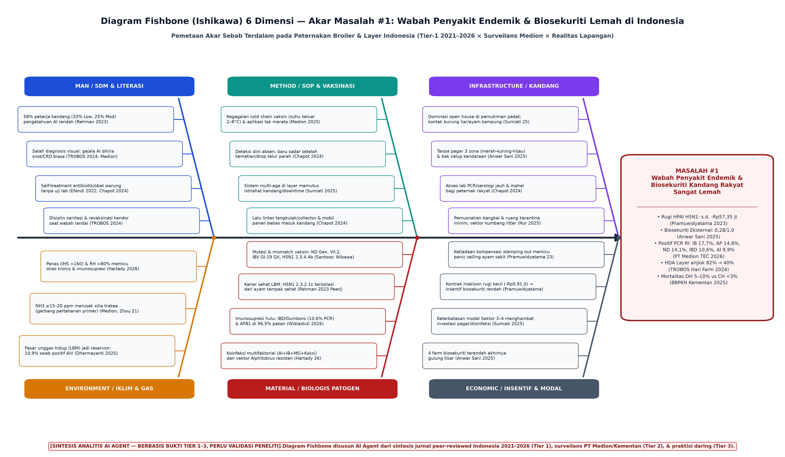
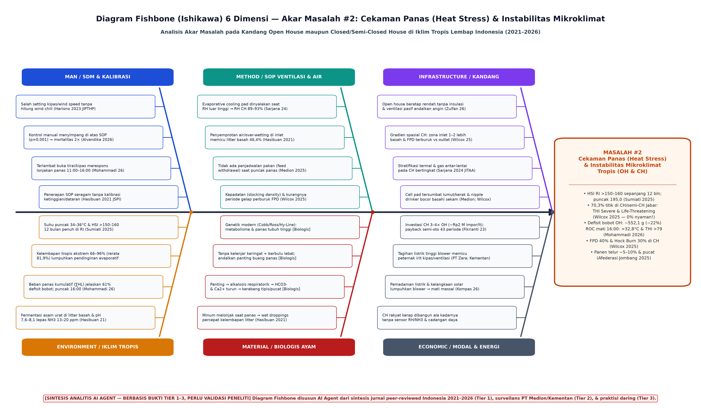
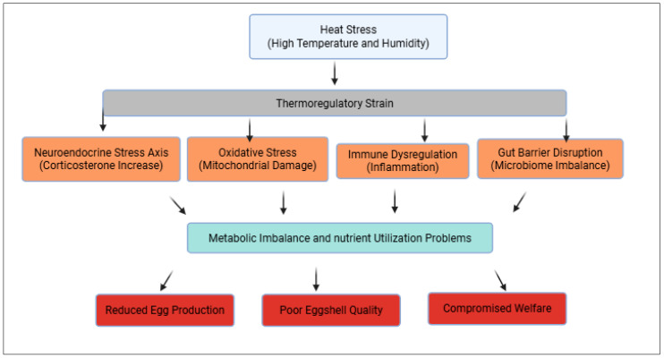
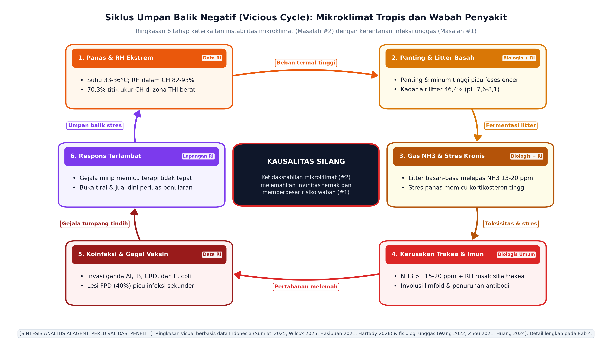
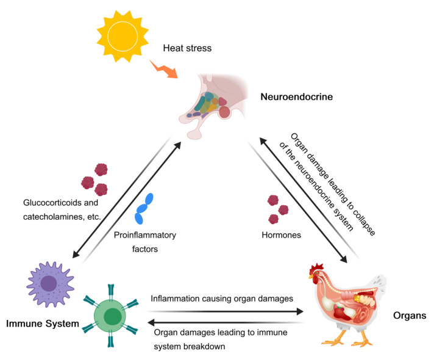

# DEEP ROOT CAUSE ANALYSIS (RCA): MASALAH #1 (WABAH PENYAKIT & BIOSEKURITI) DAN MASALAH #2 (HEAT STRESS & MIKROKLIMAT) DI PETERNAKAN UNGGAS INDONESIA

> **Status Tahapan:** *Root Cause Analysis (RCA)* Mendalam — Tim Asprak, Hackathon Deep Tech UNJ 2026, Jalur Pangan `D-FARM UNJ` (Challenge #1: *Smart Poultry / Smart Egg Production*).  
> **Batasan Ketat Dokumen:** Dokumen ini **100% murni berfokus pada penggalian akar penyebab permasalahan (*Root Cause Analysis*)** untuk **Masalah #1** dan **Masalah #2** hasil triangulasi V3 pada peternakan ayam pedaging (*broiler*) dan petelur (*layer*) di Indonesia. Dokumen ini **sama sekali tidak mengusulkan solusi, konsep proyek, nama produk, fitur aplikasi, desain perangkat IoT/CV, maupun arsitektur Hackathon**, serta mengecualikan seluruh topik pengolahan limbah/sampah dan jalur kesehatan (`D-MARC`). Arsip `01_Context_Memory/` dan `02_Problem_Research/` dipertahankan utuh tanpa perubahan.

---

## 1. Ringkasan Eksekutif & Metodologi RCA

### A. Ruang Lingkup & Sinkronisasi Angka Audit V3
Analisis RCA ini membedah secara mendalam dua masalah teknis-operasional paling stabil (invarian peringkat #1 dan #2 pada seluruh skema uji sensitivitas V3) di sektor perunggasan Indonesia:
1. **Masalah #1:** Wabah Penyakit Endemik & Lemahnya Biosekuriti Kandang Rakyat.
2. **Masalah #2:** Cekaman Panas (*Heat Stress*) & Instabilitas Mikroklimat Tropis (baik pada kandang *open house* maupun *closed/semi-closed house*).
3. **Kausalitas Silang (#2 ↔ #1):** Lingkaran setan (*vicious cycle*) bagaimana instabilitas mikroklimat tropis secara langsung meruntuhkan pertahanan biologis ternak dan memicu ledakan wabah penyakit.

**Sinkronisasi Angka Presisi Audit Lampiran V3:**
- `Mohammadi et al. (2026)` **Table 6** (`L10b` Lampiran V3): ambang (*cut-off*) analisis ROC prediktor mortalitas broiler pada pukul 16:00 adalah **suhu `>32,8°C`** (`AUC = 0,694`, `p = 0,026`) dan **THI `>79`** (`AUC = 0,709`, `p = 0,016`).
- `Rehman et al. (2023)` **Figure 2** (`L20` Lampiran V3): sebanyak **`58%` pekerja kandang unggas Indonesia** berada pada tingkat pengetahuan *Avian Influenza* kategori *Low–Moderate* (**`33% Low`**, **`25% Moderate`**; hanya `42% High`).

### B. Kerangka Kerja RCA & Standar Transparansi Peran AI Agent
Dokumen ini menerapkan tiga kerangka kerja RCA terpadu: **(1) Diagram Fishbone (Ishikawa) 6 Dimensi** (*Man/SDM*, *Method/SOP*, *Infrastructure/Kandang*, *Environment/Iklim*, *Material/Biologis*, *Economic/Insentif*), **(2) Analisis *5 Whys*** pada 6 sub-masalah kritis (3 per masalah), dan **(3) Peta Kausalitas Silang (*Vicious Cycle*)**.

`[SINTESIS ANALITIS AI AGENT — BERBASIS BUKTI TIER 1–3, PERLU VALIDASI PENELITI]` — *Legenda atribusi & pemisahan sumber dalam dokumen RCA.*

| Label Asal (*Provenance Tag*) | Definisi & Batas Penggunaannya dalam Dokumen RCA |
| :--- | :--- |
| **`[ASLI DARI SUMBER PRIMER]`** | Grafik/diagram asli yang diunduh langsung dari jurnal *Open Access* resmi tanpa digambar ulang oleh AI. |
| **`[DATA PRIMER TERVERIFIKASI — TABEL/VISUALISASI DISUSUN OLEH AI AGENT]`** | 100% angka, persentase, dan temuan empiris berasal dari jurnal *peer-reviewed* Tier-1 (2021–2026) atau data resmi BPS/Kementan/PT Medion (Tier-2); AI Agent menyusun format tabel/ringkasannya. Data lapangan Indonesia dipisahkan tegas dari mekanisme fisiologi/patologi dasar yang diberi label **`[Mekanisme Biologis Umum]`**. |
| **`[SUARA LAPANGAN DARING (YOUTUBE/BERITA/INTERNET) — NON-PEER-REVIEWED]`** | Hasil penelusuran wawancara peternak, webinar praktisi/dokter hewan lapangan, dan media industri perunggasan Indonesia (YouTube, TROBOS Livestock, Afederasi, Kompasiana) untuk validasi mekanisme operasional harian. |
| **`[SINTESIS ANALITIS AI AGENT — BERBASIS BUKTI TIER 1–3, PERLU VALIDASI PENELITI]`** | Seluruh diagram Fishbone, rantai *5 Whys*, pemetaan *Vicious Cycle*, klasifikasi *controllable on-farm* vs *struktural*, serta sintesis titik akar terdalam yang disusun AI Agent untuk diuji melalui wawancara primer Tim Asprak. |

---

## 2. Root Cause Analysis Mendalam — Masalah #1: Wabah Penyakit Endemik & Lemahnya Biosekuriti Kandang Rakyat

*`[SINTESIS ANALITIS AI AGENT — BERBASIS BUKTI TIER 1–3, PERLU VALIDASI PENELITI]` Pemetaan 6 dimensi Ishikawa akar penyebab wabah penyakit endemik & lemahnya biosekuriti di peternakan unggas Indonesia.*

### 2.1. Peta Akar Masalah 6 Dimensi (Masalah #1)
`[DATA PRIMER TERVERIFIKASI — TABEL/VISUALISASI DISUSUN OLEH AI AGENT]`

| Dimensi | Akar Masalah Spesifik | Mekanisme Kejadian di Lapangan | Bukti Empiris & Label Cakupan | Sumber (DOI / URL) |
| :--- | :--- | :--- | :--- | :--- |
| **1. *Man* (SDM & Literasi)** | **Kesenjangan literasi penyakit & biosekuriti pekerja kandang** | Pekerja kandang (ABK) dan peternak kecil belum memahami jalur transmisi patogen, protokol 3 zona, serta perbedaan gejala klinis antar-penyakit pernapasan/viral. | `[Survei Multi-Farm / Regional — 200 pekerja unggas RI]` **`58%` pekerja** berada di tingkat pengetahuan AI *Low–Moderate* (**`33% Low`**, **`25% Moderate`**; hanya `42% High`). | [Rehman et al., *PeerJ* Q1 (2023)](https://doi.org/10.7717/peerj.14600) |
| **1. *Man* (SDM & Literasi)** | **Diagnosis visual spekulatif & kebiasaan *self-treatment*** | Saat ayam ngorok/lesu, peternak langsung menduga snot/CRD dan memberi antibiotik warung/toko obat secara berulang tanpa bedah bangkai terarah atau uji lab, sehingga wabah viral ganas (AI/ND/IB) baru disadari setelah kematian melonjak. | `[Survei Multi-Farm — 132 broiler Bogor]` **`75,0%`** memakai antibiotik untuk *flushing* & **`56,1%`** profilaksis; hanya `8,3%` terapi terarah. `[Survei 56 stakeholder 5 provinsi]` Ketergantungan tinggi pada *poultry shop* & TSO swasta. `[Berita Lapangan — Hari Farm 10.000 layer]` AI awalnya dikira snot → kematian 4→80 ekor/hari, HDA anjlok **82%→40%**. | [Efendi et al., *Vet. World* Q1 (2022)](https://doi.org/10.14202/vetworld.2022.707-713); [Chapot et al., *PLOS ONE* Q1 (2024)](https://doi.org/10.1371/journal.pone.0308379); [TROBOS (2024)](https://troboslivestock.com/virus-ai-terus-mengintai/) |
| **2. *Method* (SOP, Vaksinasi & Lalu Lintas)** | **Kegagalan *cold chain* & aplikasi vaksin tidak seragam** | Vaksin aktif/inaktif rusak selama distribusi/penyimpanan karena suhu keluar rentang **2–8°C**, paparan klorin/disinfektan pada air minum, atau teknik tetes/minum tidak merata sehingga titer antibodi flok belang (*CV* tinggi). | `[Buletin Teknis Nasional — Tier 2]` PT Medion menegaskan kerusakan *cold chain* di luar **2–8°C** dan kekeliruan *handling* menurunkan potensi antigen sebelum aplikasi. `[Studi Kasus Lokal — Majalengka]` Titer ELISA IB hari ke-28 menunjukkan **CV `256%`** (sangat tidak seragam akibat infeksi lapang + gagal proteksi merata). | [PT Medion — Kualitas Vaksin (2025)](https://www.medion.co.id/info-medion/tips-jitu-menjaga-kualitas-vaksin/); [Hartady et al., *Vet. Sci.* Q1 (2026)](https://doi.org/10.3390/vetsci13040364) |
| **2. *Method* (SOP, Vaksinasi & Lalu Lintas)** | **Sistem *multi-age* pada layer & lalu lintas tengkulak (*collector*) bebas masuk** | Pada peternakan layer rakyat, banyak kelompok umur ayam dipelihara bersamaan dalam satu lokasi sehingga **istirahat kandang (*downtime* / *all-in all-out*) tidak pernah terjadi**; sementara kendaraan/keranjang tengkulak ayam hidup (*collector*) berpindah antar-farm dan pasar unggas hidup (LBM) tanpa disinfeksi. | `[Survei Multi-Farm — 19 farm Jabar]` Skor **biosekuriti eksternal terburuk: `0,28/1,0`**, disusul **pergerakan & pembelian `0,48/1,0`** dan **pekerja & peralatan `0,50/1,0`**. `[Surveilans LBM — 7 pasar tradisional 4 kabupaten Jatim]` **`10,9%` (17/156)** swab permukaan alat (pisau, talenan, lap) positif Influenza A termasuk reassortant H9N2. | [Anwar Sani et al., *Poult. Sci.* Q1 (2025)](https://doi.org/10.1016/j.psj.2025.106010); [Dharmayanti et al., *Vet. World* Q1 (2025)](https://doi.org/10.14202/vetworld.2025.955-968); [Sumiati et al., *Anim. Biosci.* Q1 (2025)](https://doi.org/10.5713/ab.24.0678) |
| **2. *Method* (SOP, Vaksinasi & Lalu Lintas)** | **Absennya pemantauan indikator dini & lambatnya akses diagnostik lab** | Peternak tidak memantau deviasi harian *feed/water intake*, pola suara napas, atau tren kematian awal secara terstruktur; sementara akses laboratorium PCR/serologi jauh, berbiaya tinggi, dan pelaporan data terputus (*silo*) antara peternak mandiri, *poultry shop*, dan Dinas. | `[Survei Kualitatif 5 Provinsi RI]` Peta jaringan informasi kesehatan menunjukkan peternak mandiri terputus dari surveilans dini dan lab diagnostik; pelaporan ke Dinas rendah karena takut penutupan kandang/stigma. | [Chapot et al., *Prev. Vet. Med.* Q1 (2023)](https://doi.org/10.1016/j.prevetmed.2023.106003); [Chapot et al., *PLOS ONE* Q1 (2024)](https://doi.org/10.1371/journal.pone.0308379) |
| **3. *Infrastructure* (Kandang & Fasilitas)** | **Kandang *open house* di tengah pemukiman padat tanpa zonasi 3 lapis** | Mayoritas kandang rakyat (Sektor 3–4) berdinding terbuka, berjarak rapat dengan rumah/kandang tetangga dan unggas kampung lepas, tanpa pagar keliling, ruang ganti, *footbath*, bak celup roda kendaraan, maupun fasilitas karantina/pemusnahan bangkai. | `[Data Nasional / Review RI]` ~40% produksi nasional berasal dari >1 juta peternak kecil–menengah dominan *open house*; kontak terbuka dengan burung liar & unggas kampung mematahkan pertahanan biosekuriti farm bertetangga. | [Sumiati et al., *Anim. Biosci.* Q1 (2025)](https://doi.org/10.5713/ab.24.0678); [PT Medion — Biosekuriti 3 Zona (2025)](https://www.medion.co.id/en/info-medion/closed-house-and-biosecurity-collaboration/) |
| **4. *Environment* (Iklim, Gas & Reservoir)** | **Tekanan mikroklimat ekstrem, gas NH₃ tinggi & reservoir LBM** | Suhu tinggi (`IHS >160`), RH `>80%`, dan akumulasi NH₃ (`15–20 ppm`) merusak silia trakea dan memicu imunosupresi (lihat Bagian 4); sementara pasar unggas hidup (LBM) & ayam kampung tidak divaksin berperan sebagai reservoir permanen virus ND & AI. | `[Studi Kasus Lokal — Majalengka]` NH₃ **`20 ppm`**, RH **`>80%`**, IHS **`>160`** menyertai koinfeksi AI H5+H9+IB+MG+Koksidiosis. `[Surveilans LBM Jatim]` Virus H5N1 clade 2.3.2.1c diisolasi dari **ayam tampak sehat** di LBM. | [Hartady et al., *Vet. Sci.* Q1 (2026)](https://doi.org/10.3390/vetsci13040364); [Rehman et al., *PeerJ* Q1 (2023b)](https://doi.org/10.7717/peerj.14917); [TROBOS — Prof. Suwarno Unair (2024)](https://troboslivestock.com/sambang-kandang-nd-dihadang/) |
| **5. *Material* (Biologis Patogen, Vektor & Mikotoksin)** | **Evolusi/mutasi strain virus lapang (*vaccine mismatch*)** | Sirkulasi **NDV Genotipe VII / VII.2**, **IBV GI-19 (*QX-like*)** dengan 31 substitusi & 2 delesi asam amino S1, **LPAI H9N2** yang mengalami *antigenic drift* & reassortment di LBM, serta masuknya **HPAI H5N1 clade 2.3.4.4b** menurunkan daya lindung vaksin klasik non-homolog. | `[Studi Molekuler Jawa — 2024]` Seluruh isolat IBV komersial (*breeder/broiler/layer*) teridentifikasi **GI-19 (QX-like)** (identitas asam amino 87–100%). `[Surveilans Kalsel — 2024]` Deteksi perdana **H5N1 clade 2.3.4.4b** di itik domestik RI. `[Review Nasional]` NDV Genotipe VII tetap mendominasi wabah pada flok tervaksin. | [Santoso et al., *HAYATI* S1/Q2 (2024)](https://doi.org/10.4308/hjb.31.3.414-424); [Wibawa et al., *Emerg. Infect. Dis.* Q1 (2024)](https://doi.org/10.3201/eid3003.230973); [Dharmayanti et al., *JVS* Q2 (2024)](https://doi.org/10.4142/jvs.23022); [Rehman et al., *F1000Res.* Q1/Q2 (2022)](https://doi.org/10.12688/f1000research.118669.2) |
| **5. *Material* (Biologis Patogen, Vektor & Mikotoksin)** | **Imunosupresi hulu (IBD/Gumboro & Aflatoksin B1) serta vektor kumbang *litter*** | Infeksi subklinis **IBD/Gumboro** merusak *Bursa Fabricius*, sementara kontaminasi **Aflatoksin B1 (AFB1)** kronis pada pakan menekan respon imun vaksin; di lantai kandang, kumbang *litter* **`Alphitobius diaperinus`** yang telah resisten insektisida sintetik menyimpan patogen antar-siklus. | `[Surveilans PCR Nasional — PT Medion 2026]` IBD/Gumboro **`10,6%`** (peringkat #4 PCR nasional). `[Survei Pakan — Bogor & Bekasi, n=86 pakan + 63 bahan]` AFB1 terdeteksi di **`96,51%` pakan jadi**, **`78,00%` jagung** (median melonjak **`126,09 μg/kg`** di 2024 = **2,5× batas SNI `50 μg/kg`**), & **`76,92%` dedak**. `[Studi Vektor RI]` *A. diaperinus* persisten & resisten insektisida sintetik. | [PT Medion TEC (2026)](https://www.medion.co.id/en/info-medion/overview-of-poultry-disease-analysis-2025-disease-projection-2026/); [Widiastuti et al., *Vet. Med. Int.* Q2 (2026)](https://doi.org/10.1155/vmi/1687482); [Nur & Widiyaningrum, *JIPI* S2 (2025)](https://doi.org/10.18343/jipi.30.3.517) |
| **6. *Economic* (Insentif & Modal)** | **Ketiadaan kompensasi *stamping out*, asimetri kontrak *makloon*, & keterbatasan modal** | Tanpa skema kompensasi pemerintah, *stamping out* merugikan peternak mandiri hingga **−Rp57,35 juta** vs *panic selling* ke pasar ayam sakit (**−Rp22,89 juta**), sehingga peternak rasional secara ekonomi memilih menjual ayam sakit. Pada kontrak *makloon*, kerugian petani kecil (**−Rp0,91 juta**) sehingga rendah insentif berinvestasi biosekuriti. | `[Pemodelan Bio-Ekonomi Jabar — 2023]` *Gross margin* normal Rp5,28 jt → `stamp-15`: **−Rp57,35 jt**, `none-8`: **−Rp53,89 jt**, `early-8`: **−Rp22,89 jt**; *makloon*: **−Rp0,91 jt**. `[Kohort 19 Farm Jabar]` Seluruh **4 farm dengan skor biosekuriti terendah akhirnya bangkrut/tutup**. | [Pramuwidyatama et al., *Prev. Vet. Med.* Q1 (2023)](https://doi.org/10.1016/j.prevetmed.2022.105833); [Anwar Sani et al., *Poult. Sci.* Q1 (2025)](https://doi.org/10.1016/j.psj.2025.106010) |

---

### 2.2. Bedah *5 Whys* untuk 3 Sub-Masalah Kritis (Masalah #1)
`[SINTESIS ANALITIS AI AGENT — BERBASIS BUKTI TIER 1–3, PERLU VALIDASI PENELITI]`

#### (a) Mengapa kepatuhan biosekuriti eksternal kandang rakyat sangat rendah (`0,28/1,0`)?
1. **Why 1 — Mengapa skor biosekuriti eksternal hanya `0,28` (`Anwar Sani 2025`)?** Karena orang luar (tengkulak/*collector*, sopir truk pakan/panen, tetangga), kendaraan, keranjang bekas LBM, dan hewan liar bebas keluar-masuk area kandang tanpa pagar pembatas 3 zona maupun disinfeksi ketat.
2. **Why 2 — Mengapa peternak membiarkan tengkulak & kendaraan panen masuk langsung ke mulut kandang?** Karena transaksi panen *livebird*/telur rakyat masih mengandalkan sistem jemput-kandang oleh tengkulak/*broker*, sementara kandang rakyat tidak memiliki *loading dock* terpisah di zona merah/luar.
3. **Why 3 — Mengapa kandang rakyat tidak memiliki pagar 3 zona, ruang karantina, atau tata letak terisolasi?** Karena keterbatasan lahan & modal kerja peternak Sektor 3–4 (margin normal hanya ~Rp5,28 jt/siklus pada skala 3.000 ekor; `Pramuwidyatama 2023`), lokasi kandang *open house* sudah terlanjur menyatu di tengah pemukiman padat, dan pada layer rakyat diterapkan pola *multi-age* demi arus kas harian.
4. **Why 4 — Mengapa peternak tidak melihat urgensi mengeluarkan biaya & tenaga tambahan untuk disiplin akses harian?** Karena pada skema kemitraan *makloon* risiko kerugian wabah lebih banyak ditanggung inti (*makloon* hanya rugi −Rp0,91 jt; `Pramuwidyatama 2023`), `58%` pekerja memiliki literasi penyakit *Low–Moderate* (`Rehman 2023`), dan peternak merasa "aman" mengandalkan antibiotik profilaksis murah (`0,47%–1,62%` biaya total; `Anwar Sani 2026`).
5. **Why 5 (Akar Terdalam) — Mengapa pola pikir & struktur insentif itu bertahan puluhan tahun?** **Karena tidak ada insentif ekonomi/premi harga pasar yang memberi imbalan atas sertifikasi biosekuriti di tingkat peternak rakyat, disertai tidak adanya pengawasan akses berbasis data harian dan ketiadaan penegakan standar sanitasi rantai pasok *collector*–LBM.**

#### (b) Mengapa wabah tetap berulang/jebol meski peternak sudah melakukan vaksinasi?
1. **Why 1 — Mengapa flok yang sudah divaksinasi ND, IB, atau AI tetap terkena wabah?** Karena titer antibodi protektif gagal terbentuk secara merata (misal **CV antibodi IB mencapai `256%`** pada kasus Majalengka; `Hartady 2026`) atau antibodi yang terbentuk tidak mampu menetralisir virus lapang.
2. **Why 2 — Mengapa titer antibodi gagal terbentuk atau tidak mampu menetralisir virus lapang?** Ada tiga jalur pemicu simultan: **(i) kerusakan/ketidaktepatan aplikasi vaksin**, **(ii) ketidakcocokan (*mismatch*) strain vaksin vs virus lapang**, dan **(iii) imunosupresi pada tubuh ayam**.
3. **Why 3 — Mengapa ketiga pemicu itu terjadi serempak di kandang Indonesia?** (i) *Cold chain* vaksin (`2–8°C`) sering putus saat distribusi/penyimpanan di toko obat hingga kandang, serta aplikasi lewat air minum tidak seragam/terpapar klorin (`Medion 2025`); (ii) virus lapang terus bermutasi — **IBV GI-19 (*QX-like*)** (`Santoso 2024`), **NDV Genotipe VII.2**, **LPAI H9N2** reassortant LBM (`Rehman 2022; Dharmayanti 2025`), dan **HPAI H5N1 clade 2.3.4.4b** (`Wibawa 2024`); (iii) imunitas ayam dirusak sejak awal oleh **IBD/Gumboro** (`10,6%` PCR nasional), **Aflatoksin B1** pada **`96,51%`** pakan & jagung (`126,09 μg/kg`; `Widiastuti 2026`), serta stres panas & NH₃ tinggi (`Hartady 2026`).
4. **Why 4 — Mengapa tekanan virus lapang (*challenge dose*) tetap mengalahkan antibodi flok?** Karena biosekuriti eksternal rendah (`0,28`), sistem *multi-age* dan kumbang *litter* (`Alphitobius diaperinus`) menjaga patogen terus bertahan di kandang, sementara *panic selling* dan LBM (`10,9%` swab positif AIV; karier sehat H5N1) memompa ulang beban virus ke wilayah sekitar.
5. **Why 5 (Akar Terdalam) — Mengapa peternak tidak menyadari kebocoran proteksi vaksin sebelum wabah meledak?** **Karena sebagian besar peternak rakyat tidak melakukan pemantauan *cold chain*, pemantauan kondisi imunosupresif kandang (mikroklimat/NH₃/pakan), maupun uji serologi/titer berkala — sehingga vaksinasi diperlakukan sebagai rutinitas administratif, bukan sistem proteksi berbasis bukti.**

#### (c) Mengapa deteksi penyakit di kandang hampir selalu terlambat & memicu mortalitas/kerugian besar?
1. **Why 1 — Mengapa kerugian per wabah membengkak ekstrem (HDA anjlok `82%→40%` di Hari Farm; rugi s.d. `−Rp57,35 juta`)?** Karena peternak baru mengambil tindakan isolasi/pengobatan/revaksinasi setelah kematian melonjak drastis atau produksi telur telanjur jatuh dalam.
2. **Why 2 — Mengapa tanda awal wabah terlewatkan pada 24–72 jam pertama?** Karena deteksi di kandang rakyat masih 100% mengandalkan **pengamatan visual/pendengaran sesaat oleh ABK** (baru sadar ketika ayam sudah mati berjejer atau ngorok parah), bukan pelacakan deviasi indikator dini seperti penurunan tiba-tiba *feed/water intake*, perubahan pola aktivitas/bergerombol, atau kenaikan suhu/deplesi harian.
3. **Why 3 — Mengapa saat gejala klinis awal muncul, penanganan tetap sering keliru?** Karena penyakit unggas di Indonesia umumnya muncul sebagai **koinfeksi multifaktorial dengan gejala tumpang tindih** (AI H9, IB, ND, Snot/Coryza, dan CRD sama-sama bergejala ngorok, mata berair, lesu, dan turun telur; `Hartady 2026`; kasus Hari Farm AI dikira snot, `TROBOS 2024`).
4. **Why 4 — Mengapa peternak tidak langsung mengonfirmasi ke laboratorium diagnostik?** Karena fasilitas uji PCR/serologi jauh secara geografis, biaya uji terasa mahal dibanding margin tipis, hasil uji memakan waktu beberapa hari, dan terdapat kekhawatiran stigma/penutupan usaha jika melapor ke otoritas (`Chapot 2023, 2024`).
5. **Why 5 (Akar Terdalam) — Mengapa keterlambatan deteksi ini justru memperluas wabah ke skala regional?** **Karena ketika keterlambatan deteksi berujung pada kematian masif tanpa jaring pengaman kompensasi *stamping out*, satu-satunya rasionalitas ekonomi peternak mandiri untuk meminimalkan kebangkrutan adalah *panic selling* ayam sakit ke tengkulak/LBM (`Pramuwidyatama 2023`), yang menyebarkan patogen ke peternakan lain.**

---

### 2.3. Validasi Praktis Lapangan — Masalah #1
`[SUARA LAPANGAN DARING (YOUTUBE/BERITA/INTERNET) — NON-PEER-REVIEWED]`

| No | Kanal & Narasumber (Tahun) | Validasi Akar Masalah #1 di Lapangan Indonesia | Tautan Terverifikasi (`HTTP 200`) |
| :-: | :--- | :--- | :--- |
| 1 | **TROBOS Livestock** — Wawancara Hari Wibowo (*Hari Farm*, 10.000 layer, Mar 2024) | Mengonfirmasi **jebakan kemiripan gejala & deteksi terlambat**: wabah AI awalnya dikira snot biasa sehingga terlambat direspons; kematian melonjak dari 4 menjadi 80 ekor/hari (300 ekor/bulan) dan HDA jatuh `82% → 60% → 40%`. | [TROBOS Livestock (2024)](https://troboslivestock.com/virus-ai-terus-mengintai/) |
| 2 | **TROBOS Livestock** — Seminar Prof. Suwarno (FKH Unair, Mei 2024) | Mengonfirmasi **reservoir & mutasi ND**: virus ND di RI didominasi genotipe I, II, VI, dan VII; ayam kampung lepas tak tervaksin menjadi reservoir persisten, sementara penumpukan amonia dan kelalaian revaksinasi saat wabah landai memicu *outbreak* berulang. | [TROBOS Livestock (Mei 2024)](https://troboslivestock.com/sambang-kandang-nd-dihadang/) |
| 3 | **YouTube — Satwa Media Group** (*Poultry TechniClass #10*, Jan 2023 & *Layer Vaksinasi*, Nov 2021) | Praktisi industri membedah faktor kegagalan vaksinasi broiler & layer di lapangan RI: ketidaksesuaian jadwal terhadap antibodi maternal, kerusakan *cold chain*, kualitas air pelarut, dan infeksi imunosupresif. | [YouTube Broiler (2023)](https://www.youtube.com/watch?v=Bu-VtEhSy5A) \| [YouTube Layer (2021)](https://www.youtube.com/watch?v=iusRcz6AymM) |
| 4 | **YouTube — Medion Indonesia × Farmsco** (drh. Fakhri Husain, Feb 2023) & **BARA PS** (Feb 2022) | Menekankan di lapangan peternak kerap hanya mengandalkan vaksinasi tanpa disiplin biosekuriti 3 zona (*isolasi, kontrol lalu lintas, sanitasi*), sehingga tantangan bibit penyakit di kandang tetap menjebol kekebalan vaksin. | [YouTube Medion (2023)](https://www.youtube.com/watch?v=i-reMJvs0-k) \| [YouTube BARA PS (2022)](https://www.youtube.com/watch?v=JrCKbkL4DMk) |
| 5 | **YouTube — Edufarmers** (Pak Fatkul, Okt 2023), **FARM SULUNG** (Mei 2023), & **BaLe Saba** (Agu 2022) | Peternak rakyat mengeluhkan kerugian belasan juta/siklus akibat penyakit, ngorok layer tak kunjung sembuh meski berulang kali diobati, serta serangan koksidiosis yang bahkan tetap menembus *closed house* dan membengkakkan FCR. | [Edufarmers](https://www.youtube.com/watch?v=lvuE-meEgkE) \| [FARM SULUNG](https://www.youtube.com/watch?v=jq6ERRpfYQc) \| [BaLe Saba](https://www.youtube.com/watch?v=bMMVM-WQkUs) |

---

### 2.4. Kesimpulan Inti Masalah #1 (*Controllable On-Farm* vs Struktural)
`[SINTESIS ANALITIS AI AGENT — BERBASIS BUKTI TIER 1–3, PERLU VALIDASI PENELITI]`

**4 Poin Kunci Akar Penyebab Terdalam Masalah #1:**
1. **Biosekuriti Eksternal adalah Mata Rantai Terlemah (`0,28/1,0`):** Masuknya patogen bukan kebetulan, melainkan konsekuensi langsung dari lalu lintas bebas tengkulak/kendaraan LBM, tata letak *open house* rapat pemukiman, dan pola *multi-age* tanpa *downtime*.
2. **Vaksinasi Jebol karena Kombinasi 3 Kegagalan Berantai:** Putusnya rantai dingin (`2–8°C`) & aplikasi tak merata + ketidakcocokan strain lapang (ND VII.2, IBV GI-19 QX, H5N1 2.3.4.4b, H9N2) + imunosupresi kronis (IBD, AFB1 pada `96,51%` pakan, serta stres mikroklimat/NH₃).
3. **Deteksi Dini Absen di Tingkat Kandang:** Kemiripan gejala koinfeksi (AI/IB/ND/CRD/Snot) ditambah ketergantungan pada pengamatan kasatmata dan ketiadaan pencatatan deviasi harian menyebabkan intervensi selalu terlambat 2–5 hari.
4. **Insentif Ekonomi Melanggengkan Wabah Regional:** Tanpa kompensasi *stamping out*, *panic selling* menjadi pilihan rasional peternak mandiri, sementara kontrak *makloon* melemahkan dorongan investasi biosekuriti peternak plasma.

| Kategori Kendali | Akar Masalah Spesifik pada Masalah #1 |
| :--- | :--- |
| **Operasional Kandang (*Controllable On-Farm*)** | • Deteksi dini deviasi kesehatan/perilaku/*intake* harian yang belum ada. • Disiplin kontrol akses tamu/tengkulak, sanitasi peralatan, karantina, & pengendalian vektor *A. diaperinus*. • Ketepatan penanganan *cold chain* (2–8°C) & teknik aplikasi vaksin di kandang. • Pencegahan imunosupresi kandang (kontrol mikroklimat/NH₃ & manajemen penyimpanan pakan anti-AFB1). • Literasi operasional ABK (`58%` masih *Low–Moderate*). |
| **Struktural / Kebijakan (*Beyond Farm Control*)** | • Ketiadaan skema kompensasi pemerintah untuk *stamping out* HPAI. • Struktur rantai pasok LBM tradisional (`10,9%` swab positif AIV) & keberadaan unggas kampung tak tervaksin. • Desain pembagian risiko kontrak *makloon* & keterbatasan akses pembiayaan modal Sektor 3–4. • Evolusi genetik virus lintas regional & ketersediaan vaksin homolog nasional serta distribusi fasilitas lab PCR daerah. |

---

## 3. Root Cause Analysis Mendalam — Masalah #2: Cekaman Panas (*Heat Stress*) & Instabilitas Mikroklimat Tropis

*`[SINTESIS ANALITIS AI AGENT — BERBASIS BUKTI TIER 1–3, PERLU VALIDASI PENELITI]` Pemetaan 6 dimensi Ishikawa akar penyebab cekaman panas & instabilitas mikroklimat pada kandang open house maupun closed/semi-closed house di Indonesia.*

*`[ASLI DARI SUMBER PRIMER]` `[Mekanisme Biologis Umum]` **Figure 1** dari [Idowu et al., *Animals* Q1 (2026, `PMC13072026`)](https://doi.org/10.3390/ani16071001) — Kerangka terpadu dampak fisiologis cekaman panas (suhu & kelembapan tinggi → beban termoregulasi → lonjakan kortikosteron, stres oksidatif, disregulasi imun, gangguan sawar usus → penurunan produksi & kualitas kerabang telur).*

### 3.1. Peta Akar Masalah 6 Dimensi (Masalah #2 — Mencakup *Open House* & *Closed/Semi-Closed House*)
`[DATA PRIMER TERVERIFIKASI — TABEL/VISUALISASI DISUSUN OLEH AI AGENT]`

| Dimensi | Akar Masalah Spesifik | Mekanisme Kejadian di Lapangan | Bukti Empiris & Label Cakupan | Sumber (DOI / URL) |
| :--- | :--- | :--- | :--- | :--- |
| **1. *Man* (SDM & Kalibrasi Operasional)** | **Kesalahan *setting* kipas/*wind speed* & abai *wind chill effect*** | Operator kandang *closed house* mengatur jumlah kipas hanya melihat angka suhu termometer tanpa menghitung *wind chill* berdasarkan umur & bobot ayam — memicu kedinginan di *brooding* atau panas berlebih di *finisher*. | `[Studi Kasus Lokal — CH Komersial RI]` Kesalahan pengaturan kecepatan angin kipas lantai 1 menurunkan suhu efektif di bawah zona termonetral fase awal, menghambat pertumbuhan dan menurunkan Indeks Performa (IP). | [Hariono et al., *JIPTHP* IPB S2 (2023)](https://doi.org/10.29244/jipthp.11.1.34-40) |
| **1. *Man* (SDM & Kalibrasi Operasional)** | **Kontrol manual reaktif menyimpang dari SOP & terlambat merespons puncak panas sore** | Pada *open house* maupun *closed house* kontrol manual, ABK baru membuka tirai/menyalakan kipas saat ayam sudah *panting* berat; pada *closed house*, penyimpangan suhu manual di atas SOP menggandakan mortalitas. | `[Studi Kasus Lokal — 4.200 CP-707 CH]` Kontrol manual menyimpang signifikan di atas SOP (`p = 0,001`) dengan mortalitas **`5,09%` vs `2,36%`** saat terkendali stabil (`p = 0,005`). `[Studi Kasus Lokal — Jateng]` Risiko kematian melonjak signifikan saat **suhu 16:00 `>32,8°C`** (`AUC 0,694`, `p = 0,026`) & **THI 16:00 `>79`** (`AUC 0,709`, `p = 0,016`). | [Alvandika et al., *JIPI* S2 (2026)](https://doi.org/10.18343/jipi.31.4.718); [Mohammadi et al., *AAVS* Q3 (2026)](https://doi.org/10.17582/journal.aavs/2026/14.5.1100.1111) |
| **1. *Man* (SDM & Kalibrasi Operasional)** | **Penerapan SOP seragam (*copy-paste*) lintas ketinggian wilayah** | Kemitraan/peternak menerapkan SOP ventilasi & pembasahan yang sama di dataran rendah (0–400 mdpl), sedang, dan tinggi (>700 mdpl) padahal input suhu & RH makroklimat berbeda drastis. | `[Survei Multi-Lokasi — Demak, Gunungpati, Ampel]` Dengan SOP identik, perbedaan ketinggian memengaruhi kadar air *litter* (`46,42%` dataran rendah vs `22,86%` tinggi, `p < 0,0001`), pH (`7,10–8,13`, `p < 0,0001`), suhu *litter* (`32,35°C` siang), & NH₃ (`13,11–14,94 ppm` hari ke-28). | [Hasibuan et al., *JSPI* S2 (2021)](https://doi.org/10.31186/jspi.id.16.2.171-179) |
| **2. *Method* (SOP Ventilasi, Air & Pakan)** | **Pengoperasian *evaporative cooling pad* tanpa kontrol batas RH** | Di udara tropis berkelembapan tinggi (80%–96%), penyiraman *cooling pad* terus-menerus tanpa mempertimbangkan kelembapan justru menjenuhkan udara dengan uap air (RH dalam CH melesat ke `89%–93%`), melumpuhkan kemampuan ayam membuang panas lewat penguapan napas dan membasahi *litter* area *inlet*. | `[Survei Multi-Farm — 14 CH/semi-CH Jabar]` **`0,0%`** titik ukur di zona nyaman; **`62,0%` *severe*** & **`8,3%` *life-threatening*** (`THI >85`); RH rerata **`81,9%`** (`66%–96%`). `[Studi CH 3-Lantai — 43.500 Ross RI]` RH dalam *closed house* minggu 3–4 mencapai **`89,57%–92,76%`** dengan HSI **`160,22–168,80`**. | [Wilcox et al., *Anim. Welf.* Q1 (2025)](https://doi.org/10.1017/awf.2025.10052); [Sarjana et al., *JITAA* S1/Q3 (2024)](https://doi.org/10.14710/jitaa.49.4.332-347) |
| **2. *Method* (SOP Ventilasi, Air & Pakan)** | **Kebiasaan darurat menyemprot air ke ayam/kandang & absennya pengaturan jam makan (*feed withdrawal*)** | Saat panas siang, peternak rakyat kerap menyemprot air langsung ke tubuh ayam atau tidak menghentikan pemberian pakan saat puncak panas — menaikkan kelembapan/amonia sekaligus memicu *heat increment* metabolik pencernaan. | `[Buletin Teknis Nasional — Tier 2]` PT Medion memperingatkan penyemprotan air langsung pada siang hari meningkatkan RH dan lonjakan NH₃; stres panas diperburuk jika pakan tetap diberikan pada jam panas puncak tanpa air dingin `20–24°C`. `[Survei Jabar]` `49,9%` flok CH dipelihara tanpa periode gelap (*0 dark hours*) yang memperburuk skor FPD. | [PT Medion — High Temperatures (2025)](https://www.medion.co.id/en/info-medion/hhandling-high-temperatures-during-the-day-in-the-chicken-coop/); [Wilcox et al., *Anim. Welf.* Q1 (2025)](https://doi.org/10.1017/awf.2025.10052) |
| **3. *Infrastructure* (Desain Kandang & Peralatan)** | **Kandang *open house* berventilasi pasif tanpa insulasi atap & kepadatan tinggi** | Atap seng/asbes rendah meradiasikan panas langsung ke ayam, sementara sirkulasi udara hanya bergantung pada angin luar; memasuki minggu 4–5 saat bobot dan panas metabolik flok memuncak, suhu kandang gagal turun di bawah 30–34°C. | `[Studi Kasus Lokal — 54.000 CP707 Aceh Utara]` Sejak minggu ke-4, *open house* kalah telak oleh panas: FCR minggu 4–5 membengkak **`2,06` vs `1,61`** (`p < 0,001`), bobot turun **`−15,9%`**, IP jatuh ke **`299`** (buruk) vs **`414`** (sangat baik) di CH. `[Studi Lokal Jateng]` Hanya **2 dari 35 hari** berada di zona termonetral (pukul 11:00 rerata `34,1°C`). | [Zulfan et al., *Acta Sci.* Q3 (2026)](https://doi.org/10.4025/actascianimsci.v48i1.74435); [Mohammadi et al., *AAVS* Q3 (2026)](https://doi.org/10.17582/journal.aavs/2026/14.5.1100.1111) |
| **3. *Infrastructure* (Desain Kandang & Peralatan)** | **Gradien spasial horizontal (*inlet–outlet*), stratifikasi vertikal bertingkat, *cell pad* tersumbat & *nipple* bocor** | Di dalam *closed house*, zona 1–2 dekat *inlet/cooling pad* lebih lembap dan kecepatan angin lebih rendah (`0,88 m/s` di zona 1 vs `2,10 m/s` di zona 2) sehingga *litter* basah & FPD terburuk; pada CH 3 lantai, paparan radiasi atap dan kecepatan aktivasi kipas menciptakan perbedaan mikroiklim & CO₂ (`1.532–2.180 ppm`) antar-lantai (`p < 0,05`); kerak/lumut *cell pad* dan kebocoran *nipple* memperparah kondisi. | `[Survei 14 CH Jabar, 84 titik]` Zona 1–2 (*inlet*) memiliki skor *litter* terburuk (`2,23` & `2,07`) serta FPD **`40%`** & *Hock Burn* **`30%`** (skor 3–4 tertinggi dekat pintu/*inlet*). `[Studi CH 3-Lantai Undip]` Perbedaan suhu, RH, THI, CO₂, dan kualitas *litter* antar-lantai signifikan (`p < 0,05`). | [Wilcox et al., *Anim. Welf.* Q1 (2025)](https://doi.org/10.1017/awf.2025.10052); [Sarjana et al., *JITAA* S1/Q3 (2024)](https://doi.org/10.14710/jitaa.49.4.332-347) |
| **4. *Environment* (Iklim Tropis & Kimia *Litter*)** | **Beban panas & kelembapan tropis ekstrem sepanjang 12 bulan** | Iklim ekuatorial Indonesia mempertahankan suhu maksimum **34–36°C** disertai kelembapan relatif **66%–96%** sepanjang tahun (tanpa musim dingin alami), menciptakan beban panas kumulatif mingguan (`∑HL`) yang tak pernah memberi jeda pemulihan fisiologis. | `[Data Nasional — 2023]` **HSI bulanan** Indonesia Barat **`155,52–165,42`** (maks **`187,84`**) & Timur **`150,00–166,40`** (maks **`195,00`**) melampaui zona nyaman (`<150–160`) di **12 dari 12 bulan**. `[Studi Jateng]` `∑HL` menjelaskan **`61%`** variasi defisit bobot (`B = -3,40`, `p < 0,001`; defisit **`−552,1 g`** / `−22%` di hari ke-35). | [Sumiati et al., *Anim. Biosci.* Q1 (2025), Table 6](https://doi.org/10.5713/ab.24.0678); [Mohammadi et al., *AAVS* Q3 (2026), Table 3](https://doi.org/10.17582/journal.aavs/2026/14.5.1100.1111) |
| **5. *Material* (Biologis Ayam Modern)** | **Kerentanan genetik ayam modern, ketiadaan kelenjar keringat, & mekanisme *panting* → alkalosis respiratorik** | Ayam broiler/layer modern diseleksi untuk laju metabolisme tinggi, berbulu lebat, dan **tidak memiliki kelenjar keringat**. Untuk membuang panas, ayam melakukan *panting* hingga **151 napas/menit** → CO₂ darah keluar berlebihan → **alkalosis respiratorik** → ginjal membuang bikarbonat (`HCO₃⁻`) & elektrolit → ketersediaan `Ca²⁺` & `HCO₃⁻` di kelenjar kerabang turun → **kerabang tipis/pucat/retak**; konsumsi air melonjak drastis → **feses encer (*wet droppings*)**. | `[Mekanisme Biologis Umum — Review Scopus Q1]` Kaskade *panting* → alkalosis respiratorik → penurunan deposisi kalsium kerabang & penurunan *feed intake*; aktivasi aksis HPA → lonjakan kortikosteron. `[Data Indonesia]` Frekuensi *panting* pada broiler Jabar melonjak hingga **~70% ayam** saat suhu menyentuh **`33,3°C`** (`Wilcox 2025`, Fig. 8); HDP layer Blitar tertekan suhu panas ke **`63%`** vs Payakumbuh `68%` (`Ilham 2021`). | [Idowu et al., *Animals* Q1 (2026)](https://doi.org/10.3390/ani16071001); [Huang et al., *Biology* Q1 (2024)](https://doi.org/10.3390/biology13110926); [Sumiati et al., *Anim. Biosci.* Q1 (2025)](https://doi.org/10.5713/ab.24.0678); [Wilcox et al., *Anim. Welf.* Q1 (2025)](https://doi.org/10.1017/awf.2025.10052); [Ilham et al., *JITV* S1 (2021)](https://doi.org/10.14334/jitv.v26i4.2697) |
| **6. *Economic* (Modal & Beban Energi)** | **Hambatan biaya investasi CH (`3–4×` OH), tingginya tagihan listrik *blower*, & risiko *blackout*** | Tingginya belanja modal (~Rp2 M/lantai impor; *payback* semi-otomatis **43 periode**) memaksa mayoritas peternak bertahan di *open house* atau membangun CH rakyat tanpa sensor RH/NH₃ & tanpa proteksi cadangan daya; bahkan di CH, tingginya tarif listrik membuat sebagian operator berhemat menyalakan *exhaust fan*. | `[Data Nasional — Tier 2]` Investasi CH **`3–4×` OH**, biaya listrik tinggi, ketergantungan listrik `"Sangat tinggi; risiko tinggi jika listrik padam"`. `[Studi Lokal IPB]` *Payback period* CH semi-otomatis **43 periode** vs otomatis **27 periode**. `[Berita Lapangan 2025–2026]` Listrik padam/langka solar tewaskan **800–18.000 ekor** per insiden. | [BBPKH Cinagara Kementan RI (2025)](https://bbpkhcinagara.bppsdmp.pertanian.go.id/storage/master/file/QuSKqJd1_Close_House_vs_Open_House_Menimbang_Efisiensi_dan_Kenyamanan_Ayam_Modern.pdf); [Fikrianti et al., *JAI* S2 (2023)](https://doi.org/10.29244/jai.2023.11.2.422-431); [ANTARA Aceh](https://aceh.antaranews.com/berita/395781/18000-ayam-mati-akibat-listrik-padam-peternak-abdya-gugat-pln-ke-pengadilan); [Kompas Medan (2026)](https://medan.kompas.com/read/2026/06/12/190231978/kesulitan-dapat-solar-peternak-ayam-di-deli-serdang-kehilangan-800-ekor-saat) |

---

### 3.2. Bedah *5 Whys* untuk 3 Sub-Masalah Kritis (Masalah #2)
`[SINTESIS ANALITIS AI AGENT — BERBASIS BUKTI TIER 1–3, PERLU VALIDASI PENELITI]`

#### (a) Mengapa kandang *open house* di Indonesia selalu kalah melawan beban panas siang–sore?
1. **Why 1 — Mengapa broiler di *open house* mengalami defisit bobot `−552,1 g` (`−22%`) dan FCR minggu 4–5 bengkak ke `2,06`?** Karena suhu kandang *open house* hanya 2 dari 35 hari berada di zona termonetral (`Mohammadi 2026`), dengan suhu pukul 11:00 mencapai `34,1°C` dan risiko kematian melonjak drastis saat suhu sore 16:00 menembus `>32,8°C` (THI `>79`).
2. **Why 2 — Mengapa panas terus terakumulasi sejak siang hingga memuncak pukul 16:00?** Karena akumulasi radiasi panas matahari dari atap rendah tanpa insulasi berpadu dengan peningkatan panas metabolik tubuh ayam yang makin besar pada minggu 4–5 (`Zulfan 2026`), sementara ventilasi pasif hanya mengandalkan angin alami yang sering tenang/panas di siang–sore hari.
3. **Why 3 — Mengapa tindakan buka tirai penuh dan kipas angin tambahan manual tidak cukup menahan lonjakan panas?** Karena ketika suhu udara luar sendiri sudah `33–36°C` (`Sumiati 2025`), membuka tirai justru memasukkan udara luar yang panas tanpa mampu menciptakan kecepatan angin (*wind chill*) merata; selain itu reaksi manual ABK biasanya terlambat setelah ayam sudah *panting*.
4. **Why 4 — Mengapa mayoritas peternak rakyat (~40% produksi nasional) tetap bertahan menggunakan *open house* berisiko panas tinggi?** Karena membangun *closed house* membutuhkan modal **`3–4×` lebih besar** (`BBPKH Kementan 2025`; *payback* semi-otomatis 43 periode, `Fikrianti 2023`), memerlukan lahan/air bersih besar (`PT Zara`), dan menghadapi ancaman tagihan listrik bulanan serta *blackout* PLN.
5. **Why 5 (Akar Terdalam) — Mengapa *open house* rakyat tidak mampu beradaptasi terhadap iklim panas yang makin ekstrem?** **Karena desain fisik kandang terbuka memang tidak memiliki mekanisme penurun suhu aktif maupun pemantau akumulasi beban panas (`∑HL`) berbasis ambang fisiologis sore hari (`>32,8°C` / THI `>79`), sementara kesenjangan modal membuat transisi infrastruktur penuh tidak terjangkau peternak kecil.**

#### (b) Mengapa kandang *closed/semi-closed house* di Indonesia pun masih mengalami `70,3%` titik THI *severe/life-threatening* dan `40%` FPD?
1. **Why 1 — Mengapa di dalam 14 kandang *closed/semi-closed* komersial Jawa Barat justru `0,0%` titik ukur yang nyaman dan `70,3%` berada di zona *severe* hingga *life-threatening* (`Wilcox 2025`)?** Karena meskipun suhu udara berhasil ditahan di rata-rata `29,3°C` (`26–33,3°C`), **kelembapan relatif (RH) di dalam kandang justru sangat tinggi — rata-rata `81,9%` (`66%–96%`)**, bahkan mencapai **`89,57%–92,76%`** pada minggu 3–4 di CH bertingkat (`Sarjana 2024`).
2. **Why 2 — Mengapa kelembapan di dalam kandang *closed house* bisa menembus `82%–93%`?** Karena keterbatasan hukum termodinamika ***evaporative cooling pad*** di iklim tropis lembap: ketika udara luar Indonesia sudah berkelembapan tinggi, proses penguapan air pada *cooling pad* hanya menurunkan suhu secara terbatas namun **langsung menyuntikkan beban uap air masif ke dalam kandang**.
3. **Why 3 — Mengapa kelembapan ekstrem itu tidak segera terbuang keluar dan malah merusak *litter* area *inlet* (memicu `40%` FPD & `30%` *Hock Burn*)?** Karena ketidakseimbangan operasi *cooling pad* vs kapasitas *exhaust fan*: pembasahan *cooling pad* berlebihan (*over-wetting*), *cell pad* berlumut/berkerak yang menyumbat aliran udara, kecepatan angin yang lemah di zona 1 dekat pintu/*inlet* (`0,88 m/s`; `Wilcox 2025`), serta kebocoran *nipple drinker* membuat sekam di zona *inlet* basah berkepanjangan (`46,42%` kadar air *litter* di dataran rendah; `Hasibuan 2021`).
4. **Why 4 — Mengapa operator kandang *closed house* membiarkan *cooling pad* dan *blower* beroperasi tidak presisi?** Karena sebagian besar *closed house* rakyat/menengah masih mengandalkan panel/kontrol berbasis suhu termometer tunggal (atau kontrol manual yang menyimpang di atas SOP, `p = 0,001`; `Alvandika 2026`), **tidak mengukur RH, kecepatan angin (*wind chill*), maupun gradien antar-zona/antar-lantai** (`Hariono 2023; Sarjana 2024`), dan menerapkan SOP *copy-paste* tanpa kalibrasi ketinggian tempat (`Hasibuan 2021`), ditambah tekanan menghemat tagihan listrik *blower* (`PT Zara`).
5. **Why 5 (Akar Terdalam) — Mengapa investasi mahal *closed house* tetap gagal menjamin kenyamanan termal di Indonesia?** **Karena desain dan operasional *closed house* di Indonesia umumnya mengadopsi logika kendali iklim negara subtropis kering (berbasis suhu tunggal + evaporasi penuh), tanpa memperhitungkan kendala psikrometrik kelembapan tropis tinggi (`RH >80%`), dinamika *wind chill*, dan gradien spasial *inlet–outlet*.**

#### (c) Mengapa *heat stress* selalu memicu lonjakan amonia (`NH₃`) dan kejatuhan produksi/mutu kerabang telur?
1. **Why 1 — Mengapa setiap gelombang panas di Indonesia langsung diikuti bau amonia menyengat di kandang dan anjloknya produksi/mutu kerabang telur (`−5%–10%` & kerabang pucat; `Afederasi Jombang 2025`)?** Karena cekaman panas memicu dua respons fisiologis paralel yang merusak: **peningkatan konsumsi air drastis** (untuk pendinginan tubuh) dan **hiperventilasi/*panting*** (`[Mekanisme Biologis Umum]`; `Idowu 2026`).
2. **Why 2 — Mengapa peningkatan minum dan *panting* menghasilkan amonia tinggi serta kerabang tipis/pucat?** (i) Lonjakan minum sambil *feed intake* anjlok menghasilkan **feses cair (*wet droppings*)** yang langsung menaikkan kadar air *litter* (`46,42%`; `Hasibuan 2021`); pada kondisi *litter* basah, hangat (`32,35°C`), dan basa (**pH `7,59–8,13`**), bakteri pengurai memfermentasi asam urat feses secara agresif menjadi **gas NH₃ (`13–20 ppm`)**. (ii) *Panting* intensif membuang CO₂ darah → **alkalosis respiratorik** → ginjal membuang bikarbonat (`HCO₃⁻`) → pasokan ion karbonat & kalsium (`Ca²⁺`) di uterus/kelenjar kerabang anjlok → kerabang menjadi tipis, rapuh, dan pucat (`Idowu 2026`).
3. **Why 3 — Mengapa kadar air *litter* dan pH basa sulit dikendalikan begitu *wet droppings* mulai terjadi?** Karena pada kandang *open house* ventilasi pasif tidak mampu mengeringkan sekam, sedangkan pada *closed house* kelembapan udara tinggi dari *cooling pad* (`82%–93%`) menghilangkan daya pengeringan udara (*vapor pressure deficit* rendah) sehingga sekam makin memadat (*caking*; `Sarjana 2024`).
4. **Why 4 — Mengapa peternak baru menyadari lonjakan NH₃ setelah baunya sudah menyengat hidung manusia?** Karena di Indonesia pengukuran instrumen gas NH₃ hampir tidak pernah dilakukan secara rutin di kandang (`PT Medion 2026`), padahal **hidung manusia umumnya baru mencium bau menyengat di kisaran `>20–25 ppm`**, sementara **kerusakan mikrobiota & mukosa trakea ayam sudah dimulai sejak `15–20 ppm`** (`Zhou 2021; PT Medion 2026`).
5. **Why 5 (Akar Terdalam) — Mengapa *heat stress* berubah dari stres sesaat menjadi kerusakan produksi kronis?** **Karena ayam modern tidak memiliki mekanisme keringat sehingga kompensasi fisiologis alaminya (*panting* + minum berlebih) secara otomatis mengorbankan keseimbangan asam-basa kerabang telur sekaligus memicu degradasi kualitas *litter* dan polusi NH₃ jika mikroklimat suhu–RH–ventilasi gagal dikendalikan secara simultan.**

---

### 3.3. Validasi Praktis Lapangan — Masalah #2
`[SUARA LAPANGAN DARING (YOUTUBE/BERITA/INTERNET) — NON-PEER-REVIEWED]`

| No | Kanal & Narasumber (Tahun) | Validasi Akar Masalah #2 di Lapangan Indonesia | Tautan Terverifikasi (`HTTP 200`) |
| :-: | :--- | :--- | :--- |
| 1 | **Afederasi** — Wawancara Eko (Peternak Layer Bareng, Jombang, Okt 2025) | Mengonfirmasi langsung dampak *heat stress* pada layer: cuaca panas ekstrem menekan nafsu makan, menurunkan produksi telur **`5%–10%`** (dari normal 275–300 kg/hari), dan membuat **cangkang telur memucat** (selaras mekanisme alkalosis respiratorik). | [Afederasi (Okt 2025)](https://afederasi.com/dampak-cuaca-produksi-telur-ayam-menurun-10-persen) |
| 2 | **YouTube — INSPIRASI TERNAK** (*Operasional Close House*, Mar 2024 & *Biaya Upgrade OH→CH*, Feb 2023) | Praktisi lapangan menjelaskan risiko pengoperasian *cooling pad* berlebihan terhadap kelembapan & *litter* basah/menggumpal (*caking*) jika tidak diimbangi timer & kecepatan angin *exhaust fan*, serta tingginya beban biaya upgrade kandang. | [YouTube Ops CH (2024)](https://www.youtube.com/watch?v=IuGfqfCGVsw) \| [YouTube Biaya CH (2023)](https://www.youtube.com/watch?v=MCkdJ7uqmrM) |
| 3 | **YouTube — PT Ansell Jaya Indonesia** (Mar 2025) & **Satwa Media Group** (Mar 2025) | Memaparkan pemicu utama amonia tinggi di kandang Indonesia: feses menumpuk, *litter* basah (bocor *nipple* & RH tinggi), kepadatan tinggi, serta sirkulasi ventilasi buruk yang langsung merusak saluran pernapasan ayam. | [YouTube Ansell (2025)](https://www.youtube.com/watch?v=SlEDJU4HywA) \| [YouTube Satwa Media (2025)](https://www.youtube.com/shorts/TG15IBA8ca0) |
| 4 | **YouTube — Edufarmers** (Jan 2024) & **Ternak Mania** (Apr 2022) & **Kompasiana Blitar** (Jun 2022) | Mengonfirmasi keterbatasan penanganan manual peternak rakyat saat suhu >28°C & RH >70% (hanya mengandalkan buka tirai, tambah kipas, elektrolit/vitamin C) yang tidak mampu mencegah *heat stress* kronis saat cuaca ekstrem di sentra seperti Blitar. | [Edufarmers](https://www.youtube.com/watch?v=Qp8rexlhkSw) \| [Ternak Mania](https://www.youtube.com/watch?v=rD-rVRYBwW8) \| [Kompasiana Blitar](https://www.kompasiana.com/pujiaris4473/6296eeb4ce96e567fd5ba243/populasi-ayam-layer-di-blitar-turun-drastis-peternak-lakukan-berbagai-upaya-alternatif-untuk-tetap-bertahan) |

---

### 3.4. Kesimpulan Inti Masalah #2 (Batas Fisik Tropis vs Kegagalan Kendali Operasional)
`[SINTESIS ANALITIS AI AGENT — BERBASIS BUKTI TIER 1–3, PERLU VALIDASI PENELITI]`

**4 Poin Kunci Akar Penyebab Terdalam Masalah #2:**
1. **Iklim Tropis Lembap Indonesia Menciptakan Dilema Psikrometrik:** Suhu tinggi (hingga `36°C`) sekaligus RH tinggi (`66%–96%`) membuat pendinginan evaporatif (*cooling pad*) menjadi pedang bermata dua — menurunkan sedikit suhu tetapi melambungkan RH dalam *closed house* ke `82%–93%`.
2. **Kegagalan Kendali di *Closed House* Sama Nyatanya dengan di *Open House*:** Bukti `Wilcox (2025)`, `Sarjana (2024)`, `Hasibuan (2021)`, dan `Hariono (2023)` mematahkan mitos bahwa "bangun *closed house* otomatis selesai" — tanpa kalibrasi RH, *wind chill*, zonasi *inlet–outlet*, dan ketinggian wilayah, *closed house* tetap menghasilkan `70,3%` THI berat dan `40%` FPD.
3. **Puncak Beban Panas Sore (`14:00–16:00`) Adalah Zona Kritis Kematian yang Gagal Diantisipasi Kontrol Manual:** Prediktor kematian paling tajam adalah kondisi sore hari (`>32,8°C` & THI `>79`), saat respon manual ABK terlambat dan panas metabolik flok besar memuncak.
4. **Amonia (`NH₃`) adalah Produk Langsung dari Kegagalan Pengelolaan Air + Kelembapan + Ventilasi:** *Heat stress* memicu *wet droppings*, diperparah *over-wetting cooling pad* dan kebocoran *nipple*, menghasilkan *litter* basah-basa (`46,4%` air, pH `7,6–8,1`) yang melepaskan NH₃ jauh sebelum terdeteksi penciuman manusia.

| Kategori Batas / Kendali | Akar Masalah Spesifik pada Masalah #2 |
| :--- | :--- |
| **Batas Fisik Iklim & Biologis (*Uncontrollable Constraints*)** | • Iklim tropis ekuatorial Indonesia dengan suhu puncak `34–36°C`, RH `66%–96%`, dan HSI >150–160 sepanjang 12 bulan. • Hukum termodinamika pendinginan evaporatif (efisiensi turun drastis saat RH ambien tinggi). • Fisiologi ayam genetik modern (tanpa kelenjar keringat, metabolisme tinggi, wajib mengandalkan *panting*). |
| **Kegagalan Kendali Operasional Kandang (*Controllable On-Farm*)** | • Pengaturan kipas/*wind speed* tanpa kalibrasi *wind chill*, umur ayam, dan ketinggian lokasi (SOP *copy-paste*). • Operasional *cooling pad* berlebih (*over-wetting*) tanpa batas ambang RH dan penyemprotan air langsung di siang hari. • Keterlambatan respons manual terhadap akumulasi panas siang–sore (`11:00–16:00`) & ketiadaan pemantauan gradien *inlet–outlet* serta kadar gas NH₃/CO₂. • Perawatan *cell pad* (lumut/kerak), kebocoran *nipple drinker*, manajemen kepadatan, & jadwal pemberian pakan saat puncak panas. |

---

## 4. Analisis Kausalitas Silang: Lingkaran Setan (*Vicious Cycle*) Mikroklimat (#2) ↔ Wabah Penyakit (#1)

Masalah #1 dan Masalah #2 di peternakan unggas Indonesia **bukan dua fenomena yang berdiri sendiri**, melainkan satu **lingkaran setan kausalitas silang (*vicious cycle*)** di mana kegagalan kendali mikroklimat (#2) secara sistematis meruntuhkan benteng pertahanan biologis ayam dan membuka pintu gerbang bagi ledakan wabah penyakit (#1) — yang selanjutnya memicu reaksi darurat operasional salah dan memperparah stres kandang.

*`[SINTESIS ANALITIS AI AGENT — BERBASIS BUKTI TIER 1–3, PERLU VALIDASI PENELITI]` Alur 6 tahap kausalitas silang yang menghubungkan instabilitas mikroklimat tropis Indonesia (#2) hingga memicu kegagalan vaksin & ledakan koinfeksi (#1) beserta umpan balik operasionalnya.*

*`[ASLI DARI SUMBER PRIMER]` `[Mekanisme Biologis Umum]` **Figure 5** dari [Huang et al., *Biology* Q1 (2024, `PMC11591812`)](https://doi.org/10.3390/biology13110926) — Mekanisme biologis dua arah antara aktivasi neuroendokrin (glukokortikoid/kortikosteron & katekolamin), disfungsi sistem imun, dan kerusakan organ selama cekaman panas.*

### A. Rantai Kausalitas 6 Tahap (Pemisahan Tegas Data Indonesia vs Mekanisme Biologis Umum)
`[DATA PRIMER TERVERIFIKASI — TABEL/VISUALISASI DISUSUN OLEH AI AGENT]`

1. **Tahap 1 — Pemicu Termal & Kelembapan Tropis (`[Data Indonesia]`):** Suhu kandang melampaui zona nyaman (`32,8–36°C`; HSI `>150–160` sepanjang 12 bulan; `Sumiati 2025; Mohammadi 2026`), sementara pengoperasian *cooling pad* di kelembapan tropis mendorong RH dalam *closed house* mencapai **`81,9%–92,8%`** dengan **`70,3%`** titik THI *severe–life-threatening* (`Wilcox 2025; Sarjana 2024`).
2. **Tahap 2 — Kompensasi Fisiologis & *Wet Litter* (`[Mekanisme Biologis Umum]` + `[Data Indonesia]`):** Ayam merespons panas dengan *panting* (alkalosis respiratorik → kerabang menipis/memucat; `Idowu 2026`) dan lonjakan konsumsi air minum yang menghasilkan feses encer (*wet droppings*); diperparah kelembapan area *inlet* dan kebocoran *nipple*, kadar air *litter* melonjak hingga **`46,42%`** dengan pH basa **`7,59–8,13`** (`Hasibuan 2021`).
3. **Tahap 3 — Lonjakan NH₃ & Aktivasi Hormon Stres HPA (`[Data Indonesia]` + `[Mekanisme Biologis Umum]`):** Degradasi mikroba atas asam urat pada *litter* basah-basa melepaskan **NH₃ hingga `13–20 ppm`** (`Hasibuan 2021; Hartady 2026`) dan CO₂ hingga `2.180 ppm` (`Sarjana 2024`). Secara paralel, stres panas kronis mengaktivasi aksis hipotalamus–pituitari–adrenal (HPA) yang memicu lonjakan hormon **kortikosteron** dan rasio heterofil/limfosit (H/L) (`Huang 2024; Idowu 2026`).
4. **Tahap 4 — Runtuhnya Pertahanan Primer Trakea & Imunosupresi Sistemik (`[Mekanisme Biologis Umum]` + `[Buletin Teknis RI]`):**
   - **Sinergi Toksik RH Tinggi × NH₃:** Studi eksperimental *Poultry Science* Q1 membuktikan bahwa **kelembapan udara tinggi (`85% RH`) secara sinergis memperparah peradangan mukosa saluran napas akibat NH₃** melalui penurunan protein *tight junction*, aktivasi jalur inflamasi NF-κB, ketidakseimbangan Th1/Th2, dan gangguan antibodi mukosa SIgA (`Wang et al., 2022, PMC9326132`).
   - **Kerusakan Silia & Disbiosis Trakea:** Paparan NH₃ mulai dari **`15 ppm`** sudah meruntuhkan keragaman mikrobiota trakea dan menaikkan sitokin pro-inflamasi IL-1β/IL-6 (`Zhou et al., 2021, PMC7858136`); pada **`20 ppm`**, terjadi **siliostasis (lumpuhnya silia)** dan **desiliosis (rontoknya silia trakea)** sehingga gerbang pembersih patogen pertama rusak total (`PT Medion 2026`).
   - **Imunosupresi Sistemik:** Kortikosteron tinggi menyebabkan involusi organ limfoid (*timus, limpa, Bursa Fabricius*) dan penurunan titer antibodi (`Huang 2024`), yang di kandang Indonesia diperparah lagi oleh **IBD/Gumboro (`10,6%` PCR)** dan **Aflatoksin B1 (`96,51%` pakan RI; `Widiastuti 2026`)**.
5. **Tahap 5 — Kegagalan Vaksin & Ledakan Koinfeksi Multifaktorial (`[Data Indonesia]`):** Ketika mukosa trakea rusak dan imunitas tertekan, bakteri komensal/oportunis (*Mycoplasma gallisepticum*/CRD, *E. coli*/Colibacillosis) serta virus endemik (AI H5/H9, IB varian GI-19 QX, ND Genotipe VII) langsung menginvasi secara serentak — **terbukti nyata di Majalengka (11.000 broiler)**: di bawah **NH₃ `20 ppm`, RH `>80%`, dan IHS `>160`**, terjadi koinfeksi simultan **AI H5 clade 2.3.2 + AI H9 + IB (CV 256%) + *M. gallisepticum* (`31,25%`) + *E. coli* + koksidiosis (`4.400 OPG`)** (`Hartady et al., 2026`). Bersamaan dengan itu, luka *Foot-Pad Dermatitis* (**`40%`**) dan *Hock Burn* (**`30%`**) akibat *litter* basah (`Wilcox 2025`) membuka pintu masuk infeksi bakterial sekunder.
6. **Tahap 6 — Deteksi Terlambat & Umpan Balik Operasional (`[Data Indonesia]` + `[Suara Lapangan Daring]`):** Koinfeksi menyamarkan gejala (AI dikira snot; `TROBOS 2024`) sehingga pengobatan salah sasaran; tindakan darurat membuka tirai lebar saat siang justru memasukkan patogen luar (`Zulfan 2026`); penyemprotan air langsung memperparah RH dan NH₃ (`Medion 2025`); dan saat kematian tak terkendali tanpa kompensasi *stamping out*, *panic selling* menyebarkan virus ke LBM dan peternakan sekitar (`Pramuwidyatama 2023`).

---

### B. Kesimpulan Gabungan (*Problem Framing* Sebelum Validasi Wawancara Primer)
`[SINTESIS ANALITIS AI AGENT — BERBASIS BUKTI TIER 1–3, PERLU VALIDASI PENELITI]`

Dari seluruh bedah Ishikawa 6 Dimensi, *5 Whys*, dan *Vicious Cycle* di atas, berikut **5 Titik Akar Masalah Terdalam (*Core Root Causes*)** yang berada pada ranah **operasional kandang (*controllable on-farm*)** sekaligus menjadi titik fokus validasi wawancara primer Tim Asprak (tanpa melompat ke perancangan solusi terlebih dahulu):

| No | Titik Akar Masalah Terdalam (*Core Root Cause*) | Keterkaitan Masalah | Mengapa Paling Kritis di Level Operasional Kandang? | Pertanyaan Kunci Validasi Wawancara Primer Tim Asprak |
| :-: | :--- | :---: | :--- | :--- |
| **1** | **Titik Buta Mikroklimat Multi-Parameter (Suhu–RH–*Wind Chill*–NH₃) & Gradien Spasial Kandang** | **#2 → #1** | Baik *open house* maupun *closed house* di Indonesia masih dioperasikan reaktif atau hanya melihat suhu tunggal, mengabaikan jebakan psikrometrik RH tropis (`82%–93%`), beban panas sore (`16:00 >32,8°C` / THI `>79`), *wind chill*, dan akumulasi NH₃ tak terukur (`15–20 ppm`). | *Bagaimana peternak saat ini tahu kapan cooling pad/kipas/tirai harus diubah, dan pernahkah litter dekat inlet basah atau bau amonia tinggi meski suhu terlihat normal?* |
| **2** | **Keterlambatan Deteksi Dini Gangguan Kesehatan Flok (Mengandalkan Observasi Visual Sesaat)** | **#1** | Koinfeksi multifaktorial membuat gejala klinis mirip (AI dikira snot), sementara absennya pelacakan anomali dini (*feed/water intake*, perilaku *panting/huddling*/lesu, tren mortalitas harian) membuat intervensi baru terjadi 2–5 hari terlambat setelah kerugian besar tak terhindarkan. | *Dari tanda pertama apa peternak/ABK biasanya mulai curiga ayam sakit, berapa hari jeda sampai tindakan/uji lab dilakukan, dan penyakit apa yang paling sering salah duga?* |
| **3** | **Kebocoran Biosekuriti Eksternal & Jalur Transmisi Mekanis Harian (Skor `0,28/1,0`)** | **#1** | Lalu lintas tengkulak/kendaraan panen dari LBM, ketiadaan zonasi 3 lapis, sistem *multi-age* layer, dan persistensi vektor (*A. diaperinus*, burung liar) terus memasok dosis patogen tinggi ke kandang. | *Siapa saja pihak luar (tengkulak, sopir, teknisi) yang rutin masuk area kandang tiap minggu, dan kendala apa yang paling membuat sanitasi akses/istirahat kandang sulit dijalankan?* |
| **4** | **Kerentanan Proteksi Vaksin & Imunosupresi Hulu (*Cold Chain*, Aplikasi, IBD & AFB1)** | **#1 & #2** | Kegagalan rantai dingin (`2–8°C`) & aplikasi vaksin bertemu dengan *mismatch* strain lapang (ND VII.2, IBV QX, AI) serta imunosupresi akibat panas/NH₃ dan AFB1 (`96,51%` pakan), menyebabkan wabah tetap jebol meski biaya vaksin sudah dikeluarkan. | *Apakah peternak pernah mengalami wabah meski sudah vaksin lengkap, bagaimana penyimpanan/aplikasi vaksin dilakukan, dan apakah pernah ada pemeriksaan titer/kualitas pakan?* |
| **5** | **Kesenjangan Kapasitas & Disiplin Operasional SDM/ABK di Lapangan (`58%` Literasi *Low–Moderate*)** | **#1 & #2** | SOP teknis yang kompleks (vaksinasi, biosekuriti 3 zona, kalibrasi kipas/*cooling pad*, pencatatan harian) kerap gagal dieksekusi konsisten oleh ABK karena minimnya panduan praktis, kesalahan kalibrasi manual (`p = 0,001`), dan *turnover*/pengawasan 24 jam. | *Kesalahan operasional harian apa yang paling sering dilakukan ABK terkait tirai/kipas, air minum/*litter*, pencatatan, maupun sanitasi kandang?* |

---

## 5. Daftar Pustaka & Bukti Tautan Terverifikasi

### (A1) Tier 1 — Jurnal *Peer-Reviewed* Konteks Indonesia (2021–2026: 26 Artikel — Scopus Q1–Q4 / SINTA 1–2)
1. **Alvandika, A., et al. (2026).** The Impact of IoT-Based Cyber-Physical Systems on Broiler Farming in Closed-House Systems. *Jurnal Ilmu Pertanian Indonesia (JIPI)*, 31(4): 718–725. **[SINTA 2]** — [https://doi.org/10.18343/jipi.31.4.718](https://doi.org/10.18343/jipi.31.4.718)
2. **Anwar Sani, R., et al. (2025).** Longitudinal evaluation of interventions on antimicrobial use and antimicrobial resistance on small- and medium-scale broiler farms in Indonesia. *Poultry Science*, 104(12): 106010. **[Scopus Q1 — Elsevier]** — [https://doi.org/10.1016/j.psj.2025.106010](https://doi.org/10.1016/j.psj.2025.106010) | [PMC12681536](https://pmc.ncbi.nlm.nih.gov/articles/PMC12681536/)
3. **Anwar Sani, R., et al. (2026).** "If you want to sleep easy, you give antibiotics" exploring drivers of antimicrobial use in the small- and medium scale broiler sector in Indonesia: A qualitative study. *Preventive Veterinary Medicine*, 249: 106955. **[Scopus Q1 — Elsevier]** — [https://doi.org/10.1016/j.prevetmed.2026.106955](https://doi.org/10.1016/j.prevetmed.2026.106955)
4. **Chapot, L., et al. (2023).** A qualitative analysis of health information-sharing networks in the Indonesian poultry sector. *Preventive Veterinary Medicine*, 219: 106003. **[Scopus Q1 — Elsevier]** — [https://doi.org/10.1016/j.prevetmed.2023.106003](https://doi.org/10.1016/j.prevetmed.2023.106003)
5. **Chapot, L., et al. (2024).** Needs and capabilities for improving poultry production and health management in Indonesia. *PLOS ONE*, 19(8): e0308379. **[Scopus Q1]** — [https://doi.org/10.1371/journal.pone.0308379](https://doi.org/10.1371/journal.pone.0308379)
6. **Dharmayanti, N. L. P. I., et al. (2024).** Newcastle disease virus: the past and current situation in Indonesia. *Journal of Veterinary Science*, 25(1): e17. **[Scopus Q2]** — [https://doi.org/10.4142/jvs.23022](https://doi.org/10.4142/jvs.23022) | [PMC10839176](https://pmc.ncbi.nlm.nih.gov/articles/PMC10839176/)
7. **Dharmayanti, N. L. P. I., et al. (2025).** *(Baru RCA)* Genomic surveillance of influenza A virus in live bird markets during the COVID-19 pandemic (East Java, Indonesia). *Veterinary World*, 18(4): 955–968. **[Scopus Q1]** — [https://doi.org/10.14202/vetworld.2025.955-968](https://doi.org/10.14202/vetworld.2025.955-968) | [PMC12123281](https://pmc.ncbi.nlm.nih.gov/articles/PMC12123281/)
8. **Efendi, R., et al. (2022).** An assessment of knowledge and attitude toward antibiotic misuse by small-scale broiler farmers in Bogor, West Java, Indonesia. *Veterinary World*, 15(3): 707–713. **[Scopus Q1]** — [https://doi.org/10.14202/vetworld.2022.707-713](https://doi.org/10.14202/vetworld.2022.707-713) | [PMC9047124](https://pmc.ncbi.nlm.nih.gov/articles/PMC9047124/)
9. **Fikrianti, Y., Priyanto, B., & Aini, F. N. (2023).** Perbandingan Analisis Finansial Sistem Kandang *Closed House* Semi Otomatis dan Otomatis. *Jurnal Agribisnis Indonesia (JAI)*, 11(2): 422–431. **[SINTA 2]** — [https://doi.org/10.29244/jai.2023.11.2.422-431](https://doi.org/10.29244/jai.2023.11.2.422-431)
10. **Hariono, Afnan, R., Sumiati, & Fadilah, R. (2023).** *(Baru RCA)* The Effect of Wind Chill in Closed House on Broiler Performance. *Jurnal Ilmu Produksi dan Teknologi Hasil Peternakan (JIPTHP)*, 11(1): 34–40. **[SINTA 2 — IPB]** — [https://doi.org/10.29244/jipthp.11.1.34-40](https://doi.org/10.29244/jipthp.11.1.34-40)
11. **Hartady, T., et al. (2026).** A Case of Avian Influenza Co-Infection and Multifactorial Diseases in a Broiler Farm in West Java, Indonesia. *Veterinary Sciences*, 13(4): 364. **[Scopus Q1]** — [https://doi.org/10.3390/vetsci13040364](https://doi.org/10.3390/vetsci13040364) | [PMC13120342](https://pmc.ncbi.nlm.nih.gov/articles/PMC13120342/)
12. **Hasibuan, A. S., Mahfudz, L. D., & Sarjana, T. A. (2021).** *(Baru RCA)* Efek Perbedaan Dataran terhadap Kualitas Litter *Closed House* Ayam Broiler. *Jurnal Sain Peternakan Indonesia (JSPI)*, 16(2): 171–179. **[SINTA 2]** — [https://doi.org/10.31186/jspi.id.16.2.171-179](https://doi.org/10.31186/jspi.id.16.2.171-179)
13. **Ilham, N., Maulana, M., & Gunawan, E. (2021).** Production Efficiency of Poultry Small-Scale Laying Hen in Indonesia. *Jurnal Ilmu Ternak dan Veteriner (JITV)*, 26(4): 187–194. **[SINTA 1 / Scopus Q4]** — [https://doi.org/10.14334/jitv.v26i4.2697](https://doi.org/10.14334/jitv.v26i4.2697)
14. **Mohammadi, N., et al. (2026).** Heat Stress Impacts on Broiler Performance and Mortality in Non-Cooled Equatorial Housing. *Advances in Animal and Veterinary Sciences*, 14(5): 1100–1111. **[Scopus Q3]** — [https://doi.org/10.17582/journal.aavs/2026/14.5.1100.1111](https://doi.org/10.17582/journal.aavs/2026/14.5.1100.1111)
15. **Nur, W. F. F., & Widiyaningrum, P. (2025).** *(Baru RCA)* Repellent and Metamorphosis Capability of *Alphitobius diaperinus* Exposed to Gamal Leaf Extracts. *Jurnal Ilmu Pertanian Indonesia (JIPI)*, 30(3): 517–524. **[SINTA 2 — IPB]** — [https://doi.org/10.18343/jipi.30.3.517](https://doi.org/10.18343/jipi.30.3.517)
16. **Pramuwidyatama, M. G., et al. (2023).** Economic impact of highly pathogenic avian influenza outbreaks in Western Java smallholder broiler farms. *Preventive Veterinary Medicine*, 212: 105833. **[Scopus Q1 — Elsevier]** — [https://doi.org/10.1016/j.prevetmed.2022.105833](https://doi.org/10.1016/j.prevetmed.2022.105833) | [WUR OA PDF](https://edepot.wur.nl/588952)
17. **Rehman, S., et al. (2022).** *(Baru RCA)* Emerging threats and vaccination strategies of H9N2 viruses in poultry in Indonesia: A review. *F1000Research*, 11: 548. **[Scopus Q1/Q2]** — [https://doi.org/10.12688/f1000research.118669.2](https://doi.org/10.12688/f1000research.118669.2) | [PMC9253659](https://pmc.ncbi.nlm.nih.gov/articles/PMC9253659/)
18. **Rehman, S., et al. (2023a).** A cross-sectional survey of avian influenza knowledge among poultry farmworkers in Indonesia. *PeerJ*, 11: e14600. **[Scopus Q1]** — [https://doi.org/10.7717/peerj.14600](https://doi.org/10.7717/peerj.14600) | [PMC9851045](https://pmc.ncbi.nlm.nih.gov/articles/PMC9851045/)
19. **Rehman, S., et al. (2023b).** *(Baru RCA)* Whole-genome sequence and genesis of an avian influenza virus H5N1 isolated from a healthy chicken in a live bird market in Indonesia. *PeerJ*, 11: e14917. **[Scopus Q1]** — [https://doi.org/10.7717/peerj.14917](https://doi.org/10.7717/peerj.14917) | [PMC9951803](https://pmc.ncbi.nlm.nih.gov/articles/PMC9951803/)
20. **Santoso, F. P. C., Widayanti, R., Widyarini, S., & Wibowo, M. H. (2024).** *(Baru RCA)* Spike Glycoprotein 1 Partial Gene Analysis of GI-19 (QX-like) Infectious Bronchitis Virus Isolated and Propagated from Breeder, Broiler, and Layer Chickens in Java Region. *HAYATI Journal of Biosciences*, 31(3): 414–424. **[SINTA 1 / Scopus Q2 — IPB]** — [https://doi.org/10.4308/hjb.31.3.414-424](https://doi.org/10.4308/hjb.31.3.414-424)
21. **Sarjana, T. A., et al. (2024).** *(Baru RCA)* Floor position in multitier broiler closed houses and its impact on microclimatic, air quality and litter conditions. *Journal of the Indonesian Tropical Animal Agriculture (JITAA)*, 49(4): 332–347. **[SINTA 1 / Scopus Q3 — Undip]** — [https://doi.org/10.14710/jitaa.49.4.332-347](https://doi.org/10.14710/jitaa.49.4.332-347)
22. **Sumiati, et al. (2025).** Invited Review — Challenges and constraints to the sustainability of poultry farming in Indonesia. *Animal Bioscience*, 38(4): 802–817. **[Scopus Q1]** — [https://doi.org/10.5713/ab.24.0678](https://doi.org/10.5713/ab.24.0678) | [PMC11969156](https://pmc.ncbi.nlm.nih.gov/articles/PMC11969156/)
23. **Wibawa, H., et al. (2024).** *(Baru RCA)* Highly Pathogenic Avian Influenza A(H5N1) Virus Clade 2.3.4.4b in Domestic Ducks, Indonesia, 2022. *Emerging Infectious Diseases*, 30(3): 579–583. **[Scopus Q1 — CDC]** — [https://doi.org/10.3201/eid3003.230973](https://doi.org/10.3201/eid3003.230973) | [PMC10902521](https://pmc.ncbi.nlm.nih.gov/articles/PMC10902521/)
24. **Widiastuti, R., et al. (2026).** *(Baru RCA)* Cross-Sectional Survey of Aflatoxin B1 Contamination in Poultry Feeds and Feed Ingredients From Bogor and Bekasi Regencies, West Java, Indonesia. *Veterinary Medicine International*, 2026: 1687482. **[Scopus Q2]** — [https://doi.org/10.1155/vmi/1687482](https://doi.org/10.1155/vmi/1687482) | [PMC13641298](https://pmc.ncbi.nlm.nih.gov/articles/PMC13641298/)
25. **Wilcox, C., et al. (2025).** Factors affecting animal welfare on commercial broiler chicken farms in West Java, Indonesia. *Animal Welfare*, 34: e37. **[Scopus Q1 — Cambridge]** — [https://doi.org/10.1017/awf.2025.10052](https://doi.org/10.1017/awf.2025.10052) | [PMC12722053](https://pmc.ncbi.nlm.nih.gov/articles/PMC12722053/)
26. **Zulfan, Daud, M., & Ikram, F. (2026).** Performance comparison of broiler chickens reared in closed versus stage slatted-floor open-sided houses: a case study of broiler farmers under an inti-plasma partnership model in Indonesia. *Acta Scientiarum. Animal Sciences*, 48: e74435. **[Scopus Q3]** — [https://doi.org/10.4025/actascianimsci.v48i1.74435](https://doi.org/10.4025/actascianimsci.v48i1.74435)

### (A2) Tier 1 — Jurnal *Peer-Reviewed* Mekanisme Fisiologi & Patologi Dasar Unggas (`[Mekanisme Biologis Umum]`, 2021–2026: 4 Artikel Scopus Q1)
27. **Huang, Y., et al. (2024).** *(Baru RCA — `[Mekanisme Biologis Umum]`)* Mechanisms of Heat Stress on Neuroendocrine and Organ Damage and Nutritional Measures of Prevention and Treatment in Poultry. *Biology*, 13(11): 926. **[Scopus Q1]** — [https://doi.org/10.3390/biology13110926](https://doi.org/10.3390/biology13110926) | [PMC11591812](https://pmc.ncbi.nlm.nih.gov/articles/PMC11591812/)
28. **Idowu, P. A., et al. (2026).** *(Baru RCA — `[Mekanisme Biologis Umum]`)* Integrated Stress Physiology and Mitigation Strategies for Heat Stress in Layer Chickens — Review. *Animals*, 16(7): 1001. **[Scopus Q1]** — [https://doi.org/10.3390/ani16071001](https://doi.org/10.3390/ani16071001) | [PMC13072026](https://pmc.ncbi.nlm.nih.gov/articles/PMC13072026/)
29. **Wang, C., et al. (2022).** *(Baru RCA — `[Mekanisme Biologis Umum]`)* High ambient humidity aggravates ammonia-induced respiratory mucosal inflammation by eliciting Th1/Th2 imbalance and NF-κB pathway activation in laying hens. *Poultry Science*, 101(10): 102028. **[Scopus Q1 — Elsevier]** — [https://doi.org/10.1016/j.psj.2022.102028](https://doi.org/10.1016/j.psj.2022.102028) | [PMC9326132](https://pmc.ncbi.nlm.nih.gov/articles/PMC9326132/)
30. **Zhou, Y., et al. (2021).** *(Baru RCA — `[Mekanisme Biologis Umum]`)* The alterations of tracheal microbiota and inflammation caused by different levels of ammonia exposure in broiler chickens. *Poultry Science*, 100(2): 685–696. **[Scopus Q1 — Elsevier]** — [https://doi.org/10.1016/j.psj.2020.11.026](https://doi.org/10.1016/j.psj.2020.11.026) | [PMC7858136](https://pmc.ncbi.nlm.nih.gov/articles/PMC7858136/)

### (B) Tier 2 — Data Resmi Pemerintah & Surveilans / Buletin Teknis PT Medion
31. **BBPKH Cinagara, Kementerian Pertanian RI (Desember 2025).** *Close House vs Open House: Menimbang Efisiensi dan Kenyamanan Ayam Modern* — [PDF Resmi Kementan RI](https://bbpkhcinagara.bppsdmp.pertanian.go.id/storage/master/file/QuSKqJd1_Close_House_vs_Open_House_Menimbang_Efisiensi_dan_Kenyamanan_Ayam_Modern.pdf)
32. **PT Medion TEC (Januari 2026).** *Overview of Poultry Disease Analysis 2025 & Disease Projection 2026* — [https://www.medion.co.id/en/info-medion/overview-of-poultry-disease-analysis-2025-disease-projection-2026/](https://www.medion.co.id/en/info-medion/overview-of-poultry-disease-analysis-2025-disease-projection-2026/)
33. **PT Medion (Diperbarui Juli 2026).** *(Baru RCA)* *Kadar Amonia terhadap Sistem Pertahanan Tubuh Primer* — [https://www.medion.co.id/info-medion/kadar-amonia-terhadap-sistem-pertahanan-tubuh-primer/](https://www.medion.co.id/info-medion/kadar-amonia-terhadap-sistem-pertahanan-tubuh-primer/)
34. **PT Medion (Diperbarui Okt 2025).** *(Baru RCA)* *Tips Jitu Menjaga Kualitas Vaksin (Cold Chain 2–8°C)* — [https://www.medion.co.id/info-medion/tips-jitu-menjaga-kualitas-vaksin/](https://www.medion.co.id/info-medion/tips-jitu-menjaga-kualitas-vaksin/)
35. **PT Medion (Diperbarui Jul 2025).** *(Baru RCA)* *Closed House and Biosecurity Collaboration (3 Zones)* — [https://www.medion.co.id/en/info-medion/closed-house-and-biosecurity-collaboration/](https://www.medion.co.id/en/info-medion/closed-house-and-biosecurity-collaboration/)
36. **PT Medion (Diperbarui Nov 2025).** *(Baru RCA)* *Handling High Temperatures During the Day in the Chicken Coop* — [https://www.medion.co.id/en/info-medion/hhandling-high-temperatures-during-the-day-in-the-chicken-coop/](https://www.medion.co.id/en/info-medion/hhandling-high-temperatures-during-the-day-in-the-chicken-coop/)

### (C) Tier 3 — Suara Lapangan Daring Indonesia (YouTube, Berita Wawancara & Komunitas — Non-*Peer-Reviewed*)
37. **TROBOS Livestock (Mar 2024).** *Virus AI Terus Mengintai (Wawancara Hari Wibowo, Hari Farm)* — [https://troboslivestock.com/virus-ai-terus-mengintai/](https://troboslivestock.com/virus-ai-terus-mengintai/)
38. **TROBOS Livestock (Mei 2024).** *(Baru RCA)* *Sambang Kandang, ND Dihadang (Prof. Suwarno, FKH Unair)* — [https://troboslivestock.com/sambang-kandang-nd-dihadang/](https://troboslivestock.com/sambang-kandang-nd-dihadang/)
39. **Afederasi (Okt 2025).** *Dampak Cuaca Produksi Telur Ayam Menurun 10 Persen (Wawancara Eko, Jombang)* — [https://afederasi.com/dampak-cuaca-produksi-telur-ayam-menurun-10-persen](https://afederasi.com/dampak-cuaca-produksi-telur-ayam-menurun-10-persen)
40. **ANTARA News Aceh (2025/2026).** *18.000 ayam mati akibat listrik padam, peternak Abdya gugat PLN ke pengadilan* — [https://aceh.antaranews.com/berita/395781/18000-ayam-mati-akibat-listrik-padam-peternak-abdya-gugat-pln-ke-pengadilan](https://aceh.antaranews.com/berita/395781/18000-ayam-mati-akibat-listrik-padam-peternak-abdya-gugat-pln-ke-pengadilan)
41. **Kompas.com Medan (Jun 2026).** *Kesulitan Dapat Solar, Peternak Ayam di Deli Serdang Kehilangan 800 Ekor Saat Listrik Padam* — [https://medan.kompas.com/read/2026/06/12/190231978/kesulitan-dapat-solar-peternak-ayam-di-deli-serdang-kehilangan-800-ekor-saat](https://medan.kompas.com/read/2026/06/12/190231978/kesulitan-dapat-solar-peternak-ayam-di-deli-serdang-kehilangan-800-ekor-saat)
42. **Kompasiana — `pujiaris4473` (Jun 2022).** *Populasi Ayam Layer di Blitar Turun Drastis* — [https://www.kompasiana.com/pujiaris4473/6296eeb4ce96e567fd5ba243/populasi-ayam-layer-di-blitar-turun-drastis-peternak-lakukan-berbagai-upaya-alternatif-untuk-tetap-bertahan](https://www.kompasiana.com/pujiaris4473/6296eeb4ce96e567fd5ba243/populasi-ayam-layer-di-blitar-turun-drastis-peternak-lakukan-berbagai-upaya-alternatif-untuk-tetap-bertahan)
43. **YouTube — Satwa Media Group (Jan 2023).** *(Baru RCA)* *Poultry TechniClass Series #10 "Pencegahan Kegagalan Vaksinasi Broiler"* — [https://www.youtube.com/watch?v=Bu-VtEhSy5A](https://www.youtube.com/watch?v=Bu-VtEhSy5A)
44. **YouTube — Satwa Media Group (Nov 2021).** *(Baru RCA)* *Manajemen Vaksinasi Tepat untuk Proteksi Maksimal Peternakan Layer* — [https://www.youtube.com/watch?v=iusRcz6AymM](https://www.youtube.com/watch?v=iusRcz6AymM)
45. **YouTube — Medion Indonesia (Feb 2023).** *(Baru RCA)* *Farmsco x Medion E-Learning Part #27: Cara Ampuh Biosecurity dan Vaksinasi* — [https://www.youtube.com/watch?v=i-reMJvs0-k](https://www.youtube.com/watch?v=i-reMJvs0-k)
46. **YouTube — BARA PS (Feb 2022).** *(Baru RCA)* *BIOSECURITY di peternakan ayam petelur* — [https://www.youtube.com/watch?v=JrCKbkL4DMk](https://www.youtube.com/watch?v=JrCKbkL4DMk)
47. **YouTube — INSPIRASI TERNAK (Mar 2024).** *(Baru RCA)* *Cara Mengoperasikan Kandang Close House* — [https://www.youtube.com/watch?v=IuGfqfCGVsw](https://www.youtube.com/watch?v=IuGfqfCGVsw)
48. **YouTube — INSPIRASI TERNAK (Feb 2023).** *(Baru RCA)* *Berapa Biaya Upgrade Kandang Open ke Close House Ayam Broiler* — [https://www.youtube.com/watch?v=MCkdJ7uqmrM](https://www.youtube.com/watch?v=MCkdJ7uqmrM)
49. **YouTube — PT Ansell Jaya Indonesia (Mar 2025).** *(Baru RCA)* *BAHAYA AMONIA TINGGI! Ini Cara Ampuh Mengatasinya!* — [https://www.youtube.com/watch?v=SlEDJU4HywA](https://www.youtube.com/watch?v=SlEDJU4HywA)
50. **YouTube — Satwa Media Group (Mar 2025).** *(Baru RCA)* *Faktor Penyebab Tingginya Amoniak di Kandang Ayam* — [https://www.youtube.com/shorts/TG15IBA8ca0](https://www.youtube.com/shorts/TG15IBA8ca0)
51. **YouTube — Edufarmers (Okt 2023 & Jan 2024).** *Kenali Penyakit Ayam Broiler (Pak Fatkul)* & *Anti Panik Atasi Heat Stress* — [Penyakit](https://www.youtube.com/watch?v=lvuE-meEgkE) \| [Heat Stress](https://www.youtube.com/watch?v=Qp8rexlhkSw)
52. **YouTube — FARM SULUNG (Mei 2023), BaLe Saba (Agu 2022), & Ternak Mania (Apr 2022).** *Ayam Petelur Ngorok*, *Koksidiosis CH*, & *Heat Stress Broiler* — [FARM SULUNG](https://www.youtube.com/watch?v=jq6ERRpfYQc) \| [BaLe Saba](https://www.youtube.com/watch?v=bMMVM-WQkUs) \| [Ternak Mania](https://www.youtube.com/watch?v=rD-rVRYBwW8)
53. **Referensi Internal Mitra Hackathon:** `01_Context_Memory/04_MITRA_PT_ZARA_PROPERTIFARM.md` — Konteks lapangan mitra lokal PT Zara Propertifarm Indonesia (KANOPIS).
