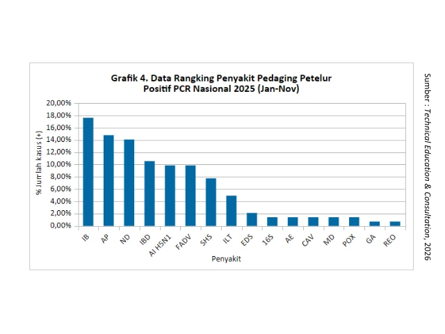
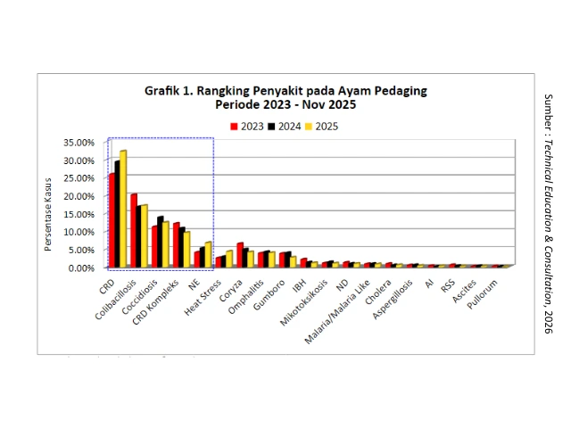
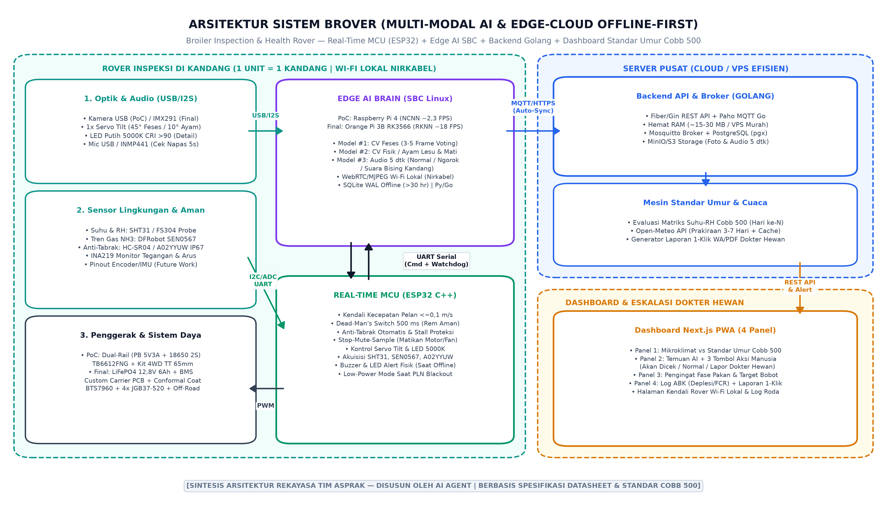
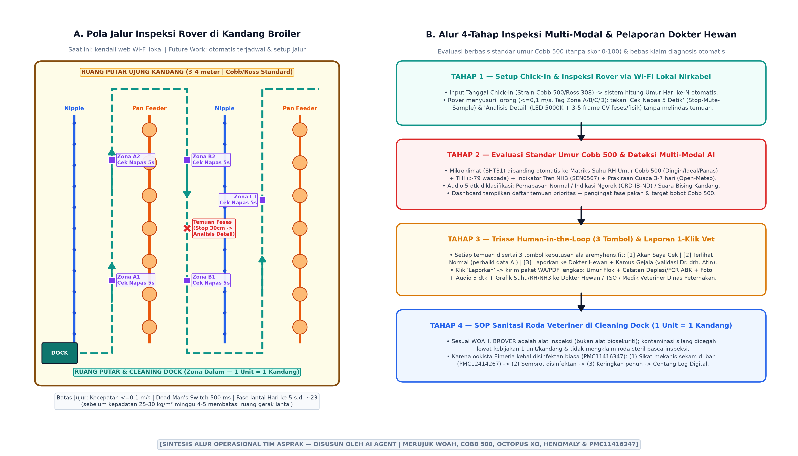
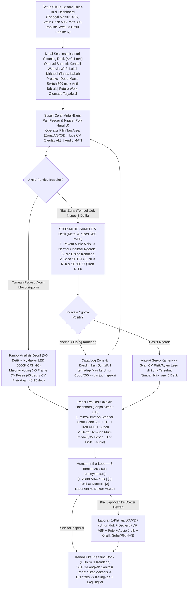
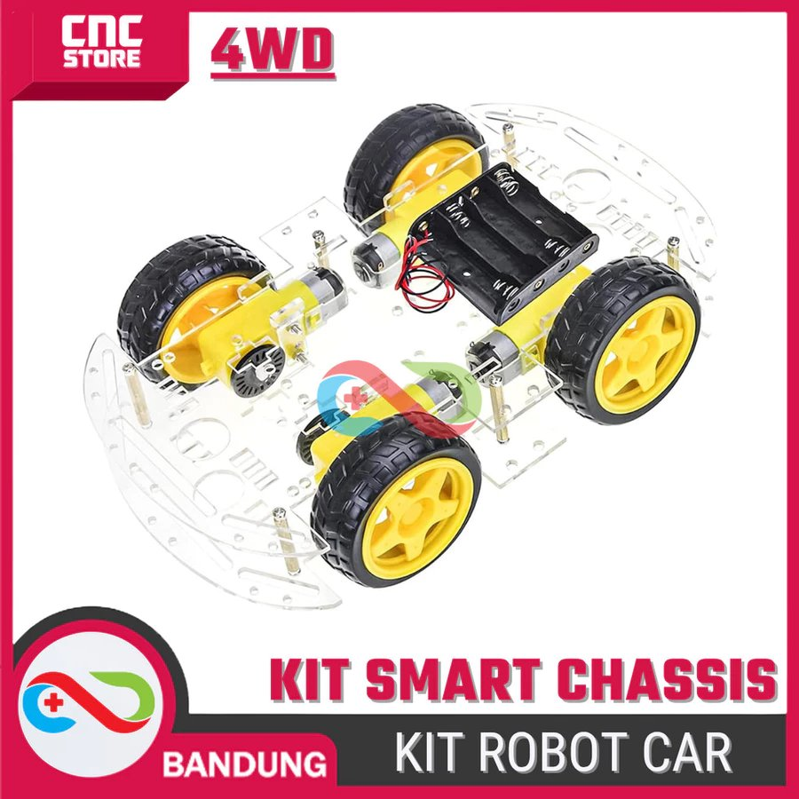
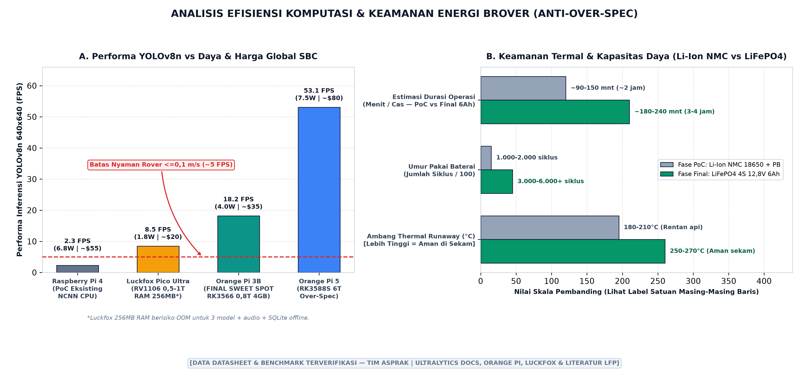
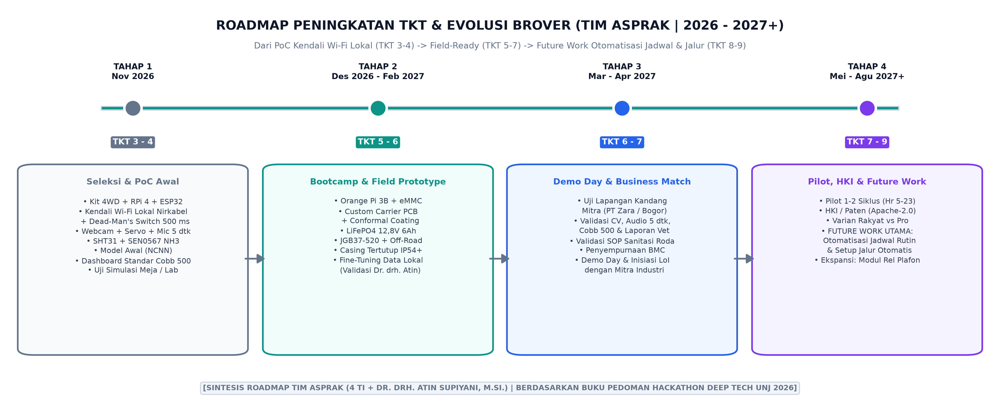

# BROVER (*Broiler Inspection & Health Rover*): Sistem Inspeksi Berbasis *Multi-Modal AI* dan *Edge–Cloud* untuk Deteksi Dini Gejala Penyakit serta Pemantauan Mikroklimat Kandang Ayam Broiler

---

## 1. Judul, Identitas Tim, Filosofi Produk, & Standar Transparansi

- **Judul Final Proyek:**  
  **`BROVER (Broiler Inspection & Health Rover): Sistem Inspeksi Berbasis Multi-Modal AI dan Edge–Cloud untuk Deteksi Dini Gejala Penyakit serta Pemantauan Mikroklimat Kandang Ayam Broiler`**
  - *Catatan Penyelarasan Veteriner:* Penamaan telah diselaraskan dengan masukan **Medik Veteriner Ahli Muda (Dinas Peternakan)** serta standar internasional **WOAH *Terrestrial Animal Health Code*** (Bab 6.4 vs Bab 1.4): istilah *biosekuriti* adalah perisai pencegahan fisik (pagar 3-zona, disinfeksi kendaraan, karantina), sedangkan pemindaian gejala klinis & pelaporan dini adalah **Inspeksi & Deteksi Dini Gejala Penyakit**. Protokol biosekuriti alat (`1 Unit = 1 Kandang` dan sanitasi roda) tetap dijaga ketat di Bab Cara Kerja sebagai SOP operasional.
- **Filosofi `BROVER` (*Broiler* + *Rover* → `Rover Inspeksi`):**  
  Terinspirasi dari filosofi ***NASA Planetary Rover*** (*Curiosity / Perseverance*) — kendaraan darat beroda pembawa paket instrumen ilmiah (kamera, mikrofon, sensor lingkungan) yang turun ke **lingkungan berisiko/kotor (*harsh environment*)** untuk mengambil data langsung di titik lokasi agar manusia tidak perlu terlalu sering masuk ke area tersebut. Dalam terminologi inspeksi industri (*Non-Destructive Testing / Remote Visual Inspection*) dan **ISO 8373:2021 Pasal 4.16 (*Mobile Platform*)**, **`BROVER`** adalah **`Rover Inspeksi`** (*Inspection Rover*) — yaitu platform inspeksi bergerak beroda empat pembawa kamera *Computer Vision*, mikrofon, dan sensor suhu–kelembapan–amonia agar **1 unit alat mampu menjangkau hampir seluruh populasi ayam di dalam kandang** secara hemat biaya dibanding memasang puluhan CCTV dan sensor statis.
- **Program & Jalur Kompetisi:** Hackathon Deep Tech UNJ 2026 — Jalur Pangan **`D-FARM UNJ`** (*Challenge #1: Smart Poultry Production*)
- **Tim Pengusul:** **Tim Asprak** — **5/5 Anggota Lengkap** (4 Mahasiswa Teknologi Informasi UNJ + 1 Dosen Aktif Biologi/Dokter Hewan UNJ):
  1. **M. Hikari Reiziq Rakhmadinta** — **Hustler** *(Mahasiswa Teknologi Informasi UNJ — Strategi, Validasi Mitra, BMC, & Pitching)*
  2. **Ahmad Syauqi Reza** — **Hacker** *(Mahasiswa Teknologi Informasi UNJ — Software Engineering, AI/ML, & Integrasi Sistem)*
  3. **Arya Bisma Putra Refman** — **Hacker** *(Mahasiswa Teknologi Informasi UNJ — Embedded/IoT, Edge AI, & Backend)*
  4. **Aditya Reza Daffansyah** — **Hipster** *(Mahasiswa Teknologi Informasi UNJ — UI/UX Dashboard, Alur Pengguna, & Visual Produk)*
  5. **Dr. drh. Atin Supiyani, M.Si.** — **Dosen Pembimbing & Pakar Domain Veteriner** *(Dosen Biologi UNJ — bidang **Fisiologi & Kesehatan Hewan**; memenuhi syarat wajib slot ke-5 dosen aktif UNJ `[Pedoman, Hal. 3]` sekaligus validator klinis gejala penyakit & kamus triase).*
- **Ruang Lingkup Mutlak (*Hard Constraints*):**
  - Fokus 100% pada **peternakan ayam pedaging (*broiler*)** — kompatibel untuk kandang ***open house*** maupun ***closed house*** di Indonesia.
  - **Tidak** mencakup jalur kesehatan manusia (`D-MARC`), **tidak** mencakup topik pengolahan limbah/sampah (*waste-to-value*, kompos, biogas, maggot), dan **tidak** menggunakan sensor tembak suhu tubuh inframerah (*thermogun/IR*).
- **Standar Transparansi (*Provenance Tags*):** Seluruh tabel, grafik, dan analisis dalam dokumen ini mematuhi 4 label transparansi:
  - **`[ASLI DARI SUMBER PRIMER]`** — Grafik/data diambil utuh tanpa modifikasi dari sumber resmi.
  - **`[DATA PRIMER TERVERIFIKASI — TABEL/VISUALISASI DISUSUN OLEH AI AGENT]`** — 100% angka berasal dari BPS, Kementan RI, PT Medion, Cobb Genetics, WOAH, *datasheet* resmi, atau jurnal *peer-reviewed* terverifikasi (**0 *preprint***).
  - **`[SUARA LAPANGAN DARING — NON-PEER-REVIEWED]`** — Kesaksian praktisi/peternak Indonesia dari wawancara berita/YouTube untuk triangulasi realitas lapangan.
  - **`[SINTESIS REKAYASA TIM ASPRAK — DISUSUN OLEH AI AGENT]`** — Rancangan arsitektur, alur kerja, *power budget*, BMC, dan roadmap TKT yang disusun untuk validasi dan eksekusi tim.

> **Ringkasan Eksekutif:** `BROVER` adalah **Sistem Inspeksi Deteksi Dini Gejala Penyakit dan Pemantauan Mikroklimat** berbasis **`Rover Inspeksi`** berkecepatan pelan (`≤0,1 m/s`) dengan arsitektur ***Edge–Cloud* (*Offline-First*)** dan ***Multi-Modal AI*** untuk kandang ayam broiler di Indonesia. Sistem ini menggabungkan **3 sumber data/indra** pada 1 unit bergerak: **(1) *Computer Vision*** untuk memindai feses abnormal serta fisik/perilaku ayam lesu atau mati, **(2) *Audio AI*** 5 detik untuk mendeteksi indikasi suara ngorok/gangguan pernapasan, dan **(3) Sensor Mikroklimat** (`SHT31` + indikator tren amonia `DFRobot SEN0567`) yang dievaluasi secara otomatis berdasarkan **Matriks Standar Umur Resmi `Cobb 500`** (tanpa skor arbitrer). Pada fase *Proof of Concept* & prototipe saat ini, pergerakan `Rover Inspeksi` dikendalikan operator melalui dashboard web via **Wi-Fi lokal nirkabel (100% tanpa kabel)** dilengkapi rem darurat otomatis (*Dead-Man's Switch* `500 ms`), sementara peningkatan ke **otomatisasi penuh terjadwal & *setup* jalur inspeksi** direncanakan secara eksplisit pada ***Future Work***. Seluruh keluaran bersifat ***Human-in-the-Loop*** tervalidasi **Dr. drh. Atin Supiyani, M.Si.** dengan tombol aksi triase dan **Laporan 1-Klik ke Dokter Hewan**.

---

## 2. Latar Belakang

Sektor perunggasan merupakan tulang punggung utama pemenuhan protein hewani terjangkau di Indonesia. Berdasarkan data resmi **Badan Pusat Statistik (BPS) 2025** dan telaah ilmiah nasional (Sumiati *et al.*, *Animal Bioscience* Q1, 2025), populasi **ayam ras pedaging (*broiler*)** nasional menembus **3,32 miliar ekor/tahun** (`3.323.003.798` ekor) dengan produksi daging mencapai **4,06–4,28 juta ton/tahun** — jauh melampaui subsektor unggas lainnya (sebagai pembanding, populasi ayam ras petelur tercatat 426,12 juta ekor dengan produksi 6,31 juta ton telur).

Namun, struktur produksi broiler di Indonesia masih terbelah tajam secara teknologi: sekitar **60% pasokan** berasal dari peternakan industrial skala besar (*closed house*), sedangkan **~40% sisanya** ditopang oleh **lebih dari 1 juta peternak kecil–menengah** yang mayoritas masih mengoperasikan kandang terbuka (*open house*) dengan pengawasan manual (Sumiati *et al.*, 2025). Di sisi lain, inovasi kandang *closed house* bahan lokal untuk peternak rakyat juga mulai berkembang—seperti **KANOPIS** milik mitra industri Hackathon Deep Tech UNJ 2026, **PT Zara Propertifarm Indonesia**, yang telah tervalidasi pada 6 farm di Bogor (`85.000 ekor`) dan pengakuan kapasitas awal JAPFA (`300.000 ekor`)—namun pemantauan kesehatan harian di dalam kandang masih menjadi tantangan operasional kritis menuju TKT 9 ([04_MITRA_PT_ZARA_PROPERTIFARM.md](../01_Context_Memory/04_MITRA_PT_ZARA_PROPERTIFARM.md)).

Di tengah margin usaha peternak broiler mandiri yang sangat tipis—dengan **biaya pakan (62,27%–67,67%) dan DOC (26,10%–30,47%) menyerap 92,74%–93,77% total biaya produksi** (Junaidi *et al.*, *JWPR*, 2023)—keterlambatan deteksi gejala penyakit selama 24–72 jam saja dapat langsung menghapus keuntungan beberapa siklus sekaligus. Dalam wawancara praktisi peternak broiler skala 12.000 ekor di Malang (`[SUARA LAPANGAN DARING]` [Edufarmers × PecahTelur](https://www.youtube.com/watch?v=FKCNKnTRif0)), serangan bakteri ***Colibacillosis*** pada umur 7 hari pernah menyebabkan **2.000 ekor mati** dalam satu siklus; selain itu, anak kandang (ABK) harus terus menjaga kesesuaian suhu dan kelembapan yang berubah drastis mengikuti klasifikasi umur ayam (*brooding* DOC `30–34°C` vs fase panen `21–25°C`), pergantian fase pakan (*Pre-Starter / Starter / Finisher*), hingga pencatatan harian bobot, FCR, dan deplesi.

Sementara itu, solusi perangkat pemantau kandang komersial impor (seperti *ChickenBoy* Big Dutchman berbasis rel plafon atau *Octopus XO* Prancis berbobot ~80 kg) memiliki harga dan kompleksitas yang tidak terjangkau bagi peternak rakyat Indonesia. Pemasangan puluhan CCTV dan sensor statis di setiap sudut kandang pun membutuhkan biaya instalasi dan perawatan kabel yang mahal. Diperlukan pendekatan rekayasa ***Demand-Driven DeepTech*** yang jujur, tahan terhadap keterbatasan sinyal internet dan listrik pedesaan, hemat biaya produksi, serta memanfaatkan kekuatan tim multidisiplin **Tim Asprak** (4 mahasiswa Teknologi Informasi + 1 Doktor Dokter Hewan UNJ).

---

## 3. Masalah

Berdasarkan hasil riset sistematis dan triangulasi 35 artikel jurnal *peer-reviewed* Indonesia (2021–2026) dengan 20 sumber lapangan daring ([TOP_5_MASALAH_PETERNAKAN_UNGGAS_INDONESIA_V3_TRANSPARAN.md](../02_Problem_Research/TOP_5_MASALAH_PETERNAKAN_UNGGAS_INDONESIA_V3_TRANSPARAN.md)) serta bedah *Root Cause Analysis* ([ROOT_CAUSE_PENYAKIT_BIOSEKURITI_DAN_HEAT_STRESS.md](../03_Root_Cause_Analysis/ROOT_CAUSE_PENYAKIT_BIOSEKURITI_DAN_HEAT_STRESS.md)), **`BROVER` memfokuskan solusi pada 2 masalah teknis-operasional paling stabil dan destruktif di Indonesia**:

### 3.1. Masalah Utama (#1) — Wabah Penyakit Unggas & Keterlambatan Deteksi Dini di Kandang

`[DATA PRIMER TERVERIFIKASI — TABEL/VISUALISASI DISUSUN OLEH AI AGENT]`

1. **Dampak Ekonomi Katastrofik per Wabah:** Pada pemodelan bio-ekonomi farm broiler Sektor 3 di Jawa Bagian Barat (skala 3.000 ekor, margin kotor normal hanya **Rp5,28 juta/siklus**), **1 kali wabah HPAI H5N1** membalik keuntungan menjadi kerugian rata-rata hingga **−Rp53,89 juta** (*tanpa tindakan*) hingga **−Rp57,35 juta** (*stamping out* tanpa kompensasi), mendorong peternak melakukan *panic selling* ayam sakit (**−Rp22,89 juta**) yang memperluas penyebaran regional (Pramuwidyatama *et al.*, *Prev. Vet. Med.* Q1, 2023).
2. **Dominasi Penyakit Pernapasan & Pencernaan di Broiler Indonesia:** Berdasarkan surveilans laboratorium nasional **PT Medion TEC (Januari 2026)**, penyakit positif PCR nasional dipimpin oleh ***Infectious Bronchitis* (IB ~17,7%)**, ***Avian Paramyxovirus* (AP ~14,8%)**, ***Newcastle Disease* (ND ~14,1%)**, **IBD/Gumboro (~10,6%)**, dan **AI H5N1 (~9,9%)**. Secara spesifik pada insiden klinis **ayam broiler (2023–Nov 2025)**, 3 penyakit teratas adalah **CRD / ngorok (>31%)**, **Colibacillosis (~17%)**, dan **Coccidiosis (~12%)**.

*`[ASLI DARI SUMBER PRIMER]` Grafik 4 — Rangking Penyakit Pedaging & Petelur Positif PCR Nasional Jan–Nov 2025, disalin utuh dari [PT Medion TEC (Januari 2026)](https://www.medion.co.id/en/info-medion/overview-of-poultry-disease-analysis-2025-disease-projection-2026/).*

*`[ASLI DARI SUMBER PRIMER]` Grafik 1 — Rangking Penyakit Ayam Pedaging (Broiler) 2023–Nov 2025, disalin utuh dari [PT Medion TEC (Januari 2026)](https://www.medion.co.id/en/info-medion/overview-of-poultry-disease-analysis-2025-disease-projection-2026/), mengonfirmasi dominasi CRD (>31%), Colibacillosis (~17%), dan Coccidiosis (~12%).*

3. **Lemahnya Pengawasan & Literasi Pekerja Kandang:** Studi longitudinal 19 farm broiler (153 siklus) di Jawa Barat mengungkap skor **biosekuriti eksternal rata-rata hanya `0,28/1,0`**, pergerakan/pembelian **`0,48/1,0`**, dan **pekerja & peralatan `0,50/1,0`**; seluruh **4 farm dengan skor terendah akhirnya gulung tikar** (Anwar Sani *et al.*, *Poultry Science* Q1, 2025). Sementara itu, survei 200 pekerja kandang unggas Indonesia menunjukkan **`58%` pekerja** berada pada tingkat pengetahuan *Avian Influenza* kategori *Low–Moderate* (`33% Low`, `25% Moderate`) (Rehman *et al.*, *PeerJ* Q1, 2023).
4. **Koinfeksi & Deteksi Terlambat di Lapangan:** Penyakit di kandang Indonesia kerap muncul sebagai koinfeksi multifaktorial—seperti temuan studi kasus 11.000 broiler di Majalengka yang mengalami **koinfeksi simultan AI H5 + AI H9 + IB (CV antibodi 256%) + *M. gallisepticum* (31,25%) + koksidiosis (4.400 OPG)** di bawah tekanan amonia **20 ppm** (Hartady *et al.*, *Vet. Sci.* Q1, 2026). Akibat pengamatan visual kasatmata yang terlambat dan kemiripan gejala luar, peternak sering salah duga (misal kasus *Hari Farm*: wabah AI awalnya disangka snot hingga kematian melonjak 4→80 ekor/hari; `[SUARA LAPANGAN DARING]` TROBOS Livestock, 2024; serta kasus kematian 2.000/12.000 ekor akibat *Colibacillosis* di umur 7 hari pada wawancara `[SUARA LAPANGAN DARING]` Edufarmers × PecahTelur) dan mengandalkan antibiotik profilaktik/*flushing* sembarangan (`75,0%` *flushing*, hanya `8,3%` terapi terarah; Efendi *et al.*, *Vet. World* Q1, 2022).

### 3.2. Masalah Pendukung (#2) — Cekaman Panas (*Heat Stress*), Gas Amonia, & Ketimpangan Mikroklimat per Umur

`[DATA PRIMER TERVERIFIKASI — TABEL/VISUALISASI DISUSUN OLEH AI AGENT]`

1. **Tekanan Iklim Tropis Sepanjang Tahun:** Nilai rata-rata bulanan *Heat Stress Index* (HSI) Indonesia tahun 2023 melampaui ambang nyaman (`<150–160`) **di seluruh 12 bulan**, mencapai **155,5–165,4 (puncak 187,8)** di Indonesia Barat dan **150,0–166,4 (puncak 195,0)** di Indonesia Timur dengan suhu puncak `36°C` (Sumiati *et al.*, 2025).
2. **Gradien Mikroklimat di Ketinggian Ayam vs Sensor Dinding:** Pada 14 farm *closed/semi-closed house* di Jawa Barat (`2.104 ekor`, `84 titik ukur`), **`0,0%`** titik ukur berada di zona nyaman termal (`THI <72`), sementara **`62,0%` berada di zona *Severe Discomfort*** dan **`8,3%` *Life-Threatening* (`THI >85`)**, dengan kelembapan rerata **`81,9%` (`66%–96%`)**, `NH₃` `7,3 ± 6,4 ppm`, serta lesi *Foot-Pad Dermatitis* (FPD) mencapai **`40%`** akibat *wet litter* (Wilcox *et al.*, *Animal Welfare* Q1, 2025).
3. **Korelasi Langsung ke Mortalitas, Saluran Napas, & Kebutuhan Dinamis Umur:** Di Jawa Tengah, analisis ROC membuktikan **suhu sore pukul 16:00 `>32,8°C`** (`AUC 0,694`, `p = 0,026`) dan **THI pukul 16:00 `>79`** (`AUC 0,709`, `p = 0,016`) signifikan memprediksi kematian broiler, sementara kadar air *litter* di dataran rendah mencapai **`46,42%`** dengan `NH₃` `13,11–14,94 ppm` (Mohammadi *et al.*, *AAVS*, 2026; Hasibuan *et al.*, *JSPI*, 2021). Kadar gas amonia **`>20 ppm`** terbukti merusak silia saluran pernapasan dan meningkatkan kerentanan terhadap penyakit pernapasan (CRD/airsacculitis) (Ritz *et al.*, 2004; Naseem & King, 2018). Selain itu, standar suhu nyaman broiler berubah tajam mengikuti umur—suhu `26°C` nyaman untuk umur 14 hari namun terlalu dingin bagi DOC umur 0 hari (`30–34°C`, *Cobb 500 Management Guide*, 2018/2021).

---

## 4. Solusi (`BROVER`) & Pengembangan 5 Fitur Utama

**`BROVER` (*Broiler Inspection & Health Rover*)** adalah **Sistem Inspeksi Deteksi Dini Gejala Penyakit dan Pemantauan Mikroklimat** berbasis **`Rover Inspeksi`** beroda empat dengan arsitektur ***Multi-Modal AI*** (Baltrušaitis *et al.*, 2019) dan ***Edge–Cloud* (*Offline-First*)** (Shi *et al.*, 2016). Alih-alih memasang puluhan kamera dan sensor statis mahal di setiap sudut kandang, **`BROVER`** membawa 1 set kamera *Computer Vision*, mikrofon, dan sensor lingkungan menyusuri lorong kandang pada kecepatan pelan (`≤0,1 m/s`) agar mampu memantau hampir seluruh populasi ayam secara efisien.

*`[SINTESIS REKAYASA TIM ASPRAK — DISUSUN OLEH AI AGENT]` Diagram blok arsitektur Multi-Modal AI & Edge–Cloud BROVER: pemisahan Real-Time MCU (`ESP32` + Dead-Man's Switch 500 ms) + Edge AI SBC (`RPi 4` PoC / `Orange Pi 3B` Final, Wi-Fi lokal nirkabel) + Backend `Golang` + Dashboard `Next.js` PWA berbasis standar umur `Cobb 500`.*

### 4.1. Rincian 5 Fitur Utama `BROVER`

#### Fitur 1 — `Rover Inspeksi` Bergerak (Jangkauan Menyeluruh 1 Kandang)
- **Fungsi Utama:** Platform inspeksi bergerak beroda empat (ISO 8373:2021 Pasal 4.16) berkecepatan pelan (`≤0,1 m/s` agar ayam terbiasa dan tidak panik) yang membawa seluruh kamera, mikrofon, dan sensor melintasi lorong kandang sehingga **1 unit alat dapat menjangkau hampir seluruh populasi ayam**.
- **Pengoperasian Tahap Saat Ini (Jujur & Aman):** Pada fase PoC dan prototipe awal, pergerakan `Rover Inspeksi` dikendalikan operator melalui antarmuka dashboard web menggunakan **Koneksi Wi-Fi Lokal Nirkabel (100% Tanpa Kabel — Tetap Berfungsi Saat Internet Kandang Mati)** (terhubung langsung lewat Wi-Fi lokal kandang atau *hotspot* Wi-Fi bawaan `Raspberry Pi` / `Orange Pi` dengan jeda video rendah).
- **Fitur Keselamatan & Instrumen di Atas `Rover`:**
  - ***Dead-Man's Switch* (`500 ms` — Rem Darurat Otomatis):** Apabila sinyal Wi-Fi terputus atau perintah berhenti diterima lebih dari `0,5 detik`, `ESP32` otomatis memutus tenaga motor dan mengerem penuh agar `Rover` tidak menabrak ayam atau tempat pakan.
  - **Sensor Jarak Depan Anti-Tabrak** (`HC-SR04` PoC / `DFRobot A02YYUW` IP67 Final dengan *blind zone* 3 cm) untuk menghentikan gerak otomatis saat ada ayam atau penghalang tepat di depan bumper.
  - **Kontrol Sudut Kamera 2-Posisi (1× Servo *Tilt*) + Lampu LED Putih 5000K CRI >90:** Posisi miring bawah `~45°` untuk memindai feses di permukaan sekam dan posisi datar `~0–15°` untuk memindai fisik/postur ayam, disertai lampu LED untuk menstandarkan warna foto pada pencahayaan kandang yang redup.
  - **Tombol 1-Klik *"Cek Napas 5 Detik"*** untuk menghentikan motor/kipas dan merekam suara pernapasan ayam tanpa gangguan bunyi mesin.
- ***Future Work* (Pengembangan Lanjutan — Otomatisasi Penuh Terjadwal):** Pada tahap pengembangan lanjutan, `Rover Inspeksi` ditingkatkan dari kendali operator menjadi **otomatisasi penuh terjadwal**: peternak cukup **mengatur jadwal inspeksi rutin** (misalnya pagi dan sore) serta melakukan ***setup* jalur/rute kandang** di dashboard; saat jadwal tiba, `Rover` bergerak sendiri menyusuri rute, menjalankan pemindaian kamera + audio + sensor secara otomatis, lalu kembali ke *dock* pengisian daya.

#### Fitur 2 — Perangkat Sensor Mikroklimat & Gas Amonia (Dinamis Mengikuti Umur Ayam)
- **Sensor di Ketinggian Ayam (*Bird-Level*):** Mengukur **Suhu & Kelembapan Relatif (`SHT31` / probe waterproof `FS304`)** serta **Indikator Tren Gas Amonia (`DFRobot SEN0567`)** terkompensasi suhu/RH langsung pada zona tempat ayam berada (bukan hanya di dinding/plafon).
- **Evaluasi Otomatis Berbasis Standar Umur Resmi (`Cobb 500`):** Alih-alih memakai batas suhu kaku yang salah secara biologis, pembacaan `SHT31` dibandingkan otomatis terhadap **Matriks Suhu–RH Ideal `Cobb 500` sesuai umur ayam (Hari ke-N)**, sekaligus menghitung **Indeks Cekaman Panas (THI)** (waspada `>32,8°C` / `THI >79` pada fase besar; Mohammadi *et al.*, 2026).
- **Pemetaan per Area (`Zona A / B / C / D`) & Prakiraan Cuaca Preventif:** Operator cukup mengetuk label area kandang saat berpindah lorong agar sistem memetakan variasi suhu, RH, dan tren NH₃ antar-zona, lalu menggabungkannya dengan **prakiraan cuaca 3–7 hari ke depan ([Open-Meteo API](https://open-meteo.com/))** untuk memberikan peringatan dini sebelum puncak panas siang/sore.

#### Fitur 3 — *Computer Vision* Deteksi Dini Gejala Penyakit (Fisik Ayam & Feses)
- **Pemindaian Ganda (Feses + Fisik/Perilaku Ayam):**
  1. **Model #1 (CV Feses Abnormal):** Mendeteksi kandidat feses berdarah (indikasi koksidiosis), diare putih-kapur, dan diare kehijauan pada jarak `30–50 cm` di depan `Rover` (berbasis dataset terverifikasi PCR `Zenodo 5801834` + data lokal Indonesia).
  2. **Model #2 (CV Fisik & Perilaku Ayam):** Mendeteksi ayam lesu/menyendiri, kandidat ayam mati (*carcass*), serta gejala fisik eksternal yang tervalidasi **Dr. drh. Atin Supiyani, M.Si.** (berbasis `Kaggle ekosupriyanto RGB`, `ChickenVerse 2026`, dan `PIO Broiler`).
- **Mode *Live Overlay* + Analisis Detail (`3–5 Frame Voting` + LED):** Saat operator melihat objek mencurigakan pada tampilan kamera langsung, tombol **"Analisis Detail"** menghentikan `Rover`, menyalakan LED putih `5000K CRI >90`, lalu menjalankan ***majority voting* 3–5 frame** agar hasil skrining lebih stabil dan menekan *false positive*.

#### Fitur 4 — Deteksi Audio Pernapasan / Respirasi Ayam (5 Detik)
- **Protokol *Stop–Mute–Sample* 5 Detik:** Berdasarkan mekanisme klinis unggas, bunyi gangguan pernapasan (*ngorok/rales*, bersin) kerap muncul lebih awal daripada gejala fisik berat dan dapat tertangkap dari radius `3–5 meter` menembus kerumunan ayam dengan konsumsi daya sensor jauh lebih kecil dibanding kamera. Saat tombol **"Cek Napas 5 Detik"** ditekan di setiap zona (atau terjadwal di *Future Work*), motor roda dan kipas komputer mini berhenti total selama 5 detik sehingga mikrofon (`Mic USB` PoC / `INMP441` Final) merekam suara ayam secara jernih.
- **Klasifikasi 3 Kelas yang Mudah Dipahami (Adaptasi Dataset *SmartEars* 5 Detik):**
  1. **`Pernapasan Normal`** — suara ayam sehat biasa.
  2. **`Indikasi Ngorok / Gangguan Pernapasan (CRD/IB/ND)`** — memicu rekomendasi pemeriksaan visual fisik lebih lanjut di zona tersebut.
  3. **`Suara Bising Kandang` (*Background Noise* — kipas *blower*, hujan, aktivitas kandang)** — kelas penyaring wajib (berasal dari kelas `None` pada *SmartEars*) agar suara kipas *closed house* tidak salah dikenali sebagai ayam ngorok.
- **Bukti Audio yang Dapat Diputar Ulang:** Setiap klip `.wav` 5 detik yang berindikasi abnormal otomatis disimpan dan dapat diputar ulang langsung di dashboard oleh peternak maupun Dokter Hewan.

#### Fitur 5 — Dashboard Website Berbasis Standar Umur Resmi `Cobb 500`, Triase, & Pelaporan Dokter Hewan
Alih-alih menggunakan "Skor Kesehatan 0–100" buatan sendiri yang rancu secara peternakan (karena suhu ideal berubah drastis dari DOC hingga panen), Dashboard **`BROVER`** dibangun di atas **Setup Siklus Flok (1× saat *Chick-In*: Tanggal Masuk DOC, Strain `Cobb 500`/`Ross 308`, & Populasi Awal)** yang otomatis menghitung **Umur Ayam (Hari ke-N)** dan menyajikan **4 Panel Indikator Objektif**:

1. **Panel 1 — Status Kesesuaian Mikroklimat vs Standar Umur Resmi (`Cobb 500`):** Menampilkan status objektif **`Terlalu Dingin` / `Sesuai Standar Umur` / `Terlalu Panas`** berdasarkan tabel suhu–RH `Cobb 500`, angka **THI**, **Indikator Tren Gas Amonia (`Normal / Meningkat / Waspada Ventilasi`)**, peta warna per zona (`Zona A/B/C/D`), serta peringatan prakiraan cuaca 3–7 hari.
2. **Panel 2 — Daftar Temuan Gejala Penyakit Multi-Modal (Prioritas Terkritis) & 3 Tombol Aksi Manusia:** Merangkum jumlah & bukti foto/audio per kategori (CV Feses, CV Fisik Ayam, Audio Pernapasan) diurutkan dari yang paling mendesak (*Most Critical*, terinspirasi dari alur UX [`aremyhens.fit`](https://aremyhens.fit/)). Setiap temuan dilengkapi **3 tombol keputusan manusia (*Human-in-the-Loop*)**: **`Akan Saya Cek`** (mencatat verifikasi ABK), **`Terlihat Normal`** (menandai *false positive* untuk memperbaiki data latih AI), dan **`Laporkan ke Dokter Hewan`**, disertai **Kamus Gejala Penyakit (*Disease Triage Dictionary*)** tervalidasi **Dr. drh. Atin Supiyani, M.Si.** dan [Manual Penyakit Unggas Kementan RI](https://wiki.isikhnas.com/images/d/dd/Manual_Penyakit_Unggas.pdf).
3. **Panel 3 — Pengingat Fase Pemeliharaan, Klasifikasi Pakan, & Target Bobot Resmi (`Cobb 500`):** Menampilkan otomatis fase pemeliharaan (*Brooding / Grower / Finisher*), pengingat jenis pakan sesuai umur (*Pre-Starter / Starter / Finisher*), serta patokan bobot standar `Cobb 500` agar ABK dapat langsung mencocokkannya dengan hasil sampling mingguan.
4. **Panel 4 — Catatan Harian Ringkas ABK (Opsional) + Laporan 1-Klik ke Dokter Hewan + Log Sanitasi Roda:** Form ringan input harian ABK (mortalitas/deplesi harian, sampling bobot rata-rata, dan konsumsi pakan → hitung **FCR** otomatis). Saat tombol **"Laporkan ke Dokter Hewan"** diklik, website otomatis merangkum **1 paket bukti klinis lengkap via WhatsApp/PDF** (umur flok Hari ke-N, angka deplesi harian, foto feses/ayam, klip audio ngorok 5 detik, grafik suhu/RH/tren NH₃, dan lokasi zona) siap dikirim ke Dokter Hewan / TSO / Medik Veteriner Dinas Peternakan. Dilengkapi halaman kendali `Rover Inspeksi` dan ***Checklist* Log Sanitasi Roda** pasca-inspeksi.

### 4.2. Acuan Ilmiah Standar Umur Dashboard (`Cobb 500` & Jurnal *Peer-Reviewed*)

`[DATA PRIMER TERVERIFIKASI — TABEL DISUSUN OLEH AI AGENT]`

#### A. Matriks Acuan Suhu & Kelembapan Berdasarkan Umur Ayam (*Cobb 500 Broiler Management Guide*, 2018 & [Edisi Resmi 2021](https://www.cobbgenetics.com/assets/Cobb-Files/Broiler-Guide_English-2021-min.pdf))

| Umur / Fase Ayam | RH 30% | RH 40% | RH 50% | RH 60% | RH 70% | Evaluasi Otomatis Dashboard `BROVER` |
| :--- | :---: | :---: | :---: | :---: | :---: | :--- |
| **Umur 0 hari (DOC / *Brooding*)** | `34°C` | `33°C` | `32°C` | `31°C` | `30°C` | Rentang ideal *brooding* DOC: `30–34°C` (sistem termoregulasi DOC belum matang). |
| **Umur 7 hari** | `32°C` | `31°C` | `30°C` | `29°C` | `28°C` | Penurunan bertahap `2–3°C` per minggu sesuai pertumbuhan bulu. |
| **Umur 14 hari** | `29°C` | `28°C` | `27°C` | `26°C` | `25°C` | Transisi dari *brooding* menuju fase *grower*. |
| **Fase Besar (`28 kg/m²` / *Finisher*)** | `25°C` | `24°C` | `23°C` | `22°C` | `21°C` | Aktifkan peringatan cekaman panas sore (`>32,8°C` / `THI >79`, Mohammadi *et al.*, 2026) & pantau RH tropis tinggi (Wilcox *et al.*, 2025). |

#### B. Acuan Fase Pakan & Target Pertumbuhan Bobot (*Cobb500 Male Performance & Nutrition Supplement*, 2017 & 2020; `[SUARA LAPANGAN DARING]` [Edufarmers × PecahTelur](https://www.youtube.com/watch?v=FKCNKnTRif0))

| Umur (Hari) | Fase Pemeliharaan | Klasifikasi Pakan (Pengingat Dashboard) | Target Bobot `Cobb500` (2017) | Target Bobot `Cobb500` (2020) | Patokan Praktis Lapangan |
| :---: | :--- | :--- | :---: | :---: | :--- |
| **Hari 1** | *Brooding* Awal | *Pre-Starter* (butiran halus, 0–7 hari) | `42 g` | `42 g` | Bobot awal DOC saat *chick-in* |
| **Hari 7** | *Brooding* | *Pre-Starter* → transisi *Starter* | `186 g` (`4,43×`) | `194 g` (`4,62×`) | Minggu 1 ideal: `4,5–4,75×` bobot *chick-in* |
| **Hari 14** | Akhir *Brooding* | *Starter* (7–21 hari) | `470 g` (`2,53×`) | `534 g` (`2,75×`) | Minggu 2 ideal: `~2,4–2,75×` bobot minggu 1 |
| **Hari 21** | *Grower* | *Starter* → transisi *Finisher* | `971 g` (`2,07×`) | `1.042 g` (`1,95×`) | Minggu 3 ideal: mencapai `~1 kg` |
| **Hari 28** | *Finisher* | *Finisher* (*crumble* kasar, 21 hari–panen) | `1.585 g` (`1,63×`) | `1.675 g` (`1,61×`) | Pantau ketat *heat stress*, NH₃, & FCR |
| **Hari 35** | *Finisher* / Panen | *Finisher* | `2.299 g` (`1,45×`) | `2.392 g` (`1,41×`) | Evaluasi akhir panen (FCR, deplesi, bobot) |

> **Acuan Kualitas Udara Amonia (NH₃):** Berdasarkan [Cobb Broiler Management Guide (2021)](https://www.cobbgenetics.com/assets/Cobb-Files/Broiler-Guide_English-2021-min.pdf), Ritz *et al.* (2004), dan Naseem & King (2018), kadar NH₃ di ketinggian ayam idealnya **`<10 ppm`**, sedangkan paparan **`>20 ppm`** merusak silia saluran napas dan memperparah risiko CRD/airsacculitis.

### 4.3. Pagar Kejujuran & Batasan Operasional (Prinsip *Anti-Fake Innovation*)

`[SINTESIS REKAYASA TIM ASPRAK — DISUSUN OLEH AI AGENT]`

Menjawab langsung peringatan **Anti-*Fake Innovation*** dari Mitra PT Zara Propertifarm Indonesia ([04_MITRA_PT_ZARA_PROPERTIFARM.md](../01_Context_Memory/04_MITRA_PT_ZARA_PROPERTIFARM.md#L108-L113)) dan masukan **Medik Veteriner Ahli Muda Dinas Peternakan**, `BROVER` menetapkan 6 batasan jujur berikut sejak awal:

| Aspek | Batasan Jujur yang Diterapkan `BROVER` | Bukti Ilmiah / Teknis Pendukung |
| :--- | :--- | :--- |
| **Mode Operasi Saat Ini vs *Future Work*** | Tahap PoC & prototipe saat ini **digerakkan operator melalui dashboard web via Wi-Fi lokal nirkabel (tanpa kabel)**. **Otomatisasi jadwal & *setup* jalur otomatis** ditetapkan jujur sebagai ***Future Work***. | Sesuai **ISO 8373:2021 Pasal 4.16** (*Mobile Platform*), menghindari *overclaim* "robot otonom penuh", mempercepat validasi akurasi AI, dan menekan biaya belanja komponen (`BOM`). |
| **Fase Umur Operasi Lantai** | Inspeksi lantai difokuskan pada **hari ke-5 s.d. ~23** (kecepatan `≤0,1 m/s`, bukan 24 jam nonstop). | Perangkat broiler komersial *Octopus XO* menetapkan operasi **hari ke-5–23** pada kecepatan `0,04–0,12 m/s` ([FAQ Octopus XO](https://www.octopusbiosafety.com/en/faq/xo-en/)); mulai minggu ke-4–5 kepadatan broiler mencapai `13–30 kg/m²` ([PT Medion](https://www.medion.co.id/info-medion/closed-house-solusi-peningkatan-performa-ayam/)) dan ruang lantai makin rapat ([PMC11011048](https://pmc.ncbi.nlm.nih.gov/articles/PMC11011048/)). |
| **Bukan Alat Biosekuriti / Roda Tidak Diklaim Steril** | Sesuai **WOAH**, `BROVER` adalah **alat inspeksi & deteksi dini**, bukan alat biosekuriti. Risiko kontaminasi silang dicegah lewat SOP **1 unit = 1 kandang** + **sikat mekanis & disinfeksi roda**. | Fenomena ***subclinical/asymptomatic fecal shedding*** membuat feses tampak normal tetap dapat membawa patogen ([PMC13433518](https://pmc.ncbi.nlm.nih.gov/articles/PMC13433518/); [PLOS ONE, 2022](https://journals.plos.org/plosone/article?id=10.1371/journal.pone.0264028)); ookista *Eimeria* kebal disinfektan umum ([PMC11416347](https://pmc.ncbi.nlm.nih.gov/articles/PMC11416347/)). |
| **Klaim Diagnosis AI** | Output aplikasi adalah **Deteksi Dini / Skrining Gejala (*Human-in-the-Loop*)**, **bukan** diagnosis medis/lab otomatis dan **tidak** meresepkan dosis antibiotik. | Kemiripan gejala koinfeksi lintas penyakit (kasus Hari Farm AI dikira snot, [TROBOS 2024](https://troboslivestock.com/virus-ai-terus-mengintai/)) serta efek *domain shift* lintas kandang ([Henomaly](https://github.com/RishitRai/Henomaly): akurasi turun 99%→75–78%). |
| **Pengukuran Gas `NH₃`** | Sensor **`DFRobot SEN0567`** (~Rp240–330 rb) dilaporkan jujur sebagai **indikator tren kualitatif lonjakan `NH₃`** (terkompensasi Suhu/RH), bukan angka `ppm` absolut sertifikasi lab. | [Wiki Resmi DFRobot `SEN0567`](https://wiki.dfrobot.com/sen0567/) menyatakan eksplisit: *"Qualitative only—for quantitative, buy the Factory-calibrated Gas Sensor."* |
| **Status Kit 4WD Akrilik** | Kit 4WD akrilik + roda 65 mm (*ground clearance* 1,3–1,5 cm) hanya digunakan sebagai ***indoor PoC testbed* (TKT 3–4)**, **bukan** unit uji sekam basah lapangan. | Sekam broiler tebal `5–10 cm` (kadar air hingga `46,42%`, Hasibuan *et al.*, 2021) mensyaratkan upgrade motor *metal-gear* + roda *off-road*/*track* (*ground clearance* ≥5–6 cm) pada fase Bootcamp (TKT 5–6). |

---

## 5. Tech Stack

Pemilihan tumpukan teknologi `BROVER` menyeimbangkan **kecepatan pengembangan 4 mahasiswa TI**, **validasi klinis Dokter Hewan**, **hemat daya di atas baterai `Rover`**, dan **efisiensi biaya operasional server komersial**:

`[SINTESIS ARSITEKTUR SOFTWARE TIM ASPRAK — DISUSUN OLEH AI AGENT]`

| Lapisan Sistem | Teknologi Terpilih | Peran Spesifik & Justifikasi Teknis |
| :--- | :--- | :--- |
| **1. Firmware MCU (*Real-Time*)** | **`C++`** (`PlatformIO` / Arduino Framework pada **`ESP32`**) | Mengendalikan PWM motor pelan (`≤0,1 m/s`), ***Dead-Man's Switch* (`500 ms` — rem darurat otomatis jika sinyal Wi-Fi/SBC putus >0,5 dtk)**, *stall protection*, servo *tilt*, LED 5000K, serta pembacaan `SHT31` (I2C), `SEN0567` (ADC + kompensasi T/RH), `A02YYUW`/`HC-SR04`, dan `INA219`. Berkomunikasi via **UART Serial** ke SBC. |
| **2. Edge AI, Kendali Nirkabel & Orchestrator (Di Atas `Rover`)** | • **Fase PoC (`RPi 4`):** **`Python 3`**, `OpenCV`, `NumPy/SciPy`, **`Ultralytics NCNN`**, `WebRTC/MJPEG` + `WebSocket` (**Wi-Fi Lokal Nirkabel 100% Tanpa Kabel**), `SQLite (WAL Mode)`, `Paho-MQTT` • **Fase Final (`Orange Pi 3B`):** **`Golang` (*Edge Daemon/Orchestrator*)** + **`C++` (`rknn-toolkit-lite2` / RKNN C-API)** + `SQLite (WAL Mode)` | **Wi-Fi lokal nirkabel** (via *router* kandang atau *hotspot* bawaan SBC) menjaga video kamera tetap lancar (<0,3 dtk jeda) dan tetap dapat dioperasikan meski internet kandang mati. Pada fase Final, memindahkan manajemen UART/SQLite/MQTT/sync ke **`Golang`** dan inferensi NPU ke **`C++` RKNN** menghemat RAM & daya baterai `LiFePO₄`. Mode `SQLite WAL` menjamin operasi **100% *Offline-First*** (>30 hari *ring-buffer* di eMMC). |
| **3. Training & Konversi Model AI** | **`PyTorch`**, **`Ultralytics`**, **`torchaudio` / `librosa`**, `ONNX`, `rknn-toolkit2` *(dijalankan di PC/Laptop ber-GPU lokal Tim Asprak)* | Pelatihan *offline* 3 model AI sekuensial: (1) CV Feses (`YOLOv8n/11n`), (2) CV Ayam Lesu/Mati & Gejala Fisik (`YOLOv8n/11n`), (3) Audio Pernapasan 5 detik (`Log-Mel Spectrogram` + `MobileNetV3-Small` / `2D CNN`), lalu dikuantisasi **INT8** ke format **NCNN** (PoC) atau **RKNN** (Final). |
| **4. Backend Server Pusat & Broker** | **`Golang`** (`Fiber` / `Gin` / `Chi`), **`PostgreSQL`** (`pgx`), **`Eclipse Mosquitto`** (MQTT Broker), **`MinIO / S3`**, **`Open-Meteo API`**, Bot WhatsApp/Telegram | Karena 100% inferensi AI berlangsung di *Edge*, backend pusat tidak membutuhkan library ML Python. **`Golang`** (*compiled binary*, RAM *idle* `~15–30 MB`, *goroutine* konkuren ringan) melayani sinkronisasi telemetri, kalkulasi standar umur `Cobb 500`, *polling* cuaca `Open-Meteo`, penyimpanan bukti foto/audio, dan ekspor Laporan 1-Klik Dokter Hewan hanya pada **1 VPS hemat biaya**. |
| **5. Frontend Aplikasi & Dashboard Peternak** | **`Next.js` (React + Tailwind CSS)** berformat **PWA (*Progressive Web App*)** | **1 basis kode** langsung berjalan di **HP Android peternak/ABK** (ringan di jaringan 3G/4G pedesaan, bisa di-install ke *home screen*, *push notification*) maupun **browser desktop** pemilik farm & Dokter Hewan. Memuat 4 Panel Standar Umur `Cobb 500`, halaman kendali `Rover` (*live video*, joystick/WASD, tag Zona A/B/C/D, tombol Cek Napas 5 Detik & Analisis Detail), 3 tombol aksi ala `aremyhens.fit`, Kamus Gejala Penyakit, catatan harian ABK, & Laporan 1-Klik ke Dokter Hewan. |

---

## 6. Cara Kerja

### 6.1. Alur Inspeksi `Rover` di Kandang Broiler & SOP Sanitasi 4-Tahap

*`[SINTESIS REKAYASA TIM ASPRAK — DISUSUN OLEH AI AGENT]` (A) Pola jalur inspeksi huruf U menyusuri celah antar-baris pan feeder & nipple drinker (dikendalikan operator via Wi-Fi lokal nirkabel saat ini; otomatis terjadwal di Future Work); (B) Alur kerja 4-tahap inspeksi multi-modal, evaluasi standar umur Cobb 500, triase 3 tombol, dan SOP sanitasi roda.*

### 6.2. Urutan Detail Eksekusi per Sesi Inspeksi

1. **Setup Siklus *Chick-In* & Gerak Pelan Berbasis Habituasi (`≤0,1 m/s`):** Sebelum siklus dimulai, peternak memasukkan Tanggal *Chick-In*, Strain (`Cobb 500` / `Ross 308`), dan Populasi Awal pada dashboard sehingga seluruh ambang batas suhu, RH, fase pakan, dan target bobot menyesuaikan **Umur Hari ke-N** secara otomatis. Berdasarkan studi *peer-reviewed* broiler terhadap perangkat bergerak darat (*AviSense*, [PMC13696172](https://pmc.ncbi.nlm.nih.gov/articles/PMC13696172/); *RobôFrango*, [PMC11011048](https://pmc.ncbi.nlm.nih.gov/articles/PMC11011048/)), paparan rutin berkecepatan rendah sejak awal siklus (hari ke-5) memicu pembiasaan (*habituation*) dan tidak mengganggu perilaku alami ayam. Mengikuti tata letak standar [Cobb](https://www.cobbgenetics.com/assets/Cobb-Files/2024-Nipple-Drinker-Poster.pdf) dan [Aviagen Ross](https://aviagen.com/assets/Tech_Center/Ross_Broiler/Aviagen-ROSS-Broiler-PocketGuide-EN.pdf) (jarak antar-baris alat ±1,2–3,0 m; ruang ujung kandang 3–4 m), operator mengarahkan `Rover Inspeksi` lewat **Wi-Fi lokal nirkabel** lurus di celah antar-baris *pan feeder* & *nipple drinker* lalu memutar di ujung kandang *(otomatisasi penuh mengikuti jadwal & jalur yang di-setup di dashboard menjadi target Future Work)*.
2. **Pemetaan Zona & Pengecekan Audio Pernapasan 5 Detik (*Stop–Mute–Sample*):** Saat berjalan, mikrofon dimatikan agar bebas bising roda. Saat berpindah lorong, operator mengetuk label area (`Zona A / B / C / D`) dan menekan tombol **"Cek Napas 5 Detik"**. Motor roda dan kipas SBC berhenti total selama **5 detik** untuk merekam & mengklasifikasi klip audio 5 detik (sesuai struktur segmen [SmartEars](https://data.mendeley.com/datasets/dy6gtvt4mk/2): `Pernapasan Normal`, `Indikasi Ngorok/CRD-IB-ND`, atau `Suara Bising Kandang`) sekaligus membaca `SHT31` & `SEN0567`. Jika audio mendeteksi indikasi ngorok, operator/sistem mengarahkan servo mengangkat kamera (`0–15°`) untuk pemindaian gejala fisik/ayam lesu lebih intensif di zona tersebut.
3. **Verifikasi 2-Tahap CV Feses & Evaluasi Standar Umur `Cobb 500`:** Jika *live overlay* kamera depan (miring 45°) menangkap kandidat feses abnormal pada jarak `30–50 cm`, operator menekan **"Analisis Detail"** (`Rover` berhenti aman sebelum melindas bercak, menyalakan LED putih `5000K CRI >90`, dan menjalankan *majority voting* 3–5 frame). Seluruh temuan visual, audio, dan sensor ditampilkan pada 4 Panel Dashboard secara objektif (status suhu–RH terhadap **Matriks Umur `Cobb 500`**, THI, tren NH₃, dan daftar temuan terkritis).
4. **Tindak Lanjut *Human-in-the-Loop* (3 Tombol Aksi), Laporan 1-Klik Dokter Hewan, & SOP Sanitasi Roda:** Untuk setiap temuan, peternak memilih salah satu dari 3 tombol keputusan: **`Akan Saya Cek`** (ABK menuju zona terkait berpanduan Kamus Gejala Penyakit tervalidasi **Dr. drh. Atin Supiyani, M.Si.** & [Manual Penyakit Unggas Kementan RI](https://wiki.isikhnas.com/images/d/dd/Manual_Penyakit_Unggas.pdf)), **`Terlihat Normal`** (menandai *false positive*), atau **`Laporkan ke Dokter Hewan`** (mengekspor 1 paket bukti lengkap via WhatsApp/PDF mencakup umur flok, data deplesi/FCR harian ABK, foto, audio 5 detik, dan grafik suhu/RH/NH₃). Saat `Rover` kembali ke *Cleaning Dock* di dalam kandang (`1 Unit = 1 Kandang`), aplikasi mengingatkan SOP sanitasi roda 3-langkah berbasis bukti [PMC11416347](https://pmc.ncbi.nlm.nih.gov/articles/PMC11416347/) & [PMC12414267](https://pmc.ncbi.nlm.nih.gov/articles/PMC12414267/) (karena ookista *Eimeria* kebal disinfektan biasa): **(1) sikat fisik/mekanis sekam dari alur ban → (2) semprot disinfektan spektrum luas → (3) keringkan penuh**, lalu centang log digital.

### 6.3. Mitigasi 7 Skenario *Worst-Case* Lapangan

`[SINTESIS REKAYASA TIM ASPRAK — DISUSUN OLEH AI AGENT]`

| No | Skenario *Worst-Case* | Mekanisme Mitigasi pada `BROVER` |
| :-: | :--- | :--- |
| **1** | **Internet Kandang Mati Berhari-hari** | **100% *Offline-First* + Wi-Fi Lokal Nirkabel:** Kendali `Rover`, 3 model AI, dan *ring-buffer* `SQLite WAL` di eMMC 32GB (>30 hari) tetap jalan penuh tanpa internet; *cache* cuaca 3–7 hari; **LED Merah + Buzzer fisik** di bodi & *dock*; otomatis sinkron ke server `Golang` begitu sinyal internet pulih. |
| **2** | **Sinyal Wi-Fi Putus / HP Operator Mati Mendadak** | ***Dead-Man's Switch* (`500 ms`) di `ESP32`:** Begitu paket *heartbeat* kendali tidak masuk >0,5 detik, `ESP32` langsung memutus PWM motor dan mengerem penuh agar `Rover` aman di tengah flok ayam. |
| **3** | **Listrik PLN Padam (*Blackout* 5 Jam – 3 Hari)** | Saat *dock* kehilangan tegangan PLN, `Rover` masuk ***Emergency Low-Power Mode*** (motor mati agar baterai `LiFePO₄` bertahan >12–24 jam, sensor Suhu/RH/NH₃ + alarm darurat tetap siaga memantau lonjakan panas). |
| **4** | **Roda Macet (*Stall*) di Sekam atau Baterai Menipis** | Peringatan baterai `25%` (`INA219`) pada layar kendali untuk segera mengarahkan pulang ke *dock*; *stall detection* (arus lonjak tinggi → *cutoff* proteksi motor + bunyi *beep* pencari). |
| **5** | ***Domain Shift* & *False Positive* di Kandang Baru** | Pencahayaan standar LED `5000K CRI >90` + *fine-tuning* 300–500 foto sekam/feses lokal Indonesia bersama **Dr. drh. Atin Supiyani, M.Si.** saat Bootcamp + tombol **`Terlihat Normal`** di dashboard (*active learning*). |
| **6** | **SBC *Crash* / MicroSD Korup / *Overheat* di 35°C** | 3 model INT8 (<50 MB total) sangat lega di RAM 4GB; **`ESP32` *Hardware Watchdog*** memutus motor jika SBC *hang* >1 dtk; versi Final memakai **eMMC bawaan `Orange Pi 3B`** (tahan getaran & anti-korup) + *heatsink*. |
| **7** | **Korosi Amonia (`NH₃`), Kelembapan 96%, & Debu Bulu** | Casing tertutup IP54–IP65 + ***Custom Carrier PCB* berlapis *Conformal Coating*** + probe `SHT31 FS304` berfilter + *splash-shield* busa di lubang mikrofon. |

---

## 7. Prototype (Fase PoC Awal — TKT 3–4, Seleksi Nov 2026)

Sesuai ketentuan fleksibilitas pendaftaran Buku Pedoman Hackathon Deep Tech UNJ 2026 (`TKT 3–4` diperbolehkan pada tahap seleksi proposal Nov 2026; [02_HACKATHON_DFARM_RULES.md](../01_Context_Memory/02_HACKATHON_DFARM_RULES.md#L95-L98)), fase **Prototype (PoC)** memaksimalkan **perangkat keras yang sudah dimiliki Tim Asprak** untuk membuktikan *end-to-end software*, kendali Wi-Fi lokal nirkabel + *Dead-Man's Switch*, inferensi 3 model AI, evaluasi standar umur `Cobb 500`, dan integrasi Dashboard PWA di permukaan uji simulasi (*indoor testbed*).

*`[DOKUMENTASI HARDWARE TIM ASPRAK]` Kit Smart Chassis 4WD akrilik (4× motor TT 1:48 + roda 65 mm) yang telah dimiliki tim sebagai platform PoC testbed awal (TKT 3–4) di lantai uji simulasi.*

### 7.1. Daftar Komponen Lengkap Versi Prototype Awal (PoC — TKT 3–4)

`[DATA DATASHEET & INVENTARIS TIM — DISUSUN OLEH AI AGENT]`

| Subsistem | Komponen Terpilih | Status Stok Tim | Spesifikasi Kunci & Alasan Teknis |
| :--- | :--- | :---: | :--- |
| **Edge AI SBC** | **`Raspberry Pi 4`** + *Heatsink* + MicroSD 32GB A2 | **Sudah Dimiliki** | Menjalankan `YOLOv8n` **NCNN (~2,3 FPS, 414–433 ms)** ([Ultralytics Docs](https://docs.ultralytics.com/guides/raspberry-pi/)) + Audio 5 dtk + *streaming* Wi-Fi lokal nirkabel + `SQLite WAL`. Stabil & nol risiko *stuck* driver untuk tenggat Nov 2026. |
| **Real-Time MCU** | **`ESP32` (Standar)** *(via kabel USB Serial ke RPi 4)* | **Sudah Dimiliki** | Menutupi 3 batas GPIO `RPi 4` (0 pin ADC bawaan, hanya 2 kanal hardware PWM, pin 3,3V rawan 5V) sekaligus menjadi ***Dead-Man's Switch* 500 ms** & *safety watchdog*. |
| **Sasis & Penggerak** | **Kit Smart Chassis 4WD Akrilik + 4× Motor TT 1:48 + Roda 65 mm** | **Sudah Dimiliki** | Platform ***indoor PoC testbed*** (permukaan datar/simulasi). Beban total di atas sasis dijaga **≤800–1.000 gram**. |
| **Driver Motor** | **`TB6612FNG`** (MOSFET Dual H-Bridge) | Ready Tokped/Shopee *(Rp15–60 rb)* | Drop tegangan hanya **~0,5 V** (efisiensi >90%, tanpa heatsink), jauh lebih efisien dari `L298N` (drop 1,8–3,2 V) ([Datasheet TB6612FNG](https://cdn.sparkfun.com/datasheets/Robotics/TB6612FNG.pdf)). |
| **Optik, Servo & Audio** | **`Webcam USB`** + **1× `Servo` *Tilt*** + **LED Putih 5V** + **`Mikrofon USB`** | **Sudah Dimiliki** *(+LED)* | 1 webcam + 1 servo mencakup sudut feses (45°) & ayam (0–15°); jauh lebih tajam di *low-light* dibanding `ESP32-CAM` OV2640. |
| **Sensor Lingkungan** | • **Suhu & RH:** `SHT31` (I2C) • **Tren Gas `NH₃`:** **`DFRobot SEN0567`** (MEMS `1–300 ppm`, `<20 mA`) | Ready Tokped *(SEN0567 Rp240–330 rb)* | Hemat daya dibanding `MQ-137` (~150 mA *heater*); output `SEN0567` dilabeli jujur sebagai **indikator tren kualitatif lonjakan `NH₃`** ([Wiki SEN0567](https://wiki.dfrobot.com/sen0567/)). |
| **Anti-Tabrak** | **`HC-SR04`** *(dengan voltage divider 3,3V)* / `VL53L0X` | Tambahan murah | Mencegah tabrakan objek saat demo meja/simulasi. |
| **Baterai (*Dual-Rail*)** | • **Rail 1 (`RPi 4` + Cam + Mic):** Powerbank 5V 3A `10.000 mAh` (~37 Wh) • **Rail 2 (Motor + Servo + `ESP32`):** `2× 18650` (2S `7,4V` `2.500–3.000 mAh`) + **BMS 2S 10A** + *Buck 5V 3A* | **Wajib Benahi** *(ganti 4×AA)* | Memisahkan jalur daya mencegah `RPi 4` *brownout/reboot* saat motor *start*. Estimasi *runtime* PoC: **~1,5–2,5 jam**. |
| **Kabel & Proteksi** | *Perfboard* solder rapi + **Kabel Silikon `18 AWG`** (daya) + **`XT30` / `JST-XH`** + **Sekring `5A`** + Saklar Utama | Ready Tokped/Shopee | Menghindari kabel jumper DuPont tipis (26–28 AWG) yang longgar akibat getaran dan tidak kuat arus *stall* 4 motor. |
| **Node Pembanding (Opsional)** | **`ESP32-C3 Super Mini`** + sensor Suhu/RH statis | **Sudah Dimiliki** | Dipasang diam di tepi area simulasi untuk membandingkan pembacaan suhu/RH dinding vs pengukuran bergerak `BROVER`. |

*(Catatan: `PC/Laptop ber-GPU` milik tim digunakan khusus untuk training model; `Raspberry Pi 3` dan `ESP32-CAM` disiapkan sebagai cadangan/kamera statis *dock*; `Arduino UNO` tidak digunakan karena fungsinya telah digantikan penuh oleh `ESP32`).*

---

## 8. Finalisasi (Rencana Final Komersial / *Field-Ready* — TKT 5–7+, Bootcamp Des 2026 – Feb 2027)

Fase **Finalisasi** dirancang khusus untuk lolos uji lapangan kandang broiler asli Indonesia (**sekam tebal 5–10 cm dengan kadar air hingga 46,42%, suhu 30–36°C, RH 80–96%, amonia hingga 20 ppm, debu bulu, dan keterjangkauan harga komersial bagi peternak rakyat**), memanfaatkan fasilitas **Lab Robotika/IoT/Manufaktur UNJ** dan potensi dukungan hardware *in-kind* **PT Edura Cipta Gemilang**.

*`[DATA DATASHEET & BENCHMARK TERVERIFIKASI — VISUALISASI DISUSUN OLEH AI AGENT]` (A) Komparasi FPS YOLOv8n vs daya & harga global SBC yang menetapkan `Orange Pi 3B` (`RK3566` 0,8 TOPS, ~18 FPS, ~4W) sebagai sweet spot anti-over-spec; (B) Perbandingan keamanan termal & durasi operasi `LiFePO₄` vs `Li-Ion NMC`.*

### 8.1. Mengapa `Orange Pi 3B` + *Custom Carrier PCB* + `LiFePO₄`?
1. **Anti-*Over-Spec* Komputasi (`Orange Pi 3B` 4GB vs `Orange Pi 5`):** Karena 3 model AI berjalan **sekuensial (*time-sliced*)** pada kecepatan `Rover` `≤0,1 m/s`, `Orange Pi 3B` (`Rockchip RK3566`, NPU `0,8 TOPS`, RAM 4GB, slot **eMMC**, daya `3,5–4,5 W`, ~16–22 FPS INT8) memotong biaya board hingga **~50%** dibanding `Orange Pi 5` (`6 TOPS`, harga lokal Rp4,8–7,9 jt untuk varian Pro/Plus) sekaligus jauh lebih aman terhadap *Out-of-Memory* dibanding `Luckfox Pico` (RAM hanya 256 MB).
2. **Wajib *Custom Carrier PCB* 2-Layer (Menurunkan Biaya & Menaikkan Keandalan Komersial):** Prosesor `Orange Pi 3B` dan modul `ESP32` tetap dibeli jadi (*off-the-shelf*), sementara seluruh jalur daya, *buck converter*, sekring, *Dead-Man's Switch*, driver motor, dan port sensor disatukan dalam **1 papan *Custom Carrier PCB* (desain KiCad, cetak ~Rp30–80 rb/pcs pada produksi batch kecil)** berlapis ***Conformal Coating*** — memangkas ongkos perakitan manual, tahan getaran sekam, dan kebal korosi uap `NH₃`/RH 96%.
3. **Keamanan Kebakaran Sekam (`LiFePO₄` 4S `12,8V 6Ah`):** Kandang broiler penuh sekam kering mudah terbakar pada suhu ambien 33–36°C. Ambang *thermal runaway* **`LiFePO₄` (`250–270°C`)** jauh lebih aman dibanding `Li-Ion NMC` (`180–210°C`) dengan umur pakai **`3.000–6.000+ siklus`**. Dengan beban rata-rata `~18–26 W` (efisiensi daya `Orange Pi 3B`), kapasitas `76,8 Wh` (`~65 Wh` efektif pada 85% DoD) menghasilkan durasi operasi **~3–4 jam kontinu** (cukup untuk **6–8 sesi inspeksi harian** dalam 1× pengisian daya).
4. **Efisiensi Biaya Komponen (`BOM`) Berkat Tahap Kendali Operator:** Karena navigasi otonom penuh ditempatkan secara bertahap pada *Future Work*, komponen navigasi otonom tambahan (seperti LiDAR atau sensor odometri/IMU presisi tinggi) **tidak wajib dipasang pada versi awal**, sehingga mempercepat perakitan dan menekan total biaya belanja komponen (`BOM`) per unit.

### 8.2. Daftar Komponen Lengkap Versi Final Komersial (Terverifikasi Ketersediaan di Tokopedia/Shopee Indonesia)

`[DATA DATASHEET & AUDIT MARKETPLACE INDONESIA — DISUSUN OLEH AI AGENT]`

| Subsistem | Komponen Terpilih (Versi Final) | Status Pasar Lokal (Tokped/Shopee) | Estimasi Harga Lokal | Alasan Teknis & Keunggulan Lapangan |
| :--- | :--- | :---: | :--- | :--- |
| **Edge AI SBC** | **`Orange Pi 3B` (4GB RAM, `RK3566` NPU `0,8 TOPS`) + Modul `eMMC 32GB`** + *Heatsink* | **Ready** (Tokped/Shopee) | Rp900 rb – Rp2,0 jt *(tergantung RAM/eMMC)* | *Sweet spot* komersial (~18 FPS RKNN INT8, 3,5–4,5 W); Wi-Fi terintegrasi; eMMC tahan getaran & anti-korup OS. |
| **Real-Time MCU & PCB** | **`ESP32`** + ***Custom Carrier PCB* 2-Layer (KiCad)** + ***Conformal Coating*** | **Ready** (PCB cetak lokal/JLCPCB; coating ready Tokped) | ~Rp150–250 rb *(total modul + PCB/unit)* | Nol kabel jumper longgar, menjalankan *Dead-Man's Switch* 500 ms, terlindungi dari kelembapan 96% & korosi gas `NH₃`. |
| **Sasis & Penggerak Medan Sekam** | • **Casing Tertutup IP54–IP65** (Rangka Aluminium + 3D-print **PETG/ASA** / **HDPE** bawah rata) • **4× Motor DC *Metal-Gear* 12V (`JGB37-520`, 100–130 RPM)** *(varian Hall Encoder disiapkan opsional untuk Future Work otomatisasi)* • **2× Driver MOSFET `BTS7960` (43A)** • **Ban RC *Crawler* `110–120 mm` (+ *hex coupler* 12→6 mm) ATAU Kit *Rubber Track*** (*quick-release*) | **Ready Melimpah** (Tokped/Shopee) | Motor: Rp400–800 rb (4 pcs) Driver: Rp100–240 rb (2 pcs) Roda/Track + Casing: ~Rp600 rb–1,2 jt | Menjawab hukum torsi $F = \tau/r$ saat memperbesar roda, memberi ***ground clearance* ≥5–6 cm** agar tidak kandas di *wet litter* 46,4%, dan roda *quick-release* mudah disikat untuk sanitasi ookista *Eimeria*. |
| **Kamera, Servo & Pencahayaan** | • **Kamera USB *Low-Light* `Sony IMX291` (1080p UVC)** di balik kaca pelindung • **Servo *Metal-Gear* Waterproof `DS3218`** (torsi 20 kg) • **LED Bar Putih `5000K CRI >90`** + *diffuser* | **Ready** (Tokped/Shopee) | Kamera: ~Rp250–450 rb Servo: Rp180–200 rb LED: ~Rp50 rb | Sensor `IMX291` menangkap warna feses & postur ayam tajam dalam cahaya redup kandang; CRI >90 menstandarkan warna merah/hijau/putih feses. |
| **Audio Pernapasan** | **Mikrofon MEMS Digital `INMP441` (I2S)** *(atau Mic USB)* + busa anti-debu & *splash-shield* menghadap bawah | **Ready Melimpah** (Tokped/Shopee) | ~Rp30–80 rb | Konsumsi daya mikro (`<0,1 W`), sensitif menangkap *rales*/ngorok radius 3–5 m saat *Stop–Mute–Sample* 5 detik. |
| **Sensor Mikroklimat & Gas** | • **Suhu & RH:** **`SHT31` Waterproof Probe (`FS304` stainless berfilter bawaan)** • **Tren Gas `NH₃` (Standar Rakyat):** **`DFRobot SEN0567`** *(MEMS, 1–300 ppm, `<20 mA`)* • *(Opsi Varian Pro/Korporasi:* **Sensor `NH₃` RS485 Modbus Industri + `MAX485`** — Rp1,5–3,2 jt lokal*)* | **Ready** (Tokped) | `SHT31 FS304`: ~Rp120–220 rb `SEN0567`: **Rp240–330 rb** | Probe `FS304` langsung menggantikan membran ePTFE eceran yang langka di pasar lokal; pemilihan `SEN0567` menjaga BOM tetap terjangkau peternak rakyat tanpa *overclaim* (indikator tren kualitatif terkompensasi T/RH). |
| **Anti-Tabrak & Persiapan *Future Work*** | • **Ultrasonik IP67 `DFRobot A02YYUW`** (*blind zone* hanya **3 cm**, UART) • *(Opsional Future Work Otomatisasi Jalur:* **IMU `MPU6050`** + *Hall Encoder* roda*)* | **Ready** (Tokped/Shopee) | `A02YYUW`: Rp350–395 rb *(`MPU6050` opsional: ~Rp25–45 rb)* | *Blind zone* 3 cm (`A02YYUW`, [Datasheet](https://www.dfrobot.com/product-1935.html)) mencegah sensor "buta" saat ayam mendekat di depan bumper; *pinout* IMU/encoder disediakan di PCB agar mudah *upgrade* ke otomatisasi terjadwal tanpa ganti papan. |
| **Baterai & Kelistrikan Industri** | • **`LiFePO₄` 4S `12,8V 6Ah` + Built-in BMS** • **2× *Buck Converter* (`5V 5A` SBC & `6V 3A` Servo)** • **Sensor Arus/Tegangan `INA219`** • **Kabel Silikon `16–18 AWG`**, **`XT60`**, **Konektor `GX16`**, ***Blade Fuse* `15A`**, & ***Kill Switch* IP65** | **Ready Melimpah** (Tokped/Shopee) | Baterai LFP: Rp200–350 rb Buck + INA219 + Kabel/Konektor: ~Rp250–400 rb | Aman terhadap risiko kebakaran sekam (`thermal runaway 250–270°C`), *runtime* 3–4 jam (6–8 sesi/hari), tahan getaran & mudah dirawat. |

> **Estimasi Total BOM Versi Final Rakyat (`Varian Standar` dengan `SEN0567`):** Sekitar **Rp3,9 – Rp6,2 juta/unit** (belum termasuk efisiensi harga grosir/batch produksi) — **jauh di bawah kerugian 1 kali wabah HPAI pada 3.000 ekor broiler (`−Rp53,89 s.d. −Rp57,35 juta`; Pramuwidyatama *et al.*, 2023) dan sebagian kecil dari harga perangkat komersial impor (`Rp100 juta+`)!**

---

## 9. Keberlanjutan (*Sustainability*, BMC, Roadmap TKT 3→9, & Kesiapan Tim `Asprak`)

*`[SINTESIS ROADMAP TIM ASPRAK — DISUSUN OLEH AI AGENT]` Peta jalan terukur dari TKT 3–4 (Seleksi Nov 2026 — PoC kendali operator) → TKT 5–6 (Bootcamp Des 2026–Feb 2027 — Field-Ready) → TKT 6–7 (Demo Day & LoI Mar–Apr 2027) → TKT 7–9 (Pilot Testing, HKI, & Future Work Otomatisasi Jadwal/Jalur Mei–Agu 2027+).*

### 9.1. Ringkasan *Business Model Canvas* (BMC — Rubrik Penilaian 15%)

`[SINTESIS MODEL BISNIS TIM ASPRAK — PERLU VALIDASI WAWANCARA MITRA]`

| Blok BMC | Strategi Komersialisasi `BROVER` |
| :--- | :--- |
| **1. *Customer Segments*** | (1) Peternak broiler mandiri & plasma skala menengah (3.000–20.000 ekor, *open* & *closed house*); (2) Perusahaan *agritech* & penyedia kandang lokal (seperti **PT Zara Propertifarm / KANOPIS** sebagai *add-on* paket kandang); (3) Koperasi peternak, inti kemitraan, & jejaring layanan veteriner. |
| **2. *Value Propositions*** | Sistem inspeksi deteksi dini gejala penyakit (feses, fisik, pernapasan) + pemantauan mikroklimat dinamis berbasis standar umur resmi `Cobb 500` yang tahan mati internet pada fraksi biaya alat impor; membantu menekan kerugian wabah (`Rp22–57 juta`); serta paket **Laporan 1-Klik ke Dokter Hewan** lengkap dengan foto, audio 5 detik, dan catatan deplesi/FCR. |
| **3. *Channels*** | B2B *bundling* bersama mitra konstruksi kandang (PT Zara/KANOPIS), kemitraan distributor/TSO obat hewan, koperasi/asosiasi peternak (PINSAR/GOPAN), dan kanal edukasi digital peternak. |
| **4. *Customer Relationships*** | Pendampingan instalasi & kalibrasi awal *dock*, pembaruan model AI berkala (*OTA update* dari data verifikasi tombol **`Terlihat Normal`**), serta dukungan teknis via WhatsApp & komunitas peternak. |
| **5. *Revenue Streams*** | (1) **Penjualan Unit Perangkat** (Varian Rakyat `SEN0567` vs Varian Pro `RS485 NH₃` Modbus); (2) **Langganan Software/Cloud Ringan (*SaaS*)** untuk histori lintas-siklus, notifikasi WA, & pembaruan Kamus Gejala Penyakit; (3) **Skema *Rover-as-a-Service* (Sewa per Siklus)** bagi peternak kecil untuk menurunkan hambatan modal awal. |
| **6. *Key Resources*** | Tim multidisiplin **Asprak** (4 TI: AI/CV/Audio, Embedded, Backend `Golang`, PWA + **1 Doktor Dokter Hewan UNJ**), *Custom Carrier PCB* & desain mekanik 3D, dataset terkurasi + data *fine-tuning* lokal Indonesia, serta fasilitas Lab UNJ & jejaring mitra industri. |
| **7. *Key Activities*** | Kurasi & *fine-tuning* model AI pada kandang lokal bersama pakar veteriner, perakitan & uji ketahanan sasis/PCB, pengembangan Dashboard PWA & backend `Golang`, serta validasi *pilot testing* bersama Dokter Hewan/Dinas Peternakan. |
| **8. *Key Partnerships*** | **PT Zara Propertifarm Indonesia** (validasi lapangan 6 farm Bogor & *bundling* KANOPIS), **PT Edura Cipta Gemilang** (dukungan hardware *in-kind* & komersialisasi PTNBH UNJ), **Lab UNJ & Biologi UNJ** (pendampingan TKT, fisiologi unggas, & HKI), serta **Dinas Peternakan / Medik Veteriner**. |
| **9. *Cost Structure*** | BOM hardware per unit (ditekan lewat `Orange Pi 3B`, `SEN0567`, & *Custom Carrier PCB*), biaya VPS cloud minimal berkat efisiensi **`Golang`**, biaya *pilot testing* & perakitan, serta pendaftaran HKI/Paten. |

### 9.2. Keberlanjutan Teknis, Strategi HKI/Lisensi, & Peta Pengembangan Masa Depan (*Future Work*)

1. **Mitigasi Lisensi untuk HKI & Komersialisasi (TKT 7–9):**
   - Pada fase PoC/Hackathon, `Ultralytics YOLOv8n/11n` (lisensi `AGPL-3.0`) digunakan untuk mempercepat validasi akurasi. Untuk komersialisasi *closed-source* & pendaftaran HKI (Mei–Agu 2027), arsitektur deteksi direncanakan bermigrasi ke *backbone* berlisensi komersial bebas **`Apache-2.0`** (seperti **`YOLOX-Nano`**, **`RT-DETR`**, dan **`MobileNetV3`**), sedangkan dataset *Evet-Africa* (`AGPL-3.0`) bersifat cadangan/eksperimen dan digantikan data terbuka **`CC0`/CC-BY** + dataset primer lokal Tim Asprak.
   - Kepemilikan HKI (Hak Cipta perangkat lunak/dashboard, desain sirkuit *Carrier PCB*, & Paten Sederhana sistem inspeksi multi-modal terpadu) tetap milik **Tim Inovator / UNJ** sesuai ketentuan Buku Pedoman (`[Pedoman, Hal. 6]`).
2. **Keberlanjutan Ekonomi & Kesehatan Hewan (*One Health*):**
   - Dengan mendeteksi gejala pernapasan, feses abnormal, serta penyimpangan suhu–RH per umur lebih dini dan mengarahkan peternak melapor terstruktur ke Dokter Hewan/TSO (tanpa resep antibiotik otomatis), `BROVER` berkontribusi tidak langsung menekan penggunaan antibiotik profilaktik sembarangan (AMR) dan menurunkan mortalitas panen — memperkuat ketahanan pangan hewani nasional.
3. **Peta Ekspansi Produk Jangka Panjang (*Future Work*):**
   - **Otomatisasi Penuh Terjadwal & *Setup* Jalur Inspeksi:** Mengaktifkan *Hall Encoder* + `MPU6050` / penanda lorong kandang (jalur *pinout* sudah disiapkan pada *Custom Carrier PCB*) agar peternak cukup mengatur **jadwal rutin** (mis. pukul 07.00 & 15.00) dan ***setup* rute lorong** di dashboard, lalu `Rover Inspeksi` menjalankan seluruh siklus inspeksi dan kembali ke *dock* secara otomatis tanpa kendali manual.
   - **Modul Rel/Kabel Gantung (*Overhead Track Kit*):** Kotak sensor & *Edge AI* `BROVER` yang sama dirancang modular agar pada generasi berikutnya dapat digantung pada kawat sling baja/rel plafon untuk melayani **kandang broiler penuh hingga hari ke-35 (kepadatan 30 kg/m²)** serta **kandang baterai bertingkat ayam petelur (*layer*)** tanpa mengubah *tech stack* AI maupun backend `Golang`.
4. **Pembagian Peran Multidisiplin Tim `Asprak` (Kesiapan Eksekusi — Rubrik 10%):**
   - **M. Hikari Reiziq Rakhmadinta (`Hustler`):** Strategi produk, riset mitra & Dinas Peternakan, penyusunan BMC, manajemen timeline lomba, & pitching.
   - **Ahmad Syauqi Reza (`Hacker`):** Pelatihan & kuantisasi 3 model *Multi-Modal AI* (CV Feses, CV Fisik Ayam, Audio Pernapasan 5 detik) serta integrasi *Edge*–*Backend*.
   - **Arya Bisma Putra Refman (`Hacker`):** Pengembangan firmware `ESP32` (*Dead-Man's Switch 500 ms*, sensor `SHT31`/`SEN0567`), *Custom Carrier PCB*, konektivitas Wi-Fi lokal nirkabel, & *Backend* `Golang`.
   - **Aditya Reza Daffansyah (`Hipster`):** Perancangan UI/UX Dashboard `Next.js` PWA (4 Panel Standar Umur `Cobb 500`, halaman kendali `Rover`, 3 tombol triase, Laporan 1-Klik Dokter Hewan) & desain industrial casing.
   - **Dr. drh. Atin Supiyani, M.Si. (`Dosen Pembimbing & Pakar Domain Veteriner — Biologi UNJ`):** Validasi ilmiah gejala klinis penyakit broiler & fisiologi mikroklimat, penyusunan *Disease Triage Dictionary* berbasis Manual Kementan RI, pendampingan uji lapangan/TKT–Katsinov (`≥80%`), akses Lab UNJ, & pengawalan HKI.

---

## 10. Kumpulan Dataset, GitHub / Hugging Face / Kaggle, & Model AI

Seluruh tautan di bawah ini telah diverifikasi aktif (`HTTP 200`) dari kurasi [05_Curated_Winners_And_Top_OpenSource](../05_Curated_Winners_And_Top_OpenSource/00_RINGKASAN_KURASI_DAN_ELIMINASI.md) dan audit langsung.

`[DATA PRIMER TERVERIFIKASI — TABEL/VISUALISASI DISUSUN OLEH AI AGENT]`

### A. Kumpulan Dataset Terverifikasi (CV Feses, CV Fisik/Mati, Audio Pernapasan, & Mikroklimat)

| No | Jenis | Nama & Platform | Untuk Apa (Peran di `BROVER`) | Catatan Audit & Lisensi | Link Terverifikasi (`HTTP 200`) |
| :-: | :--- | :--- | :--- | :--- | :--- |
| 1 | **Dataset CV Feses (PCR)** | **PCR-Annotated Poultry Disease Diagnostics** *(Zenodo 5801834)* | **Dataset Utama Model #1 (CV Feses):** 4 kelas terverifikasi uji PCR (*Coccidiosis, Salmonella, Newcastle Disease, Healthy*) + anotasi deteksi objek YOLO. | `36.265 downloads`; DOI permanen (`Machuve et al., 2022`); wajib ditambah foto sekam lokal Indonesia untuk *domain shift*. | [Zenodo 5801834](https://zenodo.org/records/5801834) |
| 2 | **Dataset CV Feses** | **Chicken Disease Image Classification** *(Kaggle — `allandclive`)* | Pengayaan data *training/validation* Model #1 (4 kelas feses unggas, 266 MB). | `9.211 downloads`, `85 upvotes`; *benchmark* standar komunitas. | [Kaggle Dataset](https://www.kaggle.com/datasets/allandclive/chicken-disease-1) |
| 3 | **Dataset CV Feses** | **Chicken Feces Baseline Clean** *(Hugging Face — `iagovarela`)* | Dataset citra feses bersih format HF untuk uji *baseline* cepat Model #1. | `562 downloads`; siap pakai di pipeline PyTorch/HF. | [Hugging Face Dataset](https://huggingface.co/datasets/iagovarela/poultry-disease-dataset) |
| 4 | **Dataset CV Fisik/Mati (ID)** | **Chicken Health Images Dataset — RGB & Thermal** *(Kaggle — `ekosupriyanto`)* | **Dataset Utama Model #2 (CV Ayam Sehat/Lesu/Mati):** Memanfaatkan cabang **RGB** berlabel *Healthy, Sick, Dead* buatan kontributor Indonesia. | **Lisensi `CC0 Public Domain`** (bebas komersial!); cabang termal tidak dipakai karena tanpa IR/thermogun. | [Kaggle Dataset](https://www.kaggle.com/datasets/ekosupriyanto/chicken-health-images-dataset-rgb-and-thermal) |
| 5 | **Dataset CV Perilaku Broiler** | **ChickenVerse: Detection, Segmentation & Behavior (2026)** *(Zenodo 20672799)* | Melatih Model #2 mengenali deteksi individu, postur abnormal, dan perilaku broiler di kandang nyata. | `3.228 downloads`; riset terbuka mutakhir 2026 (`DOI: 10.5281/zenodo.20672799`). | [Zenodo 20672799](https://zenodo.org/records/20672799) |
| 6 | **Dataset CV Broiler** | **PIO Broiler Detection Dataset** *(Zenodo 16686320)* | Pengayaan deteksi broiler & kerumunan/distribusi lantai (`1.435` gambar resolusi tinggi, `327.289` anotasi YOLO). | `3.875 downloads`; label fokus deteksi individu & distribusi (bukan label penyakit). | [Zenodo 16686320](https://zenodo.org/records/16686320) |
| 7 | **Dataset CV Gejala Eksternal *(Cadangan)*** | **Evet-Africa Poultry Disease Dataset** *(Hugging Face)* | Eksperimen sekunder Model #2 khusus **hanya 8 kelas gejala fisik luar** (*Torticollis, Facial Swelling, Oculonasal Discharge, Cyanotic comb*, dll.). | **Peringatan Audit:** `~18/26` kelas adalah organ dalam bedah bangkai (**wajib dibuang**); lisensi **`AGPL-3.0`** (opsi diganti data lain saat komersialisasi). | [Hugging Face Dataset](https://huggingface.co/datasets/Evet-Africa/poultry-disease-dataset) |
| 8 | **Dataset Audio Pernapasan** | **SmartEars: Poultry Respiratory Monitoring Audio** *(Mendeley Data)* | **Dataset Utama Model #3 (Audio AI):** `6.000` segmen audio persis berdurasi **5 detik** (*Healthy*, *Sick/Gangguan Pernapasan*, *None/Suara Bising Kandang*). | Sangat selaras dengan protokol *Stop–Mute–Sample* 5 detik & memisahkan suara *blower closed house*. | [Mendeley Data](https://data.mendeley.com/datasets/dy6gtvt4mk/2) |
| 9 | **Dataset Audio Pernapasan** | **Poultry Vocalization Signal Dataset** *(Mendeley Data)* | Pengayaan Model #3: `346` file `.wav` (*healthy, noise, unhealthy*) hasil rekaman longitudinal 65 hari. | DOI permanen (`10.17632/zp4nf2dxbh.1`); memperkuat generalisasi suara ngorok/bersin. | [Mendeley Data](https://data.mendeley.com/datasets/zp4nf2dxbh.1) |
| 10 | **Dataset Multimodal (ID/EN)** | **Chicken Health & Behavior Multimodal** *(Hugging Face — `IceKhoffi`)* | Pengayaan Model #2 & #3: mencakup folder `vision-object-detection` & `vocalization-dataset-for-early-disease-detection`. | `723 downloads`; bertag bahasa Indonesia & Inggris. | [Hugging Face Dataset](https://huggingface.co/datasets/IceKhoffi/chicken-health-behavior-multimodal) |
| 11 | **Dataset Mikroklimat** | **Environmental Monitoring of Broiler Chickens** *(Mendeley Data)* | Referensi kalibrasi & pengujian simulasi evaluasi mikroklimat (`1.920` observasi Suhu, RH, `NH₃`, `CO₂`, & umur broiler). | DOI permanen (`10.17632/m9nsjhtsph.1`). | [Mendeley Data](https://data.mendeley.com/datasets/m9nsjhtsph.1) |

### B. Repositori GitHub & Proyek Pemenang Hackathon Referensi

| No | Jenis | Nama & Platform | Untuk Apa (Peran di `BROVER`) | Catatan Audit & Lisensi | Link Terverifikasi (`HTTP 200`) |
| :-: | :--- | :--- | :--- | :--- | :--- |
| 12 | **GitHub + Devpost Winner** | **Henomaly (`RishitRai/Henomaly`)** | Referensi utama arsitektur *Edge AI* Raspberry Pi + *anomaly triage* feses/perilaku (3 tombol aksi *Human-in-the-Loop*, bukan vonis medis) & studi kasus *cross-farm domain shift*. | Pemenang resmi AI Hackathon 2026; demo web [aremyhens.fit](https://aremyhens.fit/) aktif. | [GitHub](https://github.com/RishitRai/Henomaly) \| [Devpost](https://devpost.com/software/holy-crap) |
| 13 | **GitHub Riset CV Karkas** | **Broiler Carcass Candidate Detection (`jeongrubin`)** | Referensi algoritma membedakan **ayam mati vs ayam tidur** pada lantai broiler (Model #2). | Implementasi riset *YOLOv8s + U-Net + BiLSTM*. | [GitHub](https://github.com/jeongrubin/broiler-carcass-candidate-detection) |
| 14 | **GitHub Audio AI** | **CVC-Fusion (`CoderYLH/CVC-Fusion`)** | Referensi arsitektur *encoder* akustik ringan (*1D MobileNetV2 + spectrogram fusion*) untuk Model #3. | Implementasi paper riset vokalisasi ayam. | [GitHub](https://github.com/CoderYLH/CVC-Fusion) |
| 15 | **GitHub Audio AI** | **ChickenLanguageDataset (`zebular13`)** | Referensi skrip prapemrosesan & segmentasi rekaman vokalisasi ayam + suara bising latar. | `47 stars`, `9 forks`. | [GitHub](https://github.com/zebular13/ChickenLanguageDataset) |
| 16 | **GitHub Indonesia (SPK)** | **ChiRex (`januriawan/chirex`)** | Referensi struktur basis pengetahuan gejala penyakit ayam Indonesia untuk merancang ***Disease Triage Dictionary*** di Dashboard. | `96 stars`, `34 forks`; konteks lokal Indonesia. | [GitHub](https://github.com/januriawan/chirex) |
| 17 | **GitHub Indonesia (ESP32)** | **Poultry Vet Env Monitor (`MiftahulSN`)** | Referensi firmware C++ ESP32 Indonesia membaca Suhu + RH + Amonia `NH₃` + monitor baterai secara terpadu. | Merujuk jurnal *Animals* (`DOI: 10.3390/ani14040615`). | [GitHub](https://github.com/MiftahulSN/poultry-vet-decision-support-system) |
| 18 | **GitHub Indonesia (YOLO CH)** | **Perilaku Broiler *Closed House* (`Ruler02`)** | Referensi eksperimen YOLO perilaku broiler + suhu aktual pada kandang *closed house* di Indonesia. | Riset lapangan kandang *closed house* Indonesia. | [GitHub](https://github.com/Ruler02/Deteksi-dan-Klasifikasi-Perilaku-Ayam-Broiler-pada-Kandang-Close-House-Berbasis-YOLO-) |
| 19 | **GitHub MLOps Feses** | **Chicken Disease MLOps (`krishnaik06`)** | Referensi *pipeline* pelatihan, DVC, & *containerization* model klasifikasi feses ayam. | `90 stars`, `110 forks`, **MIT License**. | [GitHub](https://github.com/krishnaik06/Chicken-Disease-Classification-Projects) |
| 20 | **GitHub NPU Rockchip** | **Qengineering YOLO NPU (`RK3566/RK3588`)** | Referensi konversi & *deployment* C++ RKNN INT8 untuk **Orange Pi 3B (`RK3566`)** pada fase Finalisasi. | Benchmark terverifikasi RK3566/RK3588. | [GitHub YoloV5-NPU](https://github.com/Qengineering/YoloV5-NPU) \| [YoloV6-NPU](https://github.com/Qengineering/YoloV6-NPU) |
| 21 | **Hackathon Winner** | **PoultryGuard AI (`SIRAGU`)** & **Smart Coop 2.0 (`CodersCafeTech`)** | Referensi fitur *sensor fault diagnostics* (deteksi *drift* sensor) + desain *Custom Carrier PCB* + *Edge ONNX* + alert Telegram. | Terverifikasi pemenang resmi AnimalHack 2026 & Hackster Contest. | [SIRAGU GitHub](https://github.com/skarthik2745/SIRAGU-Poultry-Monitoring) \| [Smart Coop 2.0 GitHub](https://github.com/CodersCafeTech/Smart-Coop-V2) |

### C. Model AI *Pretrained*, Demo *Space*, & Arsitektur Target

| No | Jenis | Nama Model / Platform | Untuk Apa (Peran di `BROVER`) | Catatan Audit & Lisensi | Link Terverifikasi (`HTTP 200`) |
| :-: | :--- | :--- | :--- | :--- | :--- |
| 22 | **Pretrained YOLO** | **Ultralytics `YOLOv8n` / `YOLO11n` → NCNN / RKNN** | *Backbone* utama PoC untuk **Model #1 (Feses)** dan **Model #2 (Ayam Lesu/Mati)** — berjalan ~2,3 FPS di `RPi 4` (NCNN) & ~18 FPS di `Orange Pi 3B` (RKNN INT8). | `AGPL-3.0` (migrasi ke `YOLOX-Nano` / `RT-DETR` `Apache-2.0` saat komersialisasi *closed-source*). | [Ultralytics Raspberry Pi Guide](https://docs.ultralytics.com/guides/raspberry-pi/) |
| 23 | **Pretrained HF Model** | **PoultryVision (`Williamsanderson/PoultryVision`)** | Bobot awal *pretrained* `YOLO11` unggas untuk percepatan *transfer learning* Model #2. | `171 downloads`; `AGPL-3.0`. | [Hugging Face Model](https://huggingface.co/Williamsanderson/PoultryVision) |
| 24 | **Pretrained HF Model** | **DETR ResNet-50 Chickens (`joe611/chickens`)** | *Teacher model* / pembanding akurasi deteksi ayam pada eksperimen *training* di PC GPU. | `2.247 downloads`; **Apache-2.0 License** (bebas komersial). | [Hugging Face Model](https://huggingface.co/joe611/chickens) |
| 25 | **Live Demo Space *(Referensi)*** | **Evet-Africa Poultry Disease Detector Space** *(Hugging Face)* | Pembanding *benchmark* inferensi visual cepat (khusus kelas gejala eksternal). | `RUNNING`; `AGPL-3.0` (jangan gunakan prediksi 18 kelas bedah bangkai untuk ayam hidup). | [HF Space](https://huggingface.co/spaces/Evet-Africa/poultry-disease-detector) |
| 26 | **Arsitektur Audio AI** | **`Log-Mel Spectrogram` + `MobileNetV3-Small` / `2D CNN`** | Arsitektur ringan **Model #3 (Audio Pernapasan 5 detik)** — ukuran ~3–8 MB, inferensi `~20–50 ms` di CPU/NPU, bebas lisensi (`PyTorch/BSD/Apache-2.0`). | Dilatih dari dataset *SmartEars* + *Poultry Vocalization* + *IceKhoffi*. | [PyTorch TorchVision](https://pytorch.org/vision/stable/models/mobilenetv3.html) *(standar resmi)* |

---

## 11. Referensi Lengkap

Seluruh referensi berikut telah diverifikasi keasliannya (**0 *preprint***, **0 tautan tidak aktif**).

### A. Jurnal *Peer-Reviewed* Indonesia, Standar Veteriner, & Data Resmi Sektor Perunggasan
1. **Badan Pusat Statistik (BPS).** (2025). *Produksi Daging Ayam Ras Pedaging Menurut Provinsi*. [bps.go.id](https://www.bps.go.id/id/statistics-table/2/NDg4IzI=/produksi-daging-ayam-ras-pedaging-menurut-provinsi.html)
2. **Direktorat Jenderal Peternakan dan Kesehatan Hewan (Ditjen PKH), Kementerian Pertanian RI.** *Manual Penyakit Unggas*. [Manual Penyakit Unggas PDF (iSIKHNAS)](https://wiki.isikhnas.com/images/d/dd/Manual_Penyakit_Unggas.pdf)
3. **World Organisation for Animal Health (WOAH).** *Terrestrial Animal Health Code* — *Chapter 1.4 (Animal Health Surveillance)* & *Chapter 6.4 (Biosecurity Procedures in Poultry Production)*. [woah.org](https://www.woah.org/en/what-we-do/standards/codes-and-manuals/terrestrial-code-online-access/)
4. **PT Medion Technical Education & Consultation (TEC).** (Januari 2026). *Overview of Poultry Disease Analysis 2025 & Disease Projection 2026*. [medion.co.id](https://www.medion.co.id/en/info-medion/overview-of-poultry-disease-analysis-2025-disease-projection-2026/)
5. **PT Medion.** *Closed House, Solusi Peningkatan Performa Ayam* (standar kepadatan *open house* 13–15 kg/m² vs *closed house* 25–30 kg/m²). [medion.co.id](https://www.medion.co.id/info-medion/closed-house-solusi-peningkatan-performa-ayam/)
6. **Sumiati, *et al.*** (2025). *Animal Bioscience* (Q1) — Tinjauan industri perunggasan Indonesia & *Heat Stress Index* (HSI) bulanan 2023. [DOI: 10.5713/ab.24.0678](https://doi.org/10.5713/ab.24.0678)
7. **Pramuwidyatama, M. G., *et al.*** (2023). *Preventive Veterinary Medicine* (Q1) — Pemodelan bio-ekonomi dampak wabah HPAI H5N1 pada broiler Sektor 3 Jawa Bagian Barat. [DOI: 10.1016/j.prevetmed.2022.105833](https://doi.org/10.1016/j.prevetmed.2022.105833)
8. **Anwar Sani, R., *et al.*** (2025). *Poultry Science* (Q1) — Evaluasi skor biosekuriti 6 dimensi pada 19 farm broiler (153 siklus) di Jawa Barat. [DOI: 10.1016/j.psj.2025.106010](https://doi.org/10.1016/j.psj.2025.106010)
9. **Hartady, T., *et al.*** (2026). *Veterinary Sciences* (Q1) — Studi kasus koinfeksi multifaktorial (AI H5/H9, IB, *M. gallisepticum*, koksidiosis) dan tekanan mikroklimat/NH₃ 20 ppm di Majalengka. [DOI: 10.3390/vetsci13040364](https://doi.org/10.3390/vetsci13040364)
10. **Wilcox, C. H., *et al.*** (2025). *Animal Welfare* (Q1) — Distribusi THI, RH (81,9%; maks 96%), amonia, dan lesi FPD (40%) pada 14 farm *closed/semi-closed house* Jawa Barat. [DOI: 10.1017/awf.2025.10052](https://doi.org/10.1017/awf.2025.10052)
11. **Mohammadi, *et al.*** (2026). *Advances in Animal and Veterinary Sciences* (Q3) — Beban panas kumulatif dan ambang ROC prediktor mortalitas broiler sore hari (`>32,8°C`; `THI >79`) di Jawa Tengah. [DOI: 10.17582/journal.aavs/2026/14.5.1100.1111](https://doi.org/10.17582/journal.aavs/2026/14.5.1100.1111)
12. **Hasibuan, *et al.*** (2021). *Jurnal Sain Peternakan Indonesia* (SINTA 2) — Variasi kadar air *litter* (`46,42%` dataran rendah) dan kadar `NH₃` lintas ketinggian wilayah di Jawa Tengah. [DOI: 10.31186/jspi.id.16.2.171-179](https://doi.org/10.31186/jspi.id.16.2.171-179)
13. **Rehman, S., *et al.*** (2023). *PeerJ* (Q1) — Survei tingkat pengetahuan *Avian Influenza* pada 200 pekerja kandang unggas di Indonesia. [DOI: 10.7717/peerj.14600](https://doi.org/10.7717/peerj.14600)
14. **Efendi, R., *et al.*** (2022). *Veterinary World* (Q1) — Pola penggunaan antibiotik profilaktik/*flushing* pada 132 peternak broiler Kabupaten Bogor. [DOI: 10.14202/vetworld.2022.707-713](https://doi.org/10.14202/vetworld.2022.707-713)
15. **Junaidi, *et al.*** (2023). *Journal of World's Poultry Research* (Q3) — Struktur biaya usaha broiler mandiri vs kontrak pada 180 farm di Banten. [DOI: 10.36380/jwpr.2023.25](https://doi.org/10.36380/jwpr.2023.25)
16. **Chapot, L., *et al.*** (2024). *PLOS ONE* (Q1) — Tantangan pencatatan data silo dan keputusan kesehatan pada 56 pemangku kepentingan perunggasan Indonesia. [DOI: 10.1371/journal.pone.0308379](https://doi.org/10.1371/journal.pone.0308379)
17. **TROBOS Livestock.** (Maret 2024). `[SUARA LAPANGAN DARING]` *Virus AI Terus Mengintai* — Wawancara Hari Farm (kasus wabah AI awalnya dikira snot). [troboslivestock.com](https://troboslivestock.com/virus-ai-terus-mengintai/)
18. **PecahTelur × Edufarmers.** `[SUARA LAPANGAN DARING]` *Usia 28 Tahun Sukses, Optimalkan Nutrisi & Performa Ayam Broiler untuk Keuntungan Maksimal!* — Wawancara peternak broiler Malang 12.000 ekor (Arif Ryan: fase pakan, standar suhu/bobot Cobb 500, FCR/ABK, & kasus mortalitas 2.000 ekor akibat *Colibacillosis*). [YouTube FKCNKnTRif0](https://www.youtube.com/watch?v=FKCNKnTRif0)

### B. Jurnal *Peer-Reviewed* Multi-Modal AI, Edge Computing, Robotika Unggas, Amonia, & Sanitasi
19. **Baltrušaitis, T., Ahuja, C., & Morency, L.-P.** (2019). Multimodal Machine Learning: A Survey and Taxonomy. *IEEE Transactions on Pattern Analysis and Machine Intelligence (TPAMI)*. [DOI: 10.1109/TPAMI.2018.2798607](https://doi.org/10.1109/TPAMI.2018.2798607)
20. **Shi, W., Cao, J., Zhang, Q., Li, Y., & Xu, L.** (2016). Edge Computing: Vision and Challenges. *IEEE Internet of Things Journal*. [DOI: 10.1109/JIOT.2016.2579198](https://doi.org/10.1109/JIOT.2016.2579198)
21. **ISO 8373:2021.** *Robotics — Vocabulary* (Pasal 3.1 *Robot*, Pasal 3.16 *Robotic Device*, & Pasal 4.16 *Mobile Platform*). [iso.org](https://www.iso.org/standard/75539.html)
22. **Machuve, D., Nwankwo, E., Mduma, N., & Mbelwa, J.** (2022). Poultry diseases diagnostics models using deep learning. *Frontiers in Artificial Intelligence*. [DOI: 10.3389/frai.2022.733345](https://doi.org/10.3389/frai.2022.733345)
23. **Ritz, C. W., Fairchild, B. D., & Lacy, M. P.** (2004). Implications of Ammonia Production and Emissions from Commercial Poultry Facilities: A Review. *The Journal of Applied Poultry Research*. [DOI: 10.1093/japr/13.4.684](https://doi.org/10.1093/japr/13.4.684)
24. **Naseem, S., & King, A. J.** (2018). Ammonia production in poultry houses can affect health of humans, birds, and the environment—techniques for its reduction during poultry production. *Environmental Science and Pollution Research*. [DOI: 10.1007/s11356-018-2018-y](https://doi.org/10.1007/s11356-018-2018-y)
25. **Ren, G., Lin, T., & Ying, Y.** (2020). Agricultural robotics research applicable to poultry production: A review. *Computers and Electronics in Agriculture*. [DOI: 10.1016/j.compag.2020.105216](https://doi.org/10.1016/j.compag.2020.105216)
26. **Vroegindeweij, B. A., *et al.*** (2018). Evaluation of the performance of PoultryBot, an autonomous mobile robotic platform for poultry houses. *Biosystems Engineering*. [DOI: 10.1016/j.biosystemseng.2018.07.015](https://doi.org/10.1016/j.biosystemseng.2018.07.015)
27. **Animals (2024).** How Do Escape Distance Behavior of Broiler Chickens Change in Response to a Mobile Robot Moving at Two Different Speeds? (*RobôFrango*). [PMC11011048](https://pmc.ncbi.nlm.nih.gov/articles/PMC11011048/)
28. **Poultry Science (2026).** Research note: approach rather than avoidance: behavioral responses of broiler chicks repeatedly exposed to an autonomous robot (*AviSense*). [PMC13696172](https://pmc.ncbi.nlm.nih.gov/articles/PMC13696172/)
29. **Innovative prevention and control of coccidiosis (2024)** & **Frontiers (2026)** — Ketahanan dinding ookista *Eimeria* terhadap disinfektan kandang umum. [PMC11416347](https://pmc.ncbi.nlm.nih.gov/articles/PMC11416347/) \| [DOI: 10.3389/fcimb.2026.1756128](https://www.frontiersin.org/journals/cellular-and-infection-microbiology/articles/10.3389/fcimb.2026.1756128/full)
30. **Evaluation of cleaning and disinfection procedures on poultry farms (2025).** Pentingnya pembersihan mekanis/fisik materi organik sebelum disinfeksi. [PMC12414267](https://pmc.ncbi.nlm.nih.gov/articles/PMC12414267/)
31. **Persistence of non-typhoidal *Salmonella* (PMC13433518)** & **Prevalence of Newcastle Disease in Domestic Chickens (PLOS ONE, 2022)** — Bukti *subclinical/asymptomatic fecal shedding*. [PMC13433518](https://pmc.ncbi.nlm.nih.gov/articles/PMC13433518/) \| [PLOS ONE](https://journals.plos.org/plosone/article?id=10.1371/journal.pone.0264028)
32. **Molecular Investigation of *Eimeria* Species in Broiler Farms (2023).** Peran *fomites* (sepatu bot, roda, peralatan) dan biosekuriti pada 100 farm broiler. [PMC10144399](https://pmc.ncbi.nlm.nih.gov/articles/PMC10144399/)
33. **von Jasmund, N., *et al.*** (2022). Assessment of ammonia sensors and photoacoustic measurement systems using a gas calibration unit. *Computers and Electronics in Agriculture*, 194, 106744. [DOI: 10.1016/j.compag.2022.106744](https://doi.org/10.1016/j.compag.2022.106744)
34. **Damasceno, F. A., & Saraz, J. A. O.** Evaluasi performa modul sensor amonia (MQ-137 vs elektrokimia) pada lingkungan kandang terbuka. [SciELO Brazil](https://www.scielo.br/j/eagri/a/qKDrWtT4XvNDdTnMVkCJJJC/?lang=en)

### C. Panduan Manajemen Broiler, *Datasheet* Hardware, & Referensi Industri
35. **Cobb Genetics.** *Cobb 500 Broiler Management Guide* (edisi 2018 & edisi daring resmi 2021) serta *Cobb500 Broiler (Male) Performance & Nutrition Supplement* (2017 & 2020). [Cobb Broiler Guide 2021 PDF](https://www.cobbgenetics.com/assets/Cobb-Files/Broiler-Guide_English-2021-min.pdf) \| [Cobb Management Guides Portal](https://www.cobbgenetics.com/resources/management-guides)
36. **Cobb Genetics.** (2024). *Nipple Drinker Management Poster* (tata letak jalur & ruang ujung kandang). [Cobb PDF](https://www.cobbgenetics.com/assets/Cobb-Files/2024-Nipple-Drinker-Poster.pdf)
37. **Aviagen (Ross).** *Ross Broiler Pocket Guide* (ketinggian *pan feeder* & *nipple drinker*). [Aviagen PDF](https://aviagen.com/assets/Tech_Center/Ross_Broiler/Aviagen-ROSS-Broiler-PocketGuide-EN.pdf)
38. **Octopus Biosafety.** *FAQ: XO Broiler Robot* (kecepatan `0,04–0,12 m/s`, jendela operasi hari ke-5–23, pencucian roda). [octopusbiosafety.com](https://www.octopusbiosafety.com/en/faq/xo-en/)
39. **Big Dutchman / Faromatics.** *ChickenBoy Brochure* (pembanding sistem rel plafon 24/7). [Big Dutchman PDF](https://cdn.bigdutchman.com/fileadmin/content/poultry/products/en/Poultry-growing-ChickenBoy-Big-Dutchman-en.pdf)
40. **Ultralytics Official Documentation.** *Raspberry Pi Deployment & NCNN Benchmarks*. [docs.ultralytics.com](https://docs.ultralytics.com/guides/raspberry-pi/)
41. **Orange Pi Official.** Spesifikasi Hardware [`Orange Pi 3B` (`RK3566`)](http://www.orangepi.org/html/hardWare/computerAndMicrocontrollers/details/Orange-Pi-3B.html) & [`Orange Pi 5` (`RK3588S`)](http://www.orangepi.org/html/hardWare/computerAndMicrocontrollers/details/Orange-Pi-5.html).
42. **Luckfox Official.** Spesifikasi Hardware [`Luckfox Pico Ultra` (`RV1106`)](https://www.luckfox.com/EN-Luckfox-Pico-Ultra?ci=502).
43. **DFRobot Official.** Wiki [`SEN0567` MEMS `NH₃`](https://wiki.dfrobot.com/sen0567/), Datasheet [`SEN0469` Electrochemical `NH₃`](https://www.dfrobot.com/product-2513.html), & Datasheet [`A02YYUW` IP67 Ultrasonic (3 cm blind zone)](https://www.dfrobot.com/product-1935.html).
44. **Toshiba / SparkFun.** *TB6612FNG Dual MOSFET Motor Driver Datasheet*. [TB6612FNG PDF](https://cdn.sparkfun.com/datasheets/Robotics/TB6612FNG.pdf)
45. **Open-Meteo.** *Free Open-Source Weather Forecast API*. [open-meteo.com](https://open-meteo.com/)
46. **Dokumen Internal Terverifikasi Hackathon UNJ 2026 (Tim Asprak):** [01_TEAM_AND_CONSTRAINTS.md](../01_Context_Memory/01_TEAM_AND_CONSTRAINTS.md) | [02_HACKATHON_DFARM_RULES.md](../01_Context_Memory/02_HACKATHON_DFARM_RULES.md) | [04_MITRA_PT_ZARA_PROPERTIFARM.md](../01_Context_Memory/04_MITRA_PT_ZARA_PROPERTIFARM.md).
