# Panduan IoT `BROVER` — Tahap 1: Merakit Mobil 4WD Kontrol Website HP (`Breadboard`)

> **Status Kesiapan Hardware Tahap 1:** **`100% LENGKAP & SIAP RAKIT`** *(tinggal membawa `cable ties` & tang potong saat merakit).*  
> **Posisi dalam Seri Panduan 3 Tahap `BROVER`:**  
> 1. **Dokumen Ini (`Tahap 1`):** Fokus tunggal merakit **mobil 4WD agar bisa dikendalikan ke mana-mana lewat website di HP/laptop (`http://192.168.4.1`)** menggunakan komponen aktual yang sudah ada di tangan tim (`DOIT ESP32 DEVKIT V1 30-Pin`, `1× TB6612FNG`, `2× Breadboard 830`, `Wintonic INR 18650`, `BMS 2S 8A`, `3× PCT-223`, `Fuse Holder Putar 5×20 mm`, & `Kabel 22 AWG`).  
> 2. **Lanjut ke [Tahap 2](./02_PANDUAN_TAHAP2_PROTOTYPE_LENGKAP_AI_SENSOR.md):** Menambahkan `Raspberry Pi 4 Model B`, Webcam USB pada `Servo Tilt` dua posisi, `LED 5V`, `SHT31` dan `DFRobot SEN0567` di tiang sensor, & `HC-SR04` terintegrasi penuh ke Website Dashboard.  
> 3. **Lanjut ke [Tahap 3 (Final)](./03_PANDUAN_IOT_FINAL_FIELD_READY.md):** *Upgrade* perangkat keras siap medan kandang broiler nyata (`TKT 5–6+`).
>
> **Catatan:** Dokumen ini **tidak mencantumkan harga** dan **belum memuat blok kode program** — fokus penuh pada inventaris aktual terverifikasi, alasan objektif anti-*overclaim*, wiring warna kabel pin-ke-pin, dan **panduan perakitan fisik super lengkap (Fase 0 s.d. Fase 7)**.

---

## 1. Tujuan Tahap 1 & Batasan Jujur (*Anti-Overclaim*)

### Apa yang Kita Buktikan di Tahap 1?
1. **Kendali Nirkabel Tanpa Internet:** `DOIT ESP32 DEVKIT V1 (30-Pin)` memancarkan Wi-Fi sendiri (*Access Point* lokal) sehingga browser HP Android/laptop langsung membuka **`http://192.168.4.1`** untuk menggerakkan mobil maju, mundur, belok kiri/kanan, dan berhenti.
2. **Kecepatan Pelan Terkendali (`0,07–0,1 m/s`):** Roda diatur melaju pelan (menempuh `1 meter` dalam **`10–14 detik`**), sesuai kecepatan awal di Bab 6 concept. Kecepatan yang terlalu lambat justru membuat ayam tidak menyingkir sehingga terjadi benturan (da Rocha Balthazar *et al.*, 2024), jadi batas bawahnya juga dijaga.
3. **Rem Darurat Otomatis (*Dead-Man's Switch* `500 ms`):** Begitu jari dilepas atau Wi-Fi HP dimatikan mendadak, keempat roda berhenti total dalam `≤0,5 detik`.
4. **Kelistrikan Aman di *Breadboard*:** Jalur daya besar dipisah di luar *breadboard* memakai **`3× PCT-223`**, diproteksi **`BMS 2S 8A`** + **Sekring `5A`**, bebas *ESP32 restart* saat motor start.

### Batasan Jujur Tahap 1
- **Khusus Lantai Datar (*Indoor Testbed*):** Sasis akrilik `25 × 15 cm` + roda `65 mm` (*ground clearance* `~1,3–1,5 cm`) hanya untuk pengujian lantai keramik/meja datar, **bukan** untuk sekam basah kandang asli.
- **Barang yang Sengaja Disimpan Dulu (Jangan Dipasang di Tahap 1):** `HC-SR04`, `3× Resistor 1 kΩ` *(nanti di Tahap 2, `2× 1 kΩ` diseri = `2 kΩ` sehingga pembagi tegangan `HC-SR04` sudah lengkap tanpa beli lagi!)*, `Raspberry Pi 4 Model B`, `Webcam USB`, `Servo Tilt`, serta bawaan kit **`4× Disc Encoder`** & **`1× Soket 4×AA`** (tidak dipakai di PoC).

---

## 2. Pertimbangan Objektif Pemilihan Komponen Aktual (*Anti-Overclaim*)

| Keputusan Hardware Aktual | Alasan Objektif Dipilih | Batasan Jujur & Pagar Keselamatan Wajib |
| :--- | :--- | :--- |
| **`DOIT ESP32 DEVKIT V1 (30-Pin)`** | Wi-Fi `2,4 GHz` terintegrasi langsung di chip (mudah membuat web `192.168.4.1` + WebSocket tanpa modul eksternal), Dual-Core `240 MHz`, hardware PWM lengkap. | Pin GPIO hanya **`3,3V` (TIDAK *5V-tolerant*)**; hindari *strapping pin* `D12`, `D15`, `D2`. |
| **`1× Driver Motor TB6612FNG`** | Drop tegangan MOSFET hanya `~0,5V` (efisiensi >90%, dingin, ringan, native `3,3V`), jauh lebih hemat daya & ringan dibanding `L298N` (drop `1,8–3,2V`). Jalan pelan 2 motor TT paralel per kanal hanya menarik **`~0,40–0,60 A`** (aman di bawah batas kontinu `1,2 A`). | **4 Aturan Wajib Anti-*Thermal Shutdown*:** (1) batasi PWM pelan `≤55–65%`, (2) *soft-start* + jeda `100–200 ms` sebelum balik arah maju↔mundur, (3) khusus lantai datar bebas ganjalan berat, (4) segera lepas tombol jika roda macet (*stall* 2 motor paralel bisa menyentuh `~2,5–3,5 A`). |
| **`2× Wintonic INR 18650 2200mAh 3,7V`** *(dari stok 4 pcs)* | Jauh lebih stabil dibanding soket `4×AA` bawaan kit; memakai 2 sel (2S `7,4V`, `~88 g`) menjaga bobot ringan dan 2 sel sisanya menjadi cadangan tukar-cepat. | Berdasarkan spesifikasi sel: arus *discharge* maks **`2,5 A`**, tipe **Flat Top** (kutub `+` rata), dan **tanpa proteksi internal** → wajib dicek kontak holder-nya di multimeter & wajib diproteksi **`BMS 2S 8A`** + **Sekring `5A`**. |
| **`BMS 2S 7,4V 8A` + Sekring `5A` (Holder Putar `5×20 mm`)** | Rating kontinu **`8A`** lebih dari `5×` arus kerja normal (`~1,0–1,5 A`); sekring kaca **`5A`** (dalam holder tabung putar berkuping solder besar) mengamankan jalur jika terjadi korsleting. *(Sekring `2A` disimpan cadangan karena rawan putus saat 4 motor start bersamaan).* | BMS 2S sering dalam mode *tidur* (`0V` di `P+/P-`) saat pertama kali dipasang baterai → perlu pancingan *wake-up* singkat (dijelaskan di Fase 4). **Jangan** menyolder langsung tabung kaca sekring. |
| **`2× Breadboard 830` + `3× PCT-223` + `Kabel 22 AWG` (`OD 1,7 mm`)** | Merapatkan `2× Breadboard 830` memberi `4–5` lubang lega di kedua sisi `ESP32 30-Pin`; `3× PCT-223` (tuas 3-lubang) memisahkan seluruh arus daya di luar *breadboard* tanpa butuh `XT30` lagi; kabel serabut `22 AWG` aman hingga `~5 A` untuk jarak pendek `10–25 cm` di Tahap 1. | **DILARANG** memakai kabel AWG super tipis (`26–30 AWG`) untuk jalur baterai/motor. Karena `22 AWG` yang dibeli warna **merah semua (`2 m`)**, setiap potongan jalur **`GND` (negatif) WAJIB ditandai *heat-shrink* hitam di kedua ujungnya**! *(Pada Tahap 3 Final `12V`, kabel tetap wajib naik ke `16–18 AWG`).* |

---

## 3. Daftar Lengkap Inventaris Aktual Tahap 1 (22 Item Lengkap, Tanpa Harga)

Seluruh komponen dan alat yang sudah kamu miliki, pinjam dari lab, maupun beli hari ini dirangkum utuh di bawah ini:

### A. Otak, Sasis, & Penggerak

| No | Foto Referensi | Nama Komponen Aktual | Qty di Tangan | Fungsi Utama (*To The Point*) | Alasan Objektif Dipilih | Spesifikasi & Catatan Praktis | Status |
| :-: | :---: | :--- | :-: | :--- | :--- | :--- | :--- |
| 1 | 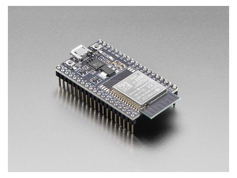 | **`DOIT ESP32 DEVKIT V1` (30-Pin)** | `1 pcs` | **Otak penggerak & pemancar Wi-Fi lokal:** membuat website kontrol `192.168.4.1`, mengatur motor pelan, dan mengerem otomatis `500 ms`. | Wi-Fi bawaan kuat, hardware PWM lengkap, dan dipakai terus hingga Tahap 2 & Final. | Dual-Core `240 MHz`, logika GPIO **`3,3V`** *(TIDAK 5V-tolerant)*, port Micro-USB (`CP2102`/`CH340`). | **Sudah Dimiliki** |
| 2 | 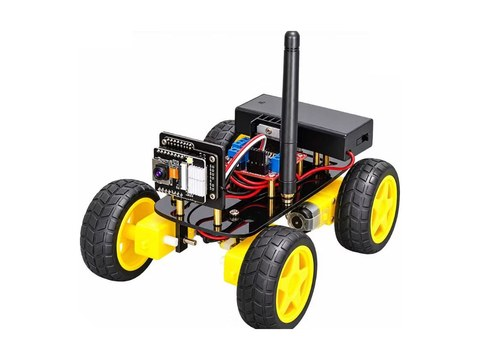 | **Kit Smart Chassis 4WD Robot Car** *(Chassis Acrylic `25×15 cm` tebal `3 mm`, `4× Motor TT 1:48`, `4× Roda 65 mm`)* | `1 set` | **Badan & 4 roda penggerak mobil:** membawa seluruh rangkaian berjalan pelan di lantai datar saat uji kendali website. | Ringan, mudah dibongkar-pasang di meja uji sebelum *upgrade* rangka logam di Bootcamp. | Beban total wajib **`≤800–1.000 g`**. *(Bawaan `4× Disc Encoder` & `1× Soket 4×AA` disimpan, tidak dipakai di Tahap 1).* | **Sudah Dimiliki** |
| 3 | 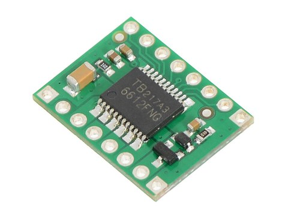 | **Driver Motor MOSFET `TB6612FNG`** | `1 pcs` | **Penguat tenaga motor ("otot" mobil):** mengubah sinyal kecil `ESP32` menjadi tenaga `7,4V` baterai untuk memutar 4 roda. | Drop tegangan hanya `~0,5V` (vs `L298N` 1,8–3,2V), ringan, native `3,3V`, cukup 1 modul untuk jalan pelan `0,07–0,1 m/s`. | `1,2 A/kanal` kontinu (`3,2 A` puncak), `VM 4,5–13,5V`, `VCC 3,3V`. *(Solder pin header dulu jika masih terpisah).* | **Sudah Dimiliki** |

### B. Sistem Daya Mobil (Rail 2 — `7,4V` Motor & `5,0V` Stabil)

| No | Foto Referensi | Nama Komponen Aktual | Qty di Tangan | Fungsi Utama (*To The Point*) | Alasan Objektif Dipilih | Spesifikasi & Catatan Praktis | Status |
| :-: | :---: | :--- | :-: | :--- | :--- | :--- | :--- |
| 4 | 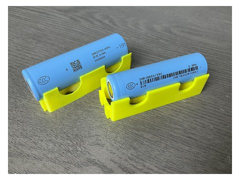 | **Baterai `Wintonic INR 18650 2200mAh 3,7V`** | `4 pcs` *(pakai 2 + 2 cadangan)* | **Sumber tenaga utama mobil:** memasok arus `7,4V` stabil untuk 4 motor & `ESP32` menggantikan `4×AA`. | 2 sel seri (`~88 g`) sanggup memasok beban jalan pelan (`~1,0–1,5 A`) di bawah batas `2,5 A/sel`, dan 2 sel sisa jadi baterai tukar cepat. | Tipe **Flat Top**, maks *discharge* `2,5 A`, tanpa proteksi internal (`cut-off` `3,0V`, penuh `4,2V`). | **Sudah Dimiliki** |
| 5 | 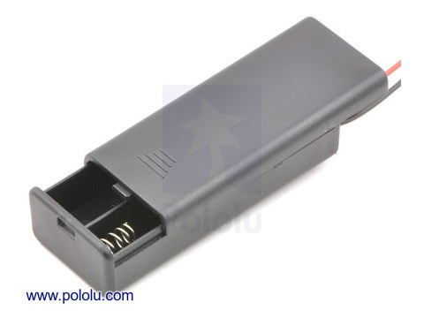 | **Holder Baterai `18650` 2-Slot Seri** | `1 pcs` | **Rumah dudukan 2 baterai `18650`:** merangkai 2 sel seri menjadi `7,4V` dan memudahkan lepas-pasang saat dicas. | Menghindari penyolderan langsung ke badan sel `18650` yang berisiko merusak baterai. | **Wajib uji di Fase 0:** ukur dengan multimeter harus keluar **`7,4–8,4V`** (pastikan seri & kontak *Flat Top* menempel). | **Pinjam Lab *(Sudah Diterima)*** |
| 6 | 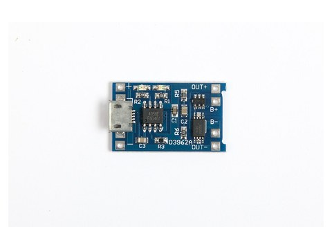 | **Modul `BMS 2S 7,4V 8A`** *(2 MOSFET, Akhishop)* | `1 pcs` | **Satpam pengaman baterai:** otomatis memutus arus bila korslet, terlalu penuh (`>4,25V/sel`), atau terlalu kosong (`<2,5V/sel`). | Wajib karena `Wintonic 18650` tidak punya sirkuit proteksi; rating `8A` sangat lega untuk beban `~1,0–1,5 A`. | Pin kanan: `B+`, `B-`; pin kiri: `P+`, `P-`, `BM`. Perlu *wake-up* singkat jika awal terbaca `0V`. | **Sudah Dibeli** |
| 7 | 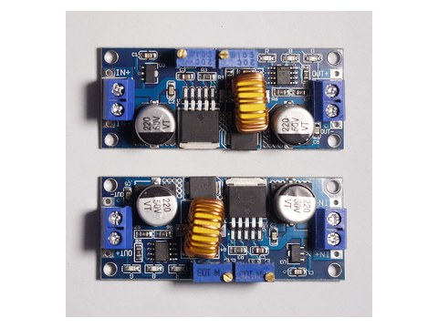 | **Step-Down *Buck Converter* (`XL4015 5A` / `LM2596 3A`)** | `1 pcs` | **Penurun tegangan `7,4V → 5,00V`:** memasok daya `5,0V` bersih untuk `ESP32` (dan nanti Servo/LED di Tahap 2). | Lebih stabil daripada regulator linear; `XL4015` juga langsung dipakai ulang di Versi Final. | **WAJIB setel trimpot tepat ke `5,00V` pakai multimeter di Fase 4 sebelum dicolok ke `ESP32`!** | **Pinjam Lab *(Sudah Diterima)*** |
| 8 | 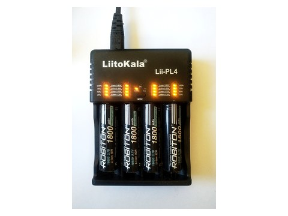 | **Charger Baterai `18650`** | `1 pcs` | **Pengisi ulang baterai `Wintonic 18650`:** mengisi kedua sel hingga penuh aman (`4,2V/sel`). | Menjaga kesehatan sel `18650` agar tegangan kedua sel selalu seimbang sebelum dipasang seri. | Cek apakah model slot lepas-pasang atau adaptor `8,4V`. | **Pinjam Lab *(Sudah Diterima)*** |
| 9 | 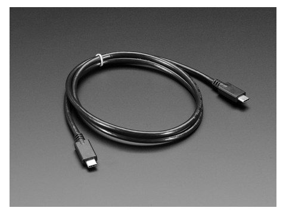 | **Kabel Micro-USB Data** | `1 pcs` | **Kabel upload & monitor `ESP32`:** menghubungkan `ESP32` ke laptop (Tahap 1) dan ke `Raspberry Pi 4 Model B` (Tahap 2). | Pastikan mendukung transfer data (bukan kabel charger saja). | Uji colok ke laptop untuk memastikan port COM / `/dev/ttyUSB0` muncul. | **Sudah Dimiliki** |

### C. *Breadboard*, Pengkabelan Aman, Komponen Pasif, & Proteksi

| No | Foto Referensi | Nama Komponen Aktual | Qty di Tangan | Fungsi Utama (*To The Point*) | Alasan Objektif Dipilih | Spesifikasi & Catatan Praktis | Status |
| :-: | :---: | :--- | :-: | :--- | :--- | :--- | :--- |
| 10 | 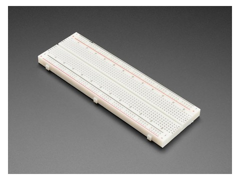 | ***Breadboard* `830` Titik** | `2 pcs` | **Papan uji tancap tanpa solder:** tempat menancapkan `ESP32`, `TB6612FNG`, dan resistor secara rapi. | Merapatkan 2 breadboard sejajar mengatasi lebar `ESP32 30-Pin` (`25,4 mm`) sehingga kedua sisi pin lega `4–5` lubang. | Hanya untuk **jalur sinyal kecil**, bukan jalur daya baterai/motor. | **Sudah Dimiliki** |
| 11 | 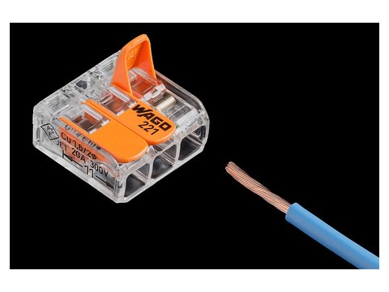 | **Konektor Lever 3-Port `PCT-223`** *(setara Wago 221-413)* | `3 pcs` | **Percabangan kabel daya di luar *breadboard*:** membagi jalur `+7,4V` (`#1`), `GND` (`#2`), dan `+5,0V` (`#3`) secara cepat tanpa solder permanen. | Menjaga arus motor tidak melewati rel tipis *breadboard*, sekaligus menggantikan kebutuhan konektor `XT30` (tinggal angkat tuas untuk melepas jalur). | 3 lubang jepit per unit, cocok langsung dengan kabel `22 AWG`. | **Sudah Dibeli** *(iSee Robot)* |
| 12 | 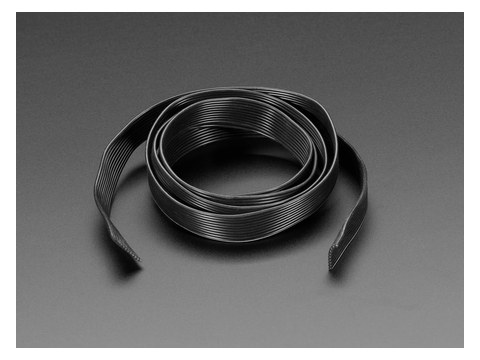 | **Kabel Serabut `22 AWG` (`OD 1,7 mm`) Warna Merah** | `2 meter` | **Kabel jalur daya utama & motor:** menyambungkan holder baterai, `BMS 2S`, saklar, sekring, `PCT-223`, Buck, driver, dan 4 motor TT. | Kapasitas arus `~5 A` aman untuk beban Tahap 1 (`~1,0–1,5 A`) dan jauh lebih kuat daripada kabel AWG super tipis. | **WAJIB:** karena warna merah semua, tandai **kedua ujung setiap potongan jalur `GND` dengan *heat-shrink* hitam**! *(Jangan pakai kabel AWG super tipis untuk daya).* | **Sudah Dibeli** *(iSee Robot)* |
| 13 | 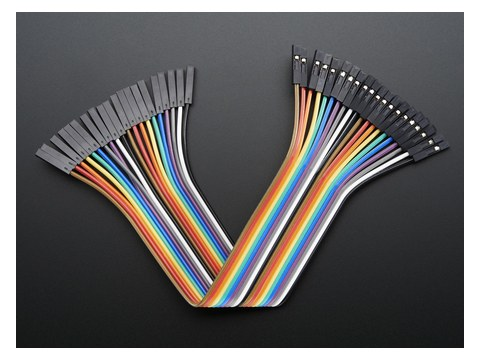 | **Kabel Jumper DuPont** | `10 F-M pendek` + `10 F-F panjang` + `10 M-M` + **`1 strip M-M` Lab** | **Kabel sinyal data di *breadboard*:** menyambung 9 jalur kontrol `ESP32` ↔ `TB6612FNG` + rel sinyal. | Tambahan `1 strip M-M` dari lab menutup kebutuhan `~12–14 kabel M-M` di Tahap 1 plus cadangan Tahap 2. | **Khusus sinyal data**, jangan dipakai untuk arus baterai/motor. | **Sudah Dimiliki + Pinjam Lab** |
| 14 | 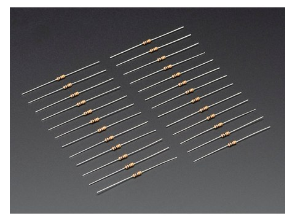 | **Resistor `10 kΩ`** *(+ `3× 1 kΩ` disimpan untuk Tahap 2)* | `10 pcs` *(pakai 1 pcs di Tahap 1)* | **Pengunci motor mati saat baru nyala:** menarik pin `STBY` `TB6612FNG` ke `GND` (*pull-down*) agar roda tidak loncat saat `ESP32` *booting*. | Mencegah sinyal mengambang sesaat setelah saklar ON dinyalakan. | Pakai 1 pcs di `STBY → GND`; sisanya + `3× 1 kΩ` simpan untuk Tahap 2. | **Sudah Dimiliki** |
| 15 | 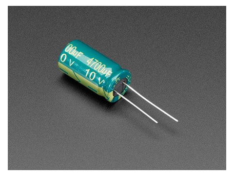 | **Kapasitor Elektrolit `470 µF` / `1000 µF` (`≥16V/25V`)** | `4 pcs` *(pakai 2 pcs)* | **"Tangki cadangan listrik" anti-reset:** menyerap hentakan arus saat 4 motor mulai jalan agar `ESP32` tidak *restart*. | Menjaga tegangan di jalur `VM` (`7,4V`) dan `+5,0V` tetap stabil saat start. | **Wajib cek di Fase 0:** tulisan tegangan di badan minimal **`16V`**; garis putih (`-`) selalu ke `GND`! | **Pinjam Lab *(Sudah Diterima)*** |
| 16 | 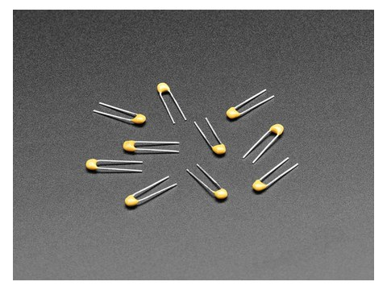 | **Kapasitor Multilayer (`MLCC`) `100 nF 50V`** | `12 pcs` *(pakai 6 pcs)* | **Penyaring gangguan listrik motor:** meredam percikan sikat karbon di 4 motor TT agar Wi-Fi `ESP32` tidak putus-nyambung. | Tipe multilayer `50V` lebih stabil & ringkas dibanding keramik keping biasa. | Non-polar (bebas bolak-balik): pasang 4 pcs di kaki 4 motor + 1 pcs di `TB6612FNG VCC–GND` + 1 pcs di `ESP32 3V3–GND`. | **Sudah Dibeli** *(iSee Robot)* |
| 17 | 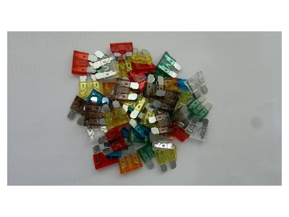 | **Sekring Kaca `5×20 mm` (`5A` & `2A`) + Rumah Sekring Model Putar `5×20 mm`** | `5 pcs (5A)` + `5 pcs (2A)` + **`3 holder putar`** | **Pengaman anti-kebakaran utama:** langsung putus bila kabel korslet sebelum baterai `Wintonic 18650` panas/rusak. | Model tabung putar punya kuping solder kokoh & tabung tertutup aman; pasang isi **`5A`** (tahan arus start 4 motor, langsung putus bila korslet). | Pakai `1 holder putar` + `1 sekring 5A`; sisanya simpan cadangan. | **Sudah Dibeli** |
| 18 | 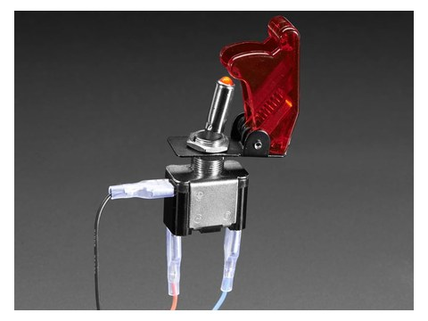 | **Saklar Utama ON/OFF (`10A`)** | `1 pcs` | **Tombol ON/OFF utama mobil:** memutus listrik baterai dalam 1 klik tanpa membongkar baterai atau kabel. | Wajib ada agar aman saat mengutak-atik *breadboard* atau saat upload kode USB. | Dipasang memutus kabel merah antara `BMS P+` dan `Fuse Holder 5A`. | **Pinjam Lab *(Sudah Diterima)*** |
| 19 | 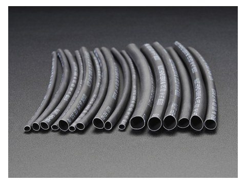 | ***Heat-Shrink Tube* + *Cable Ties* Kecil** | Heat-shrink *(ada)* + *Cable ties* *(dibawa besok)* | **Pembungkus solderan, penanda kabel `GND` hitam, & pengikat rangka:** mencegah sambungan terbuka bersentuhan dan mengikat komponen ke akrilik. | Krusial untuk membedakan kabel `22 AWG` merah jalur `+` vs jalur `GND` (pakai selongsong hitam di kedua ujungnya). | Siapkan *heat-shrink* hitam `2–4 mm` dan *cable ties* `10–15 cm`. | **Heat-shrink Ada; Cable Ties Dibawa Besok** |

### D. Alat Kerja Lengkap (Sudah Tersedia Semua!)

| No | Foto Referensi | Nama Alat Aktual | Fungsi Utama (*To The Point*) | Status |
| :-: | :---: | :--- | :--- | :--- |
| 20 | 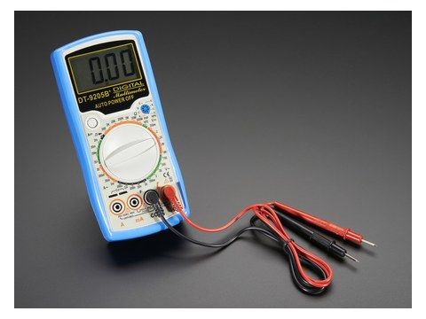 | **Multimeter Digital** | **Alat cek wajib:** cek anti-korslet (*beep*), cek holder `7,4–8,4V`, *wake-up* `BMS 2S`, & setel *Buck Converter* tepat **`5,00V`**. | **Sudah Dimiliki** |
| 21 | 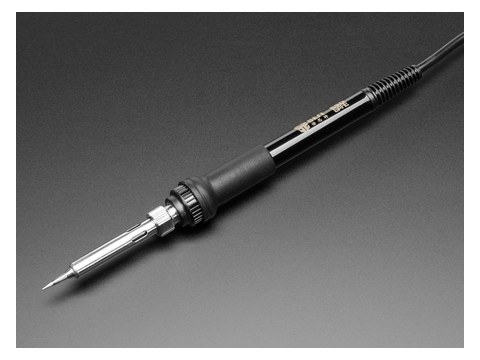 | **Solder + Timah + Flux + Penyedot Timah** | Menyolder kaki 4 motor TT + `MLCC 100 nF`, pin header `TB6612FNG`, papan `BMS 2S 8A`, saklar, & kuping `Fuse Holder Putar`. *(Foto pendukung: [Timah](./assets/poc/33_solder_tin_wire.jpg), [Flux](./assets/poc/34_solder_flux_paste.jpg), [Penyedot](./assets/poc/35_desoldering_pump.jpg)).* | **Sudah Dimiliki** |
| 22 | 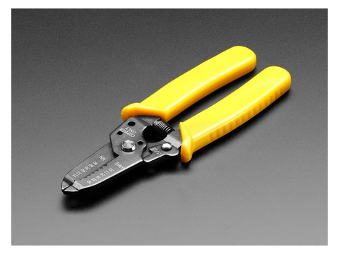 | **Tang Potong** | Memotong & mengupas rapi kabel `22 AWG` serta memotong sisa kaki kapasitor/resistor. | **Sudah Dimiliki** *(dibawa besok)* |

---

## 4. Persiapan Software & Alur Kontrol Web *(Tanpa Codingan Dulu)*

| Kebutuhan | Aplikasi / Library yang Disiapkan | Peran di Tahap 1 | Link Resmi |
| :--- | :--- | :--- | :--- |
| **IDE Coding *(Disarankan)*** | **Visual Studio Code** + Ekstensi **`PlatformIO IDE`** | Mengelola board `esp32doit-devkit-v1` dan library dalam 1 proyek tim. | [VS Code](https://code.visualstudio.com/) \| [PlatformIO](https://platformio.org/install/ide?install=vscode) |
| **IDE Alternatif Pemula** | **Arduino IDE 2.x** + Board **`esp32` by Espressif** | Alternatif cepat untuk uji putar motor pertama kali. | [Arduino IDE](https://www.arduino.cc/en/software) |
| **Driver USB `ESP32`** | **CP210x** *(atau **CH340** sesuai chip dekat port USB board)* | Agar laptop Windows/macOS mengenali port COM `ESP32` *(di Linux otomatis `/dev/ttyUSB0`)*. | [Driver CP210x](https://www.silabs.com/developers/usb-to-uart-bridge-vcp-drivers) |
| **Library Web Kontrol** | **`ESPAsyncWebServer`** + **`AsyncTCP`** *(dari `ESP32Async`)* | Menyajikan website `http://192.168.4.1` & jalur **WebSocket** instan tanpa jeda. | [ESPAsyncWebServer](https://github.com/ESP32Async/ESPAsyncWebServer) \| [AsyncTCP](https://github.com/ESP32Async/AsyncTCP) |

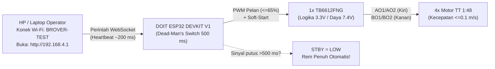

---

## 5. Panduan Wiring Warna Kabel Pin-ke-Pin (`3× PCT-223` + `2× Breadboard 830`)

### A. Peta Sambungan Jalur Daya Besar — **DI LUAR *Breadboard*** (`Kabel 22 AWG` + `3× PCT-223`)

> **Aturan Penandaan Warna Wajib:** Karena `2 m` kabel `22 AWG`-mu berwarna merah semua, potong selongsong ***heat-shrink* hitam** (`1–1,5 cm`) dan pasang di **kedua ujung** setiap potongan kabel yang bertanda **`[HITAM — GND]`** di tabel bawah!

| Dari Komponen & Pin | Jenis & Tanda Kabel `22 AWG` | Ke Komponen & Pin | Tegangan & Fungsi |
| :--- | :---: | :--- | :--- |
| **Holder `18650` (Ujung `+` Sel 2)** | Merah polos (`~10 cm`) | **`BMS 2S 8A` Pin `B+`** *(sisi kanan)* | `+7,4V–8,4V` input baterai ke BMS. |
| **Holder `18650` (Pelat Tengah antara Sel 1 & Sel 2)** | Merah + *heat-shrink* **kuning/putih** (`~10 cm`) | **`BMS 2S 8A` Pin `BM`** *(sisi kiri bawah)* | `+3,7V–4,2V` sensor titik tengah BMS. |
| **Holder `18650` (Ujung `-` Sel 1)** | Merah + *heat-shrink* **`HITAM`** (`~10 cm`) | **`BMS 2S 8A` Pin `B-`** *(sisi kanan)* | `0V` negatif baterai ke BMS. |
| **`BMS 2S 8A` Pin `P+`** *(sisi kiri atas)* | Merah polos (`~12 cm`) | **Saklar ON/OFF (Kaki 1)** | Jalur positif terproteksi BMS. |
| **Saklar ON/OFF (Kaki 2)** | Merah polos (`~10 cm`) | **`Fuse Holder Putar 5×20 mm` (Kaki Belakang)** | Memutus semua daya saat saklar OFF. *(Masukkan tabung kaca **`5A`** di dalam holder!)* |
| **`Fuse Holder Putar` (Kaki Samping)** | Merah polos (`~10 cm`) | **`PCT-223 #1` — Lubang 1** *(Rel `+7,4V`)* | Jalur utama terproteksi sekring `5A`. |
| **`PCT-223 #1` — Lubang 2** | Merah polos (`~12 cm`) | **`TB6612FNG` Pin `VM`** *(disolder / masuk baris pin `VM` paling pinggir)* | Suplai tenaga `7,4V` untuk 4 motor TT. |
| **`PCT-223 #1` — Lubang 3** | Merah polos (`~12 cm`) | ***Buck Converter* Pin `IN+`** | Suplai input `7,4V` ke penurun tegangan. |
| **`BMS 2S 8A` Pin `P-`** *(sisi kiri atas)* | Merah + *heat-shrink* **`HITAM`** (`~12 cm`) | **`PCT-223 #2` — Lubang 1** *(Rel `GND`)* | Jalur negatif utama keluar BMS. |
| **`PCT-223 #2` — Lubang 2** | Merah + *heat-shrink* **`HITAM`** (`~12 cm`) | ***Buck Converter* Pin `IN-`** | Ground sisi input *Buck Converter*. |
| **`PCT-223 #2` — Lubang 3** | Merah + *heat-shrink* **`HITAM`** (`~12 cm`) | **`TB6612FNG` Pin `GND`** | Ground arus besar driver motor. |
| ***Buck Converter* Pin `OUT-`** *(terhubung internal ke `IN-`)* | Merah + *heat-shrink* **`HITAM`** (`~12 cm`) | **Rel `-` (Biru) *Breadboard #1* → `ESP32 Pin GND`** | Menyambungkan *Common Ground* ke `ESP32` tanpa memaksa 4 kabel ke 3 lubang `PCT-223 #2`! |
| ***Buck Converter* Pin `OUT+`** *(WAJIB di-set **`5,00V`** dulu di Fase 4!)* | Merah polos (`~10 cm`) | **`PCT-223 #3` — Lubang 1** *(Rel `+5,0V`)* | Jalur `+5,00V` teregulasi bersih. |
| **`PCT-223 #3` — Lubang 2** *(JANGAN dipasang sebelum Fase 4!)* | Merah polos / Jumper `M-M` (`~12 cm`) | **`ESP32` Pin `VIN`** *(kaki paling bawah sisi kiri)* | Sumber daya `5,00V` untuk `ESP32`. *(Lubang 3 `PCT-223 #3` dibiarkan kosong, siap pakai untuk Servo & LED di Tahap 2!)* |

### B. Peta Sambungan Jalur Sinyal & Motor — **Di Atas `2× Breadboard 830`**

*(Pin sensor Tahap 2 seperti `D21/D22` I2C, `D34` ADC1, `D18`, `D19`, `D23`, `D35`, `D16/D17` sengaja dibiarkan kosong agar nanti tidak perlu bongkar kabel Tahap 1!)*

| Dari Komponen & Pin | Warna Jumper / Kabel | Ke Komponen & Pin | Tegangan & Fungsi |
| :--- | :---: | :--- | :--- |
| **`ESP32` Pin `3V3`** *(kanan bawah)* | Jumper `M-M` Oranye | **`TB6612FNG` Pin `VCC`** | Sumber logika **`3,3V`** chip driver *(JANGAN ke `7,4V`!)*. Pasang `1 pcs MLCC 100 nF` antara `VCC–GND`. |
| **`ESP32` Pin `GND`** *(kanan/kiri bawah)* | Jumper `M-M` Hitam | **Rel `-` (Biru) *Breadboard* ↔ `TB6612FNG` Pin `GND`** | *Common Ground* sinyal. |
| **`ESP32` Pin `D13`** | Jumper `M-M` Abu-abu | **`TB6612FNG` Pin `STBY`** | Mengaktifkan driver. Pasang **Resistor `10 kΩ`** dari pin `STBY` ke Rel `-` (`GND`) agar motor diam saat boot. |
| **`ESP32` Pin `D25`** | Jumper `M-M` Kuning | **`TB6612FNG` Pin `PWMA`** | Kecepatan pelan **2 Motor Sisi Kiri**. |
| **`ESP32` Pin `D26`** | Jumper `M-M` Hijau | **`TB6612FNG` Pin `AIN1`** | Arah putar 1 **Motor Kiri**. |
| **`ESP32` Pin `D27`** | Jumper `M-M` Biru | **`TB6612FNG` Pin `AIN2`** | Arah putar 2 **Motor Kiri**. |
| **`ESP32` Pin `D14`** | Jumper `M-M` Ungu | **`TB6612FNG` Pin `PWMB`** | Kecepatan pelan **2 Motor Sisi Kanan**. |
| **`ESP32` Pin `D32`** | Jumper `M-M` Putih | **`TB6612FNG` Pin `BIN1`** | Arah putar 1 **Motor Kanan**. |
| **`ESP32` Pin `D33`** | Jumper `M-M` Cokelat | **`TB6612FNG` Pin `BIN2`** | Arah putar 2 **Motor Kanan**. |
| **`TB6612FNG` Pin `AO1` & `AO2`** | Kabel `22 AWG` (Merah & Tanda Hitam) | **Paralel 2 Motor Sisi Kiri (Depan-Kiri + Belakang-Kiri)** | Setiap motor sudah disolder `1 pcs MLCC 100 nF`. Jika 1 roda mutar terbalik saat uji, cukup tukar 2 kabel pada motor itu. |
| **`TB6612FNG` Pin `BO1` & `BO2`** | Kabel `22 AWG` (Merah & Tanda Hitam) | **Paralel 2 Motor Sisi Kanan (Depan-Kanan + Belakang-Kanan)** | Sama seperti sisi kiri. |

---

## 6. Panduan Perakitan Lengkap Langkah demi Langkah (*Fase 0 s.d. Fase 7*)

Ikuti urutan fase di bawah ini **persis berurutan** — jangan melompati **Fase 0** dan **Fase 4 (Tes Multimeter)** agar tidak ada komponen yang hangus!

### FASE 0 — Cek Fisik Awal & Pemotongan Kabel (`~10 Menit`)
1. **Cek 4 Barang dari Lab dengan Multimeter:**
   - **Holder `18650` + `2× Wintonic 18650`:** Masukkan 2 baterai ke holder (ujung kabel jangan saling bersentuhan!), ukur kabel merah vs hitam dengan Multimeter mode **DC Volt (`20V`)**:
     - Keluar **`~7,4V – 8,4V`** → **Lolos!** (Benar tipe Seri & kutub *Flat Top* menempel).
     - Keluar **`0V`** → kutub *Flat Top* terganjal plastik positif holder (ganjal sedikit dengan lipatan kecil timah/pelat kuningan atau geser kontak pegas).
     - Keluar **`~3,7V – 4,2V`** → holder-nya tipe Paralel (harus diubah sambungan dalamnya menjadi seri sebelum lanjut).
   - **Kapasitor Elektrolit dari Lab:** Baca tulisan pada badannya — pastikan minimal **`16V` atau `25V`** *(jangan pasang kapasitor `6,3V`/`10V` pada rel `7,4V`!)*.
   - **Saklar ON/OFF:** Putar Multimeter ke mode *Buzzer/Continuity*, tempel ke 2 kaki saklar: posisi **ON = bunyi *beep***, posisi **OFF = diam**.
   - **Keluarkan Baterai Dulu!** Setelah tes holder lulus, **cabut kedua baterai `18650`** selama seluruh proses penyolderan Fase 1–3!
2. **Potong Kabel `22 AWG` (`2 meter`) & Tandai Jalur `GND`:**
   - Potong **8 potongan `15–18 cm`** untuk 4 motor TT (`4 merah polos` + `4 diberi heat-shrink hitam di kedua ujungnya`).
   - Potong **9 potongan `10–12 cm`** untuk jalur daya (`5 merah polos` untuk `+`, `1 diberi heat-shrink kuning/putih` untuk `BM`, `3 diberi heat-shrink hitam` untuk `GND`). Total terpakai `~1,8–1,9 meter` — pas dari stok `2 meter`-mu!

### FASE 1 — Rakit Sasis 4WD & Solder `4× Motor TT` + `MLCC 100 nF 50V` (`~25 Menit`)
1. Ambil 1 Motor TT kuning, oleskan sedikit **flux** pada 2 kuping tembaganya.
2. Tekuk kaki `1 pcs MLCC 100 nF 50V` (bebas bolak-balik) menjembatani kedua kuping tembaga motor, lalu solder **cepat (`≤2–3 detik`)** bersama 1 kabel merah polos (kuping atas) dan 1 kabel bertanda *heat-shrink* hitam (kuping bawah). **Jangan menempelkan ujung solder terlalu lama** agar rumah plastik kuning motor tidak meleleh!
3. Ulangi langkah 1–2 untuk ke-4 motor TT, lalu potong sisa kaki kapasitor dengan tang potong.
4. Pasang ke-4 motor ke pelat bawah akrilik `25 × 15 cm` memakai baut panjang & *T-bracket* bawaan kit (semua kuping solder menghadap ke **bagian dalam** sasis agar terlindung dari benturan; `4× Disc Encoder` tidak perlu dipasang). Pasang ke-4 roda `65 mm`.
5. **Paralelkan Motor per Sisi:**
   - **Sisi Kiri:** Pilin ujung kabel merah Motor Depan-Kiri + Motor Belakang-Kiri menjadi satu (tin dengan timah / sambung rapi), lakukan sama untuk ujung kabel tanda hitamnya → sekarang Sisi Kiri punya **1 pasang ujung (`Kiri+` & `Kiri-`)**.
   - **Sisi Kanan:** Ulangi persis sama untuk Motor Depan-Kanan + Belakang-Kanan → sekarang Sisi Kanan punya **1 pasang ujung (`Kanan+` & `Kanan-`)**.

### FASE 2 — Siapkan `TB6612FNG` & Rapatkan `2× Breadboard 830` (`~15 Menit`)
1. **Jika Pin Header `TB6612FNG` Masih Terpisah:** Tancapkan kedua baris pin header male (8-pin + 8-pin) ke *breadboard* dengan jarak sesuai lubang modul, letakkan papan `TB6612FNG` di atasnya (tulisan pin menghadap ke atas), beri sedikit flux, lalu solder ke-16 kakinya hingga mengilap berbentuk kerucut kecil (pastikan tidak ada timah yang menyentuh pin sebelah!).
2. **Rapatkan `2× Breadboard 830`:** Kaitkan sisi samping kedua breadboard sejajar (jika rel daya tengah menghalangi lebar `ESP32`, lepaskan 1 strip rel daya pinggir di sisi dalam salah satu breadboard).
3. **Tancapkan `DOIT ESP32 DEVKIT V1 (30-Pin)`:** Posisikan port **Micro-USB menghadap ke tepi belakang** (supaya gampang dicolok ke laptop!), tancapkan deret pin kiri (`EN` s.d. `VIN`) di **Breadboard #1** dan deret pin kanan (`D23` s.d. `3V3`) di **Breadboard #2**. Cek kedua sisi kini menyisakan `4–5` lubang lega.
4. **Tancapkan `1× TB6612FNG`** melintasi celah tengah di sisi kosong **Breadboard #1** (berjarak `3–4` baris dari `ESP32` agar jari leluasa memasang kabel).

### FASE 3 — Rakit Jalur Daya Rail 2 di Luar *Breadboard* (`~25 Menit`, Baterai MASIH DICABUT!)
1. **Solder Kabel ke `BMS 2S 7,4V 8A` (Sesuai Letak Pin Board Akhishop):**
   - Sisi kanan: solder kabel merah Holder (`+` Sel 2) ke **`B+`**, dan kabel hitam Holder (`-` Sel 1) ke **`B-`**.
   - Sisi kiri bawah (**`BM`**): lihat bagian belakang Holder 2-slot tempat pelat logam menghubungkan kutub `+` Sel 1 ke kutub `-` Sel 2 → solder 1 kabel `22 AWG` (tanda kuning/putih) dari pelat penghubung tengah tersebut ke pad **`BM`** di BMS!
   - Sisi kiri atas: solder kabel merah `12 cm` ke **`P+`** dan kabel tanda hitam `12 cm` ke **`P-`**.
2. **Solder `Saklar ON/OFF` & `Fuse Holder Putar 5×20 mm`:**
   - Pastikan posisi saklar **`OFF`**. Solder kabel dari `BMS P+` ke **Kaki 1 Saklar**.
   - Solder kabel merah dari **Kaki 2 Saklar** ke **kuping belakang `Fuse Holder Putar`**, dan kabel merah lain dari **kuping samping `Fuse Holder Putar`** menuju ujung bebas (untuk masuk ke `PCT-223 #1`). Bungkus kedua solderan kuping holder dengan ***heat-shrink***!
   - Putar tutup bertuliskan `FUSE`, masukkan **`1 pcs Sekring Kaca 5A`**, lalu putar tutup kembali sampai rapat.
3. **Pasang `3× Konektor Lever PCT-223` (Angkat Tuas Oranye → Masukkan Kabel Kupas `~10 mm` → Tutup Tuas):**
   - **`PCT-223 #1` (Rel `+7,4V`):**
     - Lubang 1 = kabel merah dari `Fuse Holder Putar 5A`
     - Lubang 2 = kabel merah menuju **`TB6612FNG` Pin `VM`**
     - Lubang 3 = kabel merah menuju ***Buck Converter* Pin `IN+`**
   - **`PCT-223 #2` (Rel `GND`):**
     - Lubang 1 = kabel tanda hitam dari `BMS P-`
     - Lubang 2 = kabel tanda hitam menuju ***Buck Converter* Pin `IN-`**
     - Lubang 3 = kabel tanda hitam menuju **`TB6612FNG` Pin `GND`**
   - **Jembatan `GND` ke *Breadboard*:** Sambungkan kabel tanda hitam dari ***Buck Converter* Pin `OUT-`** ke Rel `-` (Biru) *Breadboard #1*, lalu sambungkan 1 jumper hitam dari Rel `-` ke **`ESP32` Pin `GND`**.
   - **`PCT-223 #3` (Rel `+5,0V`):**
     - Lubang 1 = kabel merah dari ***Buck Converter* Pin `OUT+`**
     - **Lubang 2 & Lubang 3 BIARKAN KOSONG DULU!** *(Jangan menyambung ke `ESP32 VIN` sebelum lulus Fase 4!)*

### FASE 4 — *PHYSICAL GATE* WAJIB DENGAN MULTIMETER (`~10 Menit` — DILARANG DILEWATI!)
1. **Cek Anti-Korslet (*Continuity / Buzzer*, Baterai Belum Masuk, Saklar ON):**
   - Tempel *probe* merah ke lubang `PCT-223 #1 (+7,4V)` dan hitam ke `PCT-223 #2 (GND)` → **tidak boleh bunyi *beep* panjang!** *(Jika bunyi sesaat lalu diam, itu normal karena kapasitor mengisi).*
   - Ulangi pada `PCT-223 #3 (+5,0V)` vs `PCT-223 #2 (GND)` → **tidak boleh bunyi *beep* panjang!**
   - Kembalikan Saklar ke posisi **`OFF`**.
2. **Cek & Pasang `2× Wintonic 18650`:**
   - Ukur masing-masing sel dengan Multimeter (DC Volt): pastikan keduanya **`3,7V – 4,2V`** dan selisih antar kedua sel **`≤0,1V`** *(jika timpang, cas dulu sampai sama-sama penuh di charger lab!)*.
   - Pasang kedua sel ke Holder (cek simbol `+` & `-` dengan teliti — **jangan terbalik!**).
   - Ukur di papan `BMS 2S`: `B+` vs `B-` harus **`7,4–8,4V`**, dan `BM` vs `B-` harus **`3,7–4,2V`**.
3. **Tes & *Wake-Up* `BMS 2S 8A`:**
   - Ukur `P+` vs `P-` pada `BMS 2S`. Jika langsung terbaca **`7,4–8,4V`**, lanjut ke langkah 4.
   - Jika terbaca **`0V`** (mode proteksi tidur pabrik), pancing 1 detik dengan menempelkan kabel jumper sesaat antara `B-` dan `P-` (atau sentuhkan charger `8,4V` 1 detik ke `P+/P-`), lalu ukur ulang `P+` vs `P-` hingga keluar **`7,4–8,4V`**.
4. **Setel Output *Buck Converter* ke Tepat `5,00V`:**
   - Pastikan **Lubang 2 `PCT-223 #3` (`ESP32 VIN`) MASIH KOSONG!**
   - Geser Saklar ke **`ON`**. Tempel *probe* merah Multimeter (DC Volt `20V`) ke `Buck OUT+` (`PCT-223 #3`) dan hitam ke `Buck OUT-` (`GND`).
   - Putar baut kuningan kecil (*trimpot*) di papan *Buck Converter* perlahan menggunakan obeng minus kecil sampai layar Multimeter menunjukkan tepat **`5,00V`** (toleransi aman **`4,95V – 5,05V`**).
   - **Geser Saklar kembali ke `OFF`!**

### FASE 5 — Pasang Kapasitor Anti-Reset, Wiring Sinyal, & Sambungkan Motor (`~20 Menit`, Saklar OFF!)
1. **Pasang `2× Kapasitor Elektrolit` (`470–1000 µF ≥16V` — PERHATIKAN POLARITAS!):**
   - **Kapasitor #1:** Kaki panjang (`+`) ke jalur **`TB6612FNG VM`** (`+7,4V`), kaki garis putih (`-`) ke **`GND`**.
   - **Kapasitor #2:** Kaki panjang (`+`) ke jalur **`Buck OUT+`** (`+5,0V`), kaki garis putih (`-`) ke **`GND`**.
2. **Pasang `2× MLCC 100 nF 50V`** (bebas bolak-balik): 1 pcs antara `TB6612FNG VCC–GND` dan 1 pcs antara `ESP32 3V3–GND`.
3. **Pasang `1× Resistor 10 kΩ`** dari baris `TB6612FNG Pin STBY` ke Rel `-` (`GND`).
4. **Tancapkan `9× Kabel Jumper M-M`** persis sesuai **Tabel 5.B** (centang tiap kabel setelah ditancap):
   - [ ] `ESP32 3V3` → `TB6612FNG VCC`
   - [ ] `ESP32 GND` → Rel `-` (`GND`) ↔ `TB6612FNG GND`
   - [ ] `ESP32 D13` → `TB6612FNG STBY`
   - [ ] `ESP32 D25` → `TB6612FNG PWMA`
   - [ ] `ESP32 D26` → `TB6612FNG AIN1`
   - [ ] `ESP32 D27` → `TB6612FNG AIN2`
   - [ ] `ESP32 D14` → `TB6612FNG PWMB`
   - [ ] `ESP32 D32` → `TB6612FNG BIN1`
   - [ ] `ESP32 D33` → `TB6612FNG BIN2`
5. **Sambungkan Kabel Motor ke `TB6612FNG`:**
   - Masukkan ujung `Kiri+` ke `AO1` & `Kiri-` ke `AO2`; masukkan ujung `Kanan+` ke `BO1` & `Kanan-` ke `BO2`.
6. **Sambungkan Daya `5,00V` ke `ESP32`:**
   - Masukkan kabel merah dari `ESP32 Pin VIN` ke **Lubang 2 `PCT-223 #3`**, lalu tutup tuasnya.

### FASE 6 — Tata Letak Rapi di Sasis Akrilik `25 × 15 cm` & Aturan Upload USB (`~15 Menit`)
1. **Susun Pembagian Dek (Titik Berat Rendah & Seimbang):**
   - **Pelat Bawah (`25 × 15 cm`):** `4× Motor TT`, `Holder 2× Wintonic 18650`, `BMS 2S 8A`, dan *Buck Converter* (ikat kencang memakai *cable ties* / *double tape* busa).
   - **Pelat Atas (`25 × 15 cm`):** `2× Breadboard 830` (berisi `ESP32` & `TB6612FNG`), `3× PCT-223`, `Saklar ON/OFF`, dan `Fuse Holder Putar 5A` diletakkan di tepi mudah dijangkau tangan.
2. **ATURAN EMAS SAAT COLOK USB `ESP32` KE LAPTOP (UNTUK UPLOAD KODE NANTI):**
   - Sebelum mencolok kabel Micro-USB dari laptop ke `ESP32`, **WAJIB matikan Saklar `10A` baterai ke posisi `OFF`** (atau angkat tuas Lubang 2 `PCT-223 #3`) agar suplai `5V` USB laptop tidak bertabrakan dengan suplai `5V` *Buck Converter*!
   - Begitu selesai upload kode, cabut kabel USB dari laptop → baru nyalakan Saklar `10A` ke `ON` untuk tes jalan pakai baterai!

### FASE 7 — Kriteria Lulus Tahap 1 (*Wajib Terpenuhi Sebelum Lanjut ke Tahap 2!*)
- [ ] **Tes Nyala Awal:** Saat Saklar `ON` digeser, lampu LED daya di `ESP32` menyala terang stabil, tidak ada bau hangus/komponen panas, dan **keempat roda tetap diam total** (berkat resistor `10 kΩ` *pull-down* di `STBY`).
- [ ] **Tes Angkat Roda:** Mobil diganjal (roda menggantung), Wi-Fi HP terhubung ke `ESP32`, buka `http://192.168.4.1` → tombol **Maju, Mundur, Belok Kiri, Belok Kanan, & Stop** memutar keempat roda ke arah yang benar *(jika ada 1 roda terbalik, tukar 2 kabel pada motor itu)*.
- [ ] **Tes Rem Darurat (*Dead-Man's Switch*):** Saat tombol Maju ditahan lalu Wi-Fi HP dimatikan mendadak, keempat roda berhenti penuh dalam **`≤0,5 detik`**.
- [ ] **Tes Lantai Datar (`0,07–0,1 m/s`):** Mobil diturunkan ke lantai keramik, menempuh jarak `1 meter` lurus dalam **`10–14 detik`**, `ESP32` tidak pernah *restart* saat start, dan chip `TB6612FNG` tetap dingin/hangat wajar.

---

## 7. Link Referensi Proyek Mirip Tahap 1 (Terverifikasi Aktif)

- **YouTube — Membuat Mobil Robot Wi-Fi `ESP32` Kontrol WebSocket (DonskyTech):** [ESP32 Robot Car Using WebSockets](https://www.youtube.com/watch?v=udC-liFoaEI)
- **YouTube — Penjelasan WebSocket Real-Time di `ESP32`:** [ESP32 WebSocket Server Tutorial](https://www.youtube.com/watch?v=mkXsmCgvy0k)
- **YouTube — Wiring & Kontrol Motor `TB6612FNG`:** [TB6612FNG Motor Driver Tutorial](https://www.youtube.com/watch?v=eEf1n8TKNFQ)
- **Panduan Tertulis Langkah-demi-Langkah (Random Nerd Tutorials):** [ESP32 Wi-Fi Car Robot](https://randomnerdtutorials.com/esp32-wi-fi-car-robot-arduino/) \| [ESP32 WebSocket Server](https://randomnerdtutorials.com/esp32-websocket-server-arduino/)
- **Panduan Wiring `TB6612FNG` Ramah Pemula:** [Last Minute Engineers — TB6612FNG](https://lastminuteengineers.com/tb6612fng-dc-motor-control-arduino-tutorial/) \| [DroneBot Workshop — TB6612FNG](https://dronebotworkshop.com/tb6612fng-h-bridge/)
- **Repositori GitHub Referensi Kontrol Mobil WebSocket `ESP32`:** [donskytech/platformio-projects](https://github.com/donskytech/platformio-projects) \| [bryantwong-xx/ESP32_web_socket_car](https://github.com/bryantwong-xx/ESP32_web_socket_car) \| [pablopeza/TB6612FNG_ESP32](https://github.com/pablopeza/TB6612FNG_ESP32)
- **Datasheet Resmi Driver:** [Toshiba / SparkFun TB6612FNG Datasheet (PDF)](https://cdn.sparkfun.com/datasheets/Robotics/TB6612FNG.pdf)
