# Panduan IoT `BROVER` — Tahap 2: Prototype Lengkap CV Feses, Sensor di Tiang, & Integrasi Website (`TKT 3–4`)

> **Posisi dalam Seri Panduan 3 Tahap `BROVER`:**  
> 1. **Prasyarat Wajib — [Tahap 1](./01_PANDUAN_TAHAP1_ROVER_KONTROL_WEB.md):** Mobil 4WD (`DOIT ESP32 DEVKIT V1 30-Pin` + `1× TB6612FNG` + `2× 18650` + `2× Breadboard 830`) **wajib sudah lulus** tes jalan pelan `0,07–0,1 m/s`, kontrol website HP, dan rem darurat `500 ms`.  
> 2. **Dokumen Ini (`Tahap 2`):** Memasang **`Raspberry Pi 4 Model B`**, Webcam USB pada **`Servo Tilt`** dua posisi, `LED 5V`, **`SHT31`** dan **`DFRobot SEN0567`** di tiang setinggi ayam, dan **`HC-SR04`** agar **CV feses + sensor mikroklimat terintegrasi penuh ke Website Dashboard** (target **M1, akhir Desember 2026**).  
> 3. **Lanjut ke [Tahap 3 (Final)](./03_PANDUAN_IOT_FINAL_FIELD_READY.md):** *Upgrade* mekanik, baterai `LiFePO₄`, `Orange Pi 3B`, & casing `IP65` siap kandang broiler nyata (`TKT 5–6+`).
>
> **Catatan:** Dokumen ini **tidak mencantumkan harga** (cek manual di e-commerce lokal RI) dan **belum memuat kode program** — fokus 100% pada alasan objektif pemilihan komponen, anti-*overclaim*, daftar komponen tambahan berfoto `.jpg`, dan panduan wiring warna kabel pin-ke-pin.

---

## 1. Arsitektur Integrasi CV Feses, Sensor, & Website (Tahap 2)

Begitu mobil Tahap 1 sudah lancar berjalan, pusat Wi-Fi lokal & halaman kendali website (`http://192.168.4.1`) **dipindahkan dari `ESP32` ke `Raspberry Pi 4 Model B`**, sedangkan `ESP32` berubah peran menjadi **pengendali gerak & pembaca sensor *real-time*** yang terhubung lewat **1 kabel USB Serial**:

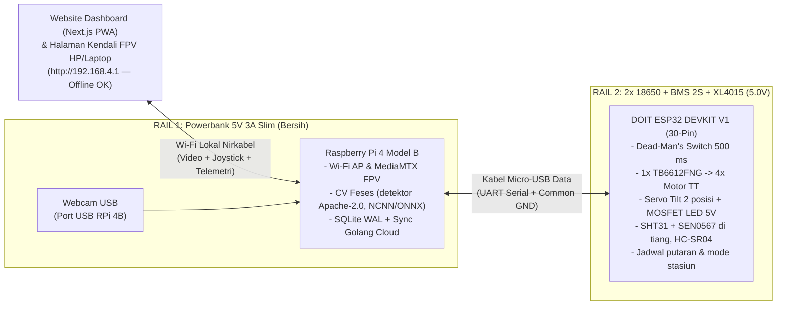

---

## 2. Pertimbangan Objektif Pemilihan Komponen Tahap 2 (*Anti-Overclaim*)

### A. Kamera pada Servo Dua Posisi, Tiang Sensor, & Mode Stasiun

| Keputusan Tahap 2 | Alasan Objektif | Batasan Jujur (*Anti-Overclaim*) |
| :--- | :--- | :--- |
| **1 Webcam pada `Servo Tilt` dua posisi** | Foto feses diambil saat rover **berhenti** di titik zona, sehingga satu kamera yang dimiringkan servo sudah cukup: posisi **depan `~0–15°`** untuk tampilan FPV saat operator menyetir, posisi **bawah `~45°`** untuk foto feses dengan LED `5000K` menyala. | Servo mikro `SG90`/`MG90S` hanya untuk uji meja; versi final memakai servo tahan air `DS3218`. Alasan menolak kamera PTZ dan kit *pan-tilt* ada di Bab 8.1 concept. |
| **`SHT31` + `SEN0567` di tiang setinggi ayam** | Suhu, RH, dan tren amonia diukur di ketinggian ayam, bukan di ketinggian manusia, lalu dibandingkan dengan tabel umur `Cobb 500`/`Ross 308`. | `SEN0567` tetap indikator tren kualitatif dan baru dikalibrasi terhadap alat acuan saat pilot. Tiang menambah bobot, jadi pakai tiang ringan. |
| **Mode stasiun (diuji lewat firmware)** | Saat tidak berkeliling (hari 0–6, malam, atau saat mengisi daya), rover diam dan `ESP32` mencatat udara **per menit**. Di Tahap 2 cukup diuji di meja dengan rover diparkir. | Dok fisik, stopkontak, dan pengisian daya otomatis baru dibuat di [Tahap 3](./03_PANDUAN_IOT_FINAL_FIELD_READY.md). |

### B. Perbandingan Objektif Sensor Lingkungan, Sensor Jarak, & Saklar LED

| Subsistem | Pilihan `BROVER` | Pembanding yang Ditolak & Alasan Objektifnya | Batasan Jujur (*Anti-Overclaim*) |
| :--- | :--- | :--- | :--- |
| **Suhu & Kelembapan (`RH`)** | **`SHT31` (I2C)** *(atau langsung probe **`FS304-SHT31`** untuk *reuse* Final)* | **Menolak `DHT11`/`DHT22`:** `DHT22` sering macet/error pada kelembapan tinggi (`>85% RH` tropis) dan kalibrasinya cepat bergeser. `SHT31` buatan Sensirion akurat (`±0,2°C`, `±2% RH`) dan stabil. | `SHT31` modul PCB terbuka hanya untuk uji meja PoC; untuk kandang nyata wajib probe berfilter *stainless* `FS304-SHT31`. |
| **Gas Amonia (`NH₃`)** | **`DFRobot SEN0567`** *(MEMS `1–300 ppm`, `<20 mA`, **Reuse ke Final**)* | **Menolak `MQ-137`:** `MQ-137` memakai koil pemanas boros (`~150 mA` terus-menerus, panas tinggi, cepat menguras baterai rover) dan butuh pemanasan lama. **Menolak sensor elektrokimia lab di PoC** karena terlalu mahal untuk tahap seleksi awal. | Berdasarkan Wiki resmi DFRobot, `SEN0567` **bukan alat ukur ppm bersertifikasi lab** — wajib dilaporkan jujur sebagai **indikator tren kualitatif lonjakan `NH₃`** (terkompensasi suhu/RH) dan butuh *preheat* min. 5 menit tiap nyala. |
| **Sensor Jarak Depan (Perlambat Laju)** | **`HC-SR04` + *Voltage Divider* `1 kΩ + 2 kΩ`** *(atau langsung **`DFRobot A02YYUW` IP67** untuk *reuse* Final)* | **Menolak `JSN-SR04T`:** memiliki jarak buta (*blind zone*) terlalu panjang (`~20 cm`), rawan menabrak ayam/wadah pakan sebelum terbaca. **Menolak colok `HC-SR04` langsung ke `ESP32`** karena pin `ECHO` mengeluarkan `5V` yang merusak pin `3,3V` `ESP32`. | `HC-SR04` tidak tahan air/debu bulu (khusus meja PoC) dan wajib pembagi tegangan `1 kΩ + 2 kΩ`. Jika budget siap, langsung pakai `DFRobot A02YYUW` IP67 (*blind zone* `3 cm`, aman `3,3V`). |
| **Saklar Lampu `LED 5V`** | **Modul MOSFET *Logic-Level* `3,3V` (`D4184` / `LR7843` / `IRLZ44N`)** | **Menolak colok LED langsung ke GPIO `ESP32`** (pin GPIO maks aman `12 mA`, sedangkan LED strip menarik `150–300 mA` → merusak chip!). **Menolak modul `IRF520`** karena tegangan ambang *gate*-nya tinggi sehingga tidak terbuka penuh di `3,3V` `ESP32`. | Pastikan ada resistor *pull-down* `10 kΩ` di kaki *gate* agar LED tidak berkedip menyala sendiri saat `ESP32` baru boot. |
| **Suhu Tubuh Ayam** | **TIDAK memakai sensor IR / *thermogun*** | Mematuhi *hard constraint* proyek: pengukuran *thermogun* di atas bulu ayam broiler sangat tidak akurat (*emissivity* bulu menutupi suhu kulit). Skrining fokus pada **CV feses + mikroklimat `Cobb 500`/`Ross 308` + ceklis gejala pernapasan oleh ABK**. | — |

### C. Audit Jujur Bobot Total di Atas Sasis Akrilik 4WD (`Batas Aman: ≤800–1.000 gram`)

Agar tidak terjadi *overclaim* kemampuan motor TT `1:48` di sasis akrilik, berikut estimasi jujur bobot gabungan Tahap 1 + Tahap 2:

| Kelompok Beban | Perkiraan Bobot | Catatan Rekayasa Wajib |
| :--- | :---: | :--- |
| Sasis Akrilik 4WD + `4× Motor TT` + `4× Roda 65 mm` | `~280–350 g` | Rangka dasar eksisting. |
| **Powerbank `10.000 mAh` versi *Slim*** (Rail 1 `RPi 4B`) | `~180–220 g` | **JANGAN pakai Powerbank `20.000 mAh`** (`~400–450 g`) — terlalu berat untuk motor TT! |
| `2× 18650` + Holder + BMS + `XL4015` + Kabel/Wago (Rail 2) | `~140–160 g` | Posisikan di tengah/dek bawah agar titik berat rendah & tidak njomplang. |
| `Raspberry Pi 4 Model B` + *Heatsink* + `Webcam USB` | `~110–140 g` | Gunakan webcam ringan; hindari kipas besar jika tidak perlu. |
| `ESP32` + `1× TB6612FNG` + `Servo` + Sensor + **`Perfboard`** *(atau `2× Breadboard`)* | `~90–120 g` *(perfboard)*<br>`~210–240 g` *(2× breadboard)* | **Keputusan Penting:** Gunakan `2× Breadboard 830` selama pengujian di atas meja; begitu seluruh sensor & AI lulus tes, **pindahkan wiring sinyal ke `Perfboard` (item #13)** sebelum demo berjalan agar bobot turun `~120 g` dan ruang dek lega! |
| **TOTAL BOBOT ROVER POC** | **`~800–990 g`** *(dengan perfboard)* | **Berada tepat di dalam batas aman motor TT (`≤800–1.000 g`) di lantai datar!** |

> **Catatan tiang sensor:** bobot tiang belum masuk tabel ini. Timbang ulang setelah tiang dipasang; bila total melewati `1.000 g`, pakai tiang yang lebih ringan atau pasang tiang penuh di Tahap 3.

---

## 3. Daftar Lengkap Komponen Tambahan Tahap 2 (15 Item di Luar Tahap 1, Tanpa Harga)

> **Catatan:** Daftar ini **hanya berisi komponen tambahan** di luar 24 item yang sudah dibeli/dimiliki di [Tahap 1](./01_PANDUAN_TAHAP1_ROVER_KONTROL_WEB.md).

### A. Otak AI & Sistem Daya Rail 1 (Terpisah dari Jalur Motor)

| No | Foto Referensi | Nama Komponen | Qty | Fungsi Utama (*To The Point*) | Alasan Objektif Dipilih | Spesifikasi Wajib | Status |
| :-: | :---: | :--- | :-: | :--- | :--- | :--- | :--- |
| 1 | 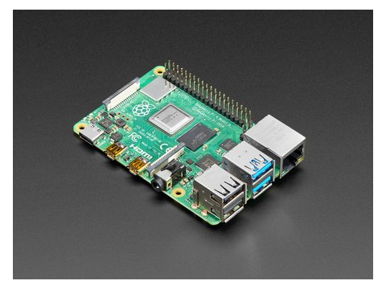 | **`Raspberry Pi 4 Model B`** + *Heatsink* + MicroSD 32GB A2 | 1 | **Otak AI, pemancar FPV, & penyimpan luring:** menjalankan satu detektor CV feses (Apache-2.0, `NCNN`/`ONNX`), Wi-Fi lokal `192.168.4.1`, & `SQLite WAL`. | Sudah dimiliki tim; ekosistem driver kamera USB, `NCNN`, dan `ONNX Runtime` matang untuk mengejar M1 (akhir Desember 2026). | Suplai bersih **`5V 3A`** via USB-C, *heatsink* aluminium, MicroSD Class 10 **A2** (tahan tulis `SQLite`). | **Sudah Dimiliki** |
| 2 | 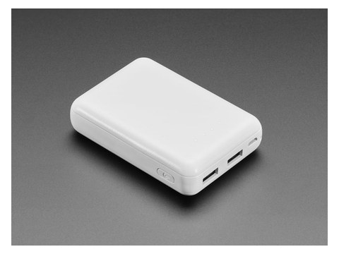 | **Powerbank `5V 3A` (`10.000 mAh` *Slim*)** *(Rail 1)* | 1 | **Baterai khusus `Raspberry Pi 4 Model B`:** menyuplai daya terpisah dari jalur motor agar `RPi 4B` tidak *brownout/reboot* saat roda mulai berjalan. | Pemisahan *Dual-Rail* mencegah drop tegangan motor mematikan `RPi 4B`; versi *slim* `10.000 mAh` (~37 Wh) menjaga bobot tetap `≤220 g`. | Wajib tertulis output **`5V ⎓ 3A`** (USB-C PD/QC); hindari powerbank lama mentok `5V/2A`. | **Perlu Dibeli** *(kecuali sudah punya)* |
| 3 | 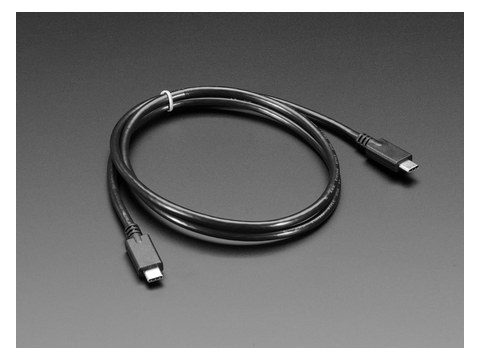 | **Kabel Daya USB-C `3A` Pendek (`25–30 cm`)** | 1 | **Penghubung daya Powerbank → `RPi 4B`:** mengalirkan `5V 3A` stabil tanpa rugi tegangan di kabel dan tanpa gulungan kabel berlebih di atas mobil. | Kabel charger murah `1 meter` sering menimbulkan peringatan petir (*undervoltage*) di `Raspberry Pi 4 Model B`. | Panjang `25–30 cm`, rating arus minimal **`3A`**. | **Perlu Dibeli** |

### B. Optik, Pencahayaan, & Sensor di Tiang

| No | Foto Referensi | Nama Komponen | Qty | Fungsi Utama (*To The Point*) | Alasan Objektif Dipilih | Spesifikasi Wajib | Status |
| :-: | :---: | :--- | :-: | :--- | :--- | :--- | :--- |
| 4 | 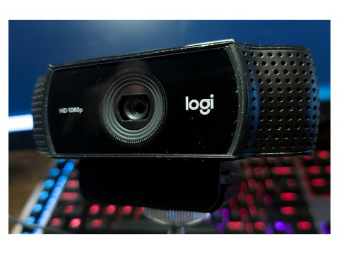 | **Webcam USB (`720p/1080p UVC`)** | 1 | **Mata Rover:** menayangkan video jalan langsung (FPV) sekaligus mengambil foto feses untuk model CV feses saat rover berhenti. | Sudah dimiliki tim; jauh lebih tajam pada cahaya redup dibanding `ESP32-CAM` OV2640 dan langsung dikenali Linux (`/dev/video0`). | Standar UVC Linux, bobot ringan agar tidak membebani servo mikro. | **Sudah Dimiliki** |
| 5 | 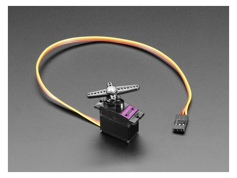 | **Servo *Tilt* (`SG90` / `MG90S Metal Gear`)** | 1 | **Leher penggerak kamera:** memiringkan kamera `~45°` ke lantai (foto feses saat berhenti) dan `~0–15°` ke depan (FPV saat disetir). | 1 kamera + 1 servo cukup menghemat biaya & beban dibanding memasang 2 kamera terpisah. | Sudut `180°`, suplai **`5V`** dari `XL4015` (bukan pin `ESP32`!). Disarankan `MG90S` (gigi logam) jika webcam agak berat. | **Sudah Dimiliki** |
| 6 | 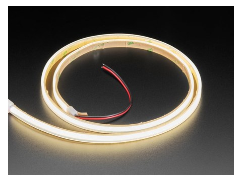 | **LED Putih `5V` (`5000K CRI >90` + *Diffuser*)** | 1 | **Lampu penerang standar warna feses:** menyala saat rover berhenti di titik zona dan kamera mengambil foto feses, agar warna bercak feses terbaca konsisten oleh AI. | Cahaya lampu kandang kuning/redup membuat AI keliru membedakan feses berdarah vs sekam gelap; putih `5000K CRI >90` menstandarkan warna. | Strip/bar COB **`5V`** putih netral `5000K` (*daylight*), potong `~10–15 cm` (`~150–300 mA`). | **Perlu Dibeli** |
| 7 | 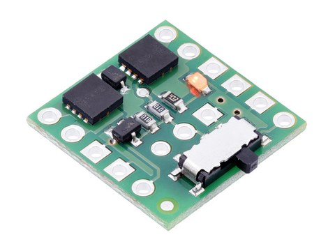 | **Modul Saklar MOSFET `3,3V` (`D4184` / `LR7843` atau Transistor `IRLZ44N`)** | 1 | **Saklar elektronik lampu LED:** membolehkan `ESP32` menyalakan/mematikan `LED 5V` dari website tanpa merusak pin GPIO `ESP32`. | Pin GPIO `ESP32` hanya aman `~12 mA`, sedangkan LED menarik `~200–300 mA`. Tipe `D4184`/`LR7843` terbuka penuh pada sinyal `3,3V` (lebih tepat dari `IRF520`). | MOSFET *logic-level* **`3,3V`**, tegangan beban `5V`. | **Perlu Dibeli** |
| 8 | 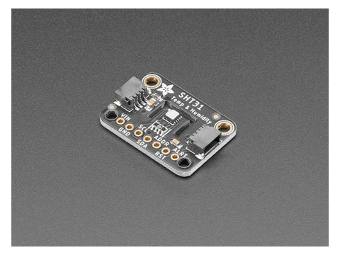 | **Sensor Suhu & RH `SHT31-D` (I2C)** *(atau langsung probe **`FS304-SHT31`** untuk *reuse* Final)* | 1 | **Pengukur suhu & kelembapan udara di tiang setinggi ayam:** mengevaluasi kondisi kandang otomatis terhadap tabel standar umur resmi **`Cobb 500` & `Ross 308`**. | Jauh lebih akurat & tahan kelembapan tinggi dibanding `DHT22`. Jika budget cukup, beli langsung probe `FS304-SHT31` agar langsung *reuse* ke Final. | Suplai **`3,3V`**, I2C alamat `0x44`, akurasi `±0,2°C` & `±2% RH`. | **Perlu Dibeli** *(Opsi langsung `FS304` untuk Reuse)* |
| 9 | 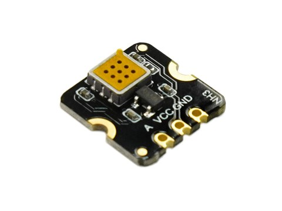 | **Sensor Tren Gas `NH₃` `DFRobot SEN0567`** | 1 | **Penanda tren gas amonia (`NH₃`) di tiang setinggi ayam:** memberi peringatan ventilasi bila tren amonia meningkat. | Jauh lebih hemat baterai (`<20 mA`) daripada `MQ-137` (`~150 mA` heater) dan **langsung *reuse* ke Versi Final**. Dilabeli jujur sebagai **indikator tren kualitatif `NH₃`**. | Fermion MEMS `NH₃` (`1–300 ppm`), suplai **`3,3V–5V`**, output **Analog (`A`)** ke `ADC1` (`D34`). | **Perlu Dibeli *(Reuse ke Final!)*** |
| 10 | 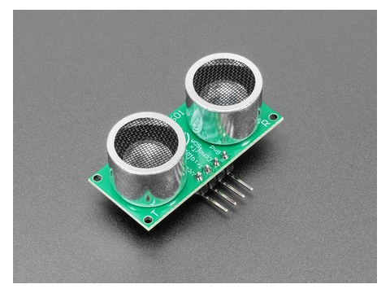 | **Sensor Anti-Tabrak `HC-SR04`** *(atau langsung **`DFRobot A02YYUW` IP67** untuk *reuse* Final)* | 1 | **Sensor jarak depan:** memperlambat laju rover otomatis bila ada ayam, tempat pakan, atau dinding di depan. | Hemat untuk uji meja PoC (atau langsung `A02YYUW` IP67 dengan *blind zone* `3 cm` jika ingin sekalian *reuse* ke Final). | `HC-SR04` (`5V`): pin `ECHO` **WAJIB lewat *voltage divider* `1 kΩ + 2 kΩ`** sebelum masuk `ESP32`! *(Atau `A02YYUW`: langsung aman `3,3V` UART)*. | **Perlu Dibeli** *(Opsi langsung `A02YYUW` untuk Reuse)* |
| 11 | 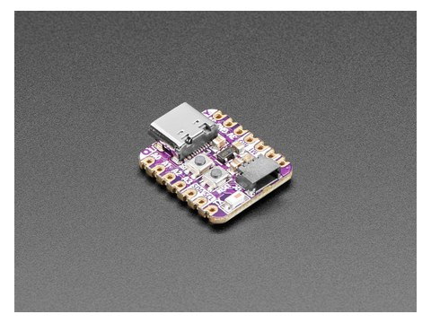 | **`ESP32-C3 Super Mini`** *(Opsional)* | 1 | **Pembanding uji meja (bukan node kandang):** dipasang diam di tepi meja uji untuk membandingkan suhu/RH titik tetap dengan bacaan tiang sensor rover. | Sudah dimiliki tim; memperkuat pembuktian nilai tambah *bird-level* di depan juri. | MCU RISC-V Wi-Fi `3,3V`, port USB-C (butuh 1 sensor suhu tambahan jika diaktifkan). | **Sudah Dimiliki** *(Opsional)* |

### C. Komponen Pasif Tahap 2 & Transisi Ringan ke *Perfboard* (Sebelum Demo Seleksi)

| No | Foto Referensi | Nama Komponen | Qty | Fungsi Utama (*To The Point*) | Alasan Objektif Dipilih | Spesifikasi Wajib | Status |
| :-: | :---: | :--- | :-: | :--- | :--- | :--- | :--- |
| 12 | 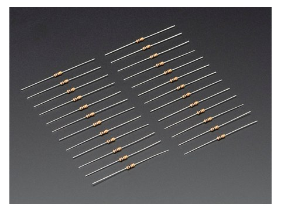 | **Resistor Film Metal (`1 kΩ`, `2 kΩ`, `4,7 kΩ`, `220 Ω` — `1/4W 1%`)** | 2 + 2 + 4 + 2 pcs | **Pengaman tegangan `HC-SR04`, *pull-up* I2C, & pengaman MOSFET:** menurunkan `ECHO` `5V → 3,33V`, menstabilkan jalur `SHT31`, dan melindungi kaki *gate* MOSFET. | Pin `ESP32` tidak *5V-tolerant*; tanpa `1 kΩ + 2 kΩ`, pin `D35` berisiko rusak oleh `HC-SR04`. *(Jika sudah beli kit resistor di Tahap 1, tidak perlu beli lagi!)*. | Toleransi `1%`, daya `1/4W`. | **Perlu Dibeli** *(kecuali sudah beli kit di Tahap 1)* |
| 13 | 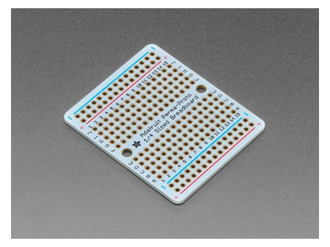 | ***Perfboard* / PCB Bolong *Double-Side* (`5×7 cm` / `7×9 cm`)** | 2 pcs | **Pengganti `2× Breadboard 830` saat mobil siap demo:** memadatkan seluruh wiring `ESP32` + driver + resistor menjadi 1 papan kecil, ringan, dan anti-lepas. | Memangkas bobot `~120 gram` dan memberi ruang cukup di atas akrilik untuk `Raspberry Pi 4 Model B` + Powerbank agar total bobot tetap `≤1.000 g`. | FR4 *double-side* lubang tembaga `2,54 mm`. | **Perlu Dibeli** *(untuk tahap akhir demo)* |
| 14 | 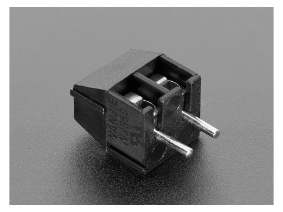 | **Pin Header *Female* `2,54 mm` (40-pin) + *Screw Terminal Block* 2-Pin `5,08 mm`** | 4 strip + 6 pcs | **Soket cabut-pasang di *perfboard*:** membuat `ESP32` & `TB6612FNG` tetap bisa dicabut kapan saja (tidak disolder mati) dan menjepit kabel daya `18 AWG` dengan baut. | Memudahkan penggantian cepat bila 1 modul rusak tanpa menyolder ulang seluruh papan. | Pitch `2,54 mm` (*female header*) & `5,08 mm` (*terminal block*). | **Perlu Dibeli** *(untuk tahap akhir demo)* |
| 15 | 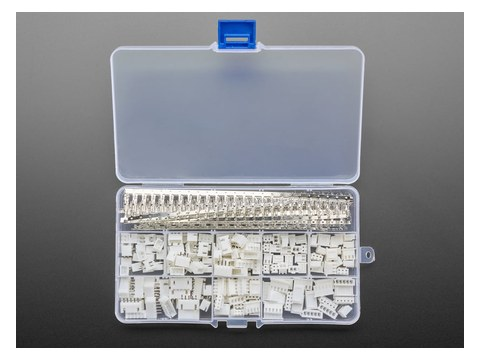 | **Konektor Sinyal `JST-XH 2,54 mm` (2/3/4 Pin)** | 1 set | **Colokan rapi anti-terbalik untuk sensor & servo:** memudahkan melepas sensor `SHT31`, `SEN0567`, `HC-SR04`, dan `LED 5V` saat perawatan. | Kabel jumper DuPont mudah terlepas sendiri oleh getaran mobil saat demo di depan juri; `JST-XH` memiliki kait pengunci. | Pitch `2,54 mm` (3-pin & 4-pin). | **Perlu Dibeli** *(untuk tahap akhir demo)* |

---

## 4. Software, Library AI/Web, & Konfigurasi OS *(Tanpa Codingan Dulu)*

| Lapisan | Software / Library / Konfigurasi | Peran Spesifik di Tahap 2 | Link Resmi |
| :--- | :--- | :--- | :--- |
| **OS & Akses `RPi 4B`** | **Raspberry Pi Imager** (`Raspberry Pi OS 64-bit Bookworm`) + **VS Code `Remote - SSH`** | Memasang OS ke MicroSD 32GB A2 dan mengedit program `RPi 4B` secara nirkabel dari laptop tanpa monitor tambahan. | [Raspberry Pi Imager](https://www.raspberrypi.com/software/) |
| **Video FPV & Wi-Fi Lokal** | **`MediaMTX`** (`WebRTC/MJPEG`) + **`NetworkManager` (`nmcli` Hotspot)** | Menayangkan kamera USB ke browser HP di `http://192.168.4.1` (latensi `~100–300 ms`) tanpa internet kandang. | [MediaMTX GitHub](https://github.com/bluenviron/mediamtx) |
| **Edge AI (`Python 3`)** | **Detektor feses Apache-2.0 (`YOLOX` / `RT-DETR`)** diekspor ke `ONNX`, dijalankan dengan **`NCNN`** atau **`ONNX Runtime`** di CPU, + `opencv-python`, `pyserial`, `fastapi`, `paho-mqtt`, `SQLite WAL` | Menjalankan satu model CV feses secara lokal (*Offline-First*) dan menyimpan log ke MicroSD hingga internet tersedia. Kecepatan inferensi diukur sendiri oleh tim, bukan dikutip dari dokumentasi pihak lain. | [YOLOX](https://github.com/Megvii-BaseDetection/YOLOX) \| [RT-DETR](https://github.com/lyuwenyu/RT-DETR) |
| **Firmware Tambahan `ESP32`** | Library **`ESP32Servo`**, **`Adafruit SHT31 Library`**, & **`ArduinoJson`** | Mengendalikan `Servo Tilt` dua posisi, membaca `SHT31` (I2C) + `SEN0567` (ADC1) + `HC-SR04`, menjalankan jadwal putaran, perlambatan sensor jarak, dan pencatatan per menit saat mode stasiun, lalu bertukar paket JSON ke `RPi 4B` via USB Serial. | [ESP32Servo](https://github.com/madhephaestus/ESP32Servo) \| [Adafruit_SHT31](https://github.com/adafruit/Adafruit_SHT31) |
| **Website & Server Pusat** | **Frontend `Next.js` PWA** (4 Panel Standar Umur `Cobb 500`/`Ross 308`, 3 tombol triase, Laporan 1-Klik Dokter Hewan) + **Backend `Golang`** (`PostgreSQL`, `Mosquitto`, cuaca `BMKG + Open-Meteo`) + **`MQTTX`** (uji debug) | Menampilkan hasil CV feses, suhu/RH/tren NH₃ per zona, catatan harian ABK, dan peringatan standar umur langsung di website HP/laptop. | [MQTTX](https://mqttx.app/) |

---

## 5. Panduan Wiring Warna Kabel Pin-ke-Pin Tahap 2

### A. Wiring Aktuator & 3 Sensor Tambahan ke **`DOIT ESP32 DEVKIT V1 (30-Pin)`**
*(Kabel motor Tahap 1 di `D25, D26, D27, D14, D32, D33, D13` **TIDAK perlu diubah sama sekali**!)*

| Komponen | Pin Komponen | Warna Kabel | Pin Tujuan di `ESP32` / Rail Daya | Catatan Keselamatan Wajib |
| :--- | :--- | :---: | :--- | :--- |
| **`Servo Tilt`** (`SG90`/`MG90S`) | **Merah** (`VCC`)<br>**Cokelat/Hitam** (`GND`)<br>**Oranye/Kuning** (`SIG`) | Merah<br>Hitam<br>Oranye | **`Wago #3` Rel `+5,0V` (`XL4015`)**<br>**`Wago #2` Rel `GND`**<br>**`ESP32` Pin `D18`** | Daya servo wajib dari `XL4015` (bukan dari `ESP32`!). Pasang kapasitor elektrolit `470 µF` dekat soket servo. |
| **`LED Putih 5V`** via **MOSFET `3,3V`** | `SIG / Gate`<br>`GND`<br>`V+ / VIN`<br>`OUT+` & `OUT-` | Kuning<br>Hitam<br>Merah<br>Merah & Hitam | **`ESP32` Pin `D19`** *(lewat `220 Ω` + `10 kΩ` pull-down ke `GND`)*<br>**Rel `GND`**<br>**`Wago #3` Rel `+5,0V` (`XL4015`)**<br>**`+` & `-` Strip `LED 5V`** | Default MATI saat boot; hanya menyala saat foto feses diambil di titik zona. |
| **`SHT31`** *(atau probe `FS304-SHT31`)* | `VCC` *(Merah)*<br>`GND` *(Hitam)*<br>`SCL` *(Kuning)*<br>`SDA` *(Hijau)* | Merah tipis<br>Hitam<br>Kuning<br>Hijau | **`ESP32` Pin `3V3`**<br>**`ESP32` Pin `GND`**<br>**`ESP32` Pin `D22`**<br>**`ESP32` Pin `D21`** | Bekerja di `3,3V` (alamat I2C `0x44`). Jika memakai probe `FS304` kabel panjang, tambah resistor *pull-up* **`4,7 kΩ`** dari `D21 → 3V3` & `D22 → 3V3` dan cek stiker label kabel pabrik. |
| **`DFRobot SEN0567`** *(Tren `NH₃`)* | `VCC`<br>`GND`<br>`A` *(Analog Out)* | Merah tipis<br>Hitam<br>Biru | **`ESP32` Pin `3V3`**<br>**`ESP32` Pin `GND`**<br>**`ESP32` Pin `D34` (`ADC1`)** | **WAJIB `D34` (ADC1)** agar bebas konflik Wi-Fi & aman `≤3,3V` karena disuplai `3,3V`. Pemanasan awal min. 5 menit tiap nyala (5–24 jam saat baru pertama kali dibuka). |
| **`HC-SR04`** *(Sensor Jarak)* | `VCC`<br>`GND`<br>`TRIG`<br>`ECHO` *(Output `5V`!)* | Merah<br>Hitam<br>Putih<br>Ungu *(via Divider)* | **`Wago #3` Rel `+5,0V` (`XL4015`)**<br>**Rel `GND`**<br>**`ESP32` Pin `D23`**<br>**`ECHO` → `1 kΩ` → titik tengah ke `ESP32 D35` → `2 kΩ` → `GND`** | **KRITIS:** Wajib pembagi tegangan `1 kΩ + 2 kΩ` menurunkan `5V → 3,33V`! *(Jika memakai `DFRobot A02YYUW` IP67: Merah → `3V3`, Hitam → `GND`, Hijau `TX` → `ESP32 RX2 / D16`, Kuning `RX` biarkan lepas — tanpa divider!)*. |

```text
   Pembagi Tegangan (Voltage Divider) WAJIB untuk Pin ECHO HC-SR04 (5V -> 3,33V):

   HC-SR04 Pin ECHO (5V) ────[ Resistor 1 kΩ ]────┬────► ESP32 Pin D35 (Aman: ~3,33V)
                                                  │
                                          [ Resistor 2 kΩ ]
                                                  │
                                                 GND
```

### B. Wiring Sambungan Rail 1 (`Raspberry Pi 4 Model B`) ↔ Rail 2 (`ESP32`) — **Aturan Anti-Tabrakan `+5V`!**

| Dari Komponen & Port | Kabel | Ke Komponen & Port | Aturan Keamanan Wajib |
| :--- | :---: | :--- | :--- |
| **Powerbank `5V 3A` *Slim* (Port USB-C)** | Kabel USB-C `3A` pendek (`25–30 cm`) | **`Raspberry Pi 4 Model B` Port Daya USB-C** | Rail 1 murni terpisah dari motor. **JANGAN** sambungkan pin `5V` GPIO `RPi 4B` ke `Buck XL4015`! |
| **`Raspberry Pi 4 Model B` (Port USB-A #1)** | Kabel Micro-USB **Data** | **`ESP32` Port Micro-USB** | Membuka jalur UART Serial (`/dev/ttyUSB0`) **sekaligus** otomatis menyatukan *Common Ground* (`GND`) Rail 1 & Rail 2. **WAJIB:** Saat kabel USB ini terpasang permanen di Tahap 2, **cabut kabel `Wago #3 (+5,0V) → ESP32 VIN`** agar `ESP32` hanya menerima daya dari USB `RPi 4B` (tidak terjadi bentrok 2 sumber `5V`!). `Servo`, `LED 5V`, & `HC-SR04` tetap mengambil daya `+5,0V` dari `Wago #3 (XL4015)`. |
| **`Raspberry Pi 4 Model B` (Port USB-A #2)** | Kabel bawaan | **Webcam USB** | Dipasang di dudukan lengan `Servo Tilt` bagian depan. |

---

## 6. Urutan Integrasi Modular & Kriteria Lulus Tahap 2

Pasang dan uji **satu per satu di meja terlebih dahulu** (jangan sambungkan semuanya serentak!):
1. **Uji `Servo Tilt` (`D18`) & `LED 5V` (`D19`):** Cek sudut `45°` (lantai) ↔ `10°` (depan) lancar tanpa *jitter* dan LED nyala/mati bersih lewat MOSFET.
2. **Uji `SHT31` (`D21/D22`):** Pastikan alamat I2C `0x44` terdeteksi dan pembacaan suhu/RH ruang wajar.
3. **Uji `DFRobot SEN0567` (`D34`):** Panaskan minimal 5 menit, pastikan tegangan analog stabil dan merespons kenaikan saat didekatkan sumber bau amonia ringan.
4. **Uji `HC-SR04` (`D23/D35`)** *(atau `A02YYUW` `D16`)*: Pastikan jarak `<25 cm` memicu perlambatan otomatis di `ESP32`.
5. **Uji Mode Stasiun:** Parkirkan rover di meja, pastikan `ESP32` mencatat `SHT31` & `SEN0567` setiap menit dan data muncul di dasbor tanpa celah.
6. **Gabung `RPi 4B` ↔ `ESP32` & Pindah ke *Perfboard*:** Setelah semua lulus di `2× Breadboard 830`, pindahkan rangkaian `ESP32` + `1× TB6612FNG` + resistor/kapasitor ke **`Perfboard`** (`item #13–#15`) agar ringan (`≤800–1.000 g`) dan tahan getaran saat demo.

### Kriteria Lulus Tahap 2 (*Target M1, Akhir Desember 2026*)
- [ ] Halaman FPV lokal `http://192.168.4.1` dari `RPi 4B` menampilkan video *live* (`<400 ms`), kontrol gerak pelan `0,07–0,1 m/s`, dan *Dead-Man's Switch 500 ms* tetap berfungsi saat internet mati total.
- [ ] Saat rover berhenti di titik zona, servo menunduk `~45°`, LED `5000K` menyala, foto feses diambil, dan hasil detektor *baseline* Apache-2.0 tampil di daftar triase dasbor.
- [ ] Data `SHT31` & `SEN0567` dari tiang sensor tampil di Panel 1 Website, dievaluasi otomatis terhadap standar umur resmi **`Cobb 500` / `Ross 308`**, dan tetap tercatat per menit saat rover diparkir (mode stasiun).

---

## 7. Link Referensi Proyek Mirip Tahap 2 (Terverifikasi Aktif)

- **Dokumentasi Resmi Sensor & Edge AI:** [DFRobot SEN0567 Wiki (`NH₃`)](https://wiki.dfrobot.com/sen0567/) \| [DFRobot A02YYUW Wiki (`IP67`)](https://wiki.dfrobot.com/sen0311/) \| [YOLOX (Apache-2.0)](https://github.com/Megvii-BaseDetection/YOLOX) \| [RT-DETR (Apache-2.0)](https://github.com/lyuwenyu/RT-DETR)
- **Repositori GitHub Rujukan:** [RishitRai/Henomaly (Edge AI Unggas RPi + 3 Tombol Triase)](https://github.com/RishitRai/Henomaly) \| [MiftahulSN/poultry-vet-decision-support-system (ESP32 Suhu+RH+NH₃ Indonesia)](https://github.com/MiftahulSN/poultry-vet-decision-support-system) \| [bluenviron/mediamtx (WebRTC/MJPEG Server)](https://github.com/bluenviron/mediamtx)
- **Dataset CV Feses (sama dengan Bab 11 concept):** [Zenodo 4628934 (label YOLO, data latih utama)](https://zenodo.org/records/4628934) \| [Zenodo 5801834 (label PCR, tanpa label YOLO)](https://zenodo.org/records/5801834) \| [Mendeley 8pnbzpt2k9 (broiler & petelur)](https://data.mendeley.com/datasets/8pnbzpt2k9/1). Semuanya bukan foto broiler di atas sekam, sehingga set uji lokal foto rover dan HP tetap wajib.
