# Panduan IoT `BROVER` — Tahap 3: Versi Final *Field-Ready* Kandang Broiler (`TKT 5–6+`)

> **Posisi dalam Seri Panduan 3 Tahap `BROVER`:**  
> 1. **[Tahap 1](./01_PANDUAN_TAHAP1_ROVER_KONTROL_WEB.md):** Mobil 4WD kontrol website HP (`DOIT ESP32 DEVKIT V1 30-Pin` + `1× TB6612FNG` + `2× Breadboard 830`).  
> 2. **[Tahap 2](./02_PANDUAN_TAHAP2_PROTOTYPE_LENGKAP_AI_SENSOR.md):** Prototype lengkap CV feses + sensor (`Raspberry Pi 4 Model B` + webcam pada servo dua posisi + `SHT31`/`SEN0567` di tiang + `HC-SR04`) terintegrasi ke Website Dashboard.  
> 3. **Dokumen Ini (`Tahap 3 — Final Field-Ready`):** *Upgrade* perangkat keras saat Bootcamp (Des 2026 – Feb 2027) agar lolos uji lapangan **kandang broiler asli Indonesia** (sekam basah `5–10 cm`, kadar air hingga `46,42%`, suhu `30–36°C`, kelembapan `80–96%`, amonia hingga `20 ppm`, debu bulu, dan koridor panjang `60–120 m`).
>
> **Catatan:** Daftar komponen **tidak mencantumkan harga** (cek manual di e-commerce & distributor lokal RI, 100% dalam negeri) dan **belum memuat kode program** — fokus pada alasan objektif anti-*overclaim*, komponen *reuse* dari Prototype, daftar berfoto `.jpg`, serta wiring warna kabel pin-ke-pin.

---

## 1. Pertimbangan Objektif Upgrade Prototype → Versi Final (*Anti-Overclaim*)

Mengapa unit Prototype meja di Tahap 1–2 **tidak boleh dipaksa langsung masuk kandang broiler nyata**? Berikut dasar objektif setiap *upgrade* di Tahap 3:

| Subsistem | Prototype PoC (`Tahap 1–2`) | Upgrade Final (`Tahap 3`) | Alasan Objektif & Pembanding yang Ditolak |
| :--- | :--- | :--- | :--- |
| **Otak Edge AI** | `Raspberry Pi 4 Model B` + MicroSD (inferensi CPU) | **`Orange Pi 3B` (`4GB RAM`, `RK3566` NPU `0,8 TOPS`, `eMMC 32GB`, Antena Wi-Fi `2,4 GHz`)** | **Anti-*over-spec*:** hanya **satu detektor feses** yang berjalan saat rover berhenti di titik zona, sehingga `Orange Pi 3B` (NPU `0,8 TOPS`) cukup dan lebih ekonomis dibanding `Orange Pi 5` (NPU `6 TOPS`), namun jauh lebih aman dari *Out-of-Memory* dibanding `Luckfox Pico Ultra` (RAM `256 MB`). Kecepatan inferensi INT8 diukur sendiri oleh tim. Slot `eMMC` membuat sistem tidak bergantung pada kartu microSD, dan antena eksternal membantu jangkauan Wi-Fi di lorong kandang (jangkauan nyata diukur saat uji). |
| **Rangka, Motor, & Driver** | Akrilik + `4× Motor TT` + roda `65 mm` + `1× TB6612FNG` | **Box Panel `IP65` + Pelat Aluminium `2 mm` + 3D Print `PETG` + `4× JGB37-520` (`12V 100 RPM`) + Ban RC `110–120 mm` + `2× BTS7960 43A`** | Roda `65 mm` (*ground clearance* `1,5 cm`) langsung kandas di sekam `5–10 cm`; ban `110–120 mm` memberi kolong **`≥5–6 cm`**. `2× BTS7960 43A` tahan lonjakan arus *stall* sekam lembap yang akan memicu *thermal shutdown* pada `TB6612FNG`. Filamen **`PETG`** dipilih (menolak `PLA` yang melunak di suhu `36°C`). |
| **Papan Elektronik** | `2× Breadboard 830` → *Perfboard* | ***Custom Carrier PCB* 2-Layer (`KiCad 8`) + *Conformal Coating*** | Meniadakan kabel longgar akibat getaran sekam sekaligus melapisi jalur tembaga terhadap karat gas `NH₃` dan kelembapan `96%`. |
| **Baterai & Proteksi** | Powerbank + `2× 18650` | **1 Baterai `LiFePO₄` 4S `12,8V 6Ah` + Charger `14,6V` + `2× Buck XL4015` + `INA219` (Shunt `0,01 Ω`) + *Kill Switch IP65*** | **Keamanan kebakaran sekam:** kimia `LiFePO₄` dikenal lebih stabil secara termal daripada `Li-Ion NMC`; angka ambang *thermal runaway* dan umur siklus mengikuti *datasheet* sel yang dibeli. Kapasitas `76,8 Wh` ditargetkan cukup untuk **2 putaran per hari** (*runtime* target `≥3 jam`); di luar putaran, rover mengisi daya di dok sambil tetap mencatat udara (mode stasiun). Tetap memisahkan jalur `5V` SBC vs aktuator lewat `2× XL4015`. |
| **Kamera, Servo, & Sensor** | Webcam biasa + `SG90` + `SHT31` terbuka + `HC-SR04` | **Kamera `IMX291` *Low-Light* + Servo `DS3218` 20 kg Waterproof + Probe `FS304-SHT31` + `A02YYUW` IP67** *(plus **Reuse** `SEN0567` & `XL4015`!)* | `IMX291` tajam di kandang redup; `FS304` berfilter *stainless* anti-debu; `A02YYUW` tahan air `IP67` dengan *blind zone* hanya `3 cm` (menolak `JSN-SR04T` 20 cm). |

---

## 2. Software, Aplikasi Desain, & Library Tambahan Tahap 3 *(Tanpa Codingan Dulu)*

| Kebutuhan | Aplikasi / Library | Peran di Tahap 3 (Final) | Link Resmi |
| :--- | :--- | :--- | :--- |
| **Desain *Custom Carrier PCB*** | **`KiCad 8`** *(Gratis, Open-Source)* | Mendesain skematik & layout PCB 2-layer (termasuk pin cadangan *Hall Encoder* + `MPU6050` untuk *Future Work*) dan mengekspor file **Gerber** ke jasa cetak PCB lokal. | [KiCad Official](https://www.kicad.org/) |
| **Desain & Cetak 3D `PETG`** | **`FreeCAD`** / **`Autodesk Fusion`** + **`OrcaSlicer` / `PrusaSlicer`** | Mendesain dudukan kamera `IMX291`, pelindung sensor udara, *mudguard* ban, dan rumah baterai `LiFePO₄` (dicetak di Lab Manufaktur UNJ / jasa 3D print lokal). | [FreeCAD](https://www.freecad.org/) \| [PrusaSlicer](https://www.prusa3d.com/page/prusaslicer_424/) |
| **OS & NPU `Orange Pi 3B`** | **Orange Pi OS / Armbian** + **BalenaEtcher** + **`rknn-toolkit2`** (PC) + **`rknn-toolkit-lite2` / RKNN C-API** (`Orange Pi 3B`) | Memasang OS ke `eMMC 32GB` serta mengonversi dan menjalankan **satu detektor feses** berformat **`.rknn` INT8** pada NPU `RK3566`. | [Orange Pi 3B Docs](http://www.orangepi.org/html/hardWare/computerAndMicrocontrollers/details/Orange-Pi-3B.html) \| [RKNN Model Zoo](https://github.com/airockchip/rknn_model_zoo) |
| **Edge Orchestrator Ringan** | **`Golang`** (`go-serial`, `paho.mqtt.golang`, `SQLite WAL`) + **`MediaMTX`** | Menggantikan layanan Python berat untuk komunikasi serial `ESP32`, *buffering* luring `>30 hari`, dan sinkronisasi ke Backend Pusat `Golang` agar hemat baterai & RAM. | [Go Official](https://go.dev/) \| [MediaMTX](https://github.com/bluenviron/mediamtx) |
| **Tambahan Library `ESP32`** | **`Adafruit INA219`** *(melengkapi library Tahap 1–2 di PlatformIO)* | Membaca persentase baterai `LiFePO₄` (peringatan pulang `25%`) dan mendeteksi lonjakan arus roda macet (*stall*). | [Adafruit INA219](https://github.com/adafruit/Adafruit_INA219) |

---

## 3. Daftar Lengkap Komponen Upgrade & Alat Kerja Tahap 3 (24 Item Utama + 10 Item Pasif/Alat, Tanpa Harga)

### A. Komputasi Edge AI, Konektivitas, & Papan PCB

| No | Foto Referensi | Nama Komponen | Qty | Fungsi Utama (*To The Point*) | Alasan Objektif Dipilih | Spesifikasi Wajib | Status |
| :-: | :---: | :--- | :-: | :--- | :--- | :--- | :--- |
| 1 | 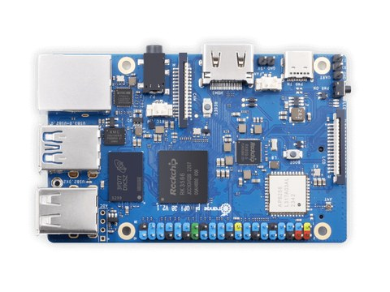 | **`Orange Pi 3B` (4GB RAM + Modul `eMMC 32GB` + *Heatsink*)** | 1 set | **Otak AI kandang:** menjalankan satu detektor feses (RKNN INT8), menayangkan video FPV, & menyimpan data luring di `eMMC`. | Cukup untuk satu model dan lebih ekonomis dari `Orange Pi 5`; slot `eMMC` tidak bergantung pada kartu microSD. Kecepatan inferensi diukur sendiri oleh tim. | SoC `Rockchip RK3566` (NPU `0,8 TOPS`), RAM `4GB LPDDR4`, **`eMMC 32GB`**, *heatsink* aluminium. | **Upgrade Baru Final** |
| 2 | 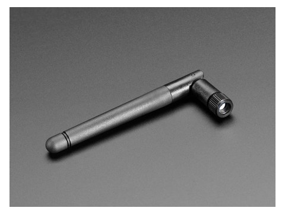 | **Antena Wi-Fi Eksternal `2,4 GHz` + Pigtail `IPEX/u.FL` → `RP-SMA`** | 1 set | **Penguat jangkauan sinyal kendali:** menjaga koneksi website & video stabil menembus kandang panjang `60–120 m`. | Antena internal PCB melemah drastis di dalam Box Panel dan rangka besi kandang; antena vertikal luar memperbaiki jangkauan tanpa biaya besar. | *Omnidirectional* `2,4 GHz` (`3–5 dBi`), *bulkhead* `RP-SMA` dengan *o-ring* karet kedap air. | **Upgrade Baru Final** |
| 3 | 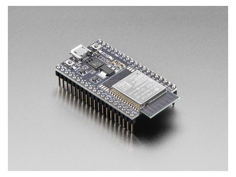 | **`DOIT ESP32 DEVKIT V1` (30-Pin)** | 1 | **Otak penggerak & penjaga keselamatan:** mengatur motor pelan, rem darurat `500 ms`, baca sensor, & *hardware watchdog*. | Sudah teruji penuh sejak Tahap 1–2; dipasang lewat *female header* di *Carrier PCB* agar mudah diganti. | Versi `30-Pin` yang sama dengan Tahap 1–2. | **Reuse dari Prototype!** |
| 4 | 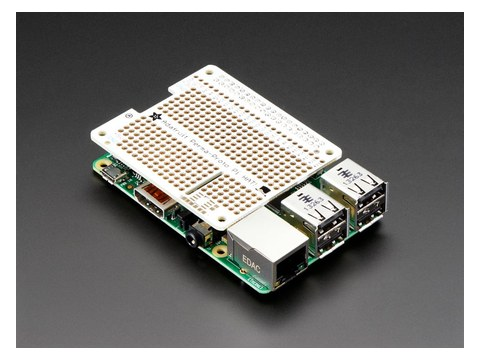 | ***Custom Carrier PCB* 2-Layer (Desain `KiCad 8`)** | 1 *(cetak 3–5 pcs)* | **Papan induk rapi bebas kabel kusut:** menyatukan jalur `12,8V/5V`, `ESP32`, `INA219`, MOSFET, sekring, & konektor sensor. | Meniadakan kabel jumper longgar saat melintasi sekam bergelombang dan mempercepat perakitan skala batch. | FR4 `1,6 mm`, tembaga **`2 oz`** (atau `1 oz` lebar jalur `≥3 mm` untuk `12,8V`), cetak jasa PCB lokal RI. | **Upgrade Baru Final** |
| 5 | 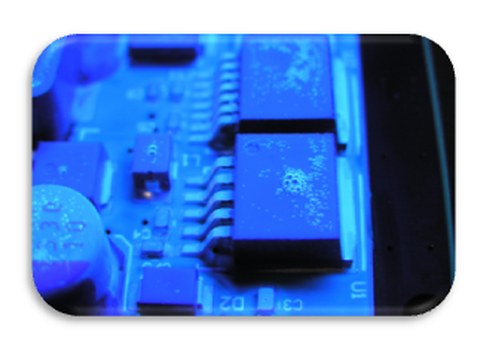 | ***Conformal Coating* Spray / Cair (Akrilik atau Silikon)** | 1 kaleng/botol | **Cat pelindung anti-air & anti-karat PCB:** melindungi jalur tembaga dari uap amonia (`NH₃`) dan kelembapan `96%`. | Tanpa lapisan isolasi, embun lembap + gas `NH₃` cepat menimbulkan korosi hijau (*dendrite*) dan korsleting mikro pada PCB. | Khusus elektronik (akrilik/silikon). *(Wajib tutup konektor & kepala sensor pakai lakban sebelum semprot!)*. | **Upgrade Baru Final** |

### B. Penggerak Medan Sekam Lembap & Casing Tahan Kandang (`IP54–IP65`)

| No | Foto Referensi | Nama Komponen | Qty | Fungsi Utama (*To The Point*) | Alasan Objektif Dipilih | Spesifikasi Wajib | Status |
| :-: | :---: | :--- | :-: | :--- | :--- | :--- | :--- |
| 6 | 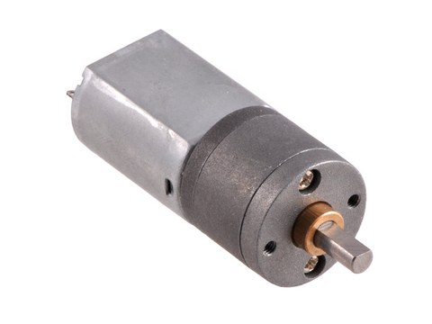 | **Motor DC *Metal-Gear* `JGB37-520` (`12V`, `100 RPM`, Non-Encoder)** | 4 | **Penggerak bertenaga besar untuk sekam:** melaju pelan `0,07–0,1 m/s` menembus sekam lembap `5–10 cm` tanpa kehabisan torsi. | Gigi logam penuh jauh lebih awet dari gir plastik motor TT; versi non-encoder dipilih agar hemat biaya pada tahap kendali operator. | Diameter `37 mm`, poros bentuk D **`6 mm`**, `12V 100 RPM`; kecepatan `0,07–0,1 m/s` dikalibrasi lewat PWM saat uji bak sekam. | **Upgrade Baru Final** |
| 7 | 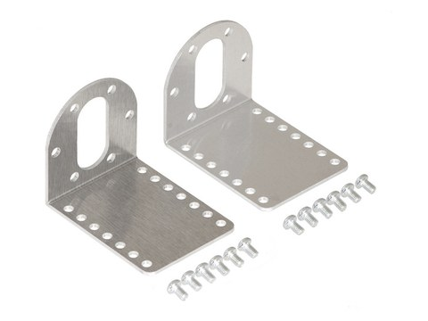 | **Bracket L Metal Motor `37 mm` + Baut `M3` *Stainless*** | 4 set | **Kaki pengikat motor ke sasis:** memegang kuat 4 motor `JGB37-520` pada pelat aluminium bawah agar tidak miring. | Bracket plastik/3D print rentan patah saat torsi tinggi di sekam; logam `3 mm` + baut `SUS 304` anti-karat. | Logam tebal `3 mm` khusus diameter `37 mm` + baut *stainless steel*. | **Upgrade Baru Final** |
| 8 | 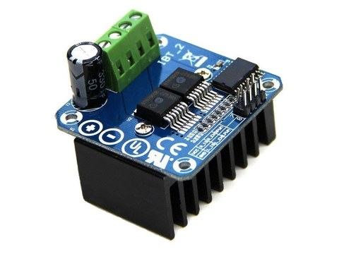 | **Driver Motor MOSFET `BTS7960` (`IBT-2`, `43A`)** | 2 | **Penguat tenaga motor kelas berat:** memasok arus besar `12,8V` ke 4 motor (1 modul kiri, 1 kanan) tanpa kepanasan di sekam basah. | Kapasitas `43A` memberi cadangan keamanan amat besar terhadap arus *stall* `JGB37-520` dan mendukung logika **`3,3V` `ESP32`**. | Rating `43A`, *heatsink* aluminium besar, input logika `3,3V–5V`. | **Upgrade Baru Final** |
| 9 | 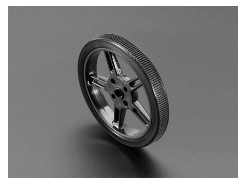 | **Ban RC *Crawler* Karet `110–120 mm` (Set 4 pcs) + *Hex Coupler* `12 mm` (Poros `6 mm`)** | 1 set (4+4) | **Roda tinggi anti-kandas & mudah disikat:** memberi *ground clearance* `≥5–6 cm` di atas sekam dan mudah dilepas saat sanitasi. | Ban karet alur dalam memberi cengkeraman bagus di sekam basah dan bisa dicuci/disikat cepat di dok. | Diameter `110–120 mm` + *hex coupler* `12 mm` lubang poros `6 mm`. | **Upgrade Baru Final** |
| 10 | 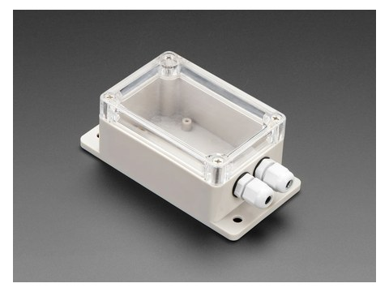 | **Box Panel Waterproof `IP65` (ABS/PC) + Pelat Aluminium `2 mm`** | 1 + 1 | **Rumah kedap debu & cipratan disinfektan:** melindungi `Orange Pi 3B`, PCB, driver, & baterai dari debu bulu dan semprotan sanitasi. | Box panel industri `IP65` jauh lebih murah, kedap, dan cepat dirakit daripada membuat cetakan injeksi bodi kustom di tahap TKT 5–6. | Ukuran `~250×190×110 mm` ber-*seal* karet `IP65` + pelat bawah aluminium `2 mm`. | **Upgrade Baru Final** |
| 11 | 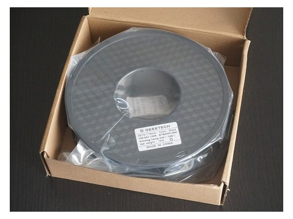 | **Part Mekanik 3D Print Filamen `PETG`** | 1 set | **Dudukan khusus kamera, sensor, & pelindung cipratan ban:** memegang instrumen di posisi sudut tepat dan rapi. | **Wajib `PETG`** (tahan suhu kandang `36°C` & cairan disinfektan), menolak `PLA` yang cepat melengkung/rapuh. | Cetak 3D filamen `PETG` (*infill* `30–40%`) di Lab UNJ / jasa lokal. | **Upgrade Baru Final** |

### C. Optik *Low-Light* & Sensor Tahan Kandang

| No | Foto Referensi | Nama Komponen | Qty | Fungsi Utama (*To The Point*) | Alasan Objektif Dipilih | Spesifikasi Wajib | Status |
| :-: | :---: | :--- | :-: | :--- | :--- | :--- | :--- |
| 12 | 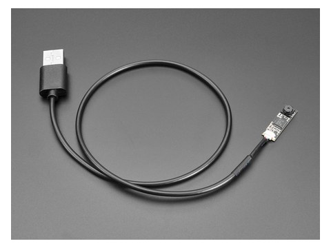 | **Kamera USB *Low-Light Starlight* `IMX291` (`1080p UVC`)** | 1 | **Mata tajam di kandang redup:** menangkap foto feses jernih tanpa *blur* walau penerangan kandang remang; dipasang pada servo `DS3218` dua posisi. | Sensor Sony *starlight* `IMX291` unggul pada cahaya rendah (*low-light*) dengan antarmuka USB UVC standar Linux. | `1080p UVC`, lensa lebar `90–100°` *no-distortion*. | **Upgrade Baru Final** |
| 13 | 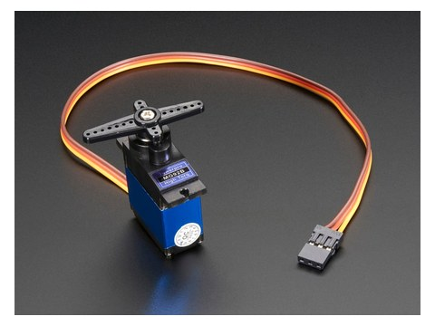 | **Servo *Metal-Gear* Waterproof `DS3218` (`20 kg`, `180°`)** | 1 | **Leher kamera tahan air & debu:** mengatur sudut `45°` (feses) & `0–15°` (fisik) secara kokoh di kandang lembap. | Menggantikan servo mikro `SG90` yang mudah kemasukan debu bulu atau aus giginya; *seal* karet tahan cipratan sanitasi. | Torsi `20 kg`, gir logam penuh, kerja `4,8–6,8V` (kuat di `5,0V`), *horn* aluminium. | **Upgrade Baru Final** |
| 14 | 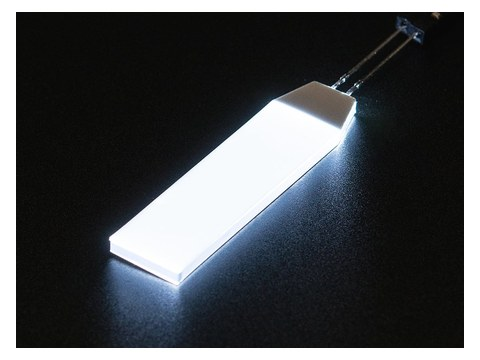 | **LED Bar COB Putih `5V` (`5000K CRI >90`) + *Diffuser*** | 1 | **Lampu standarisasi warna feses:** menjaga akurasi warna feses saat *"Analisis Detail"* di berbagai kondisi lampu kandang. | Cahaya menyebar halus (*COB + diffuser*) tanpa titik pantulan silau pada sekam lembap. | Putih netral `5000K CRI >90`, dikendalikan MOSFET *logic-level*. | **Upgrade / Reuse Prototype** |
| 15 | 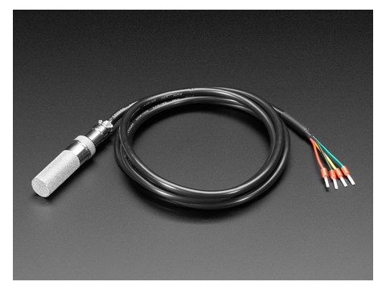 | **Sensor Suhu & RH Waterproof Probe `FS304-SHT31` (I2C)** *(opsi hemat: `FS304-SHT30`)* | 1 | **Pengukur suhu & RH tahan debu/embun:** mengukur mikroklimat di ketinggian ayam untuk evaluasi standar umur `Cobb 500`/`Ross 308`. | Cangkang *stainless sintered mesh* melindungi chip `SHT31` dari debu bulu & kondensasi RH `96%` yang cepat merusak PCB terbuka. | Probe *stainless* I2C (`0x44`), suplai `3,3V–5V`, kabel 4-inti standar. | **Upgrade / Reuse Prototype** |
| 16 | 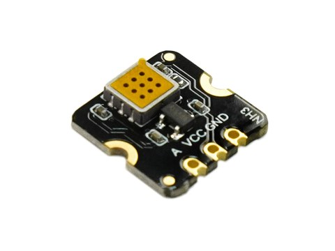 | **Sensor Tren Gas `NH₃` `DFRobot SEN0567` (MEMS `1–300 ppm`)** | 1 | **Pendeteksi kenaikan amonia (`NH₃`):** memberi peringatan dini ventilasi per zona kandang. | Langsung *reuse* dari Tahap 2; hemat arus `<20 mA`; dipasang dalam cerobong berfilter kasa halus. Dilabeli jujur sebagai **indikator tren kualitatif `NH₃`**. | Suplai `3,3V`, output analog ke `ESP32 D34 (ADC1)`. | **Reuse dari Prototype!** |
| 17 | 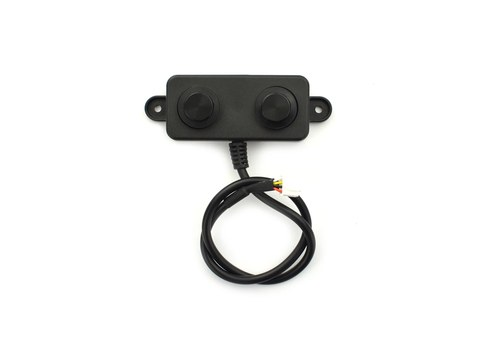 | **Sensor Anti-Tabrak Waterproof `DFRobot A02YYUW` (`IP67`, UART)** | 1 | **Bumper jarak tahan air jarak dekat:** menghentikan Rover otomatis sebelum menyenggol ayam atau tempat pakan. | Tahan air `IP67` dan *blind zone* hanya **`3 cm`** (jauh lebih aman daripada `JSN-SR04T` 20 cm dan tahan debu dibanding `HC-SR04`). | `IP67`, UART `9600 bps`, suplai **`3,3V–5V`** (langsung aman di `3,3V` `ESP32`!). | **Upgrade / Reuse Prototype** |

### D. Sistem Daya `LiFePO₄`, Proteksi, Kabel Industri, & Dok

| No | Foto Referensi | Nama Komponen | Qty | Fungsi Utama (*To The Point*) | Alasan Objektif Dipilih | Spesifikasi Wajib | Status |
| :-: | :---: | :--- | :-: | :--- | :--- | :--- | :--- |
| 18 | 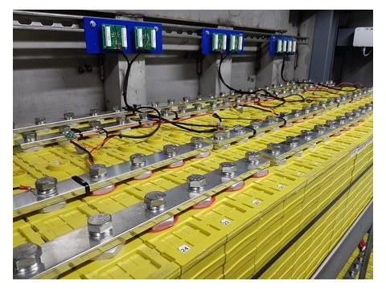 | **Baterai `LiFePO₄` 4S `12,8V 6Ah` (`76,8 Wh`) + *Built-in* BMS `15–20A`** | 1 | **Sumber tenaga utama rover:** *runtime* target `≥3 jam`, cukup untuk 2 putaran per hari; di luar putaran rover mengisi daya di dok. *Runtime* nyata diukur dengan `INA219` saat uji. | Kimia `LiFePO₄` dikenal lebih stabil secara termal daripada Li-Ion NMC, penting di atas sekam kering. Ambang *thermal runaway* dan umur siklus mengikuti *datasheet* sel yang dibeli. | `4S 12,8V 6Ah` dengan BMS internal min. `15–20A`. | **Upgrade Baru Final** |
| 19 | 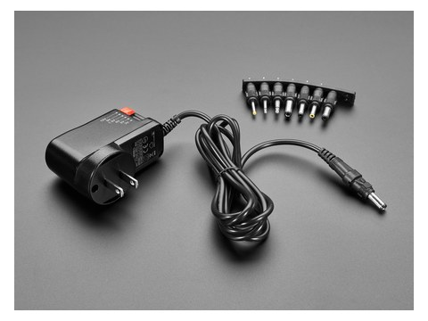 | **Charger Khusus `LiFePO₄` `14,6V` (`2A–3A`)** | 1 | **Pengisi ulang baterai `LiFePO₄` aman:** mengisi penuh tepat di `14,6V` lalu memutus otomatis agar sel awet bertahun-tahun. | Charger Li-Ion `16,8V` atau charger aki merusak sel `LiFePO₄` (*over-voltage*). | **Wajib khusus `LiFePO₄` `14,6V`** (`3,65V × 4 sel`). | **Upgrade Baru Final** |
| 20 | 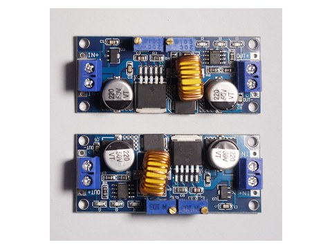 | **Step-Down *Buck Converter* `XL4015 5A` (Dual-Rail Internal)** | 2 | **Pemisah jalur `5V` komputer vs aktuator:** #1 khusus `Orange Pi 3B` (`5,10V`), #2 khusus `Servo`/`LED`/`ESP32` (`5,00V`). | Menjaga prinsip *Dual-Rail* meski hanya pakai 1 baterai fisik `LiFePO₄`, sehingga `Orange Pi 3B` kebal *reboot* saat servo bergerak. | Rating `5A` + *heatsink*; wajib disetel pakai multimeter sebelum dipasang. | **1× Reuse Prototype + 1× Baru** |
| 21 | 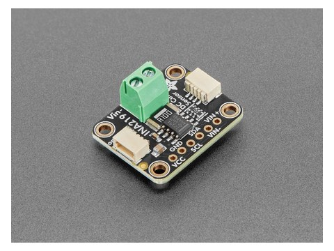 | **Sensor Arus & Tegangan `INA219` (I2C `0x40`) + Shunt `0,01 Ω 2W`** | 1 | **Pengukur sisa baterai & deteksi roda macet:** memicu alarm pulang pada `25%` baterai & memutus motor bila arus melonjak (*stall*). | **Audit teknis anti-rusak:** modul `INA219` bawaan pakai shunt `0,1 Ω` (mentok `3,2 A` — akan panas/mentok untuk 4 motor besar!). Mengganti shunt ke **`0,01 Ω 2W`** (atau memakai `INA226`) memperluas bacaan aman hingga `15–20 A`. | I2C alamat `0x40` + resistor shunt **`0,01 Ω (10 mΩ) 2W`**. | **Upgrade Baru Final** |
| 22 | 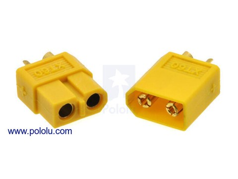 | **Kabel Silikon `16 AWG` & `18 AWG` + `XT60` + `GX16` (4-Pin) + *Cable Gland* `PG7`/`PG9`** | 1 set | **Jalur arus besar & penyegel kabel keluar Box IP65:** `16 AWG`/`XT60` kuat menahan arus 4 motor `12V`; `GX16`/`PG7` menyegel rapat dinding box. | Melubangi Box IP65 tanpa *cable gland* merusak status kedap debu/airnya; konektor `GX16` berdrat ulir tidak bisa lepas oleh getaran. | `16 AWG` (jalur `12,8V` & motor), `XT60`, `GX16` 4-pin, *cable gland* `PG7/PG9`. | **Upgrade Baru Final** |
| 23 | 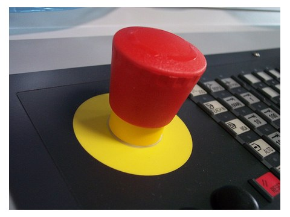 | **Sekring Blade `15A` *Waterproof* & *Emergency Kill Switch* `IP65`** | 1 + 1 | **Rem listrik darurat sekali pukul & pengaman korslet:** memutus total daya `12,8V` secara mekanis saat darurat di kandang. | Standar keselamatan fisik di dekat hewan hidup: tombol jamur merah bisa langsung dipukul siapa pun tanpa membuka HP. | Fuse blade `15A` + holder *waterproof*; tombol jamur merah kontak **`NC`** `IP65`. | **Upgrade Baru Final** |
| 24 | 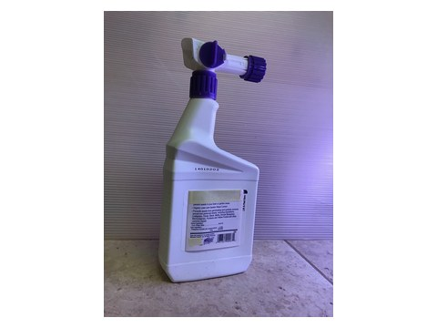 | **Dok di Dalam Kandang + Sikat Mekanis Roda + *Hand Sprayer*** | 1 set | **Tempat parkir, isi daya, & sanitasi roda:** rover mengisi daya lewat charger `14,6V` sambil mencatat udara per menit (mode stasiun), dan SOP sanitasi roda 3 langkah dijalankan di sini (`1 Unit = 1 Kandang`). | Ookista koksidia tahan terhadap disinfektan berdaya rendah (Zhao *et al.*, 2024), dan permukaan harus bersih dari bahan organik sebelum disinfeksi (Hansson *et al.*, 2025), sehingga sikat mekanis wajib didahulukan. | Tatakan dok di area *brooding* atau tengah kandang dengan stopkontak tahan air + sikat kaku + *hand sprayer* disinfektan. | **Upgrade Baru Final** |

### E. Komponen Pasif PCB & Alat Kerja Tambahan Tahap 3
*(Alat kerja Tahap 1 seperti Solder `60W`, Timah `0,8 mm`, Flux, Multimeter Digital, & Wire Stripper tetap dipakai kembali; tambahkan item berikut untuk versi Final)*:

| No | Nama Komponen / Alat Tambahan | Qty | Fungsi Utama (*To The Point*) | Alasan Objektif Dipilih | Spesifikasi Wajib |
| :-: | :--- | :-: | :--- | :--- | :--- |
| E1 | **Kapasitor Elektrolit `1000 µF 25V`** | 4 pcs | **Penahan lonjakan arus motor & servo besar:** menstabilkan rel `12,8V` & `5V` di *Custom Carrier PCB*. | Motor `JGB37-520` & servo `20 kg` menarik lonjakan arus awal jauh lebih besar daripada motor TT. | Radial `1000 µF 25V` (di input `2× BTS7960` & output `2× XL4015`). |
| E2 | **Kapasitor Keramik `100 nF` (`104`)** | 12 pcs | **Penyaring bising listrik frekuensi tinggi:** menjaga data I2C/UART/ADC tetap bersih di dekat 4 motor besar. | Mencegah *glitch* pada `FS304-SHT31`, `INA219`, dan `A02YYUW`. | Non-polar `0,1 µF`, dipasang di kaki 4 motor & tiap IC PCB. |
| E3 | **Resistor `10 kΩ`, `4,7 kΩ`, & `220 Ω` (`1/4W 1%`)** | 6 + 2 + 3 pcs | **Pengunci driver mati saat boot & *pull-up* I2C:** mengunci `R_EN/L_EN` `BTS7960` & MOSFET tetap mati saat start serta menstabilkan bus I2C. | Mencegah roda mendadak berputar saat `ESP32` menyala dan menjaga integritas sinyal I2C. | Film metal `1/4W 1%` (atau SMD `0805` sesuai desain `KiCad`). |
| E4 | **MOSFET *Logic-Level* (`IRLZ44N` / `AO3400` / `D4184`)** | 2 pcs | **Saklar elektronik `LED COB 5V` & `Buzzer`/kipas:** mengendalikan beban `5V` dari sinyal `3,3V` `ESP32`. | Menjaga arus GPIO `ESP32` tetap aman dan bebas panas. | Tipe *logic-level* penuh pada `3,3V`. |
| E5 | **`LED Merah 5 mm` + `Buzzer Aktif 5V`** | 1 + 1 pcs | **Alarm fisik luring di bodi Rover:** berbunyi & berkedip bila baterai `<25%`, roda macet, atau ada peringatan krisis tanpa internet. | Peternak/ABK di kandang tetap langsung sadar adanya masalah meski HP sedang tidak dipegang. | LED merah terang `5 mm` + *active buzzer* `5V`. |
| E6 | **Baut *Stainless* `M3/M4` + Mur *Nyloc* + *Silicone Sealant* Netral** | 1 set | **Pengikat anti-kendur & penyegel celah air:** mencegah baut lepas oleh getaran sekam dan menutup celah baut di dinding Box IP65. | Mur biasa cepat kendur di jalan tidak rata; *sealant* asam merusak logam/PCB sehingga wajib tipe **netral**. | Baut `SUS 304` + mur *nyloc* + *silicone sealant* netral. |
| E7 | **Bor Tangan + Mata Bor Besi / *Step-Drill*** | 1 set | **Pembuat lubang sasis aluminium & Box IP65:** membuat lubang bracket motor dan lubang presisi *cable gland* `PG7/PG9`. | *Step-drill* membuat lubang bulat mulus tanpa memecahkan plastik ABS Box IP65. | Tersedia di Lab Manufaktur/Robotika UNJ. |
| E8 | ***Heat Gun* (Pemanas Selongsong)** | 1 | **Penyusut *heat-shrink* kabel besar `16 AWG`:** membungkus rapat sambungan konektor `XT60`/`GX16` anti-lembap. | Lebih merata dan aman dibanding korek api untuk kabel besar. | Tersedia di Lab Elektronika/Robotika UNJ. |
| E9 | **Kunci L (*Hex Key*) `M3/M4`** | 1 set | **Pengencang *hex coupler* poros `6 mm`:** mengunci ban RC `120 mm` ke poros D motor `JGB37-520` agar tidak selip. | Baut *set-screw* *hex coupler* menggunakan kepala kunci L metrik. | Ukuran standar metrik (`1,5–4 mm`). |
| E10 | **Lakban Kertas (*Masking Tape*)** | 1 rol | **Pelindung konektor saat semprot *Conformal Coating*:** menutup *pin header*, port USB, dan trimpot agar tidak terlapisi cairan isolasi. | Mencegah kontak pin tersumbat lapisan isolasi permanen. | Lakban kertas bebas residu lem. |

---

## 4. Panduan Wiring Warna Kabel Pin-ke-Pin Versi Final (`LiFePO₄` + `2× BTS7960` + `Orange Pi 3B`)

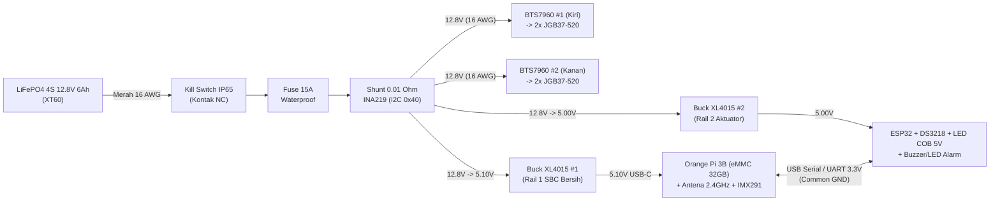

### A. Jalur Daya Utama `12,8V` & Regulator Dual-Rail (`16 AWG` & `18 AWG`)

| Dari Komponen & Pin | Warna & Ukuran Kabel | Ke Komponen & Pin | Tegangan & Catatan Keselamatan |
| :--- | :---: | :--- | :--- |
| **`LiFePO₄ 4S` Konektor `XT60 (+)`** | Merah `16 AWG` | ***Emergency Kill Switch* `IP65` (Kaki `NC` #1)** | Gunakan kontak *Normally Closed* (`NC`): saat tombol dipukul, arus langsung putus total. |
| ***Kill Switch* `IP65` (Kaki `NC` #2)** | Merah `16 AWG` | **Sekring *Waterproof* `15A` (Ujung 1)** | Proteksi korsleting utama sebelum masuk ke PCB/driver. |
| **Sekring `15A` (Ujung 2)** | Merah `16 AWG` | **`INA219` / Shunt `0,01 Ω` Pin `VIN+`** | Membaca arus total baterai secara real-time. |
| **`INA219` / Shunt Pin `VIN-`** | Merah `16 AWG` | **4 Cabang Rel `12,8V`:** `BTS7960 #1 B+`, `BTS7960 #2 B+`, `XL4015 #1 IN+`, & `XL4015 #2 IN+` | Pasang Kapasitor **`1000 µF 25V`** di kaki `B+/B-` kedua `BTS7960`. |
| **`LiFePO₄ 4S` Konektor `XT60 (-)`** | Hitam `16 AWG` | **Bus *Common Ground* (`GND`):** `BTS7960 #1/#2 B-`, `XL4015 #1/#2 IN-`, & `GND` *Carrier PCB* | Seluruh kabel hitam bermuara di satu bus bar `GND` tebal pada PCB. |
| **`Buck XL4015 #1` (`OUT+ / OUT-`)** *(Set **`5,10V`**!)* | Merah & Hitam `18 AWG` | **Port Daya USB-C `Orange Pi 3B`** | Khusus hanya untuk `Orange Pi 3B` + kamera `IMX291` — jangan digabung ke servo! |
| **`Buck XL4015 #2` (`OUT+ / OUT-`)** *(Set **`5,00V`**!)* | Merah & Hitam `18 AWG` | **Rel `+5,0V` Aktuator:** `Servo DS3218`, `LED COB`, `Buzzer 5V` *(dan `ESP32 VIN` hanya bila tidak mengambil daya dari USB `Orange Pi`)* | Pasang Kapasitor `1000 µF 25V` dekat `DS3218` untuk menyerap tarikan arus torsi `20 kg`. |

### B. Jalur Sinyal `DOIT ESP32 DEVKIT V1 (30-Pin)` ↔ `2× BTS7960` & Sensor Final

| Komponen Final | Pin / Warna Kabel Asli Komponen | Pin Tujuan di `ESP32` / Rail | Tegangan & Catatan Kritis |
| :--- | :--- | :--- | :--- |
| **`BTS7960 #1` (2 Motor Kiri)** | `VCC` → `3V3` \| `GND` → `GND` `RPWM` (Maju) \| `LPWM` (Mundur) `R_EN + L_EN` (digabung) | `ESP32 3V3` & `GND` **`D25`** (`RPWM`), **`D26`** (`LPWM`) **`D27`** *(+ `10 kΩ` pull-down ke `GND`)* | Logika **`3,3V`** aman langsung dari `ESP32`. `M+/M-` ke paralel `2× JGB37-520` Kiri (`16 AWG`). |
| **`BTS7960 #2` (2 Motor Kanan)** | `VCC` → `3V3` \| `GND` → `GND` `RPWM` (Maju) \| `LPWM` (Mundur) `R_EN + L_EN` (digabung) | `ESP32 3V3` & `GND` **`D14`** (`RPWM`), **`D32`** (`LPWM`) **`D33`** *(+ `10 kΩ` pull-down ke `GND`)* | `M+/M-` ke paralel `2× JGB37-520` Kanan (`16 AWG`). |
| **Probe `FS304-SHT31`** *(I2C `0x44`)* | **Merah** (`VCC`) \| **Hitam** (`GND`) **Kuning** (`SCL`) \| **Hijau** (`SDA`) | `ESP32 3V3` & `GND` **`D22`** (`SCL`), **`D21`** (`SDA`) | Cocokkan stiker warna kabel pabrik; pasang resistor *pull-up* **`4,7 kΩ`** ke `3V3` pada `D21` & `D22`. |
| **`INA219`** *(I2C `0x40`)* | `VCC` \| `GND` \| `SCL` \| `SDA` | `ESP32 3V3`, `GND`, **`D22`**, **`D21`** | Berbagi bus I2C dengan `FS304-SHT31` (alamat `0x40` vs `0x44`, bebas bentrok). |
| **`DFRobot SEN0567`** *(Reuse, `NH₃`)* | `VCC` \| `GND` \| `A` (Analog) | `ESP32 3V3`, `GND`, **`D34` (`ADC1`)** | Tetap pakai **ADC1 (`D34`)** aman `≤3,3V`. |
| **`DFRobot A02YYUW` IP67** *(UART)* | **Merah** (`VCC`) \| **Hitam** (`GND`) **Hijau** (`TX`) \| **Kuning** (`RX`) | `ESP32 3V3`, `GND` **`RX2 (D16)`**, **`TX2 (D17)`** *(opsional lepas)* | Suplai **`3,3V`** membuat sinyal `TX` langsung `3,3V` aman tanpa *voltage divider*. |
| **`Servo DS3218` 20 kg** | **Merah** (`+5V`) \| **Cokelat** (`GND`) \| **Oranye** (`PWM`) | **Rel `+5,0V` (`XL4015 #2`)**, `GND`, **`D18`** | Daya mutlak dari `XL4015 #2`, bukan pin `ESP32`. |
| **`LED COB 5V` (MOSFET)** & **Alarm Luring** | `MOSFET LED` \| `MOSFET Buzzer` \| `LED Merah (+220 Ω)` | **`D19`** (`LED COB`), **`D13`** (`Buzzer`), **`D4`** (`LED Merah`) | Default MATI saat boot; alarm berbunyi fisik saat internet putus / baterai `<25%`. |

---

## 5. Urutan Perakitan & Validasi Lapangan Versi Final

1. **Uji Sekam Lembap Dulu (Sebelum Cetak PCB):** Rakit pelat aluminium `2 mm` + `4× JGB37-520` + ban RC `110–120 mm` + `2× BTS7960` + `LiFePO₄`, lalu uji melintasi bak sekam padi lembap setebal `5–8 cm` pada kecepatan `0,07–0,1 m/s`.
2. **Desain & Cetak *Custom Carrier PCB* (`KiCad 8`) + *Conformal Coating*:** Cetak PCB 2-layer, solder seluruh *female header* & komponen pasif, luluskan tes multimeter (`XL4015 #1 = 5,10V`, `#2 = 5,00V`), tutup semua soket/trimpot/sensor dengan lakban kertas, semprot 2 lapis tipis *Conformal Coating*, keringkan 24 jam, lalu lepas lakban.
3. **Integrasi Box Panel `IP65` & *3D Print PETG*:** Pasang seluruh elektronik dengan mur *nyloc*, pasang *Kill Switch IP65* & Antena `2,4 GHz` di tutup atas, dan lewatkan seluruh kabel luar melalui *Cable Gland* `PG7/PG9` atau soket `GX16`.
4. **Migrasi AI ke NPU `RK3566` (`RKNN INT8`) & Uji *Offline*:** Konversi satu detektor feses ke `.rknn` INT8 dan ukur sendiri kecepatan inferensinya, uji *runtime* baterai `≥3 jam` (cukup untuk 2 putaran per hari), uji alarm `25%` & *stall detection* `INA219`, serta uji putus internet (`SQLite WAL` → *auto-sync* ke Backend `Golang`).
5. **Uji Dok & Mode Stasiun, lalu Jalankan SOP Sanitasi Roda 3 Langkah (`1 Unit = 1 Kandang`):** pastikan rover mengisi daya di dok sambil mencatat udara per menit, lalu jalankan **(1) sikat mekanis sekam** dari alur ban `120 mm`, **(2) semprot disinfektan** spektrum luas (jauhkan dari lubang sensor udara), **(3) keringkan penuh**, lalu catat log digital di Dashboard Website.

---

## 6. Link Referensi Proyek Mirip Tahap 3 (Terverifikasi Aktif)

- **YouTube — Wiring Motor Arus Besar `BTS7960 43A` + `ESP32`:** [Control High Power DC Motor with ESP32](https://www.youtube.com/watch?v=5Niou67bJ_w) \| [BTS7960 43A & 3.3V Logic](https://www.youtube.com/watch?v=GZ7LjKUznKo) \| [Beginner Guide BTS7960 + ESP32](https://www.youtube.com/watch?v=uT_kYwhg6SQ)
- **YouTube — Desain *Custom PCB* `ESP32` dengan `KiCad 8`:** [Design an ESP32 PCB with KiCad (<25 Menit)](https://www.youtube.com/watch?v=jiJGbWOSdMo) \| [ESP32-WROOM-32 Hardware Design](https://www.youtube.com/watch?v=RYvpsIkfbHo) \| [Custom ESP32 PCB in 19 Minutes](https://www.youtube.com/watch?v=UP0-w7tPxF0)
- **Repositori GitHub & Datasheet Resmi Final:** [airockchip/rknn_model_zoo](https://github.com/airockchip/rknn_model_zoo) \| [YOLOX (Apache-2.0)](https://github.com/Megvii-BaseDetection/YOLOX) \| [Qengineering YoloV5-NPU](https://github.com/Qengineering/YoloV5-NPU) \| [CodersCafeTech/Smart-Coop-V2 (Custom PCB Unggas)](https://github.com/CodersCafeTech/Smart-Coop-V2) \| [SIRAGU Poultry Monitoring](https://github.com/skarthik2745/SIRAGU-Poultry-Monitoring) \| [Orange Pi 3B Official](http://www.orangepi.org/html/hardWare/computerAndMicrocontrollers/details/Orange-Pi-3B.html) \| [DFRobot SEN0567](https://wiki.dfrobot.com/sen0567/) \| [DFRobot A02YYUW](https://wiki.dfrobot.com/sen0311/)
- **Dataset CV Feses (sama dengan Bab 11 concept):** [Zenodo 4628934 (label YOLO, data latih utama)](https://zenodo.org/records/4628934) \| [Zenodo 5801834 (label PCR, tanpa label YOLO)](https://zenodo.org/records/5801834) \| [Mendeley 8pnbzpt2k9 (broiler & petelur)](https://data.mendeley.com/datasets/8pnbzpt2k9/1). *Fine-tuning* kandang lokal memakai set uji lokal foto rover dan HP berpasangan berlabel dokter hewan.
