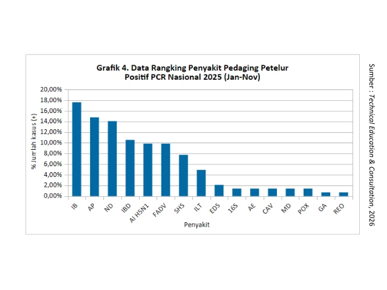
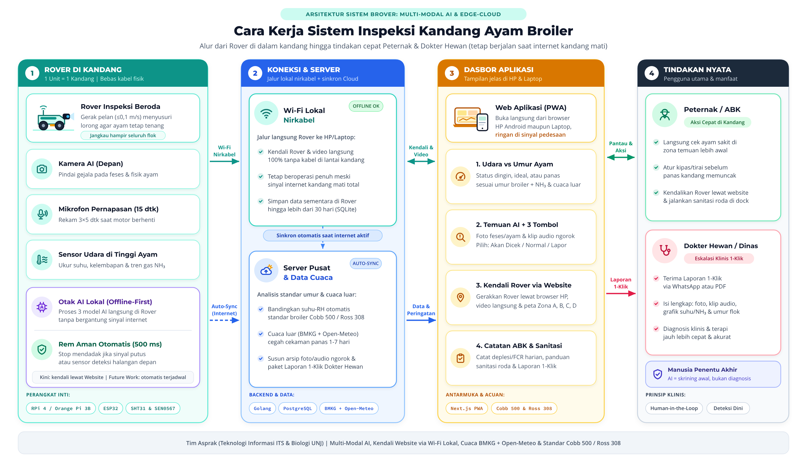
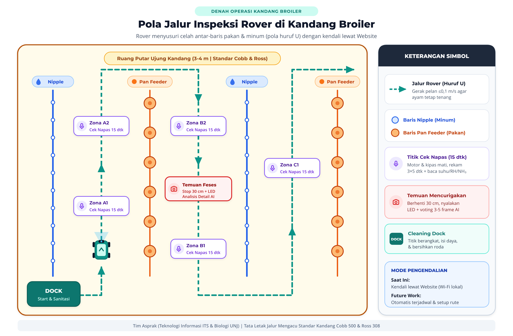
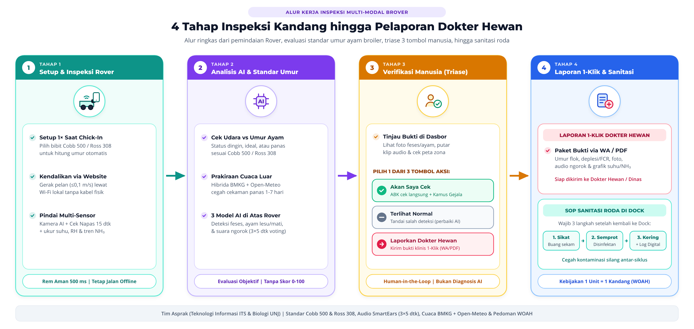
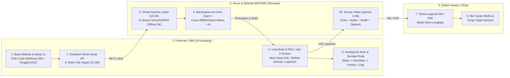
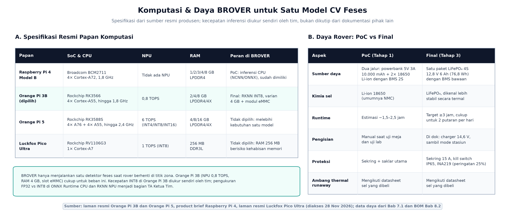
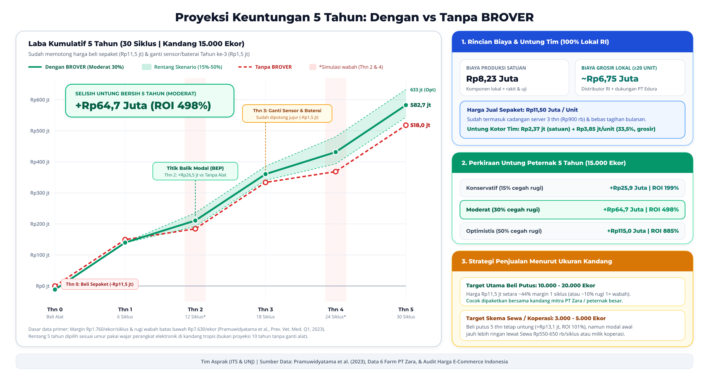
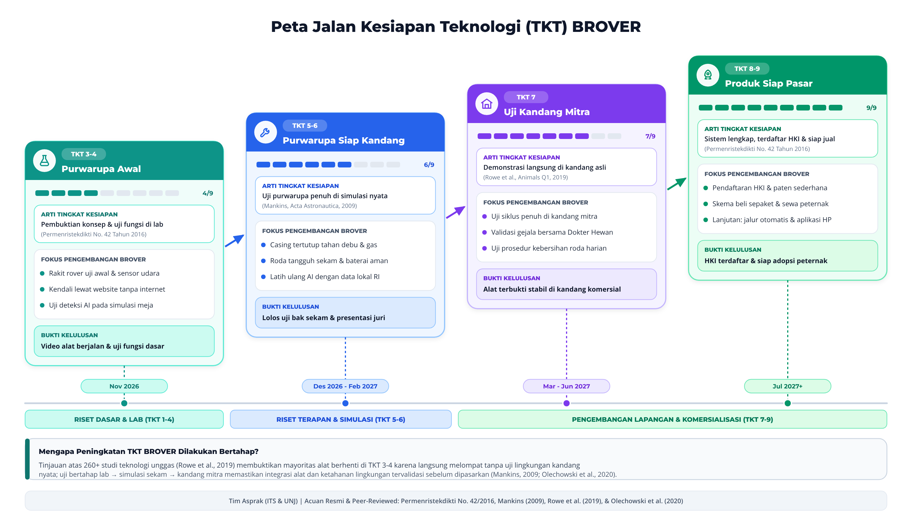

# BROVER (*Broiler Inspection & Health Rover*): Sistem Inspeksi Berbasis *Multi-Modal AI* dan *Edge-Cloud* untuk Deteksi Dini Gejala Penyakit serta Pemantauan Mikroklimat Kandang Ayam Broiler

---

## 1. Judul, Identitas Tim, Filosofi Produk, & Standar Transparansi

- **Judul Final Proyek:**  
  **`BROVER (Broiler Inspection & Health Rover): Sistem Inspeksi Berbasis Multi-Modal AI dan Edge-Cloud untuk Deteksi Dini Gejala Penyakit serta Pemantauan Mikroklimat Kandang Ayam Broiler`**
  - *Catatan Penyelarasan Veteriner:* Penamaan telah diselaraskan dengan masukan **Medik Veteriner Ahli Muda (Dinas Peternakan)** serta standar internasional **WOAH *Terrestrial Animal Health Code*** (Bab 6.4 vs Bab 1.4): istilah *biosekuriti* adalah perisai pencegahan fisik (pagar 3-zona, disinfeksi kendaraan, karantina), sedangkan pemindaian gejala klinis & pelaporan dini adalah **Inspeksi & Deteksi Dini Gejala Penyakit**. Protokol biosekuriti alat (`1 Unit = 1 Kandang` dan sanitasi roda) tetap dijaga ketat di Bab Cara Kerja sebagai SOP operasional.
- **Filosofi `BROVER` (*Broiler* + *Rover* → `Rover Inspeksi`):**  
  Terinspirasi dari filosofi ***NASA Planetary Rover*** (*Curiosity / Perseverance*), kendaraan darat beroda pembawa paket instrumen ilmiah (kamera, mikrofon, sensor lingkungan) yang turun ke **lingkungan berisiko/kotor (*harsh environment*)** untuk mengambil data langsung di titik lokasi agar manusia tidak perlu terlalu sering masuk ke area tersebut. Dalam terminologi inspeksi industri (*Non-Destructive Testing / Remote Visual Inspection*) dan **ISO 8373:2021 Pasal 4.16 (*Mobile Platform*)**, **`BROVER`** adalah **`Rover Inspeksi`** (*Inspection Rover*), yaitu platform inspeksi bergerak beroda empat pembawa kamera *Computer Vision*, mikrofon, dan sensor suhu–kelembapan–amonia agar **1 unit alat mampu menjangkau hampir seluruh populasi ayam di dalam kandang** secara hemat biaya dibanding memasang puluhan CCTV dan sensor statis.
- **Program & Jalur Kompetisi:** Hackathon Deep Tech UNJ 2026: Jalur Pangan **`D-FARM UNJ`** (*Challenge #1: Smart Poultry Production*)
- **Tim Pengusul:** **Tim Asprak**: **5/5 Anggota Lengkap** (Kolaborasi 4 Mahasiswa Teknologi Informasi **ITS** + 1 Dosen Aktif Biologi/Dokter Hewan **UNJ**):
  1. **M. Hikari Reiziq Rakhmadinta**: **Hustler** *(Mahasiswa Teknologi Informasi ITS; Strategi, Validasi Mitra, BMC, & Pitching)*
  2. **Ahmad Syauqi Reza**: **Hacker** *(Mahasiswa Teknologi Informasi ITS; Embedded/IoT, Edge AI, & Backend)*
  3. **Arya Bisma Putra Refman**: **Hacker** *(Mahasiswa Teknologi Informasi ITS; Software Engineering, AI/ML, & Integrasi Sistem)*
  4. **Aditya Reza Daffansyah**: **Hipster** *(Mahasiswa Teknologi Informasi ITS; UI/UX Dashboard, Alur Pengguna, & Visual Produk)*
  5. **Dr. drh. Atin Supiyani, M.Si.**: **Anggota Tim: Pakar Domain Veteriner** *(Dosen Biologi UNJ; bidang **Fisiologi & Kesehatan Hewan**; memenuhi syarat wajib slot ke-5 dosen aktif UNJ `[Pedoman, Hal. 3]` sekaligus validator klinis gejala penyakit & kamus triase).*
- **Ruang Lingkup Proyek (*Hard Constraints*):**
  - Berfokus sepenuhnya pada **peternakan ayam pedaging (*broiler*)** : kompatibel untuk kandang ***open house*** maupun ***closed house*** di Indonesia.
  - **Tidak** mencakup jalur kesehatan manusia (`D-MARC`), **tidak** mencakup topik pengolahan limbah/sampah (*waste-to-value*, kompos, biogas, maggot), dan **tidak** menggunakan sensor tembak suhu tubuh inframerah (*thermogun/IR*).
- **Standar Transparansi (*Provenance Tags*):** Seluruh tabel, grafik, dan analisis dalam dokumen ini mematuhi 4 label transparansi:
  - **`[ASLI DARI SUMBER PRIMER]`** : Grafik/data diambil utuh tanpa modifikasi dari sumber resmi.
  - **`[DATA PRIMER TERVERIFIKASI: TABEL/VISUALISASI DISUSUN OLEH AI AGENT]`** : Seluruh angka berasal dari BPS, Kementan RI, PT Medion, Cobb Genetics, WOAH, *datasheet* resmi, atau jurnal *peer-reviewed* terverifikasi (**0 *preprint***).
  - **`[SUARA LAPANGAN DARING: NON-PEER-REVIEWED]`** : Kesaksian praktisi/peternak Indonesia dari wawancara berita/YouTube untuk triangulasi realitas lapangan.
  - **`[SINTESIS REKAYASA TIM ASPRAK: DISUSUN OLEH AI AGENT]`** : Rancangan arsitektur, alur kerja, *power budget*, BMC, dan roadmap TKT yang disusun untuk validasi dan eksekusi tim.

> **Ringkasan Eksekutif:** Wabah penyakit pernapasan dan pencernaan serta instabilitas mikroklimat tropis merupakan dua penyebab kerugian operasional utama pada peternakan ayam broiler rakyat di Indonesia, dengan potensi kerugian mencapai Rp22 hingga Rp57 juta per siklus pada skala 3.000 ekor apabila deteksi terlambat. Untuk menjawab permasalahan tersebut, Tim Asprak mengembangkan **`BROVER` (*Broiler Inspection & Health Rover*)**, yaitu sistem inspeksi bergerak berbasis *Multi-Modal AI* dan arsitektur *Edge-Cloud* yang memadukan pemindaian visual feses dan kondisi fisik ayam, deteksi suara gangguan pernapasan, serta pemantauan suhu, kelembapan, dan tren gas amonia dalam satu unit beroda. Seluruh data lingkungan dievaluasi otomatis terhadap standar umur resmi bibit ayam broiler (*Cobb 500* dan *Ross 308*) pada dasbor website, tetap beroperasi saat koneksi internet kandang terputus, dan dilengkapi alur verifikasi manusia serta laporan ringkas sekali klik kepada Dokter Hewan. Berdasarkan audit harga e-commerce dan distributor lokal Indonesia (100% pengadaan dalam negeri), total HPP nyata berada di kisaran Rp8,23 juta per unit (eceran satuan) dan turun menjadi sekitar Rp6,75 juta per unit pada pengadaan grosir lokal (≥20–50 unit), sehingga dapat dipasarkan melalui skema **All-In Sepaket Rp11,50 juta/unit tanpa langganan bulanan** (atau sewa Rp550–650 ribu/siklus bagi peternak kecil), jauh di bawah perangkat impor di atas Rp100 juta; `BROVER` dirancang bertahap dari purwarupa kendali operator langsung lewat website melalui Wi-Fi lokal nirkabel (TKT 3–4 menuju TKT 6–7) hingga otomatisasi inspeksi terjadwal dan aplikasi mobile native pada tahap pengembangan lanjutan.

---

## 2. Latar Belakang

Sektor perunggasan merupakan tulang punggung utama pemenuhan protein hewani terjangkau di Indonesia. Berdasarkan data resmi **Badan Pusat Statistik (BPS) 2025** dan telaah ilmiah nasional (Sumiati *et al.*, *Animal Bioscience* Q1, 2025), populasi **ayam ras pedaging (*broiler*)** nasional menembus **3,32 miliar ekor/tahun** (`3.323.003.798` ekor) dengan produksi daging mencapai **4,06–4,28 juta ton/tahun**, melampaui populasi subsektor unggas lainnya secara signifikan (sebagai pembanding, populasi ayam ras petelur tercatat 426,12 juta ekor dengan produksi 6,31 juta ton telur).

Namun, struktur produksi broiler di Indonesia masih terbelah tajam secara teknologi: sekitar **60% pasokan** berasal dari peternakan industrial skala besar (*closed house*), sedangkan **~40% sisanya** ditopang oleh **lebih dari 1 juta peternak kecil–menengah** yang mayoritas masih mengoperasikan kandang terbuka (*open house*) dengan pengawasan manual (Sumiati *et al.*, 2025). Di sisi lain, inovasi kandang *closed house* bahan lokal untuk peternak rakyat juga mulai berkembang, seperti **KANOPIS** milik mitra industri Hackathon Deep Tech UNJ 2026, **PT Zara Propertifarm Indonesia**, yang telah diuji pada 6 farm di Bogor (`85.000 ekor`) dan pengakuan kapasitas awal JAPFA (`300.000 ekor`), namun pemantauan kesehatan harian di dalam kandang masih menjadi tantangan operasional kritis menuju TKT 9 ([04_MITRA_PT_ZARA_PROPERTIFARM.md](./01_Context_Memory/04_MITRA_PT_ZARA_PROPERTIFARM.md)).

Di tengah margin kotor usaha broiler rakyat yang relatif tipis (rata-rata **Rp5,28 juta per siklus** pada skala 3.000 ekor), satu kali wabah penyakit dapat menimbulkan kerugian **Rp22,89 hingga Rp57,35 juta** (Pramuwidyatama *et al.*, *Prev. Vet. Med.* Q1, 2023), setara keuntungan beberapa siklus sekaligus apabila deteksi gejala terlambat 24–72 jam. Dalam wawancara praktisi peternak broiler skala 12.000 ekor di Malang (`[SUARA LAPANGAN DARING]` [Edufarmers × PecahTelur](https://www.youtube.com/watch?v=FKCNKnTRif0)), serangan bakteri ***Colibacillosis*** pada umur 7 hari pernah menyebabkan **2.000 ekor mati** dalam satu siklus; di sisi lain, anak kandang (ABK) harus terus menjaga kesesuaian suhu dan kelembapan yang berubah signifikan mengikuti umur ayam (*brooding* DOC `30–34°C` hingga fase panen `21–25°C`) serta memantau tanda awal gangguan kesehatan secara harian.

Sementara itu, solusi perangkat pemantau kandang komersial impor (seperti *ChickenBoy* Big Dutchman berbasis rel plafon atau *Octopus XO* berbobot ~80 kg) memiliki harga dan kompleksitas yang tidak terjangkau bagi peternak rakyat Indonesia. Pemasangan puluhan CCTV dan sensor statis di setiap sudut kandang pun membutuhkan biaya instalasi dan perawatan kabel yang mahal. Diperlukan pendekatan rekayasa ***Demand-Driven DeepTech*** yang jujur, tahan terhadap keterbatasan sinyal internet dan listrik pedesaan, hemat biaya produksi, serta memanfaatkan kekuatan tim multidisiplin **Tim Asprak** (kolaborasi 4 mahasiswa Teknologi Informasi **ITS** + 1 Doktor Dokter Hewan **UNJ**).

---

## 3. Masalah

Berdasarkan hasil riset sistematis dan triangulasi 35 artikel jurnal *peer-reviewed* Indonesia (2021–2026) dengan 20 sumber lapangan daring ([TOP_5_MASALAH_PETERNAKAN_UNGGAS_INDONESIA_V3_TRANSPARAN.md](./02_Problem_Research/TOP_5_MASALAH_PETERNAKAN_UNGGAS_INDONESIA_V3_TRANSPARAN.md)) serta bedah *Root Cause Analysis* ([ROOT_CAUSE_PENYAKIT_BIOSEKURITI_DAN_HEAT_STRESS.md](./03_Root_Cause_Analysis/ROOT_CAUSE_PENYAKIT_BIOSEKURITI_DAN_HEAT_STRESS.md)), **`BROVER` memfokuskan solusi pada 2 masalah teknis-operasional paling konsisten dan berdampak ekonomi besar di Indonesia**:

### 3.1. Masalah Utama (#1): Wabah Penyakit Unggas & Keterlambatan Deteksi Dini di Kandang

`[DATA PRIMER TERVERIFIKASI: TABEL/VISUALISASI DISUSUN OLEH AI AGENT]`

1. **Dampak Ekonomi Berat per Wabah:** Pada pemodelan bio-ekonomi farm broiler Sektor 3 di Jawa Bagian Barat (skala 3.000 ekor, margin kotor normal hanya **Rp5,28 juta/siklus**), **1 kali wabah HPAI H5N1** mengubah margin positif menjadi kerugian rata-rata hingga **−Rp53,89 juta** (*tanpa tindakan*) hingga **−Rp57,35 juta** (*stamping out* tanpa kompensasi), mendorong peternak melakukan *panic selling* ayam sakit (**−Rp22,89 juta**) yang memperluas penyebaran regional (Pramuwidyatama *et al.*, *Prev. Vet. Med.* Q1, 2023).
2. **Dominasi Penyakit Pernapasan & Pencernaan di Broiler Indonesia:** Berdasarkan surveilans laboratorium nasional **PT Medion TEC (Januari 2026)**, penyakit positif PCR nasional dipimpin oleh ***Infectious Bronchitis* (IB ~17,7%)**, ***Avian Paramyxovirus* (AP ~14,8%)**, ***Newcastle Disease* (ND ~14,1%)**, **IBD/Gumboro (~10,6%)**, dan **AI H5N1 (~9,9%)**. Secara spesifik pada insiden klinis **ayam broiler (2023–Nov 2025)**, 3 penyakit teratas adalah **CRD / ngorok (>31%)**, **Colibacillosis (~17%)**, dan **Coccidiosis (~12%)**.

*`[ASLI DARI SUMBER PRIMER]` Grafik 4: Rangking Penyakit Pedaging & Petelur Positif PCR Nasional Jan–Nov 2025, disalin utuh dari [PT Medion TEC (Januari 2026)](https://www.medion.co.id/en/info-medion/overview-of-poultry-disease-analysis-2025-disease-projection-2026/).*

*`[ASLI DARI SUMBER PRIMER]` Grafik 1: Rangking Penyakit Ayam Pedaging (Broiler) 2023–Nov 2025, disalin utuh dari [PT Medion TEC (Januari 2026)](https://www.medion.co.id/en/info-medion/overview-of-poultry-disease-analysis-2025-disease-projection-2026/), mengonfirmasi dominasi CRD (>31%), Colibacillosis (~17%), dan Coccidiosis (~12%).*

3. **Lemahnya Pengawasan & Literasi Pekerja Kandang:** Studi longitudinal 19 farm broiler (153 siklus) di Jawa Barat mengungkap skor **biosekuriti eksternal rata-rata hanya `0,28/1,0`**, pergerakan/pembelian **`0,48/1,0`**, dan **pekerja & peralatan `0,50/1,0`**; seluruh **4 farm dengan skor terendah akhirnya gulung tikar** (Anwar Sani *et al.*, *Poultry Science* Q1, 2025). Sementara itu, survei 200 pekerja kandang unggas Indonesia menunjukkan **`58%` pekerja** berada pada tingkat pengetahuan *Avian Influenza* kategori *Low–Moderate* (`33% Low`, `25% Moderate`) (Rehman *et al.*, *PeerJ* Q1, 2023).
4. **Koinfeksi & Deteksi Terlambat di Lapangan:** Penyakit di kandang Indonesia kerap muncul sebagai koinfeksi multifaktorial, seperti temuan studi kasus 11.000 broiler di Majalengka yang mengalami **koinfeksi simultan AI H5 + AI H9 + IB (CV antibodi 256%) + *M. gallisepticum* (31,25%) + koksidiosis (4.400 OPG)** di bawah tekanan amonia **20 ppm** (Hartady *et al.*, *Vet. Sci.* Q1, 2026). Akibat pengamatan visual kasatmata yang terlambat dan kemiripan gejala luar, peternak sering salah duga (misal kasus *Hari Farm*: wabah AI awalnya disangka snot hingga kematian meningkat dari 4 menjadi 80 ekor/hari; `[SUARA LAPANGAN DARING]` TROBOS Livestock, 2024; serta kasus kematian 2.000/12.000 ekor akibat *Colibacillosis* di umur 7 hari pada wawancara `[SUARA LAPANGAN DARING]` Edufarmers × PecahTelur) dan mengandalkan antibiotik profilaktik/*flushing* sembarangan (`75,0%` *flushing*, hanya `8,3%` terapi terarah; Efendi *et al.*, *Vet. World* Q1, 2022).

### 3.2. Masalah Pendukung (#2): Cekaman Panas (*Heat Stress*), Gas Amonia, & Ketimpangan Mikroklimat per Umur

`[DATA PRIMER TERVERIFIKASI: TABEL/VISUALISASI DISUSUN OLEH AI AGENT]`

1. **Tekanan Iklim Tropis Sepanjang Tahun:** Nilai rata-rata bulanan *Heat Stress Index* (HSI) Indonesia tahun 2023 melampaui ambang nyaman (`<150–160`) **di seluruh 12 bulan**, mencapai **155,5–165,4 (puncak 187,8)** di Indonesia Barat dan **150,0–166,4 (puncak 195,0)** di Indonesia Timur dengan suhu puncak `36°C` (Sumiati *et al.*, 2025).
2. **Gradien Mikroklimat di Ketinggian Ayam vs Sensor Dinding:** Pada 14 farm *closed/semi-closed house* di Jawa Barat (`2.104 ekor`, `84 titik ukur`), **`0,0%`** titik ukur berada di zona nyaman termal (`THI <72`), sementara **`62,0%` berada di zona *Severe Discomfort*** dan **`8,3%` *Life-Threatening* (`THI >85`)**, dengan kelembapan rerata **`81,9%` (`66%–96%`)**, `NH₃` `7,3 ± 6,4 ppm`, serta lesi *Foot-Pad Dermatitis* (FPD) mencapai **`40%`** akibat *wet litter* (Wilcox *et al.*, *Animal Welfare* Q1, 2025).
3. **Korelasi Langsung ke Mortalitas, Saluran Napas, & Kebutuhan Dinamis Umur:** Di Jawa Tengah, analisis ROC membuktikan **suhu sore pukul 16:00 `>32,8°C`** (`AUC 0,694`, `p = 0,026`) dan **THI pukul 16:00 `>79`** (`AUC 0,709`, `p = 0,016`) signifikan memprediksi kematian broiler, sementara kadar air *litter* di dataran rendah mencapai **`46,42%`** dengan `NH₃` `13,11–14,94 ppm` (Mohammadi *et al.*, *AAVS*, 2026; Hasibuan *et al.*, *JSPI*, 2021). Kadar gas amonia **`>20 ppm`** terbukti merusak silia saluran pernapasan dan meningkatkan kerentanan terhadap penyakit pernapasan (CRD/airsacculitis) (Ritz *et al.*, 2004; Naseem & King, 2018). Selain itu, standar suhu nyaman broiler berubah signifikan mengikuti umur; suhu `26°C` nyaman untuk umur 14 hari namun terlalu dingin bagi DOC umur 0 hari (`30–34°C`, *Cobb 500 Management Guide*, 2018/2021).

---

## 4. Solusi (`BROVER`) & Pengembangan 5 Fitur Utama

**`BROVER` (*Broiler Inspection & Health Rover*)** adalah **Sistem Inspeksi Deteksi Dini Gejala Penyakit dan Pemantauan Mikroklimat** berbasis **`Rover Inspeksi`** beroda empat dengan arsitektur ***Multi-Modal AI*** (Baltrušaitis *et al.*, 2019) dan ***Edge-Cloud* (*Offline-First*)** (Shi *et al.*, 2016). Alih-alih memasang puluhan kamera dan sensor statis mahal di setiap sudut kandang, **`BROVER`** membawa 1 set kamera *Computer Vision*, mikrofon, dan sensor lingkungan menyusuri lorong kandang pada kecepatan pelan (`≤0,1 m/s`) agar mampu memantau hampir seluruh populasi ayam secara efisien.

*`[SINTESIS REKAYASA TIM ASPRAK: DISUSUN OLEH AI AGENT]` Alur sistem BROVER dari kiri ke kanan: (1) Rover inspeksi di dalam kandang (dikendalikan lewat website pada tahap saat ini) dengan kamera AI, mikrofon 15 detik (3×5 detik voting), sensor suhu-RH/NH₃, otak AI lokal (offline-first), dan rem aman otomatis 500 ms; (2) koneksi Wi-Fi lokal nirkabel dan sinkronisasi otomatis ke server pusat serta data cuaca luar (BMKG + Open-Meteo); (3) dasbor aplikasi website (Next.js PWA) untuk kendali Rover dan evaluasi standar umur bibit ayam broiler Cobb 500 / Ross 308; hingga (4) aksi cepat Peternak/ABK dan Laporan 1-Klik ke Dokter Hewan/Dinas.*

### 4.1. Rincian 5 Fitur Utama `BROVER`

#### Fitur 1: `Rover Inspeksi` Bergerak (Jangkauan Menyeluruh 1 Kandang)
- **Fungsi Utama:** Platform inspeksi bergerak beroda empat (ISO 8373:2021 Pasal 4.16) berkecepatan pelan (`≤0,1 m/s` agar ayam terbiasa dan tidak panik) yang membawa seluruh kamera, mikrofon, dan sensor melintasi lorong kandang sehingga **1 unit alat dapat menjangkau hampir seluruh populasi ayam**.
- **Pengoperasian Tahap Saat Ini (Dikendalikan Lewat Website, Jujur & Aman):** Pada fase PoC dan prototipe awal, pergerakan `Rover Inspeksi` **dikendalikan operator langsung lewat website** (browser HP Android maupun laptop dalam mode layar penuh *landscape* berjoystick sentuh) menggunakan **Koneksi Wi-Fi Lokal Nirkabel (100% Tanpa Kabel Fisik, Tetap Berfungsi Saat Internet Kandang Mati)** (halaman kendali disajikan langsung oleh `Raspberry Pi` / `Orange Pi` di Wi-Fi lokal agar bebas blokir *Mixed Content* dan memiliki jeda video rendah `~100–300 ms`).
- **Fitur Keselamatan & Instrumen di Atas `Rover`:**
  - ***Dead-Man's Switch* (`500 ms`; Rem Darurat Otomatis):** Apabila sinyal Wi-Fi terputus atau perintah berhenti diterima lebih dari `0,5 detik`, `ESP32` otomatis memutus tenaga motor dan mengerem penuh agar `Rover` tidak menabrak ayam atau tempat pakan.
  - **Sensor Jarak Depan Anti-Tabrak** (`HC-SR04` PoC / `DFRobot A02YYUW` IP67 Final dengan *blind zone* 3 cm) untuk menghentikan gerak otomatis saat ada ayam atau penghalang tepat di depan bumper.
  - **Kontrol Sudut Kamera 2-Posisi (1× Servo *Tilt*) + Lampu LED Putih 5000K CRI >90:** Posisi miring bawah `~45°` untuk memindai feses di permukaan sekam dan posisi datar `~0–15°` untuk memindai fisik/postur ayam, disertai lampu LED untuk menstandarkan warna foto pada pencahayaan kandang yang redup.
  - **Tombol 1-Klik `Cek Napas 15 Detik`** untuk menghentikan motor/kipas dan merekam suara pernapasan ayam (`3 segmen × 5 detik` *voting*) tanpa gangguan bunyi mesin.
- ***Future Work* (Pengembangan Lanjutan; Otomatisasi Penuh Terjadwal):** Pada tahap pengembangan lanjutan, `Rover Inspeksi` ditingkatkan dari kendali operator lewat website menjadi **otomatisasi penuh terjadwal**: peternak cukup **mengatur jadwal inspeksi rutin** (misalnya pagi dan sore) serta melakukan ***setup* jalur/rute kandang** di dashboard; saat jadwal tiba, `Rover` bergerak sendiri menyusuri rute, menjalankan pemindaian kamera + audio + sensor secara otomatis, lalu kembali ke *dock* pengisian daya.

#### Fitur 2: Perangkat Sensor Mikroklimat & Gas Amonia (Dinamis Mengikuti Umur Ayam)
- **Sensor di Ketinggian Ayam (*Bird-Level*):** Mengukur **Suhu & Kelembapan Relatif (`SHT31` / probe waterproof `FS304`)** serta **Indikator Tren Gas Amonia (`DFRobot SEN0567`)** terkompensasi suhu/RH langsung pada zona tempat ayam berada (bukan hanya di dinding/plafon).
- **Evaluasi Otomatis Berbasis Standar Umur Resmi Bibit Ayam Broiler (`Cobb 500`):** `Cobb 500` adalah jenis bibit (*strain*) ayam broiler pedaging komersial yang paling luas dipelihara di Indonesia bersama `Ross 308`. Alih-alih memakai batas suhu kaku yang salah secara biologis, pembacaan `SHT31` dibandingkan otomatis terhadap **Matriks Suhu–RH Ideal buku panduan resmi `Cobb 500` sesuai umur ayam (Hari ke-N)** (mendukung pula pilihan `Ross 308`), sekaligus menghitung **Indeks Cekaman Panas (THI)** (waspada `>32,8°C` / `THI >79` pada fase besar; Mohammadi *et al.*, 2026).
- **Pemetaan per Area Dalam Kandang (`Zona A / B / C / D`) & Prakiraan Cuaca Luar Hibrida (`BMKG` + `Open-Meteo`):** Pemetaan variasi suhu, RH, dan tren NH₃ antar-area di dalam kandang **100% diukur langsung oleh sensor fisik di atas `Rover`** saat operator mengetuk label zona pada website (bukan dari API cuaca). Sebagai pelengkap preventif untuk cuaca luar kandang, server menggabungkan **API Publik BMKG level desa/kelurahan (`adm4`, prakiraan lokal 0–72 jam berbasis stasiun dan radar resmi Indonesia dengan atribusi BMKG)** bersama **Open-Meteo API (`ECMWF IFS`, prakiraan per 1 jam hingga 7 hari berbasis GPS untuk mendeteksi puncak panas pukul `11:00–16:00` sekaligus *automatic fallback* apabila server BMKG lambat/*timeout*)** yang di-cache tiap 3–6 jam di backend `Golang`. *(Sebagai catatan teknis, Google Maps Platform Weather API tidak dipilih karena kebijakan resmi Google membatasi cakupan Indonesia hanya untuk internal usage only; untuk tahap komersialisasi TKT 8–9, tim menyiapkan pengajuan kerja sama resmi BMKG dan/atau paket komersial Open-Meteo).*

#### Fitur 3: *Computer Vision* Deteksi Dini Gejala Penyakit (Fisik Ayam & Feses)
- **Pemindaian Ganda (Feses + Fisik/Perilaku Ayam):**
  1. **Model #1 (CV Feses Abnormal):** Mendeteksi kandidat feses berdarah (indikasi koksidiosis), diare putih-kapur, dan diare kehijauan pada jarak `30–50 cm` di depan `Rover` (berbasis dataset terverifikasi PCR `Zenodo 5801834` + data lokal Indonesia).
  2. **Model #2 (CV Fisik & Perilaku Ayam):** Mendeteksi ayam lesu/menyendiri, kandidat ayam mati (*carcass*), serta gejala fisik eksternal yang tervalidasi **Dr. drh. Atin Supiyani, M.Si.** (berbasis `Kaggle ekosupriyanto RGB`, `ChickenVerse 2026`, dan `PIO Broiler`).
- **Mode *Live Overlay* + Analisis Detail (`3–5 Frame Voting` + LED):** Saat operator melihat objek mencurigakan pada tampilan kamera langsung, tombol **`Analisis Detail`** menghentikan `Rover`, menyalakan LED putih `5000K CRI >90`, lalu menjalankan ***majority voting* 3–5 frame** agar hasil skrining lebih stabil dan menekan *false positive*.

#### Fitur 4: Deteksi Audio Pernapasan / Respirasi Ayam (`15 Detik`: `3 × 5 Detik` *Voting*)
- **Protokol *Stop–Mute–Sample* `15 Detik` (`3 Segmen × 5 Detik`):** Berdasarkan mekanisme klinis unggas, bunyi gangguan pernapasan (*ngorok/rales*, bersin) kerap muncul lebih awal daripada gejala fisik berat dan dapat tertangkap dari radius `3–5 meter` menembus kerumunan ayam dengan konsumsi daya sensor jauh lebih kecil dibanding kamera. Saat tombol **`Cek Napas 15 Detik`** ditekan di setiap zona (atau terjadwal di *Future Work*), motor roda dan kipas komputer mini berhenti total (`~1–2 detik` jeda hening mekanis) lalu mikrofon (`Mic USB` PoC / `INMP441` Final) merekam **3 segmen beruntun masing-masing `5 detik`** (`44,1 kHz`) untuk diproses dengan mekanisme *voting* agar gejala bersin/ngorok dini yang muncul selang-seling (*intermittent*) tidak terlewat.
- **Klasifikasi 3 Kelas yang Mudah Dipahami (Adaptasi Dataset *Peer-Reviewed* Q1 *SmartEars*, Qiao *et al.*, 2026):**
  1. **`Pernapasan Normal`** : suara ayam sehat biasa.
  2. **`Indikasi Ngorok / Gangguan Pernapasan (CRD/IB/ND)`** : memicu rekomendasi pemeriksaan visual fisik lebih lanjut di zona tersebut.
  3. **`Suara Bising Kandang` (*Background Noise*; kipas *blower*, hujan, aktivitas kandang)** : kelas penyaring wajib (berasal dari kelas `None` pada *SmartEars*) agar suara kipas *closed house* tidak salah dikenali sebagai ayam ngorok.
- **Bukti Audio yang Dapat Diputar Ulang:** Setiap klip `.wav` (`5 detik` per segmen atau gabungan `15 detik`) yang berindikasi abnormal otomatis disimpan dan dapat diputar ulang langsung di dashboard oleh peternak maupun Dokter Hewan.

#### Fitur 5: Dashboard Website Berbasis Standar Umur Resmi (`Cobb 500` & `Ross 308`), Triase, & Pelaporan Dokter Hewan
Alih-alih menggunakan skor kesehatan 0–100 buatan sendiri yang rancu secara peternakan (karena suhu ideal berubah drastis dari DOC hingga panen), Dashboard **`BROVER`** dibangun di atas **Setup Siklus Flok (1× saat *Chick-In*: Tanggal Masuk DOC, Strain `Cobb 500` / `Ross 308`, & Populasi Awal)** yang otomatis menghitung **Umur Ayam (Hari ke-N)** dan menyajikan **4 Panel Indikator Objektif**:

1. **Panel 1: Status Kesesuaian Mikroklimat vs Standar Umur Resmi (`Cobb 500` / `Ross 308`):** Menampilkan status objektif **`Terlalu Dingin` / `Sesuai Standar Umur` / `Terlalu Panas`** berdasarkan tabel suhu–RH `Cobb 500` atau `Ross 308`, angka **THI**, **Indikator Tren Gas Amonia (`Normal / Meningkat / Waspada Ventilasi`)**, peta warna per zona di dalam kandang (`Zona A/B/C/D` dari sensor fisik `Rover`), serta peringatan prakiraan cuaca luar 1–7 hari (`BMKG` + `Open-Meteo`).
2. **Panel 2: Daftar Temuan Gejala Penyakit Multi-Modal (Prioritas Terkritis) & 3 Tombol Aksi Manusia:** Merangkum jumlah & bukti foto/audio per kategori (CV Feses, CV Fisik Ayam, Audio Pernapasan) diurutkan dari yang paling mendesak (*Most Critical*, terinspirasi dari alur UX [`aremyhens.fit`](https://aremyhens.fit/)). Setiap temuan dilengkapi **3 tombol keputusan manusia (*Human-in-the-Loop*)**: **`Akan Saya Cek`** (mencatat verifikasi ABK), **`Terlihat Normal`** (menandai *false positive* untuk memperbaiki data latih AI), dan **`Laporkan ke Dokter Hewan`**, disertai **Kamus Gejala Penyakit (*Disease Triage Dictionary*)** tervalidasi **Dr. drh. Atin Supiyani, M.Si.** dan [Manual Penyakit Unggas Kementan RI](https://wiki.isikhnas.com/images/d/dd/Manual_Penyakit_Unggas.pdf).
3. **Panel 3: Pengingat Fase Pemeliharaan, Klasifikasi Pakan, & Target Bobot Resmi (`Cobb 500` / `Ross 308`):** Menampilkan otomatis fase pemeliharaan (*Brooding / Grower / Finisher*), pengingat jenis pakan sesuai umur (*Pre-Starter / Starter / Finisher*), serta patokan bobot standar `Cobb 500` atau `Ross 308` agar ABK dapat langsung mencocokkannya dengan hasil sampling mingguan.
4. **Panel 4: Catatan Harian Ringkas ABK (Opsional) + Laporan 1-Klik ke Dokter Hewan + Log Sanitasi Roda:** Form ringan input harian ABK (mortalitas/deplesi harian, sampling bobot rata-rata, dan konsumsi pakan untuk menghitung **FCR** otomatis). Saat tombol **`Laporkan ke Dokter Hewan`** diklik, website otomatis merangkum **1 paket bukti klinis lengkap via WhatsApp/PDF** (umur flok Hari ke-N, angka deplesi harian, foto feses/ayam, klip audio ngorok `.wav`, grafik suhu/RH/tren NH₃, dan lokasi zona) siap dikirim ke Dokter Hewan / TSO / Medik Veteriner Dinas Peternakan. Dilengkapi halaman kendali `Rover Inspeksi` lewat website dan ***Checklist* Log Sanitasi Roda** pasca-inspeksi.

### 4.2. Acuan Ilmiah Standar Umur Dashboard (`Cobb 500`, `Ross 308`, & Jurnal *Peer-Reviewed*)

`[DATA PRIMER TERVERIFIKASI, TABEL DISUSUN OLEH AI AGENT]`

#### A. Matriks Acuan Suhu & Kelembapan Berdasarkan Umur Ayam: `Cobb 500` (*Cobb 500 Broiler Management Guide*, 2018 & [Edisi Resmi 2021](https://www.cobbgenetics.com/assets/Cobb-Files/Broiler-Guide_English-2021-min.pdf))

| Umur / Fase Ayam | RH 30% | RH 40% | RH 50% | RH 60% | RH 70% | Evaluasi Otomatis Dashboard `BROVER` |
| :--- | :---: | :---: | :---: | :---: | :---: | :--- |
| **Umur 0 hari (DOC / *Brooding*)** | `34°C` | `33°C` | `32°C` | `31°C` | `30°C` | Rentang ideal *brooding* DOC: `30–34°C` (sistem termoregulasi DOC belum matang). |
| **Umur 7 hari** | `32°C` | `31°C` | `30°C` | `29°C` | `28°C` | Penurunan bertahap `2–3°C` per minggu sesuai pertumbuhan bulu. |
| **Umur 14 hari** | `29°C` | `28°C` | `27°C` | `26°C` | `25°C` | Transisi dari *brooding* menuju fase *grower*. |
| **Fase Besar (`28 kg/m²` / *Finisher*)** | `25°C` | `24°C` | `23°C` | `22°C` | `21°C` | Aktifkan peringatan cekaman panas sore (`>32,8°C` / `THI >79`, Mohammadi *et al.*, 2026) & pantau RH tropis tinggi (Wilcox *et al.*, 2025). |

#### B. Acuan Suhu, Kelembapan, & Target Bobot Resmi: `Ross 308` (*Aviagen Ross Broiler Management Handbook*, 2018; *Ross 308 Performance Objectives*, 2022; & Jurnal *Peer-Reviewed* Tropis Quintana-Ospina *et al.*, *Animals*, 2023)

| Umur (Hari) | Suhu Ideal *Whole-House* `Ross 308` | Suhu *Spot Brooding* (Tepi Pemanas) | Target RH `Ross 308` | Target Bobot *As-Hatched* `Ross 308` (2022) | Catatan Evaluasi Iklim Tropis (*Peer-Reviewed*) |
| :---: | :---: | :---: | :---: | :---: | :--- |
| **Hari 0 (DOC)** | `30°C` | `32°C` | `60–70%` | `42–44 g` | Jaga kelembapan awal `60–70%` agar saluran napas DOC tidak dehidrasi (*Aviagen*, 2018). |
| **Hari 3** | `28°C` | `30°C` | `60–70%` | `~90–100 g` | Transisi awal pemeliharaan; pantau sebaran ayam & kenyamanan termal. |
| **Hari 7** | `26–27°C` | `27–28°C` | `50–60%` | `195–213 g` | Patokan minggu 1: bobot mencapai minimal `4×` bobot *chick-in* (*Aviagen*, 2022). |
| **Hari 14** | `24–25°C` | `25–26°C` | `50–60%` | `485–533 g` | Penurunan bertahap mengikuti kenaikan panas metabolik (Quintana-Ospina *et al.*, 2023). |
| **Hari 21** | `22°C` | `23°C` | `50–60%` | `1.010–1.012 g` | Memasuki fase *finisher* (~1 kg); risiko cekaman panas mulai meningkat. |
| **Hari 27–35** | `20°C` | `20°C` | `50–60%` | `1.616–1.675 g` (H28) / `~2.296 g` (H35) | Pantau ketat ambang mortalitas sore `>32,8°C` / `THI >79` (Mohammadi *et al.*, 2026) & RH ekstrem (Wilcox *et al.*, 2025). |

#### C. Acuan Fase Pakan & Target Pertumbuhan Bobot `Cobb 500` (*Cobb500 Male Performance & Nutrition Supplement*, 2017 & 2020; `[SUARA LAPANGAN DARING]` [Edufarmers × PecahTelur](https://www.youtube.com/watch?v=FKCNKnTRif0))

| Umur (Hari) | Fase Pemeliharaan | Klasifikasi Pakan (Pengingat Dashboard) | Target Bobot `Cobb500` (2017) | Target Bobot `Cobb500` (2020) | Patokan Praktis Lapangan |
| :---: | :--- | :--- | :---: | :---: | :--- |
| **Hari 1** | *Brooding* Awal | *Pre-Starter* (butiran halus, 0–7 hari) | `42 g` | `42 g` | Bobot awal DOC saat *chick-in* |
| **Hari 7** | *Brooding* | *Pre-Starter* → transisi *Starter* | `186 g` (`4,43×`) | `194 g` (`4,62×`) | Minggu 1 ideal: `4,5–4,75×` bobot *chick-in* |
| **Hari 14** | Akhir *Brooding* | *Starter* (7–21 hari) | `470 g` (`2,53×`) | `534 g` (`2,75×`) | Minggu 2 ideal: `~2,4–2,75×` bobot minggu 1 |
| **Hari 21** | *Grower* | *Starter* → transisi *Finisher* | `971 g` (`2,07×`) | `1.042 g` (`1,95×`) | Minggu 3 ideal: mencapai `~1 kg` |
| **Hari 28** | *Finisher* | *Finisher* (*crumble* kasar, 21 hari–panen) | `1.585 g` (`1,63×`) | `1.675 g` (`1,61×`) | Pantau ketat *heat stress*, NH₃, & FCR |
| **Hari 35** | *Finisher* / Panen | *Finisher* | `2.299 g` (`1,45×`) | `2.392 g` (`1,41×`) | Evaluasi akhir panen (FCR, deplesi, bobot) |

> **Acuan Kualitas Udara Amonia (NH₃):** Berdasarkan [Cobb Broiler Management Guide (2021)](https://www.cobbgenetics.com/assets/Cobb-Files/Broiler-Guide_English-2021-min.pdf), Ritz *et al.* (2004), dan Naseem & King (2018), kadar NH₃ di ketinggian ayam idealnya **`<10 ppm`**, sedangkan paparan **`>20 ppm`** merusak silia saluran napas dan memperparah risiko CRD/airsacculitis.

### 4.3. Pagar Kejujuran & Batasan Operasional (Prinsip *Anti-Fake Innovation*)

`[SINTESIS REKAYASA TIM ASPRAK: DISUSUN OLEH AI AGENT]`

Menjawab langsung peringatan **Anti-*Fake Innovation*** dari Mitra PT Zara Propertifarm Indonesia ([04_MITRA_PT_ZARA_PROPERTIFARM.md](./01_Context_Memory/04_MITRA_PT_ZARA_PROPERTIFARM.md#L108-L113)) dan masukan **Medik Veteriner Ahli Muda Dinas Peternakan**, `BROVER` menetapkan 6 batasan jujur berikut sejak awal:

| Aspek | Batasan Jujur yang Diterapkan `BROVER` | Bukti Ilmiah / Teknis Pendukung |
| :--- | :--- | :--- |
| **Mode Operasi Saat Ini vs *Future Work*** | Tahap PoC & prototipe saat ini **digerakkan operator melalui dashboard web via Wi-Fi lokal nirkabel (tanpa kabel)**. **Otomatisasi jadwal & *setup* jalur otomatis** ditetapkan jujur sebagai ***Future Work***. | Sesuai **ISO 8373:2021 Pasal 4.16** (*Mobile Platform*), menghindari klaim berlebih sebagai sistem otonom penuh, mempercepat validasi akurasi AI, dan menekan biaya belanja komponen (`BOM`). |
| **Fase Umur Operasi Lantai** | Inspeksi lantai difokuskan pada **hari ke-5 s.d. ~23** (kecepatan `≤0,1 m/s`, bukan 24 jam nonstop). | Perangkat broiler komersial *Octopus XO* menetapkan operasi **hari ke-5–23** pada kecepatan `0,04–0,12 m/s` ([FAQ Octopus XO](https://www.octopusbiosafety.com/en/faq/xo-en/)); mulai minggu ke-4–5 kepadatan broiler mencapai `13–30 kg/m²` ([PT Medion](https://www.medion.co.id/info-medion/closed-house-solusi-peningkatan-performa-ayam/)) dan ruang lantai makin rapat ([PMC11011048](https://pmc.ncbi.nlm.nih.gov/articles/PMC11011048/)). |
| **Bukan Alat Biosekuriti / Roda Tidak Diklaim Steril** | Sesuai **WOAH**, `BROVER` adalah **alat inspeksi & deteksi dini**, bukan alat biosekuriti. Risiko kontaminasi silang dicegah lewat SOP **1 unit = 1 kandang** + **sikat mekanis & disinfeksi roda**. | Fenomena ***subclinical/asymptomatic fecal shedding*** membuat feses tampak normal tetap dapat membawa patogen ([PMC13433518](https://pmc.ncbi.nlm.nih.gov/articles/PMC13433518/); [PLOS ONE, 2022](https://journals.plos.org/plosone/article?id=10.1371/journal.pone.0264028)); ookista *Eimeria* kebal disinfektan umum ([PMC11416347](https://pmc.ncbi.nlm.nih.gov/articles/PMC11416347/)). |
| **Klaim Diagnosis AI** | Output aplikasi adalah **Deteksi Dini / Skrining Gejala (*Human-in-the-Loop*)**, **bukan** diagnosis medis/lab otomatis dan **tidak** meresepkan dosis antibiotik. | Kemiripan gejala koinfeksi lintas penyakit (kasus Hari Farm AI dikira snot, [TROBOS 2024](https://troboslivestock.com/virus-ai-terus-mengintai/)) serta efek *domain shift* lintas kandang ([Henomaly](https://github.com/RishitRai/Henomaly): akurasi turun 99%→75–78%). |
| **Pengukuran Gas `NH₃`** | Sensor **`DFRobot SEN0567`** (~Rp175–230 rb di Tokopedia/Shopee/Lazada) dilaporkan jujur sebagai **indikator tren kualitatif lonjakan `NH₃`** (terkompensasi Suhu/RH), bukan angka `ppm` absolut sertifikasi lab. | [Wiki Resmi DFRobot `SEN0567`](https://wiki.dfrobot.com/sen0567/) menyatakan eksplisit: *"Qualitative only; for quantitative, buy the Factory-calibrated Gas Sensor."* |
| **Status Kit 4WD Akrilik** | Kit 4WD akrilik + roda 65 mm (*ground clearance* 1,3–1,5 cm) hanya digunakan sebagai ***indoor PoC testbed* (TKT 3–4)**, **bukan** unit uji sekam basah lapangan. | Sekam broiler tebal `5–10 cm` (kadar air hingga `46,42%`, Hasibuan *et al.*, 2021) mensyaratkan upgrade motor *metal-gear* + roda *off-road*/*track* (*ground clearance* ≥5–6 cm) pada fase Bootcamp (TKT 5–6). |

### 4.4. *State of the Art* (SOTA), *Research Gap*, Kebaruan (*Novelty*), & Target KPI Terukur

`[SINTESIS KOMPARASI SOLUSI & METRIK PENGUJIAN TIM ASPRAK: DISUSUN OLEH AI AGENT]`

#### A. Perbandingan *State of the Art* (SOTA) & Posisi Kebaruan `BROVER` (Menjawab Rubrik Kebaruan 30%)

| Solusi / Riset Pembanding | Modalitas Sensor & AI | Ketahanan Offline & Kandang | Estimasi Biaya / Hambatan Adopsi di RI | Celah (*Research Gap*) yang Dijawab `BROVER` |
| :--- | :--- | :--- | :--- | :--- |
| **Big Dutchman *ChickenBoy*** *(Komersial Rel Plafon)* | Kamera + suhu + RH + CO₂ + NH₃ + suara | Rel plafon 24/7 (butuh modifikasi struktur atap) | **>Rp100 juta+/unit** (impor penuh, skala *enterprise*) | Tidak terjangkau bagi >1 juta peternak kecil–menengah Indonesia maupun kandang *open house*. |
| **Octopus Biosafety *XO*** *(Robot Darat Impor)* | Robot berat (~80 kg) disinfeksi/aerasi sekam + sensor | Operasi lantai hari ke-5–23 (`0,04–0,12 m/s`) | **Impor Eropa**, bobot & perawatan tinggi | Bukan alat deteksi dini penyakit multi-modal terjangkau untuk peternak rakyat. |
| **CCTV & Sensor IoT Statis** *(Konvensional)* | Kamera/sensor diam di beberapa titik dinding/plafon | Membutuhkan banyak unit + instalasi kabel mahal | Biaya naik linear mengikuti panjang kandang (`120 m`) | Banyak *blind spot* lantai; sensor dinding tidak mencerminkan suhu/NH₃ di ketinggian ayam (*bird-level*). |
| ***Henomaly* (`aremyhens.fit`)** *(Pemenang AI Hackathon)* | CV feses & perilaku + 3 tombol *Human-in-the-Loop* | Raspberry Pi lokal | Belum ada audio pernapasan, mikroklimat per umur, & platform bergerak | `BROVER` memadukan alur triase 3 tombol dengan mobilitas 1 unit/kandang, audio ngorok, & standar umur `Cobb 500`/`Ross 308`. |
| ***SmartEars* (Qiao *et al.*, 2026)** *(Riset Audio Q1)* | Audio spektrogram `5 detik` (`Healthy/Sick/None`) | Mikrofon statis | Hanya 1 modalitas (tanpa foto feses/fisik & tanpa mikroklimat) | `BROVER` mengintegrasikan model *SmartEars* dalam protokol `15 detik` (`3×5 detik` *voting*) + verifikasi kamera & sensor udara. |
| **`BROVER` (Tim Asprak: ITS & UNJ)** | **Multi-Modal 3-in-1:** CV Feses + CV Fisik Ayam + Audio `3×5 detik` + Suhu/RH/Tren NH₃ | **100% *Offline-First* (Wi-Fi lokal nirkabel)** + *Dead-Man's Switch* 500 ms + standar umur `Cobb 500`/`Ross 308` + cuaca `BMKG + Open-Meteo` | **HPP Eceran RI `Rp8,23 jt` → Grosir Lokal RI `~Rp6,75 jt`; Jual All-In `Rp11,50 jt`** *(nol langganan bulanan)* | **Satu-satunya sistem inspeksi bergerak multi-modal terjangkau bagi kandang broiler rakyat RI (*open* & *closed house*) yang tahan mati internet dan terhubung 1-klik ke Dokter Hewan.** |

#### B. Indikator Keberhasilan Terukur (*Key Performance Indicators* / KPI: Menjawab Rubrik Kelayakan Teknis 20%)

*(Catatan Anti-Fake Innovation: Angka berikut adalah **target pengujian terukur** untuk tahap PoC dan Bootcamp, bukan klaim hasil uji yang sudah dilaksanakan).*

| Dimensi Uji | Parameter / Metrik KPI | Target Fase PoC *(Seleksi Nov 2026, TKT 3–4)* | Target Fase Final *(Bootcamp Des 2026 – Feb 2027, TKT 5–6)* | Metode Verifikasi |
| :--- | :--- | :--- | :--- | :--- |
| **Keselamatan & Kendali Web** | Latensi video & kendali FPV di browser HP + *Dead-Man's Switch* | Video `<400 ms`; rem darurat aktif `≤500 ms` saat Wi-Fi diputus | Video `100–300 ms`; kecepatan stabil `≤0,1 m/s`; *blind zone* anti-tabrak `3 cm` (`A02YYUW`) | Uji cabut Wi-Fi/heartbeat berulang & *stopwatch*/*log* `ESP32` |
| **Akurasi Multi-Modal AI** | F1-Score / mAP@0,5 pada data uji lokal + *cross-farm* | Baseline publik *mAP/F1* `≥0,75` pada simulasi meja | *Fine-tuning* kandang lokal RI bersama Dr. drh. Atin: target `F1 ≥0,80` (CV & Audio `3×5 dtk`) | Evaluasi *confusion matrix* pada dataset terpisah (*held-out test*) |
| **Ketahanan Medan & Daya** | Kemampuan melintasi sekam & durasi baterai | Stabil di lantai datar (`~1,5–2,5 jam` *dual-rail*) | Mampu melintasi sekam lembap (`ground clearance ≥5–6 cm`), *runtime* `LiFePO₄` `≥3 jam` | Uji lintasan sekam simulasi & aktual kandang mitra + log `INA219` |
| **Ketahanan Luring & Cuaca** | Operasi saat internet mati total & keandalan cuaca luar | Kendali lokal & *SQLite WAL* jalan 100% tanpa internet | *Auto-sync* sukses saat internet pulih; *cache* & *fallback* `BMKG → Open-Meteo` `<3 detik` | Simulasi putus WAN/internet & uji *timeout* API |
| **Kepatuhan Program UNJ** | Kehadiran Bootcamp/Mentoring & kelayakan Katsinov | Berkas administrasi + Katsinov `≥80%` | Kehadiran Bootcamp/Mentoring **`≥80%`** (`[Pedoman, Hal. 6]`) + *Working Prototype* | Rekap absensi resmi & validasi mentor 3 pilar |

---

## 5. Tech Stack

Pemilihan tumpukan teknologi `BROVER` menyeimbangkan **kecepatan pengembangan 4 mahasiswa TI ITS**, **validasi klinis Dokter Hewan UNJ**, **hemat daya di atas baterai `Rover`**, dan **efisiensi biaya operasional server komersial**:

`[SINTESIS ARSITEKTUR SOFTWARE TIM ASPRAK: DISUSUN OLEH AI AGENT]`

| Lapisan Sistem | Teknologi Terpilih | Peran Spesifik & Justifikasi Teknis |
| :--- | :--- | :--- |
| **1. Firmware MCU (*Real-Time*)** | **`C++`** (`PlatformIO` / Arduino Framework pada **`ESP32`**) | Mengendalikan PWM motor pelan (`≤0,1 m/s`), ***Dead-Man's Switch* (`500 ms`: rem darurat otomatis jika sinyal Wi-Fi/SBC putus >0,5 dtk)**, *stall protection*, servo *tilt*, LED 5000K, serta pembacaan `SHT31` (I2C), `SEN0567` (ADC + kompensasi T/RH), `A02YYUW`/`HC-SR04`, dan `INA219`. Berkomunikasi via **UART Serial** ke SBC. |
| **2. Edge AI, Kendali Nirkabel & Orchestrator (Di Atas `Rover`)** | • **Fase PoC (`RPi 4`):** **`Python 3`**, `OpenCV`, `NumPy/SciPy`, **`Ultralytics NCNN`**, **`WebRTC` (*MediaMTX*) / `MJPEG`** + **`WebSocket`** + **Halaman Kendali Web Lokal (`http://192.168.4.1`)**, `SQLite (WAL Mode)`, `Paho-MQTT` • **Fase Final (`Orange Pi 3B`):** **`Golang` (*Edge Daemon/Orchestrator*)** + **`C++` (`rknn-toolkit-lite2` / RKNN C-API)** + `SQLite (WAL Mode)` | **Wi-Fi lokal nirkabel** menyajikan halaman kendali FPV web langsung dari `RPi 4` / `Orange Pi 3B` (`http://192.168.4.1`) sehingga browser HP bebas blokir *Mixed Content* (`https://` → `ws://`), menjaga video kamera tetap lancar (`~100–300 ms`), dan 100% beroperasi saat internet kandang mati. Pada fase Final, memindahkan manajemen UART/SQLite/MQTT/sync ke **`Golang`** dan inferensi NPU ke **`C++` RKNN** menghemat RAM & daya baterai `LiFePO₄`. Mode `SQLite WAL` menjamin operasi **beroperasi luring (*Offline-First*)** (>30 hari *ring-buffer* di eMMC). |
| **3. Training & Konversi Model AI** | **`PyTorch`**, **`Ultralytics`**, **`torchaudio` / `librosa`**, `ONNX`, `rknn-toolkit2` *(dijalankan di PC/Laptop ber-GPU lokal Tim Asprak)* | Pelatihan *offline* 3 model AI sekuensial: (1) CV Feses (`YOLOv8n/11n`), (2) CV Ayam Lesu/Mati & Gejala Fisik (`YOLOv8n/11n`), (3) Audio Pernapasan (`Log-Mel Spectrogram` + `MobileNetV3-Small` / `2D CNN`, ukuran segmen input `5 detik` *SmartEars* dengan *voting* `3×5 detik` di lapangan), lalu dikuantisasi **INT8** ke format **NCNN** (PoC) atau **RKNN** (Final). |
| **4. Backend Server Pusat & Broker** | **`Golang`** (`Fiber` / `Gin` / `Chi`), **`PostgreSQL`** (`pgx`), **`Eclipse Mosquitto`** (MQTT Broker), **`MinIO / S3`**, **`BMKG API Publik` + `Open-Meteo API`**, Bot WhatsApp/Telegram | Karena seluruh inferensi AI berlangsung di *Edge*, backend pusat tidak membutuhkan library ML Python. **`Golang`** (*compiled binary*, RAM *idle* `~15–30 MB`, *goroutine* konkuren ringan) melayani sinkronisasi telemetri, kalkulasi standar umur bibit broiler `Cobb 500` & `Ross 308`, *polling* & *caching* cuaca luar hibrida (**BMKG `adm4` 0–72 jam + Open-Meteo `ECMWF IFS` per jam 1–7 hari sebagai *fallback***), penyimpanan bukti foto/audio, dan ekspor Laporan 1-Klik Dokter Hewan hanya pada **1 VPS hemat biaya**. |
| **5. Frontend Aplikasi (*Website-First*) & Mobile Native (*Future Work*)** | • **Tahap Awal (PoC s.d. Bootcamp):** **`Next.js` (React + Tailwind CSS)** berformat **PWA (*Progressive Web App*)** + halaman kendali FPV layar penuh (*HTML5 Touch Joystick* `nipplejs` + `WebSocket`) • **Tahap Komersial (*Future Work*, TKT 8–9):** Aplikasi **Mobile Native** (`Flutter` / `React Native`) | **Fokus Website terlebih dahulu** mempercepat eksekusi tim 4 mahasiswa TI ITS karena **1 basis kode** langsung berjalan di browser **HP Android peternak/ABK** (tampilan *fullscreen landscape* + dual joystick sentuh persis aplikasi FPV, ringan di 3G/4G desa, dapat dipasang ke *home screen*, notifikasi krisis via WhatsApp/Telegram) maupun **browser desktop** pemilik farm & Dokter Hewan. Memuat 4 Panel Standar Umur `Cobb 500` & `Ross 308`, kendali `Rover`, 3 tombol aksi ala `aremyhens.fit`, Kamus Gejala Penyakit, catatan harian ABK, & Laporan 1-Klik Dokter Hewan. **Aplikasi Mobile Native** disiapkan pada fase komersialisasi untuk *auto-switch* Wi-Fi SSID di latar belakang (*Android `WifiNetworkSpecifier`*), *BLE provisioning*, dan notifikasi native ketat. |

---

## 6. Cara Kerja

### 6.1. Pola Jalur Inspeksi & Alur 4-Tahap Multi-Modal `BROVER`

*`[SINTESIS REKAYASA TIM ASPRAK: DISUSUN OLEH AI AGENT]` Pola jalur inspeksi huruf U menyusuri celah antar-baris pan feeder dan nipple drinker dengan titik pengecekan audio pernapasan 15 detik (3×5 detik voting) serta verifikasi visual berhenti 30 cm saat menemukan indikasi feses/ayam abnormal.*

*`[SINTESIS REKAYASA TIM ASPRAK: DISUSUN OLEH AI AGENT]` Alur kerja 4-tahap BROVER: (1) setup bibit Cobb 500/Ross 308 & inspeksi Rover lewat website, (2) analisis AI lokal & evaluasi standar umur/cuaca luar, (3) verifikasi manusia dengan 3 tombol keputusan, dan (4) Laporan 1-Klik Dokter Hewan beserta SOP sanitasi roda 3 langkah di dock.*

#### *User Flow* Harian: Pemisahan Peran Peternak/ABK, Sistem `BROVER`, & Dokter Hewan

Untuk memudahkan pembaca memahami **apa yang diklik manusia** versus **apa yang diproses otomatis oleh sistem**, diagram di bawah ini menyajikan *User Flow* harian dalam 3 jalur peran (*swimlane*) beserta versi kode `mermaid` ringkas bagi tim pengembang:

*`[SINTESIS REKAYASA TIM ASPRAK: DISUSUN OLEH AI AGENT]` User Flow harian BROVER dalam 3 jalur peran (Peternak/ABK, Rover & Website, serta Dokter Hewan) dengan prinsip privasi explicit consent (laporan hanya dikirim jika peternak menekan tombol Laporkan).*

### 6.2. Urutan Detail Eksekusi per Sesi Inspeksi & Dasar Ilmiah Parameter Kritis

1. **Setup Siklus *Chick-In* & Gerak Pelan Berbasis Bukti *Peer-Reviewed* (`≤0,1 m/s`):** Sebelum siklus dimulai, peternak memasukkan Tanggal *Chick-In*, Strain (`Cobb 500` atau `Ross 308`), dan Populasi Awal pada website sehingga seluruh ambang batas suhu, RH, fase pakan, dan target bobot menyesuaikan **Umur Hari ke-N** secara otomatis. Batas kecepatan **`≤0,1 m/s`** (kisaran operasional `0,05–0,10 m/s`) ditetapkan berdasarkan konsensus 3 jurnal *peer-reviewed* dan 1 standar komersial: (a) ***RobôFrango*** ([PMC11011048](https://pmc.ncbi.nlm.nih.gov/articles/PMC11011048/)) menguji robot darat broiler pada **`0,04 m/s`** dan **`0,07 m/s`** untuk menekan jarak menghindar (*escape distance*); (b) ***AviSense*** (*Poultry Science*, 2026, [PMC13696172](https://pmc.ncbi.nlm.nih.gov/articles/PMC13696172/)) beroperasi hingga **`~0,09 m/s`** dan membuktikan paparan rutin sejak awal siklus memicu pembiasaan (*habituation*) alih-alih kepanikan; (c) **Parajuli *et al.* (2020, *Transactions of the ASABE*, [DOI: 10.13031/trans.13644](https://doi.org/10.13031/trans.13644))** menguji kecepatan `0,2`, `0,4`, dan `0,6 m/s` serta membuktikan kecepatan lebih tinggi meningkatkan *Avoidance Distance* (indikator stres/ketakutan) pada broiler besar sehingga `≤0,1 m/s` berada aman di bawah ambang stres tersebut; dan (d) perangkat komersial *Octopus XO* beroperasi pada **`0,04–0,12 m/s`**. Secara visi komputer, kecepatan `≤0,1 m/s` (`≤10 cm/detik`) juga mencegah *motion blur* saat *live overlay* berjalan pada ~2,3 FPS (PoC `RPi 4`). Mengikuti tata letak standar [Cobb](https://www.cobbgenetics.com/assets/Cobb-Files/2024-Nipple-Drinker-Poster.pdf) dan [Aviagen Ross](https://aviagen.com/assets/Tech_Center/Ross_Broiler/Aviagen-ROSS-Broiler-PocketGuide-EN.pdf) (jarak antar-baris alat ±1,2–3,0 m; ruang ujung kandang 3–4 m), operator mengarahkan `Rover Inspeksi` langsung lewat website (Wi-Fi lokal nirkabel) lurus di celah antar-baris *pan feeder* & *nipple drinker* lalu memutar di ujung kandang *(otomatisasi penuh mengikuti jadwal & jalur menjadi target Future Work)*.
2. **Pemetaan Zona & Pengecekan Audio Pernapasan `15 Detik` (`3 Segmen × 5 Detik` *Voting*, Protokol *Stop–Mute–Sample*):** Saat berjalan, mikrofon dimatikan agar bebas bising roda. Saat berpindah lorong, operator mengetuk label area (`Zona A / B / C / D`) dan menekan tombol **`Cek Napas 15 Detik`**. Pemilihan durasi **berhenti `15 detik`** yang diproses sebagai **`3 segmen × 5 detik`** didasarkan pada 3 bukti objektif: (a) dataset *peer-reviewed* Q1 ***SmartEars*** (Qiao *et al.*, *Computers and Electronics in Agriculture*, 2026, [DOI: 10.1016/j.compag.2025.111241](https://doi.org/10.1016/j.compag.2025.111241)) memotong setiap segmen input model spektrogramnya tepat **`5 detik`** (`44,1 kHz`); (b) laju napas normal ayam broiler berkisar **`30–60 kali/menit`** (`1–2 detik/napas`), namun gejala awal bersin (*sneeze*) dan ngorok (*rales*) bersifat **intermiten (muncul selang-seling)** sehingga 1 klip tunggal 5 detik rawan melewatkan gejala (*false negative*) dan belum memberi jeda hening pasca-motor mati; dan (c) protokol pengamatan fisiologi respirasi unggas lazim memakai jendela **`15 detik`** (`7–15 siklus napas`). Dengan jeda hening `~1–2 detik` setelah motor/kipas SBC mati lalu merekam **3 segmen beruntun `5 detik`** (*voting*), akurasi meningkat signifikan sambil hanya menambah ~1 menit total untuk 4 zona. Klasifikasi menghasilkan 3 kelas (`Pernapasan Normal`, `Indikasi Ngorok/CRD-IB-ND`, atau `Suara Bising Kandang`) sekaligus membaca `SHT31` & `SEN0567`. Jika indikasi ngorok terdeteksi, servo mengangkat kamera (`0–15°`) untuk pemindaian gejala fisik/ayam lesu lebih intensif di zona tersebut.
3. **Verifikasi 2-Tahap CV Feses & Evaluasi Standar Umur (`Cobb 500` / `Ross 308`):** Jika *live overlay* kamera depan (miring 45°) menangkap kandidat feses abnormal pada jarak `30–50 cm`, operator menekan tombol **`Analisis Detail`** (`Rover` berhenti aman sebelum melindas bercak, menyalakan LED putih `5000K CRI >90`, dan menjalankan *majority voting* 3–5 frame). Seluruh temuan visual, audio, dan sensor ditampilkan pada 4 Panel Dashboard secara objektif (status suhu–RH terhadap **Matriks Umur `Cobb 500` atau `Ross 308`**, THI, tren NH₃, cuaca luar `BMKG + Open-Meteo`, dan daftar temuan terkritis).
4. **Tindak Lanjut *Human-in-the-Loop* (3 Tombol Aksi), Laporan 1-Klik Dokter Hewan, & SOP Sanitasi Roda:** Untuk setiap temuan, peternak memilih salah satu dari 3 tombol keputusan: **`Akan Saya Cek`** (ABK menuju zona terkait berpanduan Kamus Gejala Penyakit tervalidasi **Dr. drh. Atin Supiyani, M.Si.** & [Manual Penyakit Unggas Kementan RI](https://wiki.isikhnas.com/images/d/dd/Manual_Penyakit_Unggas.pdf)), **`Terlihat Normal`** (menandai *false positive*), atau **`Laporkan ke Dokter Hewan`** (mengekspor 1 paket bukti lengkap via WhatsApp/PDF mencakup umur flok, data deplesi/FCR harian ABK, foto, klip audio ngorok `.wav`, dan grafik suhu/RH/NH₃). Saat `Rover` kembali ke *Cleaning Dock* di dalam kandang (`1 Unit = 1 Kandang`), aplikasi menampilkan panduan SOP sanitasi roda 3 tahap berbasis bukti [PMC11416347](https://pmc.ncbi.nlm.nih.gov/articles/PMC11416347/) dan [PMC12414267](https://pmc.ncbi.nlm.nih.gov/articles/PMC12414267/) (karena ookista *Eimeria* relatif tahan terhadap disinfektan umum), yaitu: **(1) penyikatan mekanis sekam dari alur ban, (2) penyemprotan disinfektan spektrum luas, dan (3) pengeringan penuh**, diikuti pencatatan log digital.

### 6.3. Mitigasi 7 Skenario *Worst-Case* Lapangan

`[SINTESIS REKAYASA TIM ASPRAK: DISUSUN OLEH AI AGENT]`

| No | Skenario *Worst-Case* | Mekanisme Mitigasi pada `BROVER` |
| :-: | :--- | :--- |
| **1** | **Internet Kandang Mati Berhari-hari** | **beroperasi luring (*Offline-First*) + Wi-Fi Lokal Nirkabel:** Kendali `Rover` lewat website, 3 model AI, dan *ring-buffer* `SQLite WAL` di eMMC 32GB (>30 hari) tetap beroperasi tanpa koneksi internet; *cache* prakiraan cuaca luar (`BMKG` + `Open-Meteo`) tersimpan di server/perangkat; **LED Merah + Buzzer fisik** di bodi & *dock*; otomatis sinkron ke server `Golang` begitu sinyal internet pulih. |
| **2** | **Sinyal Wi-Fi Putus / HP Operator Mati Mendadak** | ***Dead-Man's Switch* (`500 ms`) di `ESP32`:** Begitu paket *heartbeat* kendali tidak masuk >0,5 detik, `ESP32` langsung memutus PWM motor dan mengerem penuh agar `Rover` aman di tengah flok ayam. |
| **3** | **Listrik PLN Padam (*Blackout* 5 Jam – 3 Hari)** | Saat *dock* kehilangan tegangan PLN, `Rover` masuk ***Emergency Low-Power Mode*** (motor mati agar baterai `LiFePO₄` bertahan >12–24 jam, sensor Suhu/RH/NH₃ + alarm darurat tetap siaga memantau lonjakan panas). |
| **4** | **Roda Macet (*Stall*) di Sekam atau Baterai Menipis** | Peringatan baterai `25%` (`INA219`) pada layar kendali untuk segera mengarahkan pulang ke *dock*; *stall detection* (arus lonjak tinggi → *cutoff* proteksi motor + bunyi *beep* pencari). |
| **5** | ***Domain Shift* & *False Positive* di Kandang Baru** | Pencahayaan standar LED `5000K CRI >90` + *fine-tuning* 300–500 foto sekam/feses lokal Indonesia bersama **Dr. drh. Atin Supiyani, M.Si.** saat Bootcamp + tombol **`Terlihat Normal`** di dashboard (*active learning*). |
| **6** | **SBC *Crash* / MicroSD Korup / *Overheat* di 35°C** | 3 model INT8 (<50 MB total) sangat lega di RAM 4GB; **`ESP32` *Hardware Watchdog*** memutus motor jika SBC *hang* >1 dtk; versi Final memakai **eMMC bawaan `Orange Pi 3B`** (tahan getaran & anti-korup) + *heatsink*. |
| **7** | **Korosi Amonia (`NH₃`), Kelembapan 96%, & Debu Bulu** | Casing tertutup IP54–IP65 + ***Custom Carrier PCB* berlapis *Conformal Coating*** + probe `SHT31 FS304` berfilter + *splash-shield* busa di lubang mikrofon. |

---

## 7. Prototype (Fase PoC Awal: TKT 3–4, Seleksi Nov 2026)

Sesuai ketentuan fleksibilitas pendaftaran Buku Pedoman Hackathon Deep Tech UNJ 2026 (`TKT 3–4` diperbolehkan pada tahap seleksi proposal Nov 2026; [02_HACKATHON_DFARM_RULES.md](./01_Context_Memory/02_HACKATHON_DFARM_RULES.md#L95-L98)), fase **Prototype (PoC)** memaksimalkan **perangkat keras yang sudah dimiliki Tim Asprak** untuk membuktikan *end-to-end software*, kendali Wi-Fi lokal nirkabel + *Dead-Man's Switch*, inferensi 3 model AI, evaluasi standar umur `Cobb 500`, dan integrasi Dashboard PWA di permukaan uji simulasi (*indoor testbed*).

*`[ILUSTRASI REFERENSI KONFIGURASI HARDWARE]` Gambaran tata letak kit rover 4WD akrilik berkamera depan dan antena Wi-Fi eksternal sebagai referensi bentuk purwarupa awal (PoC TKT 3–4); pada perakitan aktual BROVER, kamera ditingkatkan ke webcam USB low-light, driver MOSFET TB6612FNG/BTS7960, serta pasokan daya dual-rail.*

### 7.1. Daftar Komponen Lengkap Versi Prototype Awal (PoC: TKT 3–4)

`[DATA DATASHEET DAN INVENTARIS TIM: DISUSUN OLEH AI AGENT]`

| Subsistem | Komponen Terpilih | Status Stok Tim | Spesifikasi Kunci & Alasan Teknis |
| :--- | :--- | :---: | :--- |
| **Edge AI SBC** | **`Raspberry Pi 4`** + *Heatsink* + MicroSD 32GB A2 | **Sudah Dimiliki** | Menjalankan `YOLOv8n` **NCNN (~2,3 FPS, 414–433 ms)** ([Ultralytics Docs](https://docs.ultralytics.com/guides/raspberry-pi/)) + Audio `3×5 dtk` + *streaming* & halaman kendali web lokal Wi-Fi nirkabel + `SQLite WAL`. Ekosistem driver lebih matang sehingga meminimalkan risiko kendala integrasi menjelang tenggat Nov 2026. |
| **Real-Time MCU** | **`ESP32` (Standar)** *(via kabel USB Serial ke RPi 4)* | **Sudah Dimiliki** | Menutupi 3 batas GPIO `RPi 4` (0 pin ADC bawaan, hanya 2 kanal hardware PWM, pin 3,3V rawan 5V) sekaligus menjadi ***Dead-Man's Switch* 500 ms** & *safety watchdog*. |
| **Sasis & Penggerak** | **Kit Smart Chassis 4WD Akrilik + 4× Motor TT 1:48 + Roda 65 mm** | **Sudah Dimiliki** | Platform ***indoor PoC testbed*** (permukaan datar/simulasi). Beban total di atas sasis dijaga **≤800–1.000 gram**. |
| **Driver Motor** | **`TB6612FNG`** (MOSFET Dual H-Bridge) | Ready Tokped/Shopee *(Rp15–60 rb)* | Drop tegangan hanya **~0,5 V** (efisiensi >90%, tanpa heatsink), jauh lebih efisien dari `L298N` (drop 1,8–3,2 V) ([Datasheet TB6612FNG](https://cdn.sparkfun.com/datasheets/Robotics/TB6612FNG.pdf)). |
| **Optik, Servo & Audio** | **`Webcam USB`** + **1× `Servo` *Tilt*** + **LED Putih 5V** + **`Mikrofon USB`** | **Sudah Dimiliki** *(+LED)* | 1 webcam + 1 servo mencakup sudut feses (45°) & ayam (0–15°); jauh lebih tajam di *low-light* dibanding `ESP32-CAM` OV2640. |
| **Sensor Lingkungan** | • **Suhu & RH:** `SHT31` (I2C) • **Tren Gas `NH₃`:** **`DFRobot SEN0567`** (MEMS `1–300 ppm`, `<20 mA`) | Ready Tokped/Shopee/Lazada *(Rp175–230 rb)* | Hemat daya dibanding `MQ-137` (~150 mA *heater*); output `SEN0567` dilabeli jujur sebagai **indikator tren kualitatif lonjakan `NH₃`** ([Wiki SEN0567](https://wiki.dfrobot.com/sen0567/)). |
| **Anti-Tabrak** | **`HC-SR04`** *(dengan voltage divider 3,3V)* / `VL53L0X` | Tambahan murah | Mencegah tabrakan objek saat demo meja/simulasi. |
| **Baterai (*Dual-Rail*)** | • **Rail 1 (`RPi 4` + Cam + Mic):** Powerbank 5V 3A `10.000 mAh` (~37 Wh) • **Rail 2 (Motor + Servo + `ESP32`):** `2× 18650` (2S `7,4V` `2.500–3.000 mAh`) + **BMS 2S 10A** + *Buck 5V 3A* | **Wajib Benahi** *(ganti 4×AA)* | Memisahkan jalur daya mencegah `RPi 4` *brownout/reboot* saat motor *start*. Estimasi *runtime* PoC: **~1,5–2,5 jam**. |
| **Kabel & Proteksi** | *Perfboard* solder rapi + **Kabel Silikon `18 AWG`** (daya) + **`XT30` / `JST-XH`** + **Sekring `5A`** + Saklar Utama | Ready Tokped/Shopee | Menghindari kabel jumper DuPont tipis (26–28 AWG) yang longgar akibat getaran dan tidak kuat arus *stall* 4 motor. |
| **Node Pembanding (Opsional)** | **`ESP32-C3 Super Mini`** + sensor Suhu/RH statis | **Sudah Dimiliki** | Dipasang diam di tepi area simulasi untuk membandingkan pembacaan suhu/RH dinding vs pengukuran bergerak `BROVER`. |

*(Catatan: `PC/Laptop ber-GPU` milik tim digunakan khusus untuk training model; `Raspberry Pi 3` dan `ESP32-CAM` disiapkan sebagai cadangan/kamera statis *dock*; `Arduino UNO` tidak digunakan karena fungsinya telah digantikan penuh oleh `ESP32`. Referensi kit rover 4WD berkamera komersial umum umumnya memakai `ESP32-CAM`, driver `L298N`, dan baterai terbuka, namun `BROVER` sengaja menaikkan kelas kamera ke webcam USB *low-light* + `TB6612FNG` / `BTS7960` serta mengadopsi keunggulan **antena Wi-Fi eksternal 2,4 GHz** pada versi final untuk kestabilan jangkauan kandang).*

---

## 8. Finalisasi (Rencana Final Komersial / *Field-Ready*: TKT 5–7+, Bootcamp Des 2026 – Feb 2027)

Fase **Finalisasi** dirancang khusus untuk lolos uji lapangan kandang broiler asli Indonesia (**sekam tebal 5–10 cm dengan kadar air hingga 46,42%, suhu 30–36°C, RH 80–96%, amonia hingga 20 ppm, debu bulu, dan keterjangkauan harga komersial bagi peternak rakyat**), memanfaatkan fasilitas **Lab Robotika/IoT/Manufaktur UNJ** dan potensi dukungan hardware *in-kind* **PT Edura Cipta Gemilang**.

*`[DATA DATASHEET DAN BENCHMARK TERVERIFIKASI: VISUALISASI DISUSUN OLEH AI AGENT]` (A) Komparasi FPS YOLOv8n vs daya & harga global SBC yang menetapkan `Orange Pi 3B` (`RK3566` 0,8 TOPS, ~18 FPS, ~4W) sebagai sweet spot anti-over-spec; (B) Perbandingan keamanan termal & durasi operasi `LiFePO₄` vs `Li-Ion NMC`.*

### 8.1. Mengapa `Orange Pi 3B` + *Custom Carrier PCB* + `LiFePO₄`?
1. **Anti-*Over-Spec* Komputasi (`Orange Pi 3B` 4GB vs `Orange Pi 5`):** Karena 3 model AI berjalan **sekuensial (*time-sliced*)** pada kecepatan `Rover` `≤0,1 m/s`, `Orange Pi 3B` (`Rockchip RK3566`, NPU `0,8 TOPS`, RAM 4GB, slot **eMMC**, daya `3,5–4,5 W`, ~16–22 FPS INT8) memotong biaya board hingga **~50%** dibanding `Orange Pi 5` (`6 TOPS`, harga lokal Rp4,8–7,9 jt untuk varian Pro/Plus) sekaligus jauh lebih aman terhadap *Out-of-Memory* dibanding `Luckfox Pico` (RAM hanya 256 MB).
2. **Wajib *Custom Carrier PCB* 2-Layer (Menurunkan Biaya & Menaikkan Keandalan Komersial):** Prosesor `Orange Pi 3B` dan modul `ESP32` tetap dibeli jadi (*off-the-shelf*), sementara seluruh jalur daya, *buck converter*, sekring, *Dead-Man's Switch*, driver motor, dan port sensor disatukan dalam **1 papan *Custom Carrier PCB* (desain KiCad, cetak ~Rp30–80 rb/pcs pada produksi batch kecil)** berlapis ***Conformal Coating***: menekan biaya perakitan manual, meningkatkan ketahanan terhadap getaran sekam, serta melindungi sirkuit dari kelembapan 96% dan uap `NH₃`.
3. **Keamanan Kebakaran Sekam (`LiFePO₄` 4S `12,8V 6Ah`):** Kandang broiler penuh sekam kering mudah terbakar pada suhu ambien 33–36°C. Ambang *thermal runaway* **`LiFePO₄` (`250–270°C`)** jauh lebih aman dibanding `Li-Ion NMC` (`180–210°C`) dengan umur pakai **`3.000–6.000+ siklus`**. Dengan beban rata-rata `~18–26 W` (efisiensi daya `Orange Pi 3B`), kapasitas `76,8 Wh` (`~65 Wh` efektif pada 85% DoD) menghasilkan durasi operasi **~3–4 jam kontinu** (cukup untuk **6–8 sesi inspeksi harian** dalam 1× pengisian daya).
4. **Efisiensi Biaya Komponen (`BOM`) Berkat Tahap Kendali Operator:** Karena navigasi otonom penuh ditempatkan secara bertahap pada *Future Work*, komponen navigasi otonom tambahan (seperti LiDAR atau sensor odometri/IMU presisi tinggi) **tidak wajib dipasang pada versi awal**, sehingga mempercepat perakitan dan menekan total biaya belanja komponen (`BOM`) per unit.
5. **Antena Wi-Fi Eksternal 2,4 GHz (Kestabilan Jangkauan Kandang 60–120 m):** Terinspirasi dari tata letak antena vertikal pada *rover* berkamera 4WD, modul `Orange Pi 3B` (konektor u.FL/SMA bawaan) dipasangkan antena eksternal omnidirectional `2,4 GHz` di luar casing `IP54–65` agar sinyal kendali website tetap stabil menembus lorong panjang dan kerangka besi kandang tanpa menaikkan biaya secara berarti.

### 8.2. Audit Daftar Komponen & HPP Nyata Versi Final (100% E-Commerce & Distributor Lokal Indonesia)

`[DATA AUDIT HARGA MARKETPLACE & DISTRIBUTOR LOKAL INDONESIA (TOKOPEDIA, SHOPEE, LAZADA, BLIBLI): DISUSUN OLEH AI AGENT]`

Agar perhitungan ekonomi produk tidak meleset atau menjual di bawah modal sekaligus bebas hambatan izin impor tahap awal, seluruh **19 item komponen** (termasuk komponen pendukung wajib seperti *charger* khusus `LiFePO₄ 14,6V`, *bracket* motor, *Cleaning Dock*, serta biaya *overhead* rakit/ongkir/garansi) diaudit **100% pada pasar Indonesia**: perbandingan antara **pembelian eceran satuan (1 unit)** di Tokopedia, Shopee, Lazada, dan Blibli dengan **pembelian grosir distributor lokal Indonesia (`≥20–50 unit` + efisiensi dukungan *in-kind* PT Edura Cipta Gemilang, estimasi diskon grosir lokal ~18–19%)**:

| No | Subsistem & Komponen Terpilih (`Varian Final Rakyat`) | Qty | Rentang Eceran RI *(Tokped/Shopee/Lazada/Blibli)* | Eceran 1 Unit RI | Grosir Lokal RI *(≥20–50 Unit)* | Alasan Teknis & Catatan Audit |
| :-: | :--- | :-: | :--- | --: | --: | :--- |
| 1 | **`Orange Pi 3B` (4GB RAM + Modul `eMMC 32GB` + *Heatsink* + Antena Wi-Fi)** | 1 | `Rp1.600.000 – Rp2.300.000` | `Rp1.950.000` | `Rp1.600.000` | *Sweet spot* komersial (~18 FPS RKNN INT8, 3,5–4,5 W) + konektor antena eksternal. |
| 2 | **`ESP32` Dev Board (`WROOM-32`)** | 1 | `Rp50.000 – Rp85.000` | `Rp65.000` | `Rp52.000` | *Real-time MCU*, PWM pelan, & *Dead-Man's Switch* 500 ms. |
| 3 | ***Custom Carrier PCB* 2-Layer + SMD + *Conformal Coating*** | 1 | `Rp150.000 – Rp400.000` | `Rp250.000` | `Rp160.000` | Cetak PCB jasa lokal Indonesia + pelapis anti-lembap 96% & uap `NH₃`. |
| 4 | **Motor DC *Metal-Gear* `JGB37-520` 12V 100 RPM (Non-Encoder)** | 4 | `Rp215.000 – Rp350.000/pcs` (`Rp860 rb–1,40 jt`) | `Rp1.000.000` | `Rp800.000` | Torsi tinggi untuk ban besar di sekam lembap; grosir toko robotika RI ~Rp200 rb/pcs. |
| 5 | **Bracket L Metal Motor 37 mm** | 4 | `Rp15.000 – Rp25.000/pcs` (`Rp60–100 rb`) | `Rp80.000` | `Rp64.000` | Dudukan baja kokoh ke plat sasis aluminium. |
| 6 | **Driver Motor MOSFET `BTS7960` 43A** | 2 | `Rp60.000 – Rp95.000/pcs` (`Rp120–190 rb`) | `Rp150.000` | `Rp120.000` | Tahan arus lonjakan *stall* di sekam tebal 5–10 cm (menggantikan `L298N` kit hobi). |
| 7 | **Ban RC *Crawler* 110–120 mm (Set 4 pcs) + *Hex Coupler* 12 mm** | 1 set | `Rp275.000 – Rp550.000` | `Rp400.000` | `Rp320.000` | Memberi *ground clearance* ≥5–6 cm & *quick-release* mudah disikat. |
| 8 | **Sasis & Casing IP54–65 (Box Panel IP65 + Plat Al 2 mm + 3D Print PETG)** | 1 set | `Rp450.000 – Rp900.000` | `Rp650.000` | `Rp520.000` | Jasa 3D print PETG lokal Rp400–1.200/g + plat aluminium 2 mm + *seal*. |
| 9 | **Kamera USB *Low-Light* `IMX291` (Modul Generik 1080p UVC)** | 1 | `Rp350.000 – Rp750.000` *(Arducam Rp1,2–2,4 jt)* | `Rp550.000` | `Rp450.000` | Sensor *starlight* tajam di kandang redup (jauh di atas `ESP32-CAM`). |
| 10 | **Servo *Metal-Gear* Waterproof `DS3218` 20 kg (Standar)** | 1 | `Rp180.000 – Rp250.000` | `Rp215.000` | `Rp175.000` | Mengatur sudut kamera 45° (feses) & 0–15° (fisik ayam). |
| 11 | **LED Strip/Bar COB Putih 5V `5000K CRI >90` + *Diffuser*** | 1 | `Rp30.000 – Rp75.000` | `Rp50.000` | `Rp40.000` | Menstandarkan warna foto feses pada pencahayaan redup. |
| 12 | **Mikrofon MEMS Digital `INMP441` (I2S) + Busa *Shield*** | 1 | `Rp30.000 – Rp55.000` | `Rp45.000` | `Rp36.000` | Konsumsi daya `<0,1 W`; rekam *Stop–Mute–Sample* `15 detik` (`3×5 detik`). |
| 13 | **Sensor Suhu & RH Waterproof Probe `FS304-SHT31` (I2C)** | 1 | `Rp200.000 – Rp450.000` *(opsi `SHT30`: Rp110–250 rb)* | `Rp325.000` | `Rp260.000` | Cangkang *stainless* berfilter anti-debu (stok tersedia di e-commerce RI). |
| 14 | **Sensor Tren Gas `NH₃` `DFRobot SEN0567` (MEMS `1–300 ppm`)** | 1 | `Rp175.000 – Rp230.000` *(opsi Pro RS485: Rp1,5–3,2 jt)* | `Rp230.000` | `Rp195.000` | Hemat daya (`<20 mA`); dilabeli jujur sebagai indikator tren kualitatif `NH₃`. |
| 15 | **Sensor Anti-Tabrak Waterproof `DFRobot A02YYUW` IP67** | 1 | `Rp350.000 – Rp510.000` | `Rp410.000` | `Rp340.000` | *Blind zone* hanya `3 cm` ([Datasheet](https://www.dfrobot.com/product-1935.html)); stok distributor DFRobot RI. |
| 16 | **Baterai `LiFePO₄` 4S `12,8V 6Ah` + Built-in BMS** | 1 | `Rp190.000 – Rp330.000` *(rakitan)* / `Rp350–600 rb` *(pack)* | `Rp350.000` | `Rp290.000` | Aman kebakaran sekam (*thermal runaway* 250–270°C), *runtime* 3–4 jam. |
| 17 | **Charger Khusus `LiFePO₄` `14,6V` (2A–3A)** | 1 | `Rp75.000 – Rp180.000` | `Rp115.000` | `Rp93.000` | Wajib untuk pengisian aman *cutoff* 3,65V/sel `LiFePO₄`. |
| 18 | **Kelistrikan (2× Buck `XL4015` 5A, `INA219`, `XT60`, `GX16`, Fuse, *Kill Switch*, Kabel 16–18 AWG)** | 1 set | `Rp160.000 – Rp350.000` | `Rp240.000` | `Rp200.000` | Proteksi arus, monitor baterai, & koneksi tahan getaran. |
| 19 | ***Cleaning Dock* Sederhana + Sikat Mekanis + *Sprayer*** | 1 set | `Rp120.000 – Rp300.000` | `Rp200.000` | `Rp185.000` | Mendukung wajib SOP sanitasi roda 3 langkah pasca-inspeksi. |
| | **SUBTOTAL DIRECT BOM (19 ITEM KOMPONEN)** | | **`Rp5.455.000 – Rp9.645.000`** | **`Rp7.275.000`** | **`Rp5.900.000`** | **Efisiensi ~18,9% via grosir distributor lokal RI.** |
| | ***Overhead* Produksi (Ongkir lokal, Perakitan, QC/Kalibrasi, Packing, Cadangan Garansi 10%)** | | `Rp650.000 – Rp1.200.000` | `Rp950.000` | `Rp850.000` | Biaya nyata operasional produksi agar perhitungan tidak merugi. |
| | **TOTAL HPP (*COGS*) SEBENARNYA PER UNIT** | | **`Rp6.105.000 – Rp10.845.000`** | **`Rp8.225.000`** | **`Rp6.750.000`** | **100% rantai pasok RI (bebas risiko impor awal).** |

> **Ringkasan Transparansi Biaya Produksi (100% Pasar Indonesia):** Pada pengadaan eceran satuan di e-commerce Indonesia (fase *pilot* 1–10 unit), total HPP riil termasuk *charger*, *dock*, dan *overhead* perakitan berada di kisaran **Rp8,23 juta/unit** (bisa ditekan ~Rp150 rb dengan opsi probe `FS304-SHT30` serta dukungan *in-kind* PT Edura Cipta Gemilang). Saat pengadaan dinaikkan ke skala grosir distributor lokal Indonesia (`≥20–50 unit`), HPP turun menjadi **~Rp6,75 juta/unit** tanpa bergantung pada impor langsung tahap awal, tetap merupakan fraksi kecil dibanding potensi kerugian 1 kali wabah penyakit berat (`Rp22,89–57,35 juta` pada 3.000 ekor; Pramuwidyatama *et al.*, 2023) maupun harga alat impor (`Rp100 juta+`).

---

## 9. Model Bisnis, Tata Kelola AI, *Risk Register*, & *Project Timeline*

### 9.1. *Business Model Canvas* (BMC: Rubrik Penilaian 15%)

*`[SINTESIS MODEL BISNIS TIM ASPRAK: BERBASIS DATA BPS 2025, MITRA PT ZARA / PT EDURA, & WAWANCARA PRAKTISI PETERNAK BROILER EDUFARMERS × PECAHTELUR]` Visualisasi 9 blok Business Model Canvas (Osterwalder) BROVER dengan 100% rantai pasok e-commerce/distributor lokal Indonesia dan skema All-In Sepaket tanpa langganan bulanan.*

| Blok BMC | Strategi Komersialisasi `BROVER` |
| :--- | :--- |
| **1. *Customer Segments*** | (1) Peternak broiler menengah–besar skala **10.000–20.000 ekor** (*target utama beli putus*, setara profil 6 farm mitra PT Zara & praktisi Malang 12.000 ekor); (2) Peternak rakyat kecil skala **3.000–5.000 ekor** (*target utama skema sewa/koperasi*); (3) Penyedia kandang lokal (*agritech* seperti **PT Zara / KANOPIS**); (4) Dokter Hewan & TSO. |
| **2. *Value Propositions*** | Sistem inspeksi deteksi dini 3-in-1 (feses, fisik, pernapasan `3×5 detik`) + pemantauan mikroklimat dinamis berbasis standar umur resmi `Cobb 500` & `Ross 308` + cuaca luar `BMKG + Open-Meteo`, tahan mati internet, kendali lewat website, paket **Laporan 1-Klik ke Dokter Hewan**, **beli sekali sepaket tanpa tagihan bulanan**, pada fraksi biaya perangkat impor (`Rp100 juta+`). |
| **3. *Channels*** | B2B *bundling* bersama mitra konstruksi kandang (PT Zara/KANOPIS), kemitraan distributor/TSO obat hewan, koperasi/asosiasi peternak (PINSAR/GOPAN), dan demo lapangan di sentra broiler Jawa. |
| **4. *Customer Relationships*** | Pendampingan instalasi & kalibrasi awal *dock*, layanan **penggantian suku cadang aus & kalibrasi berkala** (sensor & baterai tiap 2–3 tahun), pembaruan model AI berkala (*OTA update*), serta dukungan teknis via grup WhatsApp & Kamus Gejala Penyakit. |
| **5. *Revenue Streams*** | (1) **Penjualan Unit All-In Sepaket:** **`Rp11,50 juta/unit`** (sudah termasuk Website PWA, cadangan server Cloud 3 tahun `Rp900 rb/unit`, & *Cleaning Dock*; nol langganan bulanan; opsi Varian Pro `RS485 NH₃` sesuai permintaan); (2) **Skema *Rover-as-a-Service* (Sewa per Siklus):** **`Rp550–650 ribu/siklus`** (sepaket tanpa biaya bulanan terpisah, bagi peternak skala 3.000–5.000 ekor); (3) **Paket Suku Cadang Aus & Kalibrasi Berkala:** **`~Rp1,5 juta` tiap 2–3 tahun** (penggantian sensor `SEN0567`/`FS304-SHT31` & baterai `LiFePO₄` sesuai umur pakai fisik di kandang tropis). |
| **6. *Key Resources*** | Tim multidisiplin **Asprak** (4 TI **ITS** + **1 Doktor Dokter Hewan UNJ**), *Custom Carrier PCB* & desain mekanik 3D, dataset terkurasi + data *fine-tuning* lokal Indonesia, serta fasilitas Lab UNJ & jejaring mitra industri. |
| **7. *Key Activities*** | Kurasi & *fine-tuning* model AI pada kandang lokal bersama pakar veteriner, perakitan & uji ketahanan sasis/PCB, pengembangan Website PWA & backend `Golang`, serta validasi *pilot testing* bersama Dokter Hewan/Dinas Peternakan. |
| **8. *Key Partnerships*** | **PT Zara Propertifarm Indonesia** (validasi lapangan 6 farm Bogor & *bundling* KANOPIS), **PT Edura Cipta Gemilang** (dukungan hardware *in-kind* & komersialisasi PTNBH UNJ), **Lab UNJ & Biologi UNJ** (pendampingan TKT, fisiologi unggas, & HKI), **Dinas Peternakan / Medik Veteriner**, serta **pemasok e-commerce & distributor komponen lokal Indonesia** (Tokopedia, Shopee, Lazada, Blibli). |
| **9. *Cost Structure*** | HPP nyata 100% lokal RI (**`Rp8,23 juta`** eceran 1 unit RI; **`~Rp6,75 juta`** grosir distributor lokal RI ≥20–50 unit), **cadangan operasional Cloud 3 tahun (`~Rp900 rb/unit`, VPS `Golang` hemat RAM `~Rp25–30 rb/bln`)** yang sudah dimasukkan ke harga jual, biaya *pilot testing*, & pendaftaran HKI/Paten Sederhana. |

### 9.2. *Unit Economics* Tim, Skema All-In Sepaket, & Proyeksi Keuntungan 5 Tahun bagi Investor/Peternak

`[SIMULASI FINANSIAL 5 TAHUN BERBASIS DATA PRIMER BPS 2025, PRAMUWIDYATAMA ET AL. 2023, DATA 6 FARM PT ZARA, & AUDIT E-COMMERCE RI]`

#### A. Mengapa Skema Jual Murni All-In Sepaket (Tanpa Langganan Bulanan Cloud)?
Secara teknis, seluruh inferensi AI, kendali `Rover`, dan penyimpanan lokal (`SQLite`) berjalan **gratis selamanya** di perangkat kandang (*Offline-First*). Komponen yang menimbulkan biaya rutin bagi pengelola sistem hanyalah server **Cloud** (`VPS Golang` + *object storage* foto/audio arsip lintas siklus + domain/SSL, estimasi `~Rp25–30 ribu/kandang/bulan` atau `~Rp300 ribu/tahun`). Namun, riset lapangan menunjukkan peternak Indonesia cenderung enggan berlangganan tagihan bulanan (*subscription fatigue*).

Oleh karena itu, `BROVER` menetapkan **Skema Murni All-In Sepaket (`Rp11,50 juta/unit`)**:
1. **Cadangan Cloud 3 Tahun (`Rp900 ribu/unit`) sudah dimasukkan ke harga jual di muka** dengan kebijakan *auto-prune* arsip Cloud >6 bulan (peternak tetap bebas mengunduh penuh seluruh riwayat PDF/CSV ke HP/PC). Pembeli tidak pernah ditagih iuran bulanan apa pun.
2. **Pendapatan Berulang Alami dari Suku Cadang Aus (`~Rp1,5 juta` tiap 2–3 tahun):** Di lingkungan kandang tropis (`RH 80–96%` + uap `NH₃`), sensor gas/suhu dan baterai secara ilmiah memang memerlukan penggantian/kalibrasi setiap 2–3 tahun. Pendapatan berulang tim berasal dari kebutuhan perawatan fisik nyata, bukan pungutan akses *software*.

#### B. *Unit Economics* Tim `BROVER` (Biaya Produksi, Harga Jual, & Untung Kotor)

| Skala Pengadaan (100% Pasar Indonesia) | HPP Produksi Nyata *(BOM 19 Item + Overhead)* | Cadangan Server Cloud 3 Tahun *(Inkl. di Harga)* | Total Modal Penuh per Unit | Harga Jual **All-In Sepaket** | **Untung Kotor Bersih Tim / Unit** | Skema Alternatif Sewa (*Peternak Kecil*) |
| :--- | :---: | :---: | :---: | :---: | :---: | :---: |
| **Tahap Pilot (`1–10 unit`, Eceran RI)** | `Rp8,23 juta` | `Rp0,90 juta` | `Rp9,13 juta` | **`Rp11,50 juta`** | **`Rp2,37 juta` (`20,6%`)** | `Rp550–650 ribu / siklus` *(sepaket)* |
| **Tahap Grosir Lokal RI (`≥20–50 unit` + *in-kind* PT Edura)** | **`~Rp6,75 juta`** | `Rp0,90 juta` | **`~Rp7,65 juta`** | **`Rp11,50 juta`** | **`Rp3,85 juta` (`33,5%`)** | `Rp550–650 ribu / siklus` *(sepaket)* |

#### C. Basis Potensi Pasar Indonesia
- **Total Populasi Nasional (*TAM* Sektor):** **3,32 miliar ekor/tahun** (`BPS 2025`), dengan **~40% pasokan** ditopang oleh **>1 juta peternak kecil–menengah** (`Sumiati et al., 2025`).
- **Sentra Prioritas Pulau Jawa (*SAM*):** Jawa Barat (`765,74 juta`), Jawa Tengah (`644,09 juta`), Jawa Timur (`444,43 juta`), dan Banten (`203,49 juta` ekor; `BPS 2025`).
- **Target Adopsi Awal (*SOM* Tahun 1–2):** 6 farm mitra **PT Zara / KANOPIS** di Bogor (`85.000 ekor`, rata-rata `~14.200 ekor/farm`) dan ekspansi koperasi/mitra binaan kapasitas awal JAPFA (`300.000 ekor`, [04_MITRA_PT_ZARA_PROPERTIFARM.md](./01_Context_Memory/04_MITRA_PT_ZARA_PROPERTIFARM.md)).

#### D. Proyeksi Keuntungan 5 Tahun (30 Siklus): Dengan vs Tanpa `BROVER`

*`[SIMULASI FINANSIAL 5 TAHUN: DISUSUN OLEH AI AGENT]` Perbandingan laba kumulatif 5 tahun (30 siklus) pada kandang skala menengah 15.000 ekor (setara rata-rata farm mitra PT Zara) dengan skema beli putus All-In Rp11,50 juta + perawatan sensor/baterai Tahun ke-3 Rp1,50 juta (total TCO Rp13,00 juta), beserta analisis sensitivitas 3 skenario dan segmentasi jujur skala kandang.*

**Mengapa Horizon Analisis 5 Tahun (Bukan 10 Tahun)?**  
Secara rekayasa dan keuangan *AgTech*, **5 tahun adalah horizon paling objektif dan kredibel di hadapan investor/juri**: (1) umur pakai wajar perangkat elektronik dan sensor di kandang broiler tropis (`RH 80–96%` + uap `NH₃`) adalah **3–5 tahun** (dengan penggantian jujur paket sensor & baterai `-Rp1,50 juta` pada Tahun ke-3); proyeksi 10 tahun tanpa ganti unit tidak realistis; (2) pada horizon 5 tahun (30 siklus), selisih laba kumulatif sudah sangat kontras (**`+Rp64,70 juta`**, **`ROI 498%`**) dengan titik balik modal (*Break-Even Point*) tercapai pada **Tahun ke-2**.

**Parameter Primer Terverifikasi (Anti-Overclaim):**
- **Margin Normal Broiler:** `Rp5,28 juta` per 3.000 ekor (`Rp1.760/ekor/siklus`; Pramuwidyatama *et al.*, *Prev. Vet. Med.* Q1, 2023) → setara **`Rp26,40 juta/siklus`** pada kandang `15.000 ekor` (6 siklus/tahun = `30 siklus` dalam 5 tahun).
- **Kerugian Wabah Penyakit (Batas Bawah Konservatif):** `Rp22,89 juta` per 3.000 ekor (`Rp7.630/ekor`; batas bawah rentang `Rp22,89–57,35 juta` pada Pramuwidyatama *et al.*, 2023) → **`Rp114,45 juta/kejadian`** pada `15.000 ekor`. Disimulasikan hanya **2 kali kejadian wabah dalam 5 tahun** (Tahun ke-2 & Tahun ke-4) ditambah kerugian mikroklimat/cekaman panas rutin `Rp1,50 juta/siklus`.
- **Total Biaya Kepemilikan 5 Tahun (`TCO`):** Beli putus All-In **`Rp11,50 juta`** (Tahun 0) + ganti sensor/baterai **`Rp1,50 juta`** (Tahun ke-3) + **`Rp0` langganan bulanan** = **`Rp13,00 juta`**.

| Skala Kandang & Skenario | Laba Bersih 5 Thn *(Tanpa BROVER)* | Laba Bersih 5 Thn *(Dengan BROVER, Net TCO Rp13 jt)* | **Selisih Untung Bersih 5 Tahun** | **ROI 5 Tahun** *(atas TCO Rp13 jt)* | Rekomendasi Strategi Jual (*Go-To-Market*) |
| :--- | --: | --: | --: | :-: | :--- |
| **15.000 Ekor (Konservatif:** *15% wabah / 10% rutin*) | `Rp518,00 juta` | `Rp543,85 juta` | **`+Rp25,85 juta`** | **`199%`** | **Beli Putus All-In `Rp11,50 jt`** *(layak meski efektivitas sangat konservatif)* |
| **15.000 Ekor (Moderat:** *30% wabah / 20% rutin*) | `Rp518,00 juta` | `Rp582,70 juta` | **`+Rp64,70 juta`** | **`498%`** | **Target Utama Beli Putus (`BEP Tahun ke-2`)**: *bundling* kandang KANOPIS/mitra besar |
| **15.000 Ekor (Optimistis:** *50% wabah / 30% rutin*) | `Rp518,00 juta` | `Rp633,00 juta` | **`+Rp115,00 juta`** | **`885%`** | **Beli Putus All-In** *(harga alat hanya ~44% margin 1 siklus)* |
| **3.000 Ekor (Pembanding Jujur, Moderat 30%/20%)** | `Rp103,60 juta` | `Rp116,70 juta` | `+Rp13,10 juta` | `101%` | **Skema Sewa `Rp550–650 rb/siklus`** atau beli bersama **Koperasi** *(modal awal Rp11,5 jt setara ~2,2 siklus profit, terlalu berat bila beli sendiri)* |

### 9.3. Tata Kelola AI, Privasi Data, Keamanan Sistem, & Etika Veteriner

`[MATRIKS TATA KELOLA AI & KEPATUHAN HKI TIM ASPRAK: DISUSUN OLEH AI AGENT]`

| Aspek Tata Kelola | Risiko Etis / Hukum / Teknis | Mekanisme Tata Kelola pada `BROVER` |
| :--- | :--- | :--- |
| **1. Privasi Data Kandang Peternak** | Data mortalitas, FCR, dan foto penyakit kandang sensitif secara bisnis (kekhawatiran peternak terhadap *stamping out* tanpa kompensasi atau penurunan harga pengepul). | Arsitektur ***Offline-First*** menyimpan data lokal di `SQLite` kandang; pengiriman laporan ke Dokter Hewan/Dinas bersifat ***explicit consent*** (hanya terkirim saat peternak secara sadar menekan tombol **`Laporkan ke Dokter Hewan`**). |
| **2. Anti-*Overtrust* & Etika Veteriner (AMR)** | Peternak terlalu percaya pada output AI atau langsung membeli antibiotik dosis sembarangan tanpa konsultasi dokter hewan. | UI wajib menampilkan pernyataan *"AI hanya skrining deteksi dini, bukan diagnosis medis"* serta **tidak pernah menampilkan resep atau dosis antibiotik**; setiap temuan diarahkan melalui 3 tombol verifikasi manusia & Kamus Gejala tervalidasi **Dr. drh. Atin Supiyani, M.Si.** |
| **3. Transparansi Keputusan AI (*Explainability*)** | Peternak atau Dokter Hewan ragu pada peringatan sistem jika berbentuk kotak hitam (*black-box*). | Setiap peringatan wajib menyertakan **bukti mentah yang dapat diperiksa manusia**: foto asli ber-*bounding box*, *confidence score*, klip audio `.wav` yang bisa diputar ulang, serta grafik suhu–RH terhadap tabel `Cobb 500` / `Ross 308`. |
| **4. Kepatuhan Lisensi *Open-Source* & API Cuaca** | Penggunaan model `AGPL-3.0` (`Ultralytics YOLO`), dataset terbatas, atau API cuaca non-komersial saat memasuki pasar berbayar. | Fase komersialisasi (TKT 8–9) menyiapkan migrasi ke *backbone* **`Apache-2.0`** (`YOLOX-Nano` / `RT-DETR` / `MobileNetV3`), dataset `CC0`/primer lokal, atribusi wajib **`BMKG`** + pengajuan kerja sama resmi BMKG, dan paket komersial **`Open-Meteo`**. |
| **5. Perlindungan HKI & Kerahasiaan (NDA)** | Potensi sengketa kepemilikan desain PCB, kode, atau kebocoran desain teknis saat inkubasi. | Mematuhi penuh **`[Pedoman, Hal. 6]`**: HKI (Hak Cipta software/web, desain PCB, & Paten Sederhana sistem inspeksi) tetap milik **Tim Inovator / institusi asal** dengan UNJ sebagai lembaga pembina; skema royalti diatur via **MoA** terpisah dan dilindungi **NDA**. |

### 9.4. *Risk Register* & Rencana Mitigasi Menyeluruh

`[MATRIKS RISIKO EKSEKUSI TIM ASPRAK: DISUSUN OLEH AI AGENT]`

| Kode | Kategori & Risiko Utama | Peluang | Dampak | Strategi Mitigasi Konkret |
| :---: | :--- | :---: | :---: | :--- |
| **R01** | **Lonjakan Harga Komponen Ritel / Stok Kosong** *(membuat HPP melampaui harga jual)* | Sedang | Tinggi | Tetapkan harga jual **All-In `Rp11,50 jt`** di atas HPP eceran RI (`Rp8,23 jt` + cadangan Cloud `Rp0,90 jt`), perjanjian grosir distributor lokal RI (`~Rp6,75 jt`), opsi substitusi `FS304-SHT30`, dan optimalkan dukungan *in-kind* **PT Edura**. |
| **R02** | **Kegagalan Traksi Roda / Sasis Kandas di Sekam Lembap (`46,4%`)** | Sedang | Tinggi | Pisahkan tegas PoC akrilik (uji meja) vs versi Final *metal-gear* `JGB37-520` + ban RC `110–120 mm` (*ground clearance* ≥5–6 cm) & uji di bak sekam simulasi sejak Jan 2027. |
| **R03** | **Penurunan Akurasi AI di Kandang Baru (*Domain Shift*)** | Tinggi | Tinggi | Standarisasi cahaya LED `5000K CRI >90`, *fine-tuning* 300–500 foto & audio lokal bersama Dr. drh. Atin, serta *active learning* via tombol **`Terlihat Normal`**. |
| **R04** | **Bising Kipas *Blower* Mengganggu Deteksi Audio Ngorok** | Tinggi | Sedang | Protokol *Stop–Mute–Sample* `15 detik` (`3×5 detik` *voting*) mematikan motor/kipas internal + kelas penyaring wajib **`Suara Bising Kandang`** (*SmartEars*). |
| **R05** | **Hambatan Adopsi & Literasi Digital Peternak/ABK** | Sedang | Tinggi | Desain *Website-First* tanpa instal rumit, antarmuka 4 panel lugas tanpa skor rancu, kendali joystick sentuh ala permainan HP, serta notifikasi via WhatsApp. |
| **R06** | **Gangguan Internet Desa & *Timeout* API Publik BMKG** | Tinggi | Sedang | Operasi inti 100% luring via Wi-Fi lokal + `SQLite WAL` (>30 hari); cuaca luar di-cache 3–6 jam di backend `Golang` dengan *automatic fallback* ke `Open-Meteo`. |
| **R07** | **Korsleting / Korosi Amonia (`NH₃`) & Kelembapan `96%`** | Sedang | Tinggi | Casing IP54–65, *Custom Carrier PCB* berlapis *Conformal Coating*, baterai `LiFePO₄` tahan panas, sekring `15A`, dan *kill switch* IP65. |
| **R08** | **Risiko Jadwal Tim Lintas Kampus (ITS & UNJ) & Syarat Hadir Bootcamp `≥80%`** | Sedang | Tinggi | Pembagian kerja paralel berbasis GitHub/CI, sinkronisasi mingguan lintas ITS–UNJ, dan jadwal piket kehadiran wajib seluruh sesi Bootcamp/Mentoring (`[Pedoman, Hal. 6]`). |

### 9.5. *Project Timeline* Resmi (Nov 2026 – Agu 2027), Peta Jalan TKT, & Kesiapan Tim `Asprak`

Seluruh jadwal kerja Tim `Asprak` disusun mengikuti langsung **Tahap 3 s.d. Tahap 7 `[02 Buku Pedoman Hackathon 2026.pdf, Hal. 4]`** selama 10 bulan pelaksanaan aktif:

*`[SINTESIS JADWAL TIM ASPRAK: MENGACU BUKU PEDOMAN HACKATHON DEEP TECH UNJ 2026 HAL. 4]` Jadwal pelaksanaan proyek selama 10 bulan (Nov 2026 – Agu 2027) dalam resolusi mingguan (Minggu 1–4 setiap bulan) dari seleksi, bootcamp dan prototyping, demo alat, pertemuan mitra, hingga uji lapangan dan pendaftaran HKI.*

*`[SINTESIS PETA JALAN TKT TIM ASPRAK: BERBASIS PERMENRISTEKDIKTI NO. 42/2016 & JURNAL PEER-REVIEWED]` Peta jalan kenaikan Tingkat Kesiapterapan Teknologi (TKT) BROVER secara bertahap dari Purwarupa Awal (TKT 3–4) → Purwarupa Siap Kandang (TKT 5–6) → Uji Kandang Mitra (TKT 7) → Produk Siap Pasar (TKT 8–9).*

#### Mengapa Kesiapan Teknologi (TKT) `BROVER` Dinaikkan Secara Bertahap?
Secara sederhana, **Tingkat Kesiapterapan Teknologi (TKT / *Technology Readiness Level*)** adalah skala kematangan **1 sampai 9** yang mengukur seberapa siap sebuah alat hasil riset untuk benar-benar dipakai di lapangan (Permenristekdikti RI No. 42 Tahun 2016). `BROVER` sengaja tidak mengklaim langsung siap jual dalam satu lompatan karena tiga alasan ilmiah yang terverifikasi:
1. **Menghindari Jebakan Riset Berhenti di Lab (*TKT 3–4 → 5–6*):** Tinjauan sistematis atas lebih dari 260 publikasi *peer-reviewed* teknologi peternakan unggas oleh **Rowe *et al.* (*Animals* Q1, 2019)** membuktikan bahwa mayoritas inovasi gagal diadopsi peternak karena berhenti di purwarupa meja laboratorium tanpa teruji menghadapi debu, kelembapan tinggi, amonia, dan keterjangkauan harga.
2. **Wajib Melewati Uji Lingkungan Relevan (*TKT 5–6*):** Kerangka resmi penilaian kesiapan teknologi oleh **Mankins (*Acta Astronautica* Q1, 2009)** menegaskan bahwa perpindahan dari uji laboratorium (**TKT 4**) ke lapangan sesungguhnya (**TKT 7**) harus melewati simulasi lingkungan relevan (**TKT 5–6**) terlebih dahulu, yakni pengujian ketahanan rangka, baterai, dan akurasi AI di bak sekam lembap sebelum masuk kandang komersial.
3. **Menjamin Integrasi Antar-Subsistem (*TKT 7 → 8–9*):** Kajian **Olechowski *et al.* (*Systems Engineering*, 2020)** menunjukkan kegagalan paling sering muncul saat perangkat keras, sensor, AI, dan perangkat lunak digabungkan dalam kondisi kerja asli; oleh sebab itu uji siklus penuh di kandang mitra Bogor (**TKT 7**) dijadikan syarat kelulusan sebelum pendaftaran HKI dan pemasaran luas (**TKT 8–9**).

#### Peta Ekspansi Jangka Panjang (*Future Work*) & Pembagian Peran Tim `Asprak` (Rubrik Kapasitas Tim 10%)
1. **Peta Ekspansi Produk (*Future Work* TKT 8–9):**
   - **Otomatisasi Penuh Terjadwal & *Setup* Jalur Inspeksi:** Mengaktifkan *Hall Encoder* + `MPU6050` (pinout disiapkan pada *Custom Carrier PCB*) agar peternak cukup mengatur jadwal rutin dan rute lorong di dashboard.
   - **Aplikasi Mobile Native (`Flutter` / `React Native`):** Menambahkan *auto-switch* SSID Wi-Fi latar belakang (*Android `WifiNetworkSpecifier`*), *BLE provisioning*, dan notifikasi darurat native.
   - **Modul Rel/Kabel Gantung (*Overhead Track Kit*):** Kotak sensor & *Edge AI* modular dapat digantung pada rel plafon untuk melayani broiler penuh hingga hari ke-35 (`30 kg/m²`) serta kandang baterai ayam petelur (*layer*).
2. **Pembagian Peran Multidisiplin Tim `Asprak` (5/5 Lengkap):**
   - **M. Hikari Reiziq Rakhmadinta (`Hustler`, TI ITS):** Strategi produk, riset mitra & Dinas Peternakan, analisis model bisnis/BMC, manajemen timeline lomba, & pitching.
   - **Ahmad Syauqi Reza (`Hacker`, TI ITS):** Pengembangan firmware `ESP32` (*Dead-Man's Switch 500 ms*, sensor `SHT31`/`SEN0567`), *Custom Carrier PCB*, konektivitas Wi-Fi lokal nirkabel, & *Backend* `Golang`.
   - **Arya Bisma Putra Refman (`Hacker`, TI ITS):** Pelatihan & kuantisasi 3 model *Multi-Modal AI* (CV Feses, CV Fisik Ayam, Audio Pernapasan `3×5 detik`) serta integrasi *Edge-Backend*.
   - **Aditya Reza Daffansyah (`Hipster`, TI ITS):** Perancangan UI/UX Dashboard `Next.js` PWA (4 Panel Standar Umur `Cobb 500` & `Ross 308`, halaman kendali FPV `Rover` di website, 3 tombol triase, Laporan 1-Klik Dokter Hewan) & desain industrial casing.
   - **Dr. drh. Atin Supiyani, M.Si. (`Anggota Tim: Pakar Domain Veteriner, Biologi UNJ`):** Validasi ilmiah gejala klinis penyakit broiler & fisiologi mikroklimat, penyusunan *Disease Triage Dictionary* berbasis Manual Kementan RI, kolaborasi uji lapangan/TKT–Katsinov (`≥80%`), akses Lab UNJ, & pengawalan HKI.

---

## 10. Kesimpulan

**`BROVER` (*Broiler Inspection & Health Rover*)** dirancang sebagai jawaban rekayasa yang jujur, berbasis bukti ilmiah, dan realistis secara ekonomi terhadap dua persoalan paling merugikan peternak ayam broiler rakyat Indonesia: keterlambatan deteksi dini gejala penyakit dan instabilitas mikroklimat tropis.

1. **Kebaruan & Kelayakan Teknis:** Memadukan 3 modalitas *Edge AI* (CV Feses, CV Fisik Ayam, dan Audio Pernapasan `15 detik` / `3×5 detik` *voting* berbasis *SmartEars*) dengan sensor udara *bird-level* di atas 1 unit *Rover Inspeksi* berkecepatan aman (`≤0,1 m/s`), *Dead-Man's Switch* `500 ms`, kendali langsung lewat website via Wi-Fi lokal nirkabel (*Offline-First*), evaluasi otomatis terhadap standar umur resmi `Cobb 500` & `Ross 308`, serta prakiraan cuaca luar hibrida `BMKG + Open-Meteo`.
2. **Keberlanjutan Bisnis & Tata Kelola:** Audit harga riil 100% e-commerce dan distributor lokal Indonesia memastikan struktur biaya transparan (**HPP `Rp8,23 juta`** eceran satuan; **`~Rp6,75 juta`** grosir lokal ≥20–50 unit) dengan skema **All-In Sepaket `Rp11,50 juta/unit` tanpa langganan bulanan** (cadangan Cloud 3 tahun `Rp900 rb/unit` sudah termasuk, proyeksi keuntungan bersih 5 tahun **`+Rp64,70 juta` / `ROI 498%`** pada kandang 15.000 ekor), dilengkapi tata kelola privasi *explicit consent*, pencegahan *operator overtrust*/AMR, dan perlindungan HKI sesuai Buku Pedoman Hackathon Deep Tech UNJ 2026.
3. **Kesiapan Hilirisasi:** Didukung tim multidisiplin lengkap **4 mahasiswa Teknologi Informasi ITS + 1 Doktor Dokter Hewan Biologi UNJ**, target KPI terukur, serta jadwal kerja terstruktur 10 bulan (**Nov 2026 – Agu 2027**) menuju *working prototype*, *pilot testing* di kandang mitra, dan kesiapan pasar.

---

## 11. Kumpulan Dataset, GitHub / Hugging Face / Kaggle, & Model AI

Seluruh tautan di bawah ini telah diverifikasi aktif (`HTTP 200`) dari kurasi [05_Curated_Winners_And_Top_OpenSource](./05_Curated_Winners_And_Top_OpenSource/00_RINGKASAN_KURASI_DAN_ELIMINASI.md) dan audit langsung.

`[DATA PRIMER TERVERIFIKASI: TABEL/VISUALISASI DISUSUN OLEH AI AGENT]`

### A. Kumpulan Dataset Terverifikasi (CV Feses, CV Fisik/Mati, Audio Pernapasan, & Mikroklimat)

| No | Jenis | Nama & Platform | Untuk Apa (Peran di `BROVER`) | Catatan Audit & Lisensi | Link Terverifikasi (`HTTP 200`) |
| :-: | :--- | :--- | :--- | :--- | :--- |
| 1 | **Dataset CV Feses (PCR)** | **PCR-Annotated Poultry Disease Diagnostics** *(Zenodo 5801834)* | **Dataset Utama Model #1 (CV Feses):** 4 kelas terverifikasi uji PCR (*Coccidiosis, Salmonella, Newcastle Disease, Healthy*) + anotasi deteksi objek YOLO. | `36.265 downloads`; DOI permanen (`Machuve et al., 2022`); wajib ditambah foto sekam lokal Indonesia untuk *domain shift*. | [Zenodo 5801834](https://zenodo.org/records/5801834) |
| 2 | **Dataset CV Feses** | **Chicken Disease Image Classification** *(Kaggle: `allandclive`)* | Pengayaan data *training/validation* Model #1 (4 kelas feses unggas, 266 MB). | `9.211 downloads`, `85 upvotes`; *benchmark* standar komunitas. | [Kaggle Dataset](https://www.kaggle.com/datasets/allandclive/chicken-disease-1) |
| 3 | **Dataset CV Feses** | **Chicken Feces Baseline Clean** *(Hugging Face: `iagovarela`)* | Dataset citra feses bersih format HF untuk uji *baseline* cepat Model #1. | `562 downloads`; siap pakai di pipeline PyTorch/HF. | [Hugging Face Dataset](https://huggingface.co/datasets/iagovarela/poultry-disease-dataset) |
| 4 | **Dataset CV Fisik/Mati (ID)** | **Chicken Health Images Dataset: RGB & Thermal** *(Kaggle: `ekosupriyanto`)* | **Dataset Utama Model #2 (CV Ayam Sehat/Lesu/Mati):** Memanfaatkan cabang **RGB** berlabel *Healthy, Sick, Dead* buatan kontributor Indonesia. | **Lisensi `CC0 Public Domain`** (bebas untuk penggunaan komersial); cabang termal tidak dipakai karena tanpa IR/thermogun. | [Kaggle Dataset](https://www.kaggle.com/datasets/ekosupriyanto/chicken-health-images-dataset-rgb-and-thermal) |
| 5 | **Dataset CV Perilaku Broiler** | **ChickenVerse: Detection, Segmentation & Behavior (2026)** *(Zenodo 20672799)* | Melatih Model #2 mengenali deteksi individu, postur abnormal, dan perilaku broiler di kandang nyata. | `3.228 downloads`; riset terbuka mutakhir 2026 (`DOI: 10.5281/zenodo.20672799`). | [Zenodo 20672799](https://zenodo.org/records/20672799) |
| 6 | **Dataset CV Broiler** | **PIO Broiler Detection Dataset** *(Zenodo 16686320)* | Pengayaan deteksi broiler & kerumunan/distribusi lantai (`1.435` gambar resolusi tinggi, `327.289` anotasi YOLO). | `3.875 downloads`; label fokus deteksi individu & distribusi (bukan label penyakit). | [Zenodo 16686320](https://zenodo.org/records/16686320) |
| 7 | **Dataset CV Gejala Eksternal *(Cadangan)*** | **Evet-Africa Poultry Disease Dataset** *(Hugging Face)* | Eksperimen sekunder Model #2 khusus **hanya 8 kelas gejala fisik luar** (*Torticollis, Facial Swelling, Oculonasal Discharge, Cyanotic comb*, dll.). | **Peringatan Audit:** `~18/26` kelas adalah organ dalam bedah bangkai (**wajib dibuang**); lisensi **`AGPL-3.0`** (opsi diganti data lain saat komersialisasi). | [Hugging Face Dataset](https://huggingface.co/datasets/Evet-Africa/poultry-disease-dataset) |
| 8 | **Dataset Audio Pernapasan** | **SmartEars: Poultry Respiratory Monitoring Audio** *(Mendeley Data / Comp. Electron. Agric., 2026)* | **Dataset Utama Model #3 (Audio AI):** `6.000` segmen audio persis berdurasi **5 detik** (`44,1 kHz`: *Healthy*, *Sick/Gangguan Pernapasan*, *None/Suara Bising Kandang*). | Ukuran segmen 5 detik dipadukan protokol *Stop–Mute–Sample* `15 detik` (`3×5 detik` *voting*) agar gejala intermiten tertangkap & bising *blower* tersaring. | [Mendeley Data](https://data.mendeley.com/datasets/dy6gtvt4mk/2) |
| 9 | **Dataset Audio Pernapasan** | **Poultry Vocalization Signal Dataset** *(Mendeley Data)* | Pengayaan Model #3: `346` file `.wav` (*healthy, noise, unhealthy*) hasil rekaman longitudinal 65 hari. | DOI permanen (`10.17632/zp4nf2dxbh.1`); memperkuat generalisasi suara ngorok/bersin. | [Mendeley Data](https://data.mendeley.com/datasets/zp4nf2dxbh.1) |
| 10 | **Dataset Multimodal (ID/EN)** | **Chicken Health & Behavior Multimodal** *(Hugging Face: `IceKhoffi`)* | Pengayaan Model #2 & #3: mencakup folder `vision-object-detection` & `vocalization-dataset-for-early-disease-detection`. | `723 downloads`; bertag bahasa Indonesia & Inggris. | [Hugging Face Dataset](https://huggingface.co/datasets/IceKhoffi/chicken-health-behavior-multimodal) |
| 11 | **Dataset Mikroklimat** | **Environmental Monitoring of Broiler Chickens** *(Mendeley Data)* | Referensi kalibrasi & pengujian simulasi evaluasi mikroklimat (`1.920` observasi Suhu, RH, `NH₃`, `CO₂`, & umur broiler). | DOI permanen (`10.17632/m9nsjhtsph.1`). | [Mendeley Data](https://data.mendeley.com/datasets/m9nsjhtsph.1) |

### B. Repositori GitHub & Proyek Pemenang Hackathon Referensi

| No | Jenis | Nama & Platform | Untuk Apa (Peran di `BROVER`) | Catatan Audit & Lisensi | Link Terverifikasi (`HTTP 200`) |
| :-: | :--- | :--- | :--- | :--- | :--- |
| 12 | **GitHub + Devpost Winner** | **Henomaly (`RishitRai/Henomaly`)** | Referensi utama arsitektur *Edge AI* Raspberry Pi + *anomaly triage* feses/perilaku (3 tombol aksi *Human-in-the-Loop*, bukan vonis medis) & studi kasus *cross-farm domain shift*. | Pemenang resmi AI Hackathon 2026; demo web [aremyhens.fit](https://aremyhens.fit/) aktif. | [GitHub](https://github.com/RishitRai/Henomaly) \| [Devpost](https://devpost.com/software/holy-crap) |
| 13 | **GitHub Riset CV Karkas** | **Broiler Carcass Candidate Detection (`jeongrubin`)** | Referensi algoritma membedakan **ayam mati vs ayam tidur** pada lantai broiler (Model #2). | Implementasi riset *YOLOv8s + U-Net + BiLSTM*. | [GitHub](https://github.com/jeongrubin/broiler-carcass-candidate-detection) |
| 14 | **GitHub Audio AI** | **CVC-Fusion (`CoderYLH/CVC-Fusion`)** | Referensi arsitektur *encoder* akustik ringan (*1D MobileNetV2 + spectrogram fusion*) untuk Model #3. | Implementasi paper riset vokalisasi ayam. | [GitHub](https://github.com/CoderYLH/CVC-Fusion) |
| 15 | **GitHub Audio AI** | **ChickenLanguageDataset (`zebular13`)** | Referensi skrip prapemrosesan & segmentasi rekaman vokalisasi ayam + suara bising latar. | `47 stars`, `9 forks`. | [GitHub](https://github.com/zebular13/ChickenLanguageDataset) |
| 16 | **GitHub Indonesia (SPK)** | **ChiRex (`januriawan/chirex`)** | Referensi struktur basis pengetahuan gejala penyakit ayam Indonesia untuk merancang ***Disease Triage Dictionary*** di Dashboard. | `96 stars`, `34 forks`; konteks lokal Indonesia. | [GitHub](https://github.com/januriawan/chirex) |
| 17 | **GitHub Indonesia (ESP32)** | **Poultry Vet Env Monitor (`MiftahulSN`)** | Referensi firmware C++ ESP32 Indonesia membaca Suhu + RH + Amonia `NH₃` + monitor baterai secara terpadu. | Merujuk jurnal *Animals* (`DOI: 10.3390/ani14040615`). | [GitHub](https://github.com/MiftahulSN/poultry-vet-decision-support-system) |
| 18 | **GitHub Indonesia (YOLO CH)** | **Perilaku Broiler *Closed House* (`Ruler02`)** | Referensi eksperimen YOLO perilaku broiler + suhu aktual pada kandang *closed house* di Indonesia. | Riset lapangan kandang *closed house* Indonesia. | [GitHub](https://github.com/Ruler02/Deteksi-dan-Klasifikasi-Perilaku-Ayam-Broiler-pada-Kandang-Close-House-Berbasis-YOLO-) |
| 19 | **GitHub MLOps Feses** | **Chicken Disease MLOps (`krishnaik06`)** | Referensi *pipeline* pelatihan, DVC, & *containerization* model klasifikasi feses ayam. | `90 stars`, `110 forks`, **MIT License**. | [GitHub](https://github.com/krishnaik06/Chicken-Disease-Classification-Projects) |
| 20 | **GitHub NPU Rockchip** | **Qengineering YOLO NPU (`RK3566/RK3588`)** | Referensi konversi & *deployment* C++ RKNN INT8 untuk **Orange Pi 3B (`RK3566`)** pada fase Finalisasi. | Benchmark terverifikasi RK3566/RK3588. | [GitHub YoloV5-NPU](https://github.com/Qengineering/YoloV5-NPU) \| [YoloV6-NPU](https://github.com/Qengineering/YoloV6-NPU) |
| 21 | **Hackathon Winner** | **PoultryGuard AI (`SIRAGU`)** & **Smart Coop 2.0 (`CodersCafeTech`)** | Referensi fitur *sensor fault diagnostics* (deteksi *drift* sensor) + desain *Custom Carrier PCB* + *Edge ONNX* + alert Telegram. | Terverifikasi pemenang resmi AnimalHack 2026 & Hackster Contest. | [SIRAGU GitHub](https://github.com/skarthik2745/SIRAGU-Poultry-Monitoring) \| [Smart Coop 2.0 GitHub](https://github.com/CodersCafeTech/Smart-Coop-V2) |

### C. Model AI *Pretrained*, Demo *Space*, & Arsitektur Target

| No | Jenis | Nama Model / Platform | Untuk Apa (Peran di `BROVER`) | Catatan Audit & Lisensi | Link Terverifikasi (`HTTP 200`) |
| :-: | :--- | :--- | :--- | :--- | :--- |
| 22 | **Pretrained YOLO** | **Ultralytics `YOLOv8n` / `YOLO11n` → NCNN / RKNN** | *Backbone* utama PoC untuk **Model #1 (Feses)** dan **Model #2 (Ayam Lesu/Mati)**: berjalan ~2,3 FPS di `RPi 4` (NCNN) & ~18 FPS di `Orange Pi 3B` (RKNN INT8). | `AGPL-3.0` (migrasi ke `YOLOX-Nano` / `RT-DETR` `Apache-2.0` saat komersialisasi *closed-source*). | [Ultralytics Raspberry Pi Guide](https://docs.ultralytics.com/guides/raspberry-pi/) |
| 23 | **Pretrained HF Model** | **PoultryVision (`Williamsanderson/PoultryVision`)** | Bobot awal *pretrained* `YOLO11` unggas untuk percepatan *transfer learning* Model #2. | `171 downloads`; `AGPL-3.0`. | [Hugging Face Model](https://huggingface.co/Williamsanderson/PoultryVision) |
| 24 | **Pretrained HF Model** | **DETR ResNet-50 Chickens (`joe611/chickens`)** | *Teacher model* / pembanding akurasi deteksi ayam pada eksperimen *training* di PC GPU. | `2.247 downloads`; **Apache-2.0 License** (bebas komersial). | [Hugging Face Model](https://huggingface.co/joe611/chickens) |
| 25 | **Live Demo Space *(Referensi)*** | **Evet-Africa Poultry Disease Detector Space** *(Hugging Face)* | Pembanding *benchmark* inferensi visual cepat (khusus kelas gejala eksternal). | `RUNNING`; `AGPL-3.0` (jangan gunakan prediksi 18 kelas bedah bangkai untuk ayam hidup). | [HF Space](https://huggingface.co/spaces/Evet-Africa/poultry-disease-detector) |
| 26 | **Arsitektur Audio AI** | **`Log-Mel Spectrogram` + `MobileNetV3-Small` / `2D CNN`** | Arsitektur ringan **Model #3 (Audio Pernapasan; segmen 5 detik × 3 *voting*)**: ukuran ~3–8 MB, inferensi `~20–50 ms` di CPU/NPU, bebas lisensi (`PyTorch/BSD/Apache-2.0`). | Dilatih dari dataset *SmartEars* + *Poultry Vocalization* + *IceKhoffi*. | [PyTorch TorchVision](https://pytorch.org/vision/stable/models/mobilenetv3.html) *(standar resmi)* |

---

## 12. Referensi Lengkap

Seluruh referensi berikut telah diverifikasi sumber dan aksesibilitasnya (tanpa *preprint*).

### A. Jurnal *Peer-Reviewed* Indonesia, Standar Veteriner, & Data Resmi Sektor Perunggasan
1. **Badan Pusat Statistik (BPS).** (2025). *Produksi Daging Ayam Ras Pedaging Menurut Provinsi*. [bps.go.id](https://www.bps.go.id/id/statistics-table/2/NDg4IzI=/produksi-daging-ayam-ras-pedaging-menurut-provinsi.html)
2. **Direktorat Jenderal Peternakan dan Kesehatan Hewan (Ditjen PKH), Kementerian Pertanian RI.** *Manual Penyakit Unggas*. [Manual Penyakit Unggas PDF (iSIKHNAS)](https://wiki.isikhnas.com/images/d/dd/Manual_Penyakit_Unggas.pdf)
3. **World Organisation for Animal Health (WOAH).** *Terrestrial Animal Health Code*: *Chapter 1.4 (Animal Health Surveillance)* & *Chapter 6.4 (Biosecurity Procedures in Poultry Production)*. [woah.org](https://www.woah.org/en/what-we-do/standards/codes-and-manuals/terrestrial-code-online-access/)
4. **PT Medion Technical Education & Consultation (TEC).** (Januari 2026). *Overview of Poultry Disease Analysis 2025 & Disease Projection 2026*. [medion.co.id](https://www.medion.co.id/en/info-medion/overview-of-poultry-disease-analysis-2025-disease-projection-2026/)
5. **PT Medion.** *Closed House, Solusi Peningkatan Performa Ayam* (standar kepadatan *open house* 13–15 kg/m² vs *closed house* 25–30 kg/m²). [medion.co.id](https://www.medion.co.id/info-medion/closed-house-solusi-peningkatan-performa-ayam/)
6. **Sumiati, *et al.*** (2025). *Animal Bioscience* (Q1): Tinjauan industri perunggasan Indonesia & *Heat Stress Index* (HSI) bulanan 2023. [DOI: 10.5713/ab.24.0678](https://doi.org/10.5713/ab.24.0678)
7. **Pramuwidyatama, M. G., *et al.*** (2023). *Preventive Veterinary Medicine* (Q1): Pemodelan bio-ekonomi dampak wabah HPAI H5N1 pada broiler Sektor 3 Jawa Bagian Barat. [DOI: 10.1016/j.prevetmed.2022.105833](https://doi.org/10.1016/j.prevetmed.2022.105833)
8. **Anwar Sani, R., *et al.*** (2025). *Poultry Science* (Q1): Evaluasi skor biosekuriti 6 dimensi pada 19 farm broiler (153 siklus) di Jawa Barat. [DOI: 10.1016/j.psj.2025.106010](https://doi.org/10.1016/j.psj.2025.106010)
9. **Hartady, T., *et al.*** (2026). *Veterinary Sciences* (Q1): Studi kasus koinfeksi multifaktorial (AI H5/H9, IB, *M. gallisepticum*, koksidiosis) dan tekanan mikroklimat/NH₃ 20 ppm di Majalengka. [DOI: 10.3390/vetsci13040364](https://doi.org/10.3390/vetsci13040364)
10. **Wilcox, C. H., *et al.*** (2025). *Animal Welfare* (Q1): Distribusi THI, RH (81,9%; maks 96%), amonia, dan lesi FPD (40%) pada 14 farm *closed/semi-closed house* Jawa Barat. [DOI: 10.1017/awf.2025.10052](https://doi.org/10.1017/awf.2025.10052)
11. **Mohammadi, *et al.*** (2026). *Advances in Animal and Veterinary Sciences* (Q3): Beban panas kumulatif dan ambang ROC prediktor mortalitas broiler sore hari (`>32,8°C`; `THI >79`) di Jawa Tengah. [DOI: 10.17582/journal.aavs/2026/14.5.1100.1111](https://doi.org/10.17582/journal.aavs/2026/14.5.1100.1111)
12. **Hasibuan, *et al.*** (2021). *Jurnal Sain Peternakan Indonesia* (SINTA 2): Variasi kadar air *litter* (`46,42%` dataran rendah) dan kadar `NH₃` lintas ketinggian wilayah di Jawa Tengah. [DOI: 10.31186/jspi.id.16.2.171-179](https://doi.org/10.31186/jspi.id.16.2.171-179)
13. **Rehman, S., *et al.*** (2023). *PeerJ* (Q1): Survei tingkat pengetahuan *Avian Influenza* pada 200 pekerja kandang unggas di Indonesia. [DOI: 10.7717/peerj.14600](https://doi.org/10.7717/peerj.14600)
14. **Efendi, R., *et al.*** (2022). *Veterinary World* (Q1): Pola penggunaan antibiotik profilaktik/*flushing* pada 132 peternak broiler Kabupaten Bogor. [DOI: 10.14202/vetworld.2022.707-713](https://doi.org/10.14202/vetworld.2022.707-713)
15. **Chapot, L., *et al.*** (2024). *PLOS ONE* (Q1): Tantangan pencatatan data silo dan keputusan kesehatan pada 56 pemangku kepentingan perunggasan Indonesia. [DOI: 10.1371/journal.pone.0308379](https://doi.org/10.1371/journal.pone.0308379)
16. **Quintana-Ospina, G. A., *et al.*** (2023). Effect of Environmental and Farm-Associated Factors on Live Performance Parameters of Broilers Raised under Commercial Tropical Conditions. *Animals*, 13(21), 3312. [DOI: 10.3390/ani13213312](https://doi.org/10.3390/ani13213312)
17. **TROBOS Livestock.** (Maret 2024). `[SUARA LAPANGAN DARING]` *Virus AI Terus Mengintai*: Wawancara Hari Farm (kasus wabah AI awalnya dikira snot). [troboslivestock.com](https://troboslivestock.com/virus-ai-terus-mengintai/)
18. **PecahTelur × Edufarmers.** `[SUARA LAPANGAN DARING]` *Usia 28 Tahun Sukses, Optimalkan Nutrisi & Performa Ayam Broiler untuk Keuntungan Maksimal!*: Wawancara peternak broiler Malang 12.000 ekor (Arif Ryan: fase pakan, standar suhu/bobot Cobb 500, FCR/ABK, & kasus mortalitas 2.000 ekor akibat *Colibacillosis*). [YouTube FKCNKnTRif0](https://www.youtube.com/watch?v=FKCNKnTRif0)

### B. Jurnal *Peer-Reviewed* Multi-Modal AI, Edge Computing, Robotika Unggas, Amonia, & Sanitasi
19. **Baltrušaitis, T., Ahuja, C., & Morency, L.-P.** (2019). Multimodal Machine Learning: A Survey and Taxonomy. *IEEE Transactions on Pattern Analysis and Machine Intelligence (TPAMI)*. [DOI: 10.1109/TPAMI.2018.2798607](https://doi.org/10.1109/TPAMI.2018.2798607)
20. **Shi, W., Cao, J., Zhang, Q., Li, Y., & Xu, L.** (2016). Edge Computing: Vision and Challenges. *IEEE Internet of Things Journal*. [DOI: 10.1109/JIOT.2016.2579198](https://doi.org/10.1109/JIOT.2016.2579198)
21. **ISO 8373:2021.** *Robotics: Vocabulary* (Pasal 3.1 *Robot*, Pasal 3.16 *Robotic Device*, & Pasal 4.16 *Mobile Platform*). [iso.org](https://www.iso.org/standard/75539.html)
22. **Machuve, D., Nwankwo, E., Mduma, N., & Mbelwa, J.** (2022). Poultry diseases diagnostics models using deep learning. *Frontiers in Artificial Intelligence*. [DOI: 10.3389/frai.2022.733345](https://doi.org/10.3389/frai.2022.733345)
23. **Qiao, H., Huang, J.-X., *et al.*** (2026). SmartEars: A practical framework for poultry respiratory monitoring via spectrogram-based audio classification and AI-assisted labeling. *Computers and Electronics in Agriculture* (dataset terbuka Mendeley Data 2025, klip 5 detik 44,1 kHz). [DOI: 10.1016/j.compag.2025.111241](https://doi.org/10.1016/j.compag.2025.111241)
24. **Ritz, C. W., Fairchild, B. D., & Lacy, M. P.** (2004). Implications of Ammonia Production and Emissions from Commercial Poultry Facilities: A Review. *The Journal of Applied Poultry Research*. [DOI: 10.1093/japr/13.4.684](https://doi.org/10.1093/japr/13.4.684)
25. **Naseem, S., & King, A. J.** (2018). Ammonia production in poultry houses can affect health of humans, birds, and the environment-techniques for its reduction during poultry production. *Environmental Science and Pollution Research*. [DOI: 10.1007/s11356-018-2018-y](https://doi.org/10.1007/s11356-018-2018-y)
26. **Ren, G., Lin, T., & Ying, Y.** (2020). Agricultural robotics research applicable to poultry production: A review. *Computers and Electronics in Agriculture*. [DOI: 10.1016/j.compag.2020.105216](https://doi.org/10.1016/j.compag.2020.105216)
27. **Vroegindeweij, B. A., *et al.*** (2018). Evaluation of the performance of PoultryBot, an autonomous mobile robotic platform for poultry houses. *Biosystems Engineering*. [DOI: 10.1016/j.biosystemseng.2018.07.015](https://doi.org/10.1016/j.biosystemseng.2018.07.015)
28. **Parajuli, P., Huang, Y., Tabler, T., Purswell, J. L., DuBien, J. L., & Zhao, Y.** (2020). Comparative Evaluation of Poultry-Human and Poultry-Robot Avoidance Distances. *Transactions of the ASABE*, 63(2), 477–484. [DOI: 10.13031/trans.13644](https://doi.org/10.13031/trans.13644)
29. **Animals (2024).** How Do Escape Distance Behavior of Broiler Chickens Change in Response to a Mobile Robot Moving at Two Different Speeds? (*RobôFrango*, `0,04` & `0,07 m/s`). [PMC11011048](https://pmc.ncbi.nlm.nih.gov/articles/PMC11011048/)
30. **Poultry Science (2026).** Research note: approach rather than avoidance: behavioral responses of broiler chicks repeatedly exposed to an autonomous robot (*AviSense*, `~0,09 m/s`). [PMC13696172](https://pmc.ncbi.nlm.nih.gov/articles/PMC13696172/)
31. **Innovative prevention and control of coccidiosis (2024)** & **Frontiers (2026)**: Ketahanan dinding ookista *Eimeria* terhadap disinfektan kandang umum. [PMC11416347](https://pmc.ncbi.nlm.nih.gov/articles/PMC11416347/) \| [DOI: 10.3389/fcimb.2026.1756128](https://www.frontiersin.org/journals/cellular-and-infection-microbiology/articles/10.3389/fcimb.2026.1756128/full)
32. **Evaluation of cleaning and disinfection procedures on poultry farms (2025).** Pentingnya pembersihan mekanis/fisik materi organik sebelum disinfeksi. [PMC12414267](https://pmc.ncbi.nlm.nih.gov/articles/PMC12414267/)
33. **Persistence of non-typhoidal *Salmonella* (PMC13433518)** & **Prevalence of Newcastle Disease in Domestic Chickens (PLOS ONE, 2022)**: Bukti *subclinical/asymptomatic fecal shedding*. [PMC13433518](https://pmc.ncbi.nlm.nih.gov/articles/PMC13433518/) \| [PLOS ONE](https://journals.plos.org/plosone/article?id=10.1371/journal.pone.0264028)
34. **Molecular Investigation of *Eimeria* Species in Broiler Farms (2023).** Peran *fomites* (sepatu bot, roda, peralatan) dan biosekuriti pada 100 farm broiler. [PMC10144399](https://pmc.ncbi.nlm.nih.gov/articles/PMC10144399/)
35. **von Jasmund, N., *et al.*** (2022). Assessment of ammonia sensors and photoacoustic measurement systems using a gas calibration unit. *Computers and Electronics in Agriculture*, 194, 106744. [DOI: 10.1016/j.compag.2022.106744](https://doi.org/10.1016/j.compag.2022.106744)
36. **Damasceno, F. A., & Saraz, J. A. O.** Evaluasi performa modul sensor amonia (MQ-137 vs elektrokimia) pada lingkungan kandang terbuka. [SciELO Brazil](https://www.scielo.br/j/eagri/a/qKDrWtT4XvNDdTnMVkCJJJC/?lang=en)

### C. Panduan Manajemen Broiler, *Datasheet* Hardware, & Referensi Industri
37. **Cobb Genetics.** *Cobb 500 Broiler Management Guide* (edisi 2018 & edisi daring resmi 2021) serta *Cobb500 Broiler (Male) Performance & Nutrition Supplement* (2017 & 2020). [Cobb Broiler Guide 2021 PDF](https://www.cobbgenetics.com/assets/Cobb-Files/Broiler-Guide_English-2021-min.pdf) \| [Cobb Management Guides Portal](https://www.cobbgenetics.com/resources/management-guides)
38. **Cobb Genetics.** (2024). *Nipple Drinker Management Poster* (tata letak jalur & ruang ujung kandang). [Cobb PDF](https://www.cobbgenetics.com/assets/Cobb-Files/2024-Nipple-Drinker-Poster.pdf)
39. **Aviagen (Ross).** *Ross Broiler Management Handbook* (2018), *Ross 308 / 308 FF Broiler Performance Objectives* (2022), & *Ross Broiler Pocket Guide* (suhu, RH, target bobot, serta tata letak *pan feeder* & *nipple drinker*). [Aviagen Ross 308 Hub](https://aviagen.com/en/brands/ross/products/ross-308) \| [Aviagen Pocket Guide PDF](https://aviagen.com/assets/Tech_Center/Ross_Broiler/Aviagen-ROSS-Broiler-PocketGuide-EN.pdf)
40. **Octopus Biosafety.** *FAQ: XO Broiler Robot* (kecepatan `0,04–0,12 m/s`, jendela operasi hari ke-5–23, pencucian roda). [octopusbiosafety.com](https://www.octopusbiosafety.com/en/faq/xo-en/)
41. **Big Dutchman / Faromatics.** *ChickenBoy Brochure* (pembanding sistem rel plafon 24/7). [Big Dutchman PDF](https://cdn.bigdutchman.com/fileadmin/content/poultry/products/en/Poultry-growing-ChickenBoy-Big-Dutchman-en.pdf)
42. **Ultralytics Official Documentation.** *Raspberry Pi Deployment & NCNN Benchmarks*. [docs.ultralytics.com](https://docs.ultralytics.com/guides/raspberry-pi/)
43. **Orange Pi Official.** Spesifikasi Hardware [`Orange Pi 3B` (`RK3566`)](http://www.orangepi.org/html/hardWare/computerAndMicrocontrollers/details/Orange-Pi-3B.html) & [`Orange Pi 5` (`RK3588S`)](http://www.orangepi.org/html/hardWare/computerAndMicrocontrollers/details/Orange-Pi-5.html).
44. **Luckfox Official.** Spesifikasi Hardware [`Luckfox Pico Ultra` (`RV1106`)](https://www.luckfox.com/EN-Luckfox-Pico-Ultra?ci=502).
45. **DFRobot Official.** Wiki [`SEN0567` MEMS `NH₃`](https://wiki.dfrobot.com/sen0567/), Datasheet [`SEN0469` Electrochemical `NH₃`](https://www.dfrobot.com/product-2513.html), & Datasheet [`A02YYUW` IP67 Ultrasonic (3 cm blind zone)](https://www.dfrobot.com/product-1935.html).
46. **Toshiba / SparkFun.** *TB6612FNG Dual MOSFET Motor Driver Datasheet*. [TB6612FNG PDF](https://cdn.sparkfun.com/datasheets/Robotics/TB6612FNG.pdf)
47. **BMKG (Badan Meteorologi, Klimatologi, dan Geofisika).** *Layanan Data Terbuka API Publik Prakiraan Cuaca Tingkat Desa/Kelurahan (`adm4`)*. [data.bmkg.go.id](https://data.bmkg.go.id/) \| [api.bmkg.go.id](https://api.bmkg.go.id/)
48. **Open-Meteo.** *Free Open-Source Weather Forecast API (`ECMWF IFS` / Multi-Model)*. [open-meteo.com](https://open-meteo.com/)
49. **Dokumen Internal Terverifikasi Hackathon UNJ 2026 (Tim Asprak):** [01_TEAM_AND_CONSTRAINTS.md](./01_Context_Memory/01_TEAM_AND_CONSTRAINTS.md) | [02_HACKATHON_DFARM_RULES.md](./01_Context_Memory/02_HACKATHON_DFARM_RULES.md) | [04_MITRA_PT_ZARA_PROPERTIFARM.md](./01_Context_Memory/04_MITRA_PT_ZARA_PROPERTIFARM.md).

### D. Regulasi Resmi & Jurnal *Peer-Reviewed* Tingkat Kesiapterapan Teknologi (TKT / TRL)
50. **Kementerian Riset, Teknologi, dan Pendidikan Tinggi RI.** (2016). *Peraturan Menteri Riset, Teknologi, dan Pendidikan Tinggi Nomor 42 Tahun 2016 tentang Pengukuran dan Penetapan Tingkat Kesiapterapan Teknologi (TKT)* (Berita Negara RI Tahun 2016 Nomor 1010). [Peraturan BPK](https://peraturan.bpk.go.id/Details/143516/permen-ristekdikti-no-42-tahun-2016)
51. **Mankins, J. C.** (2009). Technology readiness assessments: A retrospective. *Acta Astronautica*, 65(9–10), 1216–1223. [DOI: 10.1016/j.actaastro.2009.03.058](https://doi.org/10.1016/j.actaastro.2009.03.058)
52. **Rowe, E., Dawkins, M. S., & Gebhardt-Henrich, S. G.** (2019). A systematic review of precision livestock farming in the poultry sector: Is technology focussed on improving bird welfare? *Animals*, 9(9), 614. [DOI: 10.3390/ani9090614](https://doi.org/10.3390/ani9090614)
53. **Olechowski, A. L., Eppinger, S. D., Joglekar, N., & Tomaschek, K.** (2020). Technology readiness levels: Shortcomings and improvement opportunities. *Systems Engineering*, 23(4), 395–408. [DOI: 10.1002/sys.21533](https://doi.org/10.1002/sys.21533)
