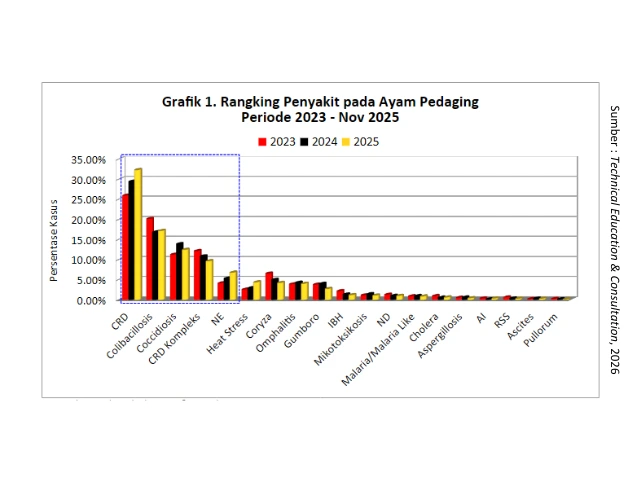
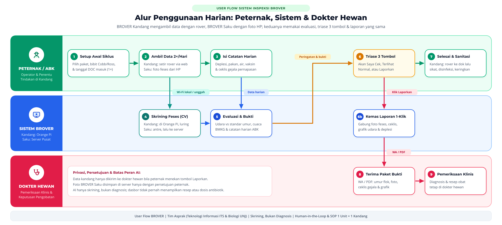
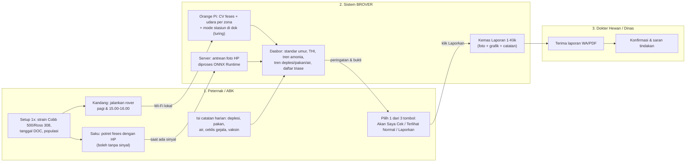
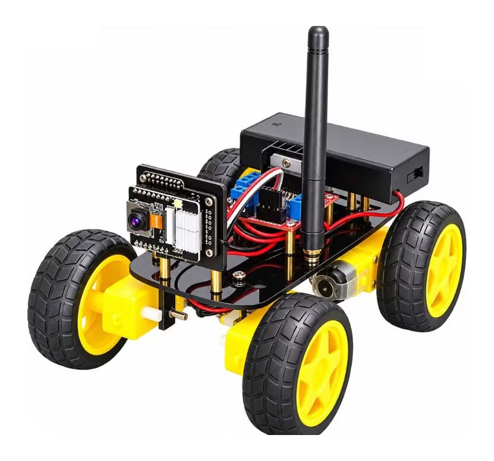
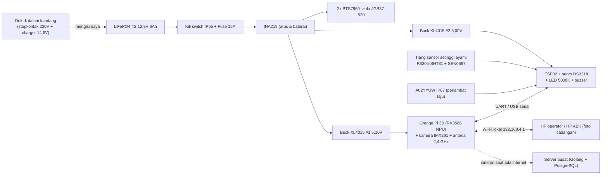
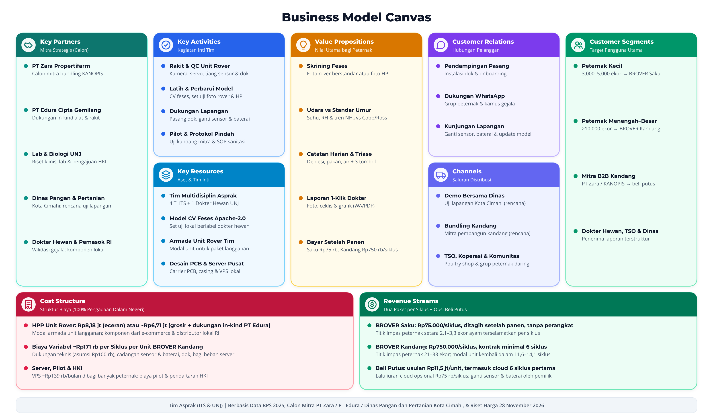
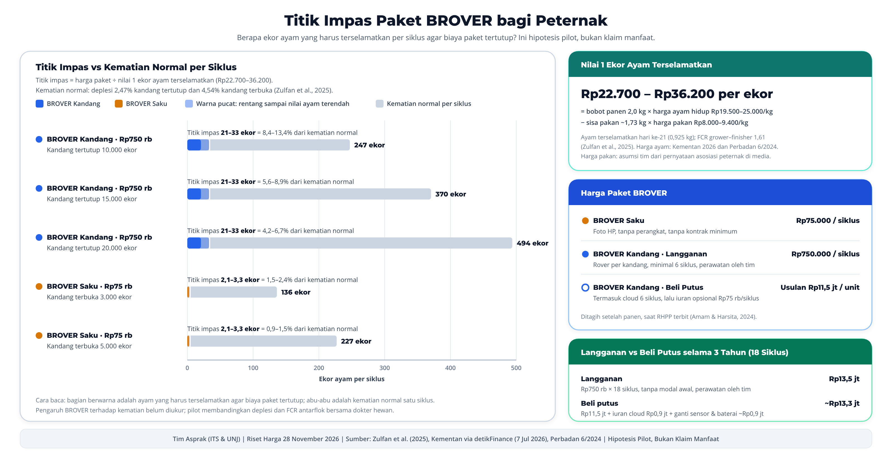
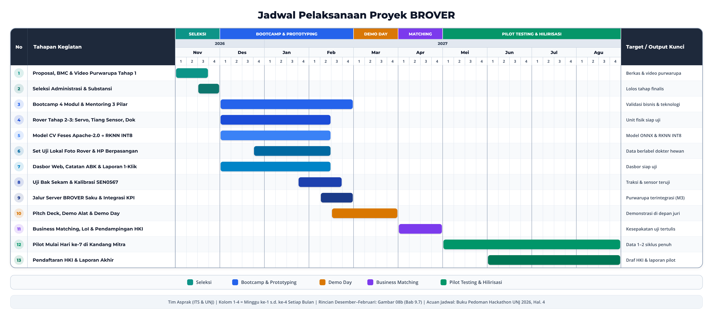
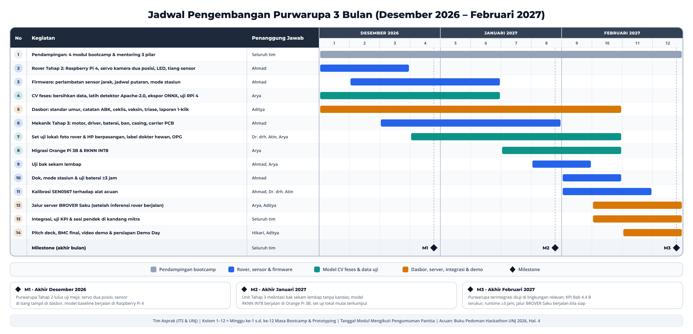

# BROVER: Sistem Inspeksi Multisensor Berbasis AI dan *Edge-Cloud* untuk Skrining Gejala Penyakit serta Pemantauan Mikroklimat Kandang Ayam Broiler

---

## 1. Judul, Identitas Tim, Filosofi Produk, & Standar Transparansi

- **Judul Final Proyek:**  
  **`BROVER: Sistem Inspeksi Multisensor Berbasis AI dan Edge-Cloud untuk Skrining Gejala Penyakit serta Pemantauan Mikroklimat Kandang Ayam Broiler`**
  - *Catatan Penyelarasan Veteriner:* Penamaan diselaraskan dengan masukan **Medik Veteriner Ahli Muda (Dinas Peternakan)** serta **WOAH *Terrestrial Animal Health Code***, yaitu [Bab 1.4 *Animal Health Surveillance*](https://www.woah.org/fileadmin/Home/eng/Health_standards/tahc/current/chapitre_surveillance_general.pdf) dan [Bab 6.5 *Biosecurity Procedures in Poultry Production*](https://www.woah.org/fileadmin/Home/eng/Health_standards/tahc/current/chapitre_biosecu_poul_production.pdf). Biosekuriti adalah perisai pencegahan fisik (pagar 3 zona, disinfeksi kendaraan, karantina), sedangkan pemeriksaan tanda klinis dan pelaporan ke dokter hewan adalah **inspeksi dan skrining gejala penyakit**, bukan diagnosis. Kata *dini* tidak dipakai sebelum selisih waktu skrining terukur saat pilot. SOP biosekuriti alat (`1 Unit = 1 Kandang`, sanitasi roda, dan protokol pemindahan unit di Bab 9.2) tetap dijaga sebagai prosedur operasional.
  - *Catatan Istilah:* Judul memakai kata **multisensor**, bukan *multimodal AI*. Menurut taksonomi Baltrušaitis dkk. (2019), *multimodal machine learning* menuntut fusi atau representasi bersama antarmodalitas yang dilatih dan diuji. `BROVER` memakai **satu model AI** (CV feses) dan beberapa sensor yang dievaluasi dengan aturan standar umur, sehingga istilah multisensor lebih jujur.
- **Filosofi `BROVER` (*Broiler* + *Rover* → `Rover Inspeksi`):** Kepanjangan merek `BROVER` adalah ***Broiler Inspection & Health Rover***. Kepanjangan ini hanya ditulis di bagian filosofi agar judul tetap ringkas. Nama ini terinspirasi ***NASA Planetary Rover*** (*Curiosity / Perseverance*), yaitu kendaraan beroda pembawa paket instrumen ilmiah ke lingkungan yang berat dan kotor agar manusia tidak terlalu sering masuk. Dalam istilah robotika, `BROVER` tergolong platform bergerak (*mobile platform*) pembawa kamera dan sensor; kosakata resmi robotika dibakukan dalam ISO 8373:2021, yang teksnya berbayar sehingga nomor pasalnya tidak dikutip di sini. Sebutan utama di dokumen ini adalah **`Rover Inspeksi`**. Rover **tidak** dimaksudkan memotret seluruh populasi ayam. Rover mengambil foto feses dan membaca udara setinggi ayam di **titik zona tetap** yang sama setiap hari, sehingga data seragam dan dapat dibandingkan antarhari.
- **Program & Jalur Kompetisi:** Hackathon Deep Tech UNJ 2026, Jalur Pangan **`D-FARM UNJ`**, *Focus Challenge* **Smart Poultry Production** `[Pedoman, Hal. 2]`. Di portal resmi, *challenge* yang sama tertulis *Smart Egg Production* ([02_HACKATHON_DFARM_RULES.md](./01_Context_Memory/02_HACKATHON_DFARM_RULES.md)).
- **Institusi:** Institut Teknologi Sepuluh Nopember (ITS) dan Universitas Negeri Jakarta (UNJ).
- **Tim Pengusul: Tim Asprak, 5/5 anggota.** Kolaborasi 4 mahasiswa Teknologi Informasi **ITS** dan 1 dosen aktif Biologi **UNJ**, sehingga syarat minimal 1 dosen aktif UNJ terpenuhi `[Pedoman, Hal. 3]`.

| No | Nama Anggota | Program Studi / Keahlian | Peran dalam Tim |
| :-: | :--- | :--- | :--- |
| 1 | **M. Hikari Reiziq Rakhmadinta** *(Ketua Tim)* | Teknologi Informasi ITS; strategi produk, riset pengguna, model bisnis | **Hustler**: validasi mitra dan Dinas, BMC, harga paket, *pitching* |
| 2 | **Ahmad Syauqi Reza** | Teknologi Informasi ITS; *embedded system*, IoT, *edge*, *backend* | **Hacker**: firmware `ESP32`, sensor, dok dan mode stasiun, Wi-Fi lokal, *backend* `Golang` |
| 3 | **Arya Bisma Putra Refman** | Teknologi Informasi ITS; rekayasa perangkat lunak, AI/ML | **Hacker**: CV feses dengan detektor Apache-2.0, kuantisasi INT8, layanan inferensi BROVER Saku |
| 4 | **Aditya Reza Daffansyah** | Teknologi Informasi ITS; UI/UX dan desain produk | **Hipster**: dasbor `Next.js` PWA, alur pengguna BROVER Saku dan BROVER Kandang, desain casing |
| 5 | **Dr. drh. Atin Supiyani, M.Si.** | Biologi UNJ; fisiologi dan kesehatan hewan (dokter hewan) | **Pakar Domain Veteriner**: label set uji lokal, kamus gejala, aturan RH tropis, validasi klinis |

- *Catatan Data Pribadi:* NIM/NIP/NIK, nomor HP, email, dan portofolio anggota tidak dicantumkan di dokumen ini karena `README.md` bersifat publik. Data tersebut diisi langsung di berkas proposal (lihat Bab 13).
- **Ruang Lingkup Proyek (*Hard Constraints*):**
  - Berfokus sepenuhnya pada **peternakan ayam pedaging (*broiler*)**: kompatibel untuk kandang ***open house*** maupun ***closed house*** di Indonesia.
  - **Tidak** mencakup jalur kesehatan manusia (`D-MARC`), **tidak** mencakup topik pengolahan limbah/sampah (*waste-to-value*, kompos, biogas, maggot), dan **tidak** menggunakan sensor tembak suhu tubuh inframerah (*thermogun/IR*).
- **Standar Transparansi (*Provenance Tags*):** Seluruh tabel, grafik, dan analisis dalam dokumen ini mematuhi 5 label transparansi:
  - **`[ASLI DARI SUMBER PRIMER]`** : Grafik/data diambil utuh tanpa modifikasi dari sumber resmi.
  - **`[DATA PRIMER TERVERIFIKASI: TABEL/VISUALISASI DISUSUN OLEH AI AGENT]`** : Seluruh angka berasal dari BPS, Kementan RI, Bapanas, PT Medion, Cobb Genetics, Aviagen, WOAH, *datasheet* resmi, atau jurnal *peer-reviewed* terverifikasi (**0 *preprint***).
  - **`[SUARA LAPANGAN DARING: NON-PEER-REVIEWED]`** : Kesaksian praktisi/peternak Indonesia dari wawancara berita/YouTube untuk triangulasi realitas lapangan.
  - **`[SINTESIS REKAYASA TIM ASPRAK: DISUSUN OLEH AI AGENT]`** : Rancangan arsitektur, alur kerja, *power budget*, BMC, dan roadmap TKT yang disusun untuk validasi dan eksekusi tim.
  - **`[ASUMSI TIM]`** : Angka perencanaan tanpa sumber primer, misalnya biaya dukungan teknis atau umur ekonomis alat. Angka ini ditulis terpisah agar mudah diuji dan dikoreksi saat pilot.

> **Ringkasan Eksekutif:** BROVER memantau amonia, kelembapan, dan suhu setinggi ayam sebagai faktor pemicu penyakit pernapasan, menskrining tanda penyakit pencernaan pada feses dengan *computer vision*, dan meneruskan bukti ke dokter hewan, tanpa mengklaim diagnosis.
>
> **Latar belakang.** Ayam broiler adalah sumber protein hewani utama Indonesia dengan populasi 3,32 miliar ekor per tahun, dan sekitar 40% pasokannya ditopang peternak kecil–menengah (BPS 2025; Sumiati dkk. 2025). Penyakit klinis broiler didominasi CRD, colibacillosis, dan koksidiosis (Medion 2026). Penyakit ini sering muncul sebagai koinfeksi yang hanya bisa dipilah lewat laboratorium (Hartady dkk. 2026), sementara keputusan antibiotik di peternakan mandiri hampir selalu diambil tanpa dokter hewan (Sunandar dkk. 2024). Di sisi lingkungan, 62% titik ukur di 14 farm Jawa Barat berada pada zona THI *severe discomfort* dengan RH rerata 81,9% (Wilcox dkk. 2025), dan amonia tinggi meningkatkan risiko penyakit pernapasan (Quarles dan Kling 1974; Barbosa dkk. 2024). Per Oktober 2026 harga ayam hidup di kandang berada di bawah biaya produksi peternak, sehingga solusi harus murah dan dibayar per siklus.
>
> **Tujuan.** Membantu anak kandang (ABK) dan peternak menemukan feses yang tampak abnormal serta kondisi udara di luar standar umur lebih cepat daripada pengamatan manual, lalu meneruskan bukti yang rapi ke dokter hewan.
>
> **Solusi *deeptech*.** (1) `Rover Inspeksi` dikendalikan lewat web di Wi-Fi lokal, berhenti di titik zona tetap 2 kali sehari, dan memotret feses dengan kamera IMX291 pada servo dua posisi serta lampu LED yang seragam. (2) Sensor SHT31 dan SEN0567 dipasang di tiang setinggi ayam; saat tidak berkeliling, rover parkir di dok dalam kandang dan mencatat setiap menit (mode stasiun). (3) Satu model CV feses berlisensi Apache-2.0 dikuantisasi INT8 dan berjalan di *edge* Orange Pi 3B. (4) Dasbor PWA menyajikan standar umur Cobb 500 dan Ross 308, tren deplesi, pakan, dan air, triase 3 tombol, serta laporan 1-klik ke dokter hewan.
>
> **Keunggulan dan *novelty*.** Kebaruan `BROVER` terletak pada integrasi dan konteks, bukan pada satu algoritma baru: foto feses dengan sudut dan cahaya seragam di titik zona yang sama setiap hari, udara setinggi ayam per zona ditambah garis dasar kontinu di dok, evaluasi otomatis terhadap standar umur, alur verifikasi dokter hewan, dan operasi inti tanpa internet. Biaya perangkatnya jauh di bawah robot impor seperti Octopus XO (20–34 ribu euro). Dua paket memperluas jangkauan: **BROVER Saku** (foto HP, Rp75 ribu per siklus) untuk peternak kecil, dan **BROVER Kandang** (rover per kandang, Rp750 ribu per siklus, dengan opsi beli putus) untuk peternak menengah–besar.
>
> **Target hasil akhir.** Pada akhir *bootcamp* (Februari 2027): purwarupa terintegrasi yang didemonstrasikan di lingkungan relevan (target TKT 6), set uji lokal feses broiler berlabel dokter hewan, dan KPI terukur. Pada akhir program (Agustus 2027): uji lapangan bersama Dinas Pangan dan Pertanian Kota Cimahi dan peternakan mitra (target TKT 7), draf HKI, dan kesepakatan uji coba tertulis.

---

## 2. Latar Belakang

Sektor perunggasan merupakan tulang punggung utama pemenuhan protein hewani terjangkau di Indonesia. Berdasarkan data resmi **Badan Pusat Statistik (BPS) 2025** dan telaah ilmiah nasional (Sumiati *et al.*, *Animal Bioscience* Q1, 2025), populasi **ayam ras pedaging (*broiler*)** nasional menembus **3,32 miliar ekor/tahun** (`3.323.003.798` ekor) dengan produksi daging mencapai **4,06–4,28 juta ton/tahun**, melampaui populasi subsektor unggas lainnya (sebagai pembanding, populasi ayam ras petelur tercatat 426,12 juta ekor dengan produksi 6,31 juta ton telur).

Struktur produksi broiler masih terbelah secara teknologi: sekitar **60% pasokan** berasal dari peternakan industrial skala besar (*closed house*), sedangkan **~40%** ditopang oleh **lebih dari 1 juta peternak kecil–menengah** yang mayoritas masih mengoperasikan kandang terbuka (*open house*) dengan pengawasan manual (Sumiati *et al.*, 2025). Inovasi kandang *closed house* berbahan lokal untuk peternak rakyat mulai berkembang, misalnya **KANOPIS** milik mitra industri Hackathon Deep Tech UNJ 2026, **PT Zara Propertifarm Indonesia**, yang telah diterapkan di 6 farm di Bogor (`85.000 ekor`) dan diakui JAPFA untuk kapasitas awal `300.000 ekor`. Peta jalan TKT 9 PT Zara menyebut AI dan IoT untuk FCR yang lebih efisien, yaitu estimasi bobot per ekor, pemantauan tempat pakan, serta pemantauan kesehatan ayam ([04_MITRA_PT_ZARA_PROPERTIFARM.md](./01_Context_Memory/04_MITRA_PT_ZARA_PROPERTIFARM.md)). `BROVER` mendukung **bagian pemantauan kesehatan dan lingkungan** pada peta jalan tersebut. Estimasi bobot, pemantauan tempat pakan, biaya listrik, dan biaya LPG tidak dijawab `BROVER`. Mitra **PT Edura Cipta Gemilang** berperan sebagai penyedia dukungan *in-kind* perangkat keras dan perakitan, bukan pemilik masalah perunggasan ([03_MITRA_PT_ECG_EDURA.md](./01_Context_Memory/03_MITRA_PT_ECG_EDURA.md)).

Margin usaha broiler rakyat tipis. Simulasi bio-ekonomi Pramuwidyatama *et al.* (*Prev. Vet. Med.* Q1, 2023) pada peternakan broiler kecil tipikal di Jawa Barat menghasilkan **margin kotor normal Rp5,28 juta per siklus**. Pada simulasi khusus **wabah HPAI H5N1**, margin kotor berubah menjadi **−Rp22,89 juta** (jual dini hari ke-8) hingga **−Rp57,35 juta** (*stamping out* hari ke-15). Angka ini adalah simulasi margin kotor wabah HPAI, bukan kerugian umum semua penyakit, dan `BROVER` tidak memiliki model yang mendeteksi HPAI. Tekanan ekonomi juga berasal dari harga jual: per 3 Oktober 2026, harga ayam hidup di kandang berkisar **Rp21.000–22.000/kg**, di bawah harga pokok produksi peternak sekitar **Rp23.000/kg** ([detikFinance, 4 Okt 2026](https://finance.detik.com/berita-ekonomi-bisnis/d-8691259/harga-ayam-di-kandang-anjlok-lagi)). Dalam wawancara praktisi peternak broiler skala 12.000 ekor di Malang (`[SUARA LAPANGAN DARING]` [Edufarmers × PecahTelur](https://www.youtube.com/watch?v=FKCNKnTRif0)), serangan ***Colibacillosis*** pada umur 7 hari pernah menyebabkan **2.000 ekor mati** dalam satu siklus. Di sisi lain, anak kandang (ABK) harus terus menjaga kesesuaian suhu dan kelembapan yang berubah mengikuti umur ayam (*brooding* DOC `30–34°C` hingga fase panen `21–25°C`) serta memantau tanda gangguan kesehatan setiap hari.

Perangkat pemantau kandang komersial impor sulit dijangkau peternak rakyat. *ChickenBoy* dari Big Dutchman berjalan di rel sekitar 0,5 m di atas ayam selama 24 jam, dan brosur resminya tidak mencantumkan harga. *Octopus XO* adalah robot penggaru sekam selebar 80 cm yang beroperasi pada hari ke-5 sampai sekitar 23 dengan harga 20–34 ribu euro menurut [FAQ resminya](https://www.octopusbiosafety.com/en/faq/xo-en/). Pemasangan banyak CCTV dan sensor statis di setiap sudut kandang juga membutuhkan biaya instalasi dan perawatan kabel. Diperlukan pendekatan rekayasa ***Demand-Driven DeepTech*** yang jujur, tetap berjalan saat sinyal internet pedesaan putus, murah, dan dibayar sesuai siklus panen, dengan memanfaatkan tim multidisiplin **Tim Asprak** (4 mahasiswa Teknologi Informasi **ITS** + 1 dokter hewan **UNJ**).

---

## 3. Masalah

Berdasarkan riset sistematis dan triangulasi 35 artikel jurnal *peer-reviewed* Indonesia (2021–2026) dengan 20 sumber lapangan daring ([TOP_5_MASALAH_PETERNAKAN_UNGGAS_INDONESIA_V3_TRANSPARAN.md](./02_Problem_Research/TOP_5_MASALAH_PETERNAKAN_UNGGAS_INDONESIA_V3_TRANSPARAN.md)) serta bedah *Root Cause Analysis* ([ROOT_CAUSE_PENYAKIT_BIOSEKURITI_DAN_HEAT_STRESS.md](./03_Root_Cause_Analysis/ROOT_CAUSE_PENYAKIT_BIOSEKURITI_DAN_HEAT_STRESS.md)), **`BROVER` memfokuskan solusi pada 2 masalah teknis-operasional yang paling konsisten dan berdampak ekonomi di peternakan broiler Indonesia**:

### 3.1. Masalah Utama (#1): Penyakit Unggas, Koinfeksi, & Keterlambatan Mengenali Gejala di Kandang

`[DATA PRIMER TERVERIFIKASI: TABEL/VISUALISASI DISUSUN OLEH AI AGENT]`

1. **Dampak Ekonomi Wabah (Simulasi HPAI):** Pada model bio-ekonomi peternakan broiler kecil tipikal di Jawa Barat (Pramuwidyatama *et al.*, *Prev. Vet. Med.* Q1, 2023), margin kotor normal hanya **Rp5,28 juta/siklus**. Simulasi **1 kali wabah HPAI H5N1** mengubahnya menjadi **−Rp53,89 juta** (*tanpa tindakan*, introduksi hari ke-8) hingga **−Rp57,35 juta** (*stamping out*, introduksi hari ke-15), sedangkan jual dini menghasilkan **−Rp22,89 juta** dan justru mendorong penyebaran regional. Skala 3.000 ekor yang selama ini dipakai tim berasal dari catatan riset TOP5 dan belum dicek ulang ke bagian metode makalah.
2. **Dominasi Penyakit Pernapasan & Pencernaan:** Berdasarkan surveilans laboratorium **PT Medion TEC (Januari 2026)**, penyakit positif PCR nasional dipimpin ***Infectious Bronchitis*** (IB ~17,7%), ***Avian Paramyxovirus*** (AP ~14,8%), ***Newcastle Disease*** (ND ~14,1%), **IBD/Gumboro** (~10,6%), dan **AI H5N1** (~9,9%). Grafik PCR ini **mencampur ayam pedaging dan petelur**. Grafik klinis khusus **broiler (2023–Nov 2025)** terpisah dan menempatkan **CRD / ngorok (>31%)**, **Colibacillosis (~17%)**, dan **Coccidiosis (~12%)** di tiga teratas.

*`[ASLI DARI SUMBER PRIMER]` Grafik 4: Ranking Penyakit Pedaging & Petelur Positif PCR Nasional Jan–Nov 2025, disalin utuh dari [PT Medion TEC (Januari 2026)](https://www.medion.co.id/en/info-medion/overview-of-poultry-disease-analysis-2025-disease-projection-2026/). Catatan: data grafik ini gabungan broiler dan petelur, sehingga tidak dipakai sebagai peringkat khusus broiler.*

*`[ASLI DARI SUMBER PRIMER]` Grafik 1: Ranking Penyakit Ayam Pedaging (Broiler) 2023–Nov 2025, disalin utuh dari [PT Medion TEC (Januari 2026)](https://www.medion.co.id/en/info-medion/overview-of-poultry-disease-analysis-2025-disease-projection-2026/), dengan CRD (>31%), Colibacillosis (~17%), dan Coccidiosis (~12%) di tiga teratas.*

3. **Lemahnya Biosekuriti & Literasi Pekerja Kandang:** Studi longitudinal 19 farm broiler kecil–menengah (153 siklus, 2019–2023) di Jawa Barat mencatat skor rata-rata **biosekuriti eksternal hanya `0,28`** (rentang 0–0,67), **pergerakan & pembelian `0,48`**, serta **karyawan & peralatan `0,50`** pada skala 0–1. Empat farm dengan skor rendah di semua kategori termasuk farm yang keluar dari studi karena **berhenti beternak atau berganti manajemen** (Anwar Sani *et al.*, *Poultry Science* Q1, 2025). Survei 200 pekerja kandang unggas Indonesia juga menunjukkan **`58%`** pekerja berada pada tingkat pengetahuan *Avian Influenza* kategori *Low–Moderate* (Rehman *et al.*, *PeerJ* Q1, 2023).
4. **Koinfeksi & Keputusan Pengobatan Tanpa Dokter Hewan:** Penyakit di kandang Indonesia kerap muncul sebagai koinfeksi multifaktorial. Studi kasus 11.000 broiler di Majalengka mencatat **koinfeksi AI H5 + AI H9 + IB + *M. gallisepticum* + koksidiosis (4.400 OPG)** di bawah tekanan amonia **20 ppm**, yang hanya dapat dipilah lewat HI, ELISA, PCR, dan flotasi feses (Hartady *et al.*, *Vet. Sci.* Q1, 2026). Di 19 peternakan broiler mandiri di Kabupaten Bogor, keputusan memberi antibiotik datang dari PPL (**47,4%**), *technical service* (**36,8%**), dan pemilik (**15,8%**); hanya satu orang pengambil keputusan yang berlatar dokter hewan (Sunandar *et al.*, *Acta Vet. Indones.*, 2024). Pola pemakaian antibiotik untuk *flushing* juga tinggi (**`75,0%`**, hanya `8,3%` terapi terarah; Efendi *et al.*, *Vet. World* Q1, 2022). Artinya, bukti klinis yang rapi perlu sampai ke dokter hewan sebelum keputusan pengobatan diambil.

### 3.2. Masalah Pendukung (#2): Cekaman Panas (*Heat Stress*), Gas Amonia, & Ketimpangan Mikroklimat per Umur

`[DATA PRIMER TERVERIFIKASI: TABEL/VISUALISASI DISUSUN OLEH AI AGENT]`

1. **Tekanan Iklim Tropis Sepanjang Tahun:** Nilai rata-rata bulanan *Heat Stress Index* (HSI) Indonesia tahun 2023 melampaui ambang nyaman (`<150–160`) **di seluruh 12 bulan**, mencapai **155,5–165,4 (puncak 187,8)** di Indonesia Barat dan **150,0–166,4 (puncak 195,0)** di Indonesia Timur dengan suhu puncak `36°C` (Sumiati *et al.*, 2025).
2. **Gradien Mikroklimat di Ketinggian Ayam:** Pada 14 farm *closed/semi-closed house* di Jawa Barat (`2.104 ekor`, `84 titik ukur`), **`0%`** titik ukur berada di zona nyaman termal (`THI <72`), **`62%`** berada di zona *Severe Discomfort*, dan **`8,3%`** di zona *Life-Threatening* (`THI` di atas 85). Kelembapan rerata **`81,9%`** (`66%–96%`), `NH₃` rerata `7,3 ppm`, dan lesi *Foot-Pad Dermatitis* (FPD) mencapai sekitar **`40%`** ayam (Wilcox *et al.*, *Animal Welfare* Q1, 2025).
3. **Ambang Mortalitas & Kebutuhan Dinamis Umur:** Di Jawa Tengah, analisis ROC menunjukkan **suhu pukul 16:00 `>32,8°C`** (`AUC 0,694`) dan **THI pukul 16:00 `>79`** (`AUC 0,709`) memprediksi kematian broiler pada kandang tanpa pendingin (Mohammadi *et al.*, *AAVS*, 2026). Nilai AUC ini tergolong sedang, sehingga ambang dipakai sebagai peringatan kondisi berisiko, bukan vonis. Kadar air *litter* di dataran rendah mencapai **`46,42%`** pada umur 28 hari, sedangkan kadar normal 20–25% (Hasibuan *et al.*, *JSPI*, 2021). Suhu nyaman broiler juga berubah mengikuti umur: `26°C` nyaman untuk umur 14 hari, tetapi terlalu dingin bagi DOC umur 0 hari yang butuh `30–34°C` (*Cobb Broiler Management Guide*, 2021).
4. **Amonia Meningkatkan Risiko Penyakit Pernapasan:** Amonia tidak menunjuk nama penyakit, tetapi memperberat penyakit pernapasan. Paparan 25 dan 50 ppm yang disertai vaksin IB memicu *airsacculitis* berat (Quarles & Kling, 1974). Paparan 15 ppm selama 3 hari sudah memicu radang trakea (Zhou *et al.*, 2020). Paparan 50–75 ppm menurunkan bobot, dan 75 ppm menaikkan kematian (Miles *et al.*, 2004). Pada kadar sedang, lesi trakea dan paru akibat amonia saja tidak konsisten (Beker *et al.*, 2004; Al-Mashhadani & Beck, 1985). Karena itu `BROVER` menulis ***amonia meningkatkan risiko penyakit pernapasan***, bukan *amonia menyebabkan CRD*. Rincian bukti ada di [PETA_FITUR_DAN_BUKTI_BROVER.md](./08_Evaluasi_Proyek/PETA_FITUR_DAN_BUKTI_BROVER.md).

### 3.3. Rumusan Masalah

`[SINTESIS REKAYASA TIM ASPRAK: DISUSUN OLEH AI AGENT]`

1. Bagaimana membantu ABK broiler di kandang terbuka maupun tertutup menemukan feses yang tampak abnormal dan kondisi udara di luar standar umur lebih cepat daripada pengamatan harian manual, tanpa mengklaim diagnosis?
2. Seberapa akurat skrining feses broiler di atas sekam bila dinilai terhadap label dokter hewan dan hitungan OPG koksidiosis, dan apakah akurasinya berbeda antara foto rover dan foto HP?
3. Apakah pengukuran suhu, kelembapan, dan tren amonia setinggi ayam per zona, ditambah mode stasiun di dok, dapat berjalan tanpa internet dengan biaya yang tertutup oleh penyelamatan beberapa puluh ekor ayam per siklus?

### 3.4. Calon Pengguna (*End-User*)

| Pengguna | Kondisi & Kebutuhan | Peran terhadap `BROVER` | Paket |
| :--- | :--- | :--- | :--- |
| **Peternak kecil** (sekitar `3.000–5.000 ekor`, umumnya *open house*) | Modal terbatas, margin tipis, sinyal internet tidak stabil, belum punya catatan harian rapi | Memotret feses dengan HP, mengisi catatan harian, menerima saran tindakan | **BROVER Saku** |
| **Peternak menengah–besar** (`≥10.000 ekor`, *closed/semi-closed house*) | Lorong panjang, gradien mikroklimat, butuh data per zona yang konsisten | Berlangganan rover per kandang atau membeli putus | **BROVER Kandang** |
| **Anak kandang (ABK)** | Pekerjaan harian padat, butuh alat yang sederhana | Menyetir rover, mengisi deplesi/pakan/air, memilih 3 tombol triase | Kedua paket |
| **Dokter hewan, TSO, & Medik Veteriner Dinas** | Menerima laporan yang tercecer lewat pesan singkat | Menerima laporan 1-klik berisi foto, grafik, dan catatan harian | Kedua paket |
| **Mitra B2B pembangun kandang** (misalnya PT Zara / KANOPIS) | Ingin menambah nilai paket kandang | Membeli putus unit untuk dibundel dengan kandang | BROVER Kandang (beli putus) |
| **Dinas Pangan dan Pertanian Kota Cimahi** | Pembinaan peternak dan kesehatan hewan | Rencana mitra uji lapangan (Bab 9.6) | Pilot |

---

## 4. Solusi (`BROVER`) & Pengembangan 4 Fitur Utama

**`BROVER`** adalah **sistem inspeksi multisensor untuk skrining gejala penyakit dan pemantauan mikroklimat** pada kandang broiler, dengan arsitektur ***Edge-Cloud* (*Offline-First*)** (Shi *et al.*, 2016). Sistem ini terdiri atas `Rover Inspeksi` beroda empat yang membawa kamera feses dan sensor udara setinggi ayam, satu model *computer vision* (CV) feses yang berjalan di perangkat *edge*, dan dasbor website untuk peternak, anak kandang (ABK), dan dokter hewan. `BROVER` ditawarkan dalam **dua paket**: **BROVER Kandang** (rover per kandang) dan **BROVER Saku** (foto HP tanpa rover). Rover tidak berkeliling terus-menerus. Rover berhenti di titik zona tetap 2 kali sehari dan sisanya parkir di dok sebagai stasiun pencatat udara.

*`[SINTESIS REKAYASA TIM ASPRAK: DISUSUN OLEH AI AGENT]` Dua jalur data BROVER. Jalur BROVER Kandang: rover dikendalikan lewat web di Wi-Fi lokal, kamera IMX291 pada servo dua posisi memotret feses di titik zona, SHT31 dan SEN0567 di tiang setinggi ayam mencatat udara, rover parkir di dok sebagai mode stasiun, dan detektor Apache-2.0 berjalan di edge Orange Pi 3B. Jalur BROVER Saku: foto HP diantre di aplikasi saat tidak ada sinyal, lalu diproses di server pusat dengan model yang sama. Keduanya bermuara di dasbor standar umur Cobb 500/Ross 308, triase 3 tombol, dan laporan 1-klik ke dokter hewan, dengan cuaca luar dari BMKG dan Open-Meteo. Seluruh keluaran adalah skrining, bukan diagnosis.*

### 4.1. Rincian 4 Fitur Utama `BROVER`

#### Fitur 1: `Rover Inspeksi` Pembawa Kamera Feses, dengan Unggah Foto HP
- **Fungsi Utama:** Platform bergerak beroda empat yang membawa kamera feses dan sensor udara ke **titik zona tetap** di lorong kandang (misalnya dekat *inlet*, tengah, dan dekat kipas), sehingga foto feses diambil dengan sudut, jarak, dan cahaya yang sama setiap hari. Model CV butuh masukan yang seragam; foto acak dari HP berbeda sudut, jarak, dan cahaya.
- **Pengoperasian Tahap Saat Ini (Dikendalikan Lewat Website):** Operator menyetir rover lewat halaman web di HP Android atau laptop (tampilan *landscape* dengan joystick sentuh) melalui **Wi-Fi lokal nirkabel** yang tetap berfungsi saat internet kandang mati. Halaman kendali disajikan langsung oleh `Raspberry Pi 4` (PoC) atau `Orange Pi 3B` (final) agar bebas blokir *Mixed Content*.
- **Jadwal & Batas Operasi:** Rover beroperasi **setiap hari dari hari ke-7 sampai panen** (umur panen *closed house* Indonesia sekitar 27–35 hari), dinaikkan bertahap per minggu dengan kriteria berhenti. Di MVP ada **2 putaran per hari**, yaitu pagi dan sore pukul **15.00–16.00**; setelah otomatisasi menjadi 3 putaran. Rover **tidak** berkeliling terus-menerus.
- **Fitur Keselamatan:**
  - ***Dead-Man's Switch* `500 ms`:** bila perintah kendali tidak diterima lebih dari 0,5 detik, `ESP32` memutus tenaga motor dan mengerem.
  - **Kecepatan awal `0,07–0,1 m/s`**, bumper depan lunak, dan **sensor jarak yang memperlambat laju, bukan menghentikan total** (`HC-SR04` PoC / `DFRobot A02YYUW` IP67 final). Robot yang terlalu lambat (0,04 m/s) justru membuat ayam tidak menyingkir sehingga terjadi benturan (da Rocha Balthazar *et al.*, 2024).
  - **Kriteria berhenti sesi:** ayam tidak menyingkir, ada ayam terdorong jatuh atau terluka, atau suhu kandang melewati ambang cekaman panas.
- **Kamera & Servo Dua Posisi:** Kamera **USB UVC `IMX291`** dipasang pada **servo tahan air `DS3218`**. Posisi **depan `~0–15°`** dipakai untuk tampilan FPV saat operator menyetir, dan kelak untuk CV navigasi. Posisi **bawah `~45°`** dipakai untuk foto feses saat rover berhenti, dengan **LED putih `5000K CRI >90`** menyala agar warna foto seragam. Karena foto diambil saat rover berhenti, satu kamera yang dimiringkan servo sudah cukup.
- **Dua Peran Foto HP:**
  1. **Cadangan pada BROVER Kandang:** bila rover tidak bisa masuk, ABK memotret feses dengan HP lewat aplikasi web yang sama, lalu foto dikirim lewat Wi-Fi lokal ke Orange Pi.
  2. **Jalur utama pada BROVER Saku:** peternak kecil tanpa rover memotret feses dengan HP; foto diantre saat tidak ada sinyal dan diproses di server pusat (Bab 5).
- **Mengapa Tidak Berkeliling Terus-Menerus:** setiap lintasan membuat ayam di zona itu menyingkir; robot Marin *et al.* (2024) hanya bergerak 2 jam per hari dan penulisnya menyebut data paparan lebih lama belum ada; robot Dennis *et al.* (2020) berjalan 3 kali sehari; periode gelap penting bagi kekebalan dan konversi pakan (*Cobb Broiler Management Guide*, 2021); baterai rover hanya tahan 3–4 jam; dan data kontinu sudah didapat dari mode stasiun di dok.
- ***Future Work* (Otomatisasi Rover):** Prototipe tetap dikendalikan manual. Pengembangan lanjutan menambah **CV navigasi** (mendeteksi ayam dan halangan di depan rover untuk menentukan kapan berhenti, melambat, atau berbelok) memakai data deteksi ayam seperti PIO, YOLOv5-CBAM broiler di atas sekam, dan Big Broiler, serta **penjadwalan otomatis** (putaran terjadwal dan putaran khusus saat THI atau amonia di dok melewati ambang). Rujukan: robot navigasi otonom di kandang broiler (Marin *et al.*, 2024), PoultryBot (Vroegindeweij *et al.*, 2018), dan Octopus XO yang memetakan lingkungan kandang.

#### Fitur 2: Sensor Mikroklimat di Rover (Suhu, Kelembapan, & Tren Amonia) dengan Mode Stasiun
- **Sensor Setinggi Ayam:** **`SHT31`** (probe tahan air `FS304-SHT31` pada versi final) dan **`DFRobot SEN0567`** dipasang di **tiang setinggi ayam**, jauh dari panas `Orange Pi` dan motor agar bacaan suhu tidak bias. Panduan Cobb (2021) meminta sensor suhu dipasang setinggi ayam.
- **Saat Putaran:** rover berhenti di setiap titik zona sampai bacaan stabil. Lama berhenti per zona ditentukan saat pilot.
- **Mode Stasiun:** saat tidak berkeliling, yaitu malam hari, saat diisi daya, dan **hari ke-0 sampai 6**, rover parkir di **dok di dalam kandang** dan mencatat suhu, RH, dan amonia **setiap menit**. Dok ditempatkan di area *brooding* atau tengah kandang dan **membutuhkan stopkontak** di dalam kandang.
- **Evaluasi Standar Umur:** bacaan dibandingkan dengan tabel suhu–RH **`Cobb 500`** atau **`Ross 308`** sesuai umur (Bab 4.2), lalu **THI** dihitung. Peringatan cekaman panas sore memakai ambang suhu `>32,8°C` atau `THI >79` pada pukul 16.00 (Mohammadi *et al.*, 2026). Tabel RH Cobb berhenti di 70%, sehingga aturan untuk RH tropis yang lebih tinggi disusun bersama **Dr. drh. Atin Supiyani, M.Si.**
- **Tren Amonia, Bukan ppm Lab:** `SEN0567` menurut [wiki resminya](https://wiki.dfrobot.com/sen0567/) bersifat **kualitatif** dan bekerja pada RH 15–90% tanpa embun, padahal RH kandang Jawa Barat bisa mencapai 96% (Wilcox *et al.*, 2025). Karena itu amonia ditampilkan sebagai **tren per zona pada jam yang sama** dibanding hari-hari sebelumnya, ditambah **tren di dok** terhadap garis dasarnya. Saat pilot, `SEN0567` **dikalibrasi terhadap alat acuan** pinjaman. Ambang **target `<10 ppm`**, **waspada `~10–15 ppm`**, dan **bahaya `≥25 ppm`** baru dipakai setelah kalibrasi lolos. Sensor gas murah memang perlu dikalibrasi terhadap instrumen acuan sebelum angkanya dipakai (da Rocha Balthazar *et al.*, 2025; von Jasmund *et al.*, 2022).
- **Cuaca Luar Kandang:** server menggabungkan **API BMKG tingkat desa/kelurahan (`adm4`)** dengan **Open-Meteo** sebagai cadangan otomatis, di-*cache* tiap 3–6 jam. Pemetaan zona di dalam kandang **100% dari sensor fisik rover**, bukan dari API cuaca.
- **Tidak Mengukur CO₂ di MVP:** CO₂ 3.000–6.000 ppm tidak menurunkan bobot (Reece & Lott, 1980), dan saat ventilasi ditahan rendah yang naik justru amonia, debu, dan kelembapan. CO₂ dijadikan modul opsional untuk kandang berpemanas gas (riset lanjutan).

#### Fitur 3: *Computer Vision* Skrining Feses (Satu-satunya Model AI)
- **Fungsi:** menandai feses yang tampak abnormal sebagai kandidat untuk dicek. Keluaran berbunyi ***"pola feses mirip koksidiosis, perlu konfirmasi dokter hewan"***, bukan *"ayam terkena koksidiosis"*. Panduan Cobb (2021) menyebut *perubahan mendadak tampilan feses* sebagai salah satu tanda penyakit yang harus dikenali pekerja kandang.
- **Model:** detektor berlisensi **Apache-2.0**, yaitu **`YOLOX`** atau **`RT-DETR`**, sejalan dengan Tugas Akhir (TA) Ketua Tim tentang deteksi objek feses ayam di perangkat *edge*. Hasil TA belum tersedia, sehingga angka akurasi belum boleh diklaim.
- **Satu Model, Rover Dulu:** satu arsitektur dan satu pipeline dilatih dari data publik ditambah foto rover lokal, lalu diekspor ke dua format: **RKNN INT8** untuk NPU `Orange Pi 3B` (BROVER Kandang) dan **ONNX FP32** untuk server (BROVER Saku). Pada PoC, model berjalan di `Raspberry Pi 4` lewat **NCNN atau ONNX Runtime**, dan kecepatannya diukur sendiri oleh tim.
- **Gerbang Peluncuran BROVER Saku:** kamera rover dipasang tetap pada sudut dan cahaya yang sama, sedangkan foto HP beragam sudut, jarak, warna, dan cahaya. Model yang dilatih untuk rover bisa turun akurasinya pada foto HP, seperti penurunan lintas domain pada Henomaly (98,5–99,6% menjadi 74,6–78,2%) dan Chidziwisano *et al.* (2025, 0,91 menjadi 0,69). Karena itu set uji lokal memuat **foto rover dan foto HP berpasangan** dari titik feses yang sama. BROVER Saku baru dijual setelah akurasi pada foto HP diukur, aplikasi diberi panduan foto, dan model di-*fine-tune* dengan foto HP. Varian bobot khusus HP dibuat hanya bila selisihnya tetap besar.
- **Data:** `Zenodo 4628934` (label YOLO, dibersihkan sesuai audit TA) untuk latih; `Zenodo 5801834` (label PCR, klasifikasi saja, tanpa label YOLO) untuk uji tingkat citra; `Mendeley 8pnbzpt2k9` (broiler dan petelur, Nigeria) sebagai tambahan; dan **set uji lokal BROVER** (feses broiler di atas sekam, berlabel dokter hewan dan hitungan OPG untuk koksidiosis) yang **wajib** untuk klaim akurasi. Rincian di Bab 11.
- **Batas Jujur:** feses tidak menunjukkan penyakit pernapasan; satu tampilan feses bisa berasal dari sebab berbeda; feses salmonela dan sehat mudah tertukar karena sama-sama putih (Machuve *et al.*, 2022); dan koinfeksi hanya bisa dipilah lewat laboratorium.

#### Fitur 4: Dashboard Website Berbasis Standar Umur Resmi (`Cobb 500` & `Ross 308`), Tren Harian, Triase, & Laporan Dokter Hewan
Dashboard **`BROVER`** (`Next.js` PWA) **tidak memakai skor kesehatan 0–100**. Dasbor dibangun di atas **setup siklus flok** (1 kali saat *chick-in*: tanggal masuk DOC, strain `Cobb 500` / `Ross 308`, dan populasi awal) yang menghitung **umur ayam (hari ke-N)** secara otomatis:

1. **Panel 1, Standar Umur & Mikroklimat:** status **`Terlalu Dingin` / `Sesuai Standar Umur` / `Terlalu Panas`** terhadap tabel `Cobb 500` atau `Ross 308`, angka THI, tren amonia per zona pada jam yang sama dan tren di dok, serta peringatan cuaca luar `BMKG` + `Open-Meteo`. Status per parameter ditulis **Normal / Waspada / Bahaya** beserta tindakan yang disarankan.
2. **Panel 2, Daftar Triase:** temuan CV feses dan **ceklis gejala pernapasan oleh ABK** (misalnya ngorok atau bersin), masing-masing dengan **3 tombol keputusan**: **`Akan Saya Cek`**, **`Terlihat Normal`** (menjadi data perbaikan model), dan **`Laporkan ke Dokter Hewan`**. Pola tiga tombol ini terinspirasi [aremyhens.fit](https://aremyhens.fit/); dasbor aremyhens.fit sendiri menampilkan skor 0–100, dan skor seperti itu tidak dipakai `BROVER`. Setiap temuan dilengkapi **kamus gejala** tervalidasi **Dr. drh. Atin Supiyani, M.Si.** dan [Manual Penyakit Unggas Kementan RI](https://wiki.isikhnas.com/images/d/dd/Manual_Penyakit_Unggas.pdf).
3. **Panel 3, Tren Harian:** **deplesi, pakan, dan air** dari catatan harian ABK, dengan peringatan bila angka berubah tajam dibanding hari-hari sebelumnya. Panduan Cobb (2021) meminta konsumsi air dicatat setiap 24 jam dan perubahan besar diselidiki; Edge *et al.* (2025) serta Manning *et al.* (2007) memakai konsumsi air sebagai penanda kesehatan dan kesejahteraan. Aturan perubahan tajam ditetapkan bersama dokter hewan.
4. **Panel 4, Catatan Vaksinasi, Fase Pemeliharaan, & Laporan 1-Klik:** tanggal vaksinasi (reaksi vaksin pernapasan bisa memicu gejala sementara), pengingat fase *brooding/grower/finisher*, target bobot resmi, log sanitasi roda, dan tombol **Laporan 1-Klik ke Dokter Hewan** (WhatsApp/PDF) berisi umur flok, foto feses, grafik suhu/RH/tren amonia, ceklis gejala, dan catatan harian. Laporan hanya terkirim bila peternak menekannya (*explicit consent*).

#### Matriks Fitur per Paket

| Fitur | BROVER Saku *(foto HP, tanpa rover)* | BROVER Kandang *(rover per kandang)* |
| :--- | :-: | :-: |
| CV skrining feses | Ya, foto HP diproses di server | Ya, foto rover diproses di Orange Pi; foto HP cadangan lewat Wi-Fi lokal |
| Triase 3 tombol & kamus gejala | Ya | Ya |
| Catatan harian ABK (deplesi, pakan, air), ceklis pernapasan, catatan vaksin | Ya | Ya |
| Laporan 1-klik ke dokter hewan | Ya | Ya |
| Panel standar umur Cobb/Ross & cuaca BMKG | Ya, suhu dan RH diisi manual | Ya, dari sensor rover |
| Sensor suhu, RH, & tren amonia per zona | Tidak | Ya |
| Mode stasiun di dok (pencatatan per menit) | Tidak | Ya |
| Berjalan tanpa internet | Foto bisa diambil luring; hasil CV butuh sinyal | Ya, inti sistem berjalan luring |

#### Fitur yang Dihapus dari MVP

| Fitur Lama | Alasan Dihapus | Status |
| :--- | :--- | :--- |
| AI audio pernapasan (mikrofon `INMP441`, *Cek Napas 15 detik*, *Stop–Mute–Sample*) | Data terbuka untuk broiler di lantai sekam tidak tersedia; studi SmartEars memakai mikrofon tetap di kandang baterai dan perlu penyesuaian ulang di tiap kandang; blower kandang tetap berbunyi saat rover berhenti | Riset lanjutan: mikrofon tetap per kandang, peluang kolaborasi data dengan penulis UGM (Rosyida *et al.*, 2026) |
| CV fisik dan perilaku ayam (Model #2) | Tidak ada dataset penyakit ayam hidup yang sah; label publik berupa perilaku normal | Dihapus |
| Deteksi bangkai | Di luar fokus masalah; ABK sudah memungut bangkai setiap hari | Dihapus |
| Node sensor tetap | Celah waktu antarputaran ditutup mode stasiun di dok | Dihapus |
| Sensor CO₂ | Dampak langsung CO₂ pada kadar kandang yang wajar lemah | Modul opsional kandang berpemanas gas |

### 4.2. Acuan Ilmiah Standar Umur Dashboard (`Cobb 500`, `Ross 308`, & Jurnal *Peer-Reviewed*)

`[DATA PRIMER TERVERIFIKASI, TABEL DISUSUN OLEH AI AGENT]`

#### A. Matriks Acuan Suhu & Kelembapan Berdasarkan Umur Ayam: `Cobb 500` ([*Cobb Broiler Management Guide* 2021](https://www.cobbgenetics.com/assets/Cobb-Files/Broiler-Guide_English-2021-min.pdf))

| Umur / Fase Ayam | RH 30% | RH 40% | RH 50% | RH 60% | RH 70% | Evaluasi Otomatis Dashboard `BROVER` |
| :--- | :---: | :---: | :---: | :---: | :---: | :--- |
| **Umur 0 hari (DOC / *Brooding*)** | `34°C` | `33°C` | `32°C` | `31°C` | `30°C` | Rentang ideal *brooding* DOC: `30–34°C` (sistem termoregulasi DOC belum matang). |
| **Umur 7 hari** | `32°C` | `31°C` | `30°C` | `29°C` | `28°C` | Penurunan bertahap `2–3°C` per minggu sesuai pertumbuhan bulu. |
| **Umur 14 hari** | `29°C` | `28°C` | `27°C` | `26°C` | `25°C` | Transisi dari *brooding* menuju fase *grower*. |
| **Fase Besar (`28 kg/m²` / *Finisher*)** | `25°C` | `24°C` | `23°C` | `22°C` | `21°C` | Aktifkan peringatan cekaman panas sore (`>32,8°C` / `THI >79`, Mohammadi *et al.*, 2026) & pantau RH tropis tinggi (Wilcox *et al.*, 2025). |

*Catatan: tabel Cobb berhenti di RH 70%, sedangkan RH kandang Jawa Barat rata-rata 81,9%. Aturan untuk RH di atas 70% disusun bersama Dr. drh. Atin Supiyani, M.Si. dengan mempertimbangkan THI.*

#### B. Acuan Suhu & Target Bobot Resmi: `Ross 308` ([*Ross Broiler Management Handbook* 2025](https://aviagen.com/assets/Tech_Center/Ross_Broiler/Aviagen-ROSS-Broiler-Handbook-EN.pdf), Tabel 2.4; [*Ross 308 Broiler Performance Objectives* 2022](https://aviagen.com/assets/Tech_Center/Ross_Broiler/RossxRoss308-BroilerPerformanceObjectives2022-EN.pdf), kolom *as-hatched*)

| Umur (Hari) | Target Bobot `Ross 308` (PO 2022) | Suhu Rumah Kandang menurut Bobot (Handbook 2025) | Suhu Tepi Pemanas (*Spot Brooding*) | Catatan RH & Evaluasi |
| :---: | :---: | :---: | :---: | :--- |
| **Hari 0 (DOC)** | `44 g` | `30°C` (bobot 44 g) | `32°C` | RH `60–70%` sampai hari ke-3 agar DOC tidak dehidrasi. |
| **Hari 3** | `102 g` | `28°C` (bobot 100 g) | `30°C` | RH `60–70%`. |
| **Hari 7** | `213 g` | `27°C` (180 g) – `26°C` (290 g) | `28–27°C` | Suhu tabel mengacu RH 50% setelah hari ke-3. Bobot hari ke-7 sekitar 4,8 kali bobot hari ke-0. |
| **Hari 14** | `533 g` | `25°C` (425 g) – `24°C` (590 g) | `26°C` (425 g) | Penurunan suhu bertahap mengikuti bobot. |
| **Hari 21** | `1.012 g` | `22°C` (bobot 1.015 g) | `23°C` | Memasuki fase *finisher* (~1 kg); risiko cekaman panas mulai meningkat. |
| **Hari 28** | `1.616 g` | `20°C` (bobot >1.530 g) | `20°C` | Setelah umur 27 hari, suhu tetap 20°C atau disesuaikan perilaku ayam. |
| **Hari 35** | `2.296 g` | `20°C` | `20°C` | Pantau ambang mortalitas sore `>32,8°C` / `THI >79` (Mohammadi *et al.*, 2026) & RH tinggi (Wilcox *et al.*, 2025). |

*Catatan: Handbook 2025 menyusun suhu menurut bobot badan, bukan umur; kolom umur di atas dipetakan dari target bobot PO 2022. Target RH 50–60% setelah hari ke-3 yang tertulis di versi lama dokumen ini tidak dikutip langsung dari Aviagen, sehingga aturan RH tropis disusun bersama dokter hewan. Rujukan iklim tropis pendukung: Quintana-Ospina et al. (2023).*

#### C. Acuan Fase Pakan & Target Pertumbuhan Bobot `Cobb 500` (*Cobb500 Male Performance & Nutrition Supplement*, 2017 & 2020; `[SUARA LAPANGAN DARING]` [Edufarmers × PecahTelur](https://www.youtube.com/watch?v=FKCNKnTRif0))

| Umur (Hari) | Fase Pemeliharaan | Klasifikasi Pakan (Pengingat Dashboard) | Target Bobot `Cobb500` (2017) | Target Bobot `Cobb500` (2020) | Patokan Praktis Lapangan |
| :---: | :--- | :--- | :---: | :---: | :--- |
| **Hari 1** | *Brooding* Awal | *Pre-Starter* (butiran halus, 0–7 hari) | `42 g` | `42 g` | Bobot awal DOC saat *chick-in* |
| **Hari 7** | *Brooding* | *Pre-Starter* → transisi *Starter* | `186 g` (`4,43×`) | `194 g` (`4,62×`) | Minggu 1 ideal: `4,5–4,75×` bobot *chick-in* |
| **Hari 14** | Akhir *Brooding* | *Starter* (7–21 hari) | `470 g` (`2,53×`) | `534 g` (`2,75×`) | Minggu 2 ideal: `~2,4–2,75×` bobot minggu 1 |
| **Hari 21** | *Grower* | *Starter* → transisi *Finisher* | `971 g` (`2,07×`) | `1.042 g` (`1,95×`) | Minggu 3 ideal: mencapai `~1 kg` |
| **Hari 28** | *Finisher* | *Finisher* (*crumble* kasar, 21 hari–panen) | `1.585 g` (`1,63×`) | `1.675 g` (`1,61×`) | Pantau ketat *heat stress*, NH₃, & FCR |
| **Hari 35** | *Finisher* / Panen | *Finisher* | `2.299 g` (`1,45×`) | `2.392 g` (`1,41×`) | Evaluasi akhir panen (FCR, deplesi, bobot) |

*Catatan: angka suplemen Cobb500 jantan di tabel C belum dicek ulang terhadap dokumen Cobb pada sinkronisasi 28 November 2026, sehingga divalidasi bersama dokter hewan sebelum dipakai sebagai ambang dasbor.*

> **Acuan Kualitas Udara Amonia (NH₃):** Panduan Cobb (2021) menargetkan NH₃ di ketinggian ayam **`<10 ppm`**. `BROVER` memakai tiga tingkat: **target `<10 ppm`**, **waspada `~10–15 ppm`** (Barbosa *et al.*, 2024 mendefinisikan risiko sedang 10–14 ppm; Zhou *et al.*, 2020 mencatat radang trakea pada 15 ppm), dan **bahaya `≥25 ppm`** (Quarles & Kling, 1974). Amonia **meningkatkan risiko** penyakit pernapasan; amonia tidak menunjuk nama penyakit. Ambang ppm hanya dipakai setelah `SEN0567` dikalibrasi terhadap alat acuan.

### 4.3. Pagar Kejujuran & Batasan Operasional (Prinsip *Anti-Fake Innovation*)

`[SINTESIS REKAYASA TIM ASPRAK: DISUSUN OLEH AI AGENT]`

Menjawab peringatan **Anti-*Fake Innovation*** dari mitra PT Zara Propertifarm Indonesia ([04_MITRA_PT_ZARA_PROPERTIFARM.md](./01_Context_Memory/04_MITRA_PT_ZARA_PROPERTIFARM.md#L108-L113)) dan masukan **Medik Veteriner Ahli Muda Dinas Peternakan**, `BROVER` menetapkan batasan jujur berikut sejak awal:

| Aspek | Batasan Jujur yang Diterapkan `BROVER` | Bukti Ilmiah / Teknis Pendukung |
| :--- | :--- | :--- |
| **Mode Operasi Saat Ini vs *Future Work*** | Prototipe **digerakkan operator lewat web di Wi-Fi lokal**. CV navigasi dan penjadwalan otomatis adalah ***future work***. | Menghindari klaim sistem otonom; robot navigasi otonom di kandang broiler sudah diteliti (Marin *et al.*, 2024; Vroegindeweij *et al.*, 2018) tetapi belum dibangun tim. |
| **Fase Umur Operasi Lantai** | Inspeksi lantai **hari ke-7 sampai panen**, dinaikkan bertahap per minggu dalam **2 putaran pendek per hari**. Kecepatan awal `0,07–0,1 m/s`, bumper lunak, sensor jarak memperlambat laju, dan **kriteria berhenti sesi** berlaku. Batas akhir ditetapkan dari uji di kandang mitra. | Robot kemudi manual pengukur iklim setinggi ayam dioperasikan **hari 3–37** pada 1.597 Ross 308 dengan gangguan perilaku terbatas (Dennis *et al.*, 2020); robot 6,2 kg dioperasikan **hari 7–42** pada kepadatan hingga `32 kg/m²` dengan gangguan terbesar di minggu pertama (Marin *et al.*, 2024); kecepatan 0,04 m/s memicu benturan karena ayam tidak menyingkir (da Rocha Balthazar *et al.*, 2024). Batas hari ke-5–23 hanya milik robot penggaru sekam *Octopus XO* selebar 80 cm, tanpa alasan tertulis. Umur panen: `27,06` & `31,03` hari (Candra *et al.*, 2025), `34` hari (Junita *et al.*, 2025), `35` hari (Wijayanto *et al.*, 2023). |
| **Cakupan Data** | Foto feses dan data udara per zona hanya ada **saat putaran**. Data kontinu hanya ada di **satu titik**, yaitu lokasi dok. Kamera hanya merekam pita lantai di sepanjang jalur. | Keterbatasan ini ditulis terbuka; CV navigasi dan putaran khusus berbasis ambang adalah *future work*. |
| **Bukan Alat Biosekuriti / Roda Tidak Diklaim Steril** | Sesuai WOAH, `BROVER` adalah **alat inspeksi dan skrining gejala**, bukan alat biosekuriti. Risiko kontaminasi silang dicegah lewat SOP **1 unit = 1 kandang**, **sikat mekanis dan disinfeksi roda**, serta **protokol pemindahan unit** (Bab 9.2). | Peralatan harus dibersihkan dan disanitasi sebelum masuk kandang (WOAH Bab 6.5); ookista *Eimeria* tahan terhadap disinfektan berdaya rendah (Zhao *et al.*, 2024); feses yang tampak normal tetap dapat membawa patogen (Abdelgany *et al.*, 2026). |
| **Klaim Diagnosis AI** | Keluaran aplikasi adalah **skrining gejala dengan verifikasi manusia**, **bukan** diagnosis medis/lab otomatis, dan **tidak** meresepkan antibiotik. | Koinfeksi AI H5, H9, IB, *M. gallisepticum*, dan koksidiosis hanya dapat dipilah lewat uji laboratorium (Hartady *et al.*, 2026); akurasi turun di peternakan baru ([Henomaly](https://github.com/RishitRai/Henomaly): 98,5–99,6% menjadi 74,6–78,2% pada data PCR). |
| **Penyakit Pernapasan** | Ditangani lewat **pencegahan**: pemantauan amonia, kelembapan, dan suhu, ditambah ceklis ABK dan dokter hewan. Feses hanya menjawab koksidiosis serta sebagian tanda ND dan salmonelosis. | Bukti amonia sebagai faktor risiko di Bab 3.2; feses tidak menunjukkan penyakit pernapasan. |
| **Pengukuran Gas `NH₃`** | **`DFRobot SEN0567`** dilaporkan sebagai **indikator tren kualitatif**, bukan angka `ppm` sertifikasi lab, sampai dikalibrasi terhadap alat acuan saat pilot. | [Wiki resmi DFRobot `SEN0567`](https://wiki.dfrobot.com/sen0567/): *Qualitative only*; rentang kerja RH 15–90% tanpa embun. |
| **BROVER Saku Butuh Sinyal** | Foto HP bisa diambil tanpa sinyal, tetapi hasil CV muncul setelah foto terkirim ke server. Klaim tetap berjalan tanpa internet berlaku penuh hanya untuk BROVER Kandang. | Keputusan desain Bab 5; inferensi langsung di HP adalah *future work*. |
| **Status Kit 4WD Akrilik** | Kit 4WD akrilik + roda 65 mm (*ground clearance* 1,3–1,5 cm) hanya ***indoor PoC testbed* (TKT 3–4)**, bukan unit uji sekam lapangan. | Sekam broiler tebal sekitar 1–10 cm (rerata 5,1 cm pada 14 farm Jawa Barat, Wilcox *et al.*, 2025) dengan kadar air hingga `46,42%` (Hasibuan *et al.*, 2021) mensyaratkan motor *metal-gear* dan roda besar (*ground clearance* ≥5–6 cm) pada fase *bootcamp*. |

### 4.4. *State of the Art* (SOTA), *Research Gap*, Kebaruan (*Novelty*), & Target KPI Terukur

`[SINTESIS KOMPARASI SOLUSI & METRIK PENGUJIAN TIM ASPRAK: DISUSUN OLEH AI AGENT]`

#### A. Perbandingan *State of the Art* (SOTA) & Posisi Kebaruan `BROVER` (Rubrik Kebaruan 30%)

| Solusi / Riset Pembanding | Sensor & AI | Platform & Operasi | Biaya / Hambatan Adopsi di RI | Celah yang Dijawab `BROVER` |
| :--- | :--- | :--- | :--- | :--- |
| **Big Dutchman *ChickenBoy*** *(komersial)* | Kamera, suhu, RH, CO₂, NH₃, sensor tingkat kebisingan, penilaian ekskreta | Rel sekitar 0,5 m di atas ayam, 24 jam, butuh struktur rel | Harga tidak tercantum di brosur; impor | `BROVER` tanpa rel, dibayar per siklus, dan menyertakan alur dokter hewan lokal. |
| **Octopus Biosafety *XO*** *(robot darat impor)* | Robot penggaru sekam selebar 80 cm yang juga mencatat suhu, RH, dan NH₃ | Operasi lantai hari ke-5 sampai sekitar 23, `0,04–0,12 m/s` | 20–34 ribu euro ([FAQ resmi](https://www.octopusbiosafety.com/en/faq/xo-en/)) | `BROVER` fokus inspeksi: foto feses berstandar + udara setinggi ayam, sampai panen. |
| **BroilerX & Chickin** *(agritech Indonesia)* | Kontrol iklim IoT, pencatatan harian (FCR, deplesi, IP); BroilerX juga kamera AI aktivitas dan timbangan pintar | Perangkat tetap + aplikasi, dibundel kemitraan atau pendanaan | Harga tidak dipublikasikan; lewat kontak sales ([BroilerX IoT](https://www.broilerx.com/teknologi/iot), [Chickin CI-Touch](https://landing.chickin.id/citouch/)) | Tidak ditemukan skrining feses atau udara setinggi ayam per zona; `BROVER` dapat melengkapi, bukan menggantikan kontrol iklim. |
| **CCTV & Sensor IoT Statis** *(konvensional)* | Kamera/sensor diam di beberapa titik | Banyak unit + kabel | Biaya naik mengikuti panjang kandang | Kamera pandangan luas tidak membaca kotoran kecil; sensor dinding tidak mewakili udara setinggi ayam. |
| ***Henomaly* (`aremyhens.fit`)** *(pemenang hackathon)* | CV feses & perilaku, 3 tombol tindakan | Kamera kandang tetap, Raspberry Pi | Akurasi turun ke 74,6–78,2% pada data PCR | `BROVER` memakai pola 3 tombol tanpa skor 0–100, ditambah foto berstandar dan data lokal. |
| **Talingan** *(Indonesia, 2020)* & **AvianAlert** *(juara Cornell 2025)* | AI suara pernapasan; AvianAlert juga foto feses | Perangkat suara / aplikasi | Proyek terbuka | Suara sudah dikerjakan pihak lain, sehingga kebaruan `BROVER` **tidak** bersandar pada fitur suara. |
| **`BROVER` (Tim Asprak: ITS & UNJ)** | **Multisensor:** CV feses + suhu/RH/tren NH₃ setinggi ayam + catatan harian ABK | Rover di titik zona tetap 2×/hari + mode stasiun di dok; foto HP untuk paket Saku; inti luring | **Saku Rp75 rb/siklus; Kandang Rp750 rb/siklus** atau beli putus | Lihat pernyataan kebaruan di bawah. |

**Pernyataan Kebaruan yang Jujur:** Kebaruan `BROVER` adalah **integrasi dan konteks**, bukan satu algoritma baru:
1. Foto feses dengan sudut, jarak, dan cahaya seragam di titik zona yang sama setiap hari, sehingga tren feses per zona bisa dibandingkan antarhari.
2. Udara setinggi ayam per zona saat putaran, ditambah garis dasar kontinu di dok, dan amonia ditampilkan sebagai tren per jam yang sama.
3. Evaluasi otomatis terhadap standar umur `Cobb 500`/`Ross 308` untuk kondisi tropis Indonesia, dengan aturan RH tinggi disusun bersama dokter hewan.
4. Alur verifikasi manusia dan laporan dokter hewan, sejalan dengan fakta bahwa keputusan antibiotik di peternakan mandiri jarang diambil dokter hewan.
5. Set uji lokal feses broiler di atas sekam berlabel dokter hewan dan OPG, yang belum tersedia di data publik.

#### B. Indikator Keberhasilan Terukur (*Key Performance Indicators* / KPI, Rubrik Kelayakan Teknis 20%)

*(Catatan Anti-Fake Innovation: angka berikut adalah **target pengujian**, bukan klaim hasil uji yang sudah dilaksanakan).*

| Dimensi Uji | Parameter / Metrik KPI | Target Fase PoC *(Seleksi Nov 2026, TKT 3–4)* | Target Fase Final *(Bootcamp Des 2026 – Feb 2027, TKT 5–6)* | Metode Verifikasi |
| :--- | :--- | :--- | :--- | :--- |
| **Keselamatan & Kendali Web** | Latensi video FPV di browser HP + *Dead-Man's Switch* | Video `<400 ms`; rem aktif `≤500 ms` saat Wi-Fi diputus *(Tahap 1 sudah lulus uji rem)* | Video `100–300 ms`; kecepatan stabil `0,07–0,1 m/s`; 0 ayam terluka per putaran | Uji cabut Wi-Fi berulang, log `ESP32`, catatan sesi |
| **Akurasi CV Feses per Sumber Foto** | Presisi, *recall*, F1 / mAP@0,5 | Baseline data publik dilaporkan apa adanya | F1 pada set uji lokal dilaporkan **terpisah untuk foto rover dan foto HP**; target F1 `≥0,80` | *Confusion matrix* pada set uji terpisah dari data latih |
| **Kalibrasi `SEN0567`** | Korelasi dan galat terhadap alat acuan | Respons naik saat didekatkan sumber amonia | Koefisien korelasi dan galat dilaporkan; ambang ppm dipakai hanya bila kalibrasi lolos | Pengukuran berpasangan dengan alat acuan pinjaman |
| **Operasi Rover & Respons Ayam** | Waktu putaran, jumlah sentuhan ayam, kejadian kriteria berhenti | Uji meja dan lantai datar | Uji bak sekam simulasi dan sesi pendek di kandang mulai hari ke-7 | Video sesi + lembar catatan |
| **Mode Stasiun & Daya** | Kelengkapan data per menit di dok, *runtime* baterai | *Runtime* PoC `~1,5–2,5 jam` | Data dok `≥95%` lengkap per hari; *runtime* `LiFePO₄` `≥3 jam` | Log `SQLite` + `INA219` |
| **Ketahanan Luring & Cuaca** | Operasi saat internet mati, cadangan cuaca | Kendali lokal & *SQLite WAL* berjalan tanpa internet | *Auto-sync* saat internet pulih; *fallback* `BMKG → Open-Meteo` `<3 detik` | Simulasi putus WAN & uji *timeout* API |
| **Kepatuhan Program UNJ** | Kehadiran *bootcamp*/mentoring & Katsinov | Berkas administrasi + Katsinov `≥80%` | Kehadiran **`≥80%`** (`[Pedoman, Hal. 6]`) + *working prototype* | Rekap absensi resmi & validasi mentor 3 pilar |

### 4.5. Komponen *Deeptech*, Spesifikasi Teknis, & Keunggulan dibanding Metode Konvensional

`[SINTESIS REKAYASA TIM ASPRAK: DISUSUN OLEH AI AGENT]`

#### A. Komponen *Deeptech* yang Diintegrasikan

| Komponen | Isi di `BROVER` | Alasan Dipilih |
| :--- | :--- | :--- |
| ***Computer Vision* di *edge*** | Satu detektor feses Apache-2.0, dikuantisasi INT8 untuk NPU `RK3566` | Inferensi lokal tetap berjalan saat internet mati; lisensi Apache-2.0 memungkinkan produk dijual tanpa wajib membuka kode |
| **IoT & *embedded system*** | `ESP32` (gerak, rem 500 ms, sensor), `SHT31`, `SEN0567`, sensor jarak, servo | Kendali *real-time* terpisah dari komputer AI agar rover aman |
| **Robotika lapangan** | Rover 4WD, servo kamera dua posisi, dok pengisian | Foto feses berstandar dan udara setinggi ayam di banyak zona dengan satu set sensor |
| ***Edge-Cloud* & data** | `SQLite` luring di rover, sinkronisasi ke *backend* `Golang`, layanan ONNX Runtime untuk BROVER Saku, PWA `Next.js` | Data tetap tersimpan saat sinyal putus; laporan dokter hewan dan arsip lintas siklus di server |

#### B. Spesifikasi Teknis Ringkas BROVER Kandang (Versi Final)

| Bagian | Spesifikasi |
| :--- | :--- |
| Komputer AI | `Orange Pi 3B`, `RK3566`, NPU `0,8 TOPS`, RAM 4 GB, `eMMC 32 GB`, antena Wi-Fi eksternal `2,4 GHz` |
| Pengendali gerak & keselamatan | `ESP32`, *Dead-Man's Switch* `500 ms`, `2× BTS7960`, `4× JGB37-520` 12 V |
| Kamera | `IMX291` USB UVC `1080p` pada servo tahan air `DS3218`; posisi depan `~0–15°`, bawah `~45°`; LED `5000K CRI >90` |
| Sensor udara | Probe `FS304-SHT31` (suhu & RH) dan `DFRobot SEN0567` (tren NH₃, kualitatif) di tiang setinggi ayam |
| Sensor jarak | `DFRobot A02YYUW` IP67, *blind zone* 3 cm, memperlambat laju |
| Daya | `LiFePO₄` 4S `12,8 V 6 Ah` (`76,8 Wh`), *runtime* target `≥3 jam`, dok dengan stopkontak |
| Kecepatan & jadwal | `0,07–0,1 m/s`; 2 putaran/hari; mode stasiun per menit di dok |
| Konektivitas | Wi-Fi lokal (halaman kendali `http://192.168.4.1`), sinkronisasi saat internet tersedia |

#### C. Keunggulan dibanding Metode Konvensional

| Aspek | Cara Konvensional | `BROVER` | Status Bukti |
| :--- | :--- | :--- | :--- |
| Pengamatan feses | ABK melihat sekilas saat berkeliling; tidak tercatat | Foto berstandar di titik zona yang sama setiap hari, ditandai CV, disimpan sebagai arsip | Desain; akurasi diukur pada set uji lokal |
| Udara kandang | Termometer/higrometer di satu titik dinding | Suhu, RH, dan tren amonia setinggi ayam per zona + garis dasar di dok | Panduan Cobb (2021) meminta sensor setinggi ayam; Dennis *et al.* (2020) mengukur iklim setinggi ayam dengan robot |
| Standar umur | Tabel kertas atau hafalan | Evaluasi otomatis terhadap `Cobb 500`/`Ross 308` sesuai hari ke-N | Tabel Cobb terverifikasi; Ross dari Handbook 2025 & PO 2022 |
| Catatan harian | Tercecer di buku atau pesan singkat | Tren deplesi, pakan, dan air dengan peringatan perubahan tajam | Desain; aturan disusun bersama dokter hewan |
| Laporan ke dokter hewan | Foto lewat pesan singkat tanpa konteks | Paket bukti 1-klik: foto, grafik, ceklis, catatan harian | Desain |
| Biaya | Robot impor 20–34 ribu euro (Octopus XO) | Rp75 ribu atau Rp750 ribu per siklus, atau beli putus | Harga paket Bab 9.2 |

*Catatan: `BROVER` belum mengklaim waktu skrining lebih cepat dalam satuan hari. Selisih waktu antara peringatan sistem dan konfirmasi dokter hewan baru diukur saat pilot (Bab 9.6).*

---

## 5. Tech Stack

Pemilihan tumpukan teknologi `BROVER` menyeimbangkan **kecepatan pengembangan 2 Hacker dan 1 Hipster**, **validasi klinis Dokter Hewan UNJ**, **hemat daya di atas baterai rover**, dan **biaya server yang kecil per peternak**:

`[SINTESIS ARSITEKTUR SOFTWARE TIM ASPRAK: DISUSUN OLEH AI AGENT]`

| Lapisan Sistem | Teknologi Terpilih | Peran Spesifik & Justifikasi Teknis |
| :--- | :--- | :--- |
| **1. Firmware MCU (*Real-Time*)** | **`C++`** (`PlatformIO` / Arduino Framework pada **`ESP32`**) | Mengendalikan PWM motor pelan (`0,07–0,1 m/s`), ***Dead-Man's Switch* `500 ms`**, perlambatan otomatis dari sensor jarak, *stall protection*, servo kamera dua posisi, LED 5000K, serta pembacaan `SHT31` (I2C), `SEN0567` (ADC), `A02YYUW`/`HC-SR04`, dan `INA219`. Menyimpan jadwal putaran dan menjalankan pencatatan per menit saat mode stasiun. Berkomunikasi lewat **UART Serial** ke komputer AI. |
| **2. Edge AI, Kendali Nirkabel & Orkestrasi (Di Atas Rover, BROVER Kandang)** | • **Fase PoC (`Raspberry Pi 4`):** **`Python 3`**, `OpenCV`, **NCNN atau ONNX Runtime**, **`WebRTC` (*MediaMTX*) / `MJPEG`** + **`WebSocket`** + halaman kendali web lokal (`http://192.168.4.1`), `SQLite (WAL Mode)` • **Fase Final (`Orange Pi 3B`):** **`Golang`** (*edge daemon*) + **`C++`** (`rknn-toolkit-lite2` / RKNN C-API) + `SQLite (WAL Mode)` | Wi-Fi lokal menyajikan halaman kendali FPV langsung dari rover, sehingga browser HP bebas blokir *Mixed Content* dan tetap berjalan saat internet kandang mati. Foto HP cadangan diterima lewat Wi-Fi lokal yang sama dan diproses model yang sama. Mode `SQLite WAL` menyimpan data luring dan menyinkronkannya saat internet tersedia. |
| **3. Training & Konversi Model AI** | **`PyTorch`**, repositori resmi **`YOLOX`** atau **`RT-DETR`** (Apache-2.0), `ONNX`, `rknn-toolkit2`, `rknn_model_zoo` *(di PC/laptop ber-GPU tim)* | Melatih **satu detektor feses** dari data publik yang sudah dibersihkan dan foto rover lokal, lalu mengekspor ke **RKNN INT8** (Orange Pi 3B) dan **ONNX FP32** (server). Tidak ada pustaka audio dan tidak memakai `Ultralytics` (AGPL-3.0) agar produk bisa dijual tanpa wajib membuka kode. Syarat lisensi `rknn-toolkit2` dibaca sebelum komersialisasi karena repositorinya tidak memakai lisensi standar. |
| **4. Layanan Inferensi BROVER Saku (Server)** | Layanan kecil **`ONNX Runtime` CPU** (`Python`, memakai ulang pipeline TA) di samping *backend* | Menerima foto HP dari antrean aplikasi, menjalankan model ONNX FP32 yang sama, lalu mengirim hasil ke dasbor. Dibangun **setelah** inferensi rover berjalan. Inferensi langsung di HP menjadi *future work* setelah kecepatan dan akurasinya diukur di HP kelas bawah. |
| **5. Backend Server Pusat** | **`Golang`** (`Fiber` / `Gin`), **`PostgreSQL`**, penyimpanan objek untuk foto, **`BMKG API adm4` + `Open-Meteo API`**, bot WhatsApp/Telegram | Menyinkronkan data rover, menghitung standar umur `Cobb 500` & `Ross 308`, menyimpan bukti foto, mengambil dan menyimpan sementara cuaca luar (BMKG sebagai sumber utama, Open-Meteo sebagai cadangan), dan membuat Laporan 1-Klik Dokter Hewan. Satu VPS kelas `2 vCPU / 4 GB` (sekitar Rp139 ribu/bulan, [Biznet Gio NEO Lite](https://www.biznetgio.com/product/neo-lite)) dibagi banyak peternak. |
| **6. Frontend Aplikasi (*Website-First*) & Mobile Native (*Future Work*)** | • **Tahap awal:** **`Next.js`** (React + Tailwind CSS) sebagai **PWA**, halaman kendali FPV layar penuh (`nipplejs` + `WebSocket`), dan **antrean unggah luring** untuk foto HP • **Tahap komersial (*future work*, TKT 8–9):** aplikasi **mobile native** (`Flutter` / `React Native`) | **Satu basis kode** berjalan di browser HP Android peternak/ABK maupun desktop pemilik farm dan dokter hewan. Memuat panel standar umur, tren harian, triase 3 tombol, ceklis gejala, catatan vaksin, Laporan 1-Klik, dan halaman kendali rover (khusus BROVER Kandang). Foto HP yang diambil tanpa sinyal disimpan di perangkat lalu dikirim otomatis saat sinyal tersedia. |

*Catatan penyederhanaan untuk 2 Hacker:* broker MQTT, penyimpanan objek terpisah, dan *daemon* `Golang` di rover dapat ditunda sampai pilot. Untuk demo, cukup satu layanan HTTP sinkron dan satu basis data, sesuai rekomendasi [EVALUASI_OBJEKTIF_BROVER.md](./08_Evaluasi_Proyek/EVALUASI_OBJEKTIF_BROVER.md) Bab 7.3.

---

## 6. Cara Kerja

### 6.1. Pola Jalur Inspeksi, Alur 4 Tahap, & Alur Pengguna Dua Paket

*`[SINTESIS REKAYASA TIM ASPRAK: DISUSUN OLEH AI AGENT]` Denah putaran rover di lorong antara baris pan feeder dan nipple drinker. Rover berhenti di titik zona tetap untuk memotret feses dan membaca suhu, RH, dan NH₃ setinggi ayam. Dok berada di dalam kandang (area brooding atau tengah kandang, dekat stopkontak). Putaran dijalankan 2 kali sehari, pagi dan sore pukul 15.00–16.00; di luar putaran dan pada hari ke-0 sampai 6, rover parkir di dok sebagai mode stasiun.*

*`[SINTESIS REKAYASA TIM ASPRAK: DISUSUN OLEH AI AGENT]` Alur kerja 4 tahap BROVER: (1) putaran rover atau foto HP, (2) skrining CV feses dan status mikroklimat terhadap standar umur, (3) ceklis gejala pernapasan oleh ABK dan triase 3 tombol, serta (4) laporan 1-klik ke dokter hewan beserta SOP sanitasi roda di dok.*

#### *User Flow* Harian: Peternak/ABK, Sistem `BROVER`, & Dokter Hewan

Diagram berikut memisahkan **apa yang dikerjakan manusia** dari **apa yang diproses sistem**, untuk paket BROVER Kandang dan BROVER Saku, beserta versi `mermaid` ringkas bagi tim pengembang:

*`[SINTESIS REKAYASA TIM ASPRAK: DISUSUN OLEH AI AGENT]` Alur pengguna harian untuk dua paket. BROVER Kandang: ABK menjalankan 2 putaran rover, sistem memproses foto di Orange Pi dan mencatat udara. BROVER Saku: peternak memotret feses dengan HP, foto diantre lalu diproses di server. Keduanya memakai catatan harian ABK (deplesi, pakan, air, ceklis gejala, vaksin), triase 3 tombol, dan laporan dokter hewan yang hanya terkirim bila peternak menekan tombol Laporkan.*

### 6.2. Urutan Eksekusi per Putaran & Dasar Ilmiah Parameter Kritis

1. **Setup Siklus *Chick-In*:** peternak memasukkan tanggal *chick-in*, strain (`Cobb 500` atau `Ross 308`), dan populasi awal, sehingga ambang suhu, RH, fase pakan, dan target bobot menyesuaikan **umur hari ke-N** secara otomatis.
2. **Hari ke-0 sampai 6, Mode Stasiun Saja:** rover parkir di dok di area *brooding* dan mencatat suhu, RH, dan tren amonia setiap menit. Rover belum masuk lantai karena gangguan terbesar pada ayam terjadi di minggu pertama (Marin *et al.*, 2024).
3. **Mulai Hari ke-7, 2 Putaran per Hari:** pagi dan sore pukul **15.00–16.00**, mendekati jam rawan suhu sore (Mohammadi *et al.*, 2026). Operator menyetir rover lewat web dengan kamera di posisi depan untuk tampilan FPV, menyusuri celah antar-baris *pan feeder* dan *nipple drinker* sesuai tata letak standar [Cobb](https://www.cobbgenetics.com/assets/Cobb-Files/2024-Nipple-Drinker-Poster.pdf) dan [Aviagen Ross](https://aviagen.com/assets/Tech_Center/Ross_Broiler/Aviagen-ROSS-Broiler-PocketGuide-EN.pdf).
4. **Di Setiap Titik Zona:** rover berhenti, menunggu bacaan sensor stabil, lalu servo memiringkan kamera ke posisi bawah `~45°`, LED menyala, dan foto feses diambil. Lama berhenti per zona ditetapkan saat pilot.
5. **Kecepatan & Keselamatan:** kecepatan awal `0,07–0,1 m/s`. Dasarnya: robot *RobôFrango* diuji pada `0,04` dan `0,07 m/s`, dan kecepatan sangat lambat membuat ayam tidak menyingkir sehingga terjadi benturan (da Rocha Balthazar *et al.*, 2024, [teks penuh](https://pmc.ncbi.nlm.nih.gov/articles/PMC11011048/)); robot *AviSense* bergerak sekitar `0,05 m/s` dan anak ayam yang sering terpapar justru mendekat (Caliva *et al.*, 2026, [teks penuh](https://pmc.ncbi.nlm.nih.gov/articles/PMC13696172/)); Parajuli *et al.* (2020) hanya menguji `0,2`, `0,4`, dan `0,6 m/s` pada ayam umur 2–8 minggu, sehingga kecepatan di bawah 0,2 m/s belum teruji pada studi itu; dan *Octopus XO* beroperasi pada `0,04–0,12 m/s`. Sensor jarak memperlambat laju, bumper lunak menahan sentuhan, dan **sesi dihentikan** bila ayam tidak menyingkir, ada ayam terdorong jatuh atau terluka, atau suhu melewati ambang cekaman panas.
6. **Skrining & Evaluasi:** foto diproses detektor di Orange Pi; temuan feses abnormal masuk daftar triase. Bacaan udara dibandingkan dengan tabel standar umur, THI dihitung, dan amonia dibandingkan dengan jam yang sama di hari-hari sebelumnya.
7. **Foto HP:** bila rover tidak bisa masuk (BROVER Kandang), ABK memotret feses dengan HP dan foto dikirim lewat Wi-Fi lokal ke Orange Pi. Pada BROVER Saku, foto HP diantre di aplikasi dan diproses di server saat sinyal tersedia. Aplikasi menampilkan panduan jarak dan sudut foto.
8. **Catatan Harian ABK:** ayam mati dan afkir, karung pakan terpakai, angka meteran air, ceklis gejala pernapasan (ngorok, bersin, mata berair), dan tanggal vaksinasi. Dasbor menampilkan tren dan memberi peringatan saat ada perubahan tajam.
9. **Tindak Lanjut 3 Tombol & Laporan Dokter Hewan:** untuk setiap temuan, peternak memilih **`Akan Saya Cek`**, **`Terlihat Normal`**, atau **`Laporkan ke Dokter Hewan`**. Laporan 1-klik berisi umur flok, foto, grafik suhu/RH/tren amonia, ceklis gejala, dan catatan harian, siap dikirim ke dokter hewan, TSO, atau Medik Veteriner Dinas.
10. **Kembali ke Dok & Sanitasi Roda:** setelah putaran, rover kembali ke dok untuk diisi daya sambil tetap mencatat (mode stasiun). Aplikasi menampilkan SOP sanitasi roda 3 langkah: **(1) sikat mekanis sekam dari alur ban, (2) semprot disinfektan sesuai konsentrasi dan waktu kontak, (3) keringkan**, lalu catat di log (Hansson *et al.*, 2025; Zhao *et al.*, 2024).

### 6.3. Mitigasi 7 Skenario *Worst-Case* Lapangan

`[SINTESIS REKAYASA TIM ASPRAK: DISUSUN OLEH AI AGENT]`

| No | Skenario *Worst-Case* | Mekanisme Mitigasi pada `BROVER` |
| :-: | :--- | :--- |
| **1** | **Internet Kandang Mati Berhari-hari** | BROVER Kandang tetap berjalan luring: kendali rover lewat Wi-Fi lokal, CV feses di Orange Pi, dan pencatatan `SQLite WAL` di eMMC. Cuaca luar memakai data *cache*. Data tersinkron otomatis saat internet pulih. Pada BROVER Saku, foto tetap bisa diambil dan diantre di HP, tetapi hasil CV menunggu sinyal. |
| **2** | **Sinyal Wi-Fi Putus / HP Operator Mati Mendadak** | ***Dead-Man's Switch* (`500 ms`)** di `ESP32` memutus PWM motor dan mengerem. |
| **3** | **Listrik PLN Padam** | Rover di dok beralih ke baterai: motor dimatikan, sensor suhu/RH/NH₃ dan alarm tetap mencatat selama daya tersedia (estimasi, diukur saat pilot). Alarm kipas mati atau listrik padam tetap menjadi tugas kontroler *closed house*. |
| **4** | **Roda Macet di Sekam atau Baterai Menipis** | Peringatan baterai `25%` (`INA219`) untuk kembali ke dok; deteksi arus lonjak (*stall*) memutus motor dan membunyikan *beep*. |
| **5** | ***Domain Shift* di Kandang Baru atau Foto HP** | LED `5000K CRI >90` menyeragamkan foto rover; set uji lokal dengan foto rover dan HP berpasangan bersama **Dr. drh. Atin Supiyani, M.Si.**; tombol **`Terlihat Normal`** menjadi data perbaikan model; BROVER Saku baru dijual setelah akurasi foto HP diukur. |
| **6** | **Komputer AI Macet / Kartu Memori Korup / Panas 35°C** | Satu model INT8 berukuran kecil; ***hardware watchdog*** `ESP32` memutus motor bila komputer AI tidak merespons; versi final memakai **eMMC** `Orange Pi 3B` dan *heatsink*. |
| **7** | **Korosi Amonia, Kelembapan 96%, & Debu Bulu** | Casing IP54–IP65, ***custom carrier PCB*** berlapis ***conformal coating***, probe `FS304-SHT31` berfilter, dan sensor ditempatkan di tiang terpisah dari sumber panas. |

---

## 7. Prototype (Fase PoC Awal: TKT 3–4, Seleksi Nov 2026)

Sesuai fleksibilitas pendaftaran Hackathon Deep Tech UNJ 2026 (`TKT 3–4` diperbolehkan pada seleksi proposal; [02_HACKATHON_DFARM_RULES.md](./01_Context_Memory/02_HACKATHON_DFARM_RULES.md#L95-L98)), fase **Prototype (PoC)** memaksimalkan **perangkat keras yang sudah dimiliki Tim Asprak** untuk membuktikan kendali Wi-Fi lokal dan *Dead-Man's Switch*, inferensi satu model CV feses, pembacaan sensor di tiang, evaluasi standar umur, dan dasbor PWA di permukaan uji (*indoor testbed*). Panduan rakit bertahap ada di [07_IoT_Hardware_Guide](./07_IoT_Hardware_Guide/01_PANDUAN_TAHAP1_ROVER_KONTROL_WEB.md).

**Status per 28 November 2026:**
- **Rover Tahap 1 sudah dirakit dan lulus uji:** berjalan lewat halaman web `http://192.168.4.1` dan rem darurat `500 ms` teruji.
- **Dasbor web versi awal sudah ada.**
- **Model CV feses belum dilatih.** Pelatihan dimulai pada masa *bootcamp* (Bab 9.7).

*`[ILUSTRASI REFERENSI KONFIGURASI HARDWARE]` Gambaran tata letak kit rover 4WD akrilik berkamera depan dan antena Wi-Fi eksternal sebagai referensi bentuk purwarupa awal (PoC TKT 3–4). Pada perakitan BROVER, kamera diganti webcam USB pada servo dua posisi, driver diganti TB6612FNG (PoC) atau BTS7960 (final), dan daya memakai dua jalur terpisah.*

### 7.1. Daftar Komponen Lengkap Versi Prototype Awal (PoC: TKT 3–4)

`[DATA DATASHEET DAN INVENTARIS TIM: DISUSUN OLEH AI AGENT]`

| Subsistem | Komponen Terpilih | Status Stok Tim | Spesifikasi Kunci & Alasan Teknis |
| :--- | :--- | :---: | :--- |
| **Edge AI SBC** | **`Raspberry Pi 4`** + *Heatsink* + MicroSD 32GB A2 | **Sudah Dimiliki** | Menjalankan detektor feses Apache-2.0 lewat **NCNN atau ONNX Runtime**, *streaming* dan halaman kendali web lokal, serta `SQLite WAL`. Kecepatan inferensi diukur sendiri oleh tim; angka FPS dari dokumentasi pihak lain tidak dipakai. |
| **Real-Time MCU** | **`ESP32` (`DOIT DEVKIT V1` 30-Pin)** *(USB Serial ke RPi 4)* | **Sudah Dimiliki** | Menutupi keterbatasan GPIO `RPi 4` (tanpa ADC bawaan, kanal PWM terbatas) sekaligus menjadi ***Dead-Man's Switch* 500 ms** dan *safety watchdog*. |
| **Sasis & Penggerak** | **Kit Smart Chassis 4WD Akrilik + 4× Motor TT 1:48 + Roda 65 mm** | **Sudah Dimiliki** | Platform ***indoor PoC testbed***. Beban total di atas sasis dijaga **≤800–1.000 gram**. |
| **Driver Motor** | **`TB6612FNG`** (MOSFET Dual H-Bridge) | **Sudah Dimiliki** *(Tahap 1)* | Drop tegangan **~0,5 V**, lebih efisien dari `L298N` ([Datasheet TB6612FNG](https://cdn.sparkfun.com/datasheets/Robotics/TB6612FNG.pdf)). |
| **Optik & Servo** | **`Webcam USB`** + **1× Servo *Tilt*** (`SG90`/`MG90S`) + **LED Putih 5V** | **Sudah Dimiliki** *(+LED)* | Satu webcam pada servo dua posisi: **depan `~0–15°`** untuk FPV saat menyetir dan **bawah `~45°`** untuk foto feses saat berhenti. |
| **Sensor Lingkungan** | • **Suhu & RH:** `SHT31` (I2C) • **Tren Gas `NH₃`:** **`DFRobot SEN0567`** (MEMS `1–300 ppm`) | Perlu Dibeli *(Tahap 2)* | Dipasang di **tiang setinggi ayam**, jauh dari panas komputer dan motor. Output `SEN0567` dilabeli **indikator tren kualitatif `NH₃`** ([Wiki SEN0567](https://wiki.dfrobot.com/sen0567/)). |
| **Sensor Jarak** | **`HC-SR04`** *(dengan pembagi tegangan 3,3V)* | **Sudah Dimiliki** | Memperlambat laju saat ada objek di depan, bukan menghentikan total; diuji di meja dan lantai datar. |
| **Baterai (*Dual-Rail*)** | • **Rail 1 (`RPi 4` + kamera):** Powerbank 5V 3A `10.000 mAh` • **Rail 2 (motor + servo + `ESP32`):** `2× 18650` + **BMS 2S** + *Buck 5V* | **Sudah Dimiliki** *(Tahap 1)* | Memisahkan jalur daya mencegah `RPi 4` *brownout* saat motor mulai berputar. Estimasi *runtime* PoC **~1,5–2,5 jam**. |
| **Kabel & Proteksi** | *Perfboard* + kabel `18 AWG` (daya) + konektor + sekring + saklar utama | Sebagian sudah dimiliki | Menghindari kabel jumper tipis yang longgar akibat getaran. |
| **Pembanding Uji Meja (Opsional)** | **`ESP32-C3 Super Mini`** + sensor suhu/RH diam | **Sudah Dimiliki** | Hanya alat uji di meja untuk membandingkan bacaan dinding dengan bacaan setinggi ayam. Bukan bagian produk `BROVER`. |

*(Catatan: PC/laptop ber-GPU milik tim dipakai khusus untuk pelatihan model. Kit rover 4WD komersial umumnya memakai `ESP32-CAM`, driver `L298N`, dan baterai terbuka; `BROVER` menaikkan kelas kamera ke webcam USB, memakai `TB6612FNG` / `BTS7960`, dan memasang antena Wi-Fi eksternal 2,4 GHz pada versi final.)*

---

## 8. Finalisasi (Rencana Final Komersial / *Field-Ready*: TKT 5–7+, Bootcamp Des 2026 – Feb 2027)

Fase **Finalisasi** dirancang untuk lolos uji lapangan kandang broiler Indonesia (**sekam setebal sekitar 1–10 cm dengan kadar air hingga 46,42%, suhu 30–36°C, RH 80–96%, debu bulu, dan uap amonia**), memanfaatkan fasilitas **Lab Robotika/IoT/Manufaktur UNJ** dan potensi dukungan *in-kind* **PT Edura Cipta Gemilang**.

*`[DATA DATASHEET RESMI: VISUALISASI DISUSUN OLEH AI AGENT]` (A) Perbandingan spesifikasi resmi papan komputasi untuk satu model CV feses: NPU dan RAM Raspberry Pi 4, Orange Pi 3B, Orange Pi 5, dan Luckfox Pico; kecepatan inferensi diukur sendiri oleh tim, bukan dari dokumentasi pihak lain. (B) Perbandingan karakter baterai Li-ion NMC (PoC) dan LiFePO₄ (final) untuk operasi di atas sekam kering.*

### 8.1. Mengapa `Orange Pi 3B` + *Custom Carrier PCB* + `LiFePO₄` + Kamera pada Servo?
1. **Komputasi yang Cukup untuk Satu Model:** `BROVER` hanya menjalankan **satu detektor feses** saat rover berhenti di titik zona. `Orange Pi 3B` (`Rockchip RK3566`, NPU `0,8 TOPS`, RAM 4 GB, slot **eMMC**) cukup untuk beban ini dan lebih murah daripada `Orange Pi 5` (`RK3588S`, NPU `6 TOPS`), sekaligus jauh lebih aman dari kehabisan memori dibanding `Luckfox Pico` (RAM 256 MB). Kecepatan inferensi INT8 di `Orange Pi 3B` diukur sendiri; pengukuran FP32 terhadap INT8 di ONNX Runtime CPU dan RKNN NPU menjadi bagian TA Ketua Tim.
2. ***Custom Carrier PCB* 2-Layer:** `Orange Pi 3B` dan `ESP32` tetap dibeli jadi, sedangkan jalur daya, *buck converter*, sekring, *Dead-Man's Switch*, driver motor, dan port sensor disatukan dalam satu papan rancangan KiCad berlapis ***conformal coating***, sehingga tahan getaran sekam serta kelembapan dan uap `NH₃`.
3. **Baterai `LiFePO₄` 4S `12,8V 6Ah` (`76,8 Wh`):** kimia `LiFePO₄` dikenal lebih stabil secara termal daripada Li-ion NMC, penting di atas sekam kering. Angka suhu *thermal runaway* mengikuti *datasheet* sel yang dibeli. Kapasitas ini ditargetkan cukup untuk **2 putaran per hari**; sisanya rover terisi di dok sambil tetap mencatat udara.
4. **Dok di Dalam Kandang:** dok berfungsi sebagai tempat pengisian daya, titik mode stasiun, dan tempat sanitasi roda. Dok ditempatkan di area *brooding* atau tengah kandang dan **membutuhkan stopkontak 220 V** di dalam kandang yang terlindung dari cipratan air. Bila belum ada, peternak menyiapkan stopkontak tahan air sebelum unit dipasang.
5. **Kamera `IMX291` pada Servo `DS3218`, Bukan Pilihan Lain:** foto feses diambil saat rover berhenti, sehingga satu kamera yang dimiringkan servo antara posisi depan (FPV) dan bawah (feses) sudah cukup. Pilihan lain yang dipertimbangkan dan tidak dipakai:
   - **Kamera PTZ CCTV** (misalnya Tapo C200): firmware tertutup, kendali putar lewat ONVIF tidak bisa dijamin konsisten antarversi firmware, dan jeda video RTSP terlalu besar untuk menyetir rover menurut laporan pengguna; jeda ini belum diuji sendiri oleh tim.
   - **Kit *pan-tilt* siap pakai** (misalnya Waveshare atau Arducam): lebih mahal, stok lokal sedikit, dirancang untuk ruangan bersih, dan kamera CSI-nya belum tentu cocok dengan `Orange Pi 3B`.
   - **Dua kamera USB tetap** (depan dan bawah) hanya dicatat sebagai cadangan bila servo bermasalah saat uji lapangan.
6. **Antena Wi-Fi Eksternal 2,4 GHz:** antena *omnidirectional* di luar casing IP54–IP65 menjaga sinyal kendali di lorong panjang dan rangka besi kandang. Jangkauan pada jarak 30, 60, 90, dan 120 m diukur di kandang mitra sebelum diklaim.
7. **Biaya Komponen Tetap Rendah di Tahap Kendali Operator:** komponen navigasi otonom (misalnya *encoder* roda presisi atau sensor jarak tambahan untuk CV navigasi) tidak wajib pada versi awal; pin cadangannya disiapkan di *carrier PCB*.

### 8.2. Audit Daftar Komponen & HPP Versi Final (100% E-Commerce & Distributor Lokal Indonesia)

`[DATA AUDIT HARGA MARKETPLACE & DISTRIBUTOR LOKAL INDONESIA (TOKOPEDIA, SHOPEE, LAZADA, BLIBLI): DISUSUN OLEH AI AGENT]`

Seluruh **18 item komponen** (termasuk *charger* `LiFePO₄ 14,6V`, *bracket* motor, dan dok, serta *overhead* rakit/ongkir/garansi) dibandingkan antara **pembelian eceran satuan (1 unit)** dan **pembelian grosir distributor lokal (`≥20–50 unit` + dukungan *in-kind* PT Edura, estimasi diskon ~19%)**. Mikrofon `INMP441` dihapus bersama fitur audio. Harga per item berasal dari audit marketplace 24 November 2026 dan belum diaudit ulang pada sinkronisasi ini.

| No | Subsistem & Komponen Terpilih (`Varian Final Rakyat`) | Qty | Rentang Eceran RI *(Tokped/Shopee/Lazada/Blibli)* | Eceran 1 Unit RI | Grosir Lokal RI *(≥20–50 Unit)* | Alasan Teknis & Catatan Audit |
| :-: | :--- | :-: | :--- | --: | --: | :--- |
| 1 | **`Orange Pi 3B` (4GB RAM + Modul `eMMC 32GB` + *Heatsink* + Antena Wi-Fi)** | 1 | `Rp1.600.000 – Rp2.300.000` | `Rp1.950.000` | `Rp1.600.000` | Komputer AI *edge* (NPU `0,8 TOPS`) + konektor antena eksternal. |
| 2 | **`ESP32` Dev Board (`WROOM-32`)** | 1 | `Rp50.000 – Rp85.000` | `Rp65.000` | `Rp52.000` | *Real-time MCU*, PWM pelan, & *Dead-Man's Switch* 500 ms. |
| 3 | ***Custom Carrier PCB* 2-Layer + SMD + *Conformal Coating*** | 1 | `Rp150.000 – Rp400.000` | `Rp250.000` | `Rp160.000` | Cetak PCB jasa lokal + pelapis anti-lembap & uap `NH₃`. |
| 4 | **Motor DC *Metal-Gear* `JGB37-520` 12V 100 RPM (Non-Encoder)** | 4 | `Rp215.000 – Rp350.000/pcs` (`Rp860 rb–1,40 jt`) | `Rp1.000.000` | `Rp800.000` | Torsi tinggi untuk ban besar di sekam lembap. |
| 5 | **Bracket L Metal Motor 37 mm** | 4 | `Rp15.000 – Rp25.000/pcs` (`Rp60–100 rb`) | `Rp80.000` | `Rp64.000` | Dudukan baja ke plat sasis aluminium. |
| 6 | **Driver Motor MOSFET `BTS7960` 43A** | 2 | `Rp60.000 – Rp95.000/pcs` (`Rp120–190 rb`) | `Rp150.000` | `Rp120.000` | Tahan arus lonjakan *stall* di sekam tebal. |
| 7 | **Ban RC *Crawler* 110–120 mm (Set 4 pcs) + *Hex Coupler* 12 mm** | 1 set | `Rp275.000 – Rp550.000` | `Rp400.000` | `Rp320.000` | *Ground clearance* ≥5–6 cm & mudah dilepas untuk disikat. |
| 8 | **Sasis & Casing IP54–65 (Box Panel IP65 + Plat Al 2 mm + 3D Print PETG, termasuk tiang sensor)** | 1 set | `Rp450.000 – Rp900.000` | `Rp650.000` | `Rp520.000` | Jasa 3D print PETG lokal + plat aluminium 2 mm + *seal*; tiang sensor setinggi ayam dicetak PETG. |
| 9 | **Kamera USB *Low-Light* `IMX291` (Modul Generik 1080p UVC)** | 1 | `Rp350.000 – Rp750.000` *(Arducam Rp1,2–2,4 jt)* | `Rp550.000` | `Rp450.000` | Sensor *starlight* untuk kandang redup. |
| 10 | **Servo *Metal-Gear* Waterproof `DS3218` 20 kg (Standar)** | 1 | `Rp180.000 – Rp250.000` | `Rp215.000` | `Rp175.000` | Mengatur kamera ke posisi depan `~0–15°` (FPV operator, kelak CV navigasi) & bawah `~45°` (feses). |
| 11 | **LED Strip/Bar COB Putih 5V `5000K CRI >90` + *Diffuser*** | 1 | `Rp30.000 – Rp75.000` | `Rp50.000` | `Rp40.000` | Menyeragamkan warna foto feses. |
| 12 | **Sensor Suhu & RH Waterproof Probe `FS304-SHT31` (I2C)** | 1 | `Rp200.000 – Rp450.000` *(opsi `SHT30`: Rp110–250 rb)* | `Rp325.000` | `Rp260.000` | Cangkang *stainless* berfilter, dipasang di tiang setinggi ayam. |
| 13 | **Sensor Tren Gas `NH₃` `DFRobot SEN0567` (MEMS `1–300 ppm`)** | 1 | `Rp175.000 – Rp230.000` *(opsi Pro RS485: Rp1,5–3,2 jt)* | `Rp230.000` | `Rp195.000` | Indikator tren kualitatif `NH₃`; dikalibrasi terhadap alat acuan saat pilot. |
| 14 | **Sensor Jarak Waterproof `DFRobot A02YYUW` IP67** | 1 | `Rp350.000 – Rp510.000` | `Rp410.000` | `Rp340.000` | *Blind zone* `3 cm` ([halaman produk](https://www.dfrobot.com/product-1935.html)); memperlambat laju saat ada ayam di depan. |
| 15 | **Baterai `LiFePO₄` 4S `12,8V 6Ah` + Built-in BMS** | 1 | `Rp190.000 – Rp600.000` *(rakitan sampai pack)* | `Rp350.000` | `Rp290.000` | Target *runtime* ≥3 jam, cukup untuk 2 putaran per hari. |
| 16 | **Charger Khusus `LiFePO₄` `14,6V` (2A–3A)** | 1 | `Rp75.000 – Rp180.000` | `Rp115.000` | `Rp93.000` | Pengisian aman di dok. |
| 17 | **Kelistrikan (2× Buck `XL4015` 5A, `INA219`, `XT60`, `GX16`, Fuse, *Kill Switch*, Kabel 16–18 AWG)** | 1 set | `Rp160.000 – Rp350.000` | `Rp240.000` | `Rp200.000` | Proteksi arus, monitor baterai, & koneksi tahan getaran. |
| 18 | **Dok Pengisian & Sanitasi (Tatakan Dok + Sikat Mekanis + *Sprayer*)** | 1 set | `Rp120.000 – Rp300.000` | `Rp200.000` | `Rp185.000` | Tempat mode stasiun, pengisian daya, dan SOP sanitasi roda; butuh stopkontak di dalam kandang. |
| | **SUBTOTAL DIRECT BOM (18 ITEM KOMPONEN)** | | **`Rp5.395.000 – Rp9.620.000`** | **`Rp7.230.000`** | **`Rp5.864.000`** | **Efisiensi ~18,9% via grosir distributor lokal RI.** |
| | ***Overhead* Produksi (Ongkir lokal, Perakitan, QC/Kalibrasi, Packing, Cadangan Garansi 10%)** | | `Rp650.000 – Rp1.200.000` | `Rp950.000` | `Rp850.000` | Biaya nyata operasional produksi agar perhitungan tidak merugi. |
| | **TOTAL HPP (*COGS*) PER UNIT** | | **`Rp6.045.000 – Rp10.820.000`** | **`Rp8.180.000`** | **`Rp6.714.000`** | **100% rantai pasok RI.** |

> **Ringkasan Transparansi Biaya Produksi:** Pada pembelian eceran satuan (fase *pilot* 1–10 unit), total HPP termasuk *charger*, dok, dan *overhead* sekitar **Rp8,18 juta/unit**. Pada pembelian grosir distributor lokal (`≥20–50 unit`), HPP turun menjadi **~Rp6,71 juta/unit**. Rentang subtotal dihitung ulang dengan skrip pada 28 November 2026 setelah `INMP441` dihapus; rentang di versi lama dokumen ini tidak konsisten secara aritmetika. Instalasi stopkontak dok dan biaya dukungan lapangan dihitung terpisah di Bab 9.2 sebagai `[ASUMSI TIM]`.

### 8.3. Diagram Blok Perangkat Keras BROVER Kandang (Versi Final)

`[SINTESIS REKAYASA TIM ASPRAK: DISUSUN OLEH AI AGENT]`

---

## 9. Model Bisnis, Tata Kelola AI, *Risk Register*, & Rencana Kerja

### 9.1. *Business Model Canvas* (BMC: Rubrik Penilaian 15%)

*`[SINTESIS MODEL BISNIS TIM ASPRAK: BERBASIS DATA BPS 2025, MITRA PT ZARA / PT EDURA, & RISET HARGA 28 NOVEMBER 2026]` Business Model Canvas BROVER dengan dua paket langganan per siklus, BROVER Saku untuk peternak kecil dan BROVER Kandang untuk peternak menengah–besar, ditambah opsi beli putus untuk mitra B2B.*

| Blok BMC | Strategi Komersialisasi `BROVER` |
| :--- | :--- |
| **1. *Customer Segments*** | (1) Peternak broiler kecil skala **3.000–5.000 ekor**, umumnya *open house* → **BROVER Saku**; (2) peternak menengah–besar skala **≥10.000 ekor**, *closed/semi-closed house* → **BROVER Kandang** (langganan atau beli putus); (3) mitra B2B pembangun kandang seperti **PT Zara / KANOPIS** → beli putus untuk dibundel; (4) dokter hewan, TSO, dan Medik Veteriner Dinas sebagai penerima laporan. |
| **2. *Value Propositions*** | Skrining feses dari foto rover berstandar atau foto HP; suhu, RH, dan tren amonia setinggi ayam per zona ditambah garis dasar di dok; evaluasi otomatis standar umur `Cobb 500`/`Ross 308`; tren deplesi, pakan, dan air; triase 3 tombol; **laporan 1-klik ke dokter hewan**; inti sistem tetap berjalan tanpa internet (BROVER Kandang); **dibayar per siklus setelah panen**. |
| **3. *Channels*** | Demo dan uji lapangan bersama **Dinas Pangan dan Pertanian Kota Cimahi** (rencana), *bundling* bersama mitra pembangun kandang (rencana dengan PT Zara), TSO dan *poultry shop*, koperasi dan asosiasi peternak, serta komunitas peternak daring. |
| **4. *Customer Relationships*** | Pendampingan instalasi dok dan *onboarding*, grup WhatsApp dukungan, kunjungan lapangan saat penggantian sensor dan baterai, pembaruan model berkala, dan kamus gejala tervalidasi dokter hewan. |
| **5. *Revenue Streams*** | (1) **BROVER Saku: Rp75.000/siklus**; (2) **BROVER Kandang: Rp750.000/siklus**, kontrak minimal 6 siklus; (3) **beli putus BROVER Kandang**: usulan Rp11,5 juta/unit, termasuk layanan *cloud* 6 siklus pertama, lalu iuran *cloud* opsional Rp75.000/siklus; (4) penggantian sensor dan baterai bagi pemilik unit beli putus. |
| **6. *Key Resources*** | Tim multidisiplin **Asprak** (4 TI **ITS** + 1 dokter hewan **UNJ**), model CV feses dan set uji lokal, desain *carrier PCB* dan mekanik, **armada unit rover milik tim** untuk paket langganan, dan server pusat. |
| **7. *Key Activities*** | Perakitan dan QC unit, pelatihan dan pembaruan model, dukungan lapangan, pelaksanaan protokol pemindahan unit, dan pilot bersama dokter hewan dan Dinas. |
| **8. *Key Partnerships*** | **PT Zara Propertifarm Indonesia** (calon mitra *bundling* KANOPIS; `BROVER` mendukung bagian pemantauan kesehatan dan lingkungan pada peta jalan AI + IoT mereka), **PT Edura Cipta Gemilang** (dukungan *in-kind* perangkat keras dan perakitan), **Lab UNJ & Biologi UNJ**, **Dinas Pangan dan Pertanian Kota Cimahi** (rencana mitra uji lapangan), dokter hewan, serta pemasok komponen dan penyedia server lokal. |
| **9. *Cost Structure*** | HPP unit **Rp8,18 juta** (eceran) atau **~Rp6,71 juta** (grosir) sebagai modal armada langganan; server (VPS sekitar Rp139 ribu/bulan dibagi banyak peternak); dukungan teknis dan kunjungan lapangan `[ASUMSI TIM]`; penggantian sensor dan baterai; biaya pilot; dan pendaftaran HKI. |

### 9.2. Paket Langganan, Beli Putus, *Unit Economics*, & Titik Impas

`[RISET HARGA 28 NOVEMBER 2026: DATA PRIMER + ASUMSI TIM BERLABEL]`

#### A. Dua Paket Langganan dan Opsi Beli Putus

| Aspek | **BROVER Saku** | **BROVER Kandang (Langganan)** | **BROVER Kandang (Beli Putus)** |
| :--- | :--- | :--- | :--- |
| Sasaran | Peternak kecil (`3.000–5.000 ekor`) | Peternak menengah–besar (`≥10.000 ekor`) | Peternak menengah–besar yang punya modal, mitra B2B |
| Isi | CV feses dari foto HP + semua fitur dasbor kecuali data sensor | Rover lengkap per kandang: kamera, servo, sensor di tiang, dok, dan semua fitur dasbor | Sama dengan langganan, unit menjadi milik pembeli |
| Harga | **Rp75.000 per siklus** | **Rp750.000 per siklus** | **Usulan Rp11,5 juta per unit**, menunggu konfirmasi |
| Tagihan | Setelah panen | Setelah panen | Sekali di depan |
| Kontrak | Tanpa minimum | **Minimal 6 siklus** (sekitar 1 tahun), lalu boleh lanjut tanpa batas atau berhenti | Tidak ada; garansi 1 tahun |
| Perawatan | Tidak ada perangkat | Ditanggung tim, termasuk ganti sensor dan baterai | Ditanggung pemilik setelah garansi |
| *Cloud* & model | Termasuk | Termasuk | 6 siklus pertama termasuk; setelahnya iuran opsional Rp75.000/siklus. Fitur di rover tetap berjalan tanpa internet. |

#### B. Mengapa Ditagih per Siklus

1. **Arus kas peternak datang per panen.** Dokumen Rekapitulasi Hasil Pemeliharaan Peternak (RHPP) pada kemitraan broiler umumnya terbit 3–7 hari setelah panen terakhir, dan memuat penjualan ayam, kinerja, serta laba atau rugi satu periode (Amam & Harsita, 2024).
2. **Tidak ada tagihan saat kandang kosong.** Masa istirahat kandang di antara siklus tidak dihitung, berbeda dengan tagihan bulanan.
3. **Harga ayam sedang di bawah biaya produksi.** Per 3 Oktober 2026 harga ayam hidup di kandang Rp21.000–22.000/kg, sementara HPP peternak sekitar Rp23.000/kg ([detikFinance, 4 Okt 2026](https://finance.detik.com/berita-ekonomi-bisnis/d-8691259/harga-ayam-di-kandang-anjlok-lagi)). Tagihan kecil yang dibayar setelah panen lebih mudah diterima daripada modal besar di depan.

#### C. Biaya Tim per Unit Rover & Lama Balik Modal (BROVER Kandang Langganan)

| Komponen | Nilai | Sumber / Label |
| :--- | :--- | :--- |
| Harga langganan | Rp750.000 per siklus | Keputusan tim |
| HPP unit | Rp8.180.000 (eceran) / Rp6.714.000 (grosir) | BOM Bab 8.2 |
| Dukungan teknis & kunjungan | Rp100.000 per siklus | `[ASUMSI TIM]` |
| Bagi beban server | ~Rp4.200 per siklus | VPS Rp139.000/bulan ([Biznet Gio NEO Lite](https://www.biznetgio.com/product/neo-lite)) × 1,5 bulan ÷ 50 peternak `[ASUMSI TIM: pembagi]` |
| Cadangan ganti sensor & baterai | ~Rp50.300 per siklus | `SEN0567` + `FS304-SHT31` + `LiFePO₄` = Rp905.000 (BOM) ÷ 18 siklus `[ASUMSI TIM: umur 3 tahun]` |
| Instalasi dok & stopkontak | ~Rp16.700 per siklus | Rp300.000 ÷ 18 siklus `[ASUMSI TIM]` |
| **Total biaya variabel** | **~Rp171.100 per siklus** | |
| **Kontribusi per siklus** | **~Rp578.900** | |
| **Lama balik modal unit** | **14,1 siklus (≈2,4 tahun)** untuk unit eceran; **11,6 siklus (≈1,9 tahun)** untuk unit grosir | 6 siklus per tahun `[ASUMSI TIM]` |

*Catatan: perhitungan ini belum memasukkan biaya pengembangan tim, pajak bila tim menjadi PKP, dan margin kanal penjualan. Karena modal kembali setelah sekitar 12–14 siklus, kontrak minimal 6 siklus diikuti perpanjangan atau pemindahan unit ke kandang lain sesuai protokol di bagian G.*

#### D. Titik Impas bagi Peternak

**Metode:** titik impas adalah jumlah ayam yang harus terselamatkan per siklus agar biaya paket tertutup, yaitu harga paket dibagi nilai satu ekor ayam yang terselamatkan. Nilai satu ekor ayam yang terselamatkan dihitung sebagai **pendapatan ayam saat panen dikurangi sisa biaya pakan** sejak ayam itu terselamatkan. Asumsi dasarnya: ayam terselamatkan pada hari ke-21 (bobot sekitar 0,925 kg), dipanen pada bobot 2,0 kg, dengan FCR fase *grower–finisher* 1,61 (Zulfan *et al.*, 2025), sehingga sisa pakan sekitar 1,73 kg. Harga pakan Rp8.000–9.400/kg diambil dari pernyataan Permindo di media `[ASUMSI TIM: sumber berita]`.

*`[SIMULASI TITIK IMPAS: DATA PRIMER + ASUMSI TIM BERLABEL]` Jumlah ayam yang harus terselamatkan per siklus agar biaya paket tertutup, untuk BROVER Saku (Rp75 ribu) dan BROVER Kandang (Rp750 ribu) pada nilai ayam Rp22.700–36.200 per ekor, dibandingkan dengan kematian normal per siklus pada beberapa skala kandang, serta perbandingan harga kedua paket dan opsi beli putus.*

| Variabel | Nilai | Sumber |
| :--- | :--- | :--- |
| Harga ayam hidup | Rp19.500/kg (batas bawah acuan Kementan mulai 15 Juli 2026) – Rp25.000/kg (harga acuan pembelian di produsen) | [detikFinance, 7 Jul 2026](https://finance.detik.com/berita-ekonomi-bisnis/d-8562724/alasan-harga-ayam-di-peternak-dipatok-paling-murah-rp-19-500-kg); [Perbadan 6/2024](https://peraturan.go.id/files/peraturan-bapanas-no-6-tahun-2024.pdf) |
| Bobot panen | 2,0 kg (sensitivitas 1,6–2,3 kg) | Candra *et al.* (2025): 1,58–2,01 kg; Zulfan *et al.* (2025): 2,295 kg *closed house* |
| Deplesi normal | 2,47% *closed house*; 4,54% *open house* | Zulfan *et al.* (2025) |
| **Nilai 1 ekor terselamatkan** | **Rp22.700 – Rp36.200** | Perhitungan |

| Paket & Skala Kandang | Kematian Normal per Siklus | Titik Impas | Porsi dari Kematian Normal |
| :--- | :-: | :-: | :-: |
| **BROVER Kandang Rp750 rb**, kandang tertutup 10.000 ekor | 247 ekor | 21–33 ekor | 8,4–13,4% |
| **BROVER Kandang Rp750 rb**, kandang tertutup 15.000 ekor | 370 ekor | 21–33 ekor | 5,6–8,9% |
| **BROVER Kandang Rp750 rb**, kandang tertutup 20.000 ekor | 494 ekor | 21–33 ekor | 4,2–6,7% |
| **BROVER Saku Rp75 rb**, kandang terbuka 3.000 ekor | 136 ekor | 2,1–3,3 ekor | 1,5–2,4% |
| **BROVER Saku Rp75 rb**, kandang terbuka 5.000 ekor | 227 ekor | 2,1–3,3 ekor | 0,9–1,5% |

**Sensitivitas terhadap harga ayam hidup dan bobot panen** (harga pakan tengah Rp8.700/kg):

| Harga Ayam Hidup | Bobot 1,6 kg | Bobot 2,0 kg | Bobot 2,3 kg |
| :--- | :-: | :-: | :-: |
| Rp19.500/kg | Kandang 34 ekor; Saku 3,4 ekor | Kandang 31 ekor; Saku 3,1 ekor | Kandang 29 ekor; Saku 2,9 ekor |
| Rp21.500/kg | Kandang 30 ekor; Saku 3,0 ekor | Kandang 27 ekor; Saku 2,7 ekor | Kandang 25 ekor; Saku 2,5 ekor |
| Rp25.000/kg | Kandang 25 ekor; Saku 2,5 ekor | Kandang 21 ekor; Saku 2,1 ekor | Kandang 20 ekor; Saku 2,0 ekor |

*Catatan: titik impas ini adalah **hipotesis pilot**, bukan klaim manfaat. Pengaruh `BROVER` terhadap kematian dan FCR belum diukur; pilot membandingkan deplesi dan FCR antarflok atau antarkandang selama beberapa siklus bersama Dr. drh. Atin Supiyani, M.Si. Proyeksi ROI 5 tahun di versi lama dokumen ini dihapus karena tiga asumsi utamanya tidak memiliki data.*

#### E. Opsi Beli Putus BROVER Kandang (Usulan, Menunggu Konfirmasi Harga)

- **Untuk siapa:** peternak menengah–besar yang memilih memiliki unit, dan mitra B2B seperti pembangun kandang KANOPIS yang ingin membundel unit dengan kandang. Harga volume untuk B2B dinegosiasikan.
- **Usulan harga Rp11,5 juta per unit**, termasuk dok, instalasi, garansi 1 tahun, dan layanan *cloud* serta pembaruan model selama 6 siklus pertama. Margin kotor tim sekitar Rp3,32 juta (eceran) atau Rp4,79 juta (grosir) sebelum biaya dukungan.
- **Perbandingan 3 tahun (18 siklus) bagi peternak:** langganan Rp750 ribu × 18 = **Rp13,5 juta**, perawatan ditanggung tim, tanpa modal awal; beli putus Rp11,5 juta + iuran *cloud* 12 siklus × Rp75 ribu (Rp0,9 juta) + ganti sensor dan baterai sekitar Rp0,9 juta = **~Rp13,3 juta**, dengan modal besar di awal.
- **Manfaat bagi tim:** modal unit kembali saat penjualan, sehingga kebutuhan modal armada langganan berkurang.

#### F. Basis Potensi Pasar Indonesia
- **Total Populasi Nasional (*TAM* sektor):** **3,32 miliar ekor/tahun** (`BPS 2025`), dengan **~40% pasokan** ditopang **>1 juta peternak kecil–menengah** (`Sumiati et al., 2025`).
- **Sentra Prioritas Pulau Jawa (*SAM*):** Jawa Barat (`765,74 juta`), Jawa Tengah (`644,09 juta`), Jawa Timur (`444,43 juta`), dan Banten (`203,49 juta` ekor; `BPS 2025`).
- **Target Adopsi Awal (*SOM* Tahun 1–2):** peternak di wilayah binaan Dinas Pangan dan Pertanian Kota Cimahi dan peternakan mitra pilot (rencana), lalu calon mitra B2B PT Zara / KANOPIS dengan 6 farm di Bogor (`85.000 ekor`) ([04_MITRA_PT_ZARA_PROPERTIFARM.md](./01_Context_Memory/04_MITRA_PT_ZARA_PROPERTIFARM.md)).

#### G. Protokol Pemindahan Unit Rover Antarpeternakan

Langganan BROVER Kandang berlaku **per kandang**: selama kontrak, 1 unit hanya melayani 1 kandang. Bila kontrak berakhir dan unit dipindahkan ke peternakan lain, protokol berikut **wajib** dijalankan. **Sewa antarfarm jangka pendek**, misalnya unit berpindah setiap siklus, **tetap dilarang**.

1. **Waktu pemindahan:** unit hanya dipindah setelah kontrak selesai dan kandang asal sudah dipanen, tidak pernah di tengah siklus.
2. **Pembersihan kering:** buang sekam, feses, dan debu dari roda, alur ban, sasis, tiang sensor, dan dok dengan sikat. WOAH Bab 6.5 meminta setiap peralatan dibersihkan dan disanitasi sebelum dibawa masuk ke kandang.
3. **Pencucian:** basahi dan cuci roda serta sasis dengan air dan detergen dengan casing IP65 tertutup dan konektor terlindung. Permukaan harus bersih dari bahan organik sebelum disinfeksi, dan perendaman dengan air serta detergen memperbaiki hasil pembersihan (Hansson *et al.*, 2025).
4. **Disinfeksi:** semprotkan disinfektan sesuai konsentrasi dan waktu kontak pada label. Untuk ookista koksidia, pilih jenis yang efektif seperti larutan amonia, asam perasetat, atau sabun kresol, karena disinfektan berdaya rendah hampir tidak efektif (Zhao *et al.*, 2024). Lubang sensor udara ditutup selama penyemprotan.
5. **Pengeringan dan pemeriksaan:** keringkan penuh, periksa visual, dan lakukan uji usap bila tersedia. WOAH Bab 6.5 meminta pembersihan peralatan diuji efektivitasnya sebelum kandang diisi ulang.
6. **Penggantian bagian habis pakai:** sikat dok dan bagian yang sulit dibersihkan diganti bila perlu.
7. **Pencatatan:** setiap langkah dicatat di log pemindahan unit, sesuai anjuran WOAH untuk mencatat pembersihan dan disinfeksi peralatan.
8. **Pemasangan di kandang tujuan:** unit dipasang saat kandang tujuan dalam masa persiapan sebelum DOC masuk, lalu kembali berlaku aturan 1 unit untuk 1 kandang.

### 9.3. Tata Kelola AI, Privasi Data, Keamanan Sistem, & Etika Veteriner

`[MATRIKS TATA KELOLA AI & KEPATUHAN HKI TIM ASPRAK: DISUSUN OLEH AI AGENT]`

| Aspek Tata Kelola | Risiko Etis / Hukum / Teknis | Mekanisme Tata Kelola pada `BROVER` |
| :--- | :--- | :--- |
| **1. Privasi Data Kandang Peternak** | Data mortalitas, FCR, dan foto penyakit sensitif secara bisnis. | BROVER Kandang menyimpan data lokal di `SQLite`; foto BROVER Saku disimpan di server hanya dengan persetujuan peternak. Laporan ke dokter hewan/Dinas bersifat ***explicit consent***. Foto dipakai untuk memperbaiki model hanya bila peternak setuju. |
| **2. Anti-*Overtrust* & Etika Veteriner (AMR)** | Peternak terlalu percaya pada keluaran AI atau membeli antibiotik tanpa konsultasi. | UI menampilkan pernyataan *"AI hanya skrining, bukan diagnosis medis"* dan **tidak pernah menampilkan resep atau dosis antibiotik**. Setiap temuan melewati 3 tombol verifikasi manusia dan kamus gejala tervalidasi **Dr. drh. Atin Supiyani, M.Si.** |
| **3. Transparansi Keputusan AI** | Peringatan berbentuk kotak hitam sulit dipercaya. | Setiap peringatan menyertakan **bukti mentah**: foto asli ber-*bounding box*, tingkat keyakinan, dan grafik suhu–RH terhadap tabel `Cobb 500`/`Ross 308`. Akurasi dilaporkan terpisah untuk foto rover dan foto HP. |
| **4. Kepatuhan Lisensi** | Model `AGPL-3.0`, data berlisensi terbatas, atau API cuaca non-komersial. | Detektor **Apache-2.0** (`YOLOX`/`RT-DETR`) dipakai sejak awal; data publik berlisensi CC BY 4.0 diberi atribusi; syarat `rknn-toolkit2` dibaca sebelum komersialisasi; atribusi wajib **BMKG** dan paket komersial **Open-Meteo** saat dijual. |
| **5. Perlindungan HKI & Kerahasiaan** | Sengketa kepemilikan desain PCB, kode, atau kebocoran desain. | Mematuhi **`[Pedoman, Hal. 6]`**: HKI tetap milik **tim inovator / institusi asal** dengan UNJ sebagai lembaga pembina; royalti diatur lewat **MoA** dan dilindungi **NDA**. Hasil TA Ketua Tim dipakai dengan atribusi, dan repositori kode TA dipisahkan dari repositori lomba. |
| **6. Biosekuriti Alat** | Unit rover menjadi pembawa patogen antarkandang. | SOP 1 unit untuk 1 kandang, sanitasi roda setelah putaran, dan protokol pemindahan unit (Bab 9.2 G). |

### 9.4. *Risk Register* & Rencana Mitigasi Menyeluruh

`[MATRIKS RISIKO EKSEKUSI TIM ASPRAK: DISUSUN OLEH AI AGENT]`

| Kode | Kategori & Risiko Utama | Peluang | Dampak | Strategi Mitigasi Konkret |
| :---: | :--- | :---: | :---: | :--- |
| **R01** | **Harga Komponen Naik / Stok Kosong** *(HPP melampaui rencana)* | Sedang | Tinggi | Perjanjian grosir distributor lokal (`~Rp6,71 jt`), opsi substitusi `FS304-SHT30`, dukungan *in-kind* **PT Edura**, dan peninjauan harga paket per tahun. |
| **R02** | **Kegagalan Traksi / Sasis Kandas di Sekam Lembap (`46,4%`)** | Sedang | Tinggi | Pisahkan PoC akrilik (uji meja) dari versi final *metal-gear* `JGB37-520` + ban `110–120 mm`; uji di bak sekam simulasi mulai Januari 2027. |
| **R03** | **Akurasi CV Turun di Kandang Baru atau pada Foto HP** | Tinggi | Tinggi | LED `5000K CRI >90`, set uji lokal dengan foto rover dan HP berpasangan, *fine-tuning* bersama Dr. drh. Atin, tombol **`Terlihat Normal`**, dan gerbang peluncuran BROVER Saku. |
| **R04** | **`SEN0567` Kualitatif dan Bergeser di RH Tinggi** | Tinggi | Sedang | Tampilkan sebagai tren per zona dan per jam yang sama, kalibrasi terhadap alat acuan saat pilot, lindungi sensor dari embun, dan siapkan opsi sensor elektrokimia untuk varian Pro. |
| **R05** | **Adopsi Rendah saat Harga Ayam di Bawah HPP** | Tinggi | Tinggi | Tagihan per siklus setelah panen, BROVER Saku seharga Rp75 ribu, antarmuka 3 tombol tanpa skor rancu, dan notifikasi lewat WhatsApp. |
| **R06** | **Gangguan Internet Desa & *Timeout* API BMKG** | Tinggi | Sedang | BROVER Kandang berjalan luring lewat Wi-Fi lokal + `SQLite WAL`; BROVER Saku memakai antrean unggah; cuaca di-*cache* 3–6 jam dengan cadangan `Open-Meteo`. |
| **R07** | **Korsleting / Korosi Amonia & Kelembapan `96%`** | Sedang | Tinggi | Casing IP54–65, *carrier PCB* berlapis *conformal coating*, baterai `LiFePO₄`, sekring `15A`, dan *kill switch* IP65. |
| **R08** | **Jadwal Tim Lintas Kampus & Syarat Hadir Bootcamp `≥80%`** | Sedang | Tinggi | Pembagian kerja paralel berbasis GitHub, sinkronisasi mingguan ITS–UNJ, dan jadwal piket kehadiran (`[Pedoman, Hal. 6]`). |
| **R09** | **Modal Armada Langganan** *(Rp6,7–8,2 jt per unit di muka)* | Tinggi | Tinggi | Opsi beli putus untuk B2B, kontrak minimal 6 siklus, mulai dengan sedikit unit pilot, dan pembelian grosir. |
| **R10** | **Kontaminasi Silang saat Unit Dipindah** | Sedang | Tinggi | Protokol pemindahan unit (Bab 9.2 G) dan larangan sewa antarfarm jangka pendek. |
| **R11** | **Respons Ayam terhadap Rover** *(menyingkir, sentuhan, stres)* | Sedang | Sedang | Mulai hari ke-7, kecepatan `0,07–0,1 m/s`, bumper lunak, sensor jarak memperlambat laju, kriteria berhenti sesi, dan pencatatan sentuhan saat pilot. |

### 9.5. *Project Timeline* (Nov 2026 – Agu 2027), Status TKT, Milestone, & Peta Jalan

Seluruh jadwal kerja Tim `Asprak` mengikuti **Tahap 3 sampai Tahap 7 `[02 Buku Pedoman Hackathon 2026.pdf, Hal. 4]`** selama 10 bulan pelaksanaan aktif:

*`[SINTESIS JADWAL TIM ASPRAK: MENGACU BUKU PEDOMAN HACKATHON DEEP TECH UNJ 2026 HAL. 4]` Jadwal pelaksanaan proyek selama 10 bulan (Nov 2026 – Agu 2027) per minggu: seleksi, bootcamp dan prototyping (termasuk set uji lokal foto rover dan HP, kalibrasi sensor amonia, dan jalur BROVER Saku), demo alat, pertemuan mitra, hingga uji lapangan mulai hari ke-7 dan pendaftaran HKI. Rincian 3 bulan masa bootcamp ada di Bab 9.7.*

#### A. Status TKT Saat Ini & Target

Definisi tingkat mengikuti materi pengukuran TKT Kemenristekdikti ([LPPM Undip](https://lppm.undip.ac.id/wp-content/uploads/Materi-Sosialisasi-TRL1.pdf)) yang mengacu pada Permenristekdikti No. 42 Tahun 2016: **TKT 3** pembuktian konsep fungsi penting secara analitis dan eksperimental; **TKT 4** validasi komponen/subsistem di lingkungan laboratorium; **TKT 5** validasi komponen/subsistem di lingkungan yang relevan; **TKT 6** demonstrasi prototipe sistem/subsistem di lingkungan yang relevan; **TKT 7** demonstrasi prototipe sistem di lingkungan sebenarnya.

| Subsistem | TKT Saat Ini (28 Nov 2026) | Bukti Saat Ini | Target Akhir *Bootcamp* (Feb 2027) | Target Akhir Program (Agu 2027) |
| :--- | :-: | :--- | :-: | :-: |
| Gerak & kendali web + rem darurat | **4** | Rover Tahap 1 sudah dirakit, berjalan lewat web, dan rem 500 ms teruji di meja | 6 (bak sekam + sesi kandang) | 7 |
| Dasbor website | **4** | Versi awal dasbor sudah berjalan | 6 | 7 |
| Sensor udara & mode stasiun | **3** | Dasar analitis dari literatur dan panduan Cobb; belum diuji tim | 5 (kalibrasi di kandang) | 7 |
| CV feses | **3** | Dasar analitis dari literatur dan rancangan TA; model belum dilatih | 5 (set uji lokal) | 6–7 |
| **Sistem utuh** | **3** | Fungsi gerak dan kendali sudah dibuktikan eksperimen; fungsi lain baru analitis | **6** | **7** |

#### B. Milestone Kunci & Indikator Teknis

| Milestone | Waktu | Indikator Keberhasilan Teknis |
| :--- | :--- | :--- |
| **M0** | Nov 2026 | Rover Tahap 1 lulus uji jalan lewat web dan rem `500 ms`; video purwarupa untuk berkas seleksi |
| **M1** | Akhir Des 2026 | Purwarupa Tahap 2 lulus uji meja: servo dua posisi, sensor di tiang tampil di dasbor, model *baseline* berjalan di `Raspberry Pi 4` |
| **M2** | Akhir Jan 2027 | Unit Tahap 3 melintasi bak sekam lembap tanpa kandas; model RKNN INT8 berjalan di `Orange Pi 3B`; set uji lokal mulai terkumpul |
| **M3** | Akhir Feb 2027 | *Working prototype* terintegrasi didemonstrasikan di lingkungan relevan; KPI Bab 4.4 B terukur; *runtime* `≥3 jam`; jalur BROVER Saku berjalan bila siap |
| **M4** | Mar 2027 | Demo Day: demo alat, *pitch deck*, BMC, dan harga paket final |
| **M5** | Mei – Agu 2027 | Pilot 1–2 siklus di kandang mitra; laporan pilot; draf HKI; kesepakatan uji coba tertulis |

*`[SINTESIS PETA JALAN TKT TIM ASPRAK: BERBASIS PERMENRISTEKDIKTI NO. 42/2016 & JURNAL PEER-REVIEWED]` Peta jalan kenaikan Tingkat Kesiapterapan Teknologi (TKT) BROVER: Purwarupa Awal (TKT 3–4) → Purwarupa Siap Kandang (TKT 5–6) → Uji Kandang Mitra (TKT 7) → Produk Siap Pasar (TKT 8–9), dengan pengembangan lanjutan berupa CV navigasi, penjadwalan otomatis, modul CO₂, kamera termal, dan riset mikrofon tetap.*

#### C. Mengapa TKT `BROVER` Dinaikkan Bertahap?
**Tingkat Kesiapterapan Teknologi (TKT)** adalah skala kematangan **1 sampai 9** yang mengukur seberapa siap hasil riset dipakai di lapangan (Permenristekdikti RI No. 42 Tahun 2016). `BROVER` tidak mengklaim langsung siap jual karena tiga alasan:
1. **Menghindari riset yang berhenti di lab (TKT 3–4 → 5–6):** tinjauan sistematis atas 264 publikasi peternakan presisi unggas oleh **Rowe *et al.* (*Animals* Q1, 2019)** menyimpulkan bahwa teknologi ini belum menjadi kenyataan komersial yang luas, sehingga laju komersialisasi perlu diprioritaskan.
2. **Wajib melewati uji lingkungan relevan (TKT 5–6):** kerangka penilaian kesiapan teknologi **Mankins (*Acta Astronautica*, 2009)** menempatkan demonstrasi di lingkungan relevan sebelum demonstrasi di lingkungan sebenarnya, yaitu uji rangka, baterai, dan akurasi AI di bak sekam lembap sebelum masuk kandang komersial.
3. **Menjamin integrasi antarsubsistem (TKT 7 → 8–9):** kajian **Olechowski *et al.* (*Systems Engineering*, 2020)** atas praktisi TRL menemukan bahwa tantangan kompleksitas sistem, termasuk integrasi antarsubsistem, paling kritis, sehingga uji siklus penuh di kandang mitra menjadi syarat sebelum HKI dan pemasaran luas.

#### D. Pengembangan Lanjutan (*Future Work*) & Pembagian Peran Tim `Asprak` (Rubrik Kapasitas Tim 10%)
1. **Pengembangan lanjutan (P2):**
   - **Otomatisasi rover:** CV navigasi untuk mendeteksi ayam dan halangan di depan rover lalu memutuskan berhenti, melambat, atau berbelok, memakai data deteksi ayam seperti PIO, YOLOv5-CBAM broiler di atas sekam (Guo *et al.*, 2023), dan Big Broiler; ditambah **penjadwalan otomatis**, yaitu putaran terjadwal dan putaran khusus saat THI atau amonia di dok melewati ambang. Rujukan: Marin *et al.* (2024), Vroegindeweij *et al.* (2018), dan Octopus XO.
   - **Inferensi CV langsung di HP** untuk BROVER Saku, setelah kecepatan dan akurasinya diukur di HP kelas bawah.
   - **Modul CO₂** untuk kandang berpemanas gas (Reece & Lott, 1980; McGovern *et al.*, 2001).
   - **Kamera termal** untuk peta panas permukaan kelompok ayam, bukan suhu tubuh per ekor.
   - **Riset mikrofon tetap per kandang**, dengan peluang kolaborasi data bersama penulis UGM (Rosyida *et al.*, 2026) dan pembelajaran dari SmartEars (Qiao *et al.*, 2026).
   - **Aplikasi mobile native** (`Flutter` / `React Native`) dan modul rel gantung untuk kandang yang lantainya terlalu padat di akhir siklus.
2. **Pembagian Peran Tim `Asprak` (5/5 Lengkap):**
   - **M. Hikari Reiziq Rakhmadinta (Ketua Tim, `Hustler`, TI ITS):** strategi produk, riset harga paket, kemitraan Dinas Pangan dan Pertanian Kota Cimahi dan peternak mitra, BMC, *pitching*, dan sinergi dengan TA.
   - **Ahmad Syauqi Reza (`Hacker`, TI ITS):** firmware `ESP32` (rem 500 ms, perlambatan sensor jarak, jadwal putaran, mode stasiun), sensor di tiang dan dok, *carrier PCB*, Wi-Fi lokal, dan *backend* `Golang`.
   - **Arya Bisma Putra Refman (`Hacker`, TI ITS):** pelatihan dan kuantisasi detektor feses Apache-2.0, set uji lokal bersama dokter hewan, evaluasi akurasi per sumber foto, dan layanan inferensi BROVER Saku.
   - **Aditya Reza Daffansyah (`Hipster`, TI ITS):** UI/UX dasbor `Next.js` PWA (panel standar umur, tren harian, triase, laporan 1-klik), halaman kendali rover, alur unggah foto HP, dan desain casing.
   - **Dr. drh. Atin Supiyani, M.Si. (Pakar Domain Veteriner, Biologi UNJ):** label set uji lokal dan hitungan OPG, kamus gejala berbasis Manual Kementan RI, aturan RH tropis dan ambang amonia, validasi tabel standar umur, dan pengawalan etika uji lapangan.

### 9.6. Rencana Pengujian Lapangan (Pilot) & Hilirisasi

`[SINTESIS RENCANA PILOT TIM ASPRAK: RENCANA, BELUM KESEPAKATAN]`

**Calon Mitra Uji Lapangan (Rencana):**
1. **Dinas Pangan dan Pertanian Kota Cimahi**, yang membidangi urusan peternakan dan kesehatan hewan melalui Seksi Peternakan dan UPTD Pusat Kesehatan Hewan (Puskeswan) ([Renstra 2025–2029](https://ppid.cimahikota.go.id/image/document/dinas-pangan-dan-pertanian-rencana-strategis-dinas-pangan-dan-pertanian-tahun-2025-2029.pdf)). Peran yang diajukan: menghubungkan tim dengan peternak binaan, mendampingi validasi klinis, dan menjadi penerima laporan uji.
2. **Peternakan broiler milik keluarga salah satu anggota tim.** Hubungan keluarga ini diungkap terbuka. Peran: akses kandang untuk set uji lokal dan sesi uji rover. Tipe kandang dan skala populasi menunggu konfirmasi.

Kedua mitra **belum** menandatangani kesepakatan. Persetujuan tertulis dan *Letter of Intent* (LoI) ditargetkan pada tahap Business Matching (April 2027).

**Tahapan Uji:**

| Tahap | Waktu | Kegiatan | Lingkungan |
| :--- | :--- | :--- | :--- |
| Uji meja & bak sekam | Des 2026 – Jan 2027 | Uji gerak, rem, sensor, dan model; uji traksi di bak sekam lembap | Laboratorium & simulasi |
| Set uji lokal | Jan – Feb 2027 | Foto feses broiler di atas sekam dengan rover dan HP berpasangan, label dokter hewan, hitungan OPG | Kandang mitra (rencana) |
| Sesi pendek rover | Akhir Feb 2027 | Putaran pendek mulai hari ke-7 dengan kriteria berhenti; kalibrasi `SEN0567` terhadap alat acuan | Lingkungan relevan |
| Pilot siklus penuh | Mei – Agu 2027 | Hari 0–6 mode stasiun, hari ke-7 sampai panen 2 putaran per hari, selama 1–2 siklus | Kandang mitra (lingkungan sebenarnya) |

**Metrik Pilot:**
- akurasi CV feses per sumber foto terhadap label dokter hewan dan OPG;
- korelasi dan galat `SEN0567` terhadap alat acuan;
- waktu putaran, waktu operator, jumlah sentuhan ayam, dan kejadian kriteria berhenti;
- kelengkapan data mode stasiun di dok;
- pemakaian 3 tombol dan jumlah laporan ke dokter hewan;
- **selisih waktu antara peringatan sistem dan konfirmasi dokter hewan**, sebagai dasar sebelum memakai kata *lebih cepat* atau *dini*;
- deplesi dan FCR dibanding flok atau siklus pembanding, disajikan deskriptif, bukan sebagai klaim sebab-akibat.

**Etika & Biosekuriti Pilot:** persetujuan tertulis peternak, SOP 1 unit untuk 1 kandang, sanitasi roda setiap putaran, data dianonimkan, dan tim tidak memberikan pengobatan. Keputusan klinis tetap di tangan dokter hewan.

**Jalur Hilirisasi:** TKT 7 di kandang mitra → pendaftaran HKI (hak cipta perangkat lunak dan desain *carrier PCB*, kajian paten sederhana) → LoI uji coba → produksi batch kecil dengan dukungan *in-kind* PT Edura → *bundling* beli putus bersama mitra pembangun kandang (rencana dengan PT Zara / KANOPIS) → BROVER Saku melalui kanal TSO, koperasi, dan Dinas.

### 9.7. Jadwal Pengembangan Purwarupa 3 Bulan (Desember 2026 – Februari 2027)

`[SINTESIS JADWAL TIM ASPRAK: MASA BOOTCAMP & PROTOTYPING SESUAI PEDOMAN HAL. 4]`

Masa *bootcamp* dan *prototyping* berlangsung tepat 3 bulan. Jadwal berikut merinci periode **pengembangan** dan **pendampingan** (4 modul *bootcamp*: *Ideation & Feasibility*, *Technical Deep-Dive*, *Commercialization/BMC/BPOM/SNI/Bapanas*, dan *Rapid Prototyping & Pitching*; serta mentoring 3 pilar: akademik, industri, dan mitra pengguna). Tanggal modul mengikuti pengumuman panitia. Kolom M1–M12 adalah minggu ke-1 sampai ke-12.

| No | Kegiatan | Penanggung Jawab | Des M1 | M2 | M3 | M4 | Jan M5 | M6 | M7 | M8 | Feb M9 | M10 | M11 | M12 |
| :-: | :--- | :--- | :-: | :-: | :-: | :-: | :-: | :-: | :-: | :-: | :-: | :-: | :-: | :-: |
| 1 | Pendampingan: 4 modul *bootcamp* & mentoring 3 pilar | Seluruh tim | ■ | ■ | ■ | ■ | ■ | ■ | ■ | ■ | ■ | ■ | ■ | ■ |
| 2 | Rover Tahap 2: `Raspberry Pi 4`, kamera pada servo dua posisi, LED, tiang sensor | Ahmad | ■ | ■ | ■ | | | | | | | | | |
| 3 | Firmware: perlambatan sensor jarak, jadwal putaran, mode stasiun | Ahmad | | ■ | ■ | ■ | ■ | ■ | | | | | | |
| 4 | CV feses: pembersihan data, latih detektor Apache-2.0, ekspor ONNX, uji di `Raspberry Pi 4` | Arya | ■ | ■ | ■ | ■ | ■ | ■ | | | | | | |
| 5 | Dasbor: standar umur, catatan ABK, ceklis, vaksin, triase, laporan 1-klik | Aditya | ■ | ■ | ■ | ■ | ■ | ■ | ■ | ■ | ■ | ■ | | |
| 6 | Mekanik Tahap 3: pengadaan & rakit motor, driver, baterai, ban, casing, *carrier PCB* | Ahmad | | | ■ | ■ | ■ | ■ | ■ | ■ | | | | |
| 7 | Set uji lokal: foto rover & HP berpasangan, label dokter hewan, OPG | Dr. drh. Atin, Arya | | | | ■ | ■ | ■ | ■ | ■ | ■ | ■ | | |
| 8 | Migrasi `Orange Pi 3B` & RKNN INT8 | Arya | | | | | | | ■ | ■ | ■ | ■ | | |
| 9 | Uji bak sekam lembap | Ahmad, Arya | | | | | | | | ■ | ■ | | | |
| 10 | Dok, mode stasiun, & uji baterai `≥3 jam` | Ahmad | | | | | | | | | ■ | ■ | | |
| 11 | Kalibrasi `SEN0567` terhadap alat acuan | Ahmad, Dr. drh. Atin | | | | | | | | | ■ | ■ | ■ | |
| 12 | Jalur server BROVER Saku (setelah inferensi rover berjalan) | Arya, Aditya | | | | | | | | | | ■ | ■ | ■ |
| 13 | Integrasi, uji KPI, & sesi pendek di kandang mitra | Seluruh tim | | | | | | | | | | ■ | ■ | ■ |
| 14 | *Pitch deck*, BMC final, video demo, persiapan Demo Day | Hikari, Aditya | | | | | | | | | | | ■ | ■ |
| | **Milestone** | | | | | **M1** | | | | **M2** | | | | **M3** |

*`[SINTESIS JADWAL TIM ASPRAK]` Gantt 12 minggu masa bootcamp (Desember 2026 – Februari 2027) berisi alur kerja pengembangan dan pendampingan, dengan milestone M1 akhir Desember, M2 akhir Januari, dan M3 akhir Februari.*

### 9.8. Target Luaran & Indikator Keberhasilan

| Jenis Luaran | Luaran yang Diserahkan | Indikator Keberhasilan | Cara Verifikasi | Waktu |
| :--- | :--- | :--- | :--- | :--- |
| **Produk fisik** | Purwarupa BROVER Kandang: rover, tiang sensor, dan dok | Lulus KPI keselamatan, *runtime* `≥3 jam`, uji bak sekam, dan sesi pendek di kandang | Video uji, log `ESP32` dan `INA219` | Feb 2027 |
| **Produk digital** | Dasbor `Next.js` PWA + halaman kendali rover | Panel standar umur, tren harian, triase, dan laporan 1-klik berjalan | Demo langsung | Feb 2027 |
| **Model AI** | Detektor feses Apache-2.0 dalam format ONNX dan RKNN INT8 | F1 pada set uji lokal dilaporkan terpisah untuk foto rover dan HP | Laporan evaluasi model | Feb 2027 |
| **Layanan BROVER Saku** | Layanan inferensi server + antrean unggah foto HP | Berjalan bila inferensi rover sudah stabil; akurasi foto HP diukur | Demo dan laporan evaluasi | Feb 2027 bila siap, atau saat pilot |
| **Data** | Set uji lokal feses broiler di atas sekam (foto rover & HP berpasangan, label dokter hewan, OPG) | Jumlah sampel dan sebaran kelas dilaporkan | Lembar deskripsi dataset | Feb 2027 |
| **Dokumentasi** | Laporan uji fungsi, spesifikasi teknis, SOP sanitasi, protokol pemindahan unit | Dokumen lengkap dan dipakai saat pilot | Repositori proyek | Feb – Mar 2027 |
| **HKI** | Draf hak cipta perangkat lunak dan desain *carrier PCB*; kajian paten sederhana | Draf diajukan | Bukti pendaftaran | Mei – Agu 2027 |
| **Kesiapan adopsi** | *Pitch deck*, BMC, harga paket final, kesepakatan uji coba dengan Dinas Pangan dan Pertanian Kota Cimahi dan peternakan mitra | Dokumen bertanda tangan | Arsip kesepakatan | Mar – Apr 2027 |
| **Pilot** | Data 1–2 siklus penuh | Metrik Bab 9.6 terkumpul | Laporan pilot | Agu 2027 |

---

## 10. Kesimpulan

**`BROVER`** dirancang sebagai jawaban rekayasa yang jujur, berbasis bukti ilmiah, dan realistis secara ekonomi terhadap dua persoalan peternak ayam broiler Indonesia: penyakit yang terlambat dikenali di kandang, dan mikroklimat tropis yang menyimpang dari standar umur.

1. **Kebaruan & Kelayakan Teknis:** `BROVER` memadukan `Rover Inspeksi` yang berhenti di titik zona tetap 2 kali sehari dengan foto feses berstandar, sensor suhu, RH, dan tren amonia di tiang setinggi ayam, mode stasiun di dok dalam kandang, **satu model CV feses berlisensi Apache-2.0** yang berjalan di *edge*, serta dasbor berbasis standar umur `Cobb 500` dan `Ross 308`. Keluarannya adalah skrining dengan verifikasi manusia, bukan diagnosis. Penyakit pernapasan ditangani lewat pemantauan faktor pemicunya, ceklis ABK, dan dokter hewan.
2. **Keberlanjutan Bisnis & Tata Kelola:** dua paket yang ditagih per siklus setelah panen, **BROVER Saku Rp75 ribu** dan **BROVER Kandang Rp750 ribu** (atau beli putus), menjangkau peternak kecil sampai besar. Titik impasnya setara 2,1–3,3 ekor ayam terselamatkan per siklus untuk BROVER Saku dan 21–33 ekor untuk BROVER Kandang, dengan HPP rover **Rp8,18 juta** (eceran) atau **~Rp6,71 juta** (grosir) yang kembali dalam sekitar 12–14 siklus. Tata kelola mencakup persetujuan eksplisit, pencegahan *overtrust* dan penyalahgunaan antibiotik, lisensi Apache-2.0, serta protokol pemindahan unit berbasis WOAH dan jurnal *peer-reviewed*.
3. **Kesiapan Hilirisasi:** tim multidisiplin **4 mahasiswa Teknologi Informasi ITS + 1 dokter hewan Biologi UNJ** sudah menyelesaikan rover Tahap 1 dan dasbor awal, memiliki jadwal purwarupa 3 bulan pada masa *bootcamp*, KPI terukur, dan rencana uji lapangan bersama Dinas Pangan dan Pertanian Kota Cimahi dan peternakan mitra menuju TKT 7 pada Agustus 2027.

---

## 11. Kumpulan Dataset, Repositori, & Model AI

Tautan di bawah ini diuji ulang pada sinkronisasi 28 November 2026. Hasil uji dua kali dicatat di [EVALUASI_ULANG_BROVER.md](./08_Evaluasi_Proyek/EVALUASI_ULANG_BROVER.md).

`[DATA PRIMER TERVERIFIKASI: TABEL/VISUALISASI DISUSUN OLEH AI AGENT]`

### A. Dataset CV Feses & Data Pendukung

| No | Jenis | Nama & Platform | Peran di `BROVER` | Catatan Audit & Lisensi | Tautan |
| :-: | :--- | :--- | :--- | :--- | :--- |
| 1 | **Dataset CV feses (label YOLO)** | **Machine Learning Dataset for Poultry Diseases Diagnostics** *(Zenodo 4628934, Machuve 2021)* | **Data latih utama** setelah label dibersihkan | 6.812 citra dengan label YOLO dan segmentasi; audit TA menemukan 3 berkas kosong, 3 kotak cacat, dan 357 kotak `class_id` 1. Feses ayam petelur, persilangan, dan lokal di Tanzania, bukan broiler di atas sekam. CC BY 4.0. | [Zenodo 4628934](https://zenodo.org/records/4628934) |
| 2 | **Dataset CV feses (label PCR)** | *Machine Learning Dataset for Poultry Diseases Diagnostics, PCR annotated* (Zenodo 5801834) | **Uji klasifikasi tingkat citra** berlabel laboratorium | 1.255 citra dalam 4 arsip klasifikasi PCR, **tanpa label YOLO**, bukan broiler. CC BY 4.0. | [Zenodo 5801834](https://zenodo.org/records/5801834) |
| 3 | **Dataset CV feses tambahan** | *Mendeley 8pnbzpt2k9* (Aworinde dkk. 2023) | Tambahan data sehat dan tidak sehat | 14.618 citra 100×100 piksel, **broiler dan petelur**, Nigeria. CC BY 4.0. | [Mendeley 8pnbzpt2k9](https://data.mendeley.com/datasets/8pnbzpt2k9/1) |
| 4 | **Set uji lokal `BROVER`** | Foto feses broiler di atas sekam dari rover dan HP berpasangan | **Wajib** untuk klaim akurasi, termasuk perbandingan foto rover dan HP | Label dokter hewan dan hitungan OPG untuk koksidiosis; dikumpulkan dengan persetujuan peternak; milik tim. | Belum tersedia |
| 5 | **Dataset feses gabungan** | *Kaggle allandclive* | Hanya pembanding; **jangan dipakai bersama Zenodo** | Gabungan data Zenodo sehingga berisiko duplikat dan kebocoran data; lisensi di laman tercatat *Unknown*. | [Kaggle](https://www.kaggle.com/datasets/allandclive/chicken-disease-1) |
| 6 | **Dataset feses gabungan** | *Hugging Face iagovarela* | Hanya untuk audit asal-usul data | 9.611 baris label, tanpa lisensi, menggabungkan beberapa sumber termasuk Machuve. | [Hugging Face](https://huggingface.co/datasets/iagovarela/poultry-disease-dataset) |
| 7 | **Data mikroklimat** | *Environmental Monitoring of Broiler Chickens During Summer and Winter* (Mendeley m9nsjhtsph) | Uji perangkat lunak dasbor saja | 1.920 observasi; deskripsi resmi tidak memuat tanggal, lokasi sensor, maupun luaran biologis. | [Mendeley Data](https://data.mendeley.com/datasets/m9nsjhtsph/1) |

*Catatan: Wang dkk. (2019) mengklasifikasikan feses broiler Ross umur 25–35 hari di kandang bertingkat dengan sabuk kotoran. Artikelnya berlisensi CC BY 4.0, tetapi ketersediaan datanya belum dapat diverifikasi, sehingga dipakai sebagai rujukan metode, bukan dataset.*

### B. Repositori & Proyek Referensi

| No | Jenis | Nama & Platform | Peran di `BROVER` | Catatan Audit & Lisensi | Tautan |
| :-: | :--- | :--- | :--- | :--- | :--- |
| 8 | **Pemenang hackathon** | **Henomaly** + dasbor *aremyhens.fit* | Rujukan pola 3 tombol dan studi penurunan akurasi lintas domain | Akurasi 98,5–99,6% di data asal turun ke 74,6–78,2% di data PCR; kamera kandang tetap; AGPL-3.0; dasbornya memakai skor 0–100 yang tidak ditiru. | [GitHub](https://github.com/RishitRai/Henomaly) \| [aremyhens.fit](https://aremyhens.fit/) |
| 9 | **Pembanding SOTA** | **AvianAlert** & **Talingan** | Bukti bahwa AI suara (dan foto feses pada AvianAlert) sudah dikerjakan pihak lain | AvianAlert juara 1 Data Science Cornell Digital Agriculture Hackathon 2025; Talingan produk IoT dan AI suara dari Indonesia, tanpa lisensi. | [AvianAlert](https://github.com/farhan-439/avian_alert) \| [Talingan](https://github.com/FadhlanHawali/Talingan-Android) |
| 10 | **Model pembanding** | **mosiAfrica MobileNetV2** | Contoh model ponsel yang menyebut dirinya alat bantu skrining | Set uji 1.022 citra; lisensi MIT. | [Hugging Face](https://huggingface.co/mosiAfrica/poultry-disease-mobilenetv2) |
| 11 | **Basis pengetahuan Indonesia** | **ChiRex** (`januriawan/chirex`) | Rujukan struktur basis pengetahuan gejala untuk kamus triase | Konteks lokal Indonesia; dipakai sebagai inspirasi struktur. | [GitHub](https://github.com/januriawan/chirex) |
| 12 | **Firmware sensor Indonesia** | **Poultry Vet Env Monitor** (`MiftahulSN`) | Rujukan firmware `ESP32` pembaca suhu, RH, dan amonia | Merujuk Barbosa dkk. (2024). | [GitHub](https://github.com/MiftahulSN/poultry-vet-decision-support-system) |
| 13 | **Deployment NPU Rockchip** | **Qengineering YoloV5-NPU / YoloV6-NPU** | Rujukan konversi dan *deployment* RKNN pada `RK3566` | Contoh kode C++ untuk NPU. | [YoloV5-NPU](https://github.com/Qengineering/YoloV5-NPU) \| [YoloV6-NPU](https://github.com/Qengineering/YoloV6-NPU) |
| 14 | **Inspirasi perangkat keras** | **SIRAGU Poultry Monitoring** & **Smart Coop 2.0** | Inspirasi deteksi *drift* sensor dan desain *carrier PCB* | Repositori tanpa lisensi; kode tidak disalin. | [SIRAGU](https://github.com/skarthik2745/SIRAGU-Poultry-Monitoring) \| [Smart Coop 2.0](https://github.com/CodersCafeTech/Smart-Coop-V2) |
| 15 | **Tutorial pipeline** | **Chicken Disease MLOps** (`krishnaik06`) | Contoh struktur pipeline pelatihan, bukan acuan model | `params.yaml` memakai 2 kelas dan 1 *epoch*; lisensi MIT. | [GitHub](https://github.com/krishnaik06/Chicken-Disease-Classification-Projects) |

### C. Model & *Toolchain*

| No | Jenis | Nama | Peran di `BROVER` | Catatan Lisensi | Tautan |
| :-: | :--- | :--- | :--- | :--- | :--- |
| 16 | **Detektor (kandidat utama)** | **YOLOX** | Detektor feses, sejalan dengan TA | Apache-2.0 | [GitHub](https://github.com/Megvii-BaseDetection/YOLOX) |
| 17 | **Detektor (kandidat)** | **RT-DETR** | Alternatif detektor | Apache-2.0 | [GitHub](https://github.com/lyuwenyu/RT-DETR) |
| 18 | **Konversi NPU** | **rknn_model_zoo** & **rknn-toolkit2** | Konversi INT8 untuk NPU `Orange Pi 3B` | `rknn_model_zoo` Apache-2.0; lisensi `rknn-toolkit2` tidak memakai lisensi standar sehingga syaratnya dibaca sebelum komersialisasi | [rknn_model_zoo](https://github.com/airockchip/rknn_model_zoo) \| [rknn-toolkit2](https://github.com/airockchip/rknn-toolkit2) |
| 19 | **Pembanding lisensi** | **Ultralytics YOLO** | **Tidak dipakai**; hanya pembanding lisensi | AGPL-3.0, mewajibkan kode dibuka bila dipakai dalam layanan | [GitHub](https://github.com/ultralytics/ultralytics) |

### D. Riset Lanjutan Navigasi Rover (Data Deteksi Ayam, Bukan Data Penyakit)

| No | Nama | Isi | Lisensi / Catatan | Tautan |
| :-: | :--- | :--- | :--- | :--- |
| 20 | **PIO** | 1.435 citra dengan 327.289 anotasi ayam, satu kelas | CC BY 4.0; untuk melatih deteksi ayam di depan rover | [Zenodo 16686320](https://zenodo.org/records/16686320) |
| 21 | **YOLOv5-CBAM broiler di atas sekam** (Guo dkk. 2023) | Deteksi broiler di lantai sekam | Artikel CC BY-NC-ND 4.0; ketersediaan data dicek sebelum dipakai | [DOI](https://doi.org/10.1016/j.aiia.2023.08.002) |
| 22 | **Big Broiler** | 102 video broiler lantai umur 10–40 hari, label perilaku dan postur | AGPL-3.0, sekitar 32,5 GB; dipakai untuk riset navigasi, bukan diagnosis | [GitHub](https://github.com/decide-ugent/big-broiler-dataset) |

### E. Riset Lanjutan Lain yang Ditunda

| No | Nama | Peran di Riset Lanjutan | Tautan |
| :-: | :--- | :--- | :--- |
| 23 | **SmartEars** (Qiao dkk. 2026) dan datasetnya | Rujukan riset mikrofon tetap per kandang; 6.000 klip berlabel dari kandang baterai bertingkat, CC BY 4.0 | [Artikel](https://doi.org/10.1016/j.compag.2025.111241) \| [Dataset](https://doi.org/10.17632/dy6gtvt4mk.2) |
| 24 | **Rosyida dkk. 2026 (UGM)** | Data suara Cobb 500 dari Yogyakarta dan Blitar tersedia atas permintaan; peluang kolaborasi | [DOI](https://doi.org/10.48084/etasr.17149) |
| 25 | **DFRobot SCD41** | Kandidat sensor CO₂ untuk modul kandang berpemanas gas (400–5.000 ppm) | [Wiki](https://wiki.dfrobot.com/SKU_SEN0536_Gravity_SCD41_Infrared_CO2_Sensor) |

---

## 12. Referensi Lengkap

Format setiap entri mengikuti gaya **Vancouver** agar siap disalin ke proposal. Sitasi di dalam teks dokumen ini tetap memakai nama dan tahun; nomor final disusun saat mengisi template proposal karena urutannya mengikuti urutan kemunculan di proposal. Semua rujukan *peer-reviewed* atau sumber resmi, tanpa *preprint*. Metadata DOI diambil dari registri Crossref pada 28 November 2026.

### A. Data Resmi, Regulasi, Standar Veteriner, & Sektor Perunggasan Indonesia
1. Badan Pusat Statistik. Produksi daging ayam ras pedaging menurut provinsi [Internet]. Jakarta: BPS; 2025 [dikutip 28 Nov 2026]. Tersedia dari: [bps.go.id](https://www.bps.go.id/id/statistics-table/2/NDg4IzI=/produksi-daging-ayam-ras-pedaging-menurut-provinsi.html)
2. Direktorat Jenderal Peternakan dan Kesehatan Hewan, Kementerian Pertanian RI. Manual penyakit unggas [Internet]. Jakarta: Kementerian Pertanian RI [dikutip 28 Nov 2026]. Tersedia dari: [iSIKHNAS](https://wiki.isikhnas.com/images/d/dd/Manual_Penyakit_Unggas.pdf)
3. World Organisation for Animal Health. Terrestrial Animal Health Code: Chapter 1.4 Animal health surveillance; Chapter 6.5 Biosecurity procedures in poultry production [Internet]. Paris: WOAH; edisi terkini [dikutip 28 Nov 2026]. Tersedia dari: [Bab 1.4](https://www.woah.org/fileadmin/Home/eng/Health_standards/tahc/current/chapitre_surveillance_general.pdf) \| [Bab 6.5](https://www.woah.org/fileadmin/Home/eng/Health_standards/tahc/current/chapitre_biosecu_poul_production.pdf)
4. PT Medion Technical Education & Consultation. Overview of poultry disease analysis 2025 & disease projection 2026 [Internet]. Bandung: PT Medion; Januari 2026 [dikutip 28 Nov 2026]. Tersedia dari: [medion.co.id](https://www.medion.co.id/en/info-medion/overview-of-poultry-disease-analysis-2025-disease-projection-2026/)
5. Badan Pangan Nasional. Peraturan Badan Pangan Nasional Nomor 6 Tahun 2024 tentang Perubahan atas Peraturan Badan Pangan Nasional Nomor 5 Tahun 2022 tentang Harga Acuan Pembelian di Tingkat Produsen dan Harga Acuan Penjualan di Tingkat Konsumen Komoditas Jagung, Telur Ayam Ras, dan Daging Ayam Ras. Jakarta: Bapanas; 2024. Tersedia dari: [peraturan.go.id](https://peraturan.go.id/files/peraturan-bapanas-no-6-tahun-2024.pdf)
6. Dinas Pangan dan Pertanian Kota Cimahi. Rencana strategis Dinas Pangan dan Pertanian tahun 2025-2029 [Internet]. Cimahi: Pemerintah Kota Cimahi; 2025 [dikutip 28 Nov 2026]. Tersedia dari: [ppid.cimahikota.go.id](https://ppid.cimahikota.go.id/image/document/dinas-pangan-dan-pertanian-rencana-strategis-dinas-pangan-dan-pertanian-tahun-2025-2029.pdf)
7. Sumiati, Fadilah R, Darmawan A, Nadia R. Invited review: challenges and constraints to the sustainability of poultry farming in Indonesia. Anim Biosci. 2025;38(4):802-817. doi:[10.5713/ab.24.0678](https://doi.org/10.5713/ab.24.0678)
8. Pramuwidyatama MG, Indrawan D, Boeters M, Poetri ON, Saatkamp HW, Hogeveen H. Economic impact of highly pathogenic avian influenza outbreaks in Western Java smallholder broiler farms. Prev Vet Med. 2023;212:105833. doi:[10.1016/j.prevetmed.2022.105833](https://doi.org/10.1016/j.prevetmed.2022.105833)
9. Anwar Sani R, Rachmawati A, Sunandar S, Pertela G, Jahja EJ, Suandy I, et al. Longitudinal evaluation of interventions on antimicrobial use and antimicrobial resistance on broiler farms in West Java, Indonesia. Poult Sci. 2025;104(12):106010. doi:[10.1016/j.psj.2025.106010](https://doi.org/10.1016/j.psj.2025.106010)
10. Hartady T, Sugandi SD, Viqih M. A Case of Avian Influenza Co-Infection and Multifactorial Diseases in a Broiler Chicken Farm in Majalengka, West Java, Indonesia. Vet Sci. 2026;13(4):364. doi:[10.3390/vetsci13040364](https://doi.org/10.3390/vetsci13040364)
11. Wilcox CH, Anang A, Asmara IY, Mayasari N, Siahaan MN, Sandilands V. Factors affecting animal welfare on commercial broiler chicken farms in West Java, Indonesia. Anim Welf. 2025;34:e78. doi:[10.1017/awf.2025.10052](https://doi.org/10.1017/awf.2025.10052)
12. Mohammadi N, Coban O, Prastiwi A, Aji D, Anggraeni D, Purnomo A, et al. Heat stress impacts on broiler performance and mortality in non-cooled equatorial housing. Adv Anim Vet Sci. 2026;14(5):1100-1111. doi:[10.17582/journal.aavs/2026/14.5.1100.1111](https://doi.org/10.17582/journal.aavs/2026/14.5.1100.1111)
13. Hasibuan AS, Mahfudz LD, Sarjana TA. Efek Perbedaan Dataran terhadap Kualitas Litter Closed House Ayam Broiler. J Sain Peternak Indones. 2021;16(2):171-179. doi:[10.31186/jspi.id.16.2.171-179](https://doi.org/10.31186/jspi.id.16.2.171-179)
14. Rehman S, Shehzad A, Andriyani LD, Effendi MH, Abadeen ZU, Ilyas Khan M, et al. A cross-sectional survey of avian influenza knowledge among poultry farmworkers in Indonesia. PeerJ. 2023;11:e14600. doi:[10.7717/peerj.14600](https://doi.org/10.7717/peerj.14600)
15. Efendi R, Sudarnika E, Wibawan IWT, Purnawarman T. An assessment of knowledge and attitude toward antibiotic misuse by small-scale broiler farmers in Bogor, West Java, Indonesia. Vet World. 2022:707-713. doi:[10.14202/vetworld.2022.707-713](https://doi.org/10.14202/vetworld.2022.707-713)
16. Sunandar, Suandy I, Nurbiyanti N, Arief RA, Rachmawati AD, Pertela G, et al. Pola penggunaan anti mikrob pada peternakan mandiri ayam broiler di Kabupaten Bogor. Acta Vet Indones. 2024;12(1):83-90. Tersedia dari: [journal.ipb.ac.id](https://journal.ipb.ac.id/index.php/actavetindones/article/download/42701/27932)
17. Quintana-Ospina GA, Alfaro-Wisaquillo MC, Oviedo-Rondon EO, Ruiz-Ramirez JR, Bernal-Arango LC, Martinez-Bernal GD. Effect of Environmental and Farm-Associated Factors on Live Performance Parameters of Broilers Raised under Commercial Tropical Conditions. Animals. 2023;13(21):3312. doi:[10.3390/ani13213312](https://doi.org/10.3390/ani13213312)
18. `[SUARA LAPANGAN DARING]` PecahTelur, Edufarmers. Usia 28 tahun sukses, optimalkan nutrisi & performa ayam broiler untuk keuntungan maksimal! [video]. YouTube [dikutip 28 Nov 2026]. Tersedia dari: [YouTube FKCNKnTRif0](https://www.youtube.com/watch?v=FKCNKnTRif0)

### B. Ekonomi, Harga, & Performa Broiler Indonesia
19. detikFinance. Alasan harga ayam di peternak dipatok paling murah Rp 19.500/kg [Internet]. Jakarta: detikcom; 7 Jul 2026 [dikutip 28 Nov 2026]. Tersedia dari: [detik.com](https://finance.detik.com/berita-ekonomi-bisnis/d-8562724/alasan-harga-ayam-di-peternak-dipatok-paling-murah-rp-19-500-kg)
20. detikFinance. Harga ayam di kandang anjlok lagi [Internet]. Jakarta: detikcom; 4 Okt 2026 [dikutip 28 Nov 2026]. Tersedia dari: [detik.com](https://finance.detik.com/berita-ekonomi-bisnis/d-8691259/harga-ayam-di-kandang-anjlok-lagi)
21. Amam, Harsita PA. Evaluasi usaha ternak ayam broiler sistem kemitraan inti plasma berbasis index performance (IP). Jurnal Peternakan. 2024;21(1):48-57. Tersedia dari: [ejournal.uin-suska.ac.id](https://ejournal.uin-suska.ac.id/index.php/peternakan/article/view/21188)
22. Zulfan, Daud M, Ikram F. Performance comparison of broiler chickens reared in closed versus stage slatted-floor open-sided houses: a case study of broiler farmers under an inti-plasma partnership model in Indonesia. Acta Sci Anim Sci. 2025;48:e74435. doi:[10.4025/actascianimsci.v48i1.74435](https://doi.org/10.4025/actascianimsci.v48i1.74435)
23. Candra AA, Irwani N, Cahyono AD. Performa broiler di PT ABC dengan manajemen close house system. Jurnal Peternakan Terapan (PETERPAN). 2025;7(2):144-151. Tersedia dari: [PDF](https://jurnal.polinela.ac.id/index.php/peterpan/article/download/4496/2539/18005)
24. Junita C, et al. Performa ayam broiler pada zonasi berbeda di kandang tipe closed house PT Mitra Berlian Unggas Farm Cikancung. Jurnal Produksi Ternak Terapan. 2025;6(2):87-94. Tersedia dari: [PDF](https://journals.unpad.ac.id/jptt/article/download/54863/25957)
25. Wijayanto R, Adiyastitie BET, Mulatmi SNW. Evaluasi performa broiler pola kemitraan PT Ciomas Adisatwa dengan sistem closed house. ARAS. 2023;3(1):18-26. doi:[10.22219/aras.v3i1.26592](https://doi.org/10.22219/aras.v3i1.26592)

### C. Amonia, Kualitas Udara, & Penyakit Pernapasan
26. Quarles CL, Kling HF. Evaluation of Ammonia and Infectious Bronchitis Vaccination Stress on Broiler Performance and Carcass Quality. Poult Sci. 1974;53(4):1592-1596. doi:[10.3382/ps.0531592](https://doi.org/10.3382/ps.0531592)
27. Zhou Y, Liu QX, Li XM, Ma DD, Xing S, Feng JH, et al. Effects of ammonia exposure on growth performance and cytokines in the serum, trachea, and ileum of broilers. Poult Sci. 2020;99(5):2485-2493. doi:[10.1016/j.psj.2019.12.063](https://doi.org/10.1016/j.psj.2019.12.063)
28. Miles DM, Branton SL, Lott BD. Atmospheric Ammonia is Detrimental to the Performance of Modern Commercial Broilers. Poult Sci. 2004;83(10):1650-1654. doi:[10.1093/ps/83.10.1650](https://doi.org/10.1093/ps/83.10.1650)
29. Beker A, Vanhooser SL, Swartzlander JH, Teeter RG. Atmospheric Ammonia Concentration Effects on Broiler Growth and Performance. J Appl Poult Res. 2004;13(1):5-9. doi:[10.1093/japr/13.1.5](https://doi.org/10.1093/japr/13.1.5)
30. Al-Mashhadani EH, Beck MM. Effect of atmospheric ammonia on the surface ultrastructure of the lung and trachea of broiler chicks. Poult Sci. 1985;64(11):2056-2061. doi:[10.3382/ps.0642056](https://doi.org/10.3382/ps.0642056)
31. Barbosa LVS, Lima NDdS, Barros JdSG, de Moura DJ, Estellés F, Ramón-Moragues A, et al. Predicting Risk of Ammonia Exposure in Broiler Housing: Correlation with Incidence of Health Issues. Animals. 2024;14(4):615. doi:[10.3390/ani14040615](https://doi.org/10.3390/ani14040615)
32. da Rocha Balthazar G, Silveira RMF, Aldrigue JT, da Silva IJO. Development and validation of a rapid-prototyping IoT-based sensor system for poultry house microclimate monitoring. Smart Agric Technol. 2025;12:101197. doi:[10.1016/j.atech.2025.101197](https://doi.org/10.1016/j.atech.2025.101197)
33. von Jasmund N, Schmithausen AJ, Krommweh MS, Trimborn M, Boeker P, Büscher W. Assessment of ammonia sensors and photoacoustic measurement systems using a gas calibration unit. Comput Electron Agric. 2022;194:106744. doi:[10.1016/j.compag.2022.106744](https://doi.org/10.1016/j.compag.2022.106744)
34. Edge CM, Davis JD, Purswell JL, Campbell JC, Batchelor WD, Linhoss JE. Water consumption trends for commercial broilers grown to nine weeks. J Appl Poult Res. 2025;34(2):100511. doi:[10.1016/j.japr.2024.100511](https://doi.org/10.1016/j.japr.2024.100511)
35. Manning L, Chadd SA, Baines RN. Water consumption in broiler chicken: a welfare indicator. Worlds Poult Sci J. 2007;63(1):63-71. doi:[10.1017/s0043933907001274](https://doi.org/10.1017/s0043933907001274)

### D. *Computer Vision* Feses, AI, & *Edge Computing*
36. Machuve D, Nwankwo E, Mduma N, Mbelwa J. Poultry diseases diagnostics models using deep learning. Front Artif Intell. 2022;5:733345. doi:[10.3389/frai.2022.733345](https://doi.org/10.3389/frai.2022.733345)
37. Wang J, Shen M, Liu L, Xu Y, Okinda C. Recognition and Classification of Broiler Droppings Based on Deep Convolutional Neural Network. J Sens. 2019;2019:1-10. doi:[10.1155/2019/3823515](https://doi.org/10.1155/2019/3823515)
38. Aworinde HO, Adebayo S, Akinwunmi AO, Alabi OM, Ayandiji A, Sakpere AB, et al. Poultry fecal imagery dataset for health status prediction: A case of South-West Nigeria. Data Brief. 2023;50:109517. doi:[10.1016/j.dib.2023.109517](https://doi.org/10.1016/j.dib.2023.109517)
39. Chidziwisano G, Samikwa E, Daka C. Deep learning methods for poultry disease prediction using images. Comput Electron Agric. 2025;230:109765. doi:[10.1016/j.compag.2024.109765](https://doi.org/10.1016/j.compag.2024.109765)
40. Baltrušaitis T, Ahuja C, Morency LP. Multimodal Machine Learning: A Survey and Taxonomy. IEEE Trans Pattern Anal Mach Intell. 2019;41(2):423-443. doi:[10.1109/TPAMI.2018.2798607](https://doi.org/10.1109/TPAMI.2018.2798607)
41. Shi W, Cao J, Zhang Q, Li Y, Xu L. Edge Computing: Vision and Challenges. IEEE Internet Things J. 2016;3(5):637-646. doi:[10.1109/JIOT.2016.2579198](https://doi.org/10.1109/JIOT.2016.2579198)
42. Megvii-BaseDetection. YOLOX [perangkat lunak]. GitHub; 2021 [dikutip 28 Nov 2026]. Lisensi Apache-2.0. Tersedia dari: [GitHub](https://github.com/Megvii-BaseDetection/YOLOX)
43. Lv W, et al. RT-DETR [perangkat lunak]. GitHub; 2023 [dikutip 28 Nov 2026]. Lisensi Apache-2.0. Tersedia dari: [GitHub](https://github.com/lyuwenyu/RT-DETR)
44. Rockchip. rknn_model_zoo dan rknn-toolkit2 [perangkat lunak]. GitHub [dikutip 28 Nov 2026]. Tersedia dari: [rknn_model_zoo](https://github.com/airockchip/rknn_model_zoo) \| [rknn-toolkit2](https://github.com/airockchip/rknn-toolkit2)
45. Rai R. Henomaly dan dasbor aremyhens.fit [perangkat lunak]. GitHub; 2026 [dikutip 28 Nov 2026]. Tersedia dari: [GitHub](https://github.com/RishitRai/Henomaly) \| [aremyhens.fit](https://aremyhens.fit/)
46. FadhlanHawali. Talingan-Android [perangkat lunak]. GitHub; 2020 [dikutip 28 Nov 2026]. Tersedia dari: [GitHub](https://github.com/FadhlanHawali/Talingan-Android)
47. farhan-439. AvianAlert [perangkat lunak]. GitHub; 2025 [dikutip 28 Nov 2026]. Tersedia dari: [GitHub](https://github.com/farhan-439/avian_alert)
48. BroilerX. Smartfarm IoT [Internet]. Yogyakarta: BroilerX [dikutip 28 Nov 2026]. Tersedia dari: [broilerx.com](https://www.broilerx.com/teknologi/iot)
49. Chickin Indonesia. CI-Touch [Internet] [dikutip 28 Nov 2026]. Tersedia dari: [landing.chickin.id](https://landing.chickin.id/citouch/)

### E. Robotika & Operasi Lantai Broiler
50. Dennis IC, Abeyesinghe SM, Demmers TGM. The behaviour of commercial broilers in response to a mobile robot. Br Poult Sci. 2020;61(5):483-492. doi:[10.1080/00071668.2020.1759785](https://doi.org/10.1080/00071668.2020.1759785)
51. Marin RH, Caliva JM, Kembro JM. Dynamics of changes in broiler spatial distribution induced by a robot with autonomous navigation along the growing cycle. Poult Sci. 2024;103(6):103710. doi:[10.1016/j.psj.2024.103710](https://doi.org/10.1016/j.psj.2024.103710)
52. da Rocha Balthazar G, Silveira RMF, da Silva IJO. How Do Escape Distance Behavior of Broiler Chickens Change in Response to a Mobile Robot Moving at Two Different Speeds? Animals. 2024;14(7):1014. doi:[10.3390/ani14071014](https://doi.org/10.3390/ani14071014)
53. Caliva JM, Kembro JM, Picco RPA, Guzman DA, Marin RH. Research note: approach rather than avoidance: behavioral responses of broiler chicks repeatedly exposed to an autonomous mobile robot. Poult Sci. 2026;105(12):107959. doi:[10.1016/j.psj.2026.107959](https://doi.org/10.1016/j.psj.2026.107959)
54. Parajuli P, Huang Y, Tabler T, Purswell JL, DuBien JL, Zhao Y. Comparative Evaluation of Poultry-Human and Poultry-Robot Avoidance Distances. Trans ASABE. 2020;63(2):477-484. doi:[10.13031/trans.13644](https://doi.org/10.13031/trans.13644)
55. Vroegindeweij BA, Blaauw SK, IJsselmuiden JMM, van Henten EJ. Evaluation of the performance of PoultryBot, an autonomous mobile robotic platform for poultry houses. Biosyst Eng. 2018;174:295-315. doi:[10.1016/j.biosystemseng.2018.07.015](https://doi.org/10.1016/j.biosystemseng.2018.07.015)
56. Guo Y, Aggrey SE, Yang X, Oladeinde A, Qiao Y, Chai L. Detecting broiler chickens on litter floor with the YOLOv5-CBAM deep learning model. Artif Intell Agric. 2023;9:36-45. doi:[10.1016/j.aiia.2023.08.002](https://doi.org/10.1016/j.aiia.2023.08.002)
57. Octopus Biosafety. FAQ: XO broiler robot [Internet] [dikutip 28 Nov 2026]. Tersedia dari: [octopusbiosafety.com](https://www.octopusbiosafety.com/en/faq/xo-en/)
58. Big Dutchman. ChickenBoy [brosur] [dikutip 28 Nov 2026]. Tersedia dari: [PDF](https://cdn.bigdutchman.com/fileadmin/content/poultry/products/en/Poultry-growing-ChickenBoy-Big-Dutchman-en.pdf)
59. International Organization for Standardization. ISO 8373:2021 Robotics: vocabulary. Geneva: ISO; 2021. Tersedia dari: [iso.org](https://www.iso.org/standard/75539.html)

### F. Sanitasi & Biosekuriti Alat
60. Hansson I, Dzieciolowski T, Rydén J, Boqvist S. Evaluation of cleaning and disinfection procedures on poultry farms. Poult Sci. 2025;104(9):105453. doi:[10.1016/j.psj.2025.105453](https://doi.org/10.1016/j.psj.2025.105453)
61. Zhao D, Suo J, Liang L, Liang R, Zhou R, Ding J, et al. Innovative prevention and control of coccidiosis: targeting sporogony for new control agent development. Poult Sci. 2024;103(12):104246. doi:[10.1016/j.psj.2024.104246](https://doi.org/10.1016/j.psj.2024.104246)
62. Abdelgany A, Wong A, Guan J. Persistence of non-typhoidal Salmonella across hosts and environments: a One Health perspective. Front Microbiol. 2026;17:1830232. doi:[10.3389/fmicb.2026.1830232](https://doi.org/10.3389/fmicb.2026.1830232)

### G. Panduan Manajemen Broiler, *Datasheet*, & Layanan
63. Cobb-Vantress. Cobb broiler management guide [Internet]. Siloam Springs: Cobb; 2021 [dikutip 28 Nov 2026]. Tersedia dari: [PDF](https://www.cobbgenetics.com/assets/Cobb-Files/Broiler-Guide_English-2021-min.pdf)
64. Cobb-Vantress. Nipple drinker management poster [Internet]. 2024 [dikutip 28 Nov 2026]. Tersedia dari: [PDF](https://www.cobbgenetics.com/assets/Cobb-Files/2024-Nipple-Drinker-Poster.pdf)
65. Aviagen. Ross broiler management handbook [Internet]. Huntsville: Aviagen; 2025 [dikutip 28 Nov 2026]. Tersedia dari: [PDF](https://aviagen.com/assets/Tech_Center/Ross_Broiler/Aviagen-ROSS-Broiler-Handbook-EN.pdf)
66. Aviagen. Ross 308 / Ross 308 FF broiler performance objectives [Internet]. Huntsville: Aviagen; 2022 [dikutip 28 Nov 2026]. Tersedia dari: [PDF](https://aviagen.com/assets/Tech_Center/Ross_Broiler/RossxRoss308-BroilerPerformanceObjectives2022-EN.pdf)
67. Aviagen. Ross broiler pocket guide [Internet]. Huntsville: Aviagen; 2025 [dikutip 28 Nov 2026]. Tersedia dari: [PDF](https://aviagen.com/assets/Tech_Center/Ross_Broiler/Aviagen-ROSS-Broiler-PocketGuide-EN.pdf)
68. Orange Pi. Orange Pi 3B dan Orange Pi 5 [Internet] [dikutip 28 Nov 2026]. Tersedia dari: [Orange Pi 3B](http://www.orangepi.org/html/hardWare/computerAndMicrocontrollers/details/Orange-Pi-3B.html) \| [Orange Pi 5](http://www.orangepi.org/html/hardWare/computerAndMicrocontrollers/details/Orange-Pi-5.html)
69. Raspberry Pi Ltd. Raspberry Pi 4 Model B product brief [Internet]. Cambridge: Raspberry Pi Ltd; 2026 [dikutip 28 Nov 2026]. Tersedia dari: [PDF](https://datasheets.raspberrypi.com/rpi4/raspberry-pi-4-product-brief.pdf)
70. Luckfox. Luckfox Pico Ultra [Internet] [dikutip 28 Nov 2026]. Tersedia dari: [luckfox.com](https://www.luckfox.com/EN-Luckfox-Pico-Ultra?ci=502)
71. DFRobot. SEN0567 NH3 sensor wiki dan A02YYUW waterproof ultrasonic sensor [Internet] [dikutip 28 Nov 2026]. Tersedia dari: [SEN0567](https://wiki.dfrobot.com/sen0567/) \| [A02YYUW](https://www.dfrobot.com/product-1935.html)
72. Toshiba, SparkFun. TB6612FNG dual motor driver datasheet [Internet] [dikutip 28 Nov 2026]. Tersedia dari: [PDF](https://cdn.sparkfun.com/datasheets/Robotics/TB6612FNG.pdf)
73. Badan Meteorologi, Klimatologi, dan Geofisika. API publik prakiraan cuaca tingkat desa (adm4) dan portal data terbuka [Internet] [dikutip 28 Nov 2026]. Tersedia dari: [api.bmkg.go.id adm4](https://api.bmkg.go.id/publik/prakiraan-cuaca?adm4=31.71.03.1001) \| [data.bmkg.go.id](https://data.bmkg.go.id/)
74. Open-Meteo. Free weather forecast API [Internet] [dikutip 28 Nov 2026]. Tersedia dari: [open-meteo.com](https://open-meteo.com/)
75. Biznet Gio. NEO Lite VPS [Internet] [dikutip 28 Nov 2026]. Tersedia dari: [biznetgio.com](https://www.biznetgio.com/product/neo-lite)

### H. Regulasi & Kajian Tingkat Kesiapterapan Teknologi (TKT / TRL)
76. Kementerian Riset, Teknologi, dan Pendidikan Tinggi RI. Peraturan Menteri Riset, Teknologi, dan Pendidikan Tinggi Nomor 42 Tahun 2016 tentang Pengukuran dan Penetapan Tingkat Kesiapterapan Teknologi. Berita Negara RI Tahun 2016 Nomor 1010. Tersedia dari: [Peraturan BPK](https://peraturan.bpk.go.id/Details/143516/permen-ristekdikti-no-42-tahun-2016)
77. LPPM Universitas Diponegoro. Materi sosialisasi pengukuran TKT/TRL [Internet] [dikutip 28 Nov 2026]. Tersedia dari: [PDF](https://lppm.undip.ac.id/wp-content/uploads/Materi-Sosialisasi-TRL1.pdf)
78. Mankins JC. Technology readiness assessments: A retrospective. Acta Astronaut. 2009;65(9-10):1216-1223. doi:[10.1016/j.actaastro.2009.03.058](https://doi.org/10.1016/j.actaastro.2009.03.058)
79. Rowe E, Dawkins MS, Gebhardt-Henrich SG. A Systematic Review of Precision Livestock Farming in the Poultry Sector: Is Technology Focussed on Improving Bird Welfare? Animals. 2019;9(9):614. doi:[10.3390/ani9090614](https://doi.org/10.3390/ani9090614)
80. Olechowski AL, Eppinger SD, Joglekar N, Tomaschek K. Technology readiness levels: Shortcomings and improvement opportunities. Syst Eng. 2020;23(4):395-408. doi:[10.1002/sys.21533](https://doi.org/10.1002/sys.21533)

### I. Riset Lanjutan (Navigasi, Audio, CO₂)
81. Qiao H, Chen Z, Ji C, Gao J, Xue X, Zhou S, et al. SmartEars: A practical framework for poultry respiratory monitoring via spectrogram-based audio classification and AI-assisted labeling. Comput Electron Agric. 2026;241:111241. doi:[10.1016/j.compag.2025.111241](https://doi.org/10.1016/j.compag.2025.111241)
82. Rosyida N, Priyambodo TK, Afiahayati, Zuprizal. An Acoustic Feature-Based Ensemble Learning Approach for Chicken Health Detection. Eng Technol Appl Sci Res. 2026;16(2):33557-33562. doi:[10.48084/etasr.17149](https://doi.org/10.48084/etasr.17149)
83. Reece FN, Lott BD. Effect of carbon dioxide on broiler chicken performance. Poult Sci. 1980;59(11):2400-2402. doi:[10.3382/ps.0592400](https://doi.org/10.3382/ps.0592400)
84. McGovern RH, Feddes JJR, Zuidhof MJ, Hanson JA, Robinson FE. Growth performance, heart characteristics and the incidence of ascites in broilers in response to carbon dioxide and oxygen concentrations. Can Biosyst Eng. 2001;43:4.1-4.6. Tersedia dari: [PDF](https://library.csbe-scgab.ca/docs/journal/43/c9843.pdf)

### J. Dokumen Internal Tim Asprak
85. Tim Asprak. Dokumen konteks lomba, peta fitur, dan evaluasi proyek BROVER. 2026. Tersedia dari: [01_TEAM_AND_CONSTRAINTS.md](./01_Context_Memory/01_TEAM_AND_CONSTRAINTS.md) \| [02_HACKATHON_DFARM_RULES.md](./01_Context_Memory/02_HACKATHON_DFARM_RULES.md) \| [04_MITRA_PT_ZARA_PROPERTIFARM.md](./01_Context_Memory/04_MITRA_PT_ZARA_PROPERTIFARM.md) \| [PETA_FITUR_DAN_BUKTI_BROVER.md](./08_Evaluasi_Proyek/PETA_FITUR_DAN_BUKTI_BROVER.md)

---
## 13. Pemetaan Concept ke Template Proposal Hackathon Deep Tech UNJ 2026

Bab ini memetakan setiap bagian *Template Proposal Peserta Kegiatan HackAthon 2026* ke sumbernya di dokumen ini, agar proposal dapat diisi tanpa menulis ulang dari nol. Batas kata mengikuti template.

| Bagian Template | Batas | Sumber di Dokumen Ini | Catatan Pengisian |
| :--- | :--- | :--- | :--- |
| **Sampul** | Tidak ada | Bab 1 | Judul final; *Focus Challenge* **Smart Poultry Production** (portal: *Smart Egg Production*); Tim **Asprak**; Ketua **M. Hikari Reiziq Rakhmadinta**; Anggota 1–4 sesuai tabel profil; Institusi **ITS dan UNJ**; Tahun 2026. |
| **Lembar Pengesahan** | Tidak ada | Bab 1, tabel profil tim | NIM/NIP/NIK, nomor HP/WA, email, dan tanda tangan **diisi langsung di berkas docx**, tidak disimpan di repositori publik. Pihak *Mengetahui* mengikuti ketentuan panitia. |
| **1. Executive Summary** | 500 kata | Ringkasan Eksekutif, Bab 1 | Sudah memuat enam unsur: latar belakang, tujuan, solusi *deeptech*, keunggulan, *novelty*, dan target hasil akhir. Panjang saat ini sekitar 449 kata. |
| **2. Substansi Inovasi** | 1.000 kata total | Bab 2–6 | Ringkas dari bab sumber di bawah. |
| 2.1 Deskripsi permasalahan & target pengguna | Bagian dari 1.000 kata | Bab 2, 3.1–3.2, **3.3 Rumusan Masalah**, **3.4 Calon Pengguna** | Pakai angka terverifikasi; tandai simulasi HPAI sebagai simulasi margin kotor. |
| 2.2 Solusi dan teknologi | 500 kata | Bab 4.1, matriks paket, **4.5 Komponen *Deeptech*, Spesifikasi, & Keunggulan**, Bab 5 | Jangan klaim waktu skrining lebih cepat sebelum diukur di pilot. |
| 2.3 Arsitektur & cara kerja prototype | 250 kata | Gambar 03, Bab 6, diagram blok 8.3, **9.5 A Status TKT** | Sertakan TKT saat ini (sistem utuh TKT 3; gerak & kendali web TKT 4) dan target (TKT 6 akhir *bootcamp*, TKT 7 akhir program). |
| 2.4 Potensi pasar, model bisnis, & rencana hilirisasi | 250 kata | Bab 9.2 A–F, **9.6 Rencana Pengujian Lapangan & Hilirisasi** | Mitra uji ditulis sebagai rencana sampai ada kesepakatan tertulis. |
| **3. Business Model Canvas** | Tidak ada | Bab 9.1 dan Gambar 07 | Pakai versi singkat 9 blok. |
| **4.1 Jadwal Pengembangan Purwarupa** | Maksimal 3 bulan, tabel atau chart | **Bab 9.7** dan Gambar 08b | Desember 2026 – Februari 2027, berisi pengembangan dan pendampingan. |
| **4.2 Peta Jalan & Target TKT** | 250 kata | **Bab 9.5 A–B** dan Gambar 06 | Tabel TKT per subsistem dan milestone M0–M5 dengan indikator teknis. |
| **4.3 Target Luaran & Indikator Keberhasilan** | Tidak ada | **Bab 9.8** | Produk fisik/digital, model AI, data, dokumentasi, HKI, kesiapan adopsi, dan pilot. |
| **Profil Tim** *(bernomor 4 kedua di template)* | Tabel | Bab 1, tabel profil tim, dan 9.5 D | Kolom: nomor, nama, program studi/keahlian, dan peran. |
| **5. Lampiran Portofolio** | Tidak ada | Disiapkan terpisah | Daftar periksa: CV setiap anggota, prestasi dan publikasi relevan, foto/video purwarupa Tahap 1 dan dasbor awal. Tidak disimpan di repositori publik. |
| **6. Daftar Pustaka** | Gaya Vancouver | **Bab 12** | Ambil hanya rujukan yang dikutip di proposal, lalu nomori ulang sesuai urutan kemunculan. |

**Berkas Wajib di Luar Isi Proposal** `[Pedoman, Hal. 5]` ([02_HACKATHON_DFARM_RULES.md](./01_Context_Memory/02_HACKATHON_DFARM_RULES.md)):
1. Formulir pendaftaran melalui portal resmi.
2. Proposal sesuai template resmi panitia.
3. *Business Model Canvas*.
4. Identitas pengusul dan CV tim (ketua dan seluruh anggota).
5. Surat pernyataan pakta integritas.
6. **Link foto/video purwarupa awal.** Usulan isi: video rover Tahap 1 berjalan lewat web `192.168.4.1`, uji rem darurat `500 ms`, dan tampilan dasbor awal.
7. Bukti Katsinov dengan ambang kelayakan 80% per tahap.
